# Quy hoạch module Vyforge (Q4/2026 – Q4/2027)

> **Trạng thái: đề xuất, chờ duyệt.** Sau khi được duyệt, phần quyết định ở đây sẽ được ghi thành ADR-0015
> (danh mục repo và module), và các quy tắc ở mục 7 sẽ được đưa vào [ARCHITECTURE.md](ARCHITECTURE.md).

Tài liệu này chốt hệ sinh thái Vyforge gồm những module nào: cái nào giữ, gộp, đổi tên, bỏ, cái nào thêm mới, và làm
theo thứ tự nào. Lý do chi tiết và số liệu nằm ở hai báo cáo nghiên cứu:

- [Module thông dụng còn thiếu](research/2026-10-module-thong-dung.md): so sánh với ABP, JHipster, Supabase…, kèm phân
  tích thư viện, license, phiên bản và công sức cho từng module.
- [Quy hoạch danh mục module và lộ trình](research/2026-10-quy-hoach-vyforge.md): bằng chứng trong code cho từng quyết
  định, kiến trúc runtime đích, rủi ro.

## Tóm tắt quyết định

| Quyết định | Nội dung |
|---|---|
| **Bỏ** | Xoá 2 repo rỗng là `nextjs-ui` và `spring-boot-starter`. Vai trò của chúng đã thuộc `@vyforge/ui` và `platform-java`. Không làm `platform-mongo-migrations`. |
| **Gộp** | Repo `platform-iam-server` chỉ có 171 dòng, chuyển thành module trong `platform-java` (image giữ nguyên tên). Bảng `iam_audit_log` hợp nhất vào `platform-starter-audit`. Bộ rate limit tự viết của gateway và auth-server được thay bằng `platform-starter-ratelimit`. |
| **Đổi tên** | `platform-auth-admin` thành `platform-admin`: một console chung cho tài khoản, tenant, IdP và phân quyền. |
| **Giữ** | Mọi starter Java và package web hiện có. `TokenExchangeClient` vẫn ở trong `-security`; `-audit` không gộp vào `-authz`. |
| **Thêm** | 12 starter Java, 4 package web, 2 chart, 3 repo/template hạ tầng và mobile, 3 workflow CI. Mục 4 có danh sách đầy đủ. |
| **Không tự xây** | Máy chủ thông báo, search engine, workflow engine, feature-flag server, secret store, CMS, Backstage, service mesh. Mục 5 có lý do. |
| **Số repo** | Hiện 12 repo; cuối 2027 vẫn 12 repo đang hoạt động (bớt 3, thêm `template-infra`, `platform-infra`, `template-expo`). Không chuyển sang một monorepo chung cho cả org. |

## Nguyên tắc

1. Chỉ tạo **artifact riêng** khi phụ thuộc ngoài, nhịp release hoặc người dùng khác nhau. Code ít hay nhiều không phải
   lý do.
2. Chỉ tạo **repo riêng** khi cần image riêng, quyền truy cập riêng (code bảo mật) hoặc vòng đời riêng (template Copier).
3. Đội nhỏ thì **bớt đơn vị phải release** ở mọi chỗ có thể. Module mới đặt trong monorepo sẵn có (`platform-java`,
   `platform-web`, `platform-helm-charts`).
4. Mỗi module mới là **lớp mỏng trên OSS**, đứng sau một port của Vyforge. Không tự viết engine.
5. Module P1 và P2 chỉ làm khi có dự án pilot cần đến.

## Bản đồ module đích (cuối 2027)

Ô màu xanh là module đã có, ô viền đứt là module mới, ô màu vàng là module được gộp hoặc đổi tên, ô màu đỏ là module bỏ.

```mermaid
flowchart TB
  subgraph GP["Golden path"]
    tsb["template-spring-boot"]:::have
    tnx["template-nextjs"]:::have
    tinfra["template-infra"]:::new
    texpo["template-expo (P2)"]:::new
  end

  subgraph SVC["Service nền tảng"]
    auth["platform-auth-server<br/>OIDC · MFA · tenant · IdP"]:::have
    gw["platform-gateway"]:::have
    admin["platform-admin<br/>(đổi tên từ platform-auth-admin)"]:::moved
  end

  subgraph JAVA["platform-java (monorepo Maven)"]
    jcore["web · security · jpa · messaging<br/>observability · authz · audit · test"]:::have
    iamsrv["platform-iam-server<br/>(chuyển từ repo riêng)"]:::moved
    jp0["P0: scheduling · ratelimit · privacy<br/>notification · files"]:::new
    jp1["P1: export · webhooks · features<br/>payment · realtime"]:::new
    jp2["P2: ai · einvoice"]:::new
  end

  subgraph WEB["platform-web (monorepo npm, version lockstep)"]
    wcore["ui · api-client · auth · i18n · iam<br/>query · server · *-config"]:::have
    wnew["privacy · files · notifications · features<br/>auth/core (mobile)"]:::new
  end

  subgraph OPS["Chart, hạ tầng, CI"]
    chart["chart app"]:::have
    obs["chart platform-observability"]:::new
    pol["chart platform-policies (Kyverno)"]:::new
    pinfra["platform-infra (GitOps)"]:::new
    gh[".github workflows<br/>+ copier-update · openapi-sdk · load-test"]:::have
  end

  subgraph DROP["Bỏ"]
    d1["nextjs-ui"]:::drop
    d2["spring-boot-starter"]:::drop
    d3["repo platform-iam-server"]:::drop
  end

  tsb --> jcore & jp0 & jp1
  tnx --> wcore & wnew
  texpo --> wnew
  admin --> wcore
  admin --> auth & iamsrv
  gw --> auth & iamsrv
  auth --> jcore & jp0
  gw --> jp0
  iamsrv --> jcore
  jp1 --> jp0
  jp2 --> jp0
  tinfra --> chart & obs & pol
  pinfra --> tinfra
  pinfra --> auth & gw & admin & iamsrv
  d3 -.-> iamsrv

  classDef have fill:#e3f2e9,stroke:#1d7a46,color:#16232a
  classDef new fill:#ffffff,stroke:#0d6b75,stroke-dasharray:5 4,color:#16232a
  classDef moved fill:#fbefd9,stroke:#a8650a,color:#16232a
  classDef drop fill:#fbe4e2,stroke:#b3261e,color:#16232a
```

## 1. Repo

| Repo | Quyết định | Lý do | Khi nào |
|---|---|---|---|
| `.github` | Giữ | Điểm phân phối workflow `@v1`, preset Renovate, ADR | Thêm `copier-update`, `openapi-sdk`, `load-test`; ký image bằng cosign trong `container.yml` (Q1–Q2/2027) |
| `platform-java` | Giữ | Reactor 10 module, release cùng một version | Nhận `platform-iam-server` và các starter mới |
| `platform-web` | Giữ, **đổi cách version** | 11 package đang có 6 version khác nhau; template phải ghim 9 version và đã lệch (`ui` 0.3.0 trong khi đã có 0.4.0) | Mọi package release cùng một version từ 1.0.0 (Q2/2027) |
| `platform-helm-charts` | Giữ | Chart `app` dùng cho mọi service | Thêm `platform-observability` (Q1/2027), `platform-policies` (Q2/2027) |
| `template-spring-boot`, `template-nextjs` | Giữ | Copier cần tag riêng cho `copier update` | Chuyển sang auth-server và authz 0.9 (Q4/2026); thêm câu hỏi cho starter mới (Q1/2027) |
| `platform-auth-server` | Giữ (repo riêng) | Code bảo mật, cần ≥ 2 owner và lịch pentest riêng (ADR-0008) | Tenant, danh bạ, IdP mở rộng (Q4/2026); 1.0.0 sau pentest (Q2/2027) |
| `platform-gateway` | Giữ (repo riêng) | Theo release train của Spring Cloud, không nằm trong BOM | Rate limit qua Redis (Q1/2027) |
| `platform-iam-server` | **Chuyển** vào `platform-java`, archive repo | Chỉ có class `main`, cấu hình và một migration giống hệt `iam.sql` của starter. Luôn phải release cùng starter | Q1/2027, sau khi merge `fix/authz-hardening` |
| `platform-auth-admin` | **Đổi tên** thành `platform-admin` | Đã gồm users, roles, clients; đang thêm phân quyền, tenant, IdP | Q1/2027 (GitHub tự chuyển hướng URL cũ) |
| `nextjs-ui`, `spring-boot-starter` | **Bỏ** | Repo rỗng, chưa từng có commit | Q4/2026, chờ chủ sở hữu xác nhận |
| *(mới)* `template-infra` | Thêm | Khung repo `<du-an>-infra`: Argo CD, values, overlay dev/staging/prod, ESO | P0, Q4/2026 – Q1/2027 |
| *(mới)* `platform-infra` | Thêm | GitOps cho chính các service nền tảng | P0, Q1/2027 |
| *(mới)* `template-expo` | Thêm | Golden path mobile (Expo, OIDC native) | P2, Q3/2027 |

## 2. Module của `platform-java`

| Module | Quyết định | Việc cần làm |
|---|---|---|
| `platform-bom`, `platform-parent` | Giữ | BOM quản lý thêm các starter mới |
| `-web` | Giữ | — |
| `-security` | Giữ, không tách `TokenExchangeClient` (141 dòng, đã là phần tuỳ chọn) | Sửa tên trong ADR-0010 cho khớp code |
| `-jpa` | Giữ, mở rộng | `LocalizedText`, `@SoftDeletable`, tìm kiếm `unaccent` + trigram, mã hoá cột (chuyển `AesGcmKeyCipher` từ auth-server lên) |
| `-messaging` | Giữ | Nền cho notification, webhooks, payment |
| `-observability` | Giữ | Quy ước tên metric khớp chart `platform-observability` |
| `-authz` | Giữ một artifact | `jdbc` thành optional; migration Flyway có sẵn trong starter; metric (nhánh `fix/authz-hardening`) |
| `-audit` | Giữ riêng | Auth-server dùng audit mà không dùng authz. Hợp nhất `iam_audit_log` vào đây bằng event (Q2/2027) |
| `platform-test` | Giữ, mở rộng | `TestDataFactory` locale `vi`; luật ArchUnit cho `@PersonalData` |
| `platform-iam-server` | Chuyển vào | Xem mục 1 |

## 3. Package của `platform-web`

| Package | Quyết định | Việc cần làm |
|---|---|---|
| `tsconfig`, `eslint-config`, `prettier-config`, `test-config` | Giữ riêng | Công cụ tìm cấu hình theo tên package, và mỗi package có peer dependency khác nhau |
| `ui` | Giữ, mở rộng | `DataTable`, `ResourceForm`, `PermissionGate` (Q2/2027) |
| `api-client` | Giữ | Client chỉ chạy phía server (B13) |
| `auth` | Giữ | Tách entry `@vyforge/auth/core` cho mobile, vẫn trong cùng package (Q3/2027) |
| `i18n`, `server` | Giữ | `server`: thêm logger JSON và OTel cho Next (Q1/2027) |
| `iam` | Giữ, không tách thành app riêng | Dùng chung cho `platform-admin` và template (`use_iam`) |
| `query` | Giữ riêng | Nơi đặt code phía client (TanStack, `useEventStream`). Gộp vào `api-client` sẽ trộn bundle server và client |

## 4. Module mới

Thứ tự ưu tiên:
- **P0:** cần trước khi có dự án pilot đầu tiên.
- **P1:** làm khi pilot cần.
- **P2:** chỉ làm khi có hợp đồng hoặc dự án cụ thể.

| Module | Loại | Bài toán | Nền OSS | Ưu tiên · quý |
|---|---|---|---|---|
| `platform-starter-scheduling` | starter | Job định kỳ chỉ chạy một lần dù có nhiều replica | ShedLock (Apache-2.0) | P0 · Q4/2026 |
| `platform-starter-ratelimit` | starter | Rate limit dùng chung giữa các replica; thay hai bộ lọc tự viết | Bucket4j + Redis | P0 · Q4/2026 |
| `platform-starter-privacy` + `@vyforge/privacy` | starter + package | Luật 91/2025/QH15 và NĐ 356/2025: đánh dấu dữ liệu cá nhân, masking, consent, yêu cầu xuất/xoá dữ liệu | Tự viết (không có OSS cho luật VN) | P0 · Q4/2026 – Q1/2027 |
| `platform-starter-notification` + `@vyforge/notifications` | starter + package | Email, Zalo ZNS, SMS, push, in-app; template; outbox | Angus Mail, adapter ZNS, Firebase Admin | P0 · Q4/2026 – Q1/2027 |
| `platform-starter-files` + `@vyforge/files` | starter + package | Upload qua presigned URL, quét virus, xử lý ảnh | AWS SDK v2 S3; SeaweedFS khi chạy local (MinIO bản cộng đồng đã bị archive); ClamAV | P0 · Q4/2026 – Q1/2027 |
| `template-infra`, `platform-infra` | template + repo | GitOps cho dự án và cho platform | Argo CD 3.5, Kargo 1.12, ESO 2.14, CloudNativePG 1.30 | P0 · Q4/2026 – Q1/2027 |
| chart `platform-observability` | chart | OTel Collector + Loki, Grafana, Tempo, Mimir; dashboard và alert theo SLO | Grafana LGTM, Alloy, Sloth | P0 · Q1/2027 |
| `platform-starter-export` | starter | Xuất Excel/PDF lớn chạy nền, trả link tải | FastExcel/POI, OpenHTMLtoPDF (LGPL, cần pháp chế duyệt) | P1 · Q1/2027 |
| `platform-starter-webhooks` | starter | Gửi webhook ra ngoài có ký HMAC, retry, idempotent | Standard Webhooks | P1 · Q1/2027 |
| `platform-starter-features` + `@vyforge/features` | starter + package | Feature flag theo tenant hoặc gói dịch vụ | OpenFeature + flagd | P1 · Q1/2027 |
| `platform-starter-payment` | starter | VNPay, MoMo, VietQR, ZaloPay; IPN có kiểm chữ ký; đối soát | Tự viết adapter | P1 · Q1–Q2/2027 |
| `platform-starter-realtime` | starter | SSE cho thông báo, tiến độ xuất file, trạng thái thanh toán | Spring SSE + Redis pub/sub | P1 · Q2/2027 |
| chart `platform-policies` | chart | Kyverno kiểm chữ ký image, bắt buộc digest, non-root | Kyverno 1.19, cosign 3 | P1 · Q2/2027 (Enforce từ Q3) |
| `platform-starter-ai` | starter | Gọi LLM, pgvector, chặn PII trước khi gửi ra ngoài | Spring AI 2.0 | P2 |
| `template-expo` | template | App mobile dùng chung `@vyforge/*`, đăng nhập qua auth-server | Expo SDK 58 | P2 · Q3/2027 |
| `platform-starter-einvoice`, adapter eKYC | starter | Hoá đơn điện tử, eKYC theo nhà cung cấp của khách hàng | Adapter mỏng | P2 |

Tìm kiếm không cần module riêng: mặc định dùng PostgreSQL FTS với `unaccent` + trigram, nằm trong `-jpa`. Secrets không
cần module code: dùng ESO + OpenBao hoặc secret manager của cloud, khai báo trong `template-infra`.

## 5. Không làm

| Không làm | Thay bằng | Lý do |
|---|---|---|
| Máy chủ thông báo riêng, tự host Novu | `-notification` chạy trong app, dùng outbox | Thêm một service phải trực on-call; phần `enterprise/` của Novu có license thương mại |
| Elasticsearch/OpenSearch mặc định | PostgreSQL FTS; search engine riêng phải có ADR | Dự án tier 0–1 không cần |
| Workflow engine tự viết; Camunda 8 | Flowable hoặc Temporal, chỉ khi có dự án cần | Camunda 8 cần license cho production |
| Feature-flag server; Unleash tự host | flagd | Vận hành nhẹ hơn, không có ràng buộc AGPL |
| Vault; secret store tự viết | OpenBao hoặc secret manager của cloud, qua ESO | Vault đã chuyển sang BUSL-1.1 |
| Spring Cloud Config server | Biến môi trường + ESO | Không có lợi gì so với GitOps |
| Backstage (trong 2027) | Site tài liệu tĩnh từ `.github/docs` | Chỉ đáng khi có khoảng 5 team cần self-service |
| Framework admin chung, CMS nhúng | Khối admin trong `@vyforge/ui`; Payload CMS khi dự án cần | Admin của mỗi dự án quá khác nhau |
| `platform-mongo-migrations` | Bỏ khỏi kế hoạch | ADR-0007 đã chọn PostgreSQL |
| Gateway làm BFF | Next.js BFF như hiện tại | Gateway đã nhận vai trò khác (ADR-0010) |
| Service mesh, mTLS/SPIFFE | `client_credentials` + token exchange | Chưa có tier 3 |
| SDK native iOS/Android | `template-expo` | Đội nhỏ không duy trì nổi ba nền tảng |
| Một monorepo chung cho cả org | Hai monorepo theo ngôn ngữ + các repo service | Auth-server cần quyền truy cập riêng; Copier cần tag riêng cho từng template |

## 6. Lộ trình theo quý

| Quý | Tạo mới | Gộp, đổi tên, bỏ | Điều kiện xong |
|---|---|---|---|
| **Q4/2026** | `-scheduling`, `-ratelimit`; bắt đầu `-privacy`, `-notification`, `-files`, `template-infra` | Xoá `nextjs-ui`, `spring-boot-starter`. Merge đợt đang làm: authz 0.9.0, tenant và danh bạ (ADR-0011), IdP mở rộng (ADR-0012), UI phân quyền, template dùng auth-server | E2E xanh; app sinh từ template đăng nhập được bằng auth-server mà không cần sửa tay |
| **Q1/2027** | Xong `-privacy`, `-notification`, `-files` (kèm package web); `platform-infra`, chart `platform-observability`, `-export`, `-webhooks`, `-features`, workflow `copier-update` | Chuyển `platform-iam-server` vào `platform-java`. Đổi tên `platform-admin`. Bỏ `RateLimitFilter` riêng ở gateway và auth-server | Service nền tảng chạy qua GitOps ở dev/staging; khởi động pilot tier 1 |
| **Q2/2027** | `-payment`, `-realtime`, chart `platform-policies`, workflow `openapi-sdk` và `load-test`, khối admin trong `@vyforge/ui` | Hợp nhất audit (bỏ `iam_audit_log`). `platform-web` chuyển sang version lockstep 1.0.0 | Pentest xong, ra auth-server 1.0.0 và `platform-java` 1.0.0; pilot tier 1 chạy production ≥ 4 tuần |
| **Q3/2027** | `template-expo`, `@vyforge/auth/core`; `-ai` nếu có dự án cần | `platform-policies` chuyển sang Enforce | Pilot tier 2 lên production; Boot 4.2 / Spring Cloud 2026.0 |
| **Q4/2027** | `-einvoice`, workflow engine: chỉ khi có hợp đồng | Module không có dự án dùng sau 2 quý thì đánh dấu deprecated | ≥ 3 dự án dùng platform; mỗi service nền tảng có ≥ 2 owner |

## 7. Đề xuất bổ sung ARCHITECTURE.md (áp dụng sau khi duyệt)

Quy tắc bắt buộc mới:

| # | Quy tắc |
|---|---|
| B21 | Field chứa dữ liệu cá nhân có `@PersonalData`; log và audit không chứa PII dạng rõ; có consent và luồng yêu cầu của chủ thể dữ liệu theo Luật 91/2025/QH15 và NĐ 356/2025/NĐ-CP |
| B22 | Job định kỳ dùng `@ClusterScheduled` (ShedLock); không dùng `@Scheduled` thuần trong app chạy nhiều replica |
| B23 | File người dùng đi qua presigned URL và được quét virus trước khi cho tải; không stream file qua app server |
| B24 | Tiền lưu dạng số nguyên hoặc `numeric` kèm mã tiền tệ, không dùng `double`; thời điểm lưu `timestamptz` (UTC) |
| B25 | Thanh toán chỉ đổi trạng thái qua IPN/webhook đã kiểm chữ ký, idempotent, có đối chiếu số tiền; không tin redirect của trình duyệt |

Khuyến nghị mới:

| # | Khuyến nghị |
|---|---|
| K13 | Endpoint nhạy cảm dùng rate limit của `platform-starter-ratelimit` |
| K14 | Feature flag qua OpenFeature |
| K15 | Realtime dùng SSE; WebSocket chỉ khi cần hai chiều |
| K16 | Tìm kiếm mặc định PostgreSQL (`unaccent` + trigram); search engine riêng phải có ADR |
| K17 | Secret backend tự host dùng OpenBao (MPL-2.0), không dùng Vault (BUSL-1.1) |

Sửa K12: `compose.yaml` thêm SeaweedFS (S3), Mailpit, `grafana/otel-lgtm` (profile `observability`); không dùng MinIO.

## 8. ADR cần viết

| ADR | Nội dung | Khi nào |
|---|---|---|
| 0011 | Tenant và danh bạ người dùng | Đang viết |
| 0012 | IdP mở rộng: passkey, SAML, LDAP, Zalo | Đang viết |
| 0013 | Version, release, deprecation; ma trận tương thích | Q4/2026 |
| 0014 | Nâng cấp hàng loạt cho dự án con (Renovate, `copier update`) | Q4/2026 |
| 0015 | Danh mục repo và module: ghi chính thức tài liệu này | Ngay sau khi duyệt |
| 0016 – 0023 | Runtime, GitOps, PostgreSQL trên K8s, secrets, chuỗi cung ứng, observability, SLO, DR | Q1/2027 |
| 0024 – 0032 | Bảo vệ dữ liệu cá nhân, pentest, job và rate limit, thông báo, lưu file, export/webhook/flag, thanh toán, mobile, hợp nhất audit | Trước khi làm từng module |

Danh sách đầy đủ có ở mục 6 của [báo cáo quy hoạch](research/2026-10-quy-hoach-vyforge.md).

## Cần chủ sở hữu quyết định

1. Xoá hẳn `nextjs-ui` và `spring-boot-starter`, hay chỉ archive.
2. Chuyển `platform-iam-server` vào `platform-java`.
3. Đổi tên `platform-auth-admin` thành `platform-admin`.
4. `platform-web` dùng version lockstep từ 1.0.0.
5. Chấp nhận thư viện LGPL (OpenHTMLtoPDF, JobRunr nếu dùng). Việc này cần pháp chế xác nhận.
6. Thứ tự P0, đặc biệt là đưa `-privacy` lên P0 vì Luật 91/2025 đã có hiệu lực từ 01/01/2026.
