# Quy hoạch module Vyforge (Q4/2026 – Q4/2027)

> **Trạng thái: đề xuất, chờ duyệt.** Sau khi được duyệt, phần quyết định ở đây sẽ được ghi thành ADR-0015
> (danh mục repo và module), và các quy tắc ở mục 7 sẽ được đưa vào [ARCHITECTURE.md](ARCHITECTURE.md).

Tài liệu này chốt hệ sinh thái Vyforge gồm những module nào: cái nào giữ, gộp, đổi tên, bỏ, cái nào thêm mới, và làm
theo thứ tự nào. Lý do chi tiết và số liệu nằm ở hai báo cáo nghiên cứu:

- [Module thông dụng còn thiếu](research/2026-10-module-thong-dung.md): so sánh với ABP, JHipster, Supabase…, kèm phân
  tích thư viện, license, phiên bản và công sức cho từng module.
- [Quy hoạch danh mục module và lộ trình](research/2026-10-quy-hoach-vyforge.md): bằng chứng trong code cho từng quyết
  định, kiến trúc runtime đích, rủi ro.

## Tóm tắt quyết định

| Quyết định | Nội dung |
|---|---|
| **Bỏ** | Xoá 2 repo rỗng là `nextjs-ui` và `spring-boot-starter`. Vai trò của chúng đã thuộc `@vyforge/ui` và `platform-java`. Không làm `platform-mongo-migrations`. |
| **Gộp** | Repo `platform-iam-server` chỉ có 171 dòng, chuyển thành module trong `platform-java` (image giữ nguyên tên). Bảng `iam_audit_log` hợp nhất vào `platform-starter-audit`. Bộ rate limit tự viết của gateway và auth-server được thay bằng `platform-starter-ratelimit`. |
| **Đổi tên** | `platform-auth-admin` thành `platform-admin`: một console chung cho tài khoản, tenant, IdP và phân quyền. |
| **Giữ** | Mọi starter Java và package web hiện có. `TokenExchangeClient` vẫn ở trong `-security`; `-audit` không gộp vào `-authz`. |
| **Tách** | Repo `.github` tách thành `platform-ci` (CLI `vyforge-ci`, image `ci-toolbox`, adapter CI cho GitHub, Forgejo/Gitea, GitLab, preset Renovate) và `platform-docs` (ADR, kiến trúc, quy hoạch). Trên GitHub chỉ còn một `.github` chứa profile org. |
| **Thêm** | 12 starter Java, 4 package web, 2 chart, 3 repo/template hạ tầng và mobile, 3 lệnh CI mới (`copier-update`, `openapi-sdk`, `load-test`). Mục 4 có danh sách đầy đủ. |
| **CI/CD trung lập** | Git server chỉ chứa code. Logic CI nằm trong `vyforge-ci`; mọi registry, token và khoá ký là tham số. Bộ on-prem tham chiếu: Forgejo + Forgejo Runner + registry của Forgejo (Maven, npm) + Harbor (image, chart) + cosign với OpenBao + Renovate self-host + Argo CD. Phải sửa 70 file trong 10 repo. |
| **Không tự xây** | Máy chủ thông báo, search engine, workflow engine, feature-flag server, secret store, CMS, Backstage, service mesh. Mục 5 có lý do. |
| **Số repo** | Hiện 12 repo; cuối 2027 có 13 repo đang hoạt động: bớt 3 (`nextjs-ui`, `spring-boot-starter`, `platform-iam-server`); `.github` thành `platform-ci` + `platform-docs` (thêm 1); thêm `template-infra`, `platform-infra`, `template-expo`. Không chuyển sang một monorepo chung cho cả org. |

## Nguyên tắc

1. Chỉ tạo **artifact riêng** khi phụ thuộc ngoài, nhịp release hoặc người dùng khác nhau. Code ít hay nhiều không phải
   lý do.
2. Chỉ tạo **repo riêng** khi cần image riêng, quyền truy cập riêng (code bảo mật) hoặc vòng đời riêng (template Copier).
3. Đội nhỏ thì **bớt đơn vị phải release** ở mọi chỗ có thể. Module mới đặt trong monorepo sẵn có (`platform-java`,
   `platform-web`, `platform-helm-charts`).
4. Mỗi module mới là **lớp mỏng trên OSS**, đứng sau một port của Vyforge. Không tự viết engine.
5. Module P1 và P2 chỉ làm khi có dự án pilot cần đến.
6. **Git server chỉ là nơi chứa code.** CI/CD, registry, ký image và cập nhật dependency phải chạy được trên GitHub,
   GitLab hoặc Forgejo/Gitea tự dựng (mục tiếp theo).

## CI/CD và registry trung lập với nền tảng git

Yêu cầu: dự án có thể đặt git trên GitHub, GitLab hoặc Forgejo/Gitea on-prem. Không phần nào của build, publish, ký,
deploy hay cập nhật dependency được gắn chặt vào GitHub Actions, GitHub Packages, GHCR, GitHub attestation hay OIDC của
GitHub.

Hiện trạng: cả 10 repo đều phụ thuộc GitHub, tổng **70 file** (lệnh grep ở bảng "Việc phải sửa" bên dưới). Ngoài ra
còn 7 reusable workflow `@v1` trong repo `.github`, và template sinh `.github/workflows` gọi các workflow đó.

### Nguyên tắc

1. **Logic pipeline nằm trong code có version, không nằm trong file CI.**
   - Mọi bước build, test, publish, ký, bump GitOps là lệnh của CLI `vyforge-ci`: các script bash có test, đặt trong repo
     `platform-ci`.
   - CLI được đóng trong image **`vyforge/ci-toolbox:<semver>`**. Image này ghim sẵn JDK 25, Node 24 + pnpm 11, Helm 4,
     cosign, Syft, Trivy, crane/oras, Copier.
   - Mỗi repo có một `justfile` để dev chạy đúng những lệnh mà CI chạy (`just verify`, `just image`).
2. **Task runner: chọn `just`.**
   - Lý do: [`just`](https://github.com/casey/just) 1.59 (CC0) là một binary, không cần daemon. Cú pháp gọn hơn Make
     (không vướng tab, chạy được trên Windows).
   - Không chọn Task: Task (MIT) dùng YAML và mạnh tương đương, nhưng không có lợi thêm.
   - Không chọn Dagger: [Dagger](https://github.com/dagger/dagger) (Apache-2.0) vẫn ở 0.x (v0.21.11, 21/10/2026), cần
     engine BuildKit chạy đặc quyền, và API còn đổi. Xem lại khi Dagger ra 1.0.
3. **File CI của từng nền tảng chỉ là adapter mỏng** (khoảng 20 dòng): chọn image toolbox, khai báo trigger, map secret
   sang biến môi trường, rồi gọi `vyforge-ci <bước>`. Có ba adapter:
   - GitHub Actions
   - Forgejo/Gitea Actions (cùng nội dung, khác thư mục)
   - GitLab CI
4. **Mọi đầu mối bên ngoài là tham số.** Registry Maven, npm, OCI, chart, token và khoá ký đều đọc từ biến môi trường:
   `VYFORGE_MAVEN_URL`, `VYFORGE_NPM_REGISTRY`, `VYFORGE_OCI_REGISTRY`, `VYFORGE_CHART_REPO`, `REGISTRY_USER`,
   `REGISTRY_TOKEN`, `COSIGN_KEY`.
   - Không ghi cứng `ghcr.io`, `npm.pkg.github.com` hay `maven.pkg.github.com` trong repo nào.
   - Tên secret không mang tên nền tảng (bỏ `PACKAGES_TOKEN`).
5. **Deploy bằng GitOps pull.** Argo CD đọc repo infra trên bất kỳ git server nào. CI chỉ commit digest mới (`vyforge-ci
   gitops-bump`), không giữ quyền vào cluster.
6. **Không dùng reusable workflow xuyên repo trên Forgejo.** Forgejo chỉ cho gọi workflow ở repo khác khi repo đó
   **public** ([Forgejo docs](https://forgejo.org/docs/v17.0/user/actions/reference/)), trong khi code Vyforge là private.
   Logic dùng chung vì vậy đi qua image toolbox, không đi qua `uses:` xuyên repo.

### Công cụ cho từng vai trò

Version và license kiểm ngày 26/10/2026 qua GitHub Releases API, Codeberg API và trang chính thức. Nguồn chi tiết nằm ở
mục 8 của [báo cáo quy hoạch](research/2026-10-quy-hoach-vyforge.md).

| Vai trò | Trên GitHub | On-prem (**chọn**) | Cloud khác |
|---|---|---|---|
| Git server | GitHub | **Forgejo 15 LTS** (GPLv3+, vá đến 15/07/2027). Gitea 28 (MIT) là phương án thay thế. GitLab CE nếu khách hàng đã có | GitLab.com |
| CI runner | GitHub Actions + adapter | **Forgejo Runner 13.2** chạy job trong container. Forgejo Actions "hướng tới quen thuộc chứ không tương thích 100%" với GitHub Actions ([docs](https://forgejo.org/docs/v17.0/user/actions/github-actions/)) | GitLab CI |
| Registry Maven (artifact của Vyforge) | GitHub Packages | **Package registry của Forgejo** (có Maven, npm, OCI, Helm). Reposilite 3.6 (Apache-2.0) nếu cần registry Maven riêng | AWS CodeArtifact, GCP Artifact Registry, Azure Artifacts |
| Registry npm (`@vyforge/*`) | GitHub Packages | **Package registry của Forgejo**. Verdaccio 7.0 (MIT) nếu cần registry npm riêng | Như trên |
| Proxy cache Maven Central / npmjs | — | **Nexus sẵn có** của công ty, nếu còn dưới ngưỡng hoặc có bản Pro. Nếu không thì Reposilite (proxy) + Verdaccio (uplink) | Như trên |
| Image OCI và chart | GHCR | **Harbor 2.15** (Apache-2.0, CNCF graduated): OCI image và chart, quét Trivy tích hợp, giữ chữ ký cosign, proxy cache cho Docker Hub/GHCR, replication sang registry của khách | ECR, Artifact Registry, ACR |
| Ký image | cosign (khoá) | **cosign 3.1** dùng khoá trong **OpenBao Transit** (`hashivault://`, OpenBao tương thích API Vault). Không dùng keyless/Rekor công khai | cosign với `awskms://`, `gcpkms://`, `azurekms://` |
| SBOM và quét lỗ hổng | BuildKit SBOM + Trivy | **Giống nhau trên mọi nền tảng**: SBOM của BuildKit hoặc Syft 1.55; Trivy 0.76 trong toolbox, cộng Trivy của Harbor | Giống |
| Provenance | GitHub attestation (cần gói Enterprise Cloud cho repo private) | **Provenance SLSA của BuildKit** (`--provenance=mode=max`, đi kèm image), ký bằng `cosign attest`. Dùng Tekton Chains nếu chuyển hẳn sang Tekton; witness cho artifact không phải image | Giống |
| Cập nhật dependency | Renovate GitHub App | **Renovate self-host** (AGPL-3.0, 44.x) với `platform: forgejo`; Renovate có hỗ trợ cả `gitea` và `gitlab` ([docs](https://docs.renovatebot.com/modules/platform/)). Chạy dạng CronJob trong K8s | Renovate self-host |
| Đồng bộ template | Workflow `copier-update` | **Manager `copier` của Renovate** (`allowScripts: true`, vì template dùng `--trust`), hoặc `vyforge-ci copier-update` chạy theo lịch | Giống |
| Deploy | Argo CD | **Argo CD 3.5** pull từ Forgejo | Argo CD |

**Bộ on-prem tham chiếu: Forgejo 15 LTS + Forgejo Runner + registry của Forgejo (Maven, npm) + Harbor (OCI, chart) +
cosign/OpenBao + Renovate self-host + Argo CD.**

Lý do so sánh và chọn:
- **Forgejo, không chọn GitLab CE:**
  - Một binary Go và một database, nhẹ hơn GitLab rất nhiều.
  - Cú pháp Actions gần như giống workflow hiện có, nên adapter chuyển sang ít công.
  - Có bản LTS.
  - GitLab chỉ dùng khi khách hàng đã có sẵn.
  - Gitea (MIT) tương đương về tính năng. Forgejo được chọn vì quản trị cộng đồng và có lịch LTS công khai. Adapter dùng
    chung cho cả hai.
- **Registry của Forgejo cho Maven và npm:** Vyforge chỉ có vài chục artifact, nên không cần thêm một service. Quyền
  truy cập theo org và team của chính Forgejo.
- **Không chọn Nexus Community Edition làm registry chính:**
  - Bản CE giới hạn **40.000 component và 100.000 request/ngày**; từ 3.87 hạ từ 100.000/200.000. Vượt ngưỡng thì Nexus
    dừng nhận component mới, và muốn bỏ giới hạn phải mua Pro
    ([Sonatype](https://help.sonatype.com/en/ce-onboarding.html),
    [issue #883](https://github.com/sonatype/nexus-public/issues/883)).
  - Bản CE không có HA.
  - Proxy npm sẽ chạm ngưỡng nhanh.
  - Nexus vẫn dùng được làm proxy cache, vì công ty đã quen dùng.
- **Harbor cho image và chart:** quét lỗ hổng, giữ chữ ký, replication và proxy cache đều có sẵn. Registry của Forgejo
  chứa được image, nhưng không có các tính năng này.
- **Không chọn Woodpecker, Jenkins, Tekton làm runner mặc định:**
  - Woodpecker 3.19 (Apache-2.0) gọn, nhưng thêm một hệ thống nữa bên cạnh Forgejo Actions.
  - Jenkins (LTS 2.568, MIT) nặng phần vận hành plugin.
  - Tekton 1.17 cùng Chains 0.29 cho provenance tốt nhất, nhưng cần cluster riêng cho CI. Đáng cân nhắc ở giai đoạn sau
    nếu cần SLSA Build L3.

Lưu ý khi ký image bằng cosign 3:
- Cờ `--tlog-upload=false` đã deprecated. Để ký không qua transparency log, dùng một signing config không có Rekor.
- Khi verify, cần policy cho phép bỏ qua log, ví dụ `--insecure-ignore-tlog` hoặc cấu hình tương ứng trong Kyverno
  ([sigstore/cosign#4778](https://github.com/sigstore/cosign/issues/4778)).
- Hành vi này đã đổi giữa các bản patch 3.0.x, nên toolbox phải ghim version cosign.

### Quyết định về repo `.github`

Repo `.github` chỉ có ý nghĩa đặc biệt trên GitHub (profile org, workflow template). Quyết định là **tách nó thành hai
repo trung lập**:

| Repo mới | Nội dung | Ghi chú |
|---|---|---|
| `platform-ci` | CLI `vyforge-ci` (script + test), Dockerfile của `ci-toolbox`, adapter mẫu cho GitHub / Forgejo-Gitea / GitLab, preset Renovate, workflow `copier-update`, `openapi-sdk`, `load-test` | Release theo semver: image `ci-toolbox:1.x` cùng tag `v1.x`. 7 reusable workflow `@v1` hiện có thành adapter GitHub: chúng chỉ còn gọi `vyforge-ci`, nên dự án đang dùng `@v1` vẫn chạy trong lúc chuyển đổi |
| `platform-docs` | ADR, `ARCHITECTURE.md`, `MODULE_PLAN.md`, `REPOSITORY_GUIDELINES.md`, research | Build thành site tài liệu tĩnh. Mọi link `github.com/vyforge/.github/blob/main/docs/...` trong README đổi sang URL của site |

Trên GitHub vẫn giữ một repo `.github` rất mỏng, chỉ chứa profile org. Repo này không chứa logic và không tính là repo
platform. Preset Renovate chuyển từ `github>vyforge/.github:renovate-config` sang `local>vyforge/platform-ci:renovate`;
cú pháp `local>` dùng được trên mọi nền tảng mà Renovate hỗ trợ.

### Việc phải sửa trong từng repo

Danh sách lập từ lệnh
`grep -rIl -E 'ghcr\.io|npm\.pkg\.github\.com|maven\.pkg\.github\.com|PACKAGES_TOKEN|vyforge/\.github/|attest-build-provenance'`
(bỏ qua `node_modules`, `target`, `.next`), cộng với số file workflow.

| Repo | File khớp grep / file workflow | Ví dụ | Việc cần làm |
|---|---|---|---|
| `.github` (→ `platform-ci` + `platform-docs`) | 13 / 7 | `.github/workflows/container.yml:71,106` ghi cứng `ghcr.io`; `container.yml:129` dùng `attest-build-provenance`; `maven-publish.yml:44` dùng `maven.pkg.github.com`; `npm-publish.yml:36`; `helm-publish.yml:61,67`; `java-ci.yml:21,46` (`PACKAGES_TOKEN`) | Chuyển logic vào `vyforge-ci java-verify / maven-publish / npm-publish / image / chart-publish / gitops-bump`. Bỏ `attest-build-provenance`, thay bằng provenance của BuildKit + `cosign attest`. Viết 3 adapter. Sửa `ARCHITECTURE.md:106-130` |
| `platform-java` | 3 / 2 | `README.md:38` (`maven.pkg.github.com`); `.github/workflows/ci.yml:13`, `release.yml:13` (`uses: vyforge/.github/...@v1`) | Publish tới `VYFORGE_MAVEN_URL`, truyền bằng `-DaltDeploymentRepository` trong `vyforge-ci`. README hướng dẫn cấu hình `settings.xml` theo kiểu mirror, giống Nexus đang dùng. Adapter CI theo nền tảng |
| `platform-web` | 15 / 2 | `.npmrc:1`; `publishConfig.registry` trong 11 file `packages/*/package.json` (ví dụ `packages/ui/package.json:47`); `README.md:27,33` | Bỏ `publishConfig.registry`; `vyforge-ci npm-publish --registry "$VYFORGE_NPM_REGISTRY"`. `.npmrc` của repo không ghi registry; registry và token nằm trong `~/.npmrc` do `vyforge-ci npm-login` ghi |
| `platform-helm-charts` | 5 / 1 | `charts/app/values.yaml:7` (`ghcr.io/vyforge/app`); `ci/spring-values.yaml:3`; `README.md:3,45` | `image.repository` mặc định để trống và bắt buộc khai báo. Publish chart tới `VYFORGE_CHART_REPO` (OCI) |
| `template-spring-boot` | 6 / 3 | `template/pom.xml.jinja:31` (`<repository>` của GitHub Packages); `template/.github/workflows/cd.yml.jinja:16`; `.github/workflows/test-template.yml:48` (`PACKAGES_TOKEN`) | Bỏ `<repositories>` khỏi pom: artifact tải qua mirror trong `settings.xml`. Thêm câu hỏi Copier **`ci_platform: github \| forgejo \| gitea \| gitlab`** để sinh adapter tương ứng (`.github/workflows`, `.forgejo/workflows`, `.gitea/workflows` hoặc `.gitlab-ci.yml`). Thêm `justfile` |
| `template-nextjs` | 8 / 3 | `template/.npmrc:3`; `template/Dockerfile:14` (ghi token cho `npm.pkg.github.com`); `copier.yml:59`; `.github/workflows/test-template.yml:45-46` | Dockerfile nhận `NPM_REGISTRY` qua build arg, token qua BuildKit secret. Thêm câu hỏi `ci_platform` như backend. README.jinja bỏ `gh auth token` |
| `platform-auth-server` | 5 / 2 | `pom.xml:29`; `README.md:163,208-209` (GHCR, `PACKAGES_TOKEN`); `.github/workflows/cd.yml:16`; test dùng `ghcr.io/navikt/mock-oauth2-server` (`TestcontainersConfiguration.java:41`) | Như backend. Image test bên thứ ba lấy qua proxy cache của Harbor (`VYFORGE_OCI_MIRROR`) |
| `platform-iam-server` | 4 / 2 | `pom.xml:29`; `.github/workflows/cd.yml:16` | Sửa luôn khi chuyển vào `platform-java` (Q1/2027) |
| `platform-gateway` | 5 / 2 | `pom.xml:29`; `docs/helm-values.example.yaml:2,4` | Như backend. **Service đầu tiên chạy thử trên Forgejo** (nhỏ nhất: 569 dòng) |
| `platform-auth-admin` (→ `platform-admin`) | 6 / 2 | `.npmrc:3`; `Dockerfile:14`; `README.md:24`; `pnpm-lock.yaml` chứa URL tarball `npm.pkg.github.com` | Như frontend. **Sinh lại `pnpm-lock.yaml`** sau khi đổi registry, vì lockfile ghi URL tarball của registry cũ |
| **Tổng** | **70 / 26** | | |

### Lộ trình chuyển đổi

| Quý | Việc | Xong khi |
|---|---|---|
| **Q4/2026** | Viết ADR-0016. Tạo `platform-ci` với `vyforge-ci` 0.1 và `ci-toolbox`. Tham số hoá registry trong `platform-java`, `platform-web`, `platform-helm-charts` (bỏ ghi cứng; GitHub vẫn là giá trị đang dùng) | Mọi repo build được trên GitHub qua `vyforge-ci`; grep ở trên chỉ còn khớp trong file adapter GitHub và tài liệu lịch sử |
| **Q1/2027** | Dựng môi trường on-prem tham chiếu: Forgejo 15 LTS, Runner, Harbor, OpenBao, Renovate self-host. Adapter Forgejo. Template có `ci_platform`. Tách `platform-docs`. Ký image bằng cosign + OpenBao | `platform-gateway` chạy toàn bộ CI/CD trên Forgejo on-prem **không cần GitHub**: build, test, publish, image lên Harbor, ký, quét, bump GitOps, Argo CD deploy lên dev |
| **Q2/2027** | Chuyển mọi service và thư viện sang chạy được trên Forgejo; mirror hai chiều với GitHub nếu cần. Adapter GitLab CI (khi có khách hàng dùng GitLab). `copier-update` qua Renovate | Một dự án pilot sinh từ template với `ci_platform=forgejo` lên production không chạm GitHub |
| **Q3/2027** | Chart `platform-policies` (Kyverno) verify chữ ký cosign bằng public key của org trên mọi cluster | Cluster từ chối image không có chữ ký của Vyforge |

**Tiêu chí hoàn thành chung:** tắt quyền truy cập GitHub của runner on-prem mà một service vẫn đi trọn từ commit tới
deploy dev.

## Bản đồ module đích (cuối 2027)

Ô màu xanh là module đã có, ô viền đứt là module mới, ô màu vàng là module được gộp hoặc đổi tên, ô màu đỏ là module bỏ.

```mermaid
flowchart TB
  subgraph GP["Golden path"]
    tsb["template-spring-boot"]:::have
    tnx["template-nextjs"]:::have
    tinfra["template-infra"]:::new
    texpo["template-expo (P2)"]:::new
  end

  subgraph SVC["Service nền tảng"]
    auth["platform-auth-server<br/>OIDC · MFA · tenant · IdP"]:::have
    gw["platform-gateway"]:::have
    admin["platform-admin<br/>(đổi tên từ platform-auth-admin)"]:::moved
  end

  subgraph JAVA["platform-java (monorepo Maven)"]
    jcore["web · security · jpa · messaging<br/>observability · authz · audit · test"]:::have
    iamsrv["platform-iam-server<br/>(chuyển từ repo riêng)"]:::moved
    jp0["P0: scheduling · ratelimit · privacy<br/>notification · files"]:::new
    jp1["P1: export · webhooks · features<br/>payment · realtime"]:::new
    jp2["P2: ai · einvoice"]:::new
  end

  subgraph WEB["platform-web (monorepo npm, version lockstep)"]
    wcore["ui · api-client · auth · i18n · iam<br/>query · server · *-config"]:::have
    wnew["privacy · files · notifications · features<br/>auth/core (mobile)"]:::new
  end

  subgraph OPS["Chart, hạ tầng, CI"]
    chart["chart app"]:::have
    obs["chart platform-observability"]:::new
    pol["chart platform-policies (Kyverno)"]:::new
    pinfra["platform-infra (GitOps)"]:::new
  end

  subgraph CI["CI/CD và registry trung lập"]
    pci["platform-ci<br/>vyforge-ci · ci-toolbox<br/>(tách từ .github)"]:::moved
    adp["adapter: GitHub · Forgejo/Gitea · GitLab"]:::new
    reg["registry theo tham số<br/>Forgejo packages · Harbor"]:::new
    sign["cosign + OpenBao/KMS<br/>Renovate self-host"]:::new
    pdocs["platform-docs<br/>(tách từ .github)"]:::moved
  end

  subgraph DROP["Bỏ"]
    d1["nextjs-ui"]:::drop
    d2["spring-boot-starter"]:::drop
    d3["repo platform-iam-server"]:::drop
    d4["repo .github (logic CI)"]:::drop
  end

  tsb --> jcore & jp0 & jp1
  tnx --> wcore & wnew
  texpo --> wnew
  admin --> wcore
  admin --> auth & iamsrv
  gw --> auth & iamsrv
  auth --> jcore & jp0
  gw --> jp0
  iamsrv --> jcore
  jp1 --> jp0
  jp2 --> jp0
  tinfra --> chart & obs & pol
  pinfra --> tinfra
  pinfra --> auth & gw & admin & iamsrv
  d3 -.-> iamsrv
  adp --> pci
  pci --> reg & sign
  pinfra --> reg
  tsb & tnx & tinfra --> adp
  JAVA & WEB --> pci
  d4 -.-> pci & pdocs

  classDef have fill:#e3f2e9,stroke:#1d7a46,color:#16232a
  classDef new fill:#ffffff,stroke:#0d6b75,stroke-dasharray:5 4,color:#16232a
  classDef moved fill:#fbefd9,stroke:#a8650a,color:#16232a
  classDef drop fill:#fbe4e2,stroke:#b3261e,color:#16232a
```

## 1. Repo

| Repo | Quyết định | Lý do | Khi nào |
|---|---|---|---|
| `.github` | **Tách** thành `platform-ci` và `platform-docs` | Tên `.github` chỉ có nghĩa trên GitHub. Logic CI nằm trong 7 workflow chỉ chạy được trên GitHub Actions | `platform-ci` với `vyforge-ci` 0.1 (Q4/2026); tách `platform-docs`, adapter Forgejo (Q1/2027). Trên GitHub giữ `.github` chỉ để chứa profile org |
| *(mới)* `platform-ci` | Thêm (từ `.github`) | CLI `vyforge-ci`, image `ci-toolbox`, adapter GitHub / Forgejo-Gitea / GitLab, preset Renovate, `copier-update`, `openapi-sdk`, `load-test` | Q4/2026 – Q1/2027 |
| *(mới)* `platform-docs` | Thêm (từ `.github`) | ADR, kiến trúc, quy hoạch; build thành site tài liệu tĩnh | Q1/2027 |
| `platform-java` | Giữ | Reactor 10 module, release cùng một version | Nhận `platform-iam-server` và các starter mới |
| `platform-web` | Giữ, **đổi cách version** | 11 package đang có 6 version khác nhau; template phải ghim 9 version và đã lệch (`ui` 0.3.0 trong khi đã có 0.4.0) | Mọi package release cùng một version từ 1.0.0 (Q2/2027) |
| `platform-helm-charts` | Giữ | Chart `app` dùng cho mọi service | Thêm `platform-observability` (Q1/2027), `platform-policies` (Q2/2027) |
| `template-spring-boot`, `template-nextjs` | Giữ | Copier cần tag riêng cho `copier update` | Chuyển sang auth-server và authz 0.9 (Q4/2026); thêm câu hỏi cho starter mới (Q1/2027) |
| `platform-auth-server` | Giữ (repo riêng) | Code bảo mật, cần ≥ 2 owner và lịch pentest riêng (ADR-0008) | Tenant, danh bạ, IdP mở rộng (Q4/2026); 1.0.0 sau pentest (Q2/2027) |
| `platform-gateway` | Giữ (repo riêng) | Theo release train của Spring Cloud, không nằm trong BOM | Rate limit qua Redis (Q1/2027) |
| `platform-iam-server` | **Chuyển** vào `platform-java`, archive repo | Chỉ có class `main`, cấu hình và một migration giống hệt `iam.sql` của starter. Luôn phải release cùng starter | Q1/2027, sau khi merge `fix/authz-hardening` |
| `platform-auth-admin` | **Đổi tên** thành `platform-admin` | Đã gồm users, roles, clients; đang thêm phân quyền, tenant, IdP | Q1/2027 (cùng lúc chuyển sang registry trung lập) |
| `nextjs-ui`, `spring-boot-starter` | **Bỏ** | Repo rỗng, chưa từng có commit | Q4/2026, chờ chủ sở hữu xác nhận |
| *(mới)* `template-infra` | Thêm | Khung repo `<du-an>-infra`: Argo CD, values, overlay dev/staging/prod, ESO. Đặt được trên git server bất kỳ; registry và chart repo là tham số | P0, Q4/2026 – Q1/2027 |
| *(mới)* `platform-infra` | Thêm | GitOps cho chính các service nền tảng | P0, Q1/2027 |
| *(mới)* `template-expo` | Thêm | Golden path mobile (Expo, OIDC native) | P2, Q3/2027 |

## 2. Module của `platform-java`

| Module | Quyết định | Việc cần làm |
|---|---|---|
| `platform-bom`, `platform-parent` | Giữ | BOM quản lý thêm các starter mới |
| `-web` | Giữ | — |
| `-security` | Giữ, không tách `TokenExchangeClient` (141 dòng, đã là phần tuỳ chọn) | Sửa tên trong ADR-0010 cho khớp code |
| `-jpa` | Giữ, mở rộng | `LocalizedText`, `@SoftDeletable`, tìm kiếm `unaccent` + trigram, mã hoá cột (chuyển `AesGcmKeyCipher` từ auth-server lên) |
| `-messaging` | Giữ | Nền cho notification, webhooks, payment |
| `-observability` | Giữ | Quy ước tên metric khớp chart `platform-observability` |
| `-authz` | Giữ một artifact | `jdbc` thành optional; migration Flyway có sẵn trong starter; metric (nhánh `fix/authz-hardening`) |
| `-audit` | Giữ riêng | Auth-server dùng audit mà không dùng authz. Hợp nhất `iam_audit_log` vào đây bằng event (Q2/2027) |
| `platform-test` | Giữ, mở rộng | `TestDataFactory` locale `vi`; luật ArchUnit cho `@PersonalData` |
| `platform-iam-server` | Chuyển vào | Xem mục 1 |

## 3. Package của `platform-web`

| Package | Quyết định | Việc cần làm |
|---|---|---|
| `tsconfig`, `eslint-config`, `prettier-config`, `test-config` | Giữ riêng | Công cụ tìm cấu hình theo tên package, và mỗi package có peer dependency khác nhau |
| `ui` | Giữ, mở rộng | `DataTable`, `ResourceForm`, `PermissionGate` (Q2/2027) |
| `api-client` | Giữ | Client chỉ chạy phía server (B13) |
| `auth` | Giữ | Tách entry `@vyforge/auth/core` cho mobile, vẫn trong cùng package (Q3/2027) |
| `i18n`, `server` | Giữ | `server`: thêm logger JSON và OTel cho Next (Q1/2027) |
| `iam` | Giữ, không tách thành app riêng | Dùng chung cho `platform-admin` và template (`use_iam`) |
| `query` | Giữ riêng | Nơi đặt code phía client (TanStack, `useEventStream`). Gộp vào `api-client` sẽ trộn bundle server và client |

## 4. Module mới

Thứ tự ưu tiên:
- **P0:** cần trước khi có dự án pilot đầu tiên.
- **P1:** làm khi pilot cần.
- **P2:** chỉ làm khi có hợp đồng hoặc dự án cụ thể.

| Module | Loại | Bài toán | Nền OSS | Ưu tiên · quý |
|---|---|---|---|---|
| `platform-starter-scheduling` | starter | Job định kỳ chỉ chạy một lần dù có nhiều replica | ShedLock (Apache-2.0) | P0 · Q4/2026 |
| `platform-starter-ratelimit` | starter | Rate limit dùng chung giữa các replica; thay hai bộ lọc tự viết | Bucket4j + Redis | P0 · Q4/2026 |
| `platform-starter-privacy` + `@vyforge/privacy` | starter + package | Luật 91/2025/QH15 và NĐ 356/2025: đánh dấu dữ liệu cá nhân, masking, consent, yêu cầu xuất/xoá dữ liệu | Tự viết (không có OSS cho luật VN) | P0 · Q4/2026 – Q1/2027 |
| `platform-starter-notification` + `@vyforge/notifications` | starter + package | Email, Zalo ZNS, SMS, push, in-app; template; outbox | Angus Mail, adapter ZNS, Firebase Admin | P0 · Q4/2026 – Q1/2027 |
| `platform-starter-files` + `@vyforge/files` | starter + package | Upload qua presigned URL, quét virus, xử lý ảnh | AWS SDK v2 S3; SeaweedFS khi chạy local (MinIO bản cộng đồng đã bị archive); ClamAV | P0 · Q4/2026 – Q1/2027 |
| `template-infra`, `platform-infra` | template + repo | GitOps cho dự án và cho platform; chạy với git server bất kỳ; registry image và chart là tham số | Argo CD 3.5, Kargo 1.12, ESO 2.14, CloudNativePG 1.30 | P0 · Q4/2026 – Q1/2027 |
| `platform-ci`: `vyforge-ci` + image `ci-toolbox` | CLI + image | Logic build, test, publish, ký, bump GitOps dùng chung cho mọi nền tảng git | `just`, cosign, Syft, Trivy, Helm, crane | P0 · Q4/2026 |
| `vyforge-ci copier-update`, `openapi-sdk`, `load-test` | lệnh trong `platform-ci` | Đồng bộ khung Copier; sinh SDK từ OpenAPI; chạy k6. Mỗi lệnh có adapter cho GitHub, Forgejo/Gitea, GitLab | Copier, Renovate (manager `copier`), OpenAPI Generator, k6 | P0/P1 · Q1–Q2/2027 |
| chart `platform-observability` | chart | OTel Collector + Loki, Grafana, Tempo, Mimir; dashboard và alert theo SLO | Grafana LGTM, Alloy, Sloth | P0 · Q1/2027 |
| `platform-starter-export` | starter | Xuất Excel/PDF lớn chạy nền, trả link tải | FastExcel/POI, OpenHTMLtoPDF (LGPL, cần pháp chế duyệt) | P1 · Q1/2027 |
| `platform-starter-webhooks` | starter | Gửi webhook ra ngoài có ký HMAC, retry, idempotent | Standard Webhooks | P1 · Q1/2027 |
| `platform-starter-features` + `@vyforge/features` | starter + package | Feature flag theo tenant hoặc gói dịch vụ | OpenFeature + flagd | P1 · Q1/2027 |
| `platform-starter-payment` | starter | VNPay, MoMo, VietQR, ZaloPay; IPN có kiểm chữ ký; đối soát | Tự viết adapter | P1 · Q1–Q2/2027 |
| `platform-starter-realtime` | starter | SSE cho thông báo, tiến độ xuất file, trạng thái thanh toán | Spring SSE + Redis pub/sub | P1 · Q2/2027 |
| chart `platform-policies` | chart | Kyverno kiểm chữ ký image, bắt buộc digest, non-root | Kyverno 1.19, cosign 3 | P1 · Q2/2027 (Enforce từ Q3) |
| `platform-starter-ai` | starter | Gọi LLM, pgvector, chặn PII trước khi gửi ra ngoài | Spring AI 2.0 | P2 |
| `template-expo` | template | App mobile dùng chung `@vyforge/*`, đăng nhập qua auth-server | Expo SDK 58 | P2 · Q3/2027 |
| `platform-starter-einvoice`, adapter eKYC | starter | Hoá đơn điện tử, eKYC theo nhà cung cấp của khách hàng | Adapter mỏng | P2 |

Tìm kiếm không cần module riêng: mặc định dùng PostgreSQL FTS với `unaccent` + trigram, nằm trong `-jpa`. Secrets không
cần module code: dùng ESO + OpenBao hoặc secret manager của cloud, khai báo trong `template-infra`.

## 5. Không làm

| Không làm | Thay bằng | Lý do |
|---|---|---|
| Máy chủ thông báo riêng, tự host Novu | `-notification` chạy trong app, dùng outbox | Thêm một service phải trực on-call; phần `enterprise/` của Novu có license thương mại |
| Elasticsearch/OpenSearch mặc định | PostgreSQL FTS; search engine riêng phải có ADR | Dự án tier 0–1 không cần |
| Workflow engine tự viết; Camunda 8 | Flowable hoặc Temporal, chỉ khi có dự án cần | Camunda 8 cần license cho production |
| Feature-flag server; Unleash tự host | flagd | Vận hành nhẹ hơn, không có ràng buộc AGPL |
| Vault; secret store tự viết | OpenBao hoặc secret manager của cloud, qua ESO | Vault đã chuyển sang BUSL-1.1 |
| Spring Cloud Config server | Biến môi trường + ESO | Không có lợi gì so với GitOps |
| Backstage (trong 2027) | Site tài liệu tĩnh từ `.github/docs` | Chỉ đáng khi có khoảng 5 team cần self-service |
| Framework admin chung, CMS nhúng | Khối admin trong `@vyforge/ui`; Payload CMS khi dự án cần | Admin của mỗi dự án quá khác nhau |
| `platform-mongo-migrations` | Bỏ khỏi kế hoạch | ADR-0007 đã chọn PostgreSQL |
| Gateway làm BFF | Next.js BFF như hiện tại | Gateway đã nhận vai trò khác (ADR-0010) |
| Service mesh, mTLS/SPIFFE | `client_credentials` + token exchange | Chưa có tier 3 |
| SDK native iOS/Android | `template-expo` | Đội nhỏ không duy trì nổi ba nền tảng |
| Một monorepo chung cho cả org | Hai monorepo theo ngôn ngữ + các repo service | Auth-server cần quyền truy cập riêng; Copier cần tag riêng cho từng template |
| Phụ thuộc GitHub Packages, GHCR, GitHub attestation, OIDC của GitHub | Registry theo tham số; cosign với khoá trong OpenBao/KMS; provenance của BuildKit | Git server phải thay được bằng Forgejo, Gitea hoặc GitLab |
| Logic CI nằm trong reusable workflow | CLI `vyforge-ci` trong image `ci-toolbox`; file CI chỉ là adapter | Forgejo chỉ gọi workflow xuyên repo khi repo đó public; mỗi nền tảng có cú pháp riêng |
| Nexus Community Edition làm registry chính | Registry của Forgejo cho artifact Vyforge; Harbor cho image | Bản CE giới hạn 40.000 component và 100.000 request/ngày, không có HA |
| Jenkins hoặc Tekton làm CI mặc định | Forgejo Actions (hoặc runner của nền tảng git đang dùng) | Jenkins tốn công vận hành plugin; Tekton cần cluster riêng cho CI. Xem lại Tekton Chains khi cần SLSA L3 |
| Dagger làm task runner | `just` + script bash | Dagger còn 0.x và cần engine chạy đặc quyền |

## 6. Lộ trình theo quý

| Quý | Tạo mới | Gộp, đổi tên, bỏ | Điều kiện xong |
|---|---|---|---|
| **Q4/2026** | `-scheduling`, `-ratelimit`; bắt đầu `-privacy`, `-notification`, `-files`, `template-infra`; `platform-ci` với `vyforge-ci` 0.1 và `ci-toolbox` | Xoá `nextjs-ui`, `spring-boot-starter`. Bỏ ghi cứng registry GitHub trong `platform-java`, `platform-web`, `platform-helm-charts`. Merge đợt đang làm: authz 0.9.0, tenant và danh bạ (ADR-0011), IdP mở rộng (ADR-0012), UI phân quyền, template dùng auth-server | E2E xanh; app sinh từ template đăng nhập được bằng auth-server mà không cần sửa tay; mọi repo build qua `vyforge-ci` |
| **Q1/2027** | Xong `-privacy`, `-notification`, `-files` (kèm package web); `platform-infra`, chart `platform-observability`, `-export`, `-webhooks`, `-features`, lệnh `copier-update`; môi trường on-prem tham chiếu (Forgejo, Runner, Harbor, OpenBao, Renovate self-host); adapter Forgejo/Gitea; câu hỏi `ci_platform` trong template | Chuyển `platform-iam-server` vào `platform-java`. Đổi tên `platform-admin`. Tách `.github` thành `platform-ci` + `platform-docs`. Bỏ `RateLimitFilter` riêng ở gateway và auth-server | Service nền tảng chạy qua GitOps ở dev/staging; khởi động pilot tier 1; `platform-gateway` đi trọn CI/CD trên Forgejo on-prem không cần GitHub |
| **Q2/2027** | `-payment`, `-realtime`, chart `platform-policies`, lệnh `openapi-sdk` và `load-test`, khối admin trong `@vyforge/ui`; adapter GitLab CI khi có khách hàng dùng GitLab | Hợp nhất audit (bỏ `iam_audit_log`). `platform-web` chuyển sang version lockstep 1.0.0 | Pentest xong, ra auth-server 1.0.0 và `platform-java` 1.0.0; pilot tier 1 chạy production ≥ 4 tuần; mọi service và thư viện chạy được CI/CD trên Forgejo |
| **Q3/2027** | `template-expo`, `@vyforge/auth/core`; `-ai` nếu có dự án cần | `platform-policies` chuyển sang Enforce (verify chữ ký cosign bằng public key của org) | Pilot tier 2 lên production; Boot 4.2 / Spring Cloud 2026.0 |
| **Q4/2027** | `-einvoice`, workflow engine: chỉ khi có hợp đồng | Module không có dự án dùng sau 2 quý thì đánh dấu deprecated | ≥ 3 dự án dùng platform; mỗi service nền tảng có ≥ 2 owner |

## 7. Đề xuất bổ sung ARCHITECTURE.md (áp dụng sau khi duyệt)

Quy tắc bắt buộc mới:

| # | Quy tắc |
|---|---|
| B21 | Field chứa dữ liệu cá nhân có `@PersonalData`; log và audit không chứa PII dạng rõ; có consent và luồng yêu cầu của chủ thể dữ liệu theo Luật 91/2025/QH15 và NĐ 356/2025/NĐ-CP |
| B22 | Job định kỳ dùng `@ClusterScheduled` (ShedLock); không dùng `@Scheduled` thuần trong app chạy nhiều replica |
| B23 | File người dùng đi qua presigned URL và được quét virus trước khi cho tải; không stream file qua app server |
| B24 | Tiền lưu dạng số nguyên hoặc `numeric` kèm mã tiền tệ, không dùng `double`; thời điểm lưu `timestamptz` (UTC) |
| B25 | Thanh toán chỉ đổi trạng thái qua IPN/webhook đã kiểm chữ ký, idempotent, có đối chiếu số tiền; không tin redirect của trình duyệt |

Khuyến nghị mới:

| # | Khuyến nghị |
|---|---|
| K13 | Endpoint nhạy cảm dùng rate limit của `platform-starter-ratelimit` |
| K14 | Feature flag qua OpenFeature |
| K15 | Realtime dùng SSE; WebSocket chỉ khi cần hai chiều |
| K16 | Tìm kiếm mặc định PostgreSQL (`unaccent` + trigram); search engine riêng phải có ADR |
| K17 | Secret backend tự host dùng OpenBao (MPL-2.0), không dùng Vault (BUSL-1.1) |

Sửa K12: `compose.yaml` thêm SeaweedFS (S3), Mailpit, `grafana/otel-lgtm` (profile `observability`); không dùng MinIO.

Sửa các quy tắc đang gắn với GitHub:

| # | Hiện tại | Đề xuất |
|---|---|---|
| B16 | Image non-root, multi-stage, có SBOM + provenance, quét Trivy (ghim SHA); dùng một digest cho mọi môi trường | Giữ nguyên, thêm: image **ký bằng cosign với khoá của tổ chức** (OpenBao hoặc KMS), provenance SLSA lấy từ BuildKit; tên registry là tham số `VYFORGE_OCI_REGISTRY`, không ghi cứng `ghcr.io` |
| B17 | CI gọi reusable workflow `vyforge/.github/...@v1`; mọi third-party action ghim theo SHA; `permissions: contents: read` mặc định | CI chạy `vyforge-ci` trong image `ci-toolbox` có version; file CI của nền tảng git (GitHub, Forgejo/Gitea, GitLab) chỉ là adapter sinh từ template; action và image bên thứ ba ghim SHA hoặc digest; token có quyền tối thiểu |
| B18 | Secret chỉ đi qua ESO / GitHub Environments; không có trong Git; bật secret scanning | Secret chỉ đi qua ESO hoặc kho secret của nền tảng CI; không có trong Git; bật secret scanning (gitleaks trong `vyforge-ci` nếu nền tảng không có sẵn) |
| B19 | Dependency bot theo preset của org, có fast-track bảo mật | Renovate (App trên GitHub, self-host trên Forgejo/Gitea/GitLab) theo preset `local>vyforge/platform-ci:renovate`; giữ fast-track bảo mật |
| K11 | Helm app chart chung (OCI) + Argo CD + repo `<du-an>-infra`; cân nhắc Kargo | Giữ, thêm: chart lấy từ OCI registry theo tham số (Harbor on-prem); Argo CD pull từ git server bất kỳ; CI không giữ quyền vào cluster |

Mục "Thư viện platform" và "Delivery" của ARCHITECTURE.md cần viết lại theo cùng hướng: bỏ "GitHub Packages", "GHCR",
`permissions: packages: read`, *Manage Actions access* và `PACKAGES_TOKEN`; thay bằng biến registry và token đọc
chung.

## 8. ADR cần viết

| ADR | Nội dung | Khi nào |
|---|---|---|
| 0011 | Tenant và danh bạ người dùng | Đang viết |
| 0012 | IdP mở rộng: passkey, SAML, LDAP, Zalo | Đang viết |
| 0013 | Version, release, deprecation; ma trận tương thích | Q4/2026 |
| 0014 | Nâng cấp hàng loạt cho dự án con (Renovate, `copier update`) | Q4/2026 |
| 0015 | Danh mục repo và module: ghi chính thức tài liệu này | Ngay sau khi duyệt |
| 0016 | CI/CD và registry trung lập với nền tảng git: `vyforge-ci`, adapter, registry theo tham số, bộ on-prem tham chiếu, tách `.github` | Q4/2026 |
| 0017 – 0024 | Runtime, GitOps, PostgreSQL trên K8s, secrets, chuỗi cung ứng, observability, SLO, DR | Q1/2027 |
| 0025 – 0033 | Bảo vệ dữ liệu cá nhân, pentest, job và rate limit, thông báo, lưu file, export/webhook/flag, thanh toán, mobile, hợp nhất audit | Trước khi làm từng module |

Danh sách đầy đủ có ở mục 6 của [báo cáo quy hoạch](research/2026-10-quy-hoach-vyforge.md).

## Cần chủ sở hữu quyết định

1. Xoá hẳn `nextjs-ui` và `spring-boot-starter`, hay chỉ archive.
2. Chuyển `platform-iam-server` vào `platform-java`.
3. Đổi tên `platform-auth-admin` thành `platform-admin`.
4. `platform-web` dùng version lockstep từ 1.0.0.
5. Chấp nhận thư viện LGPL (OpenHTMLtoPDF, JobRunr nếu dùng). Việc này cần pháp chế xác nhận.
6. Thứ tự P0, đặc biệt là đưa `-privacy` lên P0 vì Luật 91/2025 đã có hiệu lực từ 01/01/2026.
7. Bộ công cụ on-prem: chấp nhận bộ tham chiếu Forgejo 15 LTS + Forgejo Runner + registry của Forgejo + Harbor + cosign
   với OpenBao + Renovate self-host, hay chọn khác. Hai lựa chọn khác: Gitea thay Forgejo; GitLab CE nếu công ty muốn một
   sản phẩm gồm cả git, CI và registry.
8. Nexus đang dùng: chỉ giữ làm proxy cache cho Maven Central và npmjs, hay dùng làm registry chính. Nếu làm registry
   chính thì cần bản Pro, vì bản CE giới hạn 40.000 component.
9. Tách `.github` thành `platform-ci` và `platform-docs`.
10. Nơi đặt git server on-prem và ai vận hành nó (Forgejo, Harbor, OpenBao cần backup và cập nhật như service nền tảng).
