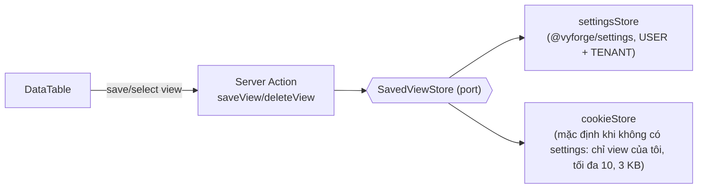
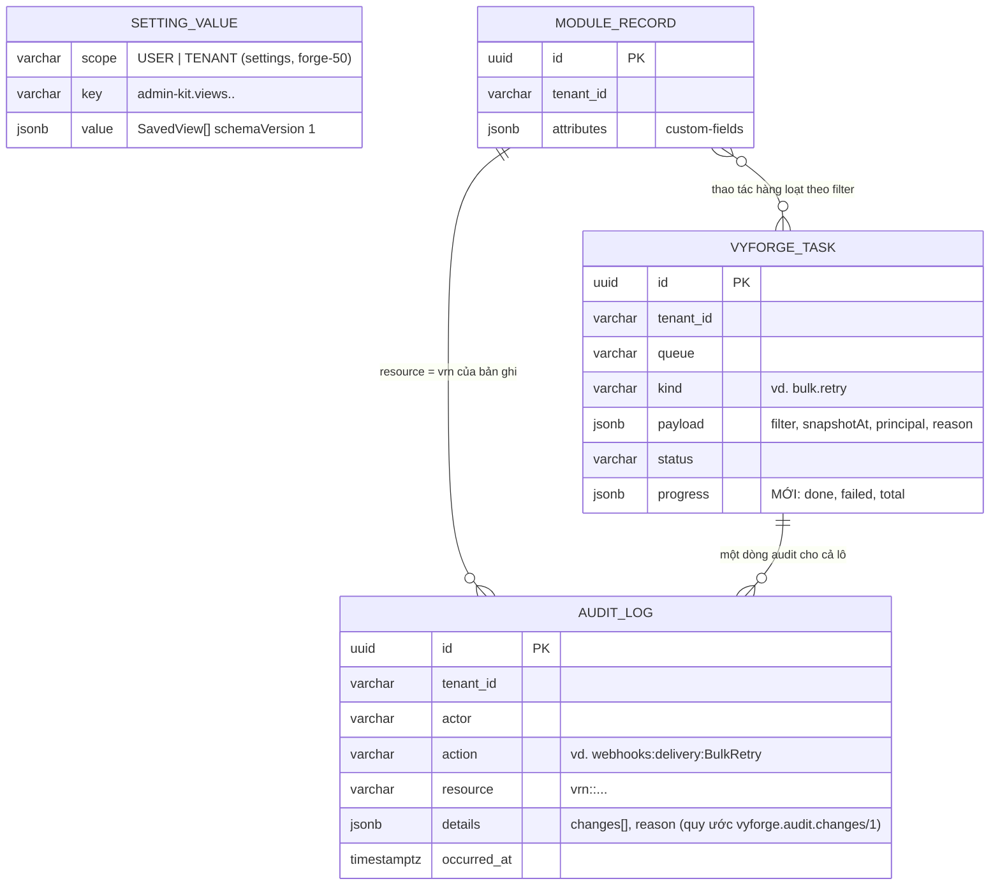
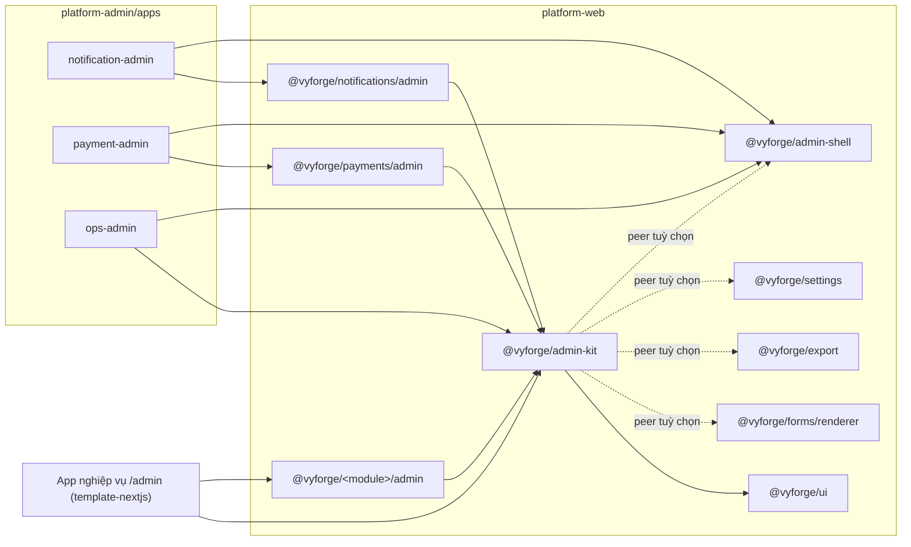

# Thiết kế: `@vyforge/admin-kit`, khối dựng màn hình quản trị dùng chung

> Trạng thái: **thiết kế, chờ duyệt** (forge-49, 27/10/2026). Nhánh `docs/design-admin-kit`.
> Theo `module-conventions.md` (mục 1–6) và kiến trúc admin microfrontend đã duyệt trong
> `docs/design/platform-services.md` (D1–D10, mục 4.7–4.12, 5.1–5.6, 6). Phạm vi lấy từ
> `docs/research/2026-10-gap-analysis.md` mục 2.1 và brief 6.1.
> Nền đã đọc trong code: `@vyforge/admin-shell` 0.1.0 (nhánh `web--shell`), template `admin-zone` của `platform-admin`
> (nhánh `admin--zones`), `@vyforge/ui` 0.4.0, `@vyforge/api-client` (`createFormAction`, `toFormErrors`),
> `PageResponse` (-web), `AuditLog`/`AuditQuery` (-audit), `TaskAdmin`/`TaskQuery` (-scheduling, 0.12.1), ví dụ
> `customer` của `template-spring-boot` và `template-nextjs`, các màn danh sách của `platform-admin/src/features`.
> Nối với thiết kế đã có: forms (forge-56, renderer `SchemaForm`), export (forge-30, `ExportButton`), jpa-extras
> (forge-57, `LocalizedText`, `searchVietnamese`, thùng rác), settings (forge-50, view đã lưu), ops-console (forge-52).

`admin-kit` là **bộ khối dựng**, không phải framework admin. Mỗi admin MFE (khoảng 25 module × hai nhóm người quản trị)
đều lặp lại cùng các mảnh: bảng danh sách có lọc và phân trang phía server, form tạo/sửa có lỗi theo field, trang chi
tiết, nút thao tác có kiểm quyền, xác nhận thao tác nguy hiểm, lịch sử thay đổi, việc nền. admin-kit làm các mảnh đó
một lần, theo đúng mô hình đã chốt (Server Component, Server Action, BFF giữ token, B13), cộng một sub-template Copier
`resource` để sinh khung CRUD đầu-cuối từ một file YAML.

## Mục lục

0. [Tóm tắt quyết định](#0-tóm-tắt-quyết-định)
1. [Bài toán và phạm vi](#1-bài-toán-và-phạm-vi)
2. [Nghiên cứu](#2-nghiên-cứu)
3. [Kiến trúc](#3-kiến-trúc)
4. [Mô hình dữ liệu](#4-mô-hình-dữ-liệu)
5. [API](#5-api)
6. [Mở rộng](#6-mở-rộng)
7. [Vận hành](#7-vận-hành)
8. [Bảo mật và tuân thủ](#8-bảo-mật-và-tuân-thủ)
9. [Kế hoạch triển khai](#9-kế-hoạch-triển-khai)
10. [Đóng gói và triển khai độc lập](#10-đóng-gói-và-triển-khai-độc-lập)
11. [Lệch quy ước, quyết định, phụ thuộc tab khác](#11-lệch-quy-ước-quyết-định-phụ-thuộc-tab-khác)
- [Phụ lục A. Nguồn đã kiểm](#phụ-lục-a-nguồn-đã-kiểm)

---

## 0. Tóm tắt quyết định

**Quyết định về module:**
- **Thêm** một package web `@vyforge/admin-kit` (platform-web). Không có admin MFE riêng, không có server riêng.
- **Không thêm** starter Java mới. Phần backend nhỏ đi vào starter có sẵn: `-web` (hợp đồng danh sách, cursor, thao tác
  hàng loạt, `allowedActions`), `-audit` (định dạng `changes`, endpoint audit theo module), `-scheduling` (endpoint việc
  nền dùng chung, chung hợp đồng với ops-console).
- **Thêm** sub-template Copier `resource` vào `template-spring-boot` và `template-nextjs` (không thêm repo).
- **Chuyển** năm component "chung" mà platform-services §6 đặt trong `@vyforge/admin-shell` (`TaskQueueTable`,
  `AuditTrail`, `SecretField`, `JsonSchemaForm`, `TenantPicker`) sang admin-kit, trừ `TenantPicker` ở lại admin-shell.
  admin-shell 0.1.0 chưa làm bốn component này, nên không phải bỏ code nào.

| # | Quyết định | Lý do ngắn |
|---|---|---|
| D1 | **Không dùng react-admin hay Refine.** Tự dựng trên TanStack Table 9 (headless), nuqs 2 (state trên URL), React Hook Form 7 + Zod 4, `@vyforge/ui` | Cả hai áp "data provider" chạy ở trình duyệt, gọi API trực tiếp từ client. Mô hình của vyforge là Server Component đọc dữ liệu ở BFF, token chỉ ở server, Server Action kiểm quyền ở đầu (B13, ADR-0006). Bọc data provider qua Server Action thì mất phần lớn giá trị của framework |
| D2 | **Dữ liệu đi một chiều: URL → Server Component → API → props.** `DataTable` là client component chỉ hiển thị và đổi URL (nuqs, `shallow: false`, `startTransition`); trang server đọc cùng bộ parser bằng `createLoader`, gọi API, truyền `rows` xuống | Một nguồn sự thật (URL), deep link và nút back đúng, F5 giữ trạng thái, không cache phía client, không lộ token. Đúng cách `platform-admin/users` đang làm bằng tay |
| D3 | **Một định nghĩa cho cả danh sách, lọc, xuất:** `defineListQuery()` sinh parser nuqs, loader server, object `filter` gửi cho API danh sách **và** cho `ExportButton` (export §5: `filter` là JSON do definition tự kiểm, cùng record với query danh sách) | Lọc khi xuất phải giống hệt lọc trên màn hình (export K1) |
| D4 | **Hai kiểu phân trang**: offset (`PageResponse` có sẵn) và cursor (`CursorPage`, mới ở -web) cho bảng lớn (log gửi 10 triệu dòng, task, audit, delivery). Cursor không đếm tổng mặc định; có `totalEstimate` tuỳ chọn | `count(*)` trên bảng chục triệu dòng mỗi lần lọc là lỗi vận hành; `TaskQuery` và các module log đã dùng keyset |
| D5 | **Không có ngôn ngữ lọc chung kiểu RSQL/JHipster Criteria trên REST.** Mỗi API danh sách nhận tham số phẳng có kiểu (`status=A&status=B&createdFrom=…`, `sort=field,dir`, `q`), backend map vào record filter + whitelist sort (`SortWhitelist`) | Lọc tuỳ ý trên mọi cột là cách nhanh nhất để có truy vấn không index và lộ cột không được phép. Tham số phẳng khớp OpenAPI, khớp `ExportDefinition.filterType()`, sinh được client có kiểu |
| D6 | **`ResourceForm` có hai chế độ, một khung**: (a) form viết bằng code: RHF + Zod, submit qua `createFormAction`; (b) form theo JSON Schema: **bọc `SchemaForm` của `@vyforge/forms/renderer`** (rjsf 6.11, validator không `eval`), không có engine thứ hai. Cả hai đổ lỗi Problem Details về field bằng cùng một hàm | forms (forge-56) đã chọn rjsf và yêu cầu admin-kit bọc; module cấu hình provider (notification, payment, files) mô tả cấu hình bằng JSON Schema |
| D7 | **Quyền theo dòng lấy từ server:** API danh sách có thể trả `allowedActions` cho từng dòng (helper `AllowedActions` ở -web gọi `Authz.allowed`). Không có thì `RowActions` gom câu hỏi `can()` theo lô (đã có trong `@vyforge/auth`), giới hạn 200 câu/trang, quá thì hỏi theo wildcard | 50 dòng × 6 thao tác = 300 câu hỏi IAM mỗi lần mở trang; server tính ngay khi đọc dòng rẻ hơn nhiều |
| D8 | **Thao tác hàng loạt** theo hợp đồng chung `POST …/bulk/{op}` nhận `ids` **hoặc** `filter` + `expectedCount`. Từ 500 dòng trở lên, hoặc khi chọn "mọi dòng khớp bộ lọc", backend tạo một việc `DurableTaskQueue` và trả `202` + `taskId`; giao diện theo dõi bằng `TaskMonitor` | Không giữ request HTTP vài phút; retry/cancel/audit đã có sẵn ở `vyforge_task` |
| D9 | **`AuditTimeline` đọc endpoint audit của chính module** (`{api.base}/admin/audit?resource=`), helper `ModuleAuditEndpoint` ở -audit giới hạn tiền tố `vrn:<service>:`. Chi tiết thay đổi theo quy ước `details.changes[]` (`field`, `from`, `to`, `masked`) | Ở `platform-services` mọi module chung bảng `audit_log`; route `/api/v1/audit-log` qua gateway không biết module nào. Quy ước `changes` để mọi module hiện diff giống nhau |
| D10 | **`TaskMonitor` đọc endpoint việc nền chung** `{api.base}/admin/tasks/**` do helper `TaskAdminEndpoint` ở -scheduling phục vụ (module chỉ khai báo queue và action). Hợp đồng này cũng là API theo module của ops-console | Platform-services §6 có 6 module cần màn "việc nền queue X"; mỗi module viết lại controller là lặp |
| D11 | **Trang mẫu (page template) là Server Component**: `ResourceListPage`, `ResourceDetailPage`, `ResourceFormPage` nhận `access` từ `requireModuleAccess()` của admin-shell; cột, bộ lọc, thao tác có `audience` (`operator`/`tenant`) và `permission` | Một trang phục vụ hai nhóm người quản trị (platform-services D6); không màn hình nào giả định quyền xuyên tenant |
| D12 | **View đã lưu** (cột, thứ tự, bộ lọc, mật độ) qua port `SavedViewStore`: adapter `settings` (forge-50, phạm vi USER và TENANT) khi có, adapter cookie khi không có. admin-kit **không có bảng** | Settings đã nhận "view đã lưu của DataTable" trong phạm vi; không tạo kho thứ hai |
| D13 | **Sub-template Copier `resource`**: YAML mô tả một resource → entity, Flyway, Specification, service, controller, action IAM, test; trang list/detail/form, schema Zod, message vi/en. Chạy bằng `copier copy --data-file`, mỗi resource một answers file để `copier update` được. YAML **chỉ dùng lúc sinh code**, không đọc lúc chạy | Học JDL của JHipster nhưng gọn, và tránh DSL low-code (brief). Code sinh ra thuộc về dự án |
| D14 | **Bộ lọc nhạy cảm không lên URL.** Bộ lọc có `sensitive: true` (số điện thoại, email, CCCD, mã số thuế cá nhân) giữ ở state trong trang và gửi bằng POST `…/search`; URL chỉ có `?sq=<id ngắn>` trỏ vào cache server 15 phút | Truy vấn trên URL vào access log, lịch sử trình duyệt, header Referer: lộ dữ liệu cá nhân (Luật 91/2025, mục 8) |

---

## 1. Bài toán và phạm vi

### 1.1 Use case

**Hiện tại.** `platform-admin` có 8 khu (users, roles, clients, tenants, IdP, IAM, audit, settings). Mỗi trang danh sách
tự viết: đọc `searchParams`, đổi trang 1-based sang 0-based, form `GET` có ô tìm, `EmptyState`, `Pagination` với link,
bảng `Table` của `@vyforge/ui`. Không có lọc nhiều điều kiện, sắp xếp theo cột, chọn cột, chọn dòng, thao tác hàng
loạt, xuất, view đã lưu. 6 module P1 đã thiết kế và 12 module đợt sau đều liệt kê màn hình kiểu này (platform-services
§6: hơn 70 màn hình). Không có admin-kit, mỗi phiên module tự viết lại, và mỗi bảng sẽ khác nhau về hành vi lẫn
lỗi bảo mật (PII trên URL, quyền theo dòng, tenant).

**Tương lai.** Dự án khách hàng (CRM, HRM, kho) sinh trang quản trị cho entity của mình bằng sub-template `resource`,
dùng cùng component. Tenant admin của khách thêm trường tuỳ biến (custom-fields) và thấy cột mới trong bảng mà không ai
sửa code. Dự án lớn thêm bảng ảo cuộn vô hạn, chỉnh sửa trong ô, nhóm theo cột.

### 1.2 Kịch bản nghiệp vụ phải đáp ứng

| # | Kịch bản | Đòi hỏi | Ở đâu |
|---|---|---|---|
| K1 | **Nhật ký gửi thông báo 10 triệu dòng** của tenant: lọc kênh (email, SMS brandname, Zalo ZNS), trạng thái, khoảng ngày, provider; sắp theo thời gian; mở chi tiết; xuất Excel đúng bộ lọc | Cursor, không `count(*)`; lọc trên URL; xuất cùng `filter` | §3.3, §5.2 |
| K2 | **Giao dịch thanh toán**: kế toán tenant (chỉ có `payment:intent:List`, `payment:refund:Create`) thấy bảng, nút "Hoàn tiền" chỉ hiện ở giao dịch đủ điều kiện và khi có quyền; hoàn tiền đòi MFA | `allowedActions` theo dòng, `requireStepUp` | §3.5, §5.1 |
| K3 | **Webhook bị tắt hàng loạt** sau sự cố của đối tác: chọn mọi delivery `FAILED` trong 2 giờ qua (35.000 dòng, nhiều trang) → "Gửi lại"; theo dõi tiến độ; huỷ giữa chừng | Chọn theo bộ lọc, `expectedCount`, việc nền, `TaskMonitor` | §3.6 |
| K4 | **Người vận hành** mở khu "Thông báo" ở chế độ operator: thấy thêm cột `tenant`, bộ lọc theo tenant, mục "Mặc định platform". Tenant admin mở cùng trang (cùng image MFE) không thấy các phần đó | `audience` trên cột/bộ lọc/thao tác | §3.5 |
| K5 | **Cấu hình nhà cung cấp SMS brandname** (Viettel, VNPT, FPT…) có form khác nhau theo provider, mô tả bằng JSON Schema của adapter; khoá API là secret chỉ ghi | `ResourceForm` chế độ schema + `SecretField` | §3.4 |
| K6 | **Tạo khách hàng** trong CRM: mã khách hàng trùng → backend trả `409 crm.customer.code_taken` với `errors[].field = code`; ô "Mã" đỏ, thông báo vi/en, giữ dữ liệu đã nhập | Map Problem Details → field | §3.4 |
| K7 | **Tìm khách hàng theo tên không dấu** ("nguyen van a" ra "Nguyễn Văn A"), tên đa ngôn ngữ (`LocalizedText`) hiện theo locale, sắp theo collation tiếng Việt | Tích hợp `searchVietnamese`, `LocalizedText` (jpa-extras) | §3.3 |
| K8 | **CSKH tìm khách theo số điện thoại** `0912…`: số không được xuất hiện trên URL, log của ingress/gateway hay lịch sử trình duyệt | Bộ lọc `sensitive` (D14) | §8.2 |
| K9 | **Xoá endpoint webhook** đang có 3 subscription: hộp xác nhận bắt gõ lại tên endpoint, nêu hậu quả; ghi audit có lý do | `ConfirmDangerDialog` | §3.7 |
| K10 | **Kiểm toán hỏi "ai đổi hạn mức tín dụng của khách X ngày nào"**: tab "Lịch sử" ở trang chi tiết hiện dòng thời gian thay đổi theo field (giá trị cũ → mới), che giá trị PII | `AuditTimeline` + `details.changes` | §3.8 |
| K11 | **Cổng ZNS lỗi 2 giờ**: 50.000 việc `DEAD` ở queue `notification`; tenant admin thấy backlog và retry toàn bộ việc của tenant mình; người vận hành dùng ops-console cho mọi tenant | `TaskMonitor`, hợp đồng `/admin/tasks` chung với ops-console | §3.9 |
| K12 | **Khách A thêm trường "Mã khách hàng cũ"** (custom-fields): cột hiện trong bảng, lọc được nếu đánh dấu "lọc được", form có ô mới, không deploy lại | Cột và field động lúc chạy | §6.3 |
| K13 | **Nhân viên kinh doanh lưu view "Khách VIP Hà Nội"** (lọc tỉnh = Hà Nội, hạng = VIP, cột rút gọn); trưởng nhóm chia sẻ view cho cả tenant | `SavedViewStore` (settings) | §3.10 |
| K14 | **Dự án mới sinh trang quản trị "Hợp đồng"** (12 field, quan hệ tới Khách hàng, trạng thái, file đính kèm, số hợp đồng tự sinh) trong 10 phút, build xanh, có test | Sub-template `resource` | §6.5 |
| K15 | **Danh mục tỉnh/xã sau sắp xếp đơn vị hành chính 2025** (34 tỉnh, khoảng 3.300 xã): chọn tỉnh → xã trong form, ô chọn có tìm không dấu và tải theo trang | `ReferenceSelect` + master-data | §3.4 |
| K16 | **Tiền VND, ngày dd/MM/yyyy, giờ Asia/Ho_Chi_Minh** ở bảng và form; xuất Excel giữ kiểu số; bản tiếng Anh hiện `en-US` | Bộ định dạng cell theo locale/timezone | §3.3 |
| K17 | **Nâng MFE files lên 0.14 trong khi backend 0.13**: cột "Legal hold" cần capability `legal-hold`; bảng tự ẩn cột, không lỗi | `requires` theo capability trên cột/thao tác | §3.5 |
| K18 | **Màn hình đọc được bằng trình đọc màn hình và bàn phím** (cơ quan nhà nước yêu cầu tiếp cận): sắp xếp có `aria-sort`, chọn dòng bằng phím cách, thông báo khi tải xong | a11y | §3.3 |

### 1.3 Không thuộc phạm vi

| Không làm | Thuộc về |
|---|---|
| Khung trang, menu, đăng nhập, CSP, registry, chọn tenant đang xem | `@vyforge/admin-shell` (platform-services D4) |
| Renderer JSON Schema, builder form | `@vyforge/forms` (forge-56) |
| Định nghĩa trường tuỳ biến | `custom-fields` (đợt C) |
| Màn hình vận hành xuyên tenant (mọi queue, outbox, DLT) | ops-console (forge-52), dùng lại `TaskMonitor` |
| Lưu cài đặt và view | settings (forge-50) |
| Dashboard, biểu đồ BI | analytics (đợt C); admin-kit chỉ có `StatCard` sẵn trong `@vyforge/ui` |
| **DSL low-code**, trình dựng màn hình kéo thả, định nghĩa resource đọc lúc chạy | Không làm (brief, MODULE_PLAN "Không làm": framework admin chung) |
| Chỉnh sửa trong ô (inline edit), nhóm theo cột, cuộn ảo vô hạn | Để bản sau (§9.4) |

---

## 2. Nghiên cứu

Nguồn kiểm ngày 27/10/2026: version và ngày phát hành lấy từ npm registry (`registry.npmjs.org/<pkg>`), GitHub API
(`gh api repos/<repo>`, `.../releases/latest`), PyPI. Tài liệu đọc trực tiếp ở trang chính thức (Phụ lục A).

### 2.1 Framework admin và trình sinh CRUD

| Hệ thống | Version, license | Mô hình | Điểm mạnh | Điểm yếu với vyforge |
|---|---|---|---|---|
| **react-admin** (Marmelab) | 5.15.5 (19/10/2026), MIT; 27k sao | `<Admin>` + `<Resource>`; mọi I/O qua `dataProvider` với 9 hàm (`getList`, `getOne`, `getMany`, `getManyReference`, `create`, `update`, `updateMany`, `delete`, `deleteMany`); `getList({pagination:{page,perPage}, sort:{field,order}, filter, meta})` → `{data,total}` hoặc `pageInfo`. Bộ component List/Datagrid/Edit/Show/Filter, `<ReferenceInput>` | Mô hình resource rõ, hợp đồng 9 hàm dễ nhớ; filter trên URL; quyền qua `authProvider.canAccess`; undo optimistic | Chạy ở client, gọi API từ trình duyệt (token phải xuống client hoặc proxy); tài liệu `dataProvider` không đề cập RSC; giao diện Material UI (khác `@vyforge/ui`); phần "Enterprise Edition" thương mại (audit log, RBAC chi tiết) |
| **Refine** | `@refinedev/core` 5.0.12 (02/04/2026), MIT; 36k sao; repo push gần nhất 10/09/2026 | Headless; `dataProvider` (`getList`, `getOne`, `create`, `update`, `deleteOne`, `getApiUrl` bắt buộc; `getMany`, `createMany`, `updateMany`, `deleteMany`, `custom` tuỳ chọn); `getList({resource, pagination:{currentPage,pageSize}, sorters, filters, meta})`; filter có toán tử và nhóm `and/or`; `@refinedev/react-table` bọc TanStack Table | Headless thật, dùng được với shadcn; hook `useTable` đồng bộ URL; toán tử filter phong phú | Nhịp phát hành chậm (bản core cuối 04/2026); vẫn là mô hình data provider phía client; lớp trừu tượng dày cho thứ ta đã có (openapi-fetch + Server Action) |
| **JHipster** | `generator-jhipster` 9.4.0 (18/09/2026), Apache-2.0 | **JDL**: `entity Customer(customer_table) { name String required minlength(3) }`, quan hệ, option `paginate … with pagination\|infinite-scroll`, `dto … with mapstruct`, `service … with serviceClass`, `filter`, `search`, `readOnly`, `skipClient`. Sinh entity, Liquibase, repository, service, REST, test, trang Angular/React/Vue. Lọc: `xyz.equals`, `xyz.in`, `xyz.specified`, `xyz.contains`, `greaterThan`… qua `EntityCriteria` + `EntityQueryService` | Sinh đầu-cuối đã chứng minh qua 10 năm; validation khai báo một chỗ; "bạn sở hữu code sinh ra" | Sinh quá nhiều (DTO, mapper, service impl) cho dự án nhỏ; Criteria cho phép lọc mọi field (truy vấn không index); Liquibase (vyforge dùng Flyway); cập nhật lại sau khi sửa tay thì xung đột |
| **Frappe Framework** | v16.53.0 (22/10/2026), MIT | DocType là metadata đọc lúc chạy: field, quyền, list view, form layout. Tuỳ biến theo site không sửa code: **Customize Form** ghi `Property Setter` (ghi đè thuộc tính) và `Custom Field` (thêm field); Links/Actions từ v13 | Tuỳ biến theo khách hàng mà không fork; list view, filter, report tự có | Là low-code đầy đủ (metadata lúc chạy): đúng thứ brief bảo không làm. Học **ý** "ghi đè thuộc tính hiển thị theo tenant" cho cột và field tuỳ biến (§6.3) |
| **ABP Framework** | 10.7.0 (06/10/2026), LGPL-3.0 (gói UI Angular cũng LGPL-3.0) | Module mang trang CRUD; ứng dụng mở rộng trang của module mà không sửa module: `EntityProp`/`EntityPropList` (thêm, bớt, đổi thứ tự cột qua contributor: `addAfter`, `dropByValue`…), entity action, form prop extension; đăng ký bằng `createRoutes({ entityPropContributors })`. Có `permission`, `visible`, `columnVisible` | Đúng bài toán "module dựng sẵn trang, dự án mở rộng" | Angular; LGPL; contributor chạy trong cùng bundle, nên chỉ hợp khi trang nằm trong app (không hợp MFE build sẵn) |
| **tablecn** (data table cho shadcn) | MIT; 6,4k sao; push 23/10/2026 | Ví dụ tham chiếu Next.js + TanStack Table + **nuqs** + Zod: lọc/sắp/phân trang phía server, bộ lọc sinh từ định nghĩa cột, thanh thao tác khi chọn dòng, lọc nâng cao kiểu Notion | Gần nhất với stack của vyforge; xác nhận hướng TanStack + nuqs là thực tế | Là mã mẫu để chép, không phải thư viện; dùng TanStack DB và Drizzle ở server (vyforge gọi API Spring) |

### 2.2 Thư viện nền

| Thư viện | Version, ngày, license | Dùng cho | Ghi chú đã kiểm |
|---|---|---|---|
| `@tanstack/react-table` | **9.3.1** (12/10/2026), MIT | `DataTable` headless | v9 đổi lớn so với v8: hook `useTable` (thay `useReactTable`), **bắt buộc khai báo `features`** bằng `tableFeatures({ rowSortingFeature, rowPaginationFeature, columnVisibilityFeature, rowSelectionFeature, columnOrderingFeature, columnPinningFeature, columnSizingFeature, … })` để tree-shake; `createColumnHelper<typeof features, Row>()`; `manualPagination/manualSorting/manualFiltering`; state trên TanStack Store (`table.Subscribe`, `table.atoms`), chạy đúng dưới React Compiler; còn `useLegacyTable` (deprecated) để chuyển dần. admin-kit viết thẳng v9, không dùng `stockFeatures` |
| `nuqs` | **2.10.2** (08/10/2026), MIT | State lọc/sắp/trang trên URL | `useQueryStates` ở client; `createLoader` (từ 2.3.0, có `strict` từ 2.5.0) và `createSearchParamsCache` ở `nuqs/server`; `createSerializer` để dựng link; option `shallow: false` để Server Component render lại, `startTransition` cho trạng thái đang tải, `limitUrlUpdates: debounce(ms)` cho ô tìm (thay `throttleMs`, deprecated từ 2.5.0), `clearOnDefault` mặc định `true` |
| `react-hook-form` | **7.91.0** (23/10/2026), MIT | `ResourceForm` chế độ code | |
| `@hookform/resolvers` | **6.0.0** (19/10/2026), MIT | Zod/Standard Schema resolver | Hỗ trợ `zod` (cả `zod/v4`) và `standard-schema`; lưu ý kiểu input/output khi schema có `.default()` |
| `zod` | 4.6.7 (đã dùng trong platform-web) | Schema | Standard Schema, khớp `createFormAction` |
| `@rjsf/core`, `@rjsf/utils` | 6.11.0 (29/09/2026), Apache-2.0 | Gián tiếp qua `@vyforge/forms/renderer` | admin-kit không phụ thuộc trực tiếp |
| `@tanstack/react-virtual` | 3.14.23 (26/10/2026), MIT | **Không dùng ở bản đầu** | Bảng phân trang tối đa 200 dòng không cần ảo hoá |
| `cmdk` | 1.1.1 (14/03/2025), MIT | Không dùng | Bản cuối đã 19 tháng; ô chọn có tìm dựng trên `Popover` + `Command` tự viết trên Radix (đã có `radix-ui` 1.8.1) |
| Copier | **9.19.1** (13/10/2026), MIT | Sub-template `resource` | `--data-file <yaml>` (nạp câu trả lời từ YAML), `-a/--answers-file` (một answers file cho mỗi lần áp template, để `copier update -a …` riêng), `_subdirectory` có thể template hoá, câu hỏi `type: yaml`. Không có vòng lặp sinh nhiều bản từ một lần chạy: mỗi resource một lần `copier copy` |

### 2.3 Học theo và không làm

| Học theo | Từ | Cách làm ở admin-kit |
|---|---|---|
| Hợp đồng resource gọn (list/get/create/update/delete/many) | react-admin, Refine | `AdminResource` khai báo cột, bộ lọc, thao tác; các hàm gọi API là Server Action/Server function của module, không phải data provider phía client |
| Lọc, sắp, trang trên URL | react-admin, Refine `syncWithLocation`, tablecn | nuqs, một bộ parser dùng ở cả client và server |
| Bộ lọc sinh từ định nghĩa cột | tablecn | `filters` khai báo cạnh `columns`; kiểu bộ lọc (`text`, `select`, `multiSelect`, `dateRange`, `numberRange`, `boolean`, `reference`) chọn UI tự động |
| Validation khai báo một lần, sinh cả backend và frontend | JHipster JDL | YAML của sub-template: `required`, `max`, `pattern`, `unique` → Bean Validation + Zod + ràng buộc DB |
| "Code sinh ra thuộc về bạn" | JHipster | Sinh một lần, sửa tay thoải mái; `copier update` chỉ để lấy cải tiến của template, có xung đột thì giải như git |
| Mở rộng trang của module mà không fork | ABP entity prop/action extension | `extendResource()` ở chế độ trang nhúng (§6.2); trong MFE build sẵn thì mở rộng bằng dữ liệu (custom-fields) |
| Ghi đè thuộc tính hiển thị theo site | Frappe Property Setter | Ghi đè nhãn/ẩn/thứ tự cột theo tenant lưu trong settings, không sửa code (§6.3, bản sau) |

| Không làm | Lý do |
|---|---|
| Data provider phía client | Trái B13/ADR-0006 (token ở server, quyền ở đầu Server Action) |
| Lọc tuỳ ý trên mọi field (Criteria, RSQL, `filter=json`) | Truy vấn không index, lộ cột không được phép; khó kiểm `requiredAction` theo cột |
| Metadata resource đọc lúc chạy (DocType) | Là low-code; brief cấm |
| Optimistic update + undo kiểu react-admin | Thao tác quản trị cần kết quả thật từ server (audit, quyền). Dùng toast + `revalidatePath` |
| Material UI, Ant Design | Đã có `@vyforge/ui` (Radix + Tailwind 4) |

---

## 3. Kiến trúc

### 3.1 Thành phần

```mermaid
flowchart TB
  subgraph Zone["Admin MFE <module>-admin (hoặc trang /admin của app)"]
    P["page.tsx (Server Component)<br/>requireModuleAccess() → loader → API → props"]
    A["actions.ts (Server Action)<br/>createResourceAction / createBulkAction"]
  end
  subgraph Kit["@vyforge/admin-kit"]
    direction TB
    Q["/query: defineListQuery · parsers nuqs · createLoader<br/>(dùng ở server và client)"]
    R["/resource: defineAdminResource · column/filter/action builders · extendResource"]
    T["/table (client): DataTable · FilterBar · ColumnPicker · BulkBar · RowActions · SavedViews"]
    F["/form: ResourceForm (RHF+Zod | SchemaForm) · SecretField · ReferenceSelect · LocalizedTextField (từ @vyforge/ui)"]
    V["/detail: DetailView · DetailSection · FieldValue"]
    G["/server: PermissionGate · ResourceListPage · ResourceDetailPage · ResourceFormPage<br/>createResourceAction · createBulkAction · loadAllowed"]
    W["/widgets: ConfirmDangerDialog · AuditTimeline · TaskMonitor · StatusBadge · EmptyState preset"]
    M["/messages: vi, en"]
  end
  subgraph Deps["Package có sẵn"]
    UI["@vyforge/ui"]
    AC["@vyforge/api-client<br/>createFormAction · toFormErrors · applyFormErrors"]
    AU["@vyforge/auth (can, canAll)"]
    SH["@vyforge/admin-shell<br/>requireModuleAccess · ModuleAccess · AdminFrame"]
    FO["@vyforge/forms/renderer (SchemaForm)"]
    EX["@vyforge/export (ExportButton)"]
    I18N["@vyforge/i18n (errorTranslator)"]
  end
  subgraph BE["Backend của module (starter nhúng hoặc platform-services)"]
    L["GET /admin/<res>?… → PageResponse | CursorPage<br/>(+ allowedActions)"]
    B["POST /admin/<res>/bulk/{op} → BulkResult | 202 taskId"]
    AUD["GET /admin/audit (ModuleAuditEndpoint, -audit)"]
    TSK["/admin/tasks/** (TaskAdminEndpoint, -scheduling)"]
  end
  P --> Q & R & G
  P --> T & V
  A --> G
  T --> UI
  F --> AC & FO & UI
  G --> SH & AU & AC
  T -.ExportButton.-> EX
  W --> UI
  P -- "Bearer (BFF)" --> L & AUD & TSK
  A -- "Bearer (BFF)" --> B
```



Ranh giới với admin-shell: admin-shell lo **khung và quyền vào cửa** (zone, đăng nhập, `requireModuleAccess`,
`requireStepUp`, `AdminFrame`, `TenantPicker`, manifest). admin-kit lo **nội dung trong khung**. admin-kit không đọc
cookie, env hay token: mọi thứ cần thì nhận qua tham số (đúng điều 1 của platform-services §4.12).

### 3.2 Subpath và môi trường chạy

| Subpath | Chạy ở | Nội dung |
|---|---|---|
| `@vyforge/admin-kit` | dùng chung (không JSX client) | Kiểu: `AdminResource`, `ColumnDef`, `FilterDef`, `ActionDef`, `ListResult`, `BulkResult`, `SavedView`; `defineAdminResource`, `defineListQuery` |
| `@vyforge/admin-kit/query` | server + client | Parser nuqs, `createListLoader`, `toApiQuery`, `toExportFilter`, `serializeListQuery` |
| `@vyforge/admin-kit/table` | client (`'use client'`) | `DataTable`, `FilterBar`, `ColumnPicker`, `BulkBar`, `RowActions`, `SavedViewMenu`, `DataTableSkeleton` |
| `@vyforge/admin-kit/form` | client | `ResourceForm`, `SecretField`, `ReferenceSelect`, `useResourceForm`, `applyProblem` |
| `@vyforge/admin-kit/detail` | Server Component được | `DetailView`, `DetailSection`, `FieldValue`, `DetailActions` |
| `@vyforge/admin-kit/widgets` | client | `ConfirmDangerDialog`, `AuditTimeline`, `TaskMonitor`, `StatusBadge`, `CopyableId` |
| `@vyforge/admin-kit/server` | server-only | `PermissionGate`, `ResourceListPage`, `ResourceDetailPage`, `ResourceFormPage`, `createResourceAction`, `createBulkAction`, `createTaskActions`, `createAuditLoader`, `loadAllowed`, `createSavedViewStore` |
| `@vyforge/admin-kit/messages` | — | `adminKitMessages.vi`, `.en` (namespace `AdminKit`) |
| `@vyforge/admin-kit/testing` | test | `renderDataTable`, fixture `PageResponse`/`CursorPage`, MSW handler cho `/admin/tasks`, `/admin/audit` |

### 3.3 `DataTable`: luồng chính

```mermaid
sequenceDiagram
  autonumber
  actor U as Người dùng
  participant DT as DataTable (client)
  participant N as nuqs (URL)
  participant P as page.tsx (Server Component)
  participant L as listQuery.loader
  participant API as Backend module
  U->>DT: chọn lọc "status = FAILED", sắp "createdAt desc"
  DT->>N: setQuery({status:[FAILED], sort:"createdAt.desc", page:0}) (shallow:false, startTransition)
  N->>P: điều hướng mềm, searchParams mới
  P->>P: requireModuleAccess(manifest) (B13)
  P->>L: loader(searchParams) → ListQuery có kiểu (strict)
  L-->>P: {filter:{status:[FAILED]}, sort:[createdAt,desc], page:0, size:50}
  P->>API: GET /api/v1/notifications/admin/messages?status=FAILED&sort=createdAt,desc&size=50
  API-->>P: CursorPage {content, next, totalEstimate} + allowedActions/dòng
  P-->>DT: props rows, page, allowed (RSC payload)
  DT-->>U: bảng mới; isPending=false; aria-live "Đã tải 50 dòng"
```

Quy tắc:

- **URL là nguồn sự thật** của trang, cỡ trang, sắp xếp, bộ lọc thường, view đang chọn, ô tìm `q`. Trang trên URL bắt
  đầu từ 1 (người đọc), API bắt đầu từ 0 (`PageResponse`); loader đổi, giống `platform-admin/users` hiện nay.
- **Cột hiển thị, thứ tự, độ rộng, mật độ** không lên URL: giữ trong view đã lưu (§3.10) để URL ngắn và chia sẻ link
  không áp sở thích cá nhân lên người khác.
- Đổi bộ lọc thì về trang đầu; đổi cỡ trang thì về trang đầu. Ô tìm debounce 300 ms (`limitUrlUpdates: debounce(300)`).
- `startTransition` cho cờ `isPending`: bảng mờ đi và hiện thanh tiến trình mỏng, không thay bằng skeleton (giữ vị trí
  cuộn). Lần đầu vào trang dùng `loading.tsx` với `DataTableSkeleton`.
- **Trạng thái**: đang tải (skeleton/pending), rỗng không lọc (`EmptyState` có nút tạo nếu có quyền), rỗng do lọc
  (gợi ý xoá lọc), lỗi (Problem Details dịch theo `code`, nút thử lại gọi `router.refresh()`), backend cũ không có
  capability (cột ẩn, banner từ admin-shell).
- **Cursor**: `CursorPage` có `next` (chuỗi mờ) và `prev` tuỳ chọn; URL giữ `cursor`. Nút "Trang sau/Trang trước",
  không có số trang. `totalEstimate` (nếu backend trả) hiện dạng "khoảng 1,2 triệu dòng".
- **Định dạng ô theo kiểu** (`cell: 'money' | 'date' | 'datetime' | 'relative' | 'enum' | 'badge' | 'localized' |
  'user' | 'reference' | 'bytes' | 'boolean' | 'id'`): dùng `useFormatter` của next-intl, `timeZone` mặc định
  `Asia/Ho_Chi_Minh` (lấy từ settings của tenant khi có), tiền VND không có số lẻ, ngày `dd/MM/yyyy` ở `vi`.
  `localized` dùng `pickLocalized` (jpa-extras D2).
- **a11y**: `<table>` thật (`@vyforge/ui` `Table`), nút sắp xếp trong `<th>` có `aria-sort`, ô chọn dòng là `Checkbox`
  có nhãn "Chọn dòng {tên}", vùng `aria-live="polite"` thông báo khi tải xong hoặc khi thao tác hàng loạt xong, focus
  trở về nút đã bấm sau khi đóng dialog. Trên điện thoại, bảng cuộn ngang trong `Card`, cột đầu được ghim.

### 3.4 `ResourceForm` và lỗi theo field

Hai chế độ, một khung (`ResourceForm` cung cấp layout section, nút lưu/huỷ, cảnh báo rời trang khi có thay đổi, lỗi
`_form` ở đầu form, chặn bấm hai lần):

| | Chế độ code (mặc định) | Chế độ schema |
|---|---|---|
| Khi nào | Entity của module/dự án, field biết lúc viết code | Cấu hình provider/adapter, field do plugin hoặc tenant định nghĩa (K5, K12) |
| Định nghĩa | Zod schema + danh sách `fields` (`FieldDef`: name, label, widget, section, `audience`, `permission`) | JSON Schema + UI schema từ backend (vd. `providerType.settingsSchema`) |
| Render | RHF + component `@vyforge/ui` (`FormField`, `Input`, `Select`, `Checkbox`, `Textarea`), `LocalizedTextField` (jpa-extras), `ReferenceSelect`, `SecretField`, `MoneyInput` | `SchemaForm` của `@vyforge/forms/renderer` (rjsf + theme `@vyforge/ui` + `SafeValidator`), widget `secret` map sang `SecretField` |
| Kiểm ở client | `zodResolver` (`@hookform/resolvers/zod`) | `SafeValidator` (không `eval`, CSP giữ nguyên) |
| Submit | Server Action từ `createResourceAction` (bọc `createFormAction`: authorize → validate Zod → handler → Problem Details) | Cùng Server Action; payload là JSON (`formData.get('$json')`), server kiểm lại bằng networknt (forms) |
| Lỗi field | `applyProblem(form, state)` → `setError(field)` (bọc `applyFormErrors` có sẵn) | `errors[].field`/`pointer` → `extraErrors` của rjsf (forms §6.7) |

Map Problem Details (RFC 9457, định dạng của `platform-starter-web`):

| Backend trả | Form hiện |
|---|---|
| `400/422` có `errors[] {field, code, message}` | Lỗi dưới từng ô, dịch theo `code` bằng `errorTranslator` (`@vyforge/i18n`); field lồng `items[2].qty` hoặc `pointer` `/items/2/qty` đổi về đường dẫn RHF `items.2.qty` |
| `409` có `code` và `errors[].field` (trùng mã, K6) | Lỗi ở field đó |
| `409 *.version_conflict` (optimistic lock, `@Version`) | Banner "Bản ghi đã bị người khác sửa" + nút "Tải lại" (giữ bản đang nhập để so sánh) |
| `403`, `404` | Lỗi `_form` dịch theo `code`; không lộ chi tiết |
| `5xx`, lỗi mạng | Lỗi `_form` chung + `requestId` để báo hỗ trợ |

Field nhạy cảm (`password|secret|token`, và field khai báo `sensitive`) không được trả lại trong `state.values` khi lỗi
(quy tắc đã có của `createFormAction`). `SecretField` chỉ ghi: hiện "Đã đặt • cập nhật 12/10/2026", nút "Thay", không bao
giờ nhận giá trị cũ từ API (backend trả `{ set: true, updatedAt }`).

`ReferenceSelect` (chọn bản ghi khác, K15): nhận Server Function `search(q, cursor)` và `resolve(ids)`; hiện nhãn
`LocalizedText` theo locale; tìm không dấu do backend lo (`searchVietnamese`); tải theo trang 20 mục; chọn nhiều có
giới hạn. Dùng cho master-data (tỉnh, xã, ngân hàng), user (danh bạ auth-server), bản ghi cùng module.

### 3.5 Quyền, chế độ và capability trên cột/thao tác

Mỗi `ColumnDef`, `FilterDef`, `ActionDef`, `FieldDef` có thể khai báo:

| Thuộc tính | Ý nghĩa | Ai kiểm |
|---|---|---|
| `audience?: 'operator' \| 'tenant'` | Chỉ hiện ở một chế độ (K4) | Trang server, theo `access.mode` |
| `permission?: { action, resource? }` | Cần quyền mới hiện (cột nhạy cảm, nút) | Trang server: `can()` theo lô |
| `requires?: string` (capability) | Cần backend có capability (`GET /admin/info`, platform-services §4.10) (K17) | Trang server |
| `rowPermission?: string` (thao tác) | Action IAM áp trên VRN của dòng | `row.allowedActions` hoặc `can()` theo lô |
| `when?: (row) => boolean` (thao tác) | Điều kiện nghiệp vụ (vd. chỉ giao dịch `SUCCEEDED` mới hoàn tiền được) | Client, chỉ để ẩn |
| `stepUp?: true` (thao tác) | Đòi MFA (`requireStepUp`) | Server Action |
| `danger?: { confirm: 'type-name' \| 'type-count' \| 'simple' }` | Qua `ConfirmDangerDialog` | Client + server ghi lý do |

Trang server lọc định nghĩa **trước** khi gửi xuống client (`resolveResource(resource, access, info)`), nên client không
nhận cột hoặc thao tác người dùng không được thấy. Ẩn chỉ là giao diện; backend vẫn kiểm từng thao tác (B13).

`PermissionGate` (Server Component): `<PermissionGate access={access} action="…" resource="…" fallback={…}>`. Không có
bản client: quyết định hiển thị luôn có ở server.

### 3.6 Thao tác hàng loạt

```mermaid
sequenceDiagram
  autonumber
  actor U as Tenant admin
  participant DT as DataTable + BulkBar
  participant SA as Server Action (createBulkAction)
  participant API as Backend (BulkEndpoint)
  participant Q as DurableTaskQueue
  participant TM as TaskMonitor
  U->>DT: chọn "mọi 35.214 dòng khớp bộ lọc" → "Gửi lại"
  DT->>U: ConfirmDangerDialog (gõ 35214, nhập lý do)
  U->>DT: xác nhận
  DT->>SA: retry({filter, expectedCount:35214, reason})
  SA->>SA: requireModuleAccess + can(webhooks:delivery:Retry)
  SA->>API: POST /admin/deliveries/bulk/retry {filter, expectedCount, reason} Idempotency-Key
  API->>API: đếm lại theo filter; lệch > 1% hoặc vượt maxItems → 409 bulk.count_changed
  API->>Q: enqueue(queue=webhooks, kind=bulk.retry, payload={filter, snapshotAt})
  API-->>SA: 202 {taskId, accepted: 35214}
  SA-->>DT: toast "Đang xử lý" + link
  DT->>TM: TaskMonitor(taskId) poll 2 giây (tối đa 10 phút, rồi 15 giây)
  TM-->>U: 12.000/35.214 · lỗi 3 · nút Huỷ
```

- Chọn theo trang (`ids`, tối đa 500) hay "mọi dòng khớp bộ lọc" (`filter` + `expectedCount`). Chế độ thứ hai chỉ có khi
  thao tác khai báo `bulk: { byFilter: true }` và backend có endpoint.
- `< 500` id: backend xử lý đồng bộ, trả `BulkResult { succeeded, failed: [{id, code}] }` (không bỏ dở cả lô vì một
  dòng lỗi). Từ 500, hoặc theo bộ lọc: việc nền; handler báo tiến độ vào cột mới `vyforge_task.progress` (§4.1).
- Việc nền xử lý theo lô 200, mỗi lô một transaction, kiểm quyền theo từng dòng bằng `Authz.allowed` với principal của
  người yêu cầu (lưu trong payload: `sub`, `roles`, `tenant`), ghi một dòng audit cho cả việc (`bulk.retry`, số lượng,
  bộ lọc, lý do) và audit theo dòng nếu module yêu cầu.
- `Idempotency-Key` sinh ở client khi mở dialog, nên bấm hai lần không tạo hai việc.

### 3.7 `ConfirmDangerDialog`

| Mức | Khi nào | Người dùng phải |
|---|---|---|
| `simple` | Huỷ việc, tạm dừng endpoint | Bấm "Xác nhận" |
| `type-name` | Xoá vĩnh viễn, xoay secret, gỡ storage (K9) | Gõ lại tên/khóa hiển thị của đối tượng (so khớp không phân biệt hoa thường, bỏ dấu cách thừa) |
| `type-count` | Thao tác hàng loạt theo bộ lọc | Gõ lại số dòng |
| `reason` (cờ thêm) | Thao tác có audit lý do (purge, legal hold, ghi nhận tay) | Nhập lý do 10–500 ký tự, gửi kèm Server Action → `details.reason` của audit |

Nội dung bắt buộc: tiêu đề nêu hành động, đoạn hậu quả (do module viết, vd. "3 subscription sẽ ngừng nhận sự kiện"), nút
nguy hiểm màu `destructive` bị khoá tới khi nhập đúng; phím Enter không xác nhận khi chưa khớp; focus mặc định ở nút Huỷ.

### 3.8 `AuditTimeline`

- Nguồn: `GET {api.base}/admin/audit?resource=<vrn>&before=<cursor>&limit=50` (D9). Ở trang chi tiết: tab "Lịch sử"
  lọc đúng VRN; ở trang module: lọc theo actor/action/khoảng ngày.
- Mỗi mục: thời điểm (tương đối + tuyệt đối khi hover), người làm (tên từ danh bạ, hoặc `sub`), hành động dịch theo
  catalog action (`notification:template:Publish` → "Xuất bản mẫu"), kết quả (thành công/bị từ chối), `requestId`, tenant
  thao tác nếu là người vận hành đang xem tenant khác (`actorTenant` ≠ `actingTenant`, platform-services §5.6).
- Thay đổi theo field: đọc `details.changes[]` (quy ước §5.1.4). Giá trị `masked: true` hiện "đã thay đổi" không hiện giá
  trị. Field `LocalizedText` hiện theo từng ngôn ngữ. Không có `changes` thì hiện `details` dạng khoá–giá trị đã rút gọn.
- Quyền: `<service>:audit:List` trên `vrn:<service>:audit/*`. Không có quyền thì tab không hiện.

### 3.9 `TaskMonitor`

- Ba dạng: `TaskMonitor.Backlog` (bảng theo queue: PENDING, RUNNING, FAILED, DEAD, tuổi việc đến hạn cũ nhất),
  `TaskMonitor.List` (danh sách lọc theo queue/kind/trạng thái, cursor `before`, xem `lastError`, retry/cancel từng việc
  hoặc hàng loạt), `TaskMonitor.Progress` (một việc, dùng sau thao tác hàng loạt).
- Nguồn: hợp đồng `{api.base}/admin/tasks/**` (§5.2.3), do `TaskAdminEndpoint` (-scheduling) phục vụ. Chỉ thấy việc của
  tenant hiện tại (`TaskAdmin` đã giới hạn theo `TenantContext`). Người vận hành xem tenant khác qua "tenant đang xem".
- Không hiện `payload` (có thể chứa dữ liệu cá nhân, đúng như `TaskInfo` đã bỏ payload).
- Cập nhật: Server Component render lần đầu; `TaskMonitor.Progress` và `Backlog` tự làm mới bằng `router.refresh()` theo
  chu kỳ (2 giây khi có việc RUNNING, 15 giây khi rảnh, dừng khi tab ẩn: `document.visibilityState`). Khi module realtime
  có, đổi sang nhận sự kiện (§6.4).

### 3.10 View đã lưu



- `SavedView = { schemaVersion: 1, id, name, resource, scope: 'user' | 'tenant', query: {filter, sort, size}, columns:
  {order, hidden, widths}, density, isDefault }`. Khoá trong settings: `admin-kit.views.<module>.<resource>`.
- View `tenant` chỉ tạo/sửa được khi có `<service>:view:Share` (tenant admin chia sẻ cho cả tenant, K13).
- View áp bộ lọc lên URL (`?view=<id>` cộng các tham số của nó), người dùng chỉnh tiếp thì hiện "đã thay đổi • Lưu".
- Bộ lọc `sensitive` không được lưu trong view.

---

## 4. Mô hình dữ liệu

admin-kit **không có bảng riêng**, không có migration, không có `flyway_schema_history_admin_kit`. Lý do: mọi dữ liệu
nó đọc hoặc ghi đã có chủ.

| Dữ liệu | Chủ sở hữu | admin-kit dùng như thế nào |
|---|---|---|
| Bản ghi nghiệp vụ | Module/dự án | Đọc qua API danh sách/chi tiết; ghi qua Server Action |
| Audit | `audit_log` (-audit) | Đọc qua `ModuleAuditEndpoint`; ghi bằng `AuditLog` theo quy ước `changes` |
| Việc nền, thao tác hàng loạt | `vyforge_task` (-scheduling) | Tạo bằng `BulkEndpoint`; đọc qua `TaskAdminEndpoint` |
| View đã lưu | settings (forge-50) | Giá trị JSON có `schemaVersion` (§3.10); không có settings thì cookie |
| Bộ lọc nhạy cảm tạm (D14) | Cache của BFF (Next `unstable_cache`/bộ nhớ của pod) | Khoá ngẫu nhiên 128 bit, TTL 15 phút, gắn `sub` của người tạo |



Bảng `MODULE_RECORD` đại diện cho bảng nghiệp vụ bất kỳ của module; `SETTING_VALUE` là tên minh hoạ, bảng thật do
settings đặt.

### 4.1 Tiến độ thao tác hàng loạt

`vyforge_task` không có cột tiến độ. Phương án:

| Phương án | Ưu | Nhược |
|---|---|---|
| (a) Bảng `bulk_progress` của admin-kit | Độc lập module | admin-kit phải có starter và migration chỉ cho một bảng |
| **(b, chọn) Thêm cột `progress jsonb` vào `vyforge_task`** (`{"done":12000,"failed":3,"total":35214}`), `TaskContext.reportProgress(done, failed, total)`; migration version mới của -scheduling | Một chỗ cho mọi việc dài (export cũng cần tiến độ); `TaskInfo` thêm `progress` | Đổi schema của khối dùng chung 0.12.1 → cần phiên điều phối duyệt (§11.3) |

DDL dự kiến (thuộc -scheduling, không phải admin-kit):

```sql
-- META-INF/vyforge/db/scheduling/V3__task_progress.sql (số version theo dải của -scheduling)
alter table vyforge_task add column progress jsonb;
comment on column vyforge_task.progress is
  'Tiến độ do handler báo: {"done":int,"failed":int,"total":int|null}; null = handler không báo';
```

Không có chỉ mục mới (đọc theo `id`). Retention theo retention của `vyforge_task`.

### 4.2 Định dạng JSON công khai (có version)

```jsonc
// SavedView (settings value), schemaVersion 1
{ "schemaVersion": 1, "id": "01JD…", "name": "Khách VIP Hà Nội", "resource": "crm.customer", "scope": "tenant",
  "query": { "filter": { "province": ["01"], "tier": ["VIP"] }, "sort": [["name", "asc"]], "size": 50 },
  "columns": { "order": ["code", "name", "phone", "tier"], "hidden": ["createdAt"], "widths": { "name": 280 } },
  "density": "compact", "isDefault": false }

// details.changes của audit (schema "vyforge.audit.changes/1")
{ "changes": [
    { "field": "creditLimit", "from": 50000000, "to": 80000000 },
    { "field": "phone", "masked": true },
    { "field": "name", "from": { "vi": "Cty A", "en": "A Co" }, "to": { "vi": "Công ty A", "en": "A Co" } } ],
  "reason": "Theo hợp đồng PL-12" }
```

Tiến hoá: thêm trường không bắt buộc thì giữ `schemaVersion`; đổi nghĩa thì tăng và đọc được cả bản cũ trong ít nhất một
minor (bộ đọc trong `@vyforge/admin-kit` có hàm `upgradeSavedView`).

---

## 5. API

### 5.1 Java (thêm vào starter có sẵn)

#### 5.1.1 `platform-starter-web`, package `com.vyforge.platform.web.list`

```java
/** Trang theo cursor cho bảng lớn. {@code next} là chuỗi mờ (base64url của khoá keyset), null khi hết. */
public record CursorPage<T>(List<T> content, @Nullable String next, @Nullable String prev, int size,
                            @Nullable Long totalEstimate) {
    public static <T> CursorPage<T> of(List<T> rows, int size, Function<T, Object[]> keyOf, CursorCodec codec) { … }
}

/** Mã hoá khoá keyset (vd. [createdAt, id]) thành cursor; có HMAC để client không sửa được. */
public interface CursorCodec {
    String encode(Object... key);
    Object[] decode(String cursor, Class<?>... types);   // sai/giả mạo → 400 list.invalid_cursor
}

/** Sắp xếp được phép: tên công khai → thuộc tính JPA (hoặc biểu thức `localized_fold(name)` của jpa-extras). */
public final class SortWhitelist {
    public static Builder builder();                       // .allow("name", "nameFold").allow("createdAt")
    public Sort resolve(@Nullable List<String> sortParams, Sort fallback);   // "createdAt,desc"; sai → 400 list.invalid_sort
}

/** Tham số danh sách chung: page (0-based), size (1..max), sort, q. Bind từ query bằng argument resolver. */
public record ListParams(int page, int size, List<String> sort, @Nullable String q) {
    public Pageable pageable(SortWhitelist sorts, Sort fallback);
}

/** Thao tác cho phép trên từng dòng (D7). */
public final class AllowedActions {
    public AllowedActions(Authz authz) { … }
    /** Trả các action (tên ngắn: "Retry", "Cancel") mà principal hiện tại được làm trên vrn. */
    public Set<String> of(String vrn, PermissionAction... candidates);
}

/** Yêu cầu hàng loạt: đúng một trong ids hoặc filter. */
public record BulkRequest<F>(@Nullable List<UUID> ids, @Nullable F filter, @Nullable Long expectedCount,
                             @Nullable String reason) { … }
public record BulkResult(long succeeded, List<BulkFailure> failed, @Nullable UUID taskId) {
    public record BulkFailure(String id, String code) {}
}

/** Thực hiện hàng loạt theo hợp đồng D8; module cung cấp bộ đếm, bộ duyệt và thao tác cho một dòng. */
public interface BulkOperation<F> {
    String name();                                         // "retry"
    PermissionAction action();                             // webhooks:delivery:Retry
    long count(F filter);
    Stream<UUID> ids(F filter, Instant snapshotAt);        // keyset, theo lô
    void apply(UUID id, @Nullable String reason);          // ném exception có ErrorCode khi dòng không hợp lệ
}

public final class BulkExecutor {
    /** ids < syncLimit: chạy ngay; còn lại: enqueue vào queue của module, trả taskId (cần -scheduling). */
    public <F> BulkResult execute(BulkOperation<F> op, BulkRequest<F> request, String queue);
}
```

Cấu hình: `vyforge.web.list.max-size` (mặc định 200), `vyforge.web.list.cursor-secret` (mặc định sinh từ
`SecretCipher` key hiện tại), `vyforge.web.bulk.sync-limit` (500), `vyforge.web.bulk.max-items` (100.000),
`vyforge.web.bulk.count-tolerance` (0,01). `BulkExecutor` chỉ tạo bean khi có `DurableTaskQueue`
(`@ConditionalOnBean`); không có thì chỉ chạy đồng bộ và từ chối `filter` (`400 bulk.async_unavailable`).

Mã lỗi mới (`platform-errors*.properties`, vi/en): `list.invalid_sort`, `list.invalid_cursor`, `list.size_too_large`,
`list.page_too_deep`,
`bulk.empty`, `bulk.ids_and_filter`, `bulk.too_many_items`, `bulk.count_changed`, `bulk.async_unavailable`.

#### 5.1.2 `platform-starter-audit`

```java
/** Ghi thay đổi theo field theo quy ước vyforge.audit.changes/1. */
public final class AuditChanges {
    public static AuditChanges diff(Object before, Object after);         // record/JavaBean; bỏ field giống nhau
    public AuditChanges mask(String... fields);                           // field @PersonalData tự động masked
    public AuditChanges reason(@Nullable String reason);
    public Map<String, Object> toDetails();
}
// auditLog.success("crm:customer:Update", vrn, AuditChanges.diff(old, updated).reason(reason).toDetails());

/** Endpoint audit theo module (D9), giới hạn tiền tố resource "vrn:<service>:". Module mount bằng một dòng. */
public final class ModuleAuditEndpoint {
    public static ModuleAuditEndpoint forService(String service, PermissionAction listAction);
    public CursorPage<AuditEntryResponse> list(AuditQuery query, @Nullable String before, int limit);
}
```

`AuditChanges.diff` tự đánh dấu `masked` cho field có `@PersonalData` (-privacy) và field tên chứa
`password|secret|token|key`. `AuditLog` hiện phân trang offset; `ModuleAuditEndpoint` thêm truy vấn keyset
`(occurred_at, id) < (?, ?)` (chỉ mục `audit_log (tenant_id, resource, occurred_at desc, id desc)` đã có hoặc thêm trong
migration của -audit, kiểm lúc code).

#### 5.1.3 `platform-starter-scheduling`

```java
/** REST quản trị việc nền theo hợp đồng §5.2.3; module khai báo queue và action, controller dựng sẵn. */
public final class TaskAdminEndpoint {
    public static Builder forModule(String service);        // "notification"
    // .queues("notification") .listAction(NotificationActions.TASK_LIST) .manageAction(NotificationActions.TASK_MANAGE)
}
// Module đăng ký: @Bean TaskAdminEndpoint notificationTasks() { … }  → mount tại {base}/admin/tasks
```

`TaskInfo` thêm `progress` (§4.1). `TaskContext` thêm `reportProgress(long done, long failed, @Nullable Long total)`
(ghi tối đa 1 lần/giây). Phần này **chung hợp đồng với ops-console** (forge-52): ops-console thêm đường xuyên tenant cho
người vận hành; admin-kit chỉ dùng đường theo module.

#### 5.1.4 Kiểm thử dùng chung (`platform-test`)

`AdminListContractTests` (abstract): kiểm một API danh sách theo hợp đồng: sort ngoài whitelist → 400, `size` quá →
400, cursor giả → 400, tenant khác không thấy dòng, `allowedActions` khớp `Authz`. Sub-template `resource` sinh lớp con.

### 5.2 REST: hợp đồng chung cho API quản trị của module

#### 5.2.1 Danh sách

```yaml
/api/v1/<route>/admin/<resources>:
  get:
    parameters:
      - { name: page, in: query, schema: { type: integer, minimum: 0, default: 0 } }        # offset
      - { name: cursor, in: query, schema: { type: string } }                               # hoặc cursor
      - { name: size, in: query, schema: { type: integer, minimum: 1, maximum: 200, default: 50 } }
      - { name: sort, in: query, schema: { type: array, items: { type: string, example: 'createdAt,desc' } } }
      - { name: q, in: query, schema: { type: string, maxLength: 200 } }
      # bộ lọc phẳng có kiểu do resource khai báo: status=FAILED&status=DEAD&createdFrom=…&createdTo=…&channel=email
      - { name: include, in: query, schema: { type: string, enum: [allowedActions] } }
    responses:
      '200': { content: { application/json: { schema: { oneOf: [ { $ref: PageResponse }, { $ref: CursorPage } ] } } } }
      '400': { description: list.invalid_sort | list.invalid_cursor | list.size_too_large | <module>.invalid_filter }
  # Bộ lọc nhạy cảm (D14): cùng tham số trong body, không lên URL
/api/v1/<route>/admin/<resources>/search:
  post:
    requestBody: { content: { application/json: { schema: { $ref: '<Resource>ListQuery' } } } }
```

Dòng có `include=allowedActions`: mỗi phần tử thêm `"allowedActions": ["Get","Update","Retry"]`.

Quy ước bộ lọc: `<field>` (bằng, lặp để `in`), `<field>From`/`<field>To` (khoảng, `To` không gồm), `<field>Present`
(`true|false`), `q` (tìm toàn văn/không dấu theo cột resource chọn). Không có toán tử khác ở bản đầu. Lý do ở D5.

#### 5.2.2 Thao tác hàng loạt

```yaml
/api/v1/<route>/admin/<resources>/bulk/{operation}:
  post:
    parameters: [ { name: Idempotency-Key, in: header, required: true } ]
    requestBody:
      content: { application/json: { schema: {
        type: object,
        properties: { ids: { type: array, maxItems: 500, items: { type: string } },
                      filter: { $ref: '<Resource>ListQuery' }, expectedCount: { type: integer },
                      reason: { type: string, maxLength: 500 } } } } }
    responses:
      '200': { description: BulkResult (đồng bộ) }
      '202': { description: "{ taskId, accepted }" }
      '409': { description: bulk.count_changed }
      '422': { description: bulk.empty | bulk.ids_and_filter | bulk.too_many_items }
```

#### 5.2.3 Việc nền và audit (mỗi module, dựng bằng helper)

```yaml
/api/v1/<route>/admin/tasks:                 # TaskAdminEndpoint
  get: { parameters: [queue, kind, status (lặp), before, limit], responses: { '200': CursorPage<TaskInfo> } }
/api/v1/<route>/admin/tasks/backlog:      { get: QueueBacklog[] }
/api/v1/<route>/admin/tasks/{id}:         { get: TaskInfo (có progress) }
/api/v1/<route>/admin/tasks/{id}/retry:   { post: 204 | 409 task.invalid_state }
/api/v1/<route>/admin/tasks/{id}/cancel:  { post: 204 | 409 task.invalid_state }
/api/v1/<route>/admin/tasks/bulk/{retry|cancel}: { post: BulkRequest<TaskFilter> → BulkResult | 202 }
/api/v1/<route>/admin/audit:                 # ModuleAuditEndpoint
  get: { parameters: [resource, actor, action, outcome, from, to, before, limit], responses: { '200': CursorPage<AuditEntryResponse> } }
```

Action IAM: `<service>:task:List`, `<service>:task:Manage`, `<service>:audit:List` (trên `vrn:<service>:task/*`,
`vrn:<service>:audit/*`). Module P1 đã có tên khác (vd. `files:task:Manage`, `notification:message:Retry`) giữ nguyên:
builder nhận action do module truyền vào.

### 5.3 Event công khai

admin-kit không phát event riêng. `BulkExecutor` dùng event có sẵn của module cho từng dòng (vd. `DeliveryRetried`),
cộng một dòng audit `<service>:<resource>:Bulk<Op>` cho cả lô. Khi việc nền hàng loạt kết thúc, -scheduling đã có metric
và trạng thái `SUCCEEDED/DEAD`; không thêm event.

### 5.4 Package frontend `@vyforge/admin-kit`

```ts
// features/deliveries/resource.ts — định nghĩa một lần, dùng ở trang, action, export
import { defineAdminResource, col, filter, action } from '@vyforge/admin-kit';

export const deliveries = defineAdminResource({
  key: 'webhooks.delivery',
  service: 'webhooks',
  vrn: (row) => `vrn:webhooks:delivery/${row.id}`,
  pagination: 'cursor',
  query: {
    filters: {
      status: filter.multiSelect({ options: ['PENDING', 'SUCCEEDED', 'FAILED', 'DEAD'], label: 'status' }),
      endpointId: filter.reference({ label: 'endpoint', source: 'webhooks.endpoint' }),
      createdAt: filter.dateRange({ label: 'createdAt', defaultPreset: 'last24h' }),
      tenantId: filter.text({ label: 'tenant', audience: 'operator' }),
    },
    sort: { allowed: ['createdAt', 'attempts'], default: [['createdAt', 'desc']] },
    search: { label: 'searchMessageId' },
    sizes: [25, 50, 100],
  },
  columns: [
    col.id('id', { label: 'id' }),
    col.enum('status', { label: 'status', badge: { SUCCEEDED: 'success', FAILED: 'danger', DEAD: 'danger' } }),
    col.reference('endpoint', { label: 'endpoint', href: (r) => `/endpoints/${r.endpoint.id}` }),
    col.number('attempts', { label: 'attempts', sortable: true }),
    col.datetime('createdAt', { label: 'createdAt', sortable: true }),
    col.text('tenantId', { label: 'tenant', audience: 'operator' }),
  ],
  actions: {
    row: [action.link('view', { href: (r) => `/deliveries/${r.id}` }),
          action.server('retry', { rowPermission: 'webhooks:delivery:Retry', when: (r) => r.status !== 'SUCCEEDED' })],
    bulk: [action.bulk('retry', { permission: 'webhooks:delivery:Retry', byFilter: true, danger: { confirm: 'type-count' } })],
    toolbar: [action.export({ definition: 'webhooks.deliveries', permission: 'webhooks:delivery:Export' })],
  },
});
```

```tsx
// app/[locale]/deliveries/page.tsx — Server Component
import { ResourceListPage } from '@vyforge/admin-kit/server';
import { deliveries } from '@/features/deliveries/resource';
import { listDeliveries } from '@/features/deliveries/api/queries';
import { retryDeliveries } from '@/features/deliveries/api/actions';
import { requireModuleAccess, adminInfo } from '@/shared/auth/session';
import manifest from '../../../../admin.manifest';

export default async function DeliveriesPage({ searchParams }: PageProps<'/[locale]/deliveries'>) {
  const access = await requireModuleAccess(manifest, '/deliveries');      // B13
  return (
    <ResourceListPage
      resource={deliveries}
      access={access}
      info={await adminInfo()}                       // capability (K17)
      searchParams={searchParams}
      load={(query) => listDeliveries(query)}        // query đã parse + kiểm (strict); trả CursorPage
      actions={{ retry: retryDeliveries }}           // Server Action từ createBulkAction
      title="title" description="description"        // khoá message của namespace trang
    />
  );
}
```

```ts
// features/deliveries/api/actions.ts
'use server';
import { createBulkAction } from '@vyforge/admin-kit/server';
export const retryDeliveries = createBulkAction({
  resource: deliveries,
  operation: 'retry',
  authorize: async () => (await requireModuleAccess(manifest)).can('webhooks:delivery:Retry'),
  call: (body, idempotencyKey) => unwrap(webhooksAdmin().POST('/api/v1/webhooks/admin/deliveries/bulk/{operation}',
    { params: { path: { operation: 'retry' }, header: { 'Idempotency-Key': idempotencyKey } }, body })),
  revalidate: '/deliveries',
});
```

Danh sách export chính:

| Export | Loại | Mô tả |
|---|---|---|
| `defineAdminResource`, `col.*`, `filter.*`, `action.*` | builder | Định nghĩa có kiểu; tên nhãn là khoá message |
| `defineListQuery`, `createListLoader`, `toApiQuery`, `toExportFilter`, `serializeListQuery` | `/query` | Một bộ parser cho URL ↔ server ↔ API ↔ export |
| `ResourceListPage`, `ResourceDetailPage`, `ResourceFormPage` | server | Trang mẫu: `PageHeader`, breadcrumbs, `DataTable`/`DetailView`/`ResourceForm`, lọc theo `access`/`info` |
| `DataTable` | client | Props: `resource` (đã resolve), `rows`, `page` (`PageInfo` offset hoặc cursor), `allowed?`, `actions`, `savedViews?`, `labels?`, `emptyState?`, `rowHref?` |
| `FilterBar`, `ColumnPicker`, `BulkBar`, `RowActions`, `SavedViewMenu`, `DataTableSkeleton` | client | Dùng riêng khi trang không theo mẫu |
| `ResourceForm`, `useResourceForm`, `applyProblem`, `SecretField`, `ReferenceSelect`, `MoneyInput` | client | §3.4 |
| `DetailView`, `DetailSection`, `FieldValue`, `DetailActions` | server được | Trình bày field theo section, dùng cùng `cell` formatter với bảng |
| `PermissionGate`, `loadAllowed` | server | §3.5 |
| `ConfirmDangerDialog`, `AuditTimeline`, `TaskMonitor`, `StatusBadge`, `CopyableId` | client | §3.7–3.9 |
| `createResourceAction`, `createBulkAction`, `createTaskActions`, `createAuditLoader`, `createSavedViewStore` | server | Bọc `createFormAction`, gắn `Idempotency-Key`, `revalidatePath`, dịch lỗi |
| `adminKitMessages` | message | vi/en, namespace `AdminKit` |

Phụ thuộc: `@vyforge/ui`, `@vyforge/api-client`, `@vyforge/i18n` (deps); `@tanstack/react-table` 9.3.1, `nuqs` 2.10.2,
`react-hook-form` 7.91.0, `@hookform/resolvers` 6.0.0 (deps, ghim version như platform-web đang làm); `@vyforge/forms`,
`@vyforge/export`, `@vyforge/settings` là **peer tuỳ chọn** (`peerDependenciesMeta.optional`): module nào không dùng thì
không cài. `@vyforge/admin-shell` là peer tuỳ chọn (chỉ để lấy kiểu `ModuleAccess`); app dùng trang `/admin` nhúng truyền
`access` tự dựng.

App phải bọc `NuqsAdapter` (`nuqs/adapters/next/app`) ở layout: `AdminFrame` của admin-shell sẽ làm việc này (yêu cầu cho
L1, §11.4) để mọi zone có sẵn.

---

## 6. Mở rộng

### 6.1 Kiểu ô, kiểu bộ lọc, widget form mới

```ts
import { registerCell, registerFilter } from '@vyforge/admin-kit';
registerCell('vnPhone', ({ value }) => <span className="font-mono">{formatVnPhone(value)}</span>);
registerFilter('fiscalPeriod', { parse: parseAsString, Component: FiscalPeriodPicker, toApi: (v) => ({ period: v }) });
```

Widget của form schema đăng ký ở `@vyforge/forms/renderer` (`registerWidget`), admin-kit không có registry thứ hai.

### 6.2 Mở rộng trang của module (trang nhúng trong app)

Khi app dùng component `@vyforge/<module>/admin` trong trang `/admin` của mình (platform-services §4.4, cách 1), app được
thêm/bớt cột, thao tác, field mà không fork, theo kiểu ABP contributor:

```ts
import { extendResource } from '@vyforge/admin-kit';
import { paymentIntents } from '@vyforge/payments/admin';

export const intents = extendResource(paymentIntents, (r) =>
  r.columns.addAfter('reference', col.text('erpVoucherNo', { label: 'erpVoucherNo' }))   // từ metadata của intent
   .actions.row.add(action.link('openInErp', { href: (row) => erpUrl(row) }))
   .columns.drop('provider'));
```

`extendResource` trả bản sao, không sửa bản gốc. Trong MFE build sẵn (`<module>-admin`), không có điểm cắm code của
khách (cùng origin, cùng cookie: chỉ chạy code Vyforge ký, platform-services §4.9); mở rộng ở đó đi bằng dữ liệu (§6.3).

### 6.3 Cột và field động từ custom-fields

`custom-fields` (đợt C) cung cấp `customFieldColumns(defs)`, `customFieldFilters(defs)`, `customFieldSchema(defs)` dựa
trên kiểu của admin-kit. Trang server gọi API định nghĩa trường của entity type, ghép vào resource lúc render:

```ts
const defs = await customFields().definitions('crm.customer');      // cache 60 s theo tenant
const resource = extendResource(customers, (r) => r.columns.addMany(customFieldColumns(defs))
                                                   .filters.addMany(customFieldFilters(defs)));
```

Form ghép phần schema: field cố định ở chế độ code, khối "Thông tin bổ sung" ở chế độ schema (`SchemaForm`), submit
chung một Server Action (`attributes` JSONB). Ghi đè nhãn/ẩn/thứ tự cột theo tenant (kiểu Property Setter của Frappe) để
bản sau, lưu trong settings.

### 6.4 Realtime cho `TaskMonitor`

Khi module realtime có và capability `realtime` bật, `TaskMonitor.Progress` nhận sự kiện `task.progress` qua topic
`t:<tenant>:tasks:<taskId>` thay vì poll. Polling vẫn là đường dự phòng.

### 6.5 Sub-template Copier `resource`

**Đầu vào:** một file YAML mỗi resource, đặt trong `resources/` của repo dự án (commit cùng code). Không đọc lúc chạy.

```yaml
# resources/contract.yml
resource: contract                 # số ít, kebab-case
module: sales                      # Spring Modulith module (package) và feature folder
service: crm                       # tiền tố IAM: crm:contract:List
label: { vi: Hợp đồng, en: Contracts }
table: sales_contract
tenant: true                       # TenantEntity + tenant_id (mặc định true)
softDelete: true                   # @SoftDeletable (jpa-extras) + thùng rác
audited: true                      # AuditChanges ở update/delete
version: true                      # @Version, 409 *.version_conflict
pagination: offset                 # offset | cursor
number: { sequence: sales.contract, field: code }   # dùng sequence (forge-54) khi có
fields:
  - { name: code,      type: string,   max: 30, required: true, unique: true, list: true, sort: true, filter: eq, readOnly: true }
  - { name: title,     type: localized, required: true, list: true, search: true, sort: true }
  - { name: customer,  type: ref, target: customer, required: true, list: true, filter: eq }
  - { name: status,    type: enum, values: [DRAFT, ACTIVE, EXPIRED, TERMINATED], default: DRAFT, list: true, filter: in }
  - { name: value,     type: money, currency: VND, min: 0, list: true, sort: true, filter: range }
  - { name: signedOn,  type: date, list: true, sort: true, filter: range }
  - { name: province,  type: masterdata, list: vn-admin-unit, level: province, filter: eq }
  - { name: ownerId,   type: user, filter: eq }
  - { name: contactPhone, type: phone-vn, personalData: CONTACT, sensitiveFilter: true }
  - { name: note,      type: text, max: 2000 }
  - { name: files,     type: attachments, bucket: contracts }           # -files
  - { name: attributes, type: extensible }                              # custom-fields
actions: [List, Get, Create, Update, Delete, Export]
bulk: [delete]
ui: { detailSections: [[code, title, customer, status], [value, signedOn, province, ownerId], [note, files]] }
```

**Chạy** (mỗi template một lần, mỗi resource một answers file):

```bash
copier copy --data-file resources/contract.yml --data kind=resource \
  -a .copier-answers.resource-contract.yml gh:vyforge/template-spring-boot .       # backend
copier copy --data-file resources/contract.yml --data kind=resource --data target=app \
  -a .copier-answers.resource-contract.yml gh:vyforge/template-nextjs .            # frontend (target=app|zone)
# justfile của dự án gói lại: just resource contract
```

Cơ chế: `copier.yml` của mỗi template thêm câu hỏi `kind: project | resource` (mặc định `project`, nên lệnh cũ không
đổi), `_subdirectory: "{{ 'resource' if kind == 'resource' else 'template' }}"`, câu hỏi của dự án có
`when: "{{ kind == 'project' }}"`. Câu hỏi `fields`, `actions`, `ui` có `type: yaml`. Phần `resource/` đọc thêm
`.copier-answers.yml` của dự án (package, `use_iam`, `use_kafka`) bằng câu hỏi có mặc định lấy từ file đó (kiểm lúc code:
Copier không tự đọc answers file khác, nên `just resource` truyền các giá trị cần thiết qua `--data`).

**Sinh ra (backend, `template-spring-boot`)** theo đúng mẫu `customer` có sẵn:

| File | Nội dung |
|---|---|
| `<module>/<Resource>.java`, `<Resource>Entity.java` | Entity `TenantEntity`, `@Version`, `LocalizedText`, `@SoftDeletable`, `@PersonalData` theo YAML; enum lưu `varchar` + kiểm ở code (quy ước 2) |
| `db/migration/<module>/V<yyyyMMddHHmm>__<module>_create_<table>.sql` | Bảng, `tenant_id`, unique `(tenant_id, code)`, index cho field `filter`/`sort`, cột `*_fold` + GIN trigram cho `search`, `attributes jsonb` + GIN khi `extensible`. Version theo thời gian để không trùng giữa nhánh |
| `<Resource>Filter.java`, `<Resource>Specifications.java` | Record filter (cũng là `ExportDefinition.filterType()`), Specification từng điều kiện; `searchVietnamese` |
| `<Resource>Service.java`, `Create/Update<Resource>Command.java`, `<Resource>Errors.java`, event `<Resource>Created/Updated/Deleted` | Nghiệp vụ, audit `AuditChanges`, event công khai |
| `web/<Resource>AdminController.java`, request/response record | `GET` danh sách (`ListParams`, `SortWhitelist`, `PageResponse`/`CursorPage`, `allowedActions`), `GET {id}`, `POST`, `PUT {id}` (If-Match/`version`), `DELETE`, `POST bulk/delete`, `POST search` khi có `sensitiveFilter` |
| `<Resource>Actions.java` + catalog | `crm:contract:List/Get/Create/Update/Delete/Export/BulkDelete` |
| `<Resource>ExportDefinition.java` (khi `Export` và có export) | Cột theo `list`, cột PII có `requiredAction` |
| Test | `<Resource>AdminControllerTests` (MockMvc, lỗi 400/404/409), lớp con `AdminListContractTests`, `TenantIsolationTests` cho bảng mới |

**Sinh ra (frontend, `template-nextjs`)**: `features/<resources>/{schemas.ts (Zod), resource.ts (defineAdminResource),
api/queries.ts, api/actions.ts, index.ts, server.ts}`, trang `app/[locale]/admin/<resources>/{page,[id]/page,
[id]/edit/page,new/page}.tsx` (hoặc `apps/<module>-admin/src/app/[locale]/<resources>/…` khi `target=zone`), message
`messages/{vi,en}.json` (khối `<Resource>`), test Vitest + MSW cho trang danh sách và action, mục menu thêm vào
`admin.manifest.ts` khi `target=zone`.

**Ranh giới với DSL low-code:** YAML không có biểu thức, điều kiện hiển thị, luồng hay công thức; chỉ mô tả field và
ràng buộc. Mọi logic viết bằng Java/TS trong code sinh ra. Sửa YAML rồi `copier update -a .copier-answers.resource-…`
chỉ hữu ích khi chưa sửa tay nhiều; đổi schema sau khi đã có dữ liệu thì viết migration tay (template không sinh
`ALTER`).

### 6.6 Cấu hình theo tenant

admin-kit không có cấu hình riêng ở backend. Giá trị đọc từ settings khi có: `ui.timezone`, `ui.locale`,
`ui.table.density`, `ui.table.pageSize` (USER → TENANT → PLATFORM, forge-50). Không có settings thì dùng mặc định của
package (`Asia/Ho_Chi_Minh`, `vi`, `comfortable`, 50).

---

## 7. Vận hành

### 7.1 Cấu hình

| Ở đâu | Khoá | Mặc định |
|---|---|---|
| -web | `vyforge.web.list.max-size` | 200 |
| -web | `vyforge.web.list.cursor-secret` | Dẫn xuất từ khoá hiện tại của `SecretCipher` (HKDF, ngữ cảnh `list-cursor`) |
| -web | `vyforge.web.bulk.sync-limit` / `max-items` / `count-tolerance` | 500 / 100.000 / 0,01 |
| -web | `vyforge.web.bulk.batch-size` | 200 |
| -scheduling | `vyforge.scheduling.tasks.progress-min-interval` | 1 s |
| BFF (env) | `ADMIN_KIT_SENSITIVE_QUERY_TTL` | 15 phút |
| `@vyforge/admin-kit` | `pollIntervals` của `TaskMonitor` | 2 s khi RUNNING, 15 s khi rảnh |

### 7.2 Metric

| Metric | Nguồn | Tag |
|---|---|---|
| `vyforge.web.list.requests` (timer) | Argument resolver `ListParams` | `resource`, `pagination` (`offset`/`cursor`), `outcome` |
| `vyforge.web.list.count.duration` (timer) | `PageResponse` có đếm | `resource` |
| `vyforge.web.bulk.items` (counter) | `BulkExecutor` | `resource`, `operation`, `mode` (`sync`/`async`), `outcome` |
| `vyforge.web.bulk.count_changed` (counter) | `BulkExecutor` | `resource` |
| `vyforge.task.progress.updates` (counter) | -scheduling | `queue` |
| Web vital `INP` của trang có `DataTable` | Telemetry của zone (bản sau, khi `telemetry` có) | `zone`, `route` |

### 7.3 Alert gợi ý

| Alert | Điều kiện | Ý nghĩa |
|---|---|---|
| Danh sách chậm | p95 `vyforge.web.list.requests` > 1 s trong 10 phút theo `resource` | Thiếu index cho bộ lọc/sort; xem truy vấn |
| Đếm tổng chậm | p95 `vyforge.web.list.count.duration` > 500 ms | Chuyển resource sang `cursor` |
| Hàng loạt lệch số | `count_changed` > 5/giờ | Dữ liệu đổi nhanh hoặc bộ lọc không ổn định (vd. thiếu `snapshotAt`) |

SLO "Độ trễ API quản trị 99% < 1 s" của platform-services §7.2 áp cho mọi API danh sách dựng theo hợp đồng này.

### 7.4 Giới hạn tải, chế độ lỗi

| Tình huống | Hành vi |
|---|---|
| Bảng offset trên bảng > 1 triệu dòng | Hợp đồng cho phép, nhưng `AdminListContractTests` cảnh báo khi resource đánh dấu `large: true` mà dùng offset; sub-template chọn `cursor` khi YAML có `large: true` |
| `size` > 200 | 400 `list.size_too_large` (không tự cắt, để client biết) |
| Người dùng mở trang 10.000 (offset) | `page × size` > 10.000 → 400 `list.page_too_deep`, gợi ý lọc thêm (Elasticsearch-style `max_result_window`) |
| Backend chết | Trang hiện lỗi với `requestId`; khung `AdminFrame` vẫn hiện; menu vẫn dùng được |
| Registry/`admin/info` không trả lời | Cột/thao tác có `requires` bị ẩn (an toàn), banner "không xác định được version backend" |
| Polling `TaskMonitor` khi 200 người cùng xem | Mỗi lần poll là một `GET /admin/tasks/{id}` theo khoá chính: rẻ; thêm `Cache-Control: private, max-age=1` |
| Việc hàng loạt chết giữa chừng | Trạng thái `FAILED` → retry tiếp từ lô chưa làm (handler đọc `progress.done`, duyệt keyset theo `snapshotAt`, idempotent theo dòng) |

Dung lượng: package web dự kiến ~45 KB gzip phía client cho `/table` + `/form` (TanStack Table v9 chỉ nạp feature dùng);
`SchemaForm` (rjsf) chỉ tải khi trang dùng chế độ schema (`next/dynamic`).

---

## 8. Bảo mật và tuân thủ

### 8.1 Phân quyền

| Lớp | Kiểm gì |
|---|---|
| Trang (`ResourceListPage`…) | `requireModuleAccess`/`requireOperator` của admin-shell (B13); lọc cột/bộ lọc/thao tác theo `audience`, `permission`, `requires` trước khi gửi xuống client |
| Server Action (`createResourceAction`, `createBulkAction`) | `authorize` bắt buộc (không có tuỳ chọn `'public'` trong admin-kit); thao tác `stepUp` gọi `requireStepUp` |
| Backend | `Authz.check` từng thao tác; `BulkExecutor` kiểm quyền **từng dòng** với principal của người yêu cầu, kể cả khi chạy nền; tenant từ `TenantContext` |
| Cột nhạy cảm | Cột có `permission` không được gửi xuống client khi thiếu quyền, và backend không trả field đó (response record theo quyền, hoặc `null` + `masked`) |

Action mới đề xuất cho catalog của module (sub-template sinh sẵn): `<service>:<resource>:BulkDelete` (khi có),
`<service>:audit:List`, `<service>:task:List/Manage`, `<service>:view:Share`.

### 8.2 Dữ liệu cá nhân: Luật 91/2025/QH15 và NĐ 356/2025/NĐ-CP

Đã kiểm 27/10/2026: Luật Bảo vệ dữ liệu cá nhân 91/2025/QH15 (thông qua 26/06/2025) có hiệu lực từ 01/01/2026;
NĐ 356/2025/NĐ-CP (ban hành 31/12/2025) hướng dẫn Luật, thay NĐ 13/2023/NĐ-CP, hiệu lực 01/01/2026. NĐ 330/2026/NĐ-CP
về xử phạt vi phạm hành chính trong an ninh mạng và bảo vệ dữ liệu cá nhân có hiệu lực 19/08/2026 **(chưa đối chiếu
toàn văn)**. Màn hình quản trị là nơi người có quyền xem và xuất dữ liệu cá nhân hàng loạt, nên admin-kit đặt mặc định
an toàn:

| Yêu cầu | Biện pháp trong admin-kit |
|---|---|
| Tối thiểu hoá dữ liệu hiển thị | Cột có `personalData` ẩn mặc định trong bảng (người dùng chủ động bật nếu có quyền); hiện dạng che (`091****678`) với nút "Hiện" khi resource khai báo `reveal: { action }`; mỗi lần hiện ghi audit `<service>:<resource>:RevealPersonalData` |
| Không lộ dữ liệu cá nhân qua kênh phụ | D14: bộ lọc `sensitive` không lên URL, access log, Referer, lịch sử; `Referrer-Policy: strict-origin-when-cross-origin` đã có ở CSP chung; view đã lưu không giữ bộ lọc nhạy cảm; `TaskMonitor` không hiện payload |
| Xuất dữ liệu | `ExportButton` đã ẩn cột PII mặc định và có `requiredAction` (export §8); admin-kit truyền đúng cột đang hiện (trừ cột chưa bật) |
| Ghi nhận truy cập, chứng minh tuân thủ | Mọi thao tác ghi đi qua `AuditChanges` (field PII ghi `masked`, không ghi giá trị); thao tác hàng loạt có lý do; người vận hành ở tenant khác có `actorTenant` (platform-services §5.6) |
| Quyền của chủ thể (xem, xoá) | Không thuộc admin-kit; trang tra cứu chủ thể của từng module (vd. `SubjectFilesLookup`) dựng bằng `DataTable` |
| Dữ liệu nhạy cảm (sức khoẻ, sinh trắc, tài chính…) | `personalData: SENSITIVE` trong YAML → cột luôn che, không cho bật trong bảng danh sách, chỉ hiện ở chi tiết với action riêng |

### 8.3 Rủi ro khác

| Rủi ro | Biện pháp |
|---|---|
| Sửa cursor để đọc dữ liệu ngoài phạm vi | Cursor có HMAC; điều kiện tenant và quyền vẫn áp ở truy vấn |
| Sort/lọc theo cột không index để làm chậm DB | `SortWhitelist`; bộ lọc chỉ gồm field resource khai báo; `size` tối đa 200; độ sâu offset tối đa 10.000 |
| CSRF hàng loạt | Server Action của Next (origin check, `allowedOrigins` của zone), `Idempotency-Key` |
| XSS qua dữ liệu trong ô | Mọi ô render bằng React (escape mặc định); `registerCell` không nhận HTML thô; nội dung audit `details` hiện dạng text |
| CSP | Không dùng `eval`, không style inline ngoài Tailwind; rjsf qua `SafeValidator` của forms |

---

## 9. Kế hoạch triển khai

### 9.1 Thứ tự

| Bước | Việc | Repo | Phụ thuộc |
|---|---|---|---|
| 1 | `-web`: `ListParams` (argument resolver), `SortWhitelist`, `CursorPage`, `CursorCodec`, `AllowedActions`, `BulkRequest`/`BulkResult`/`BulkOperation`/`BulkExecutor`, mã lỗi vi/en; `platform-test`: `AdminListContractTests` | platform-java (`0.13.0-SNAPSHOT`) | 0.12.1 (`SecretCipher`, `DurableTaskQueue`) |
| 2 | `-scheduling`: cột `progress`, `TaskContext.reportProgress`, `TaskAdminEndpoint`; `-audit`: `AuditChanges`, `ModuleAuditEndpoint`, truy vấn keyset | platform-java | 1; thống nhất với ops-console (forge-52) |
| 3 | `@vyforge/admin-kit` 0.1.0: `/query`, kiểu, builder, `DataTable` (offset + cursor), `FilterBar`, `ColumnPicker`, `BulkBar`, `RowActions`, trang mẫu, `PermissionGate`, messages | platform-web | `@vyforge/ui` 0.4, `api-client` |
| 4 | `ResourceForm` (chế độ code), `SecretField`, `ReferenceSelect`, `MoneyInput`, `DetailView`, `ConfirmDangerDialog`, `applyProblem` | platform-web | 3 |
| 5 | `AuditTimeline`, `TaskMonitor`, `createBulkAction`, `createTaskActions`, `createAuditLoader` | platform-web | 2, 3 |
| 6 | Chế độ schema của `ResourceForm` (bọc `SchemaForm`), `SavedViewStore` (cookie + settings), D14 (`/search` + cache) | platform-web | `@vyforge/forms/renderer`, `@vyforge/settings` (peer tuỳ chọn; làm adapter khi hai package có bản snapshot) |
| 7 | Chuyển 2 trang của `platform-admin` (users, audit) sang admin-kit làm bằng chứng; thêm `NuqsAdapter` vào `AdminFrame` (yêu cầu L1) | platform-admin, platform-web | 3–5 |
| 8 | Sub-template `resource` (backend + frontend), recipe `just resource`, CI của template chạy `copier copy` một resource mẫu rồi build | template-spring-boot, template-nextjs | 1–6 |
| 9 | README `@vyforge/admin-kit`, Storybook story cho `DataTable`/`ResourceForm`/`ConfirmDangerDialog`, mục ADR-0020 | platform-web, .github | Sau duyệt |

### 9.2 Test

| Lớp | Test |
|---|---|
| Java -web | Unit: `SortWhitelist` (cho phép/từ chối, nhiều cột), `CursorCodec` (round-trip, HMAC sai), `ListParams` (giới hạn, độ sâu). Testcontainers PostgreSQL: `CursorPage` keyset đúng thứ tự khi trùng `created_at`; `BulkExecutor` đồng bộ (lỗi từng dòng không bỏ dở lô), bất đồng bộ (enqueue khi commit, tiếp tục sau khi việc chết, quyền từng dòng, `count_changed`) |
| Java -audit/-scheduling | `AuditChanges.diff` (record, `LocalizedText`, `@PersonalData` → masked); `ModuleAuditEndpoint` chỉ thấy `vrn:<service>:`; `TaskAdminEndpoint` (retry/cancel/backlog, tenant khác 404); migration `progress` |
| Web | Vitest + Testing Library: parser URL ↔ query ↔ API ↔ export là một (bảng ca dùng chung), `DataTable` (sort `aria-sort`, chọn dòng, chọn theo bộ lọc, trạng thái rỗng/lỗi/pending, cursor), lọc cột theo `audience`/`permission`/`requires`, `applyProblem` (field lồng, pointer, `_form`, 409 version), `ConfirmDangerDialog` (khoá tới khi gõ đúng, Enter không xác nhận), `TaskMonitor` (poll dừng khi tab ẩn). MSW (`@vyforge/test-config/msw`) cho `/admin/tasks`, `/admin/audit`. axe-core cho story chính |
| Hợp đồng | Bộ ca JSON dùng chung Java/TS cho bộ lọc phẳng (`status=A&status=B`, `createdFrom/To`), sort, cursor |
| E2E | Trong e2e của `platform-admin`: zone mẫu `hello-admin` có một trang `ResourceListPage` trên backend giả: lọc → URL đổi → back giữ trạng thái; hàng loạt theo bộ lọc → `TaskMonitor` tới `SUCCEEDED` |
| Template | CI của template: `copier copy` dự án + `just resource contract` (YAML mẫu đủ kiểu field) → `./mvnw verify` + `pnpm lint typecheck test build` |

### 9.3 Phụ thuộc mới

| Package | Version | License | Nơi |
|---|---|---|---|
| `@tanstack/react-table` | 9.3.1 | MIT | platform-web (`admin-kit`) |
| `nuqs` | 2.10.2 | MIT | platform-web (`admin-kit`), peer ở app |
| `react-hook-form` | 7.91.0 | MIT | platform-web |
| `@hookform/resolvers` | 6.0.0 | MIT | platform-web |
| Java | Không thêm | — | — |

### 9.4 Để bản sau

- Cuộn ảo vô hạn (`@tanstack/react-virtual`), chỉnh sửa trong ô, nhóm theo cột, ghim cột bên phải.
- Bộ lọc nâng cao kiểu Notion (nhóm `and/or`) cho resource khai báo rõ; vẫn whitelist.
- Ghi đè nhãn/ẩn/thứ tự cột theo tenant (Property Setter) trong settings.
- `TaskMonitor` qua realtime; xuất view đã lưu thành báo cáo định kỳ (export schedule).
- Sinh `ALTER` migration khi YAML thay đổi.

---

## 10. Đóng gói và triển khai độc lập

admin-kit là thư viện dùng chung cho mọi admin MFE, nên ba phần của module-conventions mục 6 áp như sau:

| Phần | admin-kit | Ghi chú |
|---|---|---|
| 1. Backend | **Không có starter riêng, không chạy được riêng.** Phần Java (§5.1) nằm trong `-web`, `-audit`, `-scheduling`; nhúng cùng starter của module, chạy được ở cả ba cách (nhúng, `platform-services`, server riêng của module) vì chỉ là lớp tiện ích không trạng thái, không bảng (trừ cột `progress` của `vyforge_task`) | Không phụ thuộc cứng: `BulkExecutor` bất đồng bộ chỉ khi có `DurableTaskQueue` (`@ConditionalOnBean`); `AllowedActions` chỉ khi có `Authz`; `ModuleAuditEndpoint` chỉ khi có `AuditLog` |
| 2. Package frontend | `@vyforge/admin-kit` (platform-web, npm). Dùng trong trang `/admin` của app nghiệp vụ (template-nextjs) **và** trong mọi `<module>-admin` | Peer tuỳ chọn: forms, export, settings, admin-shell. Cài admin-kit không kéo theo module nghiệp vụ nào |
| 3. Admin MFE | **Không có `admin-kit-admin`.** admin-kit không có màn hình của riêng nó | Màn audit xuyên module và việc nền xuyên tenant thuộc ops-console (forge-52), dựng bằng `AuditTimeline`/`TaskMonitor` |

Quan hệ với các module:



**Khung trang theo manifest forge-37.** admin-kit không định nghĩa manifest hay route. Liên kết với manifest qua hai chỗ:
`ResourceListPage` nhận `access` (kết quả `requireModuleAccess(manifest)`), và `defineAdminResource` có thể xuất mục menu
(`resource.menuItem({ id, path, title })`) để `admin.manifest.ts` dùng, tránh khai báo quyền hai lần. Bản người vận hành
và bản tenant admin là **cùng trang**: khác nhau ở `access.mode` (cột/bộ lọc/thao tác có `audience`), ở mục menu
`audience: 'operator'` của manifest, và ở "tenant đang xem" do admin-shell lo.

**Bảng màn hình dùng admin-kit (gợi ý cho các phiên module, theo platform-services §6):**

| Khối admin-kit | Thay cho component trong platform-services §6 / thiết kế module |
|---|---|
| `DataTable` + resource | `MessageLog`, `SuppressionTable`, `FileTable`, `QuarantineTable`, `JobsTable`, `EndpointTable`, `DeliveryLog`, `MessageTable`, `PaymentTable`, `RefundTable`, `MerchantAccountTable`, `ProviderEventTable`, `LedgerAccountTable`, `JournalEntryTable`, `FlagTable`, `TenantSubscriptionTable`, `SubmissionTable` (forms)… (component của module bọc `DataTable`) |
| `ResourceForm` chế độ schema | `JsonSchemaForm` (platform-services §6) → `ProviderSettings`, `StorageForm`, `MerchantAccountForm` |
| `SecretField` | `SecretField` (giữ tên, chuyển từ admin-shell sang admin-kit) |
| `TaskMonitor` | `TaskQueueTable` (platform-services §6) |
| `AuditTimeline` | `AuditTrail` (platform-services §6) |
| `ConfirmDangerDialog` | Hộp xác nhận xoá/purge/xoay secret của mọi module |
| `TenantPicker` | **Giữ ở admin-shell** (thuộc khung, gắn cookie `vyforge-acting-tenant`) |

---

## 11. Lệch quy ước, quyết định, phụ thuộc tab khác

### 11.1 Lệch quy ước

| # | Quy ước hoặc thiết kế đã duyệt | Thiết kế này | Lý do |
|---|---|---|---|
| L1 | module-conventions mục 4/6: mỗi module có starter, package `@vyforge/<module>`, admin MFE | Không starter riêng, không admin MFE; Java đi vào `-web`/`-audit`/`-scheduling` | admin-kit là khối dựng, không có miền dữ liệu; tách starter chỉ chứa helper sẽ buộc mọi module phụ thuộc thêm một artifact |
| L2 | platform-services §6 (đã duyệt): `TaskQueueTable`, `AuditTrail`, `SecretField`, `JsonSchemaForm` nằm trong `@vyforge/admin-shell` | Chuyển sang admin-kit với tên `TaskMonitor`, `AuditTimeline`, `SecretField`, `ResourceForm` (chế độ schema); `TenantPicker` ở lại | Giữ admin-shell gọn ở vai khung (D4 của platform-services); admin-shell 0.1.0 chưa làm bốn component này nên không phải bỏ code; tên theo brief gap analysis. Cần phiên điều phối sửa bảng §6 và §9.2 P1a của platform-services |
| L3 | Khối dùng chung 0.12.1 (§5.2 module-conventions): schema `vyforge_task` đã chốt | Thêm cột `progress jsonb` | Thao tác hàng loạt và export cần tiến độ; một cột tuỳ chọn, tương thích ngược |
| L4 | MODULE_PLAN "Không làm": framework admin chung, thay bằng khối admin trong `@vyforge/ui` | Package riêng `@vyforge/admin-kit` | Đây là khối dựng (component + helper), không phải framework; tách khỏi `@vyforge/ui` để `@vyforge/ui` không kéo TanStack Table, nuqs, RHF vào mọi app |
| L5 | ADR-0015/quy ước: tenant chỉ từ claim | Không lệch | Ghi để rõ: bộ lọc `tenantId` ở chế độ operator chỉ là bộ lọc trên API xuyên tenant đã có quyền riêng (vd. features); không đổi tenant của request |

### 11.2 Quyết định đã tự chốt (có thể đổi khi duyệt)

1. Không dùng react-admin/Refine; TanStack Table 9 + nuqs 2 + RHF 7 (D1).
2. URL là nguồn sự thật; dữ liệu đọc ở Server Component; không cache phía client (D2).
3. Bộ lọc phẳng có kiểu + whitelist sort; không RSQL/Criteria (D5).
4. Hai kiểu phân trang, cursor không đếm mặc định (D4).
5. `ResourceForm` bọc `SchemaForm` của forms (trả lời câu hỏi 1 ở forms §10.3).
6. Quyền theo dòng từ server (`allowedActions`), dự phòng `can()` theo lô (D7).
7. Hàng loạt ≥ 500 dòng chạy nền qua `DurableTaskQueue` (D8).
8. View đã lưu ở settings; cookie khi không có settings (D12).
9. Sub-template `resource` nằm trong hai repo template có sẵn, chọn bằng `kind` + `_subdirectory`; không repo mới (D13).
10. Bộ lọc nhạy cảm không lên URL (D14).

### 11.3 Cần phiên điều phối xác nhận

1. **L2**: chuyển bốn component chung từ admin-shell sang admin-kit và đổi tên trong platform-services §6.
2. **L3**: thêm cột `progress` vào `vyforge_task` (-scheduling) ở 0.13.
3. **`NuqsAdapter` trong `AdminFrame`** (yêu cầu cho luồng L1 của platform-services), hoặc mỗi zone tự bọc trong layout của
   template `admin-zone`.
4. **Hợp đồng `/admin/tasks` và `/admin/audit` theo module** dùng chung với ops-console (forge-52): ops-console thêm đường
   xuyên tenant; hai phiên cần cùng tên tham số và cùng `TaskInfo` (đề xuất: admin-kit làm helper -scheduling ở bước 2,
   ops-console dùng lại).
5. Copier: chạy `resource` bằng `kind` trong cùng `copier.yml` có ảnh hưởng tới `copier update` của dự án đã sinh hay không
   (đã có `kind` mặc định `project`; cần spike ở bước 8). Phương án dự phòng: thư mục `resource-template/` riêng chạy bằng
   đường dẫn local sau khi `git clone` template (vẫn không thêm repo).

### 11.4 Phụ thuộc tab khác

| Tab | Cần gì | Nếu chưa có |
|---|---|---|
| L1 admin-shell (forge-37) | `ModuleAccess` (đã có), `NuqsAdapter` trong `AdminFrame`, bỏ 4 component khỏi kế hoạch P1a | admin-kit tự bọc `NuqsAdapter` trong `ResourceListPage` (không đẹp nhưng chạy) |
| forms (forge-56) | `@vyforge/forms/renderer` (`SchemaForm`, `SafeValidator`, `registerWidget`) | Chế độ schema để sau bước 6; chế độ code không phụ thuộc |
| export (forge-30) | `ExportButton({ definition, filter, columns })` | Ẩn thao tác `export` (`requires: 'export'`) |
| settings (forge-50) | Giá trị JSON theo phạm vi USER/TENANT, quyền `view:Share` | Adapter cookie (chỉ view cá nhân) |
| jpa-extras (forge-57) | `LocalizedText` TS (`pickLocalized`), `LocalizedTextField`, `searchVietnamese`, `localized_fold` để sort | Cột `localized` hiện `vi`, tìm có dấu |
| ops-console (forge-52) | Thống nhất hợp đồng §5.2.3 | admin-kit làm trước theo module |
| sequence (forge-54), files, master-data, custom-fields | Kiểu field `number`, `attachments`, `masterdata`, `extensible` của sub-template | Sub-template bỏ qua kiểu đó và ghi cảnh báo |

---

## Phụ lục A. Nguồn đã kiểm

| Nguồn | Version / ngày | License | Cách kiểm |
|---|---|---|---|
| [TanStack Table](https://github.com/TanStack/table), [Migrating to V9 (React)](https://tanstack.com/table/latest/docs/framework/react/guide/migrating) | `@tanstack/react-table` 9.3.1 (12/10/2026) | MIT | npm registry, GitHub API, đọc guide |
| [nuqs](https://github.com/47ng/nuqs), [Server-side](https://nuqs.dev/docs/server-side), [Options](https://nuqs.dev/docs/options) | 2.10.2 (08/10/2026) | MIT | npm, GitHub API, đọc docs |
| [React Hook Form](https://github.com/react-hook-form/react-hook-form) | 7.91.0 (23/10/2026) | MIT | npm, GitHub API |
| [@hookform/resolvers](https://github.com/react-hook-form/resolvers) | 6.0.0 (19/10/2026) | MIT | npm, README (zod, standard-schema) |
| [react-admin](https://github.com/marmelab/react-admin), [Data Providers](https://marmelab.com/react-admin/DataProviders.html) | 5.15.5 (19/10/2026) | MIT | npm, GitHub API, đọc docs |
| [Refine](https://github.com/refinedev/refine), [Data Provider](https://refine.dev/docs/data/data-provider/) | `@refinedev/core` 5.0.12 (02/04/2026) | MIT | npm, GitHub API, đọc docs |
| [JHipster](https://github.com/jhipster/generator-jhipster), [JDL entities](https://www.jhipster.tech/jdl/entities-fields), [JDL options](https://www.jhipster.tech/jdl/options), [Filtering](https://www.jhipster.tech/entities-filtering/) | 9.4.0 (18/09/2026) | Apache-2.0 | npm, GitHub API, đọc docs |
| [Frappe](https://github.com/frappe/frappe), [Customizing DocTypes](https://frappeframework.com/docs/user/en/basics/doctypes/customize), [ERPNext Customize Form](https://docs.frappe.io/erpnext/customize-form) | v16.53.0 (22/10/2026) | MIT | GitHub API, đọc docs |
| [ABP](https://github.com/abpframework/abp), [Data table column extensions](https://abp.io/docs/latest/framework/ui/angular/data-table-column-extensions) | 10.7.0 (06/10/2026); `@abp/ng.components` 10.7.0 | LGPL-3.0 | GitHub API, npm, đọc docs |
| [tablecn](https://github.com/sadmann7/tablecn) | push 23/10/2026 | MIT | GitHub API, README |
| [shadcn/ui](https://github.com/shadcn-ui/ui) | `shadcn` 4.22.1 (18/10/2026) | MIT | GitHub API |
| [react-jsonschema-form](https://github.com/rjsf-team/react-jsonschema-form) | 6.11.0 (29/09/2026) | Apache-2.0 | npm (qua forms.md §2.4) |
| [Copier](https://github.com/copier-org/copier), [Configuring](https://copier.readthedocs.io/en/stable/configuring/) | 9.19.1 (13/10/2026) | MIT | PyPI, `copier/_cli.py` (`--data-file`), đọc docs |
| `@tanstack/react-virtual` | 3.14.23 (26/10/2026) | MIT | npm |
| `cmdk` | 1.1.1 (14/03/2025) | MIT | npm |
| Luật Bảo vệ dữ liệu cá nhân 91/2025/QH15 | Hiệu lực 01/01/2026 | — | [luatvietnam.vn](https://luatvietnam.vn/bai-viet-lien-quan/luat-91-2025-qh15-405135.html), [PwC Việt Nam 28/01/2026](https://www.pwc.com/vn/vn/publications/legal-news-brief/20260128-new-rules-personal-data-protection.html) |
| NĐ 356/2025/NĐ-CP | Ban hành 31/12/2025, hiệu lực 01/01/2026, thay NĐ 13/2023 | — | [thuvienphapluat.vn](https://thuvienphapluat.vn/van-ban/Quyen-dan-su/Nghi-dinh-356-2025-ND-CP-huong-dan-Luat-Bao-ve-du-lieu-ca-nhan-687428.aspx), [vbpl.moj.gov.vn](https://vbpl.moj.gov.vn/TW/Lists/vbpq/Attachments/187276/ND.356.2025.doc) |
| NĐ 330/2026/NĐ-CP (xử phạt) | Hiệu lực 19/08/2026 | — | Tin luật trên luatvietnam.vn **(chưa đối chiếu toàn văn)** |
| Code nội bộ | `@vyforge/admin-shell` 0.1.0 (`web--shell`), template `admin-zone` (`admin--zones`), `PageResponse`, `AuditLog`, `TaskAdmin` (platform-java `main`, 0.12.1) | — | Đọc trực tiếp |
