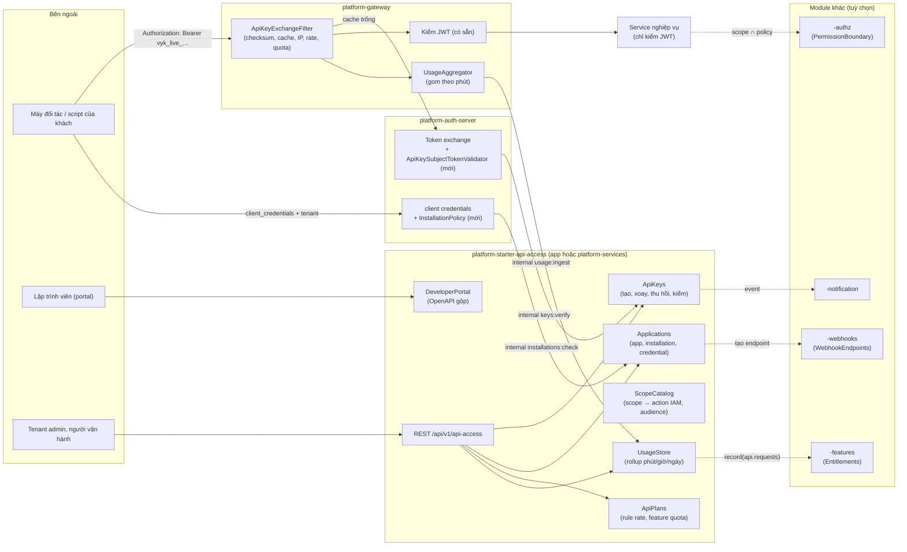
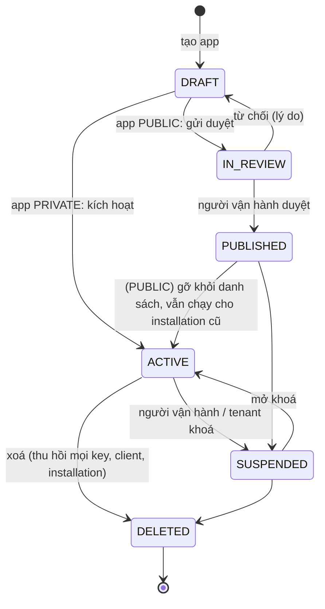
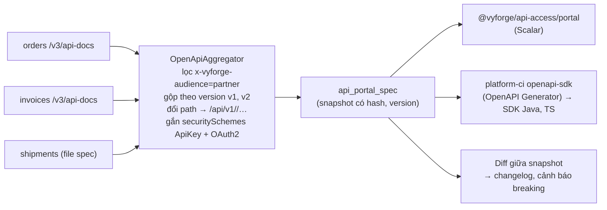
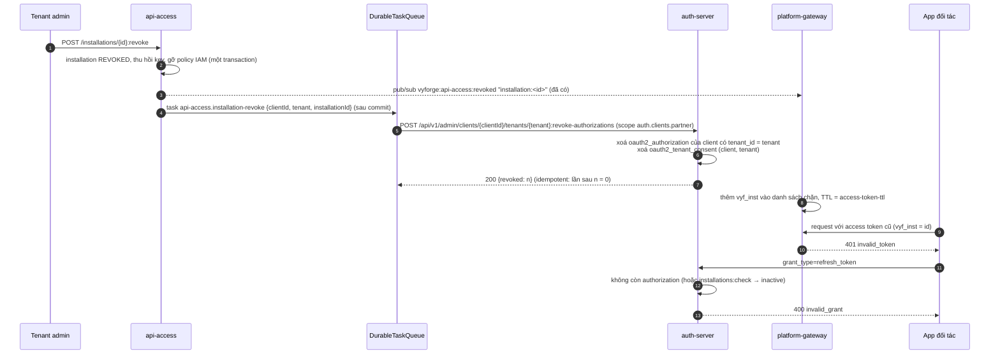
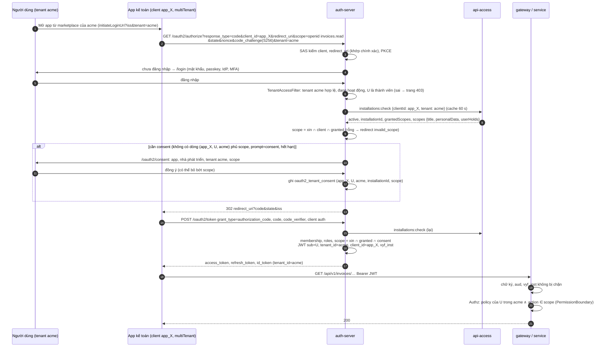
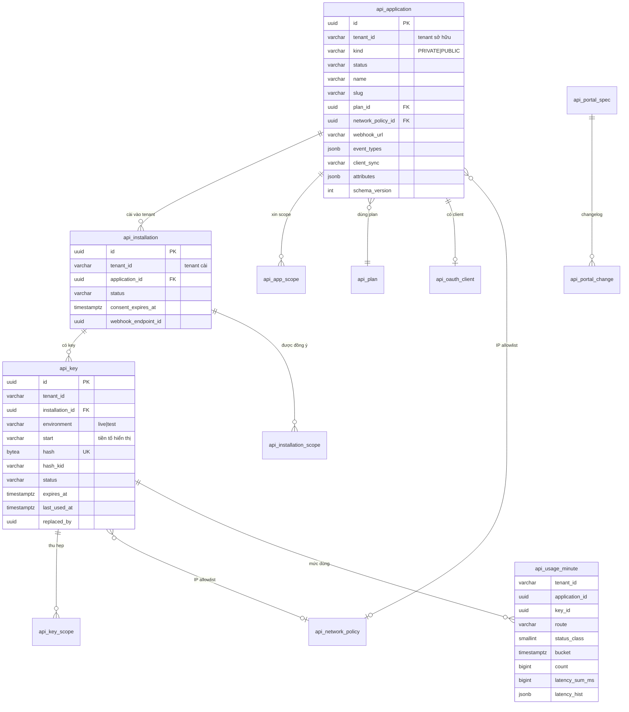

# Thiết kế: `platform-starter-api-access` và `@vyforge/api-access`

- **Trạng thái:** Bản thiết kế, chờ phiên điều phối duyệt (26/10/2026). Chưa code.
- **Phạm vi:** truy cập API cho đối tác và tích hợp: API key theo tenant và ứng dụng (scope, hạn, xoay vòng, IP allowlist,
  chỉ lưu hash), ứng dụng đối tác (client credentials, đăng ký app, cài app vào tenant, nền cho marketplace), developer
  portal (OpenAPI gộp, console thử, SDK), giới hạn (rate, quota), thống kê mức dùng, webhook cho đối tác, kiểm API key ở
  gateway.
- **Nền:** platform-java 0.12.1 (`platform-core` có `SecretCipher`, `-web`, `-security`, `-jpa` có `StarterSchemaMigrator`,
  `-messaging`, `-authz`, `-audit`, `-scheduling` có `DurableTaskQueue`, `-ratelimit`, `-privacy`), platform-web 0.9.0,
  platform-auth-server (Spring Security 7.1, token exchange RFC 8693 đã có), platform-gateway (Spring Cloud Gateway Server
  WebMVC). Bản phát hành đích: platform-java `0.13.0`.
- **Nối với:** `-features` (quota, entitlement `module.api-access`), `-webhooks` (endpoint của đối tác), `-notification`
  (báo key sắp hết hạn, bị lộ), `platform-services` (cách chạy, admin MFE), lệnh `openapi-sdk` của `platform-ci`.
- **Liên quan:** [MODULE_PLAN.md](../MODULE_PLAN.md); ADR-0005 (version API), ADR-0006 (BFF), ADR-0008 (auth server),
  ADR-0009 (IAM), ADR-0010 (gateway, IAM tập trung), ADR-0011 (tenant), ADR-0015 (tenant ở tầng dữ liệu).

Một câu: module đưa vào hệ thống một loại danh tính mới là **ứng dụng (application)**, tức máy của đối tác hoặc của chính
khách hàng gọi API. Ứng dụng có **credential** (API key, OAuth client), **quyền** (scope ánh xạ sang action IAM), **giới
hạn** (rate, quota) và **dấu vết** (mức dùng, audit). Ở biên, gateway đổi API key thành JWT ngắn hạn của auth-server, nên
mọi service phía sau vẫn chỉ kiểm JWT như hôm nay và không phải biết API key là gì.

---

## Mục lục

1. [Bài toán và phạm vi](#1-bài-toán-và-phạm-vi)
2. [Nghiên cứu](#2-nghiên-cứu)
3. [Kiến trúc](#3-kiến-trúc)
4. [Mô hình dữ liệu](#4-mô-hình-dữ-liệu)
5. [API](#5-api)
6. [Mở rộng](#6-mở-rộng)
7. [Vận hành](#7-vận-hành)
8. [Bảo mật và tuân thủ](#8-bảo-mật-và-tuân-thủ)
9. [Kế hoạch triển khai](#9-kế-hoạch-triển-khai)
10. [Đóng gói và triển khai độc lập](#10-đóng-gói-và-triển-khai-độc-lập)
11. [Lệch quy ước và quyết định](#11-lệch-quy-ước-và-quyết-định)

---

## 1. Bài toán và phạm vi

### 1.1 Vì sao cần

Hiện tại chỉ có hai kiểu gọi API: người dùng qua BFF (authorization code + PKCE) và service nội bộ (client credentials
khai báo trong cấu hình auth-server, do người vận hành platform tạo). Khi app nghiệp vụ mở API cho bên ngoài, ba nhóm
người cần thêm:

- **Khách hàng của tenant** muốn tự nối ERP, Excel, n8n hay script của họ: cần tự tạo key trong trang quản trị, không phải
  nhờ người vận hành platform, chỉ được làm những gì họ cho phép.
- **Đối tác tích hợp** (phần mềm kế toán, vận chuyển, ngân hàng, nhà cung cấp hoá đơn điện tử) muốn một tích hợp dùng cho
  nhiều tenant: cần đăng ký app một lần, mỗi tenant tự cài và tự gỡ, như GitHub Apps.
- **Người vận hành platform** cần biết ai đang gọi gì, nhiều bao nhiêu, chặn được kẻ lạm dụng, thu phí theo mức dùng.

Nếu không có module chung, mỗi app sẽ tự viết bảng `api_keys` lưu bản rõ, so sánh chuỗi không hằng thời gian, không có
scope, không xoay được và không đếm được. Đó là lỗi API2:2023 (Broken Authentication) và API4:2023 (Unrestricted Resource
Consumption) trong [OWASP API Security Top 10 2023](https://owasp.org/API-Security/editions/2023/en/0x11-t10/).

### 1.2 Kịch bản nghiệp vụ phải đáp ứng

Các kịch bản K3, K4, K5, K6, K7, K9, K11, K13 và K15 là đặc thù Việt Nam.

| # | Kịch bản | Cách giải |
|---|---|---|
| K1 | **Khách hàng tự nối ERP**: kế toán trưởng của tenant `acme` tạo key chỉ đọc đơn hàng và hoá đơn cho phần mềm kế toán nội bộ, hạn 1 năm | Tenant admin tạo *ứng dụng riêng* (`PRIVATE`), cấp scope `orders.read`, `invoices.read`; tạo key `live` có `expires_at`. Key hiện một lần. Quyền thực tế = scope của app ∩ scope của key (mục 3.6) |
| K2 | **Rò key lên GitHub**: lập trình viên của khách commit key vào repo công khai | Định dạng key có tiền tố và checksum (mục 3.4) để quét được. Nhận báo cáo rò rỉ qua `POST /leaks` (tương thích luồng secret scanning partner của GitHub, bản sau); key bị đánh dấu `COMPROMISED`, tự thu hồi theo cài đặt của tenant, phát `ApiKeyLeaked` cho `-notification` |
| K3 | **Đối tác vận chuyển** (kiểu GHN, GHTK, Viettel Post) gọi API cập nhật trạng thái vận đơn cho hàng trăm shop là tenant | Đối tác đăng ký *ứng dụng công khai* (`PUBLIC`) một lần. Mỗi shop *cài* app (installation) và đồng ý các scope `shipments.write`. Đối tác lấy token theo từng installation bằng client credentials + `tenant` (mục 3.8). Gỡ cài thì token hết hiệu lực |
| K4 | **Ngân hàng nối Open API theo Thông tư 64/2024/TT-NHNN**: bên thứ ba truy cập dữ liệu khách hàng có đồng ý, tối đa 180 ngày, ngân hàng phải lưu log 3 tháng và bản sao 1 năm, phải giới hạn số lần truy vấn tự động | Installation có `consent_expires_at` (mặc định 180 ngày theo cấu hình), nhắc gia hạn, tự hết hạn. Rate và quota theo app. Nhật ký truy cập API có retention cấu hình được (mục 8.3) |
| K5 | **Nhà cung cấp hoá đơn điện tử** (đối tác của tenant) cần IP cố định: tenant chỉ cho key gọi từ dải IP của máy chủ đối tác | `ip_allowlist` (CIDR, IPv4/IPv6) trên key và trên app. Kiểm ở gateway theo IP thật (sau proxy tin cậy). Sai IP → 403 `api_access.ip_not_allowed`, ghi audit, đếm vào metric |
| K6 | **Gói dịch vụ**: gói Free 1.000 request/ngày và 5 request/giây; gói Pro 100.000/ngày và 50/giây; đối tác Enterprise có hạn mức riêng theo hợp đồng | Rate: rule của `-ratelimit` chọn theo *API plan* của app. Quota: entitlement `METERED` `api.requests` của `-features` (theo gói của tenant, override theo hợp đồng). Gateway giữ bộ đếm nhanh, `-features` giữ số gốc (mục 3.7) |
| K7 | **Mùa cao điểm 11.11, Tết**: một đối tác gọi dồn làm chậm cả hệ thống | Rate theo key và theo app, có burst; giới hạn đồng thời theo app; người vận hành *tạm khoá* app (`SUSPENDED`) bằng một lệnh, có hiệu lực ở mọi replica gateway trong vài giây (pub/sub) |
| K8 | **Xoay key định kỳ 90 ngày** theo chính sách bảo mật của khách, không gián đoạn | `rotate` tạo key mới, key cũ còn hiệu lực trong `overlap` (mặc định 24 giờ, tối đa 7 ngày như Stripe). Chính sách tenant `max_key_lifetime` bắt buộc có hạn. Nhắc trước 14, 3, 1 ngày |
| K9 | **Đối tác kế toán** (kiểu MISA, Fast) làm *ứng dụng marketplace*: người dùng của tenant bấm "Kết nối", đồng ý quyền, ứng dụng gọi API thay người dùng | App `PUBLIC` có OAuth client loại authorization code + PKCE trên auth-server, `require-consent=true`. Danh sách app được duyệt hiện ở trang "Ứng dụng tích hợp" của tenant (marketplace). Người vận hành duyệt app trước khi lên danh sách (`REVIEW → PUBLISHED`). App truyền `tenant=<slug>` ở `/oauth2/authorize`; tenant phải đã cài app; người dùng đồng ý theo từng tenant (mục 3.12) |
| K10 | **Developer portal**: lập trình viên của đối tác đọc tài liệu OpenAPI gộp từ nhiều service, thử API trên console bằng key sandbox, tải SDK Java/TypeScript | Spec gộp chỉ gồm operation được đánh dấu công khai (`x-vyforge-audience: partner`), có version theo ADR-0005. UI dùng Scalar (MIT). Console chỉ chạy với key `test`. SDK sinh bằng lệnh `openapi-sdk` của `platform-ci` (OpenAPI Generator) |
| K11 | **Môi trường thử**: đối tác tích hợp trên dữ liệu giả trước khi chạy thật, như sandbox của Stripe | Key có `environment` `test`/`live`, tiền tố khác nhau. Key `test` chỉ đổi được token cho *tenant sandbox* ghép đôi với tenant thật (`acme` ↔ `acme-sandbox`, ADR-0011). Dữ liệu tách hẳn theo tenant, không cần cờ trong từng bảng |
| K12 | **Thống kê**: tenant admin xem app nào gọi bao nhiêu, lỗi bao nhiêu, endpoint nào chậm; đối tác xem mức dùng của chính mình | Gateway gom số liệu theo phút (app, key, route, nhóm mã trạng thái, độ trễ), đẩy về module; bảng rollup phút/giờ/ngày, partition theo ngày. API `/usage` lọc theo app, key, khoảng thời gian |
| K13 | **Triển khai on-prem cho cơ quan nhà nước**, không có Internet, không có Valkey, có khi không có gateway | Module chỉ cần PostgreSQL. Không gateway: app tự kiểm key bằng `ApiKeyAuthenticationFilter` (chế độ `local`, mục 3.5). Không Valkey: rate limit chạy bộ nhớ (một instance), quota ghi thẳng `-features` |
| K14 | **Webhook cho đối tác**: app vận chuyển muốn nhận `order.created` của các shop đã cài app | App `PUBLIC` khai báo event cần nhận. Khi tenant cài app và đồng ý, module tạo endpoint của `-webhooks` cho tenant đó, gắn `attributes.applicationId`. Gỡ cài → tắt endpoint. Không cài `-webhooks` thì phần này không bật (mục 3.9) |
| K15 | **Nhân viên phụ trách tích hợp nghỉ việc**: phải biết key nào do người đó tạo, chuyển chủ sở hữu, xoá phiên của họ | Key và app luôn thuộc *tenant*, không thuộc người. Lưu `created_by`; danh sách "key do người này tạo"; `owner_user_id` của app đổi được; audit đầy đủ. Khi tài khoản bị gỡ khỏi tenant, phát cảnh báo để tenant admin rà soát, không tự thu hồi |
| K16 | **Một service không có starter** (Go, Node) cần kiểm API key | Đi sau gateway thì không cần làm gì (nhận JWT). Không qua gateway thì gọi `POST /api/v1/api-access/internal/keys:verify` bằng token service |

Kịch bản tương lai phải chừa chỗ, chưa làm ở bản đầu:

- Credential mạnh hơn: mTLS (RFC 8705) và DPoP (RFC 9449) cho app của ngân hàng, private key JWT
  (`private_key_jwt`) thay client secret.
- Marketplace có tính phí (đối tác bán app, chia doanh thu) qua `-payment`, `-billing`.
- Đăng ký app tự động theo chuẩn (RFC 7591) cho hệ sinh thái lớn.
- Kết nối trục LGSP/NGSP của khối nhà nước (chứng thư số, mạng riêng).
- Quét rò rỉ chủ động (đăng ký làm GitHub secret scanning partner khi có tên miền và key format ổn định).
- Gateway khác (Kong, APISIX, Envoy Gateway) dùng chung bộ kiểm key qua plugin gọi endpoint verify.

### 1.3 Ngoài phạm vi

- **Cấp và kiểm JWT**: vẫn là việc của auth-server và `-security`. Module không phát hành token riêng.
- **Phân quyền người dùng**: vẫn là `-authz`. Module chỉ ánh xạ scope sang action IAM và cung cấp *ranh giới quyền*
  (mục 3.6).
- **Rate limit chống quá tải chung**: vẫn là `-ratelimit` ở gateway. Module chỉ chọn rule theo app/key.
- **Hạn mức thương mại và tính tiền**: entitlement thuộc `-features`, hoá đơn thuộc `-payment`/`-billing`. Module chỉ đo
  và báo số.
- **Gửi webhook**: thuộc `-webhooks`. Module chỉ tạo và quản lý endpoint thay mặt app.
- **Tự viết API gateway**: không. Dùng `platform-gateway` có sẵn, thêm bộ lọc.

---

## 2. Nghiên cứu

Phiên bản và license kiểm ngày 26/10/2026 qua GitHub API (`/repos/{repo}`, `/releases/latest`, file `LICENSE`) và tài
liệu chính thức. Mô hình dữ liệu lấy từ tài liệu có link ở từng dòng.

### 2.1 Quản lý API key và gateway

| Hệ thống | Phiên bản, license | Mô hình dữ liệu | API, cách kiểm | Điểm mạnh | Điểm yếu với Vyforge |
|---|---|---|---|---|---|
| [Unkey](https://www.unkey.com/docs/api-reference/v2/keys/verify-api-key) | `api/v1.1.66` (22/10/2026); **FSL-1.1-ALv2** (không phải OSI, chuyển sang Apache-2.0 sau 2 năm), trừ vài thư mục MIT ([LICENSE](https://github.com/unkeyed/unkey/blob/main/LICENSE)) | Workspace → API (keyspace) → key; *identity* gom nhiều key của một khách để dùng chung rate limit; key có `meta`, `expires`, `enabled`, `credits` (quota đếm lùi, có refill), nhiều rate limit đặt tên, permission và role | `POST /v2/keys.verifyKey` `{key, permissions (biểu thức AND/OR), credits.cost, ratelimits[{name,cost}], tags}` → luôn HTTP 200, `{valid, code: VALID\|NOT_FOUND\|FORBIDDEN\|INSUFFICIENT_PERMISSIONS\|USAGE_EXCEEDED\|RATE_LIMITED\|DISABLED\|EXPIRED, keyId, identity, credits, ratelimits[]}`. Lưu **SHA-256** của key, bản rõ chỉ trả một lần; khôi phục key là tính năng tuỳ chọn, lưu mã hoá ở vault riêng ([security](https://unkey.com/docs/security/overview)) | API kiểm gọn, mã kết quả rõ; identity; credits; trừ credit chỉ sau khi qua kiểm bảo mật | License FSL không phải OSS; là thêm một service (Go, MySQL, ClickHouse); không có khái niệm tenant của Vyforge, không gắn IAM |
| [Kong Gateway](https://developer.konghq.com/plugins/key-auth/) | 3.9.4 (12/10/2026), Apache-2.0; từ 3.10 cần license Enterprise ([diễn đàn Kong](https://discuss.konghq.com/t/kic-helm-charts-dont-upgrade-gateway-above-version-3-9/13895)) | *Consumer* (username, custom_id) → credential `key-auth` (key, ttl, tags); ACL plugin theo group; rate-limiting plugin theo consumer. Bản Enterprise thêm *principal* trong directory (3.15+) | Key ở header/query/body (query bật mặc định, tài liệu cảnh báo lộ qua log); hợp lệ → thêm `X-Consumer-ID`, `X-Credential-Identifier` cho upstream; không có key → 401; anonymous consumer. Mã hoá key at-rest chỉ có ở plugin Enterprise `key-auth-enc` | Mẫu "consumer + credential + plugin ACL/rate" là chuẩn ngành; header danh tính cho upstream | OSS dừng ở 3.9; header danh tính không ký, upstream phải tin mạng; bản OSS lưu key bản rõ |
| [Tyk](https://tyk.io/docs/api-management/policies/) | v5.15.1 (02/10/2026), **MPL-2.0** (trừ thư mục `ee`) | *Session* (key) lưu trong Redis, chứa access rights theo API/version/URL, rate, quota; *policy* là mẫu dùng chung (Free/Pro/Enterprise), áp lúc chạy, nhiều policy gộp theo kiểu thoáng nhất; scope của JWT ánh xạ sang policy | Key tra thẳng trong Redis. `hash_keys` + `hash_key_function`: `murmur32` (mặc định), `murmur64/128` (không mật mã), `sha256`; có `hash_key_function_fallback` để đổi thuật toán không mất key ([key hashing](https://tyk.io/docs/api-management/access-control/sessions-and-keys/key-hashing)) | Policy theo gói tách khỏi key; đổi policy có hiệu lực ngay cho mọi key; fallback khi đổi hash | Mặc định hash không mật mã; Redis là nguồn dữ liệu chính (mất Redis là mất key); thêm một gateway |
| [Zuplo](https://zuplo.com/docs/articles/api-key-management) (SaaS, gateway edge) | Portal Zudoku v0.93.0, MIT | *Bucket* theo môi trường (production, preview, development) → *consumer* (tên duy nhất, metadata gửi kèm mỗi request, tag) → nhiều key cùng danh tính | Key `zpka_` + phần ngẫu nhiên + **checksum**; kiểm 4 bước: định dạng → checksum (không gọi DB) → cache → dịch vụ key. Là đối tác **GitHub secret scanning**. "Roll key": tạo key mới, đặt hạn cho key cũ. Portal cho consumer tự tạo, xoay, thu hồi key | Kiểm checksum trước khi tra DB loại bỏ rác rẻ; tự phục vụ trong portal; lan thu hồi tới edge trong vài giây, độ trễ tối đa bằng TTL cache | SaaS; dữ liệu ra nước ngoài; bản self-host vẫn quản lý key trên cloud Zuplo |
| [Stripe API keys](https://docs.stripe.com/keys) (SaaS, tham khảo mô hình) | — | Bốn loại: publishable `pk_`, secret `sk_`, **restricted** `rk_` (quyền chọn từng resource, khuyến nghị cho mọi trường hợp mới), organization `sk_org_`; mỗi loại có `_test_`/`_live_`; *access policy* (IP/CIDR; nâng cao: ASN, quốc gia, chặn VPN/Tor) gắn vào key | Key live chỉ hiện một lần (trừ key Stripe tự tạo); **xoay có thời gian chồng tối đa 7 ngày**; lịch xoay; xem request log theo key; key không dùng 180 ngày bị giới hạn thao tác nhạy cảm; key gắn nhãn "agent" chịu luật duyệt | Mô hình test/live, restricted key, access policy dùng lại, overlap khi xoay, ghi chú nơi lưu key | Không có tenant con; không có OAuth app cho bên thứ ba (Stripe Connect là sản phẩm khác) |
| [GitHub token và GitHub Apps](https://github.blog/engineering/platform-security/behind-githubs-new-authentication-token-formats/) (SaaS, tham khảo) | — | Token có tiền tố theo loại `ghp_` (PAT), `gho_` (OAuth), `ghu_` (user-to-server), `ghs_` (server-to-server), `ghr_` (refresh); **CRC32 ở 6 ký tự cuối, base62**; dấu `_` để chọn cả chuỗi khi nhấp đúp. App: *registration* (public/private) → *installation* trên org/tài khoản, giới hạn repo → quyền chi tiết, webhook có sẵn ([GitHub Apps](https://docs.github.com/en/apps/creating-github-apps/about-creating-github-apps/about-creating-github-apps)) | App ký JWT bằng private key → `POST /app/installations/{id}/access_tokens` → token **1 giờ**, có thể thu hẹp repo và quyền khi xin; không vượt quyền của installation ([installation token](https://docs.github.com/en/apps/creating-github-apps/authenticating-with-a-github-app/generating-an-installation-access-token-for-a-github-app)) | Tách *app* (một lần) khỏi *installation* (mỗi khách); token ngắn hạn thu hẹp được; định dạng token quét được, kiểm checksum offline | Riêng của GitHub; không dùng được trực tiếp |
| [Phantom token (Curity)](https://curity.io/resources/learn/introspect-with-phantom-token/) (mẫu kiến trúc) | — | Credential tham chiếu (opaque) bên ngoài, JWT bên trong | Gateway đổi token opaque lấy JWT ở authorization server (introspection `Accept: application/jwt`), cache, chuyển JWT cho API. Kong, AWS Lambda authorizer, WSO2 đều làm được | Service phía sau chỉ kiểm JWT; credential ngoài không chứa dữ liệu | Thêm một lượt gọi khi cache trống |

### 2.2 OAuth app, đăng ký app và chuẩn liên quan

| Chuẩn, hệ thống | Phiên bản, trạng thái | Ý nghĩa cho thiết kế |
|---|---|---|
| Spring Security OAuth2 Authorization Server (đã nhập vào Spring Security 7; repo cũ chuyển sang `spring-attic`, bản cuối 1.5.8) | Dòng ổn định 7.1.x ([tài liệu 7.2](https://docs.spring.io/spring-security/reference/7.2/servlet/oauth2/authorization-server/core-model-components.html)), Apache-2.0; auth-server đang dùng 7.1 | Có `RegisteredClient`, client credentials, token exchange (auth-server đã bật), consent. **Dynamic client registration** theo OpenID Connect DCR 1.0, tắt mặc định ([how-to](https://docs.spring.io/spring-authorization-server/reference/guides/how-to-dynamic-client-registration.html)) |
| [CVE-2026-59354](https://app.opencve.io/cve/CVE-2026-59354) | Công bố 27/08/2026, CVSS 9.6, ảnh hưởng 7.0.0–7.0.4 khi bật DCR | Kiểm metadata client không đủ → XSS lưu trữ, leo quyền, SSRF. Lý do **không mở endpoint DCR** ra ngoài; app đăng ký qua API của module, có kiểm và duyệt (mục 3.8) |
| RFC 8693 Token Exchange | Chuẩn | Auth-server đã hỗ trợ. Mở rộng bằng `subject_token_type` riêng cho API key (mục 3.5) |
| RFC 6749 §5.1 | Chuẩn | Phản hồi token được phép có tham số thêm; dùng để trả *chính sách của key* (IP, rule) cho gateway cùng lúc với JWT |
| RFC 7591/7592 (đăng ký client động) | Chuẩn | Để bản sau, chỉ sau khi có app marketplace thật và đã vá CVE trên |
| RFC 8705 (mTLS), RFC 9449 (DPoP) | Chuẩn | Bản sau: credential ràng buộc chứng chỉ cho ngân hàng (K4) |
| [RFC 9700](https://www.rfc-editor.org/rfc/rfc9700) OAuth 2.0 Security BCP (01/2025) | Chuẩn | Không implicit, PKCE bắt buộc, token ngắn hạn, hạn chế audience. Auth-server đã theo; app marketplace kế thừa |
| [OWASP API Security Top 10 2023](https://owasp.org/API-Security/editions/2023/en/0x11-t10/) | 2023 | API2 (xác thực), API4 (tiêu thụ tài nguyên), API8 (cấu hình), API9 (quản lý inventory: biết API nào đang mở, version nào) |

### 2.3 Developer portal và SDK

| Công cụ | Phiên bản, license | Dùng thế nào |
|---|---|---|
| [Scalar](https://github.com/scalar/scalar) API Reference | release 23/10/2026, MIT | **Chọn.** Tài liệu + console thử ("Try it") trong một component, có bản React, đọc OpenAPI 3.1. Nhúng vào `@vyforge/api-access/portal` |
| [Redoc](https://github.com/Redocly/redoc) | 3.0.1, MIT | Thay thế khi chỉ cần trang đọc tĩnh, không có console |
| [Swagger UI](https://github.com/swagger-api/swagger-ui) | 5.34.0, Apache-2.0 | Đã có trong springdoc cho dev nội bộ. Không dùng cho portal (giao diện cũ, khó theme theo `@vyforge/ui`) |
| [Zudoku](https://github.com/zuplo/zudoku) | 0.93.0, MIT | Framework portal đầy đủ (Vite). Không chọn: còn 0.x, là một app riêng chứ không phải component, khó gắn vào admin MFE |
| [springdoc-openapi](https://github.com/springdoc/springdoc-openapi) | 3.2.0 (24/10/2026), Apache-2.0 | Đã có trong `-web`. Mỗi service phát `/v3/api-docs`; dùng `OpenApiCustomizer` để gắn `x-vyforge-audience` |
| [OpenAPI Generator](https://github.com/OpenAPITools/openapi-generator) | v7.26.0 (06/10/2026), Apache-2.0 | Lệnh `openapi-sdk` của `platform-ci` đã chọn công cụ này. Module chỉ cung cấp spec gộp ổn định để lệnh đó chạy |
| Gateway khác để so sánh | [Apache APISIX](https://github.com/apache/apisix) 3.19.0, [Envoy Gateway](https://github.com/envoyproxy/gateway) v1.9.3; cả hai Apache-2.0 | Không thay `platform-gateway`. Ghi lại để bản sau viết plugin gọi `keys:verify` (mục 6.4) |

### 2.4 Học theo và không làm

**Học theo:**

1. **Ứng dụng là danh tính trung tâm** (consumer của Kong, identity của Unkey, consumer của Zuplo, app của GitHub). Key,
   OAuth client, rate, quota, webhook đều gắn vào app. Một app nhiều key: xoay key không đổi danh tính, không đổi thống kê.
2. **Tách app khỏi installation** như GitHub Apps: đăng ký một lần, cài vào từng tenant, quyền theo từng lần cài.
3. **Định dạng key có tiền tố theo loại và môi trường, checksum CRC32 base62** như GitHub và Zuplo. Kiểm checksum trước
   khi tra DB để loại rác rẻ; tiền tố để quét rò rỉ.
4. **Chỉ lưu hash, hiện bản rõ một lần** như Unkey và Stripe; hash mật mã (không dùng murmur như mặc định của Tyk).
5. **Test/live** và **restricted key** của Stripe: key luôn có scope; không có key "toàn quyền".
6. **Xoay có thời gian chồng, tối đa 7 ngày** của Stripe; **đổi thuật toán hash có fallback** của Tyk.
7. **Policy theo gói tách khỏi key** của Tyk: rate/quota lấy từ *API plan* của app, đổi plan có hiệu lực ngay.
8. **Phantom token**: gateway đổi key lấy JWT ngắn hạn của auth-server, service phía sau không đổi.
9. **Mã kết quả kiểm key rõ ràng** của Unkey (`VALID`, `EXPIRED`, `DISABLED`, `RATE_LIMITED`…), dùng làm `code` của
   Problem Details và nhãn metric.
10. **Access policy dùng lại** của Stripe: danh sách IP đặt tên, gắn vào nhiều key.

**Không làm:**

1. Không chạy Unkey, Kong hay Tyk làm thành phần bắt buộc: thêm service phải trực, vướng license (FSL, Enterprise), và
   không gắn được với tenant + IAM của Vyforge. Module tự làm phần lưu trữ và kiểm, gọn trong PostgreSQL.
2. Không để gateway chuyển header danh tính không ký (`X-Consumer-ID` kiểu Kong) cho service. Gateway của Vyforge đang
   *gỡ* các header này (ADR-0010, ADR-0015); service chỉ tin JWT.
3. Không nhận key qua query string (lộ trong log và lịch sử trình duyệt). Chỉ header.
4. Không cho lấy lại bản rõ của key (Unkey có tuỳ chọn vault). Mất thì xoay.
5. Không mở dynamic client registration ra Internet (CVE-2026-59354).
6. Không tự viết portal framework; dùng Scalar làm component.
7. Không ghi mỗi request vào PostgreSQL. Gateway gom theo phút rồi mới đẩy về.

---

## 3. Kiến trúc

### 3.1 Thành phần



| Thành phần | Nằm ở | Việc |
|---|---|---|
| `platform-starter-api-access` | platform-java, artifact mới | Toàn bộ dữ liệu và nghiệp vụ: app, installation, key, scope catalog, API plan, IP policy, portal, usage, REST quản trị, endpoint nội bộ cho gateway và auth-server |
| `platform-api-access-gateway` | platform-java, artifact mới, nhỏ | Bộ lọc cho Spring Cloud Gateway Server WebMVC: nhận key, kiểm checksum, cache, đổi token, kiểm IP, rate, quota, gom usage. **Không** phụ thuộc JPA. `platform-gateway` thêm dependency này |
| `platform-api-access-core` | platform-java, artifact mới, Java thuần | Định dạng key (sinh, parse, checksum), hash, kiểu dữ liệu chung (`KeyPolicy`, `VerifyResult`). Dùng chung cho starter, bộ lọc gateway và adapter ở auth-server. Không import Spring (luật ArchUnit), như gói `signature` của `-webhooks` |
| Phần mở rộng auth-server | repo `platform-auth-server` | `ApiKeySubjectTokenValidator` (subject token kiểu API key), `InstallationPolicy` (client credentials theo installation), đọc scope catalog để đặt `aud` |
| `@vyforge/api-access` | platform-web | Client server-only, component cho app nghiệp vụ, `/admin` (component quản trị), `/portal` (tài liệu + console) |
| `@vyforge/api-access-admin` | repo `platform-admin`, app `apps/api-access-admin` | Admin MFE theo Next.js Multi-Zones (mục 10.3) |

Lý do tách ba artifact Java (nguyên tắc 1 của MODULE_PLAN: tách khi phụ thuộc và người dùng khác nhau):

- Gateway không có DataSource, không được kéo JPA, Flyway, 12 bảng.
- Auth-server chỉ cần định dạng key và kiểu dữ liệu để gọi endpoint verify.
- Ba artifact release cùng nhau trong platform-java, không thêm đơn vị phải release.

### 3.2 Gói trong starter

| Gói | Nội dung |
|---|---|
| `com.vyforge.platform.apiaccess` | API công khai: `Applications`, `ApiKeys`, `Installations`, `ScopeCatalog`, `ApiPlans`, `UsageQueries`, record, event, mã lỗi |
| `…apiaccess.spi` | `ApiKeyVerificationHook`, `ApplicationLifecycleHook`, `OAuthClientProvisioner`, `KeyLeakReporter`, `UsageSink`, `PortalSpecSource`, `ApplicationAttributeSchema` |
| `…apiaccess.internal.key` | `KeyService`, `KeyHasher` (HMAC-SHA-256 nhiều khoá), `KeyCache` |
| `…apiaccess.internal.app` | `ApplicationService`, `InstallationService`, state machine |
| `…apiaccess.internal.usage` | `UsageIngestService`, `UsageRollupJob`, partition |
| `…apiaccess.internal.portal` | `OpenApiAggregator`, `SpecFilter` |
| `…apiaccess.persistence` | Repository JDBC/JPA |
| `…apiaccess.web` | Controller quản trị, `/me`, `/internal`, portal |
| `…apiaccess.local` | `ApiKeyAuthenticationFilter` cho chế độ `local` (không có gateway) |
| `…apiaccess.integration` | Cầu nối có điều kiện: `FeaturesQuotaBridge` (`@ConditionalOnBean(Entitlements.class)`), `WebhooksBridge` (`@ConditionalOnBean(WebhookEndpoints.class)`), `NotificationBridge` |

### 3.3 Port và adapter

| Port (`spi`) | Mặc định | Adapter khác |
|---|---|---|
| `OAuthClientProvisioner`: tạo, sửa, xoá, xoay secret, gắn tenant cho OAuth client của app | `AuthServerClientProvisioner`: gọi `/api/v1/admin/clients` và `/api/v1/admin/tenants/{slug}/clients` của auth-server bằng client credentials (scope `auth.admin`, mục 8.1) | `NoopClientProvisioner` (không dùng OAuth app, chỉ API key); adapter Keycloak Admin API cho khách đã có Keycloak |
| `UsageSink`: nơi nhận số liệu mức dùng đã gom | `JdbcUsageSink` (bảng rollup) | `KafkaUsageSink` (topic `vyforge.api-access.usage`, cho kho phân tích ngoài); `OpenMeterUsageSink` bản sau |
| `QuotaPort`: hạn mức và ghi mức dùng thương mại | `FeaturesQuotaBridge` → `Entitlements` của `-features` | `NoQuota` (không cài `-features`: chỉ có rate limit) |
| `KeyLeakReporter`: nhận báo rò rỉ | REST `/leaks` (người vận hành, hoặc hệ thống quét nội bộ) | Endpoint tương thích GitHub secret scanning partner (bản sau, ký ECDSA của GitHub) |
| `PortalSpecSource`: nguồn OpenAPI của từng service | `HttpSpecSource`: đọc `/v3/api-docs` của service khai trong `vyforge.api-access.portal.sources` | `FileSpecSource` (spec đã build sẵn trong artifact, cho on-prem không cho service tự lộ spec) |
| `WebhookSubscriptionPort` | `WebhooksBridge` → `WebhookEndpoints` | Không cài `-webhooks`: app không khai báo được event |
| `PermissionBoundary` (đề xuất thêm vào `-authz`) | Không có: `-authz` bỏ qua scope | `ScopeBoundary` của module (mục 3.6) |

### 3.4 Định dạng key và cách lưu

```
vyk_live_4QzP7r2kT9mXbN3sWcLd8uFh1aEyJ6vG0pRo5KiZ2tB_1x9Kq3
└┬┘ └┬─┘ └──────────────────── secret ───────────────────┘ └─crc─┘
 │   └ môi trường: live | test
 └ tiền tố của bản triển khai (mặc định "vyk", đổi được: "acme")
```

- **Secret:** 32 byte từ `SecureRandom` (256 bit), mã hoá base62 → 43 ký tự. Lớn hơn mức 178 bit của token OAuth GitHub.
- **Checksum:** CRC32 của `tiền tố_môi trường_secret`, base62, đệm đủ 6 ký tự, như GitHub. Gateway kiểm checksum trước khi
  tra cache hay gọi mạng; sai → 401 ngay, không tốn DB. Checksum **không** phải biện pháp bảo mật, chỉ để lọc rác và để
  công cụ quét giảm báo nhầm.
- **Ký tự `_`** phân tách để nhấp đúp chọn cả chuỗi. Toàn chuỗi khớp `^[a-z]{2,8}_(live|test)_[0-9A-Za-z]{43}_[0-9A-Za-z]{6}$`.
- **Tiền tố hiển thị** (`start`): 12 ký tự đầu (`vyk_live_4Qz`), lưu bản rõ để người dùng nhận ra key trong danh sách,
  như Unkey và Stripe. Không đủ để đoán phần còn lại.
- **Hash lưu DB:** `HMAC-SHA-256(pepper[kid], toàn chuỗi key)`, lưu `hash` (32 byte) và `hash_kid`. Pepper nằm ngoài DB
  (`vyforge.api-access.hash.keys.<kid>`, cùng cách cấu hình keyring với `SecretCipher`), nên lộ bản sao DB không đủ để thử
  key offline. Không dùng bcrypt/Argon2: key có 256 bit ngẫu nhiên nên hash chậm không thêm an toàn mà làm mỗi lần kiểm
  tốn hàng chục ms CPU ([lập luận tương tự](https://docs.sso.earthobservation.vam.wfp.org/architecture/decisions/adrs/0008-api-key-hashing)).
- **Đổi pepper** như `hash_key_function_fallback` của Tyk: thêm `kid` mới làm khoá hiện tại; lúc kiểm, tra hash theo kid
  hiện tại trước, không thấy thì thử các kid cũ (tối đa 2). Gặp key dùng kid cũ thì ghi lại hash mới (lazy re-hash, có
  chỗ cho job chủ động). Hết thời gian chuyển đổi thì bỏ kid cũ.
- **So sánh:** tra bằng chỉ mục unique trên `hash`; bước so sánh cuối dùng `MessageDigest.isEqual`.
- **Không bao giờ log key.** Bộ lọc của `-privacy` thêm pattern `^[a-z]{2,8}_(live|test)_` để che nếu lỡ lọt vào message.

### 3.5 Luồng chính: gọi API bằng key qua gateway

```mermaid
sequenceDiagram
  autonumber
  participant P as Máy đối tác
  participant G as platform-gateway (ApiKeyExchangeFilter)
  participant C as Cache trong gateway (Caffeine)
  participant A as auth-server (token exchange)
  participant M as api-access (internal verify)
  participant V as Valkey
  participant S as Service nghiệp vụ
  P->>G: GET /api/v1/orders/orders  Authorization: Bearer vyk_live_…
  G->>G: parse + kiểm checksum (sai → 401 api_access.key_invalid)
  G->>C: get(sha256(key))
  alt cache trống hoặc hết hạn
    G->>A: POST /oauth2/token grant_type=token-exchange<br/>subject_token=<key>, subject_token_type=urn:vyforge:params:oauth:token-type:api-key<br/>(client platform-gateway)
    A->>M: POST /api/v1/api-access/internal/keys:verify {key}
    M->>M: HMAC → tra api_key theo hash, kiểm trạng thái key, app, installation, hạn
    M-->>A: VerifyResult{VALID, tenant, appId, keyId, env, scopes, audiences, policy}
    A->>A: kiểm tenant đang hoạt động; ký JWT 5 phút<br/>sub=app:<appId>, tenant_id, scope, aud, vyf_kid
    A-->>G: {access_token, expires_in, vyforge_key_policy{ipAllowlist, rateRule, quota, keyId, appId}}
    G->>C: put(sha256(key), token + policy), TTL = min(exp − 30 s, 60 s)
  end
  G->>G: IP thật ∈ ipAllowlist? (không → 403 api_access.ip_not_allowed)
  G->>V: rate: RateLimiter.consume(rule của plan, "apikey:<keyId>") và "app:<appId>"
  G->>V: quota: INCRBY t:<tenant>:api-access:quota:<appId>:<kỳ> (vượt → 429/403)
  G->>S: request + Authorization: Bearer <JWT> (key gốc bị gỡ)
  S->>S: kiểm JWT, aud, Authz.check (scope ∩ policy)
  S-->>G: 200
  G->>G: UsageAggregator.add(tenant, app, key, route, 2xx, latency)
  G-->>P: 200 + RateLimit-* headers
```

Điểm chính:

- **Service phía sau không đổi gì.** Chúng nhận JWT do auth-server ký, có `tenant_id` lấy từ credential đã kiểm (đúng
  ADR-0015), `sub` là danh tính của app. `-security`, `-authz`, audit hoạt động như với người dùng.
- **Auth-server là nơi duy nhất phát hành token.** Token exchange dùng hạ tầng đã có (client `platform-gateway` thêm grant
  `token_exchange`), chỉ thêm một bộ kiểm subject token. Auth-server kiểm lại tenant còn hoạt động mỗi lần cấp, như mọi grant.
- **Một lượt gọi mạng khi cache trống** (gateway → auth-server → api-access). Với cache 60 giây, một key gọi liên tục chỉ
  tốn một lượt mỗi phút mỗi replica. Đo ở mục 7.4.
- **Cache theo `sha256(key)`**, không giữ bản rõ. Hit thì không có I/O ngoài rate/quota trên Valkey.
- **Chính sách của key đi kèm phản hồi token** (tham số thêm theo RFC 6749 §5.1), nên gateway kiểm IP và chọn rule mà không
  phải gọi thêm.
- **Header nhận key:** `Authorization: Bearer <key>` (phân biệt với JWT nhờ tiền tố) hoặc `X-Api-Key` (cấu hình được, cho
  công cụ không đặt được `Authorization`). Query string không nhận.

**Chế độ `local`** (K13, app nhúng starter, không có gateway): `ApiKeyAuthenticationFilter` đứng trước bộ lọc resource server
của `-security`, gọi thẳng `ApiKeys.verify` trong JVM, dựng `ApiKeyAuthentication` có cùng các thuộc tính như JWT ở trên
(`sub`, `tenant_id`, `scope`), đặt `TenantContext` từ tenant của key và áp rate limit bằng `@RateLimited` của `-ratelimit`.
`CurrentUser`, `Authz.check` và audit dùng chung một principal, nên code nghiệp vụ không phân biệt hai chế độ.

### 3.6 Scope, IAM và ranh giới quyền

Scope là **hợp đồng công khai với đối tác** (ổn định, ít, dễ hiểu: `orders.read`). Action IAM là **chi tiết nội bộ**
(`orders:order:Get`, `orders:order:List`, `orders:shipment:Get`…). `ScopeCatalog` nối hai thứ:

```yaml
vyforge:
  api-access:
    scopes:
      orders.read:
        title: { vi: "Đọc đơn hàng", en: "Read orders" }
        audience: orders                                  # service đích → aud của JWT
        actions: [ "orders:order:Get", "orders:order:List", "orders:order-item:List" ]
        personal-data: BASIC                              # hiện cảnh báo khi cấp (mục 8.2)
      orders.write:
        title: { vi: "Tạo và sửa đơn hàng", en: "Write orders" }
        audience: orders
        actions: [ "orders:order:Create", "orders:order:Update" ]
        includes: [ orders.read ]
```

Service tự khai scope của mình trong `ScopeCatalogContributor` (bean, giống `ActionCatalog` của `-authz`), module gộp lại
và kiểm mọi action có trong catalog IAM.

Quyền thực tế của một request bằng key:

```
được phép ⇔ Allow(policy IAM gắn với principal app:<appId>)          — tenant admin quản lý, có Condition
          ∧ action ∈ actions(scope của installation hoặc app)          — trần do tenant đồng ý
          ∧ action ∈ actions(scope của key)                            — key chỉ thu hẹp, không mở rộng
          ∧ không Deny nào khớp
```

- Khi tạo app riêng, module **tự gắn** một policy quản lý (`api-access:app/<appId>`) cho principal `app:<appId>` với đúng
  action của các scope được cấp. Tenant admin có thể gắn thêm policy có `Condition` (vd. chỉ chi nhánh Hà Nội:
  `resource.branch == "HN"`), dùng đúng cơ chế `-authz` đang có.
- Hai điều kiện về scope là **ranh giới quyền** (permission boundary, như AWS IAM). `-authz` chưa có khái niệm này. Đề xuất
  thêm vào `-authz` một SPI nhỏ:

  ```java
  /** Ranh giới quyền: action phải được mọi boundary cho phép, ngoài policy của principal. */
  public interface PermissionBoundary {
      /** empty = không áp ranh giới cho principal này. */
      Optional<Predicate<String>> boundaryFor(AuthzPrincipal principal);
  }
  ```

  Module cài `ScopeBoundary`: đọc claim `scope` của JWT (hoặc của `ApiKeyAuthentication`), mở rộng `includes`, trả
  predicate `action ∈ actions(scopes)`. Thiếu SPI (bản `-authz` cũ) thì service vẫn an toàn nhờ policy quản lý ở trên chỉ
  cho đúng action của scope app; chỉ mất khả năng *key* thu hẹp hơn app. Đây là phụ thuộc vào phiên `-authz`, ghi ở mục 9.

- `aud` của JWT là tập `audience` của các scope, nên token đổi từ key chỉ dùng được ở service cần thiết.

### 3.7 Rate limit, quota và API plan

Hai loại giới hạn, tách như mục 7.5 của thiết kế `-features`:

| | Rate (chống quá tải) | Quota (hạn mức thương mại) |
|---|---|---|
| Cửa sổ | Giây, phút | Ngày, tháng, kỳ thanh toán |
| Nơi giữ | Valkey qua `-ratelimit` (`RateLimiter.consume(rule, subject)`) | Gốc ở `-features` (`api.requests`, `METERED`); gateway giữ bộ đếm nhanh trên Valkey |
| Theo | key và app (cả hai cùng phải qua) | tenant × app (hoặc tenant, theo cấu hình feature) |
| Vượt | 429 `ratelimit.exceeded` + `Retry-After` | 429 `api_access.quota_exceeded` + `RateLimit-Reset` (đối tác máy cần retry sau kỳ; khác 403 của `-features` vì client ở đây là máy, xem mục 11.1) |

**API plan** (`api_plan`) là gói giới hạn đặt tên, gắn vào app (như policy của Tyk):

```yaml
key: partner-standard
rate: { capacity: 50, refill: 50, period: PT1S }          # → RateLimitRule "api-access.partner-standard"
concurrency: 20                                            # số request đồng thời tối đa theo app (bản sau)
quota: { feature: api.requests, cost: 1 }                  # 0 = không tính quota
burst-per-key: { capacity: 20, refill: 20, period: PT1S }
```

- Plan mặc định của platform (`free`, `standard`, `partner`), người vận hành sửa được; tenant chọn plan cho app riêng trong
  giới hạn gói dịch vụ của mình (entitlement `CONFIG` `api.max-plan` của `-features`).
- Hạn mức quota lấy từ `Entitlements` lúc verify và trả trong `vyforge_key_policy.quota {limit, period, resetAt}`.
  Gateway giữ bộ đếm `INCRBY` có kiểm trần trên Valkey (script Lua, giống chế độ `FAST` của `-features`), khoá
  `t:<tenant>:api-access:quota:<appId>:<kỳ>`. Số gốc: `UsageIngestService` gọi `Entitlements.record("api.requests", n,
  idempotencyKey = <gateway>:<phút>:<app>)` theo lô mỗi lần đẩy. Sai lệch tối đa một chu kỳ đẩy (10 s), chấp nhận được
  cho đếm request; **không** dùng đường này cho thứ có hậu quả pháp lý.
- Không có Valkey: rate chạy bộ nhớ (`-ratelimit` đã hỗ trợ, chỉ đúng khi một instance), quota bỏ lớp nhanh, kiểm bằng
  `Entitlements.canConsume` theo lô (chậm hơn, nêu ở mục 7.4).

### 3.8 Ứng dụng, installation và OAuth



Hai loại app:

| | `PRIVATE` (app riêng của tenant) | `PUBLIC` (app của đối tác, cài vào nhiều tenant) |
|---|---|---|
| Ai tạo | Tenant admin (hoặc người có `api-access:app:Create`) | Tenant *nhà phát triển* (đối tác có tài khoản và tenant riêng trên platform) |
| Tenant của dữ liệu | Tenant tạo app | App thuộc tenant nhà phát triển; installation thuộc tenant cài |
| Credential | API key; tuỳ chọn OAuth client client credentials | OAuth client (client credentials theo installation, authorization code + PKCE cho app gọi thay người dùng); API key **theo installation** (tenant cài tự tạo) |
| Duyệt | Không | Người vận hành duyệt trước khi lên marketplace |
| Quyền | Scope tenant cấp | Scope app *xin*, tenant *đồng ý* khi cài (có thể đồng ý ít hơn nếu scope đánh dấu `optional`) |

**Installation** (app × tenant cài): trạng thái `PENDING_CONSENT → ACTIVE → SUSPENDED → REVOKED`, `granted_scopes`,
`consent_expires_at` (K4), `installed_by`. App `PRIVATE` có một installation ngầm trong chính tenant của nó, nên mọi
đường kiểm quyền chỉ có một mô hình.

**Client credentials theo installation** (K3): đối tác gọi `POST /oauth2/token grant_type=client_credentials&tenant=<slug>`.
Hôm nay auth-server chỉ cấp token cho tenant của client. Phần mở rộng:

1. Client của app `PUBLIC` được auth-server đánh dấu `multi-tenant` (gắn vào tenant nhà phát triển như hiện nay, cộng cờ).
2. `InstallationPolicy` (bean mới ở auth-server, adapter HTTP gọi `POST /api/v1/api-access/internal/installations:check
   {clientId, tenant}`) trả `ACTIVE` + `grantedScopes`; scope của token = scope xin ∩ granted. Không có installation →
   `invalid_grant`.
3. Token có `sub=app:<appId>`, `tenant_id=<tenant cài>`, `vyf_inst=<installationId>`, hạn 10 phút như hiện tại.

**Authorization code cho app gọi thay người dùng** (K9): client `multiTenant` có `authorization_code` + PKCE,
`require-consent`. Module tạo client với redirect URI đã kiểm (https, không wildcard, không IP nội bộ) và danh sách scope.
Chọn tenant bằng tham số `tenant`, bắt buộc installation `ACTIVE`, consent của người dùng theo tenant, claim `vyf_inst` và
thu hồi khi gỡ cài: xem [mục 3.12](#312-authorization-code-cho-app-multi-tenant-ở-tenant-khác-k9). Token của người dùng có
`client_id`/`azp` là app, nên `-authz` vẫn kiểm quyền của *người dùng*, giới hạn thêm bởi scope (ranh giới ở mục 3.6).

**Cấp OAuth client** qua `OAuthClientProvisioner`: module là nguồn sự thật về app; auth-server giữ `RegisteredClient`.
Tạo/sửa/xoá app → task `api-access.client-sync` trên `DurableTaskQueue` gọi API quản trị của auth-server (idempotent theo
`clientId = app_<appId>`), retry có backoff, `DEAD` thì hiện trạng thái "chưa đồng bộ" trên app và cho bấm thử lại. Secret
của client do auth-server sinh, module trả cho người dùng **một lần** và không lưu.

### 3.9 Webhook cho đối tác

```mermaid
sequenceDiagram
  autonumber
  participant T as Tenant admin
  participant M as api-access
  participant W as -webhooks
  participant D as Máy đối tác
  T->>M: cài app "Vận chuyển X", đồng ý scope + event order.created
  M->>M: installation ACTIVE (transaction)
  M->>W: WebhookEndpoints.create(url = app.webhookUrl, eventTypes, attributes{applicationId, installationId}) trong TenantContext.run(tenant cài)
  W-->>M: endpointId + secret
  M->>M: lưu endpointId vào installation; secret mã hoá bằng SecretCipher, chỉ app đọc được qua API của đối tác
  Note over W,D: -webhooks gửi, ký Standard Webhooks, retry như mọi endpoint
  T->>M: gỡ app
  M->>W: WebhookEndpoints.delete(endpointId)
```

- Chỉ event type mà scope đã đồng ý bao phủ mới đăng ký được (scope có thể khai `events: [order.created]`).
- Secret webhook của đối tác: đối tác lấy qua API của chính app (`GET /apps/{id}/installations/{iid}/webhook-secret`, chỉ
  token của app), không qua tenant.
- Cầu nối chỉ bật khi có bean `WebhookEndpoints` (`@ConditionalOnBean`). Không cài `-webhooks` thì trường `events` của app
  bị từ chối với `api_access.webhooks_unavailable`.

### 3.10 Developer portal



- **Nguồn:** mỗi service đánh dấu operation công khai bằng `@PartnerApi` (annotation của `platform-api-access-core`, đọc
  bởi `OpenApiCustomizer` thêm `x-vyforge-audience: partner` và `x-vyforge-scopes: [orders.read]`). Không đánh dấu thì
  không lên portal, đúng API9:2023 (quản lý inventory).
- **Gộp:** job `api-access.portal-refresh` (theo lịch và theo lệnh) đọc spec của từng nguồn, lọc, đổi path theo quy ước
  gateway (`/api/v<n>/<service>/…`), tách theo major version (ADR-0005), gắn `securitySchemes` (`ApiKeyAuth` header,
  `OAuth2` client credentials) và `security` theo scope, rồi lưu **snapshot** có hash. Spec không đổi thì không tạo
  snapshot mới.
- **Diff:** so snapshot mới với bản trước (thêm/xoá operation, đổi kiểu, field bắt buộc mới), lưu changelog, phát
  `PortalSpecPublished(breaking=true|false)`. Breaking trong cùng major version là lỗi cấu hình: hiện cảnh báo cho người vận
  hành (chính sách deprecation của ADR-0005).
- **Console thử:** Scalar gọi qua BFF của portal, không gọi thẳng từ trình duyệt bằng key live. Console chỉ nhận key `test`
  (kiểm tiền tố ở BFF), hoặc tự tạo một key `test` ngắn hạn (1 giờ) cho người đang đăng nhập.
- **SDK:** `GET /portal/specs/{version}/openapi.json` là đầu vào ổn định cho lệnh `openapi-sdk` của `platform-ci`. Portal
  hiện link tải SDK do pipeline đó phát hành (cấu hình `vyforge.api-access.portal.sdks`). Module không tự chạy generator.
- **Portal công khai hay đăng nhập:** cấu hình theo bản triển khai. Mặc định đọc tài liệu không cần đăng nhập
  (`vyforge.api-access.portal.public-docs=true`), tạo key và console cần đăng nhập.

### 3.11 Luồng lỗi

| Tình huống | Xử lý |
|---|---|
| Key sai định dạng hoặc checksum | Gateway trả 401 `api_access.key_invalid` ngay, không gọi mạng. Metric `result=malformed`. Rate limit theo IP cho lỗi xác thực (`api-access.auth-failures`, 20/phút) để chống dò |
| Key không tồn tại, đã thu hồi | auth-server trả `invalid_grant` → gateway 401 `api_access.key_invalid` (không phân biệt "không có" với "đã thu hồi" để không lộ thông tin). Cache âm 30 giây theo `sha256(key)` |
| Key hết hạn | 401 `api_access.key_expired` (phân biệt được vì người giữ key cần biết phải xoay, như Stripe trả authentication error riêng) |
| App hoặc installation `SUSPENDED` | 403 `api_access.application_suspended` |
| Tenant bị khoá | auth-server từ chối như mọi grant → 401 |
| Sai IP | 403 `api_access.ip_not_allowed`, audit `api-access:key:IpDenied` (gom theo phút để không ngập audit) |
| Vượt rate | 429 `ratelimit.exceeded` + `Retry-After`, `RateLimit-*` |
| Vượt quota | 429 `api_access.quota_exceeded` + `RateLimit-Reset`; phát `ApiQuotaExceeded` một lần mỗi kỳ |
| Scope thiếu | Service trả 403 `authz.forbidden` như mọi request; Problem Details có `params.requiredScope` khi biết |
| api-access không trả lời khi cache trống | auth-server trả `temporarily_unavailable` → gateway 503 `api_access.unavailable` + `Retry-After: 5`. Key đang có trong cache vẫn chạy tới hết TTL. **Không bao giờ cho qua khi không kiểm được** (fail-closed) |
| Valkey mất | Rate: theo `FailureMode` của rule (mặc định `OPEN` cho API đối tác, cấu hình được). Quota: bỏ lớp nhanh, ghi vào bộ đệm trong gateway và đẩy về khi đẩy usage; sai lệch được ghi vào metric |
| Thu hồi key | Commit → event `ApiKeyRevoked` → pub/sub `vyforge:api-access:revoked` → mọi gateway xoá cache theo `keyId`. Mất pub/sub thì chậm tối đa TTL cache (60 s). Token đã đổi chỉ gateway giữ, nên không có token "mồ côi" ngoài biên |
| Đồng bộ OAuth client lỗi | Task retry; `DEAD` → trạng thái `clientSync=FAILED` trên app, nút thử lại, event `ApplicationClientSyncFailed` |
| Đẩy usage lỗi | Gateway giữ tối đa `usage.buffer-max` (mặc định 10.000 dòng gom) rồi bỏ dòng cũ nhất, đếm `vyforge.api_access.usage.dropped` |

### 3.12 Authorization code cho app multi-tenant ở tenant khác (K9)

Bổ sung 27/10/2026. Trước bản này, mục 3.8 coi K9 là "đã có ở auth-server". Thực tế `TenantSelectionPolicy.select` luôn ép
client đã gắn tenant về tenant nhà, mà client `app_*` của app `PUBLIC` gắn với tenant của *nhà phát triển*. Người dùng của
tenant cài app không phải thành viên tenant nhà, nên bị chặn 403 ngay ở `/oauth2/authorize`. Mục này chốt bốn điểm còn
thiếu: chọn tenant, kiểm installation và scope, consent, claim và thu hồi.

Phạm vi: client có cờ `multiTenant` (client của app `PUBLIC`, mục 3.8) dùng grant `authorization_code` (+ `refresh_token`)
để gọi API **thay người dùng** của một tenant đã cài app. Client credentials theo installation (K3) giữ nguyên như mục 3.8.
App `PRIVATE` và client không `multiTenant` không đổi gì.

#### 3.12.1 Chọn tenant: tham số `tenant` ở `/oauth2/authorize`

**Quyết định:** app truyền `tenant=<slug>` ở `/oauth2/authorize`, đúng cơ chế "theo tham số" của ADR-0011 §2. Với client
`multiTenant`, tham số được phép khác tenant nhà; khi đó tenant đó phải có installation hợp lệ của app (3.12.2). Không có
tham số thì như hôm nay: tenant nhà của client.

| Phương án | Đánh giá |
|---|---|
| **Tham số `tenant` (chọn)** | Dùng lại `TenantParameter`, `TenantAccessFilter`, ADR-0011 §2; không thêm màn hình. App luôn biết tenant: nút "Kết nối" bắt đầu từ trang marketplace của tenant, từ webhook `ApplicationInstalled` hoặc `GET /self/installations`. Token và refresh giữ đúng tenant đã chọn nhờ `issuedTenant` như client dùng chung |
| Chọn tenant sau đăng nhập (màn hình ở auth-server) | ADR-0011 ghi là "chưa làm". Thêm một bước cho mọi lần đăng nhập, phải lọc danh sách tenant theo installation (lộ tenant nào đã cài app cho chính người dùng thì chấp nhận được, nhưng là UI mới phải i18n, a11y, test). Để sau: khi có màn hình chọn tenant chung, client `multiTenant` gửi `tenant` rỗng sẽ dùng nó (3.12.8) |
| Suy ra theo installation | Người dùng thuộc nhiều tenant cùng cài app thì không xác định được; app không chủ động chọn được tenant; dễ cấp nhầm tenant mà người dùng không để ý. Loại |

Cách app có `slug` để truyền:

- **Từ marketplace** (khuyến nghị): app khai `initiateLoginUri` (tuỳ chọn, kiểm như redirect URI: https, không wildcard,
  không IP nội bộ). Nút "Mở ứng dụng" trên trang app đã cài chuyển tới
  `<initiateLoginUri>?iss=<issuer>&tenant=<slug>&target_link_uri=…` theo *third-party initiated login* (OIDC Core 1.0 §4).
  App bắt đầu authorization request với đúng `tenant` đó. `iss` phải khớp issuer app đã cấu hình, không khớp thì app bỏ qua.
- **Từ dữ liệu của app:** webhook `ApplicationInstalled` (có `tenantId`) hoặc `GET /self/installations`.

`tenant` không phải dữ liệu tin cậy từ phía app: auth-server kiểm lại membership, trạng thái tenant và installation. App
phải đọc `tenant_id` trong token trả về, không dựa vào giá trị mình đã gửi.

Thay đổi ở auth-server (`TenantSelectionPolicy`):

```java
/** Client multiTenant: tenant khác tenant nhà được phép, kèm điều kiện installation do lớp gọi kiểm (3.12.2). */
public static Selection select(@Nullable String clientTenant, boolean multiTenant, @Nullable String requested);

/** requiresInstallation = tenant đã chọn khác tenant nhà của client multiTenant. */
public record Selection(String tenant, boolean requiresInstallation) {}
```

- Client không `multiTenant`: giữ nguyên hành vi `select(clientTenant, requested)` (khác tenant nhà → từ chối).
- `forRefresh(issued, clientTenant, multiTenant)`: client `multiTenant` được giữ `issued` khác tenant nhà, với
  `requiresInstallation=true`; client thường giữ quy tắc cũ.
- `InstallationTokenPolicy.installationTenant` (K3) dùng cùng hàm để hai grant chọn tenant như nhau.

#### 3.12.2 Installation bắt buộc và scope của token

**Installation phải `ACTIVE` ở tenant đã chọn**, kiểm bằng `InstallationPolicy.check(clientId, tenant)` (cùng
`/internal/installations:check` của K3, kết quả đã gồm hạn đồng ý `consent_expires_at`). Kiểm ở **mọi** điểm:

| Điểm kiểm | Vì sao |
|---|---|
| `/oauth2/authorize`, sau khi người dùng đăng nhập và qua `TenantAccessFilter` | Báo lỗi cho app trước khi hiện consent; không hỏi người dùng đồng ý cho app chưa được cài |
| Đổi code lấy token | Installation có thể bị gỡ giữa lúc consent và lúc đổi code |
| Mỗi lần refresh | Gỡ cài, khoá, hết hạn đồng ý phải chặn refresh ngay cả khi bước dọn (3.12.4) chưa chạy |

Tenant nhà của nhà phát triển không cần installation (nhân viên của đối tác dùng app của chính mình), giống K3.
api-access không trả lời → không cấp (fail-closed), như K3.

**Scope của token:**

```
scope(token) = scope xin
             ∩ scope đăng ký của client            — SAS đã kiểm (invalid_scope nếu xin ngoài danh sách)
             ∩ grantedScopes của installation       — tenant admin đồng ý khi cài (trần của tenant)
             ∩ scope người dùng đồng ý ở tenant đó  — consent của người dùng (3.12.3)
```

**Không giao với quyền người dùng lúc cấp token.** Quyền của người dùng được kiểm *ở mỗi request*:

```
được phép ⇔ Allow(policy IAM của người dùng trong tenant, theo role trong token)
          ∧ action ∈ actions(scope của token)            — ranh giới PermissionBoundary (mục 3.6)
          ∧ không Deny nào khớp
```

Lý do:

- Auth-server không biết policy IAM (ADR-0009/0010: IAM ở `-authz` và gateway). Giao lúc cấp phải gọi IAM với mọi action
  của mọi scope, chậm và cũ ngay khi admin đổi policy trong vòng đời refresh token (có thể nhiều ngày).
- Kiểm ở request là đúng mô hình *delegation*: app không bao giờ làm được nhiều hơn người dùng hiện tại, kể cả khi
  quyền người dùng bị thu hẹp sau khi đồng ý.
- Màn hình consent vẫn *đánh dấu* scope mà người dùng hiện không đủ quyền (gọi `Authz.holds` qua api-access, 3.12.3) để
  người dùng không tưởng nhầm. Đánh dấu chỉ để hiển thị, không lọc scope.

Thiếu `PermissionBoundary` (bản `-authz` cũ) thì token của app có toàn quyền của người dùng trong tenant, scope chỉ còn là
nhãn. Vì vậy **chỉ bật K9 khi service đích có `PermissionBoundary`**: auth-server từ chối tạo client `multiTenant` có grant
`authorization_code` nếu `vyforge.auth.api-access.user-delegation.enabled=false` (mặc định `false` tới khi `-authz` phát
hành SPI). Đây là cờ một chiều, ghi trong vận hành.

Giao rỗng ở `/oauth2/authorize` → `invalid_scope`. Giao rỗng khi refresh (tenant thu hẹp hết) → `invalid_grant`; thu hẹp
một phần thì token mới chỉ còn phần giao, không lỗi (RFC 6749 §6 cho phép scope hẹp hơn).

#### 3.12.3 Consent: hai tầng, hai màn hình

| Tầng | Ai đồng ý | Màn hình | Lưu ở | Phạm vi |
|---|---|---|---|---|
| **Cài app** (tenant) | Tenant admin, người giữ mọi action của scope (chống leo quyền, ADR-0026 §6) | `ConsentScreen` của `@vyforge/api-access` trong admin MFE | `api_installation`, `api_installation_scope` (api-access) | Trần scope cho cả tenant, hạn `consent_expires_at` |
| **Uỷ quyền** (người dùng) | Từng người dùng | Trang consent của auth-server (`/oauth2/consent`, Thymeleaf, `layout.html`, vi/en) | `oauth2_tenant_consent` (auth-server, mới) | Scope người dùng cho app dùng thay mình, trong một tenant |

Vì sao trang consent của người dùng ở auth-server, không dùng `ConsentScreen`:

- Bước consent nằm giữa luồng chuyển hướng OAuth, cùng origin và phiên đăng nhập với auth-server (OAuth 2.1 §4.1.1,
  RFC 9700 §4.4 về clickjacking: trang có `frame-ancestors 'none'`). `ConsentScreen` chạy trong app Next.js của tenant,
  không có phiên auth-server.
- Hai việc khác nhau: `ConsentScreen` cho admin chọn scope `optional`, thời hạn, webhook; trang của auth-server chỉ cho
  người dùng đồng ý hoặc bỏ chọn scope trong trần đã có.
- SAS chỉ cần `consentPage("/oauth2/consent")`; giữ trang mặc định của SAS thì không i18n và không hiện tenant.

Nội dung trang consent: tên và logo app, nhà phát triển (tên tenant nhà), **tenant đang vào** (tên + slug, để người dùng
thuộc nhiều tenant thấy rõ), danh sách scope theo tiêu đề vi/en kèm nhãn dữ liệu cá nhân (`personal-data`, mục 8.2) và nhãn
"bạn hiện chưa có quyền này", link chính sách bảo mật của app, thời hạn (nếu installation có `consent_expires_at`).
Dữ liệu lấy từ `installations:check` mở rộng (3.12.6), cache theo `(clientId, tenant)` 60 giây.

**Khoá consent là `(client, người dùng, tenant)`, không phải `(client, người dùng)` như SAS.** `OAuth2AuthorizationConsent`
của SAS khoá theo `registeredClientId + principalName` và gộp scope đã đồng ý trước đó vào lần sau. Người dùng thuộc hai
tenant cùng cài app sẽ mang consent của tenant này sang tenant kia. Cách làm:

- Bảng `oauth2_tenant_consent(registered_client_id, principal_name, tenant_id, installation_id, scopes, consented_at,
  expires_at)`, khoá chính ba cột đầu. Đây là nguồn sự thật cho client `multiTenant`.
- `OAuth2AuthorizationCodeRequestAuthenticationProvider.setAuthorizationConsentRequired(...)`: với client `multiTenant`,
  cần consent khi không có dòng của `(client, sub, tenant)` hoặc dòng không phủ scope (sau giao installation) đang xin.
- `OAuth2AuthorizationConsentAuthenticationProvider.setAuthorizationConsentCustomizer(...)`: ghi dòng
  `oauth2_tenant_consent` bằng đúng scope người dùng chọn ở lần này (tenant lấy từ authorization request đã lưu), và đặt
  authority của consent SAS bằng đúng tập đó (không gộp scope của tenant khác).
- Auth-server **tính lại `scope` của token** ở `TokenClaimsCustomizer` theo công thức 3.12.2, không tin
  `authorizedScopes` của authorization. Nếu SAS vẫn gộp scope ở đâu đó, token vẫn đúng.

**Khi nào hỏi lại người dùng:**

| Tình huống | Hỏi lại? |
|---|---|
| Lần đầu `(client, người dùng, tenant)` | Có |
| App xin thêm scope chưa có trong consent (sau giao installation) | Có, chỉ hiện scope mới cùng scope cũ đã tick sẵn |
| Tenant admin mở rộng `grantedScopes` | Không tự cấp thêm: token vẫn giới hạn bởi consent của người dùng; app phải xin scope mới → hỏi |
| Tenant admin thu hẹp `grantedScopes` | Không hỏi; token tự hẹp theo giao |
| Installation bị gỡ rồi cài lại (`installationId` khác) | Có: dòng consent gắn `installation_id`, gỡ cài xoá dòng (3.12.4) |
| Consent người dùng hết hạn (`expires_at` = min(`consent_expires_at` của installation, `consent_max_age` của tenant), K4) | Có |
| App gửi `prompt=consent` | Có (OIDC Core §3.1.2.1) |
| `prompt=none` mà cần consent | Không hiện màn hình; trả `consent_required` |
| Người dùng rút consent ở trang tài khoản | Có, ở lần sau |
| Người dùng chuyển sang tenant khác (cùng app) | Có, consent tách theo tenant |
| Chỉ đổi role người dùng | Không (quyền kiểm ở request) |

**Rút consent:** trang tài khoản của auth-server thêm mục "Ứng dụng đã cấp quyền" liệt kê dòng `oauth2_tenant_consent`
(app, tenant, scope, ngày). Rút → xoá dòng và thu hồi mọi authorization của `(client, sub, tenant)`. Đây là quyền rút lại
sự đồng ý của chủ thể dữ liệu (Luật 91/2025/QH15, mục 8.2); ghi audit `oauth2:consent:Revoke` ở auth-server.

#### 3.12.4 Claim, refresh token và `InstallationRevoked`

**Access token của người dùng qua app multi-tenant:**

| Claim | Giá trị | Ghi chú |
|---|---|---|
| `sub` | ID tài khoản người dùng | Như mọi token người dùng; **không** phải `app:<id>` |
| `tenant_id` | Tenant đã chọn (tenant cài) | ADR-0015 |
| `roles` | Role của membership trong tenant đó | Như hôm nay |
| `client_id`, `azp` | `app_<applicationId>` | RFC 9068 §2.2; service và audit biết request đi qua app nào |
| `scope` | Theo 3.12.2 | |
| `aud` | `client_id` + audience của client + audience của scope được cấp (như K3) | Không gồm audience của API auth-server |
| `vyf_inst` | `installationId` | **Có**, chỉ khi tenant khác tenant nhà. Dùng cho chặn token đã phát (dưới), audit, `ScopeBoundary` |
| `auth_time`, `amr` | Như hôm nay | Service kiểm step-up như với người dùng |
| `act` | Không có | Đây là uỷ quyền OAuth thông thường, không phải token exchange |

ID token: thêm `tenant_id` như hôm nay, không có `vyf_inst` (ID token là cho app biết người dùng, không dùng gọi API).

**Refresh token:** mỗi lần refresh auth-server kiểm lại theo thứ tự: tài khoản còn hoạt động → tenant đang hoạt động và còn
membership (`requireGranted`) → installation `ACTIVE` (đã gồm hạn đồng ý) → consent của người dùng còn hạn → tính lại
scope. Bất kỳ bước nào không đạt → `invalid_grant`, authorization giữ nguyên (refresh token không dùng được nữa vì mọi lần
đều kiểm). Refresh token xoay vòng (`reuseRefreshTokens(false)` đã bật), đúng yêu cầu OAuth 2.1 §4.3.1 cho client công khai.

**Khi `InstallationRevoked`** (tenant gỡ app, app bị xoá, operator gỡ):



- **Dọn chủ động** (task trên `DurableTaskQueue`, retry có backoff, `DEAD` thì hiện ở app như `client-sync`): xoá
  authorization và consent của `(client, tenant)`. Không có task này thì vẫn an toàn nhờ kiểm installation mỗi lần refresh;
  task chỉ dọn dữ liệu và làm introspection/userinfo trả "không hợp lệ" ngay.
- **API mới ở auth-server** `POST /api/v1/admin/clients/{clientId}/tenants/{tenant}:revoke-authorizations`: scope
  `auth.admin` hoặc `auth.clients.partner` (chỉ client `app_*`, như `PartnerClientPolicy`). Dùng
  `RevokeAuthorizationsUseCase.revokeAllForClientInTenant(clientId, tenant)` mới: lọc theo claim `tenant_id` của access
  token đã lưu trong authorization.
- `OAuthClientProvisioner` thêm `revokeAuthorizations(String clientId, String tenant)` (mặc định không làm gì, `NONE` bỏ
  qua).
- **Access token đã phát** (JWT, tối đa `access-token-ttl`): gateway đã nghe `installation:<id>` để xoá cache key; mở rộng
  để giữ danh sách chặn `vyf_inst` trên Valkey (TTL = `access-token-ttl`), JWT có `vyf_inst` trong danh sách → 401
  `invalid_token` (RFC 6750 §3.1). Không có Valkey thì chấp nhận tối đa `access-token-ttl`, như khi khoá tài khoản (ghi ở
  `RevokeAuthorizationsUseCase`).
- **`SUSPENDED`, hết hạn đồng ý:** không dọn authorization (mở khoá hoặc gia hạn thì dùng tiếp), chỉ chặn ở refresh và ở
  gateway như trên. `renew-consent` không cần người dùng đồng ý lại nếu `installationId` không đổi, trừ khi consent của
  người dùng cũng hết hạn.
- **Người dùng bị gỡ khỏi tenant, tài khoản bị khoá, client bị xoá:** đã có (`requireGranted` khi refresh,
  `AccountEventsListener`, `SasClientStore.delete`).

#### 3.12.5 Luồng đầy đủ



#### 3.12.6 Thay đổi hợp đồng `installations:check`

Thêm trường tuỳ chọn (auth-server cũ bỏ qua, api-access cũ không trả thì trang consent hiện scope bằng tên kỹ thuật):

```json
{
  "active": true, "applicationId": "0192…", "installationId": "0193…", "tenantId": "acme",
  "grantedScopes": ["invoices.read", "invoices.write"], "audiences": ["invoices"],
  "consentExpiresAt": "2027-04-25T00:00:00Z",
  "application": { "name": "Kế toán X", "developer": "Công ty X", "logoUri": "https://…", "policyUri": "https://…" },
  "scopes": [ { "name": "invoices.read", "title": { "vi": "Đọc hoá đơn", "en": "Read invoices" },
                "personalData": "BASIC" } ]
}
```

Request thêm `subject` (tuỳ chọn): có thì api-access trả thêm `scopes[].userHolds` (người dùng có giữ mọi action của scope
trong tenant hay không, bằng `Authz.holds` trong `TenantContext.run(tenant)`), chỉ dùng để hiển thị. `reason` khi
`active=false`: `not_installed`, `pending_consent`, `suspended`, `consent_expired`, `application_suspended`.

#### 3.12.7 Mã lỗi

Lỗi ở `/oauth2/authorize` chỉ chuyển hướng về app khi `client_id` và `redirect_uri` đã hợp lệ (RFC 6749 §4.1.2.1); lỗi
về người dùng và tenant hiện trang lỗi ở auth-server để không lộ thông tin tenant cho app hay người ngoài (ADR-0011).
Kiểm installation chạy trong `authenticationValidator` của SAS (sau khi SAS đã kiểm `client_id`, `redirect_uri`, nên lỗi
chuyển hướng được). SAS gọi validator cả ở lượt chưa đăng nhập; validator bỏ qua bước kiểm installation khi principal chưa
xác thực, và lượt sau đăng nhập (SAS phát lại request đã lưu) mới kiểm, sau `TenantAccessFilter`. Nhờ vậy chỉ thành viên
của tenant mới biết app đã cài hay chưa.

| Tình huống | Điểm | Phản hồi | `error_description` / ghi chú |
|---|---|---|---|
| `tenant` sai định dạng hoặc lặp | authorize | Trang 403 | Như ADR-0011 |
| Tenant không có, bị khoá, người dùng không phải thành viên | authorize | Trang 403 | Như ADR-0011; không chuyển hướng |
| Installation không có, `PENDING_CONSENT`, `REVOKED` | authorize | 302 `error=access_denied` | `installation_inactive` |
| Installation hoặc app `SUSPENDED` | authorize | 302 `error=access_denied` | `installation_suspended` |
| Hết hạn đồng ý của installation | authorize | 302 `error=access_denied` | `consent_expired` |
| Scope giao rỗng | authorize | 302 `error=invalid_scope` | `scope_not_granted` |
| Người dùng từ chối consent | authorize | 302 `error=access_denied` | Mặc định SAS |
| `prompt=none`, cần consent | authorize | 302 `error=consent_required` | OIDC Core §3.1.2.6 |
| `prompt=none`, chưa đăng nhập | authorize | 302 `error=login_required` | OIDC Core §3.1.2.6 |
| api-access không trả lời | authorize | 302 `error=temporarily_unavailable` | Fail-closed |
| Installation mất hiệu lực giữa authorize và đổi code | token | 400 `invalid_grant` | `installation_inactive` |
| Refresh sau gỡ cài, khoá, hết hạn đồng ý | token | 400 `invalid_grant` | Lý do như trên |
| Refresh khi người dùng bị gỡ khỏi tenant, tenant bị khoá | token | 400 `invalid_grant` | Như hôm nay |
| Refresh khi scope giao rỗng | token | 400 `invalid_grant` | `scope_not_granted` |
| api-access không trả lời khi đổi code hoặc refresh | token | 503 `temporarily_unavailable` | Lệch RFC 6749 §5.2 (không có mã này ở token endpoint), giữ như K3 đang làm; app nên retry có backoff |
| Client `multiTenant` có `authorization_code` khi `user-delegation.enabled=false` | admin API | 400 Problem Details `oauth2.client_invalid` | Như mọi lỗi cấu hình client (`PartnerClientPolicy`) |
| Access token có `vyf_inst` đã bị gỡ | gateway | 401 `invalid_token` | `WWW-Authenticate: Bearer error="invalid_token"` (RFC 6750 §3.1) |
| Thiếu quyền người dùng hoặc ngoài scope | service | 403 `authz.forbidden` | Như mọi request |

`error_description` là mã máy đọc được (ổn định, tiếng Anh, không chứa tên tenant); trang 403 và trang consent dùng
message vi/en.

#### 3.12.8 Đối chiếu chuẩn

| Chuẩn | Áp dụng |
|---|---|
| OAuth 2.1 (draft-ietf-oauth-v2-1) §4.1, §7.5 | PKCE `S256` bắt buộc mọi client; redirect URI khớp chính xác; không implicit, không ROPC |
| RFC 9700 (OAuth 2.0 Security BCP) | PKCE, kiểm `iss` ở phản hồi (RFC 9207), chống clickjacking trang consent, refresh token xoay vòng hoặc ràng buộc |
| RFC 9207 | Trả `iss` trong phản hồi authorization để app chống mix-up giữa nhiều issuer (app đa nền tảng) |
| RFC 6749 §4.1.2.1, §5.2, §6 | Lỗi chuyển hướng chỉ khi redirect URI hợp lệ; mã lỗi token endpoint; refresh với scope hẹp hơn |
| RFC 9068 | `client_id` trong JWT access token |
| RFC 6750 §3.1 | `invalid_token` cho token đã bị chặn |
| RFC 7009 | App gọi `/oauth2/revoke` khi người dùng ngắt kết nối phía app; auth-server xoá authorization của `(client, sub, tenant)` |
| OIDC Core 1.0 §3.1.2.1, §3.1.2.6, §4 | `prompt=consent/none`, `consent_required`/`login_required`, third-party initiated login (`initiateLoginUri`) |
| ADR-0011 §2 | Tham số `tenant`; mở rộng cho client `multiTenant` |

Để sau: màn hình chọn tenant (client `multiTenant` gửi `tenant=` rỗng hoặc không gửi mà người dùng không thuộc tenant
nhà); Rich Authorization Requests (RFC 9396) cho consent theo bản ghi (ví dụ chỉ một chi nhánh); DPoP (RFC 9449).

#### 3.12.9 Test chấp nhận (K9.x)

Auth-server: test tích hợp với `InstallationPolicy` giả (như `PartnerClientTests`). api-access: test của
`InstallationService` và task. Gateway: test của bộ lọc với WireMock/Valkey.

| Mã | Kịch bản | Kỳ vọng |
|---|---|---|
| K9.1 | U thuộc `acme`, app_X (nhà `devco`) cài ở `acme` `ACTIVE`; authorize `tenant=acme` → consent → code → token | JWT `sub=U`, `tenant_id=acme`, `client_id=app_X`, `vyf_inst=<id>`, `roles` của U ở acme, `scope` = xin ∩ granted ∩ đồng ý; ID token `tenant_id=acme` |
| K9.2 | Như K9.1 nhưng không gửi `tenant` | Tenant nhà `devco`; U không thuộc devco → trang 403, không chuyển hướng |
| K9.3 | `tenant=acme`, app_X chưa cài ở acme | 302 `access_denied`, `installation_inactive`; không hiện consent |
| K9.4 | U không thuộc `acme` (app đã cài ở acme) | Trang 403 (không lộ trạng thái installation) |
| K9.5 | Client không `multiTenant` gắn `devco` gửi `tenant=acme` | Trang 403 như hôm nay (không hồi quy) |
| K9.6 | Installation `SUSPENDED` / hết `consent_expires_at` | 302 `access_denied` `installation_suspended` / `consent_expired` |
| K9.7 | Xin `invoices.write` không có trong granted | Token chỉ có phần giao; xin toàn scope ngoài granted → 302 `invalid_scope` |
| K9.8 | U bỏ chọn `invoices.write` ở consent | Token không có `invoices.write`; lần sau xin lại `invoices.write` → hỏi lại |
| K9.9 | U đã đồng ý ở `acme`, authorize `tenant=beta` (cũng cài app_X) | Hiện consent cho `beta`; consent của acme không áp sang beta; token beta không mang scope chỉ đồng ý ở acme |
| K9.10 | Đăng nhập lần hai ở acme, cùng scope | Không hiện consent; `prompt=consent` thì hiện; `prompt=none` khi chưa có consent → `consent_required` |
| K9.11 | Gỡ installation sau khi đã có token; app refresh | 400 `invalid_grant`; task `installation-revoke` xoá authorization và consent của (app_X, acme), authorization ở `beta` còn nguyên |
| K9.12 | Gỡ cài khi task chưa chạy (auth-server tắt API quản trị) | Refresh vẫn `invalid_grant` nhờ kiểm installation; task retry tới khi xong, chạy hai lần không lỗi |
| K9.13 | Gỡ cài, gọi API bằng access token cũ qua gateway có Valkey | 401 `invalid_token` trong vòng vài giây; không Valkey thì hợp lệ tới hết `access-token-ttl` |
| K9.14 | Cài lại sau khi gỡ (`installationId` mới) | Phải consent lại; token mới mang `vyf_inst` mới |
| K9.15 | Installation `SUSPENDED` rồi mở lại | Refresh bị từ chối lúc khoá; sau mở lại refresh token cũ (nếu chưa hết hạn) dùng được, không phải consent lại |
| K9.16 | Tenant admin thu hẹp granted còn `invoices.read` | Lần refresh sau token chỉ còn `invoices.read`; thu hẹp hết → `invalid_grant` |
| K9.17 | U bị gỡ khỏi acme | Refresh `invalid_grant` (hồi quy của ADR-0011) |
| K9.18 | api-access không trả lời | authorize 302 `temporarily_unavailable`; token 503 `temporarily_unavailable`; không cấp token |
| K9.19 | U có quyền `invoices:invoice:List` nhưng không có `invoices:invoice:Create`; token có `invoices.write` | Tạo hoá đơn → 403 `authz.forbidden`; consent đã đánh dấu "chưa có quyền" cho `invoices.write` |
| K9.20 | Token có scope `invoices.read`, U là admin | Gọi API ngoài scope → 403 (PermissionBoundary) |
| K9.21 | U rút consent ở trang tài khoản | Authorization của (app_X, U, acme) bị xoá; refresh `invalid_grant`; lần sau phải consent |
| K9.22 | Tạo client `multiTenant` + `authorization_code` khi `user-delegation.enabled=false` | 400 `oauth2.client_invalid` |
| K9.23 | Không PKCE, `code_challenge_method=plain`, redirect URI khác một ký tự | Từ chối như OAuth 2.1 (SAS), không chuyển hướng với redirect URI sai |
| K9.24 | Trang consent | Có `frame-ancestors 'none'`, hiện tên tenant đang vào, i18n vi/en, a11y (axe) không lỗi |
| K9.25 | Phản hồi authorize | Có `iss` (RFC 9207) |
| K9.26 | Client credentials K3 với cùng client sau thay đổi `TenantSelectionPolicy` | Hành vi như trước (`PartnerClientTests` không đổi) |

#### 3.12.10 Việc triển khai

| Repo | Việc |
|---|---|
| `platform-auth-server` | `TenantSelectionPolicy.select/forRefresh` có `multiTenant`; kiểm installation trong `authenticationValidator` của SAS và ở `TokenClaimsService` (code, refresh); bảng `oauth2_tenant_consent` (migration oauth2), `consentPage` + template vi/en, `authorizationConsentRequired` + `authorizationConsentCustomizer`; tính lại `scope` và thêm `vyf_inst`, `client_id` ở `TokenClaimsCustomizer`; API `…/tenants/{tenant}:revoke-authorizations` và `revokeAllForClientInTenant`; mục "Ứng dụng đã cấp quyền" ở trang tài khoản; cờ `vyforge.auth.api-access.user-delegation.enabled`; bật `iss` ở phản hồi authorize nếu SAS chưa trả |
| `platform-java` (`-api-access`) | `installations:check` thêm `application`, `scopes`, `consentExpiresAt`, `subject` → `userHolds`; `initiateLoginUri` của app (kiểm như redirect URI); task `api-access.installation-revoke` + `OAuthClientProvisioner.revokeAuthorizations`; `AuthServerClientProvisioner` gọi API mới |
| `platform-java` (`-api-access-gateway`) | Danh sách chặn `vyf_inst` theo pub/sub `installation:<id>`, TTL `access-token-ttl` |
| `platform-java` (`-authz`) | `PermissionBoundary` (đã có trong 9.4), điều kiện để bật cờ `user-delegation` |
| `platform-web` (`@vyforge/api-access`) | Nút "Mở ứng dụng" trong `MarketplaceGrid`/trang app đã cài dùng `initiateLoginUri`; trường `initiateLoginUri` trong `ApplicationForm` |

---

## 4. Mô hình dữ liệu

### 4.1 ERD



### 4.2 DDL dự kiến

Migration ở `classpath:META-INF/vyforge/db/api-access`, bảng lịch sử `flyway_schema_history_api-access`
(`StarterSchemaMigrator`, phụ lục 5.3). File gộp cho DBA ở `META-INF/vyforge/sql/api-access.sql`.

```sql
-- V1__api_access_core.sql

-- Danh sách IP đặt tên, gắn vào app hoặc key (access policy của Stripe).
create table api_network_policy (
    id              uuid         primary key,
    tenant_id       varchar(64)  not null,
    name            varchar(100) not null,
    cidrs           cidr[]       not null,                 -- IPv4/IPv6, tối đa 100 dải (kiểm ở code)
    version         bigint       not null default 0,
    created_at      timestamptz  not null default now(),
    updated_at      timestamptz  not null default now(),
    unique (tenant_id, name)
);

-- Gói giới hạn. tenant_id null = plan của platform (danh mục dùng chung, @TenantExempt như ent_plan của -features).
create table api_plan (
    id              uuid         primary key,
    tenant_id       varchar(64),
    key             varchar(64)  not null,
    title           jsonb        not null,                 -- {"vi": "...", "en": "..."}
    rate            jsonb        not null,                 -- {"capacity":50,"refill":50,"period":"PT1S"}
    burst_per_key   jsonb,
    quota_feature   varchar(100),                          -- feature METERED của -features, null = không quota
    quota_cost      int          not null default 1,
    concurrency     int,
    attributes      jsonb        not null default '{}',
    version         bigint       not null default 0,
    created_at      timestamptz  not null default now(),
    updated_at      timestamptz  not null default now()
);
create unique index api_plan_key_uq on api_plan (coalesce(tenant_id, ''), key);

create table api_application (
    id                  uuid         primary key,           -- UUID v7
    tenant_id           varchar(64)  not null,               -- tenant sở hữu (nhà phát triển với app PUBLIC)
    kind                varchar(16)  not null,               -- PRIVATE | PUBLIC (kiểm ở code)
    status              varchar(16)  not null,               -- DRAFT | IN_REVIEW | PUBLISHED | ACTIVE | SUSPENDED | DELETED
    slug                varchar(64)  not null,
    name                varchar(200) not null,
    description         text,
    homepage_url        varchar(500),
    privacy_policy_url  varchar(500),                        -- bắt buộc với PUBLIC (mục 8.2)
    logo_file_id        varchar(100),                        -- -files, tuỳ chọn
    owner_user_id       varchar(64),                         -- người phụ trách, đổi được (K15)
    plan_id             uuid         references api_plan(id),
    network_policy_id   uuid         references api_network_policy(id),
    webhook_url         varchar(2000),
    event_types         jsonb        not null default '[]',
    redirect_uris       jsonb        not null default '[]',
    oauth_client_id     varchar(100),                        -- clientId ở auth-server (app_<id>)
    client_sync         varchar(16)  not null default 'NONE', -- NONE | PENDING | SYNCED | FAILED
    review_note         text,
    suspended_reason    varchar(500),
    attributes          jsonb        not null default '{}',
    schema_version      int          not null default 1,
    version             bigint       not null default 0,
    created_by          varchar(64)  not null,
    created_at          timestamptz  not null default now(),
    updated_at          timestamptz  not null default now(),
    deleted_at          timestamptz,
    unique (tenant_id, slug)
);
create index api_application_public_idx on api_application (status) where kind = 'PUBLIC';

-- Scope app xin (PUBLIC) hoặc được cấp (PRIVATE).
create table api_app_scope (
    application_id  uuid         not null references api_application(id),
    tenant_id       varchar(64)  not null,
    scope           varchar(100) not null,
    optional        boolean      not null default false,
    primary key (application_id, scope)
);

create table api_installation (
    id                   uuid         primary key,
    tenant_id            varchar(64)  not null,              -- tenant cài
    application_id       uuid         not null references api_application(id),
    status               varchar(20)  not null,              -- PENDING_CONSENT | ACTIVE | SUSPENDED | REVOKED
    installed_by         varchar(64)  not null,
    consent_at           timestamptz,
    consent_expires_at   timestamptz,                        -- K4: Thông tư 64, mặc định null (không hạn)
    webhook_endpoint_id  uuid,                               -- -webhooks
    webhook_secret       text,                               -- SecretCipher, context "api-access:webhook:<tenant>:<id>"
    revoked_at           timestamptz,
    revoked_reason       varchar(500),
    attributes           jsonb        not null default '{}',
    version              bigint       not null default 0,
    created_at           timestamptz  not null default now(),
    updated_at           timestamptz  not null default now()
);
create unique index api_installation_active_uq on api_installation (tenant_id, application_id)
    where status <> 'REVOKED';
create index api_installation_consent_idx on api_installation (consent_expires_at)
    where status = 'ACTIVE' and consent_expires_at is not null;

create table api_installation_scope (
    installation_id uuid         not null references api_installation(id),
    tenant_id       varchar(64)  not null,
    scope           varchar(100) not null,
    primary key (installation_id, scope)
);

create table api_key (
    id                uuid         primary key,
    tenant_id         varchar(64)  not null,
    installation_id   uuid         not null references api_installation(id),
    name              varchar(200) not null,
    note              varchar(500),                          -- "lưu ở Vault của phòng kế toán" (Stripe)
    environment       varchar(8)   not null,                 -- live | test
    start             varchar(16)  not null,                 -- 12 ký tự đầu, hiển thị
    hash              bytea        not null,                 -- HMAC-SHA-256 (32 byte)
    hash_kid          varchar(32)  not null,
    status            varchar(16)  not null,                 -- ACTIVE | EXPIRING | REVOKED | COMPROMISED
    network_policy_id uuid         references api_network_policy(id),
    expires_at        timestamptz,
    revoked_at        timestamptz,
    revoked_reason    varchar(32),                           -- USER | ROTATED | LEAKED | APP_DELETED | POLICY
    replaced_by       uuid         references api_key(id),   -- khi xoay
    last_used_at      timestamptz,                           -- cập nhật theo lô từ usage, không mỗi request
    last_used_ip      inet,
    created_by        varchar(64)  not null,
    attributes        jsonb        not null default '{}',
    version           bigint       not null default 0,
    created_at        timestamptz  not null default now(),
    updated_at        timestamptz  not null default now()
);
create unique index api_key_hash_uq on api_key (hash);       -- tra cứu khi verify (xuyên tenant, @TenantExempt)
create index api_key_installation_idx on api_key (tenant_id, installation_id) where status in ('ACTIVE', 'EXPIRING');
create index api_key_expiry_idx on api_key (expires_at) where status in ('ACTIVE', 'EXPIRING');
create index api_key_creator_idx on api_key (tenant_id, created_by);

-- Key thu hẹp scope; không có dòng nào = dùng toàn bộ scope của installation.
create table api_key_scope (
    key_id     uuid         not null references api_key(id),
    tenant_id  varchar(64)  not null,
    scope      varchar(100) not null,
    primary key (key_id, scope)
);

-- Chính sách của tenant: bắt buộc có hạn, độ dài tối đa, tự thu hồi khi rò rỉ, retention.
create table api_tenant_settings (
    tenant_id              varchar(64)  primary key,
    max_key_lifetime       interval,                         -- null = không giới hạn
    require_ip_allowlist   boolean      not null default false,
    auto_revoke_on_leak    boolean      not null default true,
    consent_max_age        interval,                         -- K4
    usage_retention        interval     not null default interval '90 days',
    attributes             jsonb        not null default '{}',
    version                bigint       not null default 0,
    updated_at             timestamptz  not null default now()
);

-- Báo cáo rò rỉ (K2).
create table api_key_leak (
    id            uuid         primary key,
    tenant_id     varchar(64),                               -- null khi không khớp key nào
    key_id        uuid,
    source        varchar(32)  not null,                     -- MANUAL | SCANNER | GITHUB
    location_url  varchar(2000),
    reported_at   timestamptz  not null default now(),
    action        varchar(16)  not null                      -- REVOKED | NOTIFIED | NO_MATCH
);
```

```sql
-- V2__api_access_usage.sql
-- Gom theo phút từ gateway. Partition theo ngày, retention theo cấu hình (mặc định 7 ngày cho bảng phút).
create table api_usage_minute (
    tenant_id       varchar(64)  not null,
    application_id  uuid         not null,
    key_id          uuid,                                    -- null với token OAuth (không qua key)
    installation_id uuid,
    route           varchar(200) not null,                   -- "<service> <METHOD> <path template>" hoặc "other"
    status_class    smallint     not null,                   -- 2, 3, 4, 5
    error_code      varchar(64)  not null default '',        -- code của Problem Details (đã giới hạn số giá trị)
    bucket          timestamptz  not null,                   -- đầu phút, UTC
    count           bigint       not null,
    latency_sum_ms  bigint       not null,
    latency_hist    int[]        not null,                   -- bucket cố định: 10,25,50,100,250,500,1000,2500,5000,+inf ms
    bytes_out       bigint       not null default 0,
    source          varchar(64)  not null,                   -- id replica gateway
    batch_id        varchar(100) not null,                   -- chống trùng khi đẩy lại
    primary key (bucket, tenant_id, application_id, route, status_class, error_code, key_id, source)
) partition by range (bucket);

create table api_usage_hour (like api_usage_minute including defaults) partition by range (bucket);
create table api_usage_day  (like api_usage_minute including defaults) partition by range (bucket);
-- hour, day không có source/batch_id trong khoá chính (định nghĩa đầy đủ trong file migration).

create table api_usage_batch (                             -- idempotency của lần đẩy
    batch_id    varchar(100) primary key,
    received_at timestamptz  not null default now()
);
```

```sql
-- V3__api_access_portal.sql
create table api_portal_spec (
    id           uuid         primary key,
    api_version  varchar(8)   not null,                      -- v1, v2 (ADR-0005)
    sha256       varchar(64)  not null,
    spec         jsonb        not null,                      -- OpenAPI đã lọc, gộp
    sources      jsonb        not null,                      -- {service: hash spec nguồn}
    created_at   timestamptz  not null default now(),
    unique (api_version, sha256)
);
create table api_portal_change (
    id           uuid         primary key,
    spec_id      uuid         not null references api_portal_spec(id),
    breaking     boolean      not null,
    changes      jsonb        not null,                      -- [{kind, path, method, detail}]
    created_at   timestamptz  not null default now()
);
```

Bảng `api_portal_*` và plan của platform là danh mục dùng chung, không có `tenant_id` (giống `ff_flag` của `-features`).
Spec của portal không chứa dữ liệu tenant.

### 4.3 Chỉ mục và truy vấn nóng

| Truy vấn | Chỉ mục | Tần suất |
|---|---|---|
| Verify: tra key theo hash | `api_key_hash_uq` (unique, B-tree trên 32 byte) | Mỗi lần cache trống ở gateway, ~1 lần/phút/key/replica |
| Verify: nạp installation, app, scope, plan | PK + một truy vấn join, kết quả cache trong module 30 s, xoá khi có thay đổi | Như trên |
| Nhắc key sắp hết hạn | `api_key_expiry_idx` (partial) | Job hằng ngày |
| Hết hạn đồng ý | `api_installation_consent_idx` | Job hằng ngày |
| Thống kê theo app, khoảng thời gian | PK của bảng usage bắt đầu bằng `bucket` + partition pruning | Màn hình usage |

### 4.4 Partition và retention

- `api_usage_minute`: partition ngày, giữ 7 ngày (`vyforge.api-access.usage.retention.minute`). `api_usage_hour`:
  partition tháng, giữ 90 ngày mặc định hoặc theo `api_tenant_settings.usage_retention` (lấy giá trị lớn nhất giữa các
  tenant để giữ partition, xoá dòng của tenant có retention ngắn hơn bằng job). `api_usage_day`: partition năm, giữ 2 năm.
- Rollup bằng job `@ClusterScheduled` `api-access-usage-rollup` mỗi 5 phút (phút → giờ) và mỗi giờ (giờ → ngày), dùng
  `insert … on conflict do update`, an toàn khi chạy lại.
- Tạo partition trước 7 ngày bằng job `api-access-usage-partitions`; xoá bằng `drop partition` (không `delete`).
- `api_usage_batch`: xoá dòng quá 2 ngày.
- Key đã thu hồi: giữ 1 năm để tra lịch sử (ai tạo, khi nào thu hồi), rồi xoá `hash` (đặt về giá trị ngẫu nhiên) và giữ
  metadata cho audit theo retention của `-audit`.
- Nhật ký từng request (access log) **không** nằm ở module: nằm ở log của gateway (Loki, chart `platform-observability`),
  có trường `api_app_id`, `api_key_id`, `tenant_id`. Retention của log do hạ tầng đặt; mục 8.3 nêu mức tối thiểu cho
  khách ngân hàng.

### 4.5 Tiến hoá schema

- Trạng thái và loại là `varchar`, kiểm ở code (quy ước mục 2): thêm trạng thái không cần migration.
- `attributes jsonb` trên app, installation, key, plan, settings; key do app khai trong `ApplicationAttributeSchema` (như
  `AttributeSchema` của `-webhooks`), key lạ bị từ chối `api_access.attribute.invalid`.
- `schema_version` trên app cho các trường cấu trúc (redirect URI, event type) khi đổi hình dạng.
- Bảng usage có thể thêm chiều mới bằng cột có mặc định; chiều có cardinality cao không bao giờ vào khoá chính mà vào bảng
  riêng.
- Định dạng key có version ngầm qua tiền tố môi trường; đổi định dạng thì thêm tiền tố mới (`live2`), parser nhận cả hai.

---

## 5. API

### 5.1 Java

```java
package com.vyforge.platform.apiaccess;

public interface Applications {
    Application create(CreateApplication cmd);                       // PRIVATE: trả app + installation ngầm
    Application update(UUID id, UpdateApplication cmd, long expectedVersion);
    Application submitForReview(UUID id);                            // PUBLIC
    Application review(UUID id, ReviewDecision decision);            // người vận hành
    Application suspend(UUID id, String reason);
    Application resume(UUID id);
    void delete(UUID id);                                            // thu hồi key, client, installation, endpoint
    Optional<Application> find(UUID id);
    PageResponse<Application> list(ApplicationQuery query);
    OAuthClientCredentials rotateClientSecret(UUID id);              // secret trả một lần
}

public interface Installations {
    Installation install(UUID applicationId, Set<String> grantedScopes, @Nullable Duration consentFor);
    Installation updateScopes(UUID installationId, Set<String> grantedScopes);
    Installation renewConsent(UUID installationId, Duration consentFor);
    void revoke(UUID installationId, String reason);
    PageResponse<Installation> list(InstallationQuery query);
    InstallationCheck check(String oauthClientId, String tenantId);   // cho auth-server (InstallationPolicy)
}

public interface ApiKeys {
    /** Trả key bản rõ đúng một lần trong {@link CreatedKey#secret()}. */
    CreatedKey create(UUID installationId, CreateKey cmd);
    /** Tạo key mới, key cũ còn hiệu lực tới now + overlap (tối đa 7 ngày). */
    CreatedKey rotate(UUID keyId, Duration overlap);
    void revoke(UUID keyId, RevokeReason reason);
    ApiKey update(UUID keyId, UpdateKey cmd, long expectedVersion);  // tên, ghi chú, IP policy, scope (chỉ thu hẹp)
    PageResponse<ApiKey> list(KeyQuery query);
    /** Kiểm key; không ném lỗi, trả mã kết quả như Unkey. Dùng bởi endpoint internal và chế độ local. */
    VerifyResult verify(String presentedKey, VerifyContext context);
    LeakResult reportLeak(String presentedKey, LeakSource source, @Nullable URI location);
}

public record VerifyResult(
        VerifyCode code,                 // VALID, MALFORMED, NOT_FOUND, EXPIRED, REVOKED, APP_SUSPENDED,
                                         // INSTALLATION_INACTIVE, CONSENT_EXPIRED, IP_NOT_ALLOWED, ENVIRONMENT_MISMATCH
        @Nullable String tenantId,
        @Nullable UUID applicationId,
        @Nullable UUID installationId,
        @Nullable UUID keyId,
        @Nullable KeyEnvironment environment,
        Set<String> scopes,              // đã giao: installation ∩ key, đã mở includes
        Set<String> audiences,
        @Nullable KeyPolicy policy,      // ipAllowlist, rateRule, burstRule, quota, expiresAt
        Map<String, Object> attributes) {}

public interface ScopeCatalog {
    Collection<ApiScope> all();
    Set<String> actions(Set<String> scopes);                         // mở includes
    Set<String> audiences(Set<String> scopes);
}

public interface ApiPlans { /* CRUD plan, resolve(applicationId) → ResolvedPlan */ }

public interface UsageQueries {
    UsageSeries series(UsageQuery query);                            // theo app/key/route, granularity MINUTE|HOUR|DAY
    UsageSummary summary(UUID applicationId, Instant from, Instant to);
}
```

`platform-api-access-core` (Java thuần):

```java
public final class ApiKeyFormat {
    public static GeneratedKey generate(String prefix, KeyEnvironment env, SecureRandom random);
    public static Optional<ParsedKey> parse(String value);           // empty khi sai định dạng hoặc checksum
    public static boolean looksLikeApiKey(String bearerValue);        // phân biệt với JWT ở gateway
}
public interface KeyHasher {                                          // HMAC-SHA-256 nhiều kid
    HashedKey hash(String key);                                       // với kid hiện tại
    List<HashedKey> candidates(String key);                           // kid hiện tại + kid cũ
}
@Target(METHOD) @Retention(RUNTIME)
public @interface PartnerApi { String[] scopes(); boolean deprecated() default false; }
```

### 5.2 REST

Base `/api/v1/api-access`, JSON, Problem Details, `PageResponse`. Tenant luôn lấy từ token. Lệnh ghi nhận `Idempotency-Key`.
Sửa có `If-Match` theo `version`.

**Quản trị của tenant** (tenant admin, người được cấp quyền):

| Method | Path | Action IAM | Ghi chú |
|---|---|---|---|
| GET, POST | `/applications` | `api-access:application:List` / `Create` | Lọc `kind`, `status`, `q` |
| GET, PATCH, DELETE | `/applications/{id}` | `…:Get` / `Update` / `Delete` | |
| POST | `/applications/{id}:suspend`, `:resume` | `…:Suspend` / `Resume` | |
| POST | `/applications/{id}/client-secret:rotate` | `api-access:application:RotateSecret` | Secret một lần |
| POST | `/applications/{id}:submit` | `api-access:application:Submit` | PUBLIC |
| GET | `/applications/{id}/installations` | `api-access:installation:List` | Nhà phát triển xem tenant nào đã cài (chỉ slug, ngày cài, trạng thái) |
| GET, POST | `/keys` | `api-access:key:List` / `Create` | Body `{installationId, name, environment, expiresAt, scopes?, networkPolicyId?, note?}` → `201 {key, secret}` |
| GET, PATCH | `/keys/{id}` | `…:Get` / `Update` | Không bao giờ trả `hash` |
| POST | `/keys/{id}:rotate` | `api-access:key:Rotate` | `{overlap: "PT24H"}` |
| POST | `/keys/{id}:revoke` | `api-access:key:Revoke` | |
| GET, POST, PATCH, DELETE | `/network-policies[/{id}]` | `api-access:network-policy:*` | |
| GET | `/marketplace` | `api-access:marketplace:List` | App `PUBLISHED`, scope xin, nhà phát triển |
| POST | `/installations` | `api-access:installation:Create` + mọi scope được đồng ý phải nằm trong quyền của người cài (chống leo quyền) | `{applicationId, scopes, consentFor?}` |
| PATCH, POST | `/installations/{id}`, `:revoke`, `:renew-consent` | `api-access:installation:Update` / `Revoke` | |
| GET | `/usage?applicationId&keyId&from&to&granularity&groupBy=route\|status\|key` | `api-access:usage:Get` | |
| GET, PUT | `/settings` | `api-access:settings:Get` / `Update` | |
| GET | `/scopes` | `api-access:scope:List` | Catalog cho UI |

**Người vận hành** (token của tenant vận hành, giống cách `-features` làm):

| Method | Path | Action IAM |
|---|---|---|
| GET | `/operator/applications?tenantId&kind&status` | `api-access:application:ListAll` |
| POST | `/operator/applications/{id}:review` | `api-access:application:Review` (`{decision: APPROVE\|REJECT, note}`) |
| POST | `/operator/applications/{id}:suspend` | `api-access:application:SuspendAny` |
| GET, POST, PATCH | `/operator/plans[/{id}]` | `api-access:plan:*` |
| POST | `/operator/leaks` | `api-access:leak:Report` |
| GET | `/operator/usage/top?by=application\|tenant&window=PT1H` | `api-access:usage:GetAll` |
| POST | `/operator/portal:refresh` | `api-access:portal:Refresh` |

**Của chính app** (token `sub=app:<id>`, không cần người dùng):

| Method | Path | Ghi chú |
|---|---|---|
| GET | `/self` | App, plan, quota còn lại |
| GET | `/self/installations` | App PUBLIC: danh sách tenant đã cài |
| GET | `/self/installations/{id}/webhook-secret` | Secret webhook của installation |
| GET | `/self/usage` | Mức dùng của chính app |

**Nội bộ** (chặn ở gateway theo `blocked-paths` mặc định `/api/*/*/internal/**`; chỉ nhận token service có scope riêng):

| Method | Path | Ai gọi | Scope |
|---|---|---|---|
| POST | `/internal/keys:verify` | auth-server, service không có starter (K16) | `api-access.verify` |
| POST | `/internal/installations:check` | auth-server | `api-access.verify` |
| POST | `/internal/usage:ingest` | gateway | `api-access.usage.write` |
| GET | `/internal/scopes` | auth-server (đặt `aud`) | `api-access.verify` |

**Portal:**

| Method | Path | Ghi chú |
|---|---|---|
| GET | `/portal/specs` | Version có sẵn |
| GET | `/portal/specs/{version}/openapi.json` | Spec gộp; `ETag` = sha256; công khai nếu `public-docs=true` |
| GET | `/portal/specs/{version}/changes` | Changelog |
| GET | `/portal/sdks` | Link SDK theo ngôn ngữ |
| POST | `/portal/try-keys` | Tạo key `test` 1 giờ cho người đang đăng nhập (`api-access:key:CreateTryKey`) |

Resource VRN: `vrn:api-access:application/<id>`, `vrn:api-access:installation/<id>`, `vrn:api-access:key/<id>`,
`vrn:api-access:network-policy/<id>`, `vrn:api-access:plan/<id>`, `vrn:api-access:settings`. Thuộc tính cho `Condition`:
`resource.kind`, `resource.environment`, `resource.createdBy`. Ví dụ "lập trình viên chỉ tạo được key test, chỉ thấy key
mình tạo":

```json
{"Statement": [
  {"Effect": "Allow", "Action": ["api-access:key:Create", "api-access:key:List", "api-access:key:Get", "api-access:key:Revoke"],
   "Resource": "*", "Condition": {"StringEquals": {"resource.environment": "test", "resource.createdBy": "${principal.sub}"}}}
]}
```

Policy dựng sẵn: `vyforge:ApiAccessAdministrator` (tenant admin), `vyforge:ApiAccessDeveloper` (như ví dụ), `vyforge:ApiAccessOperator`
(người vận hành).

Mã lỗi (`ErrorCode`, vi/en): `api_access.key_invalid`, `api_access.key_expired`, `api_access.ip_not_allowed`,
`api_access.application_suspended`, `api_access.installation_inactive`, `api_access.consent_expired`,
`api_access.environment_mismatch`, `api_access.quota_exceeded`, `api_access.unavailable`, `api_access.scope_unknown`,
`api_access.scope_not_granted` (key xin scope ngoài installation), `api_access.scope_exceeds_installer`,
`api_access.lifetime_exceeds_policy`, `api_access.ip_allowlist_required`, `api_access.overlap_too_long`,
`api_access.redirect_uri_invalid`, `api_access.webhooks_unavailable`, `api_access.application.not_reviewable`,
`api_access.client_sync_failed`, `api_access.attribute.invalid`, `api_access.key_limit_reached`.

OpenAPI đầy đủ sinh bằng springdoc lúc build, kiểm bằng snapshot test.

### 5.3 Phản hồi token exchange (hợp đồng gateway ↔ auth-server)

```http
POST /oauth2/token
Authorization: Basic <platform-gateway:secret>
Content-Type: application/x-www-form-urlencoded

grant_type=urn:ietf:params:oauth:grant-type:token-exchange
&subject_token=vyk_live_…
&subject_token_type=urn:vyforge:params:oauth:token-type:api-key
```

```json
{
  "access_token": "eyJ…",
  "issued_token_type": "urn:ietf:params:oauth:token-type:access_token",
  "token_type": "Bearer",
  "expires_in": 300,
  "vyforge_key_policy": {
    "keyId": "0193…", "applicationId": "0192…", "installationId": "0192…", "tenantId": "acme",
    "environment": "live", "ipAllowlist": ["203.0.113.0/24"],
    "rate": "api-access.partner-standard", "burst": "api-access.partner-standard.key",
    "quota": { "limit": 100000, "period": "DAY", "resetAt": "2026-10-27T00:00:00+07:00", "cost": 1 },
    "policyVersion": 42
  }
}
```

JWT: `sub=app:<applicationId>`, `tenant_id`, `scope`, `aud` (audience của scope + `platform-gateway`), `client_id=app_<id>`,
`vyf_kid`, `vyf_inst`, `vyf_env`, hạn 5 phút. Không có `roles`. Không có `act` (đây không phải token uỷ quyền thay người
dùng), nên mọi API quản trị của auth-server vẫn từ chối như với client credentials không có scope `auth.admin`.

### 5.4 Event công khai

Phát sau commit (outbox của `-messaging`), implement `TenantAwareEvent`, `IntegrationEvent`. App muốn ra Kafka thì gắn
`@Externalized` ở listener riêng.

| Event | Khi nào | Ai thường nghe |
|---|---|---|
| `ApplicationCreated` / `Updated` / `Deleted` | Thay đổi app | Audit (đã tự ghi), đồng bộ hệ khác |
| `ApplicationSubmitted`, `ApplicationReviewed(decision)` | Duyệt app PUBLIC | `-notification` gửi người vận hành, nhà phát triển |
| `ApplicationSuspended(reason)` / `Resumed` | Khoá, mở | Gateway (xoá cache), `-notification` |
| `ApplicationInstalled` / `InstallationRevoked` / `ConsentExpiring(daysLeft)` / `ConsentExpired` | Cài, gỡ, đồng ý sắp hết | `-webhooks` cầu nối, `-notification`, app nhà phát triển (qua webhook của platform) |
| `ApiKeyCreated` / `ApiKeyRotated` / `ApiKeyRevoked(reason)` | Vòng đời key | Gateway (`Revoked` xoá cache), audit |
| `ApiKeyExpiring(daysLeft)` | 14, 3, 1 ngày trước hạn | `-notification` gửi người tạo và tenant admin |
| `ApiKeyLeaked(source, location)` | Báo rò rỉ khớp key | `-notification` (gửi ngay), SIEM |
| `ApiQuotaExceeded(applicationId, period)` | Lần đầu vượt quota trong kỳ | `-notification`, đội kinh doanh |
| `PortalSpecPublished(version, breaking)` | Snapshot spec mới | `platform-ci` (kích hoạt `openapi-sdk`), changelog cho đối tác |

### 5.5 Package frontend `@vyforge/api-access`

| Export | Nội dung |
|---|---|
| `createApiAccessClient({ baseUrl, getAccessToken })` | Client server-only (`@vyforge/api-client`), type sinh từ OpenAPI |
| `createKeyAction()`, `rotateKeyAction()`, `revokeKeyAction()`, `installAppAction()`, `revokeInstallationAction()` | Server Action theo mẫu `createFormAction` |
| `apiAccessErrorMessages` | Message vi/en theo mã lỗi |
| `@vyforge/api-access/ui`: `SecretReveal` | Hiện key/secret một lần, nút sao chép, cảnh báo "không xem lại được", ô ghi chú nơi lưu |
| `KeyTable`, `KeyStatusBadge`, `ScopePicker` (nhóm theo service, cảnh báo scope có dữ liệu cá nhân), `CidrListInput`, `UsageChart` (theo `dataviz` của `@vyforge/ui`), `ConsentScreen` (màn hình đồng ý khi cài app), `MarketplaceGrid` | Component dùng `@vyforge/ui`, i18n vi/en |
| `@vyforge/api-access/portal`: `ApiReference` | Bọc `@scalar/api-reference-react`, theme theo `@vyforge/ui`, chế độ console qua BFF |
| `@vyforge/api-access/admin` | Component quản trị cho admin MFE (mục 10.3) |

---

## 6. Mở rộng

### 6.1 Hook

```java
/** Chạy sau khi key hợp lệ, trước khi trả kết quả. Thêm điều kiện riêng hoặc gắn thuộc tính cho JWT. */
public interface ApiKeyVerificationHook {
    VerifyResult afterVerify(VerifyResult result, VerifyContext context);   // có thể hạ VALID thành mã khác
}

/** Vòng đời app và installation. Ném ApplicationVetoException để chặn. */
public interface ApplicationLifecycleHook {
    default void beforeCreate(CreateApplication cmd) {}
    default void beforeInstall(Application app, String tenantId, Set<String> scopes) {}
    default void afterInstall(Installation installation) {}
    default void beforeRevoke(Installation installation) {}
}
```

Ví dụ:

- App y tế: `beforeInstall` từ chối app `PUBLIC` xin scope `patients.read` nếu nhà phát triển chưa có hợp đồng xử lý dữ liệu
  (đọc từ `attributes.dpaSignedAt` của app).
- App ngân hàng (K4): `afterVerify` kiểm thêm giờ cho phép (chỉ 6h–22h giờ Việt Nam) cho app có `attributes.businessHours`.

### 6.2 Cấu hình theo tenant

`api_tenant_settings` (API `/settings`): độ dài tối đa của key, bắt buộc IP allowlist, tự thu hồi khi rò rỉ, hạn đồng ý tối
đa, retention usage, số key tối đa mỗi app. Giá trị nằm trong trần của platform (`vyforge.api-access.limits.*`) và của gói
dịch vụ (`-features`: `api.keys.max` `LIMIT`, `api.apps.max` `LIMIT`, `api.marketplace` `BOOLEAN`).

### 6.3 Thêm loại credential mới (ví dụ mTLS cho ngân hàng)

1. Thêm bảng `api_client_certificate` (migration mới trong dải của module) gắn với installation.
2. Cài `CredentialVerifier` mới trong `platform-api-access-gateway` đọc chứng chỉ client từ header do ingress chuyển (đã
   kiểm ở ingress), tra theo thumbprint qua `keys:verify` mở rộng.
3. JWT có `cnf.x5t#S256` (RFC 8705) để service kiểm ràng buộc nếu muốn.
   Lõi (app, installation, scope, plan, usage) không đổi.

### 6.4 Gateway khác

Khách đã có Kong/APISIX/Envoy: viết plugin mỏng gọi token exchange của auth-server với `subject_token_type` API key (hoặc gọi
`/internal/keys:verify` rồi tự gọi token exchange). `platform-api-access-core` có bộ test vector (key hợp lệ, sai checksum,
hash theo kid) để plugin ở ngôn ngữ khác kiểm được cùng kết quả.

### 6.5 Thay kho usage

Cài `UsageSink` khác: `KafkaUsageSink` cho data warehouse của khách, hoặc OpenMeter khi cần tính phí theo hàng triệu sự
kiện/giờ (mục 2.2 của thiết kế `-features` đã nêu ngưỡng). Màn hình usage đọc qua `UsageQueries`, nên đổi kho thì cài
`UsageQueries` tương ứng.

### 6.6 `attributes`

```java
@Bean
ApplicationAttributeSchema logisticsAttributes() {
    return ApplicationAttributeSchema.builder("application")
            .string("carrierCode", s -> s.pattern("[A-Z]{2,10}"))     // mã hãng vận chuyển
            .bool("businessHours")
            .build();
}
```

---

## 7. Vận hành

### 7.1 Cấu hình

```yaml
vyforge:
  api-access:
    enabled: true
    mode: embedded                         # embedded | remote (app gọi module ở platform-services, D8 của platform-services)
    verification: gateway                  # gateway | local (K13) | both
    key:
      prefix: vyk                          # [a-z]{2,8}
      header: X-Api-Key                    # ngoài Authorization: Bearer
      default-lifetime: P365D
      max-overlap: P7D
      max-per-application: 20
    hash:
      active-key: k2026a
      keys:
        k2026a: ${API_ACCESS_HASH_KEY}     # base64, ≥ 32 byte; khác khoá của SecretCipher
    oauth:
      provisioner: auth-server             # auth-server | none | custom
      auth-server-uri: http://platform-auth-server:9000
      client-registration: vyforge-api-access   # client credentials scope auth.admin (mục 8.1)
    usage:
      retention: { minute: P7D, hour: P90D, day: P730D }
      max-routes-per-service: 200          # vượt → "other"
    portal:
      public-docs: true
      sources:
        orders: { url: http://orders-api:8080/v3/api-docs }
        shipments: { file: classpath:/openapi/shipments.json }
      refresh: PT15M
      sdks:
        java: https://git.example.com/vyforge/orders-sdk-java/releases
        typescript: https://www.npmjs.com/package/@acme/orders-sdk
    consent:
      default-max-age: null                # K4: đặt P180D cho khách ngân hàng
    schema:
      migrate: true

# platform-gateway
vyforge:
  gateway:
    api-key:
      enabled: true
      token-endpoint: http://platform-auth-server:9000/oauth2/token
      client-id: platform-gateway
      client-secret: ${GATEWAY_CLIENT_SECRET}
      cache: { max-size: 100000, max-ttl: PT60S, negative-ttl: PT30S }
      trusted-proxies: [ 10.0.0.0/8 ]      # để lấy IP thật từ X-Forwarded-For
      usage: { flush-interval: PT10S, buffer-max: 10000, endpoint: http://platform-services:8080/api/v1/api-access/internal/usage:ingest }
```

### 7.2 Metric (Micrometer)

| Metric | Tag | Ý nghĩa |
|---|---|---|
| `vyforge.api_access.gateway.requests` | `result` (VALID, MALFORMED, NOT_FOUND, EXPIRED, IP_DENIED, RATE_LIMITED, QUOTA_EXCEEDED, UNAVAILABLE), `environment` | Mọi request có key ở gateway |
| `vyforge.api_access.gateway.cache` | `outcome` (hit, miss, negative_hit) | Hiệu quả cache |
| `vyforge.api_access.gateway.exchange.duration` | `outcome` | Timer lượt đổi token |
| `vyforge.api_access.verify.duration` | `code` | Timer trong module |
| `vyforge.api_access.keys.active` | `environment` | Gauge theo platform (không theo tenant, tránh cardinality) |
| `vyforge.api_access.keys.expiring` | `window` (P14D, P3D, P1D) | Gauge |
| `vyforge.api_access.usage.ingested`, `.dropped`, `.lag` | `source` | Pipeline usage |
| `vyforge.api_access.client_sync` | `outcome` | Đồng bộ OAuth client |
| `vyforge.task.*{queue="api-access"}` | | Có sẵn của `DurableTaskQueue` |

Span OTel: `api-access.verify`, `api-access.exchange` (ở gateway, thuộc tính `api.app_id`, `api.key_id`, không có key).
Log có `tenant_id`, `request_id`, `api_app_id`, `api_key_id`.

### 7.3 Alert gợi ý (chart `platform-observability`)

| Alert | Điều kiện |
|---|---|
| `ApiAccessUnavailable` | `result=UNAVAILABLE` > 1% trong 5 phút |
| `ApiKeyBruteForce` | `result in (MALFORMED, NOT_FOUND)` > 100/phút từ cùng IP (theo log) hoặc tổng tăng gấp 10 lần mức nền |
| `ApiExchangeSlow` | p95 `exchange.duration` > 200 ms trong 10 phút |
| `ApiUsageLag` | `usage.lag` > 5 phút |
| `ApiUsageDropped` | `usage.dropped` > 0 |
| `ApiClientSyncDead` | task `api-access.client-sync` ở `DEAD` |
| `ApiKeyLeaked` | có event `ApiKeyLeaked` (gửi ngay, mức cao) |

### 7.4 Tải và dung lượng

- **Cache hit ở gateway** (đường nóng): parse + CRC32 + SHA-256 + tra Caffeine ≈ vài µs; thêm 1–2 lệnh Valkey (rate,
  quota) như hôm nay đã có với rate limit. Mục tiêu tăng p99 thêm < 2 ms so với request JWT.
- **Cache miss:** gateway → auth-server → module → PostgreSQL (một truy vấn unique index + một join đã cache) → ký JWT.
  Mục tiêu p95 < 50 ms trong cùng cluster. Ước lượng: 10.000 key hoạt động × 3 replica gateway ÷ 60 s ≈ 500 lượt/giây
  ở trường hợp xấu nhất (mọi key cùng gọi liên tục); auth-server ký JWT RS256/ES256 ~0,1–1 ms CPU mỗi lượt. Vượt mức này:
  tăng `max-ttl` lên 120 s (đổi lấy thu hồi chậm hơn khi mất pub/sub) hoặc thêm replica auth-server.
- **Kích thước cache:** 100.000 entry × ~2 KB (JWT + policy) ≈ 200 MB mỗi replica ở mức trần; mặc định 100.000, đặt thấp
  hơn cho gateway nhỏ.
- **Usage:** 1.000 app × 50 route × 4 status class × 1.440 phút ≈ 290 triệu dòng/ngày ở trần lý thuyết; thực tế chỉ tổ hợp
  có request mới tạo dòng. Ước lượng tier 1 (100 app, 20 route đang dùng) ≈ 3 triệu dòng/ngày ≈ 600 MB/ngày cho bảng phút,
  nên bảng phút chỉ giữ 7 ngày. Tier lớn hơn: `KafkaUsageSink` sang kho phân tích.
- **Bảng key:** nhỏ (hàng chục nghìn dòng), không cần partition.

### 7.5 Chế độ lỗi khác

- Việc nền chạy trên `DurableTaskQueue` queue `api-access`: `client-sync` (đồng bộ OAuth client), `webhook-provision`
  (tạo/xoá endpoint của `-webhooks`), `portal-refresh`, `key-rehash`. Retry có backoff, `DEAD` khi hết lượt, API quản trị
  của queue để retry/cancel.
- Job định kỳ `@ClusterScheduled`: `api-access-key-expiry` (hằng ngày, 08:00 giờ Việt Nam: phát `ApiKeyExpiring`, chuyển
  key quá hạn sang `REVOKED` với `reason=EXPIRED` sau thời gian ân hạn 0), `api-access-consent-expiry`, `api-access-usage-rollup`,
  `api-access-usage-partitions`, `api-access-last-used` (cập nhật `last_used_at` từ usage theo lô).
- Đồng hồ: hạn key so với giờ của DB (`now()`) ở module; gateway so `expiresAt` trong policy với đồng hồ của nó, lệch cho
  phép 30 giây.

---

## 8. Bảo mật và tuân thủ

### 8.1 Bảo mật

| Rủi ro | Biện pháp |
|---|---|
| Lộ DB | Chỉ lưu HMAC-SHA-256 có pepper ngoài DB; secret webhook mã hoá `SecretCipher`; không lưu secret OAuth client |
| Lộ key khi truyền | Chỉ header, chỉ HTTPS ở ingress; gateway gỡ key trước khi chuyển tiếp (giống `strip_auth_data` của Tyk); không log key; `-privacy` che theo pattern |
| Dò key | Entropy 256 bit; checksum lọc rác trước khi tra; rate limit theo IP cho lỗi xác thực; cache âm; không phân biệt "không có" với "đã thu hồi" |
| Key toàn quyền | Không có. Key luôn bị chặn bởi scope của installation; app chỉ có scope được cấp; ranh giới quyền ở `-authz` |
| Leo quyền khi cài app | Người cài chỉ đồng ý được scope mà chính họ có quyền tương ứng (`api_access.scope_exceeds_installer`), như tenant admin của auth-server không cấp được role mình không có |
| Token đổi từ key bị dùng lại ngoài biên | Token chỉ nằm trong gateway và đường nội bộ; hạn 5 phút; `aud` hẹp |
| Quyền `auth.admin` của module quá rộng | Bản đầu dùng client riêng `vyforge-api-access` có `auth.admin` (auth-server chưa có scope hẹp hơn). **Đề xuất** auth-server thêm scope `auth.clients.partner`: chỉ tạo/sửa/xoá client có tiền tố `app_`, không có grant `token_exchange`, không có audience của auth-server, không `auth.admin` (ghi ở mục 11.3) |
| Đăng ký app độc hại (redirect URI, logo, mô tả) | Kiểm redirect URI (https, không wildcard, không IP riêng, không `localhost` trừ app test), độ dài và ký tự của mọi trường hiển thị, logo qua `-files` có quét. Không mở DCR (CVE-2026-59354) |
| App PUBLIC bị chiếm | Người vận hành khoá một lệnh (`SuspendAny`), hiệu lực ở gateway trong vài giây, auth-server từ chối client credentials theo installation |
| SSRF qua `webhook_url` | Do `-webhooks` kiểm (SafeDnsResolver, danh sách chặn) khi tạo endpoint |
| Lộ key lên Internet | Tiền tố quét được, `POST /operator/leaks`, tự thu hồi theo cài đặt, thông báo ngay |
| Audit | Mọi thao tác ghi `AuditLog`: tạo, xoay, thu hồi key (ghi `start`, không ghi key), cài, gỡ app, duyệt, khoá, đổi settings, đổi network policy, IP bị từ chối (gom) |

### 8.2 Luật Bảo vệ dữ liệu cá nhân (Luật 91/2025/QH15) và Nghị định 356/2025/NĐ-CP

Nghị định 356/2025/NĐ-CP ký 31/12/2025, hiệu lực 01/01/2026, thay Nghị định 13/2023/NĐ-CP
([PwC](https://www.pwc.com/vn/vn/publications/legal-news-brief/20260128-new-rules-personal-data-protection.html),
[EY](https://www.ey.com/vi_vn/technical/tax/tax-and-law-updates/nghi-dinh-so-356-2025-nd-cp-quy-dinh-chi-tiet-mot-so-dieu-va-bien-phap-thi-hanh-luat-bao-ve-du-lieu-ca-nhan));
chưa thấy văn bản sửa đổi hay thay thế (kiểm 26/10/2026). Số hiệu luật dùng thống nhất với các thiết kế P1 khác; phiên
điều phối nên đối chiếu lại với Cơ sở dữ liệu quốc gia về văn bản pháp luật trước khi ra bản 0.13.0.

App của đối tác đọc dữ liệu qua API là **chuyển dữ liệu cho bên thứ ba**. Tenant là bên kiểm soát dữ liệu; đối tác là
bên nhận hoặc bên xử lý; platform là bên xử lý thay tenant. Module không quyết định căn cứ pháp lý thay tenant, nhưng cung
cấp công cụ:

| Yêu cầu | Cách module hỗ trợ |
|---|---|
| Biết bên thứ ba nào được đọc dữ liệu cá nhân nào | Scope khai `personal-data: NONE\|BASIC\|SENSITIVE`; màn hình đồng ý khi cài app hiện rõ loại dữ liệu; danh sách installation là sổ ghi bên nhận dữ liệu |
| Sự đồng ý có thể rút lại | Gỡ cài (`InstallationRevoked`) có hiệu lực ngay ở auth-server và gateway |
| Có thời hạn | `consent_expires_at`, nhắc gia hạn |
| Tối thiểu hoá | Scope chi tiết; key thu hẹp được; khuyến nghị đối tác dùng scope không có dữ liệu cá nhân khi đủ |
| Dữ liệu nhạy cảm | Scope `SENSITIVE` chỉ cấp được khi tenant bật `allow-sensitive-scopes` trong settings (có audit) và app `PUBLIC` phải có `privacy_policy_url`, đã duyệt |
| Chuyển dữ liệu ra nước ngoài | `last_used_ip` và usage theo IP nguồn (log gateway) để tenant lập hồ sơ đánh giá tác động chuyển dữ liệu xuyên biên giới; IP allowlist giới hạn nơi gọi |
| Dữ liệu cá nhân trong chính module | Ít: `created_by`, `owner_user_id`, `installed_by` (id tài khoản), `last_used_ip` (đánh dấu `@PersonalData(BASIC)`, retention theo key). Không lưu nội dung request |

### 8.3 Quy định ngành và an ninh mạng

- **Thông tư 64/2024/TT-NHNN** về triển khai Open API ngành ngân hàng: ban hành 31/12/2024, hiệu lực 01/03/2025, ngân hàng
  đang kết nối API phải tuân thủ trước 01/03/2027 (Điều 14, Điều 15)
  ([LuatVietnam, bản tiếng Anh](https://english.luatvietnam.vn/tai-chinh/circular-64-2024-tt-nhnn-deployment-of-open-application-programming-interfaces-in-the-banking-sector-387124-d1.html)).
  Chưa thấy văn bản sửa đổi ở phần công khai của trang (trạng thái chi tiết cần tài khoản); phiên điều phối kiểm lại khi có
  khách ngân hàng. Nghĩa vụ chủ yếu thuộc ngân hàng (tenant), module cung cấp:

  | Điều | Nội dung | Module hỗ trợ |
  |---|---|---|
  | 6.1(b) | Danh mục có API lấy, làm mới, thu hồi access token | Auth-server (client credentials, revoke) + installation token |
  | 11.6 | Thời hạn bên thứ ba truy cập thông tin khách hàng sau khi đồng ý không quá 180 ngày (trừ thoả thuận khác) | `consent_expires_at`, `consent.default-max-age: P180D` |
  | 11.9 | Biện pháp kỹ thuật giới hạn số lần truy vấn tự động thông tin khách hàng | API plan (rate, quota theo app) |
  | 11.12(a) | Giám sát truy cập bất thường | Metric, alert `ApiKeyBruteForce`, usage theo app |
  | 11.12(b) | Lưu log mọi lượt dùng Open API của bên thứ ba ít nhất 03 tháng, bản sao ít nhất 01 năm | Log gateway có `api_app_id`, `api_key_id` (retention ở Loki ≥ 90 ngày, sao lưu ≥ 1 năm: ghi trong hướng dẫn triển khai cho khách ngân hàng); bảng `api_usage_day` giữ 2 năm |
  | 12.2(a) | Bên thứ ba cung cấp công cụ trực tuyến cho khách xem và rút lại đồng ý | API `/installations` + component `ConsentScreen` |
  | 11.4 | Hệ thống đạt tối thiểu cấp độ 3 theo phân loại hệ thống thông tin | Thuộc hạ tầng của khách; module không quyết định |

- **Luật An ninh mạng 2025 (Luật số 116/2025/QH15)**: thông qua 10/12/2025, hiệu lực 01/07/2026, hợp nhất Luật An ninh mạng
  2018 và Luật An toàn thông tin mạng 2015
  ([Thư viện pháp luật](https://thuvienphapluat.vn/van-ban/cong-nghe-thong-tin/Luat-An-ninh-mang-2025-so-116-2025-QH15-666020.aspx)).
  Chưa kiểm được điều khoản cụ thể về thời hạn lưu nhật ký hệ thống và nghị định hướng dẫn; để lại cho phiên điều phối hoặc
  pháp chế. Thiết kế giữ retention cấu hình được để không phải sửa code khi có con số.

---

## 9. Kế hoạch triển khai

### 9.1 Thứ tự (platform-java `0.13.0-SNAPSHOT`)

1. `platform-api-access-core`: `ApiKeyFormat` (sinh, parse, CRC32 base62), `KeyHasher` (HMAC nhiều kid), `@PartnerApi`,
   record chung; bộ test vector JSON.
2. Starter: migration V1–V3, `StarterSchemaMigrator`; entity, repository; `ScopeCatalog` (từ cấu hình + contributor);
   `ApiPlans`.
3. `Applications`, `Installations` (app PRIVATE + installation ngầm), state machine; `ApiKeys` (create, rotate, revoke,
   verify); audit; event.
4. REST quản trị tenant, operator, `/self`, `/internal/keys:verify`, `/internal/installations:check`; mã lỗi vi/en; policy
   dựng sẵn; action catalog.
5. Chế độ `local`: `ApiKeyAuthenticationFilter` + `@RateLimited`.
6. `platform-api-access-gateway`: bộ lọc, cache, token exchange client, IP, rate, quota Lua, gom usage, subscriber thu hồi.
   Thêm vào `platform-gateway` (worktree của repo gateway, tin nhắn TRIỂN KHAI sẽ chỉ).
7. Usage: `/internal/usage:ingest`, rollup, partition, `UsageQueries`, `FeaturesQuotaBridge`.
8. Auth-server: `ApiKeySubjectTokenValidator` (token exchange subject type mới), `InstallationPolicy` cho client credentials
   có `tenant`, `vyforge_key_policy` trong phản hồi. Repo `platform-auth-server`. Authorization code cho client
   `multiTenant` (K9) theo mục 3.12.10, sau khi `-authz` có `PermissionBoundary`.
9. `OAuthClientProvisioner` (adapter auth-server), task `client-sync`; app PUBLIC, duyệt, marketplace, consent.
10. `WebhooksBridge`, `NotificationBridge` (có điều kiện).
11. Portal: `OpenApiAggregator`, snapshot, diff, endpoint portal, `try-keys`.
12. Frontend: `@vyforge/api-access` (client, UI, `/portal`, `/admin`), rồi app `api-access-admin` trong `platform-admin`.

Bước 1–7 là bản dùng được cho K1, K5–K8, K12, K13, K15, K16. Bước 8–11 phủ K2–K4, K9–K11, K14.

### 9.2 Test

| Mức | Nội dung |
|---|---|
| Unit | Định dạng key (sinh 10⁶ key không trùng, checksum, parse từ chối mọi biến thể sai), `KeyHasher` (đổi kid, fallback), giao scope và `includes`, state machine app/installation, giải plan, IP CIDR v4/v6 |
| Property-based | Key ngẫu nhiên đổi một ký tự → checksum sai (xác suất lọt ≈ 2⁻³²) |
| Testcontainers PostgreSQL | Migration, verify theo hash, xoay có overlap, thu hồi, hết hạn, partition và rollup usage, idempotency của `usage:ingest`, xoá theo retention |
| Testcontainers Valkey | Quota Lua (đồng thời 100 luồng không vượt trần), rate theo key và app, pub/sub thu hồi xoá cache |
| Tích hợp gateway | WireMock cho auth-server: cache hit/miss/âm, 503 khi auth-server lỗi (fail-closed), IP sau proxy tin cậy, gỡ key khỏi header |
| Tích hợp auth-server | Token exchange với subject type API key (module giả), JWT đúng claim; client credentials theo installation; installation bị gỡ → `invalid_grant`; authorization code ở tenant khác: K9.1–K9.26 (mục 3.12.9) |
| Contract (Pact) | gateway ↔ auth-server (phản hồi có `vyforge_key_policy`), auth-server ↔ module (`keys:verify`, `installations:check`), gateway ↔ module (`usage:ingest`) |
| Kiến trúc (ArchUnit) | `platform-api-access-core` không import Spring; `TENANT_ISOLATION` (truy vấn xuyên tenant chỉ ở `verify`, đánh dấu `@TenantExempt`); `PERSONAL_DATA_ANNOTATED` |
| Bảo mật | Không endpoint nào trả `hash`; key không xuất hiện trong log (test bắt log); so sánh hằng thời gian |
| Snapshot OpenAPI | REST của module; spec gộp của portal từ hai service mẫu |
| Hiệu năng | JMH cho đường nóng ở gateway; k6 (lệnh `load-test` của `platform-ci`) 1.000 key × 3 replica, đo p99 |

### 9.3 Phụ thuộc mới (platform-bom)

Không thêm thư viện Java mới: CRC32 (`java.util.zip`), HMAC (`javax.crypto`), Caffeine và Lettuce đã có. Frontend thêm
`@scalar/api-reference-react` (MIT), ghim version chính xác khi triển khai.

### 9.4 Phụ thuộc vào phiên khác

| Phụ thuộc | Phiên | Không có thì |
|---|---|---|
| `PermissionBoundary` trong `-authz` | `-authz` | Key không thu hẹp được hơn app (vẫn an toàn nhờ policy quản lý theo scope). K9 không bật được (cờ `user-delegation`, mục 3.12.2) |
| Subject token API key, `InstallationPolicy`, scope `auth.clients.partner` | auth-server | Không có đường gateway; chỉ chạy chế độ `local`. App PUBLIC chưa lấy token theo installation |
| Bộ lọc trong `platform-gateway` | gateway | Như trên |
| `Entitlements.record`, feature `api.requests` | `-features` | Chỉ có rate limit, không có quota |
| `WebhookEndpoints` | `-webhooks` | App không nhận webhook |
| Manifest, `@vyforge/admin-shell` | `platform-services` (forge-37) | Component admin nằm ở `@vyforge/api-access/admin` chờ bọc |

### 9.5 Để bản sau

- mTLS (RFC 8705), DPoP (RFC 9449), `private_key_jwt` cho app.
- Đăng ký client động RFC 7591 (sau khi có marketplace thật và kiểm CVE).
- Giới hạn đồng thời theo app (`concurrency`) ở gateway.
- Endpoint tương thích GitHub secret scanning partner.
- Marketplace tính phí, chia doanh thu.
- Lịch xoay key tự động (Stripe có "scheduled rotation").
- Plugin cho Kong/APISIX/Envoy.

---

## 10. Đóng gói và triển khai độc lập

Theo mục 6 của quy ước module (26/10/2026) và thiết kế `platform-services` (D1–D10).

### 10.1 Backend

| Cách chạy | Cấu hình | Ghi chú |
|---|---|---|
| **Starter nhúng vào app** | thêm `platform-starter-api-access`, `verification: local` hoặc `gateway` | Một app tự mở API cho đối tác. Cần lớp nền (`-web`, `-security`, `-authz`, `-audit`, `-scheduling`, `-jpa`, `-messaging`, `-privacy`, `-ratelimit`). Thiếu `DataSource`, `DurableTaskQueue`, `AuditLog` hoặc `Authz` thì module không bật (`@ConditionalOnBean`), app vẫn khởi động |
| **Trong `platform-services`** (khuyến nghị khi có từ hai service mở API) | bật `vyforge.api-access.enabled=true` trong server dùng chung | Gateway và auth-server gọi endpoint internal của server này. Service nghiệp vụ không cần starter; chỉ khai `ScopeCatalogContributor` thì cần `platform-api-access-core`, hoặc khai scope trong cấu hình của server |
| **Server riêng** | image `platform-services`, chỉ bật module này | Như trên |
| Phần ở gateway | `platform-api-access-gateway` trong `platform-gateway`, bật `vyforge.gateway.api-key.enabled` | Tắt thì gateway chỉ nhận JWT như hôm nay |
| Tắt từng phần | `vyforge.api-access.portal.enabled`, `…marketplace.enabled`, `…usage.enabled` | Chỉ dùng API key riêng của tenant |

**Không phụ thuộc cứng module P1 khác.** Không import code của `-features`, `-webhooks`, `-notification`, `-files`. Cầu nối
trong gói `integration` có `@ConditionalOnBean`/`@ConditionalOnClass`. Ra ngoài bằng event công khai (mục 5.4).

### 10.2 Package frontend `@vyforge/api-access`

Cho app nghiệp vụ: client server-only, `SecretReveal`, `KeyTable`, `ScopePicker`, `ConsentScreen`, `MarketplaceGrid`,
`UsageChart`; `/portal` cho trang developer portal (app nghiệp vụ tự dựng trang `/developers` bằng component này). Không
chứa màn hình quản trị ngoài subpath `/admin`.

### 10.3 Admin microfrontend `@vyforge/api-access-admin`

Kiến trúc đã chốt trong `platform-services.md` (D1–D10, mục 4.11–4.12, 5.1–5.2): Next.js Multi-Zones, zone
`/m/api-access`, khung `@vyforge/admin-shell`. Phần của module:

1. **Component** ở `@vyforge/api-access/admin` (platform-web). Component nhận dữ liệu và Server Action qua props, nhận
   `can` để ẩn nút; không tự đọc cookie hay env. Một bộ component dùng cho MFE ở chế độ `operator`, chế độ `tenant`, và
   trang `/admin` dựng sẵn trong app nghiệp vụ (D5). Danh sách: `ApplicationTable`, `ApplicationForm`, `ApplicationDetail`,
   `KeyTable`, `CreateKeyDialog` (dùng `SecretReveal`), `RotateKeyDialog`, `NetworkPolicyEditor`, `MarketplaceGrid`,
   `ConsentScreen`, `InstallationTable`, `UsageDashboard`, `SettingsForm`, `ReviewQueue`, `PlanEditor`, `PortalStatus`.
2. **App zone** `platform-admin/apps/api-access-admin`: route, trang, Server Action, `admin.manifest.ts`. Dựng bằng
   `pnpm create-admin-zone api-access` khi forge-37 xong lệnh này. Trang mẫu:

   ```tsx
   // apps/api-access-admin/src/app/[locale]/keys/page.tsx
   import { requireModuleAccess } from '@vyforge/admin-shell/server';
   import { KeyTable } from '@vyforge/api-access/admin';
   import { apiAccessAdmin } from '@/shared/api';   // createApiAccessClient({ baseUrl: gateway, getAccessToken })
   import { rotateKey, revokeKey } from './actions';  // Server Action bọc rotateKeyAction()/revokeKeyAction()

   export default async function KeysPage() {
     const access = await requireModuleAccess('api-access', '/keys');
     const keys = await apiAccessAdmin().listKeys();
     return <KeyTable keys={keys} can={access.can} onRotate={rotateKey} onRevoke={revokeKey} />;
   }
   ```

3. **Endpoint** `GET /api/v1/api-access/admin/info` (cần đăng nhập, không cần action riêng; `platform-services.md` mục 5.1):

   ```json
   { "module": "api-access", "version": "0.13.0", "apiVersion": 1, "mode": "services",
     "capabilities": ["keys", "oauth-clients", "marketplace", "usage", "quota", "webhooks", "portal", "gateway"] }
   ```

   `capabilities` theo những gì đang bật, để MFE ẩn màn hình không dùng được: `oauth-clients` khi
   `oauth.provisioner != none`; `quota` khi có bean `Entitlements`; `webhooks` khi có `WebhookEndpoints`; `marketplace`,
   `usage`, `portal` theo cờ `enabled` tương ứng; `gateway` khi `verification` có `gateway`.
4. **Route qua gateway** (`vyforge.gateway.services`, `strip-prefix: false`): `/api/v1/api-access/**` → `platform-services`.
   `public-paths`: `/api/v1/api-access/portal/specs/**` (khi `public-docs=true`). Rate limit: chung; `/keys` (POST) và
   `/portal/try-keys` 30/phút/người (ở module); lỗi xác thực bằng key 20/phút/IP (ở bộ lọc gateway, mục 3.11).
   `/internal/**` bị chặn như mọi module.

Đường quản trị của module giữ các path đã đặt ở mục 5.2 (`/applications`, `/keys`, `/operator/**`…), đúng ngoại lệ mà
`platform-services.md` mục 5.1 cho phép.

| Màn hình | Ai dùng (`audience`) | Quyền tối thiểu | API |
|---|---|---|---|
| Ứng dụng của tenant: danh sách, tạo, sửa, khoá | `tenant` (và `operator` cho tenant hiện tại) | `api-access:application:List` | `/applications` |
| Chi tiết app: scope, plan, IP, OAuth client, xoay secret, webhook | `tenant` | `api-access:application:Get` | `/applications/{id}` |
| Key: danh sách, tạo (hiện một lần), xoay, thu hồi, ghi chú | `tenant` | `api-access:key:List` | `/keys` |
| Danh sách IP | `tenant` | `api-access:network-policy:List` | `/network-policies` |
| Marketplace, cài app, màn hình đồng ý, app đã cài, gia hạn đồng ý | `tenant` | `api-access:marketplace:List`, `api-access:installation:List` | `/marketplace`, `/installations` |
| Mức dùng theo app, key, route | `tenant` | `api-access:usage:Get` | `/usage` |
| Cài đặt (hạn key, IP bắt buộc, tự thu hồi khi rò rỉ, hạn đồng ý) | `tenant` | `api-access:settings:Get` | `/settings` |
| App của tôi (nhà phát triển): gửi duyệt, xem tenant đã cài | `tenant` (tenant nhà phát triển) | `api-access:application:Submit` | `/applications/{id}:submit`, `/applications/{id}/installations` |
| Duyệt app PUBLIC | `operator` | `api-access:application:Review` | `/operator/applications` |
| Mọi app, khoá app bất kỳ, top mức dùng | `operator` | `api-access:application:ListAll` | `/operator/applications`, `/operator/usage/top` |
| API plan của platform | `operator` | `api-access:plan:List` | `/operator/plans` |
| Báo rò rỉ | `operator` | `api-access:leak:Report` | `/operator/leaks` |
| Portal: làm mới spec, changelog, breaking | `operator` | `api-access:portal:Refresh` | `/operator/portal:refresh`, `/portal/specs/*/changes` |

Một image phục vụ hai nhóm (D6). Nhãn vi/en, component dùng `@vyforge/ui`.

**Manifest** (`contract: 1`, theo `platform-services.md` mục 5.2):

```ts
// apps/api-access-admin/admin.manifest.ts
import { defineAdminManifest } from '@vyforge/admin-shell/manifest';
import pkg from './package.json' with { type: 'json' };

export default defineAdminManifest({
  contract: 1,
  name: 'api-access',
  version: pkg.version,
  title: { vi: 'Truy cập API', en: 'API access' },
  icon: 'key-round',
  order: 300,
  audiences: ['operator', 'tenant'],
  minPermission: { anyOf: [
    { action: 'api-access:application:List', resource: 'vrn:api-access:application/*' },
    { action: 'api-access:installation:List', resource: 'vrn:api-access:installation/*' },
  ] },
  entitlement: 'admin.api-access',
  api: { base: '/api/v1/api-access', requires: '>=0.13.0 <1.0.0' },
  menu: [
    { id: 'applications', path: '/applications', title: { vi: 'Ứng dụng', en: 'Applications' },
      permission: { action: 'api-access:application:List', resource: 'vrn:api-access:application/*' } },
    { id: 'keys', path: '/keys', title: { vi: 'API key', en: 'API keys' },
      permission: { action: 'api-access:key:List', resource: 'vrn:api-access:key/*' } },
    { id: 'marketplace', path: '/marketplace', title: { vi: 'Ứng dụng tích hợp', en: 'Integrations' },
      permission: { action: 'api-access:marketplace:List', resource: 'vrn:api-access:application/*' } },
    { id: 'usage', path: '/usage', title: { vi: 'Mức dùng', en: 'Usage' },
      permission: { action: 'api-access:usage:Get', resource: 'vrn:api-access:application/*' } },
    { id: 'settings', path: '/settings', title: { vi: 'Cài đặt', en: 'Settings' },
      permission: { action: 'api-access:settings:Get', resource: 'vrn:api-access:settings' } },
    { id: 'review', path: '/operator/review', title: { vi: 'Duyệt ứng dụng', en: 'App review' },
      audience: 'operator' },
    { id: 'plans', path: '/operator/plans', title: { vi: 'Gói API', en: 'API plans' }, audience: 'operator' },
    { id: 'portal', path: '/operator/portal', title: { vi: 'Developer portal', en: 'Developer portal' },
      audience: 'operator' },
  ],
  health: '/api/health',
});
```

Bật theo tenant: feature boolean `admin.api-access` và `module.api-access` của `-features` (mục 5.4 của platform-services);
`ModuleEntitlementFilter` chặn API quản trị khi tenant không được hưởng. Đường `/internal/**` và `/portal/specs/**` công
khai không qua filter này.

---

## 11. Lệch quy ước và quyết định

### 11.1 Lệch quy ước

| Lệch | Lý do |
|---|---|
| Verify tra `api_key` theo hash **xuyên tenant** (`@TenantExempt`) | Chưa biết tenant trước khi kiểm key. Tenant lấy từ bản ghi key đã kiểm, rồi mọi bước sau chạy trong `TenantContext.run`. Chỉ một truy vấn, có test ArchUnit riêng |
| Ở chế độ `local`, tenant lấy từ key chứ không từ claim JWT (ADR-0015) | Key đã được kiểm hash ở server, nên là credential đã xác thực giống JWT đã kiểm chữ ký. Không bao giờ lấy từ header, query, body |
| Vượt quota trả **429** (`-features` trả 403) | Client ở đây là máy của đối tác, cần thông tin "thử lại sau `RateLimit-Reset`"; đây là quy ước của API công khai (Stripe, GitHub trả 429 cho mọi giới hạn). Mã `api_access.quota_exceeded` khác `ratelimit.exceeded` để phân biệt |
| Thêm tham số `vyforge_key_policy` vào phản hồi token của auth-server | Tránh lượt gọi thứ hai từ gateway; RFC 6749 §5.1 cho phép tham số thêm. Chỉ trả cho client `platform-gateway` |
| Ba artifact Java cho một module | Gateway và auth-server không được kéo JPA/Flyway (mục 3.1) |
| Bảng `api_plan` (dòng của platform), `api_portal_*` không có `tenant_id` | Danh mục dùng chung, như `ent_plan`, `ff_flag` của `-features` |
| Không có provider bên ngoài theo tenant | Module không gọi dịch vụ ngoài theo tenant; phần theo tenant là dữ liệu và settings |

### 11.2 Quyết định đã tự chốt (có thể đổi khi duyệt)

1. **Ứng dụng là danh tính trung tâm, app × installation như GitHub Apps.** App PRIVATE có installation ngầm để chỉ có một
   đường kiểm.
2. **Phantom token qua token exchange của auth-server.** Service phía sau không đổi; auth-server vẫn là nơi duy nhất phát
   hành token. Phương án bị loại: gateway chuyển header danh tính (Kong) vì trái ADR-0010/0015; module tự ký JWT vì service
   phải tin hai issuer.
3. **HMAC-SHA-256 có pepper**, không bcrypt/Argon2 (key 256 bit), không SHA-256 trần (pepper chống thử offline khi lộ DB).
4. **Định dạng key** `<prefix>_<live|test>_<43 base62>_<6 CRC32 base62>`, tiền tố mặc định `vyk`.
5. **Cache gateway 60 giây, thu hồi qua pub/sub**, fail-closed khi không kiểm được.
6. **Quota gốc ở `-features`**, gateway giữ bộ đếm nhanh; không có `-features` thì chỉ có rate.
7. **Không mở dynamic client registration.**
8. **Portal dùng Scalar làm component**, spec gộp có snapshot và diff; SDK do `platform-ci` sinh.
9. **Không nhận key qua query string.**
10. **Test/live bằng tenant sandbox ghép đôi**, không thêm cột môi trường vào dữ liệu nghiệp vụ.
11. **K9: tham số `tenant` + installation bắt buộc + consent người dùng theo tenant ở auth-server** (mục 3.12). Scope token =
    xin ∩ granted ∩ đồng ý; quyền người dùng kiểm ở request, không giao lúc cấp. Gỡ cài thu hồi authorization của
    `(client, tenant)` và chặn `vyf_inst` ở gateway.

### 11.3 Cần người dùng hoặc phiên điều phối chọn

Không có câu hỏi chặn triển khai bước 1–7. Các điểm cần xác nhận khi duyệt:

1. **Scope hẹp `auth.clients.partner` ở auth-server** thay cho `auth.admin` của client module (khuyến nghị: có, làm cùng
   bước 8). Không làm thì client `vyforge-api-access` giữ quyền quản trị đầy đủ của auth-server.
2. **`PermissionBoundary` trong `-authz`** (khuyến nghị: có; SPI nhỏ, giá trị lớn cho cả token OAuth có scope).
3. **Tenant sandbox ghép đôi** cần auth-server/tenant directory có quan hệ `sandbox_of` (ADR-0011 chưa có). Thay thế: key
   `test` chỉ là nhãn, app tự xử lý. Khuyến nghị: thêm quan hệ ở auth-server, làm ở bản 0.13.x sau.
4. **ADR:** một mục `api-access` trong ADR-0020 chung (như features), hay ADR riêng vì có thay đổi ở auth-server và gateway
   (phantom token). Khuyến nghị: ADR riêng ngắn cho quyết định 2.
