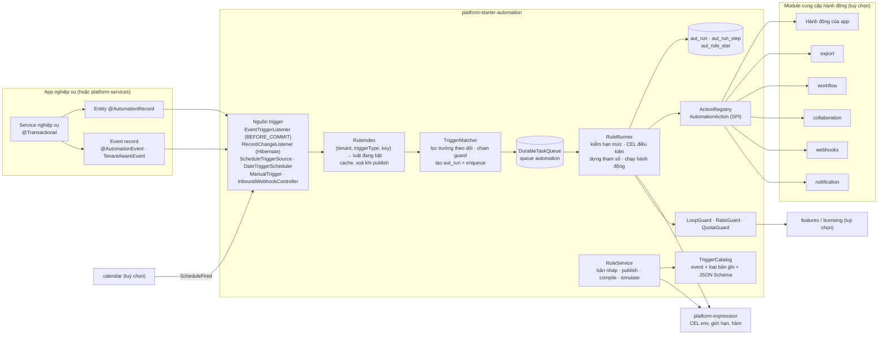
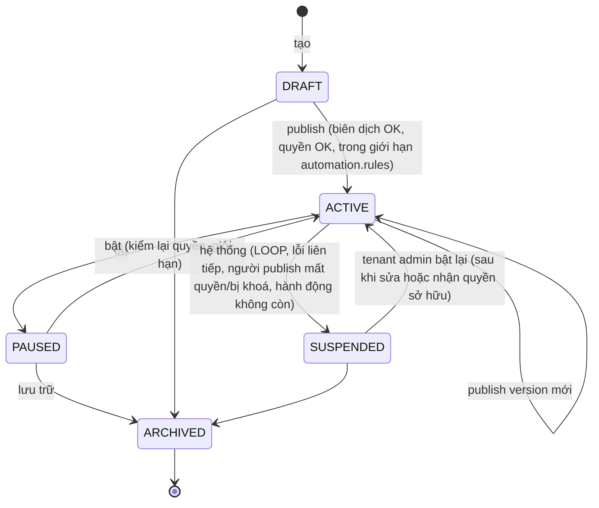
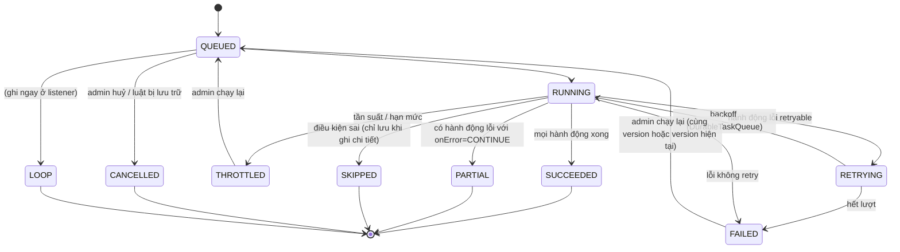
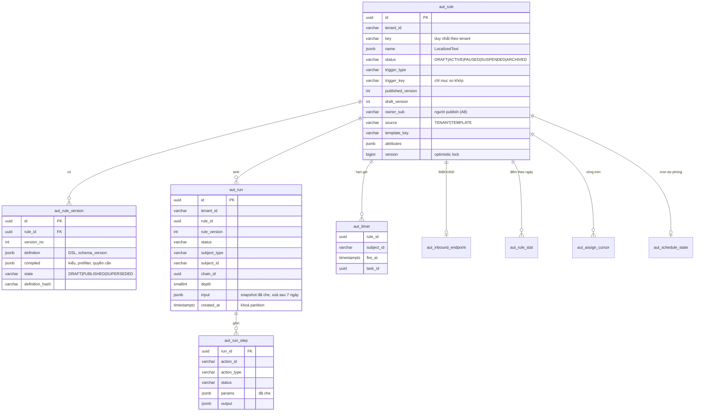

# Thiết kế module automation: `platform-starter-automation` + `@vyforge/automation` + `@vyforge/automation-admin`

> **Trạng thái:** bản thiết kế chờ duyệt (27/10/2026), phiên forge-73. Chưa có code.
>
> **Phạm vi:** luật tự động "khi X thì Y" do tenant admin tự cấu hình, không cần dev:
> - trigger: event công khai của các module (`TenantAwareEvent`), thay đổi bản ghi, lịch chạy theo ngày làm việc
>   (`calendar`), mốc tương đối theo trường ngày của bản ghi, nút bấm thủ công, webhook gọi vào;
> - điều kiện viết bằng CEL có sandbox (không script tuỳ ý), soạn bằng trình dựng trực quan;
> - hành động qua SPI `AutomationAction` do module cài: gửi thông báo, phát webhook, tạo việc, giao việc, đặt giá trị
>   field, khởi động workflow, chạy export…;
> - chống vòng lặp (độ sâu chuỗi, tần suất theo luật và theo tenant, tự tạm dừng), log từng lần chạy, chạy thử, bật/tắt,
>   version luật;
> - admin cho tenant admin: trình dựng luật trên `admin-kit`, lịch sử chạy, mẫu luật.
>
> **Nền:** platform-java 0.12.1 (`SecretCipher`, `DurableTaskQueue`, `StarterSchemaMigrator`), platform-web 0.9.0,
> module-conventions mục 1–6, `platform-services.md` (forge-37: Next.js Multi-Zones, `/m/<module>`,
> `@vyforge/admin-shell`, manifest `contract: 1`, `GET /api/v1/<module>/admin/info`), `admin-kit.md` (forge-49), gap
> analysis 10/2026 mục 2.11 và 6.12. Bản phát hành đích: `platform-java` 0.13.0 (`platform-starter-automation`,
> `platform-expression`), `platform-web` (`@vyforge/automation` 0.1.0), app `platform-admin/apps/automation-admin`.
>
> **Module liên quan (chỉ dùng qua interface, không phụ thuộc cứng):** `workflow` (forge-39), `calendar` (forge-55),
> `forms` (forge-56), `collaboration` (forge-40), `notification`, `webhooks`, `features`, `export`, `privacy-dsr`,
> `licensing`, `custom-fields` (đang thiết kế song song, đợt C). Ranh giới với `workflow` chốt ở mục 1.2.
>
> **Ghi chú độ tin cậy.** Version thư viện lấy từ `maven-metadata.xml` của Maven Central và GitHub API, kiểm ngày
> 27/10/2026. Hành vi của hệ thống tham khảo lấy từ tài liệu chính thức và **mã nguồn** (Odoo 19.0, Directus `main`,
> Frappe `develop`). Chỗ chưa đối chiếu được ghi **(chưa kiểm chứng)**.

## Mục lục

0. [Tóm tắt quyết định](#0-tóm-tắt-quyết-định)
1. [Bài toán và phạm vi](#1-bài-toán-và-phạm-vi)
2. [Nghiên cứu](#2-nghiên-cứu)
3. [Kiến trúc](#3-kiến-trúc)
4. [Mô hình dữ liệu](#4-mô-hình-dữ-liệu)
5. [API](#5-api)
6. [Mở rộng](#6-mở-rộng)
7. [Vận hành](#7-vận-hành)
8. [Bảo mật và tuân thủ](#8-bảo-mật-và-tuân-thủ)
9. [Kế hoạch triển khai](#9-kế-hoạch-triển-khai)
10. [Đóng gói và triển khai độc lập](#10-đóng-gói-và-triển-khai-độc-lập)
11. [Lệch quy ước và quyết định](#11-lệch-quy-ước-và-quyết-định)

---

## 0. Tóm tắt quyết định

**Quyết định về module:**
- **Thêm** starter `platform-starter-automation` (platform-java), package `@vyforge/automation` (platform-web), admin MFE
  `automation-admin` (platform-admin).
- **Thêm** thư viện nhỏ `platform-expression` (platform-java, không phải starter): môi trường CEL dùng chung, giới hạn chi
  phí, hàm chuẩn, SPI `ExpressionFunctions`. Workflow (W6) và automation cùng dùng; forms dùng khi có công thức (bản sau).
  Không tách thì có hai bản cấu hình sandbox CEL lệch nhau (Q1).
- **Không thêm** server riêng: chạy nhúng hoặc trong `platform-services`.
- **Không gộp** vào workflow: gap analysis 2.11 đã chốt tách; ranh giới ở mục 1.2.

| # | Quyết định | Lý do ngắn |
|---|---|---|
| A1 | **Mô hình ECA, chạy xong ngay.** Luật = một trigger + một điều kiện + danh sách hành động tuần tự (tối đa 10). Không có bước chờ người, không có bước "chờ X ngày" giữa hai hành động. Hẹn giờ thể hiện bằng trigger (lịch, mốc tương đối) hoặc tham số của hành động (hạn của việc, `scheduledAt` của thông báo) | Ranh giới với workflow (gap analysis 2.11). Bước chờ kéo theo trạng thái chạy dài, tức là một engine quy trình thứ hai |
| A2 | **Luật chạy sau commit, bất đồng bộ, qua `DurableTaskQueue`** (queue `automation`). Bộ so khớp trigger chạy trong transaction nghiệp vụ (listener `BEFORE_COMMIT`), chỉ enqueue khi có luật đang bật khớp loại trigger. Không có luật "chặn" giao dịch kiểu filter hook của Directus | Luật lỗi không làm hỏng nghiệp vụ; việc chỉ tồn tại khi transaction commit; tenant không viết được logic chặn giao dịch (chỗ đó là hook trong code) |
| A3 | **Điều kiện viết bằng CEL** (`dev.cel:cel` 0.14.0, Apache-2.0) qua `platform-expression`: biến có kiểu (sinh từ JSON Schema của trigger), kiểm kiểu khi publish, giới hạn kích thước biểu thức, độ sâu, số vòng lặp comprehension, số bước đánh giá. **Không dùng JSONLogic** làm ngôn ngữ thứ hai: trình dựng lưu cây điều kiện dạng JSON rồi biên dịch sang CEL | Cùng ngôn ngữ với workflow (W6). `json-logic-java` 1.1.0 (05/2025) không kiểm kiểu, cập nhật cuối 09/2025 |
| A4 | **Tham số của hành động là dữ liệu có JSON Schema**; giá trị động viết bằng biểu thức CEL (`{"$expr": "record.total * 0.1"}`) hoặc chuỗi có chỗ trống `{{ record.code }}` (mỗi chỗ trống là một biểu thức CEL). Không có ngôn ngữ template thứ hai | Một bộ kiểm, một sandbox. Nội dung thông báo dài vẫn soạn bằng template Liquid của `notification` |
| A5 | **Snapshot lúc trigger.** Run giữ bản chụp dữ liệu trigger (event payload, hoặc `new`/`old` của bản ghi) và đánh giá điều kiện trên bản chụp đó. Trigger theo mốc thời gian đọc lại bản ghi lúc đến hạn qua `RecordAdapter` | Điều kiện phản ánh đúng thời điểm sự kiện (giống Odoo đánh giá domain lúc ghi); mốc thời gian phải xét trạng thái hiện tại ("chưa thanh toán sau 7 ngày") |
| A6 | **Chống vòng lặp ba lớp:** (1) chuỗi nhân quả `AutomationChain` (id chuỗi, độ sâu, tập `ruleId:subject` đã chạy) đi theo mọi event và thay đổi bản ghi mà hành động gây ra; mặc định độ sâu tối đa 5; (2) một luật chạy tối đa một lần trên một bản ghi trong một chuỗi (học `__action_done` của Odoo); (3) giới hạn tần suất theo luật và theo tenant; luật bị chặn vì vòng lặp 3 lần trong 10 phút thì tự chuyển `SUSPENDED` và báo tenant admin | Odoo chặn trong một transaction; Jira chặn bằng ngưỡng 10 lần kích hoạt liên tiếp (`LOOP`). Ta cần cả hai vì luật chạy bất đồng bộ |
| A7 | **Version luật bất biến.** Sửa là tạo bản nháp; publish kiểm và biên dịch, tạo version mới; run ghi version đã dùng. Bật/tắt tách khỏi version. Khôi phục = publish lại bản cũ thành version mới | Run cũ giải thích được; giống Zapier (run hiện version) và VyFlow của workflow |
| A8 | **Hành động chạy với danh tính dịch vụ của luật, quyền theo người publish.** Khi publish, người publish phải có quyền IAM mà từng hành động yêu cầu (`requiredPermissions(params)`). Mỗi lần chạy kiểm lại tài khoản người publish còn hoạt động; mất quyền thì luật `SUSPENDED`. Audit ghi actor `automation:<ruleKey>` thay mặt `<sub>` | Tenant admin không dùng luật để vượt quyền của chính mình (Directus chạy flow theo `accountability`); không cần lưu token người dùng |
| A9 | **Trigger lấy từ catalog có khai báo.** Event phải có `@AutomationEvent` hoặc được `AutomationTriggerCatalog` khai báo (key, nhãn vi/en, JSON Schema, mức dữ liệu cá nhân, ví dụ). Event không khai báo không dùng được | Tenant chỉ thấy event ổn định, có schema; đổi tên event nội bộ không làm vỡ luật. Giống `WebhookEventCatalog` |
| A10 | **Thay đổi bản ghi qua `RecordAdapter` + `@AutomationRecord`.** App khai báo loại bản ghi tự động hoá được (trường, nhãn, kiểu, trường ghi được). Starter có listener Hibernate tính trường thay đổi cho entity có `@AutomationRecord`; app không dùng JPA thì gọi `RecordChanges.publish(...)` | Học `trigger_field_ids` của Odoo (chỉ chạy khi trường được theo dõi đổi). Không cho luật đọc/ghi bảng tuỳ ý |
| A11 | **Lịch theo ngày làm việc dùng `calendar`** (`CalendarSchedules`, `ScheduleFired`). Không có calendar thì dùng cron 5 trường theo múi giờ tenant (thêm trường giây `0` rồi parse bằng `CronExpression` 6 trường của Spring), chạy bằng `@ClusterScheduled` có watermark | "Ngày làm việc đầu tiên của tháng, Tết thì dời" là nhu cầu thật (calendar K9). Không tự viết lịch thứ hai |
| A12 | **Chạy thử không có tác dụng phụ.** `simulate` đánh giá điều kiện, dựng tham số và gọi `AutomationAction.preview` (mặc định chỉ mô tả). Chạy thử được trên payload mẫu, trên 20 event/bản ghi gần nhất (khi có log) hoặc trên một bản ghi chọn tay | Tenant thấy luật sẽ làm gì trước khi bật; n8n và Zapier đều có chế độ thử |
| A13 | **Log mọi lần chạy khớp điều kiện; lần không khớp chỉ đếm.** Bảng `aut_run` partition theo tháng; lần điều kiện sai chỉ tăng bộ đếm ngày, trừ khi bật "ghi chi tiết" cho luật trong tối đa 24 giờ. Bản chụp dữ liệu bị xoá sau 7 ngày, run giữ 30 ngày (lỗi 90 ngày) | Luật "khi bản ghi được sửa" có thể khớp trigger hàng triệu lần/ngày nhưng khớp điều kiện rất ít. Giảm lưu PII |
| A14 | **Giới hạn thương mại qua `features`:** `module.automation`, `admin.automation`, giới hạn `automation.rules` (số luật đang bật) và hạn mức `automation.runs` (lần chạy/tháng, `consume`). Vượt hạn mức thì run `THROTTLED`, không mất event (chờ chu kỳ sau hoặc admin chạy lại) | Bán theo gói như Zapier (task) và Jira (lần chạy theo gói); `licensing` kẹp trần (licensing mục 3.10) |
| A15 | **Mặc định nhúng** (`mode: embedded`), vì `record.update` và trigger thay đổi bản ghi cần chạy trong app. Chạy được ở `platform-services`: event đến qua Kafka, ghi bản ghi qua endpoint nội bộ có ký của app | Giống collaboration C14 |
| A16 | **Hành động ra ngoài chỉ qua module có kiểm soát.** Không có hành động "gọi URL tuỳ ý": gửi ra ngoài đi qua `webhook.emit` (module webhooks: ký, retry, chống SSRF) hoặc hành động do app khai báo endpoint cố định | SSRF và rò dữ liệu là rủi ro lớn nhất của automation do người dùng cấu hình |

---

## 1. Bài toán và phạm vi

### 1.1 Bài toán

Khách hàng doanh nghiệp liên tục xin những thay đổi nhỏ kiểu "khi … thì …":

- "đơn hàng đã giao và trên 10 triệu thì gửi ZNS cảm ơn, tạo việc gọi lại sau 3 ngày làm việc";
- "hồ sơ ứng tuyển nộp thì báo phòng nhân sự, chia đều cho ba chuyên viên";
- "hợp đồng còn 30 ngày hết hạn thì nhắc người phụ trách, còn 7 ngày thì nhắc cả trưởng phòng";
- "ngày làm việc đầu tiên của tháng lúc 8h30 gửi báo cáo doanh thu tháng trước cho ban giám đốc".

Mỗi yêu cầu là một lần dev sửa code, review, deploy. Odoo (Automated Actions), Frappe (Notification, Assignment Rule),
Directus (Flows), Jira (Automation) cho người quản trị tự làm. Vyforge chưa có (gap analysis bảng so sánh: ✗).

Module automation giải bài toán bằng một lớp mỏng: đọc event và thay đổi bản ghi đã có, đánh giá điều kiện có sandbox,
gọi hành động do các module khác cung cấp. Automation **không tự gửi tin, không tự lưu việc, không tự gọi HTTP**: nó điều
phối `notification`, `collaboration`, `webhooks`, `workflow`, `export` và các hành động của app.

### 1.2 Phạm vi và ranh giới

| Trong phạm vi | Ngoài phạm vi (thuộc module khác hoặc không làm) |
|---|---|
| Trigger: event công khai, bản ghi tạo/sửa/xoá/đổi trường, lịch (ngày làm việc), mốc tương đối theo trường ngày, thủ công, webhook gọi vào | Quy trình nhiều bước có người duyệt, trạng thái chờ, SLA, escalation (**workflow**) |
| Điều kiện CEL, trình dựng điều kiện trực quan | Script tuỳ ý (Python, JS, Groovy) do tenant viết |
| Hành động qua SPI; bộ hành động có sẵn khi module tương ứng được cài | Logic gửi tin, template, kênh (**notification**); ký, retry webhook (**webhooks**); lưu việc (**collaboration**) |
| Giao việc tự động theo luật (vòng tròn, ít việc nhất, theo trường): luật nằm ở đây, việc nằm ở collaboration | Hộp việc, nhắc việc (**collaboration**, **calendar**) |
| Chống vòng lặp, giới hạn tần suất, hạn mức theo gói | Rate limit hạ tầng chung (**-ratelimit** được dùng lại) |
| Version, bật/tắt, chạy thử, log chạy, chạy lại | Kiểm tra dữ liệu đồng bộ chặn giao dịch (hook trong code, `SubmissionInterceptor` của forms) |
| Mẫu luật do app giao sẵn, tenant cài và sửa | Connector tới hàng trăm SaaS kiểu Zapier/n8n (đi qua `webhooks` + `api-access`) |
| Admin MFE cho tenant admin và người vận hành | Chợ hành động của bên thứ ba |

**Ranh giới với workflow, kiểm lại theo thiết kế workflow đã merge:**

| Câu hỏi | Automation | Workflow |
|---|---|---|
| Có người ra quyết định giữa chừng? | Không | Có (bước duyệt) |
| Có trạng thái chờ (ngày, event, người)? | Không. Luật chạy xong trong một lần | Có (`wait`, SLA, yêu cầu bổ sung) |
| Lặp lại theo thời gian? | Trigger lịch, mỗi lần là một run độc lập | Nhắc việc/escalation trong một hồ sơ |
| Ai nối ai? | Automation gọi `Workflow.start` (hành động `workflow.start`); nghe `WorkflowCompleted` làm trigger | Workflow không phụ thuộc automation (workflow mục 6.3) |
| Ngôn ngữ điều kiện | CEL qua `platform-expression` | CEL (W6), cùng thư viện |

Khi một luật cần "chờ 3 ngày rồi kiểm lại", có hai cách đúng: (a) trigger mốc tương đối (`createdAt + 3 ngày làm việc`,
điều kiện xét lúc đến hạn); (b) hành động tạo việc có hạn. Nếu cần chuỗi chờ nhiều bước, đó là workflow.

### 1.3 Kịch bản nghiệp vụ phải đáp ứng

| # | Kịch bản | Đòi hỏi | Quyết định liên quan |
|---|---|---|---|
| K1 | **TMĐT:** đơn chuyển sang "Đã giao" và tổng tiền > 10.000.000 ₫ → gửi ZNS cảm ơn, tạo việc "Gọi chăm sóc" cho nhân viên phụ trách, hạn 3 ngày làm việc | Trigger đổi trường `status` với điều kiện trên `old`/`new`; hai hành động; hạn theo ngày làm việc | A1, A10, `todo.create` + calendar |
| K2 | **Tuyển dụng:** form ứng tuyển được nộp → email cho phòng nhân sự; giao việc sàng lọc vòng tròn cho 3 chuyên viên | Trigger `forms.submission.created` lọc theo `formKey`; giao việc vòng tròn có trạng thái | A9, `todo.create` (`ROUND_ROBIN`) |
| K3 | **Hợp đồng:** còn 30 ngày đến `endDate` → nhắc người phụ trách; còn 7 ngày → nhắc cả trưởng phòng; hợp đồng đã gia hạn thì không nhắc | Mốc tương đối theo trường ngày; điều kiện xét lại lúc đến hạn; đổi `endDate` thì dời mốc | A5, trigger `RECORD_DATE` |
| K4 | **Báo cáo:** ngày làm việc đầu tiên của tháng 08:30 (Tết thì ngày làm việc kế tiếp) → chạy export doanh thu tháng trước, gửi link cho ban giám đốc | Lịch theo `calendar`; hành động `export.start` + thông báo khi xong | A11 |
| K5 | **Công nợ:** hoá đơn quá hạn 7 ngày chưa thanh toán → ZNS nhắc khách, gắn nhãn "Nợ quá hạn", báo kế toán. Gắn nhãn không làm luật tự kích hoạt lại | Mốc tương đối + `record.update`; chống vòng lặp | A5, A6 |
| K6 | **CSKH:** ticket ưu tiên cao chưa phản hồi sau 4 giờ làm việc → chuyển cho trưởng nhóm, báo qua kênh chat | Mốc theo giờ làm việc; `record.assign` | A5, calendar `addBusinessDuration` |
| K7 | **Bán hàng:** lead mới từ website → giao theo tỉnh/thành (Hà Nội → nhóm miền Bắc, TP.HCM → nhóm miền Nam), trong nhóm chia cho người ít việc nhất | Điều kiện theo trường; chiến lược `LEAST_OPEN` của collaboration | `record.assign` |
| K8 | **Tài chính:** đề nghị thanh toán > 50 triệu được tạo → khởi động quy trình duyệt cấp giám đốc; ≤ 50 triệu → tự đánh dấu "Chờ kế toán" | Hai luật hoặc một luật có hai nhánh qua điều kiện; `workflow.start` khi có workflow | A1, mục 6.3 |
| K9 | **Đồng bộ ERP:** `WorkflowCompleted` với `APPROVED` → cập nhật trạng thái phiếu, phát webhook `automation.rule` tới endpoint MISA/ERP của khách | Trigger từ event module khác; `webhook.emit` có ký | A16 |
| K10 | **Sinh nhật khách hàng:** 08:00 đúng ngày sinh nhật (bỏ năm) → gửi ZNS voucher, chỉ khách đã đồng ý nhận tin quảng cáo | Mốc "kỷ niệm" theo trường ngày; hàm `hasConsent` (privacy-dsr); quảng cáo tuân theo giờ gửi của notification | §8.2 |
| K11 | **Kho:** tồn kho dưới ngưỡng tối thiểu → báo thủ kho, phát webhook cho nhà cung cấp; không báo lại trong 24 giờ cho cùng mặt hàng | Chặn lặp theo khoá (`cooldown` theo `subject`) | A6, `cooldown` |
| K12 | **Thanh toán:** `PaymentSucceeded` (IPN VNPay/MoMo) → đổi đơn sang "Đã thanh toán", gửi email biên nhận | Event của payment; idempotent khi IPN lặp | A2, idempotency |
| K13 | **eKYC:** xác minh thất bại lần thứ 3 trong ngày → báo bộ phận rủi ro, gắn cờ hồ sơ | Điều kiện trên trường đếm của event; hành động thông báo nhóm | A9 |
| K14 | **Duyệt bài CMS:** bài viết chuyển sang "Chờ duyệt" → báo biên tập viên trực ca (theo lịch trực) | Trigger bản ghi của cms; người nhận theo nhóm | — |
| K15 | **Tenant sửa luật mùa cao điểm:** trước khi bật, chạy thử trên 20 đơn gần nhất để xem bao nhiêu đơn khớp và tin nhắn sẽ ra sao | Chạy thử trên dữ liệu thật, không gửi | A12 |
| K16 | **Vòng lặp do cấu hình sai:** luật A "đơn sửa → đặt `updatedNote`", luật B "`updatedNote` đổi → sửa đơn" → bị chặn ở độ sâu 5, luật bị tạm dừng, tenant admin được báo, có log chuỗi | A6 |
| K17 | **Người publish nghỉ việc:** tài khoản bị khoá → luật của người đó tự `SUSPENDED`, tenant admin nhận việc "chuyển chủ luật" | A8 |
| K18 | **Gói dịch vụ:** gói Cơ bản 10 luật, 5.000 lần chạy/tháng; vượt thì run `THROTTLED`, tenant thấy cảnh báo và nút nâng gói | A14 |
| K19 | **Nhắc ra ngoài hệ thống:** hệ thống chấm công bên thứ ba gọi webhook vào (`POST /hooks/automation/<token>`) khi nhân viên đi muộn → gửi thông báo cho quản lý trực tiếp | Trigger `INBOUND` có HMAC, rate limit, schema payload do tenant khai | §3.3, §8 |
| K20 | **Người vận hành:** provider SMS phục hồi (`TaskQueueResumed`) → luật cấp vận hành gửi báo cáo tới kênh trực | Luật ở tenant vận hành; event của ops-console | ops-console mục 7 |

### 1.4 Để bản sau (mục 9.4)

- Nhánh rẽ trong một luật (`if/else` giữa các hành động). Bản đầu: mỗi hành động có `when` (CEL) riêng, đủ cho K8.
- Vòng lặp `for each` trên danh sách (vd. mỗi dòng của đơn hàng).
- Hành động AI (tóm tắt, phân loại) qua `ai` use case.
- Trigger theo kết quả truy vấn định kỳ ("mỗi sáng, mọi hoá đơn quá hạn"): bản đầu dùng mốc tương đối theo bản ghi.
- Kho mẫu luật dùng chung giữa các tenant (marketplace).

---

## 2. Nghiên cứu

### 2.1 Hệ thống tham khảo

| Hệ thống | Phiên bản, license | Mô hình dữ liệu | Trigger | Điều kiện | Hành động | Chống vòng lặp, giới hạn | Điểm mạnh | Điểm yếu |
|---|---|---|---|---|---|---|---|---|
| **Odoo Automation Rules** (`base_automation`) ([tài liệu 19.0](https://www.odoo.com/documentation/19.0/applications/studio/automated_actions.html), [mã nguồn](https://github.com/odoo/odoo/blob/19.0/addons/base_automation/models/base_automation.py)) | 19.0, LGPL-3.0 (Community) | `base.automation`: `model_id`, `trigger`, `trigger_field_ids` (trường theo dõi), `filter_pre_domain` (trước khi sửa), `filter_domain` (sau khi sửa), `trg_date_id` + `trg_date_range` + `trg_date_range_type` + `trg_date_calendar_id` (mốc theo trường ngày, có lịch làm việc), `last_run`, `action_server_ids` | `on_create`, `on_create_or_write`, `on_stage_set`, `on_state_set`, `on_tag_set`, `on_user_set`, `on_priority_set`, `on_archive`, `on_unarchive`, `on_unlink`, `on_change` (UI), `on_time`/`on_time_created`/`on_time_updated`, `on_message_received/sent`, `on_webhook` (đọc mã nguồn 19.0) | Domain Odoo (`safe_eval`) trước và sau khi sửa | Server action: cập nhật bản ghi, tạo/nhân bản bản ghi, tạo activity, gửi email/SMS/WhatsApp, thêm/bớt follower, chạy code Python, gửi webhook, nhiều hành động | Ngữ cảnh `__action_done`: một luật chạy tối đa một lần trên một bản ghi trong một lượt xử lý (`_process`). Trigger theo thời gian chạy bằng cron mặc định 4 giờ/lần; tài liệu cảnh báo luật mới có thể áp dụng ngược cho bản ghi cũ | Trigger theo trường cụ thể; domain trước/sau sửa; mốc thời gian theo lịch làm việc; nhiều loại hành động | Chạy đồng bộ trong transaction: lỗi hành động làm hỏng thao tác của người dùng; "Execute Code" là Python (rủi ro); không có log chạy, không chạy thử, không version |
| **Directus Flows** ([tài liệu](https://docs.directus.io/app/flows/triggers), [mã nguồn `flows.ts`](https://github.com/directus/directus/blob/main/api/src/flows.ts)) | v12.5.1 (23/10/2026). License: **Monospace Sustainable Core License 1.0** (MSCL-1.0-GPL, đọc file `license` ở `main`), không phải OSI | `directus_flows` (trigger, `options`, `accountability`), `directus_operations` (đồ thị: `resolve`/`reject` trỏ tới operation kế tiếp), log ở `directus_activity` + `directus_revisions` khi `accountability = 'all'` | `event` (loại `filter` chặn giao dịch hoặc `action` sau giao dịch), `schedule` (cron), `operation` (flow khác gọi), `webhook`, `manual` (nút trên bản ghi) | Operation "Condition" dùng filter rules của Directus; nhánh `resolve`/`reject` | Đọc/tạo/sửa/xoá item, gửi email, thông báo, gọi webhook/HTTP, chạy script (isolated sandbox: `FLOWS_RUN_SCRIPT_MAX_MEMORY` 32 MB, `FLOWS_RUN_SCRIPT_TIMEOUT` 10 s), gọi flow khác, transform | Thao tác item có tuỳ chọn `emitEvents` (tắt thì không kích hoạt flow khác); biến môi trường chỉ lộ theo `FLOWS_ENV_ALLOW_LIST` | Đồ thị trực quan; data chain (`$trigger`, `$last`, kết quả từng bước); flow thủ công có kiểm quyền; filter hook chặn được giao dịch | Filter hook do người dùng cấu hình chặn được giao dịch (dễ gây lỗi khó hiểu); HTTP tuỳ ý (SSRF); chạy script JS; license không phải OSI |
| **Frappe Notification + Assignment Rule** ([Notification](https://docs.frappe.io/erpnext/user/manual/en/notifications), [Assignment Rule](https://docs.frappe.io/erpnext/user/manual/en/assignment-rule), [mã nguồn](https://github.com/frappe/frappe/blob/develop/frappe/email/doctype/notification/notification.py)) | Frappe v16.53.0 (22/10/2026), MIT | Notification: `document_type`, `event`, `condition`, `value_changed`, `days_in_advance`, `date_changed`, kênh, người nhận, `set_property_after_alert`. Assignment Rule: `document_type`, `priority`, điều kiện gán/đóng/bỏ gán, `rule` (Round Robin, Load Balancing, Based on Field), `users`, ngày hạn theo trường | New, Save, Submit, Cancel, Days Before/After (trường ngày), Value Change, Method | Biểu thức Python qua `frappe.safe_eval` (mã nguồn dòng 126, 315) | Gửi qua email, Slack, thông báo hệ thống, SMS, WhatsApp; đặt giá trị trường sau khi gửi; giao việc | `set_property_after_alert` là cách người dùng tự chặn gửi lặp (đặt cờ rồi đưa vào điều kiện) | Assignment Rule rất sát nhu cầu VN (vòng tròn, ít việc nhất); nhắc theo ngày trước/sau | Hai cơ chế tách rời; điều kiện là Python; chống lặp phải tự làm bằng cờ |
| **Atlassian Automation** (Jira Cloud) ([giới hạn dịch vụ](https://support.atlassian.com/cloud-automation/docs/automation-service-limits/)) | SaaS, thương mại | Rule = trigger + điều kiện + hành động + nhánh; audit log từng lần chạy | Event Jira, lịch, thủ công, webhook gọi vào | Điều kiện so sánh trường, JQL, smart values | Rất nhiều | **Loop detection 10**: flow kích hoạt chính nó hoặc flow khác liên tiếp quá 10 lần thì dừng, trạng thái `LOOP`; đồng thời 5–30 theo gói; 65 thành phần/flow; 60 phút xử lý/12 giờ; 50.000 việc trong hàng đợi toàn cục; vượt thì `THROTTLED` trong audit log; có trigger "Service limit breached" | Giới hạn rõ, công khai, có trạng thái riêng cho vòng lặp và bị bóp | Giới hạn theo gói phức tạp; không tự host |
| **Zapier** ([Zap history](https://help.zapier.com/hc/en-us/articles/8496291148685)) | SaaS, thương mại | Zap = trigger + các bước; mỗi run gắn version | Hàng nghìn app | Bước Filter, Paths | Hàng nghìn app | Tính phí theo task; replay trong 60 ngày; Filter/Paths không replay | Lịch sử run có Data In/Out từng bước, version của run, replay | Không tự host; dữ liệu khách đi qua bên thứ ba |
| **n8n** ([biến cấu hình execution](https://docs.n8n.io/hosting/configuration/environment-variables/executions/)) | 2.44.7 (26/10/2026), **Sustainable Use License** (+ phần `.ee` thương mại), không phải OSI | Workflow là đồ thị node; execution lưu dữ liệu từng node | Webhook, cron, event app, thủ công | Node IF/Switch, biểu thức JS | Hàng trăm node | `EXECUTIONS_TIMEOUT` (mặc định tắt), `EXECUTIONS_TIMEOUT_MAX` 3.600 s; lưu execution theo trạng thái (`EXECUTIONS_DATA_SAVE_ON_*`), xoá sau 336 giờ hoặc 10.000 bản (`EXECUTIONS_DATA_PRUNE*`) | Chính sách lưu log theo trạng thái, xoá tự động; chế độ chạy thử từng node | License không cho nhúng bán lại; biểu thức JS |
| **Google CEL** ([cel-java](https://github.com/google/cel-java), [Maven](https://repo1.maven.org/maven2/dev/cel/cel/)) | `dev.cel:cel` 0.14.0 (17/08/2026), Apache-2.0, Java 8+ | Biểu thức biên dịch thành AST đã kiểm kiểu, chạy bằng `CelRuntime` | — | Không có tác dụng phụ, luôn dừng; `CelOptions`: `maxExpressionCodePointSize`, `maxParseRecursionDepth`, `maxParseExpressionNodeCount`, `comprehensionMaxIterations`, `maxRegexProgramSize`; `CelEvaluationListener` để đếm bước; kiểu struct tuỳ biến qua `StructType.create(name, fields, FieldResolver)` (đọc mã nguồn `main`) | — | — | Có kiểm kiểu lúc biên dịch, dùng ở Kubernetes, Envoy, Firebase; workflow đã chọn | Người dùng nghiệp vụ không viết CEL được: cần trình dựng |
| **JSONLogic** ([json-logic-java](https://github.com/jamsesso/json-logic-java)) | 1.1.0 (02/05/2025), MIT, đẩy code lần cuối 07/09/2025 | Cây JSON | — | Toán tử `==`, `and`, `in`, `var`… | — | Không kiểm kiểu; không giới hạn chi phí sẵn | Dễ sinh từ UI | Ngôn ngữ thứ hai bên cạnh CEL; ít bảo trì |

### 2.2 Ghi chú từ mã nguồn

- **Odoo chống đệ quy theo bản ghi, không theo độ sâu.** `_process` lấy `__action_done` trong context, bỏ các bản ghi luật
  đã xử lý, đánh dấu bản ghi còn lại trước khi chạy hành động. Hành động sửa bản ghi đó không làm chính luật chạy lại,
  nhưng luật B vẫn chạy được; vòng A→B→A trên cùng bản ghi dừng vì A đã đánh dấu. Ta học cách đánh dấu `ruleId:subject`
  trong chuỗi (A6.2), nhưng phải mang qua ranh giới bất đồng bộ.
- **Odoo đánh giá điều kiện trước và sau khi sửa** (`filter_pre_domain`, `filter_domain`). "Chuyển sang Đã giao" khác
  "đang ở Đã giao": ta có biến `old` và `new` và hàm `changed('status')`.
- **Directus tách `filter` (chặn) và `action` (sau giao dịch).** Flow filter kết thúc ở nhánh reject thì huỷ giao dịch.
  Ta không làm loại chặn (A2).
- **Directus ghi log theo `accountability`** (`null` = không ghi, `activity`, `all` = kèm revision). Ta học: log chi tiết
  bật/tắt được theo luật (A13).
- **Frappe `set_property_after_alert`** là dấu hiệu người dùng cần chống gửi lặp. Ta có sẵn `cooldown` theo luật + bản ghi
  (K11), không bắt tenant thêm trường cờ.
- **Jira** gắn trạng thái riêng `LOOP`, `THROTTLED` vào audit log và có trigger khi chạm giới hạn: ta có trạng thái run
  `LOOP`, `THROTTLED` và event `AutomationRuleSuspended`.

### 2.3 Học theo và không làm

**Học theo:**

1. Trigger theo **trường cụ thể** và điều kiện trên giá trị **trước/sau** (Odoo).
2. Mốc thời gian theo trường ngày **có lịch làm việc** (Odoo `trg_date_calendar_id`), nhưng không quét bằng cron 4 giờ/lần:
   ta đặt hẹn giờ chính xác khi bản ghi đổi (§3.6).
3. Giao việc vòng tròn, ít việc nhất, theo trường (Frappe Assignment Rule).
4. Trạng thái `LOOP`/`THROTTLED`, giới hạn công khai theo gói (Jira).
5. Log từng run có dữ liệu vào/ra từng bước, version của run, chạy lại (Zapier).
6. Lưu log theo trạng thái và tự xoá (n8n).
7. Trigger thủ công trên bản ghi, có kiểm quyền (Directus `manual`).

**Không làm:**

| Không làm | Lý do |
|---|---|
| Script tuỳ ý (Odoo Execute Code, Directus Run Script, n8n Code, Frappe Server Script) | Thực thi mã do tenant viết trong JVM dùng chung; sandbox JS/Python khó đảm bảo. CEL đủ cho điều kiện và tính giá trị |
| Luật chặn giao dịch (Directus filter, Odoo `on_change`) | Lỗi cấu hình của tenant làm hỏng nghiệp vụ; logic chặn thuộc code của app |
| Gọi HTTP tới URL tuỳ ý | SSRF, rò dữ liệu; đi qua `webhooks` (A16) |
| Đồ thị tuỳ ý nhiều nhánh, vòng lặp (Directus, n8n) | Thành engine quy trình thứ hai; workflow đã có |
| Nhúng n8n hoặc Directus | License SUL/MSCL không phải OSI, không theo tenant/IAM của vyforge (gap analysis mục 4) |
| Quét bản ghi định kỳ để tìm bản ghi đến hạn (cron Odoo) | Chậm (4 giờ/lần), tốn tải; dùng hẹn giờ theo từng bản ghi |
| JSONLogic song song với CEL | Hai ngôn ngữ, hai sandbox (A3) |

---

## 3. Kiến trúc

### 3.1 Sơ đồ thành phần



### 3.2 Gói và lớp

```
com.vyforge.platform.automation             API công khai: AutomationRules, AutomationRuns, AutomationTriggers,
                                            RecordChanges, AutomationChain, record, event, mã lỗi AutomationErrors,
                                            AutomationActions (action catalog IAM)
com.vyforge.platform.automation.spi         AutomationAction, ActionContext, ActionResult, RecordAdapter,
                                            AutomationTriggerCatalog, AssigneeStrategy, AutomationInterceptor
com.vyforge.platform.automation.annotation  @AutomationEvent, @AutomationRecord, @AutomationField
com.vyforge.platform.automation.port        AutomationScheduler (calendar), AutomationEntitlements (features),
                                            PrincipalDirectory (IAM)
com.vyforge.platform.automation.internal    RuleIndex, TriggerMatcher, RuleRunner, RuleCompiler, LoopGuard,
                                            RateGuard, QuotaGuard, RunRecorder, DateTriggerScheduler, …
com.vyforge.platform.automation.integration.<module>   Hành động và adapter cho notification, webhooks,
                                            collaboration, workflow, export, calendar, features, privacy, custom-fields
com.vyforge.platform.automation.web         REST: /api/v1/automation/** (admin, manual, inbound, internal)

com.vyforge.platform.expression (platform-expression)
                                            Expressions (biên dịch/đánh giá), ExpressionEnvironment, ExpressionLimits,
                                            ExpressionFunctions (SPI), SchemaTypes (JSON Schema → kiểu CEL), Template
                                            (chuỗi có {{ }}), CompiledExpression
```

ArchUnit: chỉ `..expression..` được import `dev.cel..`; `..integration.<module>..` là nơi duy nhất import package của
module tương ứng; mọi lớp `integration` có `@ConditionalOnClass` + `@ConditionalOnBean`.

### 3.3 Khái niệm

| Khái niệm | Nghĩa |
|---|---|
| **Luật** (`aut_rule`) | Định danh ổn định (`key`, duy nhất theo tenant), trạng thái, version đang chạy, người publish |
| **Version luật** (`aut_rule_version`) | Định nghĩa bất biến sau publish: trigger, điều kiện, hành động, tuỳ chọn |
| **Trigger** | Một trong 6 loại (bảng dưới). Mỗi loại có `key` để tra chỉ mục |
| **Điều kiện** | Biểu thức CEL trả `bool`; rỗng = luôn đúng |
| **Hành động** | Một mục trong danh sách: `type` (của `AutomationAction`), `params`, `when` (CEL tuỳ chọn), `onError` (`STOP` mặc định, `CONTINUE`) |
| **Run** (`aut_run`) | Một lần luật được kích hoạt và điều kiện đúng (hoặc bị chặn: `LOOP`, `THROTTLED`) |
| **Chuỗi** (`AutomationChain`) | Nhân quả giữa các run: run do hành động của run khác gây ra thì cùng chuỗi, độ sâu + 1 |
| **Subject** | Bản ghi chính của run, dạng `EntityRef` (`crm:order/01J…`), dùng cho chống lặp, cooldown, log theo bản ghi |

**Loại trigger:**

| Loại | `key` | Nguồn | Dữ liệu cho điều kiện |
|---|---|---|---|
| `EVENT` | Tên event trong catalog: `forms.submission.created`, `workflow.completed`, `payment.succeeded` | Event Spring có `@AutomationEvent` (cùng app) hoặc Kafka (ở `platform-services`) | `event` (kiểu theo schema), `trigger`, `actor` |
| `RECORD` | Loại bản ghi + thao tác: `crm:order` + `CREATED`/`UPDATED`/`DELETED`/`CREATED_OR_UPDATED`; tuỳ chọn `fields[]` (chỉ kích hoạt khi một trong các trường đổi) | `@AutomationRecord` (Hibernate) hoặc `RecordChanges.publish` | `record` (sau), `old` (trước, null khi tạo), `changed` (danh sách trường), `actor` |
| `SCHEDULE` | `ScheduleSpec` của calendar (`nthBusinessDay`, `everyBusinessDay`, `rrule`) hoặc cron 5 trường + múi giờ | calendar `ScheduleFired` (owner `automation`) hoặc bộ tick dự phòng | `trigger.scheduledAt`, `now` |
| `RECORD_DATE` | Loại bản ghi + trường ngày + độ lệch: `crm:contract.endDate`, `-30d` / `-7bd` / `+4bh` / `anniversary 08:00` | `DateTriggerScheduler` đặt hẹn giờ khi bản ghi tạo/đổi trường | `record` đọc lại lúc đến hạn qua `RecordAdapter.load` |
| `MANUAL` | Loại bản ghi (hoặc không) | Nút "Chạy luật" (`POST /rules/{key}/execute`) | `record`, `input` (form nhập do luật khai, JSON Schema) |
| `INBOUND` | Token endpoint | `POST /api/v1/automation/hooks/{token}` có HMAC | `payload` (kiểu theo JSON Schema tenant khai), `headers` (danh sách cho phép) |

### 3.4 Định nghĩa luật (DSL)

Luật lưu dạng JSON có JSON Schema (`META-INF/vyforge/automation/schema/rule-v1.json`), soạn bằng trình dựng hoặc
YAML (nhập/xuất). Ví dụ K1:

```yaml
# Mẫu do app giao: META-INF/vyforge/automation/templates/order-delivered-thanks.yml
schemaVersion: 1
key: order-delivered-thanks
name: { vi: "Cảm ơn khách sau khi giao đơn lớn", en: "Thank customer after large delivery" }
trigger:
  type: RECORD
  recordType: crm:order
  on: UPDATED
  fields: [status]
condition: >-
  changed('status') && record.status == 'DELIVERED' && old.status != 'DELIVERED'
  && record.total.amount > 10000000
options:
  cooldown: { per: subject, duration: P1D }        # tuỳ chọn; bỏ qua nếu cùng đơn đã chạy trong 1 ngày
  maxRunsPerMinute: 60                              # ≤ trần của tenant
actions:
  - id: thank
    type: notification.send
    params:
      type: crm.order.thank-you                     # type do app khai và cho phép automation dùng
      to: [{ kind: field, path: record.customer }]  # người nhận lấy từ trường bản ghi
      data:
        orderCode: "{{ record.code }}"
        total: { $expr: "record.total" }
  - id: callback
    type: todo.create
    params:
      subject: { $expr: "record.ref" }
      todoType: call
      title: "Gọi chăm sóc khách {{ record.customerName }} (đơn {{ record.code }})"
      assignee: { strategy: FIELD, path: record.ownerSub }
      due: { businessDays: 3 }
    onError: CONTINUE
```

**Biến trong điều kiện và tham số:**

| Biến | Kiểu | Có ở trigger |
|---|---|---|
| `event` | struct theo JSON Schema của event | `EVENT` |
| `record`, `old` | struct theo khai báo `@AutomationRecord` / `RecordTypeDefinition`; `old` có thể `null` | `RECORD`, `RECORD_DATE` (`old` không có), `MANUAL` |
| `changed` | `list(string)` | `RECORD` |
| `payload`, `headers` | struct theo schema tenant khai; `map(string,string)` | `INBOUND` |
| `input` | struct theo form của luật | `MANUAL` |
| `trigger` | `{type, key, occurredAt, scheduledAt?}` | mọi loại |
| `actor` | `{sub, groups, isSystem}`; `isSystem` = do automation/hệ thống gây ra | `EVENT`, `RECORD`, `MANUAL` |
| `tenant` | `{id, timezone, locale}` | mọi loại |
| `steps` | kết quả các hành động trước (`steps.thank.notificationId`) | chỉ trong `params`/`when` của hành động |
| `now` | `timestamp` | mọi loại |

**Hàm chuẩn** (`platform-expression`, mục 6.1): `changed(field)`, `money(amount, 'VND')`, `fold(text)` (bỏ dấu tiếng
Việt, theo `VietnameseText`), `daysBetween(a, b)`, `businessDaysBetween(a, b)` (khi có calendar), `inGroup(sub, group)`,
`hasConsent(subjectRef, purpose)` (khi có privacy-dsr), `date(ts, tz)`, `format(value, pattern)` và extension chuẩn của
cel-java (`strings`, `math`, `lists`). Không có hàm truy cập mạng, file, đồng hồ hệ thống ngoài `now` cố định của run.

### 3.5 Luồng chính: event → run

```mermaid
sequenceDiagram
  autonumber
  participant S as Service nghiệp vụ (tx)
  participant L as EventTriggerListener (BEFORE_COMMIT)
  participant I as RuleIndex
  participant M as TriggerMatcher
  participant Q as DurableTaskQueue
  participant R as RuleRunner (worker)
  participant G as Guards
  participant E as CEL (platform-expression)
  participant A as AutomationAction
  participant DB as aut_run / aut_run_step

  S->>S: publishEvent(PaymentSucceeded) [@AutomationEvent("payment.succeeded")]
  S->>L: trước commit
  L->>I: rules(tenant, EVENT, "payment.succeeded")
  I-->>L: [rule-12 v3] (cache theo tenant)
  L->>M: match(rule, payload, chain hiện tại)
  M->>M: chain guard: depth+1 ≤ max? ruleId:subject chưa có trong chuỗi?
  M->>DB: insert aut_run(QUEUED, snapshot đã che, chainId, depth)
  M->>Q: enqueue(automation/run, {runId}, idempotency = rule:eventId)
  S->>S: commit (run và task cùng commit với nghiệp vụ)
  Q->>R: handle(runId) trong TenantContext.run
  R->>G: RateGuard (luật, tenant) · QuotaGuard (automation.runs)
  G-->>R: OK
  R->>E: evaluate(condition, snapshot) ≤ 10.000 bước
  E-->>R: true
  loop từng hành động
    R->>E: when? dựng params ({{ }}, $expr)
    R->>A: execute(ctx) với AutomationChain(depth+1) gắn vào ngữ cảnh
    A-->>R: Completed(outputs) / Failed(code, retryable)
    R->>DB: aut_run_step
  end
  R->>DB: aut_run SUCCEEDED | PARTIAL | FAILED; aut_rule_stat++
```

Điều kiện sai: run chuyển `SKIPPED` và **bị xoá ngay trong cùng transaction** (chỉ tăng `aut_rule_stat.skipped`), trừ khi
luật đang bật "ghi chi tiết" (A13). Vì vậy điều kiện được đánh giá ở worker chứ không ở listener: listener không chạy
CEL trong transaction nghiệp vụ, nên thao tác của người dùng không chậm thêm và không lỗi vì luật.

**Tối ưu khi khớp nhiều:** luật có trigger `RECORD` trên bảng ghi nhiều có thể tạo nhiều run rồi bị bỏ. Có hai lớp lọc
rẻ trước khi enqueue: (1) `fields[]` (chỉ khi trường theo dõi đổi), (2) `prefilter`: phần điều kiện mà trình biên dịch tách
được thành so sánh bằng trên trường trạng thái (`record.status == 'DELIVERED'`) được đánh giá ngay ở listener bằng so sánh
giá trị, không chạy CEL. Phần còn lại đánh giá ở worker.

### 3.6 Trigger theo mốc thời gian của bản ghi (`RECORD_DATE`)

```mermaid
sequenceDiagram
  autonumber
  participant S as Service (tx)
  participant RC as RecordChangeListener
  participant D as DateTriggerScheduler
  participant C as calendar (BusinessCalendar, tuỳ chọn)
  participant Q as DurableTaskQueue
  participant R as RuleRunner
  participant RA as RecordAdapter

  S->>RC: hợp đồng HD-001 lưu (endDate = 2026-12-31)
  RC->>D: onChange(crm:contract/HD-001, changed=[endDate])
  D->>D: luật RECORD_DATE trên crm:contract.endDate: rule-7 (-30d), rule-8 (-7bd)
  D->>C: addBusinessDays(2026-12-31, -7) [rule-8]
  D->>Q: enqueue(automation/date, runAt=2026-12-01 08:00, key=rule-7:HD-001:2026-12-31)
  D->>Q: enqueue(automation/date, runAt=2026-12-22 08:00, key=rule-8:HD-001:2026-12-31)
  D->>D: upsert aut_timer(rule, subject, fireAt, taskId); huỷ task cũ nếu endDate đổi
  Note over Q: … đến hạn …
  Q->>R: fire(rule-7, HD-001, anchor=2026-12-31)
  R->>RA: load(crm:contract/HD-001)
  RA-->>R: record hiện tại (đã gia hạn? endDate khác anchor?)
  R->>R: anchor lệch → bỏ (đã có hẹn mới); điều kiện CEL trên record hiện tại
```

- Giờ chạy mặc định 08:00 theo múi giờ tenant (đổi được: `at`), mốc theo ngày làm việc dùng `calendar`; không có
  calendar thì `bd` = ngày lịch và `admin/info` cảnh báo.
- Bản ghi xoá → `aut_timer` của bản ghi bị huỷ. Luật tắt hoặc version mới đổi trường/độ lệch → job nền tính lại hẹn giờ.
- **Bản ghi có sẵn khi luật mới bật:** không tự áp dụng ngược (học cảnh báo của Odoo). Trình dựng có tuỳ chọn "Lên lịch cho
  bản ghi hiện có" khi `RecordAdapter` hỗ trợ `scan(type, dateField, from, to)`; chạy bằng việc nền theo lô 1.000, có
  xem trước số lượng.
- `anniversary`: hẹn giờ cho lần kỷ niệm kế tiếp; chạy xong tự hẹn năm sau (29/02 → 28/02 năm không nhuận).

### 3.7 Chống vòng lặp

```mermaid
sequenceDiagram
  autonumber
  participant R1 as Run #1 (rule A, depth 1)
  participant APP as RecordAdapter.update
  participant RC as RecordChangeListener
  participant M as TriggerMatcher
  participant LG as LoopGuard

  R1->>APP: record.update(order-9, note="…") trong ScopedValue AutomationChain{c1, depth 1, {A:order-9}}
  APP->>RC: thay đổi bản ghi (cùng thread, cùng tx)
  RC->>M: rules(UPDATED crm:order) = [A, B]
  M->>LG: A trên order-9 đã có trong chuỗi c1 → bỏ (không ghi run)
  M->>LG: B: depth 2 ≤ 5 → run #2 {c1, depth 2, {A:order-9, B:order-9}}
  Note over M: … B sửa order-9 → A? đã có → bỏ. Vòng A↔B dừng ở lượt thứ hai
  Note over LG: Chuỗi dài A→B→C→D→E→F trên các bản ghi khác nhau: depth 6 > 5 → run LOOP,<br/>tăng aut_rule_stat.loop; 3 lần LOOP/10 phút → luật SUSPENDED, AutomationRuleSuspended
```

- `AutomationChain` mang qua: (1) cùng thread: `ScopedValue` (Java 25) đặt trong lúc hành động chạy; (2) qua
  `DurableTaskQueue`: `EnqueueOptions` hiện chỉ có `idempotencyKey`, `runAt`, `delay`, `priority`, `maxAttempts` (đọc code
  0.12.1), nên đề xuất thêm SPI nhỏ `TaskContextPropagator` ở `-scheduling` (chụp ngữ cảnh lúc `enqueue`, lưu vào cột
  `context jsonb` của `vyforge_task`, khôi phục quanh handler, giống cách `TenantContext.run` bọc việc). Automation cài
  propagator cho `AutomationChain`, nên việc nền của notification, webhooks, collaboration do hành động tạo ra vẫn mang
  chuỗi (Q3). Chưa có SPI này thì chuỗi đứt ở ranh giới task và lớp tần suất là chốt chặn; (3) qua Kafka: header
  `vyforge-automation-chain` (`<chainId>;<depth>;<ruleIds>`); (4) qua HTTP nội bộ: header cùng tên.
- Event do hệ thống gây ra mà không mang chuỗi (vd. notification gửi xong rồi phát `NotificationDelivered`) tạo chuỗi mới:
  lớp (3) của A6 (tần suất) chặn phần còn lại.
- **Giới hạn tần suất** dùng `-ratelimit` (bucket Redis hoặc bộ nhớ): mặc định 60 run/phút/luật, 600 run/phút/tenant, 20
  run/phút/luật/subject. Vượt → run `THROTTLED` (có ghi), task không retry; tenant thấy trong lịch sử. Người vận hành
  đổi mặc định; tenant chỉ giảm.
- **Cooldown** theo luật + subject (K11): khoá Redis/DB `aut_cooldown` hết hạn sau `duration`; run khớp trong cooldown
  bị bỏ và đếm `skipped_cooldown`.
- **Tự tạm dừng:** `LOOP` ≥ 3 hoặc `FAILED` liên tiếp ≥ 20 (cấu hình) trong 10 phút → `SUSPENDED`, phát
  `AutomationRuleSuspended`, gửi thông báo `automation.rule.suspended` cho tenant admin (khi có notification).

### 3.8 State machine

**Luật:**



Bản nháp tồn tại song song với version đang chạy (`draft_version` khác `published_version`).

**Run:**



**Retry an toàn:** hành động đã `COMPLETED` trong run không chạy lại khi run retry (tiếp tục từ bước lỗi). Mỗi hành động
nhận `idempotencyKey = automation:<runId>:<actionId>` và chuyển cho module (notification, webhooks, collaboration đều nhận
idempotency key), nên crash giữa chừng không gửi trùng.

### 3.9 Luồng lỗi

| Lỗi | Xử lý |
|---|---|
| Biểu thức sai kiểu, trường không tồn tại | Bắt lúc publish (`automation.condition_invalid` kèm vị trí). Không vào được trạng thái chạy |
| Schema event/bản ghi đổi sau khi publish (trường bị bỏ) | Lúc khởi động và khi catalog đổi: biên dịch lại mọi version đang chạy; lỗi → luật `SUSPENDED` (lý do `schema_incompatible`) và báo admin |
| CEL vượt giới hạn bước, lỗi chia 0, `null` | Run `FAILED`, `automation.expression_runtime_error`, không retry |
| Hành động lỗi tạm (provider, mạng, khoá lạc quan) | `Failed(retryable=true)` → retry theo backoff queue (mặc định 5 lượt, 30 s → 30 phút) |
| Hành động lỗi vĩnh viễn (403, 404 bản ghi, tham số sai) | `FAILED`; `onError: CONTINUE` thì `PARTIAL` |
| Module cung cấp hành động bị gỡ | Luật dùng hành động đó `SUSPENDED` lúc khởi động (`action_unavailable`) |
| Người publish mất quyền hoặc bị khoá | Kiểm lúc chạy (cache 5 phút); `SUSPENDED` + việc "chuyển chủ luật" cho tenant admin |
| Hết hạn mức tháng | `THROTTLED`; một thông báo/ngày cho tenant admin |
| Worker chết giữa run | `DurableTaskQueue` trả việc về khi `locked_until` hết; run tiếp tục từ bước chưa `COMPLETED` |
| `RecordAdapter.load` không thấy bản ghi (mốc thời gian) | Run `SKIPPED` lý do `subject_gone`, xoá `aut_timer` |
| Inbound sai chữ ký, quá tần suất, payload sai schema | 401/429/422; không tạo run; đếm metric |

### 3.10 Chạy thử (`simulate`)

`POST /admin/rules/{key}/simulate` với `version` (mặc định bản nháp) và một trong: `sample` (ví dụ của catalog hoặc JSON
tự nhập), `recentEvents: 20` (từ `aut_trigger_sample`, mục 4.3), `subject` (bản ghi chọn tay, đọc qua `RecordAdapter`).
Kết quả cho mỗi mẫu: điều kiện đúng/sai và giá trị từng vế (`CelEvaluationListener`), tham số đã dựng (đã che PII theo
quyền người xem), `preview` của từng hành động ("Gửi ZNS `crm.order.thank-you` tới 0912***678"; "Tạo việc 'Gọi chăm sóc'
cho Nguyễn Văn A, hạn 30/10/2026"). Không có tác dụng phụ, không tăng hạn mức. `aut_trigger_sample` giữ 20 payload gần
nhất cho mỗi `(tenant, triggerType, key)` đã che PII, hết hạn sau 7 ngày, chỉ ghi khi có ít nhất một luật (kể cả bản nháp)
dùng trigger đó.

Có thêm "Chạy thật một lần" (`execute` với `dryRun=false`) trên một bản ghi, cần quyền `automation:rule:Execute`.

---

## 4. Mô hình dữ liệu

### 4.1 ERD



### 4.2 Nguyên tắc

- Mọi bảng có `tenant_id`; bảng cấu hình (`aut_rule`, `aut_rule_version`, `aut_settings`, `aut_inbound_endpoint`) là
  `TenantEntity`; bảng ghi nhiều (`aut_run`, `aut_run_step`, `aut_rule_stat`, `aut_timer`, `aut_trigger_sample`) dùng
  JDBC với `tenant_id` tường minh (giống workflow L3) vì partition và ghi lô.
- Không có enum trong DB: `varchar` + kiểm ở code. Loại trigger, loại hành động là chuỗi mở.
- `definition` có `schemaVersion`; bộ nâng cấp (`RuleDefinitionUpgrader`) đọc version cũ, ghi version mới khi publish.
- `attributes` jsonb có kiểm (≤ 8 KB, khoá theo `^[a-z][a-zA-Z0-9_.-]{0,63}$`) cho app gắn nhãn riêng.

### 4.3 DDL dự kiến (`META-INF/vyforge/db/automation/V1__automation_core.sql`)

```sql
create table aut_rule (
  id                 uuid         primary key,
  tenant_id          varchar(64)  not null,
  key                varchar(100) not null,
  name               jsonb        not null,                -- {"vi": "...", "en": "..."}
  description        jsonb,
  status             varchar(16)  not null,                -- DRAFT | ACTIVE | PAUSED | SUSPENDED | ARCHIVED
  status_reason      varchar(64),                          -- loop_detected | owner_inactive | action_unavailable | …
  trigger_type       varchar(16)  not null,                -- EVENT | RECORD | SCHEDULE | RECORD_DATE | MANUAL | INBOUND
  trigger_key        varchar(200) not null,                -- 'payment.succeeded' | 'crm:order#UPDATED' | 'crm:contract.endDate'
  published_version  int,
  draft_version      int,
  owner_sub          varchar(100),                         -- người publish gần nhất, danh tính quyền (A8)
  source             varchar(16)  not null default 'TENANT',
  template_key       varchar(100),
  template_version   int,
  tags               varchar(50)[] not null default '{}',
  debug_until        timestamptz,                          -- ghi chi tiết cả run SKIPPED tới thời điểm này (≤ 24 giờ)
  attributes         jsonb        not null default '{}',
  created_by         varchar(100) not null,
  created_at         timestamptz  not null,
  updated_by         varchar(100) not null,
  updated_at         timestamptz  not null,
  version            bigint       not null default 0,
  constraint uq_aut_rule_key unique (tenant_id, key)
);
-- RuleIndex nạp theo tenant: chỉ luật đang chạy
create index ix_aut_rule_trigger on aut_rule (tenant_id, trigger_type, trigger_key) where status = 'ACTIVE';

create table aut_rule_version (
  id               uuid        primary key,
  tenant_id        varchar(64) not null,
  rule_id          uuid        not null references aut_rule (id) on delete cascade,
  version_no       int         not null,
  state            varchar(16) not null,                   -- DRAFT | PUBLISHED | SUPERSEDED
  schema_version   int         not null,
  definition       jsonb       not null,                   -- DSL (mục 3.4), có condition_ui (cây của trình dựng)
  compiled         jsonb,                                  -- kiểu biến, prefilter, required_permissions, actions[]
  definition_hash  varchar(64) not null,                   -- sha256 của definition chuẩn hoá (so sánh, nhập/xuất)
  comment          varchar(500),
  published_by     varchar(100),
  published_at     timestamptz,
  created_by       varchar(100) not null,
  created_at       timestamptz not null,
  constraint uq_aut_rule_version unique (rule_id, version_no)
);

create table aut_run (
  id              uuid         not null,
  tenant_id       varchar(64)  not null,
  rule_id         uuid         not null,
  rule_version    int          not null,
  trigger_type    varchar(16)  not null,
  trigger_key     varchar(200) not null,
  event_id        varchar(100),                            -- id event / id thay đổi / mốc lịch
  subject_type    varchar(100),                            -- EntityRef (jpa-extras D14)
  subject_id      varchar(200),
  chain_id        uuid         not null,
  depth           smallint     not null,
  parent_run_id   uuid,
  status          varchar(16)  not null,                   -- QUEUED | RUNNING | RETRYING | SUCCEEDED | PARTIAL | FAILED
                                                           -- | SKIPPED | THROTTLED | LOOP | CANCELLED
  status_reason   varchar(64),
  dry_run         boolean      not null default false,
  manual_by       varchar(100),                            -- MANUAL / chạy lại
  input           jsonb,                                   -- snapshot đã che theo @PersonalData; null sau 7 ngày
  input_purged_at timestamptz,
  error_code      varchar(100),
  error_message   varchar(2000),                           -- LogSafeJson, không chứa PII
  task_id         uuid,
  idempotency_key varchar(255) not null,                   -- rule:<id>:<event_id> | timer:<…> | manual:<uuid>
  attempts        smallint     not null default 0,
  created_at      timestamptz  not null,
  started_at      timestamptz,
  finished_at     timestamptz,
  primary key (id, created_at)
) partition by range (created_at);
create unique index uq_aut_run_idem on aut_run (tenant_id, idempotency_key, created_at);
create index ix_aut_run_rule on aut_run (tenant_id, rule_id, created_at desc);
create index ix_aut_run_subject on aut_run (tenant_id, subject_type, subject_id, created_at desc);
create index ix_aut_run_status on aut_run (tenant_id, status, created_at desc)
  where status in ('FAILED', 'RETRYING', 'THROTTLED', 'LOOP', 'PARTIAL');
create index ix_aut_run_chain on aut_run (chain_id);

create table aut_run_step (
  run_id        uuid         not null,
  created_at    timestamptz  not null,                     -- = aut_run.created_at, cùng partition
  tenant_id     varchar(64)  not null,
  seq           smallint     not null,
  action_id     varchar(50)  not null,
  action_type   varchar(100) not null,
  status        varchar(16)  not null,                     -- PENDING | SKIPPED_WHEN | COMPLETED | FAILED | RETRYING
  params        jsonb,                                     -- đã dựng, đã che
  output        jsonb,                                     -- id do module trả (notificationId, todoId, messageId…)
  error_code    varchar(100),
  error_message varchar(2000),
  attempts      smallint     not null default 0,
  started_at    timestamptz,
  finished_at   timestamptz,
  primary key (run_id, created_at, seq)
) partition by range (created_at);

create table aut_rule_stat (                               -- đếm theo ngày, cả lần điều kiện sai
  tenant_id   varchar(64) not null,
  rule_id     uuid        not null,
  day         date        not null,
  matched     bigint      not null default 0,              -- trigger khớp
  skipped     bigint      not null default 0,              -- điều kiện sai
  succeeded   bigint      not null default 0,
  failed      bigint      not null default 0,
  throttled   bigint      not null default 0,
  loop        bigint      not null default 0,
  cooldown    bigint      not null default 0,
  p95_ms      int,
  primary key (tenant_id, rule_id, day)
);

create table aut_timer (                                   -- RECORD_DATE: một hẹn giờ cho mỗi (luật, bản ghi)
  tenant_id     varchar(64)  not null,
  rule_id       uuid         not null,
  subject_type  varchar(100) not null,
  subject_id    varchar(200) not null,
  anchor        timestamptz  not null,                     -- giá trị trường ngày lúc đặt hẹn
  fire_at       timestamptz  not null,
  task_id       uuid         not null,
  primary key (tenant_id, rule_id, subject_type, subject_id)
);
create index ix_aut_timer_subject on aut_timer (tenant_id, subject_type, subject_id);

create table aut_cooldown (
  tenant_id   varchar(64)  not null,
  rule_id     uuid         not null,
  scope_key   varchar(300) not null,                       -- subject hoặc biểu thức `cooldown.key`
  until       timestamptz  not null,
  primary key (tenant_id, rule_id, scope_key)
);

create table aut_assign_cursor (                           -- ROUND_ROBIN: người được giao gần nhất
  tenant_id   varchar(64)  not null,
  rule_id     uuid         not null,
  action_id   varchar(50)  not null,
  pool_hash   varchar(64)  not null,                       -- đổi danh sách người → cursor mới
  last_index  int          not null,
  updated_at  timestamptz  not null,
  primary key (tenant_id, rule_id, action_id)
);

create table aut_inbound_endpoint (
  id            uuid         primary key,
  tenant_id     varchar(64)  not null,
  rule_id       uuid         not null references aut_rule (id) on delete cascade,
  token_hash    varchar(64)  not null unique,              -- sha256(token); token chỉ hiện một lần
  secret        text         not null,                     -- SecretCipher, context automation:inbound:<tenant>:<id>
  payload_schema jsonb       not null,                     -- JSON Schema tenant khai (≤ 32 KB)
  allowed_headers varchar(100)[] not null default '{}',
  status        varchar(16)  not null,                     -- ACTIVE | DISABLED
  last_used_at  timestamptz,
  created_at    timestamptz  not null,
  version       bigint       not null default 0
);

create table aut_trigger_sample (                          -- 20 payload gần nhất cho chạy thử (A12)
  tenant_id     varchar(64)  not null,
  trigger_type  varchar(16)  not null,
  trigger_key   varchar(200) not null,
  captured_at   timestamptz  not null,
  subject_type  varchar(100),
  subject_id    varchar(200),
  payload       jsonb        not null,                     -- đã che
  primary key (tenant_id, trigger_type, trigger_key, captured_at)
);

create table aut_schedule_state (                          -- chỉ dùng khi không có calendar (cron dự phòng)
  tenant_id     varchar(64)  not null,
  rule_id       uuid         not null,
  cron          varchar(100) not null,
  zone          varchar(64)  not null,
  last_fired_at timestamptz,                               -- watermark: bù tối đa một lần lỡ khi app tắt
  next_fire_at  timestamptz  not null,
  primary key (tenant_id, rule_id)
);
create index ix_aut_schedule_due on aut_schedule_state (next_fire_at);

create table aut_settings (
  tenant_id            varchar(64) primary key,
  max_depth            smallint,                           -- ≤ trần platform
  max_runs_per_minute  int,
  rule_runs_per_minute int,
  retention_days       int,
  failed_retention_days int,
  notify_on_failure    varchar(16) not null default 'DAILY', -- OFF | IMMEDIATE | DAILY
  notify_group         varchar(100),                       -- nhóm IAM nhận báo lỗi/tạm dừng
  attributes           jsonb not null default '{}',
  updated_by           varchar(100) not null,
  updated_at           timestamptz not null,
  version              bigint not null default 0
);
```

### 4.4 Retention, partition, dung lượng

| Bảng | Partition | Giữ mặc định | Dọn |
|---|---|---|---|
| `aut_run`, `aut_run_step` | Theo tháng (`created_at`), tạo trước 2 tháng bằng job `@ClusterScheduled` | Thành công 30 ngày, lỗi/`LOOP`/`THROTTLED` 90 ngày (tenant chỉnh trong `[7, 365]`) | Partition cũ hơn giới hạn lớn nhất của mọi tenant thì `DROP`; trong hạn thì xoá theo lô 5.000 dòng theo tenant |
| `aut_run.input` | — | 7 ngày | Job đặt `input = null`, `input_purged_at = now()` |
| `aut_rule_stat` | Không | 400 ngày | Xoá theo ngày |
| `aut_trigger_sample` | Không | 20 bản/khoá, 7 ngày | Ghi đè vòng; job xoá hết hạn |
| `aut_rule_version` | Không | Mọi version còn tham chiếu bởi run trong hạn + 20 version gần nhất | Job gộp |

Ước lượng: tenant vừa có 50 luật, 20.000 run khớp/ngày, mỗi run ~3 KB (kèm step) → ~60 MB/ngày, ~1,8 GB cho 30 ngày.
Không lưu run `SKIPPED` là chỗ tiết kiệm chính (thường gấp 10–100 lần số run khớp).

### 4.5 Tiến hoá schema

- DSL có `schemaVersion`; mỗi version có JSON Schema trong jar; `RuleDefinitionUpgrader` chuyển tiếp từng bước (1→2→3).
- Event trong catalog có `version`; luật ghi version event đã biên dịch. Event lên version mới mà không tương thích thì
  catalog giữ bản cũ ở chế độ `deprecated` cho tới khi không còn luật dùng (giống webhooks).
- Migration có version ở `META-INF/vyforge/db/automation`, bảng lịch sử `flyway_schema_history_automation`, tắt bằng
  `vyforge.automation.schema.migrate=false`; file gộp `META-INF/vyforge/sql/automation.sql` cho DBA.

---

## 5. API

### 5.1 Java

```java
package com.vyforge.platform.automation;

/** Quản lý luật. Mọi method chạy trong TenantContext hiện tại; kiểm quyền ở lớp REST (admin) hoặc caller. */
public interface AutomationRules {
    RuleView create(CreateRule command);                                   // DRAFT, version 1 nháp
    RuleView saveDraft(String key, RuleDefinition definition, long expectedVersion);
    ValidationReport validate(String key, @Nullable Integer versionNo);   // biên dịch, kiểm quyền, kiểm giới hạn
    RuleView publish(String key, PublishOptions options);                  // comment, activate=true
    RuleView enable(String key);
    RuleView disable(String key, String reason);
    RuleView archive(String key);
    RuleView transferOwnership(String key, String newOwnerSub);           // K17; kiểm quyền của chủ mới
    SimulationResult simulate(String key, SimulationRequest request);     // A12
    RunView execute(String key, ExecuteRequest request);                  // MANUAL hoặc "chạy thật một lần"
    RuleView installTemplate(String templateKey, InstallOptions options); // tạo bản sao TEMPLATE → TENANT
    Optional<RuleView> find(String key);
    Page<RuleSummary> list(RuleQuery query, Pageable page);
    RuleExport export(String key);                                         // YAML + hash
    RuleView importRule(RuleExport export, ImportOptions options);
}

/** Lịch sử chạy. */
public interface AutomationRuns {
    Page<RunSummary> list(RunQuery query, CursorRequest cursor);           // cursor (admin-kit D4)
    Optional<RunDetail> find(UUID runId);                                  // kèm step, chuỗi
    List<RunSummary> chain(UUID chainId);
    RunView retry(UUID runId, RetryMode mode);                             // SAME_VERSION | CURRENT_VERSION
    void cancel(UUID runId, String reason);
    RuleStats stats(String key, LocalDate from, LocalDate to);
}

/** Catalog trigger (đọc), dùng cho trình dựng. */
public interface AutomationTriggers {
    List<TriggerDescriptor> events();                                      // đã lọc theo quyền đọc dữ liệu
    List<RecordTypeDescriptor> recordTypes();
    List<ActionDescriptor> actions();                                      // type, nhãn, paramsSchema, quyền cần
    ExpressionHelp expressionHelp(TriggerRef trigger);                     // biến, kiểu, hàm (gợi ý cho editor)
}

/** App không dùng JPA (hoặc thay đổi đến từ hệ thống ngoài) tự báo thay đổi bản ghi. Gọi trong transaction. */
public interface RecordChanges {
    void publish(RecordChange change);
}
public record RecordChange(String recordType, String recordId, ChangeKind kind,        // CREATED | UPDATED | DELETED
                           Map<String, Object> after, @Nullable Map<String, Object> before,
                           Set<String> changedFields, @Nullable String actorSub, Instant occurredAt) {}

/** Chuỗi nhân quả hiện tại (A6). Module khác chỉ cần đọc khi tự mang qua ranh giới bất đồng bộ. */
public final class AutomationChain {
    public static Optional<AutomationChain> current();
    public UUID id(); public int depth(); public Set<String> visited();
    public String toHeader();                                              // vyforge-automation-chain
    public static Optional<AutomationChain> fromHeader(@Nullable String value);
}
```

Annotation cho app:

```java
/** Event dùng được làm trigger. Record phải implement TenantAwareEvent. Schema sinh từ record component. */
@Target(TYPE) @Retention(RUNTIME)
public @interface AutomationEvent {
    String value();                         // "payment.succeeded" — ổn định, không đổi khi đổi tên class
    int version() default 1;
    String label() default "";              // khoá message: automation.event.payment.succeeded
    String subject() default "";            // CEL trên event ra EntityRef chính: "'payment:transaction/' + id"
    PersonalDataLevel personalData() default PersonalDataLevel.NONE;
}

/** Entity tự động hoá được. Hibernate listener phát RecordChange cho entity này (A10). */
@Target(TYPE) @Retention(RUNTIME)
public @interface AutomationRecord {
    String type();                          // "crm:order" (EntityRef type)
    String label() default "";
    String[] dateFields() default {};       // trường dùng được cho RECORD_DATE
}

/** Trường lộ ra cho luật. Không có annotation thì trường không hiện, trừ khi @AutomationRecord(exposeAll = true). */
@Target(FIELD) @Retention(RUNTIME)
public @interface AutomationField {
    String label() default "";
    boolean writable() default false;       // record.update được ghi trường này
    String format() default "";             // money:VND, user, enum
}
```

Ví dụ:

```java
@AutomationEvent(value = "payment.succeeded", subject = "'payment:transaction/' + transactionId")
public record PaymentSucceeded(String tenantId, UUID transactionId, String orderRef, Money amount,
                               String provider, Instant paidAt) implements TenantAwareEvent {}

@Entity @AutomationRecord(type = "crm:order", dateFields = {"deliveredAt", "dueDate"})
public class Order extends TenantEntity {
    @AutomationField(label = "order.code") String code;
    @AutomationField(label = "order.status", writable = true) @Enumerated(STRING) OrderStatus status;
    @AutomationField(label = "order.total", format = "money:VND") BigDecimal total;
    @AutomationField(label = "order.owner", format = "user", writable = true) String ownerSub;
    @PersonalData @AutomationField(label = "order.customerPhone") String customerPhone;   // che khi log
}
```

### 5.2 REST (OpenAPI phác thảo)

Route gateway `/api/v1/automation/**` (platform-services §5.1). Problem Details có `code` ổn định.

```yaml
openapi: 3.1.0
info: { title: vyforge automation, version: 0.13.0 }
paths:
  # --- Quản trị (tenant admin, người vận hành đang xem tenant) ---
  /admin/info:                         { get: { summary: 'Capability: calendar, notification, webhooks, workflow…, giới hạn, hạn mức đã dùng' } }
  /admin/catalog/events:               { get: { summary: 'Event dùng được làm trigger (schema, ví dụ, mức PII)' } }
  /admin/catalog/record-types:         { get: { summary: 'Loại bản ghi, trường, kiểu, trường ghi được, trường ngày' } }
  /admin/catalog/actions:              { get: { summary: 'Hành động khả dụng: paramsSchema, outputsSchema, quyền cần' } }
  /admin/catalog/functions:            { get: { summary: 'Hàm CEL và biến theo trigger (gợi ý cho editor)' } }
  /admin/expressions:check:            { post: { summary: 'Biên dịch biểu thức với ngữ cảnh trigger; trả lỗi có vị trí' } }
  /admin/rules:
    get:  { summary: 'Danh sách (lọc status, trigger, tag, owner, q)' }
    post: { summary: 'Tạo luật (nháp)' }
  /admin/rules/{key}:
    get:    { summary: 'Chi tiết: bản đang chạy, bản nháp, thống kê 7 ngày' }
    put:    { summary: 'Lưu bản nháp (If-Match: version)' }
    delete: { summary: 'Lưu trữ' }
  /admin/rules/{key}/validate:         { post: {} }
  /admin/rules/{key}/simulate:         { post: { summary: 'Chạy thử: sample | recentEvents | subject' } }
  /admin/rules/{key}/publish:          { post: { summary: 'Publish bản nháp; body: comment, activate' } }
  /admin/rules/{key}/enable:           { post: {} }
  /admin/rules/{key}/disable:          { post: { summary: 'body: reason' } }
  /admin/rules/{key}/owner:            { put: { summary: 'Chuyển chủ luật' } }
  /admin/rules/{key}/debug:            { put: { summary: 'Ghi chi tiết tới thời điểm (≤ 24 giờ)' } }
  /admin/rules/{key}/versions:         { get: {} }
  /admin/rules/{key}/versions/{n}:     { get: { summary: 'Định nghĩa của version; ?format=yaml' } }
  /admin/rules/{key}/versions/{n}/restore: { post: { summary: 'Chép version cũ thành bản nháp' } }
  /admin/rules/{key}/stats:            { get: { summary: 'Theo ngày: matched, skipped, succeeded, failed, throttled, loop' } }
  /admin/rules/{key}/backfill:         { post: { summary: 'RECORD_DATE: lên lịch cho bản ghi hiện có (xem trước: ?dryRun=true)' } }
  /admin/rules/{key}/inbound:
    post:   { summary: 'Tạo endpoint INBOUND; trả token + secret một lần' }
    delete: { summary: 'Thu hồi' }
  /admin/rules/{key}/inbound/rotate:   { post: { summary: 'Xoay secret (chồng lấn 24 giờ)' } }
  /admin/rules:import:                 { post: { summary: 'Nhập YAML/JSON (kiểm hash, đổi key khi trùng)' } }
  /admin/rules/{key}/export:           { get: {} }
  /admin/templates:                    { get: { summary: 'Mẫu luật do app giao (đã lọc theo capability)' } }
  /admin/templates/{key}/install:      { post: {} }
  /admin/runs:                         { get: { summary: 'Cursor; lọc rule, status, subject, khoảng thời gian, chainId' } }
  /admin/runs/{id}:                    { get: { summary: 'Chi tiết + step + chuỗi' } }
  /admin/runs/{id}/retry:              { post: { summary: 'mode: SAME_VERSION | CURRENT_VERSION' } }
  /admin/runs/{id}/cancel:             { post: {} }
  /admin/runs/bulk/{op}:               { post: { summary: 'retry|cancel theo ids hoặc filter (admin-kit D8)' } }
  /admin/settings:                     { get: {}, put: {} }
  /admin/usage:                        { get: { summary: 'Luật đang bật / giới hạn, lần chạy tháng này / hạn mức' } }
  /admin/tasks/**:                     { summary: 'TaskAdminEndpoint của -scheduling cho queue automation (admin-kit D10)' }
  /admin/audit:                        { get: { summary: 'ModuleAuditEndpoint (admin-kit D9)' } }

  # --- Người dùng cuối ---
  /rules/manual:                       { get: { summary: '?recordType=crm:order — luật MANUAL tôi được chạy trên loại bản ghi này' } }
  /rules/{key}/execute:                { post: { summary: 'Chạy MANUAL trên subject; body: subject, input' } }
  /runs/by-subject:                    { get: { summary: '?subject=crm:order/01J… — run gần đây trên bản ghi tôi xem được' } }

  # --- Gọi vào (không cần token người dùng) ---
  /hooks/{token}:
    post:
      summary: 'INBOUND. Header X-Vyforge-Signature: t=<unix>,v1=<hmac-sha256(secret, t + "." + body)>; lệch ≤ 5 phút'
      responses: { '202': {}, '401': {}, '404': {}, '413': {}, '422': {}, '429': {} }

  # --- Nội bộ (platform-services, client credentials + X-Tenant-Id) ---
  /internal/record-changes:            { post: { summary: 'App ở mode remote đẩy RecordChange theo lô (dự phòng khi không có Kafka)' } }
  /internal/catalogs/{service}:        { put: { summary: 'App đăng ký event/record type/action lúc khởi động' } }
```

Mã lỗi chính (`platform-errors-automation*.properties`, vi/en): `automation.rule_not_found`, `automation.rule_key_taken`,
`automation.condition_invalid`, `automation.params_invalid`, `automation.action_unavailable`,
`automation.trigger_unavailable`, `automation.permission_missing` (người publish thiếu quyền hành động),
`automation.rules_limit_reached` (features), `automation.runs_quota_exceeded`, `automation.rule_not_manual`,
`automation.subject_not_found`, `automation.expression_runtime_error`, `automation.inbound_signature_invalid`,
`automation.version_conflict`.

### 5.3 Event công khai

Mọi event là `record` implement `TenantAwareEvent`, có `schemaVersion`, phát qua Modulith sau commit. Bật
`vyforge.automation.events.externalize=true` thì ra Kafka `automation-events` (key `ruleId`).

| Event | Khi | Trường chính | Ai nghe |
|---|---|---|---|
| `AutomationRulePublished` | Publish version | `ruleId`, `key`, `versionNo`, `publishedBy` | Audit, RuleIndex các instance khác (xoá cache) |
| `AutomationRuleStatusChanged` | Bật, tắt, lưu trữ | `ruleId`, `key`, `from`, `to`, `reason` | RuleIndex, admin |
| `AutomationRuleSuspended` | Hệ thống tạm dừng | `ruleId`, `key`, `reason` (`loop_detected`, `owner_inactive`, `action_unavailable`, `schema_incompatible`, `failure_streak`) | notification (báo tenant admin), ops |
| `AutomationRunFailed` | Run `FAILED` | `runId`, `ruleId`, `key`, `errorCode`, `subjectRef` | Báo cáo, ops-console |
| `AutomationQuotaReached` | Đạt 80 % và 100 % hạn mức tháng | `used`, `limit`, `level` | notification, billing (gợi ý nâng gói) |

Event của automation **không có trong catalog trigger** (không làm trigger cho luật khác), để tránh luật phản ứng với
chính hoạt động của automation. Run thành công không phát event (khối lượng lớn); ai cần thì đọc API run.

Automation **nghe**: mọi event có `@AutomationEvent`; `ScheduleFired` (calendar, `owner = automation`);
`BusinessCalendarChanged` (calendar, tính lại `aut_timer` theo ngày làm việc); `TenantDeleted`/offboarding (dọn dữ liệu);
`UserDeactivated` (IAM, kiểm luật của người đó, K17); `FeatureEntitlementChanged` (features, kiểm lại giới hạn).

### 5.4 Package frontend `@vyforge/automation`

Server-only client qua `@vyforge/api-client`, component dùng `@vyforge/ui` và `@vyforge/admin-kit`, i18n vi/en.

| Export | Nội dung |
|---|---|
| `@vyforge/automation/server` | `createAutomationClient({ baseUrl, getAccessToken })`; Server Action dựng sẵn: `executeRule`, `listManualRules`, `listRunsBySubject` |
| `@vyforge/automation` | `RunRuleMenu` (nút "Tự động hoá ▾" trên trang bản ghi: liệt kê luật `MANUAL` của loại bản ghi, form `input` theo JSON Schema, xác nhận), `SubjectRunList` (run gần đây trên bản ghi, cho người có quyền) |
| `@vyforge/automation/admin` | Component quản trị (mục 10.3) |
| `@vyforge/automation/expression` | `CelEditor` (CodeMirror 6: `codemirror` 6.0.2 + `@codemirror/view` 6.43.15, MIT, kiểm npm 27/10/2026; nạp lazy; gợi ý biến/hàm từ `/admin/catalog/functions`, kiểm qua `/admin/expressions:check` có debounce), `ConditionBuilder` (cây AND/OR ↔ CEL), `TemplateInput` (chuỗi có `{{ }}`, chèn biến bằng menu) — dùng lại được cho workflow |
| `@vyforge/automation/messages` | `vi.json`, `en.json` |

Không đánh giá CEL ở trình duyệt (không cần thư viện CEL JS): mọi kiểm và chạy thử gọi server.

---

## 6. Mở rộng

### 6.1 `platform-expression`: CEL dùng chung

```java
package com.vyforge.platform.expression;

/** Biên dịch và đánh giá biểu thức có sandbox. Bean singleton; môi trường dựng một lần, cache theo khoá ngữ cảnh. */
public interface Expressions {
    CompiledExpression compile(String source, ExpressionContext context, Class<?> expectedType); // ném ExpressionException(vị trí)
    Object evaluate(CompiledExpression expression, Map<String, Object> variables);              // giới hạn bước
    EvaluationTrace trace(CompiledExpression expression, Map<String, Object> variables);       // giá trị từng vế (chạy thử)
    Template template(String source, ExpressionContext context);                               // "Đơn {{ record.code }}"
}

/** Ngữ cảnh biên dịch: tên biến → kiểu. Kiểu struct sinh từ JSON Schema (SchemaTypes.fromJsonSchema). */
public record ExpressionContext(String key, Map<String, ExpressionType> variables, Set<String> functionGroups) {}

/** Giới hạn mặc định; người vận hành chỉnh qua vyforge.expression.limits.*. */
public record ExpressionLimits(
        int maxSourceLength,        // 4.096 ký tự
        int maxAstNodes,            // 500 (CelOptions.maxParseExpressionNodeCount)
        int maxRecursionDepth,      // 32 (maxParseRecursionDepth)
        int maxComprehensionIterations, // 1.000 (comprehensionMaxIterations)
        int maxEvaluationSteps,     // 10.000 (đếm bằng CelEvaluationListener, vượt thì huỷ)
        int maxRegexProgramSize,    // 100 (maxRegexProgramSize)
        int maxResultSize) {}       // chuỗi/list kết quả ≤ 64 KB

/** Hàm thêm. Module đăng ký bean; hàm khai kiểu để kiểm lúc biên dịch. Hàm phải thuần (không I/O) hoặc đọc qua cache. */
public interface ExpressionFunctions {
    String group();                                        // "core", "calendar", "privacy", "org"
    List<CelFunctionDecl> declarations();
    List<CelFunctionBinding> bindings();
    default boolean deterministic() { return true; }       // false → không dùng trong prefilter
}
```

- Workflow (W6) đổi `ConditionFunctions` thành dùng `ExpressionFunctions` (giữ tên cũ làm alias một bản). Thay đổi ở
  workflow chỉ là import, vì workflow chưa có code (Q1).
- Hàm có I/O (`businessDaysBetween` gọi calendar, `hasConsent` gọi privacy-dsr, `inGroup` gọi IAM) chạy qua cache theo
  run (một lần mỗi tham số mỗi run) và có timeout tổng 2 s cho mỗi lần đánh giá.

### 6.2 SPI của automation

```java
package com.vyforge.platform.automation.spi;

/** Một loại hành động. Module cài bean; type() là khoá trong DSL ("notification.send"). */
public interface AutomationAction {
    String type();
    LocalizedText label();
    JsonNode paramsSchema();                                   // JSON Schema; trường có "x-expression": true nhận $expr / {{ }}
    default JsonNode outputsSchema() { return EMPTY_OBJECT; } // để hành động sau dùng steps.<id>.<field>
    default Set<String> requiredCapabilities() { return Set.of(); }
    /** Quyền IAM người publish phải có (A8), tính từ params tĩnh. */
    List<RequiredPermission> requiredPermissions(JsonNode params);
    /** Kiểm thêm khi publish (vd. type thông báo có cho phép automation dùng không). */
    default void validate(JsonNode params, ValidationContext ctx) {}
    /** Mô tả không tác dụng phụ cho chạy thử. */
    default ActionPreview preview(ActionContext ctx) { return ActionPreview.describe(type(), ctx.params()); }
    /** Chạy. Phải idempotent theo ctx.idempotencyKey(). Không ném exception cho lỗi nghiệp vụ: trả Failed. */
    ActionResult execute(ActionContext ctx);
}

public interface ActionContext {
    UUID runId(); String actionId(); String idempotencyKey();      // automation:<runId>:<actionId>
    JsonNode params();                                              // đã dựng ($expr, {{ }})
    @Nullable EntityRef subject();
    RuleRef rule();                                                 // key, version, ownerSub
    AutomationChain chain();
    Map<String, Object> steps();                                    // output các hành động trước
}

public sealed interface ActionResult {
    record Completed(Map<String, Object> outputs) implements ActionResult {}
    record Failed(String code, String message, boolean retryable) implements ActionResult {}
    record Skipped(String reason) implements ActionResult {}
}

/** Cầu nối tới loại bản ghi của app: đọc (RECORD_DATE, MANUAL, chạy thử) và ghi (record.update, record.assign). */
public interface RecordAdapter {
    String recordType();                                            // "crm:order"
    RecordTypeDefinition definition();                              // trường, kiểu, nhãn, writable, dateFields
    Optional<Map<String, Object>> load(String id);                  // trong TenantContext; null nếu đã xoá
    boolean canView(String sub, String id);                         // lọc SubjectRunList, chạy thử theo bản ghi
    default UpdateResult update(String id, Map<String, Object> changes, UpdateOptions options) {
        throw new UnsupportedOperationException();                  // chỉ trường writable; qua service của app (kiểm nghiệp vụ)
    }
    default Stream<RecordDateHit> scan(String dateField, Instant from, Instant to) { return Stream.empty(); } // backfill
}

/** Catalog khai bằng code (ngoài annotation): event của thư viện bên thứ ba, event remote. */
public interface AutomationTriggerCatalog {
    Collection<EventTriggerDefinition> events();
    default Collection<RecordTypeDefinition> recordTypes() { return List.of(); }
}

/** Chiến lược chọn người cho todo.create và record.assign. */
public interface AssigneeStrategy {
    String type();                                                  // DIRECT | FIELD | ROUND_ROBIN | LEAST_OPEN | GROUP_POOL
    JsonNode configSchema();
    Optional<String> choose(AssigneeContext ctx, JsonNode config);  // sub; rỗng → hành động Failed(no_assignee)
}

/** Hook quanh run (Ordered). before* trả Veto để chặn; after* chỉ quan sát. */
public interface AutomationInterceptor extends Ordered {
    default Decision beforeRun(RunContext ctx) { return Decision.proceed(); }
    default Decision beforeAction(RunContext ctx, ActionContext action) { return Decision.proceed(); }
    default void afterAction(RunContext ctx, ActionContext action, ActionResult result) {}
    default void afterRun(RunContext ctx, RunOutcome outcome) {}
}
```

**`RecordAdapter` mặc định cho JPA:** `JpaRecordAdapter` tự dựng cho mỗi entity `@AutomationRecord` (đọc bằng
`EntityManager.find`, trường theo `@AutomationField`). `update` mặc định **không bật**: app phải đăng ký
`RecordUpdater<Order>` gọi service nghiệp vụ của mình, để kiểm tra nghiệp vụ, `@Version`, audit chạy như khi người dùng
sửa. Có `RecordUpdater.direct()` cho bảng đơn giản (gán field qua setter, lưu, có `@Version`).

### 6.3 Hành động có sẵn

Mỗi hành động nằm ở `..integration.<module>`, bật khi có class và bean của module đó. `admin/info` liệt kê hành động có.

| `type` | Module | Tham số chính | Quyền người publish cần | Ghi chú |
|---|---|---|---|---|
| `notification.send` | notification | `type` (type có `automation: allowed` trong YAML của notification, hoặc type chung `automation.message`), `to[]` (`user`, `group`, `field`, `email`, `phone`, `role-in-record`), `data` (map, có `$expr`), `channels` (thu hẹp), `scheduledAt`, `urgency` | `notification:message:Send` trên type | `idempotencyKey`, `correlationKey = automation:<ruleKey>:<subject>`. Type `automation.message` có `subject`, `body` (văn bản thuần ≤ 2.000 ký tự, không HTML), `link`; template Liquid của type này do tenant soạn ở notification. Category `PROMOTIONAL` theo luật của notification (giờ gửi, opt-in, nhãn [QC]) |
| `webhook.emit` | webhooks | `payload` (map), `orderingKey` | `webhooks:message:Publish` | Event type cố định `automation.rule` (khai trong `WebhookEventCatalog` của automation), channel `automation:<ruleKey>`; endpoint của tenant chọn nhận channel đó. Ký, retry, chống SSRF do webhooks lo |
| `todo.create` | collaboration | `subject`, `todoType`, `title` (`{{ }}`), `note`, `assignee` (strategy), `due` (`{days}`, `{businessDays}`, `{at: $expr}`), `remind` | `collaboration:todo:Create` | Hạn theo ngày làm việc qua `TodoDueCalculator` (calendar) |
| `comment.post` | collaboration | `subject`, `body` (văn bản), `visibility` (`INTERNAL`) | `collaboration:comment:Create` | Ghi bằng `Comments.asSystem` với tác giả "Tự động hoá: <tên luật>" |
| `record.update` | app (`RecordAdapter`) | `subject` (mặc định subject của run), `set` (map trường → giá trị/`$expr`), `expectedVersion` (tuỳ chọn) | Quyền `Update` của loại bản ghi (`crm:order:Update`) | Chỉ trường `writable`; custom-fields: trường `attributes.<code>` qua adapter của custom-fields khi có |
| `record.assign` | app + collaboration (tuỳ chọn) | `field` (trường người phụ trách, `writable`), `strategy`, `pool` (người/nhóm) | như `record.update` | Frappe Assignment Rule: `ROUND_ROBIN` (`aut_assign_cursor`), `LEAST_OPEN` (đếm todo mở qua collaboration), `FIELD`, `GROUP_POOL` |
| `workflow.start` | workflow | `definitionKey`, `subject`, `businessKey`, `variables` | `workflow:instance:Start` | `Workflow.start`; `idempotency` theo run; trùng hồ sơ đang chạy thì `Skipped(already_running)` |
| `export.start` | export | `definitionKey`, `filter` (JSON theo `ExportDefinition`), `format`, `notify` (người nhận link) | `export:job:Create` trên definition | Export gửi `export.completed` qua notification (export đã có) |
| `automation.stop` | lõi | `reason` | — | Dừng các hành động còn lại (dùng với `when`) |
| `automation.log` | lõi | `message` (`{{ }}`) | — | Ghi một dòng vào step (gỡ lỗi luật) |

**Không có** hành động: gọi HTTP tuỳ ý, gửi email tới địa chỉ do payload inbound cung cấp mà không qua notification,
xoá bản ghi, đổi quyền IAM, chạy SQL.

### 6.4 Port tới module khác (automation sở hữu interface)

```java
package com.vyforge.platform.automation.port;

/** calendar: lịch chạy và mốc theo ngày làm việc. */
public interface AutomationScheduler {
    void register(String ruleId, ScheduleDefinition schedule);      // calendar: CalendarSchedules.register(owner="automation", …)
    void unregister(String ruleId);
    List<Instant> preview(ScheduleDefinition schedule, Instant from, int count);
    Instant shift(Instant anchor, Offset offset, @Nullable String calendarKey); // ±d, ±bd, ±bh
}

/** features: giới hạn và hạn mức (A14). */
public interface AutomationEntitlements {
    boolean moduleEnabled();                                        // module.automation
    void checkActiveRules(long newTotal);                           // automation.rules
    QuotaDecision consumeRun(String idempotencyKey);                // automation.runs
}

/** IAM: người publish còn hoạt động, có quyền. */
public interface PrincipalDirectory {
    boolean isActive(String sub);
    boolean isAllowed(String sub, String action, String resource);  // Authz cho principal khác người gọi
    Set<String> membersOf(String group);
}
```

| Port | Adapter (khi có) | Vắng module thì |
|---|---|---|
| `AutomationScheduler` | `CalendarAutomationScheduler`: `CalendarSchedules.register("automation", calendarKey, spec)`, nghe `ScheduleFired{owner=automation, specId=ruleId}`; `shift` dùng `BusinessCalendar` | `CronAutomationScheduler`: cron 5 trường (thêm giây `0`, parse bằng `org.springframework.scheduling.support.CronExpression`) theo múi giờ tenant, tick mỗi phút bằng `@ClusterScheduled`, watermark ở `aut_schedule_state` (bù lần lỡ khi app tắt, tối đa 1 lần); `bd`/`bh` bị từ chối khi publish |
| `AutomationEntitlements` | `FeaturesAutomationEntitlements` (`Entitlements.require/checkLimit/consume`) | Không giới hạn thương mại; vẫn có giới hạn kỹ thuật (mục 7) |
| `PrincipalDirectory` | `IamPrincipalDirectory` (`IamStore` khi `-authz` local; API nội bộ iam-server khi remote) | Bắt buộc có `-authz` để publish (không có thì chỉ người vận hành dùng luật cấu hình qua YAML) |
| Hàm `hasConsent` | `PrivacyConsentFunctions` (privacy-dsr `Consents`) | Hàm không đăng ký; luật dùng nó không publish được |
| Hàm `inUnit`, `managerOf` | `OrganizationFunctions` (organization) | Không đăng ký |
| Trường tuỳ biến | `CustomFieldsRecordExtension` (custom-fields, đang thiết kế): thêm `attributes.<code>` vào `RecordTypeDefinition` và cho ghi | Không có trường tuỳ biến trong trình dựng |

### 6.5 Cấu hình theo tenant

| Mức | Ở đâu | Ví dụ |
|---|---|---|
| Platform (mặc định, trần) | `vyforge.automation.*` | `limits.max-depth: 5` (trần 10), `limits.tenant-runs-per-minute: 600`, `retention.succeeded: P30D` |
| Gói | `features` | `automation.rules: 10`, `automation.runs: 5000/tháng` |
| Tenant | `aut_settings` (`/admin/settings`) | Giảm tần suất, đổi retention trong khoảng cho phép, nhóm nhận báo lỗi |
| Luật | `options` trong DSL | `cooldown`, `maxRunsPerMinute` (≤ tenant), `runAt` cho `RECORD_DATE`, `debug` |
| Mẫu của app | `META-INF/vyforge/automation/templates/*.yml` | Luật mẫu tenant cài và sửa; app nâng mẫu lên version mới thì luật đã cài **không** tự đổi, trình dựng hiện "có bản mẫu mới" |

### 6.6 Ví dụ: thêm hành động "tạo phiếu chi" (app kế toán)

```java
@Component
class CreatePaymentVoucherAction implements AutomationAction {
    private final VoucherService vouchers;

    public String type() { return "finance.voucher.create"; }
    public LocalizedText label() { return LocalizedText.of("vi", "Tạo phiếu chi", "en", "Create payment voucher"); }
    public JsonNode paramsSchema() { return Schemas.load("automation/finance-voucher.schema.json"); }
    public List<RequiredPermission> requiredPermissions(JsonNode p) {
        return List.of(RequiredPermission.of("finance:voucher:Create", "vrn:finance:voucher/*"));
    }
    public ActionResult execute(ActionContext ctx) {
        var cmd = Json.convert(ctx.params(), CreateVoucher.class);
        try {
            var v = vouchers.create(cmd, ctx.idempotencyKey());               // service tự kiểm nghiệp vụ, idempotent
            return new ActionResult.Completed(Map.of("voucherId", v.id(), "number", v.number()));
        } catch (BudgetExceededException e) {
            return new ActionResult.Failed("finance.budget_exceeded", e.getMessage(), false);
        }
    }
}
```

Hành động mới hiện trong trình dựng (form tham số dựng từ `paramsSchema` bằng `SchemaForm` của `@vyforge/forms/renderer`
qua `ResourceForm` của admin-kit). Không phải sửa lõi.

### 6.7 Ví dụ: event của app thành trigger

```java
@AutomationEvent(value = "inventory.stock.low", label = "automation.event.inventory.stock.low",
                 subject = "'inventory:item/' + itemId")
public record StockLow(String tenantId, UUID itemId, String sku, String warehouse, int onHand, int minimum)
        implements TenantAwareEvent {}

events.publishEvent(new StockLow(...));     // listener BEFORE_COMMIT của automation tự bắt
```

Luật K11: trigger `EVENT inventory.stock.low`, điều kiện `event.warehouse == 'HN-01'`, `cooldown: {per: subject,
duration: PT24H}`, hành động `notification.send` + `webhook.emit`.

### 6.8 Ví dụ: hook chặn hành động ngoài giờ cho tenant ngân hàng

```java
@Component
class BankingHoursInterceptor implements AutomationInterceptor {
    public Decision beforeAction(RunContext run, ActionContext a) {
        if (a.rule().tags().contains("customer-facing") && !bankingHours.isOpen(run.now())) {
            return Decision.defer(bankingHours.nextOpen(run.now()));   // run RETRYING với runAt
        }
        return Decision.proceed();
    }
    public int getOrder() { return 100; }
}
```

---

## 7. Vận hành

### 7.1 Cấu hình chính

```yaml
vyforge:
  automation:
    enabled: true
    mode: embedded                    # embedded | remote
    schema.migrate: true
    queue:
      name: automation
      concurrency: 8                  # worker đồng thời mỗi instance
      tenant-concurrency: 4           # tối đa mỗi tenant (DurableTaskQueue)
      max-attempts: 5
      backoff: { initial: PT30S, max: PT30M, multiplier: 3, jitter: 0.2 }
    limits:
      max-depth: 5                    # trần tenant: 10
      tenant-runs-per-minute: 600
      rule-runs-per-minute: 60
      subject-runs-per-minute: 20
      max-actions-per-rule: 10
      max-active-rules: 500           # trần kỹ thuật, ngoài giới hạn gói
      loop-suspend-threshold: 3       # LOOP trong 10 phút → SUSPENDED
      failure-suspend-threshold: 20
      action-timeout: PT30S
      run-timeout: PT2M
    expression:                       # chuyển cho platform-expression
      max-evaluation-steps: 10000
      io-timeout: PT2S
    retention:
      succeeded: P30D
      failed: P90D
      input: P7D
      samples: P7D
    inbound:
      enabled: false                  # bật theo bản triển khai
      max-body: 256KB
      requests-per-minute: 120        # mỗi endpoint
      clock-skew: PT5M
    record-changes:
      enabled: true                   # Hibernate listener cho @AutomationRecord
      max-snapshot-size: 64KB         # bản ghi lớn hơn: chỉ giữ trường @AutomationField
    events:
      externalize: false
      remote-topics: []               # mode remote/platform-services: topic Kafka chứa event @AutomationEvent
```

### 7.2 Metric (Micrometer)

| Metric | Loại | Tag |
|---|---|---|
| `vyforge.automation.trigger.matched` | counter | `trigger_type`, `outcome` (`enqueued`, `prefiltered`, `loop`, `no_rule`) |
| `vyforge.automation.run` | counter | `status`, `trigger_type` |
| `vyforge.automation.run.duration` | timer (histogram) | `status` |
| `vyforge.automation.run.lag` | timer | thời gian từ sự kiện tới lúc bắt đầu chạy |
| `vyforge.automation.action` | counter | `type`, `status` |
| `vyforge.automation.action.duration` | timer | `type` |
| `vyforge.automation.expression.duration` | timer | `phase` (`compile`, `evaluate`) |
| `vyforge.automation.expression.limit_exceeded` | counter | `limit` |
| `vyforge.automation.rules.active` | gauge | — (không gắn tag tenant: cardinality) |
| `vyforge.automation.timers.pending` | gauge | — |
| `vyforge.automation.inbound` | counter | `outcome` (`accepted`, `bad_signature`, `throttled`, `invalid`) |
| `vyforge.automation.suspended` | counter | `reason` |

Không gắn tag `tenant` hay `rule` vào metric (cardinality); số liệu theo tenant/luật ở `aut_rule_stat`. Span OTel:
`automation.run` (thuộc tính `automation.rule.key`, `automation.run.id`, `automation.chain.depth`), span con cho từng
hành động; liên kết (span link) với span của transaction nguồn. Log có `tenant`, `runId`, `ruleKey`, `chainId`.

### 7.3 Alert gợi ý (PrometheusRule trong `platform-observability`)

| Alert | Điều kiện | Mức |
|---|---|---|
| `AutomationRunLagHigh` | p95 `run.lag` > 2 phút trong 10 phút | warning; > 10 phút critical |
| `AutomationFailureRateHigh` | `run{status=FAILED}` / tổng > 10 % trong 15 phút | warning |
| `AutomationLoopSpike` | `trigger.matched{outcome=loop}` > 100/5 phút | warning |
| `AutomationQueueBacklog` | `vyforge.task.backlog{queue=automation}` > 10.000 | critical |
| `AutomationExpressionLimit` | `expression.limit_exceeded` > 0 kéo dài 30 phút | info (luật viết kém) |

### 7.4 Chế độ lỗi

| Sự cố | Hành vi |
|---|---|
| Database chậm | Listener chỉ insert `aut_run` + task (2 câu lệnh) trong tx nghiệp vụ; luật nặng không làm chậm thêm |
| Hàng đợi tồn | Worker giới hạn theo tenant, một tenant ồn không chặn tenant khác; `run.lag` báo động |
| Redis (rate limit) mất | `-ratelimit` chuyển bộ đếm trong bộ nhớ theo instance (giới hạn lỏng hơn), log cảnh báo |
| Module hành động lỗi kéo dài | Retry rồi `FAILED`; luật tự `SUSPENDED` khi chuỗi lỗi vượt ngưỡng; người vận hành chạy lại hàng loạt khi phục hồi |
| Deploy giữa lúc chạy | Task được trả về; hành động đã `COMPLETED` không chạy lại (idempotency) |
| Catalog đổi khi deploy (event bị bỏ) | Luật liên quan `SUSPENDED` (`trigger_unavailable`), báo admin |
| calendar tắt khi luật dùng `bd` | Luật `SUSPENDED` (`capability_missing`) lúc khởi động |

### 7.5 Giới hạn tải và dung lượng

- Mục tiêu: 200 run/giây mỗi instance (hành động nội bộ), độ trễ p95 từ commit tới bắt đầu chạy < 5 giây.
- Chi phí trong transaction nghiệp vụ: tra `RuleIndex` (bộ nhớ, O(1)) + nếu khớp: một insert `aut_run`, một insert
  `vyforge_task`. Không khớp: không chạm DB.
- `RuleIndex`: cache theo tenant (Caffeine, tối đa 10.000 tenant, hết hạn 10 phút), xoá khi
  `AutomationRulePublished`/`StatusChanged` trên instance phát event. Instance khác: nghe topic `automation-events` khi
  bật externalize, nếu không thì kiểm `max(updated_at)` của `aut_rule` theo tenant mỗi 30 giây (một truy vấn có index).
  Luật mới vì vậy có hiệu lực trên mọi instance trong tối đa 30 giây.
- Bản ghi sửa hàng loạt (import 100.000 dòng): `RecordChangeListener` gom theo transaction; nếu một transaction sinh
  > 1.000 run cho cùng luật thì ghi một run `THROTTLED` tổng hợp (`status_reason = bulk_change`) thay vì 100.000 run, và
  admin thấy cảnh báo. App đánh dấu thao tác hàng loạt bằng `AutomationSuppression.during(() -> …)` nếu không muốn kích
  hoạt luật (vd. migration dữ liệu).

---

## 8. Bảo mật và tuân thủ

### 8.1 Phân quyền (action catalog `automation:*`)

| Action | Resource | Ai |
|---|---|---|
| `automation:rule:List`, `automation:rule:Get` | `vrn:automation:rule/*`, `vrn:automation:rule/<key>` | Tenant admin, người được giao quản lý luật |
| `automation:rule:Create`, `automation:rule:Update`, `automation:rule:Delete` | như trên | Tenant admin |
| `automation:rule:Publish`, `automation:rule:Enable`, `automation:rule:Disable` | như trên | Tenant admin (tách để có người soạn, người duyệt) |
| `automation:rule:Simulate` | như trên | Người soạn |
| `automation:rule:Execute` | `vrn:automation:rule/<key>` | Người dùng cuối cho luật `MANUAL` (cộng với quyền xem bản ghi) |
| `automation:rule:TransferOwnership` | như trên | Tenant admin |
| `automation:inbound:Manage` | `vrn:automation:rule/<key>` | Tenant admin; cần MFA (secret) |
| `automation:run:List`, `automation:run:Get` | `vrn:automation:run/*` | Tenant admin, người soạn |
| `automation:run:Retry`, `automation:run:Cancel` | như trên | Tenant admin |
| `automation:template:List`, `automation:template:Install` | `vrn:automation:template/*` | Tenant admin |
| `automation:settings:Get`, `automation:settings:Update` | `vrn:automation:settings` | Tenant admin; người vận hành sửa trần |
| `automation:stats:Get` | `vrn:automation:*` | Tenant admin |

**Quyền của luật (A8):** lúc publish, với mỗi hành động gọi `requiredPermissions(params)` và kiểm
`Authz.check(action, resource)` cho người publish. Thiếu thì `automation.permission_missing` liệt kê quyền thiếu. Lúc
chạy, `PrincipalDirectory.isActive(ownerSub)` (cache 5 phút) và kiểm lại quyền một lần mỗi 24 giờ cho mỗi luật (cache),
mất quyền thì `SUSPENDED`. Hành động gọi module bằng danh tính dịch vụ trong tenant (`RequestContext` actor
`automation:<ruleKey>`, `onBehalfOf = ownerSub`), audit ghi cả hai.

**Đọc dữ liệu qua luật:** trình dựng chỉ hiện event/loại bản ghi mà người soạn có quyền đọc (`requiredReadPermission` khai
trong catalog). Chạy thử theo bản ghi chọn tay dùng `RecordAdapter.canView`.

### 8.2 Sandbox biểu thức

- CEL không có vòng lặp vô hạn, không có tác dụng phụ; thêm giới hạn của §6.1 (kích thước, độ sâu, số vòng
  comprehension, số bước, regex RE2 có giới hạn kích thước). Hàm tuỳ biến phải thuần hoặc đọc qua cache có timeout.
- Không có hàm reflection, không gọi bean, không đọc biến môi trường (khác Flowable JUEL, Odoo `safe_eval` có môi trường
  Python, Directus `FLOWS_ENV_ALLOW_LIST`).
- Template `{{ }}` chỉ nội suy chuỗi đã escape theo ngữ cảnh đích (văn bản thuần); không render HTML. Nội dung email/ZNS có
  định dạng do template của notification lo.

### 8.3 Ra ngoài hệ thống, webhook gọi vào

- Không có HTTP tuỳ ý (A16). `webhook.emit` dùng endpoint tenant đã đăng ký ở webhooks (kiểm SSRF, ký, retry).
- Inbound: token 32 byte ngẫu nhiên (chỉ lưu sha256), HMAC-SHA256 với secret mã hoá bằng `SecretCipher`, kiểm thời gian
  (±5 phút) và chống phát lại (lưu `(endpoint, signature)` 10 phút), giới hạn kích thước, rate limit theo endpoint và
  theo IP (`-ratelimit`), payload kiểm theo JSON Schema tenant khai. Tắt mặc định ở mức bản triển khai
  (`inbound.enabled`), bật thêm theo gói (`automation.inbound` trong features).
- Gateway: `/api/v1/automation/hooks/**` là đường public duy nhất, không cần token, có rate limit riêng.

### 8.4 Dữ liệu cá nhân (Luật 91/2025/QH15, NĐ 356/2025/NĐ-CP, cùng hiệu lực 01/01/2026)

| Dữ liệu | Loại | Xử lý |
|---|---|---|
| `aut_run.input` (bản chụp event/bản ghi), `aut_trigger_sample.payload` | Có thể chứa PII, kể cả nhạy cảm | Che theo `@PersonalData` của record/entity khi lưu (`LogSafeJson`); trường `SENSITIVE` không lưu (thay bằng `"[sensitive]"`), chỉ có trong bộ nhớ lúc đánh giá; xoá sau 7 ngày |
| `aut_run_step.params` (người nhận, nội dung) | PII (số điện thoại, email, tên) | Che (`0912***678`); nội dung đầy đủ nằm ở module đích (notification giữ theo retention của nó) |
| `owner_sub`, `manual_by`, `created_by` | Định danh gián tiếp | Cần cho trách nhiệm giải trình (A8); thay bằng nhãn ẩn danh khi xoá tài khoản sau thời hạn audit |
| Định nghĩa luật | Có thể chứa số điện thoại/email cố định do tenant nhập | Cảnh báo trong trình dựng khi hằng số giống PII; khuyến nghị dùng nhóm/trường |

- **Mục đích xử lý:** automation chỉ xử lý dữ liệu theo mục đích của module nguồn (hợp đồng, CSKH). Luật gửi tin
  marketing (category `PROMOTIONAL` của notification) phải có điều kiện `hasConsent(subject, 'marketing')` khi có
  privacy-dsr: trình dựng **bắt buộc** khi hành động là `notification.send` với type thuộc category quảng cáo (K10).
  notification còn kiểm opt-in và giờ gửi (NĐ 91/2020/NĐ-CP về chống tin nhắn rác, theo thiết kế notification K7).
- **Xử lý tự động:** luật chỉ chạy hành động vận hành (gửi tin, tạo việc, cập nhật trường). Luật dùng để ra quyết định có
  ảnh hưởng đáng kể tới chủ thể (từ chối khoản vay, khoá tài khoản) là trách nhiệm của app; mẫu luật loại này có ghi chú
  yêu cầu người xem lại **(cần pháp chế của khách xác nhận cách áp dụng điều khoản về xử lý tự động của Luật 91/2025,
  chưa kiểm chứng toàn văn)**.
- **Quyền của chủ thể:** `AutomationPersonalDataEraser` (SPI `PersonalDataEraser` của `-privacy`) xoá `input`,
  `params` của run có `subject` hoặc giá trị khớp chủ thể, huỷ `aut_timer` của bản ghi bị xoá; xuất dữ liệu: liệt kê run
  liên quan tới bản ghi của chủ thể.
- **Nhật ký xử lý:** mỗi run là bằng chứng "hệ thống đã làm gì với bản ghi nào, theo luật nào, ai cấu hình" (phục vụ đánh
  giá tác động và trả lời khiếu nại).

### 8.5 Rủi ro khác

| Rủi ro | Biện pháp |
|---|---|
| Luật gửi hàng loạt tin nhắn do điều kiện sai (thiệt hại tiền SMS/ZNS) | Chạy thử bắt buộc trước lần publish đầu (UI); `rule-runs-per-minute`; notification có hạn mức theo tenant; luật mới có "giai đoạn quan sát" tuỳ chọn 24 giờ ở chế độ `dryRun` ghi log mà không chạy hành động |
| Vượt quyền qua luật | A8 |
| Lộ dữ liệu qua webhook | Chỉ endpoint đã đăng ký; mức PII của event hiện trong trình dựng; event `SENSITIVE` không cho `webhook.emit` toàn payload, chỉ trường chọn |
| Tenant A thấy luật/run của tenant B | `TenantEntity`, truy vấn JDBC có `tenant_id`, ArchUnit `TENANT_ISOLATION`, test cách ly |
| DoS qua inbound | Rate limit, kích thước, tắt mặc định |
| Luật chạy sau khi tenant bị tạm ngưng | Worker kiểm trạng thái tenant (API trạng thái tenant của iam-server / tenant-lifecycle, cache 1 phút) trước khi chạy; tenant `SUSPENDED` thì run `CANCELLED` |

---

## 9. Kế hoạch triển khai

### 9.1 Phần code và thứ tự

| # | Phần | Repo | Phụ thuộc | Test |
|---|---|---|---|---|
| 1 | `platform-expression`: `Expressions`, `ExpressionLimits`, `SchemaTypes` (JSON Schema → `StructType`), `Template`, hàm `core` (`money`, `fold`, `daysBetween`, `date`, `format`, `changed`), đếm bước bằng `CelEvaluationListener` | platform-java | `dev.cel:cel` 0.14.0, `platform-core` | Unit: kiểu sai báo vị trí; vượt từng giới hạn; tiếng Việt (`fold('Đà Nẵng') == 'da nang'` khớp `VietnameseText`); không truy cập được class Java; property-based cho template escape |
| 2 | Starter khung: auto-config, `StarterSchemaMigrator` (V1), entity, repository, `aut_*` JDBC, mã lỗi vi/en, action catalog IAM | platform-java | 1, 0.12.1 | Testcontainers PostgreSQL: migration, partition, cách ly tenant |
| 3 | Catalog: `@AutomationEvent`, `@AutomationRecord`, `@AutomationField`, `AutomationTriggerCatalog`, schema sinh từ record | platform-java | 2 | Unit: schema từ record (Money, enum, Instant, lồng nhau); trùng key báo lỗi khởi động |
| 4 | `RuleService`: DSL v1 + JSON Schema, biên dịch, prefilter, version, publish, bật/tắt, `RuleIndex` | platform-java | 1–3 | Unit + Testcontainers: version bất biến, optimistic lock, index đúng sau publish |
| 5 | Trigger `EVENT` + `RECORD` (listener `BEFORE_COMMIT`, Hibernate `PostInsert/PostUpdate/PostDelete` gom theo tx), `TriggerMatcher`, `LoopGuard`, `AutomationChain` (`ScopedValue`) | platform-java | 4, `-scheduling` | Testcontainers: rollback không có run; vòng A↔B dừng; độ sâu 6 → `LOOP`; import 10.000 dòng → một run tổng hợp |
| 6 | `RuleRunner`: queue `automation`, guard tần suất (`-ratelimit`), hạn mức (port), đánh giá, dựng tham số, chạy hành động, retry tiếp tục từ bước lỗi, `aut_run_step`, `aut_rule_stat` | platform-java | 5 | Testcontainers: crash giữa hai hành động không chạy lại hành động 1; `THROTTLED`; `SUSPENDED` theo ngưỡng |
| 7 | Hành động lõi (`automation.stop`, `automation.log`) và tích hợp: `notification.send`, `webhook.emit`, `todo.create`, `comment.post`, `record.update`, `record.assign`, `workflow.start`, `export.start` | platform-java | 6, module tương ứng (optional) | Mỗi tích hợp: test với starter thật trong Testcontainers khi module đã có; contract test với stub khi chưa |
| 8 | `SCHEDULE` (calendar adapter + cron dự phòng), `RECORD_DATE` (`DateTriggerScheduler`, `aut_timer`, backfill), `MANUAL`, `INBOUND` | platform-java | 6, calendar (optional) | `Clock` giả: Tết dời ngày; đổi `endDate` dời hẹn; xoá bản ghi huỷ hẹn; anniversary 29/02; HMAC, replay, clock skew |
| 9 | Chạy thử (`simulate`, `trace`, `aut_trigger_sample`) | platform-java | 6 | Không tác dụng phụ (mock hành động không được gọi `execute`) |
| 10 | REST admin + user + internal, OpenAPI, `admin/info`, `TaskAdminEndpoint`, `ModuleAuditEndpoint` | platform-java | 4–9 | MockMvc + contract test OpenAPI; quyền từng endpoint |
| 11 | Privacy: che snapshot, eraser, retention jobs | platform-java | 6 | Testcontainers: SENSITIVE không lưu; xoá theo chủ thể |
| 12 | `@vyforge/automation`: client, `RunRuleMenu`, `SubjectRunList`, `/expression` (`CelEditor`, `ConditionBuilder`, `TemplateInput`) | platform-web | 10 | Vitest + Testing Library; round-trip cây ↔ CEL cho mọi toán tử |
| 13 | `@vyforge/automation/admin`: danh sách, trình dựng, chạy thử, lịch sử, version, mẫu, cài đặt, sử dụng | platform-web | 12, admin-kit 0.1 | Vitest; Playwright trong zone |
| 14 | `automation-admin` zone + manifest (`pnpm create-admin-zone automation`) | platform-admin | 13, forge-37 L1 | e2e: menu theo quyền, tenant admin không thấy mục `operator` |
| 15 | platform-services: bật module, `mode: remote` (event qua Kafka `remote-topics`, `RecordAdapter` remote qua `/internal/automation/records` của app có ký) | platform-java | 10 | Testcontainers Kafka: event remote → run; trả lỗi khi app không phản hồi |
| 16 | README, ADR (mục trong ADR-0020 hoặc ADR riêng "automation ECA + platform-expression"), mẫu luật cho template-spring-boot | .github, platform-java | — | — |

### 9.2 Test chính (ngoài bảng trên)

- **Kịch bản K1–K20** thành test tích hợp có tên theo kịch bản (`K05_overdueInvoice_tagDoesNotRetrigger`).
- **Cách ly tenant:** luật tenant A không bao giờ khớp event tenant B (kể cả qua Kafka với header sai).
- **Tương thích ngược DSL:** bộ file DSL mẫu của mọi version, nâng cấp và biên dịch được.
- **Hiệu năng:** JMH cho `RuleIndex.lookup` và đánh giá CEL điển hình (< 50 µs); Gatling/k6 200 run/giây/instance.
- **ArchUnit:** chỉ `..expression..` import `dev.cel..`; `integration.<m>` có `@ConditionalOnBean`; lõi không import
  module ứng dụng.

### 9.3 Điểm nối chốt với module khác

| Module | Hướng | Hợp đồng |
|---|---|---|
| workflow | automation → workflow; workflow đổi sang `platform-expression` | `Workflow.start`; event `WorkflowStarted`, `WorkflowCompleted` khai `@AutomationEvent("workflow.started"/"workflow.completed")` trong workflow (annotation nằm ở `platform-automation-api`, xem dưới) |
| calendar | automation dùng | `CalendarSchedules.register(owner="automation")`, `ScheduleFired`, `BusinessCalendar` (calendar mục 6 dòng automation) |
| forms | forms phát, automation nghe | `FormSubmitted` → `forms.submission.created`, `SubmissionStatusChanged` → `forms.submission.status-changed` (forms mục 11) |
| collaboration | automation gọi | `Todos.create`, `Comments.asSystem`, `TodoAssignmentStrategy` (collaboration mục 6) |
| notification | automation gọi | `Notifications.send`; type chung `automation.message`, `automation.rule.suspended` khai ở `META-INF/vyforge/notification/types/automation.yml`; type của app thêm `automation: allowed` |
| webhooks | automation gọi | `WebhookPublisher.publish("automation.rule", …)`; catalog của automation |
| features / licensing | automation dùng | `module.automation`, `admin.automation`, `automation.rules`, `automation.runs`, `automation.inbound` (thêm vào `ServicesFeatureCatalog`) |
| ops-console | ops-console phát | `TaskQueueResumed` có `@AutomationEvent` khi `tenantId ≠ '*'` (ops-console mục 5) |
| custom-fields | custom-fields cài extension | `RecordTypeExtension` thêm trường `attributes.<code>` |
| -scheduling | đề xuất | `TaskContextPropagator` (Q3) |

**Tránh phụ thuộc ngược:** module khác cần đánh dấu event bằng `@AutomationEvent` mà không kéo cả starter. Annotation và
`AutomationTriggerCatalog` đặt trong artifact rất nhỏ **`platform-automation-api`** (chỉ annotation + record, không
Spring), module khác thêm dạng `optional`. Không có starter automation thì annotation vô hại.

### 9.4 Để bản sau

- Nhánh `if/else` và `for each` trong một luật; hành động `ai.run` (use case của ai).
- Trigger theo truy vấn định kỳ (danh sách bản ghi khớp bộ lọc mỗi sáng).
- "Giai đoạn quan sát" tự động (chạy `dryRun` N ngày rồi gợi ý bật).
- Hành động gọi API ngoài qua connector có cấu hình sẵn (đi cùng `api-access`/`webhooks` nâng cấp).
- Thống kê ước tính chi phí (số tin nhắn dự kiến) trước khi bật.

---

## 10. Đóng gói và triển khai độc lập

Theo module-conventions mục 6 và `platform-services.md` (D1–D10, mục 4.11–4.12, 5.1–5.2).

### 10.1 Backend

| Cách chạy | Cách làm | Khi nào |
|---|---|---|
| **Nhúng** (`mode: embedded`, mặc định) | App thêm `platform-starter-automation`. Bảng `aut_*` trong database của app; listener bắt event và thay đổi bản ghi trong cùng transaction; `record.update` gọi service của app | Một app (phổ biến nhất) |
| **Trong `platform-services`** | Bật `automation` (`SERVICES_MODULES=…,automation`). Luật dùng event từ nhiều app: event `@AutomationEvent` được `@Externalized` ra Kafka, server đọc các topic trong `events.remote-topics` (consumer idempotent `ProcessedMessages`, chuỗi qua header). App thêm `platform-automation-client` (phần nhỏ của starter ở `mode: remote`): đăng ký catalog lúc khởi động (`PUT /internal/catalogs/{service}`), đẩy `RecordChange` qua outbox, mở `POST /api/v1/<app>/internal/automation/records/{type}/{id}:load|update` có client credentials để server đọc/ghi bản ghi | Khách có nhiều app và muốn luật xuyên app ("đơn ở CRM đã giao → tạo phiếu xuất ở kho") |
| **Chạy riêng** | Cùng image `platform-services`, chỉ bật `automation` | Tải lớn hoặc cách ly |

Ở `remote`, trigger `RECORD` đến chậm hơn (qua outbox + Kafka) và `prefilter` chạy ở app trước khi gửi (chỉ gửi thay đổi
của loại bản ghi có luật, danh sách lấy từ `GET /internal/subscriptions` cache 1 phút).

Route gateway: `/api/v1/automation/**` → app nhúng hoặc `platform-services`; `/api/v1/automation/hooks/**` public có rate
limit riêng; còn lại cần token. Entitlement `module.automation`, `admin.automation`.

**Không phụ thuộc cứng module khác.** Bắt buộc: `platform-core`, `-web`, `-security`, `-jpa` (`StarterSchemaMigrator`),
`-scheduling` (`DurableTaskQueue`, `@ClusterScheduled`), `-messaging` (`TenantAwareEvent`), `-privacy`, `-authz`,
`platform-expression`, `platform-automation-api`, `networknt` json-schema-validator (đã dùng ở workflow/forms). Tuỳ chọn
(`<optional>true</optional>`, nối qua `integration.<module>` + `@ConditionalOnBean`): notification, webhooks,
collaboration, workflow, export, calendar, features, privacy-dsr, organization, custom-fields, `-ratelimit` (không có
thì giới hạn tần suất trong bộ nhớ), `-audit`.

### 10.2 Package frontend `@vyforge/automation`

Như mục 5.4: `RunRuleMenu`, `SubjectRunList` cho app nghiệp vụ; `/expression` cho trình soạn biểu thức (workflow dùng
lại). Không chứa màn hình quản trị ngoài subpath `/admin`.

### 10.3 Admin microfrontend `@vyforge/automation-admin` (`/m/automation`)

App `platform-admin/apps/automation-admin`, dựng bằng `pnpm create-admin-zone automation`. Component ở
`@vyforge/automation/admin`, nhận dữ liệu và Server Action qua props, nhận `can`. Khung, đăng nhập, CSP, registry thuộc
`@vyforge/admin-shell`; bảng, bộ lọc, form, việc nền, audit dùng `@vyforge/admin-kit`. Nhóm: `O` = người vận hành,
`T` = tenant admin (và người vận hành đang xem tenant đó), `O+T` = cả hai.

| Màn hình | Nhóm | Action | API | Component |
|---|---|---|---|---|
| Tổng quan: luật đang bật, lần chạy hôm nay/tháng, lỗi, luật bị tạm dừng, hạn mức | O+T | `automation:stats:Get` | `/admin/usage`, `/admin/rules?status=SUSPENDED`, `/admin/runs?status=FAILED` | `AutomationOverview`, `UsageMeter` |
| Danh sách luật: lọc trạng thái, trigger, tag, chủ; bật/tắt nhanh; thao tác hàng loạt | O+T | `automation:rule:List/Enable/Disable` | `/admin/rules` | `RuleTable` (`DataTable` của admin-kit) |
| Trình dựng luật: chọn trigger (catalog có tìm kiếm, mô tả, mức PII), trường theo dõi, điều kiện (trình dựng cây ↔ CEL nâng cao), hành động (form theo `paramsSchema`, chèn biến), tuỳ chọn (cooldown, tần suất, giờ chạy), xem YAML | O+T | `automation:rule:Create/Update` | `/admin/rules[/{key}]`, `/admin/catalog/*`, `/admin/expressions:check` | `RuleBuilder`, `TriggerPicker`, `ConditionBuilder`, `CelEditor`, `ActionList`, `ActionParamsForm` (`ResourceForm` + `SchemaForm`), `TemplateInput`, `RuleYamlView` |
| Chạy thử: mẫu, 20 sự kiện gần nhất, chọn bản ghi; xem từng vế điều kiện, tham số, preview hành động | O+T | `automation:rule:Simulate` | `/admin/rules/{key}/simulate` | `SimulationPanel`, `ConditionTrace` |
| Publish (ghi chú thay đổi, xem khác biệt với bản đang chạy), lịch sử version, khôi phục | O+T | `automation:rule:Publish` | `/publish`, `/versions[/{n}[/restore]]` | `PublishDialog`, `VersionHistory`, `VersionDiff` |
| Lịch sử chạy: lọc luật, trạng thái, bản ghi, thời gian; chi tiết run (dữ liệu vào đã che, từng bước, chuỗi nhân quả); chạy lại, huỷ, hàng loạt | O+T | `automation:run:List/Get/Retry/Cancel` | `/admin/runs[/{id}]`, `/admin/runs/bulk/{op}` | `RunTable` (cursor), `RunDetail`, `ChainView`, `BulkBar` |
| Thống kê luật: biểu đồ theo ngày (khớp, điều kiện sai, thành công, lỗi, bị bóp) | O+T | `automation:stats:Get` | `/admin/rules/{key}/stats` | `RuleStatsChart` |
| Mẫu luật: thư viện mẫu theo app/capability, cài | O+T | `automation:template:List/Install` | `/admin/templates` | `TemplateGallery` |
| Webhook gọi vào: tạo, xem URL, xoay secret, thu hồi, mẫu code ký | O+T | `automation:inbound:Manage` | `/admin/rules/{key}/inbound` | `InboundEndpointPanel`, `SecretField` (admin-kit) |
| Cài đặt tenant: tần suất, retention, nhóm nhận báo lỗi, kiểu báo | O+T | `automation:settings:Get/Update` | `/admin/settings` | `AutomationSettingsForm` |
| Việc nền queue `automation` | O | `automation:run:Retry` | `/admin/tasks/**` | `TaskMonitor` (admin-kit) |
| Trần platform (độ sâu, tần suất, inbound bật/tắt) theo tenant | O | `automation:settings:Update` | `/admin/settings?scope=platform` | `PlatformLimitsForm` |
| Nhật ký thay đổi luật, cài đặt | O+T | `automation:rule:Get` | `/admin/audit` | `AuditTimeline` (admin-kit) |

Manifest (`contract: 1`, platform-services §5.2):

```ts
// apps/automation-admin/admin.manifest.ts
import { defineAdminManifest } from '@vyforge/admin-shell/manifest';
import pkg from './package.json' with { type: 'json' };

export default defineAdminManifest({
  contract: 1,
  name: 'automation',
  version: pkg.version,
  title: { vi: 'Tự động hoá', en: 'Automation' },
  icon: 'zap',
  order: 310,
  audiences: ['operator', 'tenant'],
  minPermission: { action: 'automation:rule:List', resource: 'vrn:automation:rule/*' },
  entitlement: 'admin.automation',
  api: { base: '/api/v1/automation', requires: '>=0.13.0 <1.0.0' },
  menu: [
    { id: 'overview',  path: '/',          title: { vi: 'Tổng quan', en: 'Overview' },
      permission: { action: 'automation:stats:Get', resource: 'vrn:automation:*' } },
    { id: 'rules',     path: '/rules',     title: { vi: 'Luật', en: 'Rules' },
      permission: { action: 'automation:rule:List', resource: 'vrn:automation:rule/*' } },
    { id: 'runs',      path: '/runs',      title: { vi: 'Lịch sử chạy', en: 'Run history' },
      permission: { action: 'automation:run:List', resource: 'vrn:automation:run/*' } },
    { id: 'templates', path: '/templates', title: { vi: 'Mẫu luật', en: 'Templates' },
      permission: { action: 'automation:template:List', resource: 'vrn:automation:template/*' } },
    { id: 'settings',  path: '/settings',  title: { vi: 'Cài đặt', en: 'Settings' },
      permission: { action: 'automation:settings:Get', resource: 'vrn:automation:settings' } },
    { id: 'tasks',     path: '/tasks',     title: { vi: 'Việc nền', en: 'Background tasks' }, audience: 'operator',
      permission: { action: 'automation:run:Retry', resource: 'vrn:automation:run/*' } },
  ],
  health: '/api/health',
});
```

`icon: 'zap'` phải nằm trong danh sách icon cho phép của shell (lucide có `zap`); nếu không thì dùng `workflow`.

**Nút "Chạy luật" và danh sách run trên bản ghi không nằm trong admin MFE.** Chúng ở app nghiệp vụ qua
`@vyforge/automation` (người dùng cuối, quyền `automation:rule:Execute` + quyền xem bản ghi).

---

## 11. Lệch quy ước và quyết định

### 11.1 Lệch quy ước

| # | Quy ước | Thiết kế này | Lý do |
|---|---|---|---|
| L1 | Bảng runtime là `TenantEntity` | `aut_run`, `aut_run_step`, `aut_rule_stat`, `aut_timer`, `aut_trigger_sample`, `aut_cooldown` dùng JDBC với `tenant_id` tường minh | Partition, ghi lô, upsert đếm; giống workflow L3, notification L1. Có test cách ly |
| L2 | Mỗi module là một starter | Thêm hai artifact nhỏ: `platform-expression` (thư viện CEL dùng chung) và `platform-automation-api` (annotation) | Tránh hai sandbox CEL lệch nhau; cho module khác đánh dấu event mà không phụ thuộc starter |
| L3 | Module không đòi thay đổi khối dùng chung | Đề xuất `TaskContextPropagator` cho `-scheduling` (Q3) | Mang chuỗi chống vòng lặp qua việc nền; có phương án dự phòng khi chưa có |
| L4 | Không khoá cứng enum trong DB | Không lệch | — |

### 11.2 Quyết định đã tự chốt (đổi được khi duyệt)

1. **Chạy sau commit, bất đồng bộ**, không có luật chặn giao dịch (A2).
2. **CEL là ngôn ngữ duy nhất**, kể cả cho giá trị tham số và chuỗi `{{ }}`; không JSONLogic, không Liquid trong luật (A3,
   A4).
3. **Không gọi HTTP tuỳ ý**; ra ngoài qua `webhooks` (A16).
4. **Quyền của luật = quyền của người publish**, chạy bằng danh tính dịch vụ, kiểm lại định kỳ (A8).
5. **Không lưu run có điều kiện sai** trừ khi bật ghi chi tiết (A13).
6. **Mặc định giới hạn:** độ sâu 5 (trần 10), 60 run/phút/luật, 600 run/phút/tenant, 10 hành động/luật, giữ log 30/90
   ngày, bản chụp dữ liệu 7 ngày.
7. **Mốc thời gian theo bản ghi bằng hẹn giờ từng bản ghi**, không quét định kỳ; không áp dụng ngược khi bật luật, trừ khi
   chọn "lên lịch cho bản ghi hiện có".
8. **Mặc định nhúng**, chạy được ở `platform-services` cho luật xuyên app (A15).
9. **Luật mẫu do app giao** là bản sao khi cài, không tự cập nhật theo mẫu mới.

### 11.3 Cần người dùng chọn

| # | Câu hỏi | Đề xuất | Phương án khác |
|---|---|---|---|
| Q1 | Tách thư viện `platform-expression` dùng chung cho workflow, automation (và forms sau này)? | Có (workflow chưa code nên đổi rẻ) | Mỗi module tự cấu hình CEL (hai sandbox, hai bộ hàm) |
| Q2 | Trigger `INBOUND` (webhook gọi vào) có trong 0.13.0? | Có, tắt mặc định ở mức bản triển khai và theo gói | Để 0.14.0, khi `api-access` có connector |
| Q3 | Thêm `TaskContextPropagator` vào `-scheduling` (0.13.0) để chuỗi chống vòng lặp đi qua việc nền? | Có (thay đổi nhỏ, ích cho cả trace/MDC) | Không: chỉ chống vòng lặp trong cùng thread + giới hạn tần suất |
| Q4 | Giới hạn mặc định theo gói (features): Cơ bản 10 luật / 5.000 lần chạy/tháng; Chuyên nghiệp 100 / 100.000; Doanh nghiệp không giới hạn luật / 1.000.000 | Như đề xuất, người vận hành chỉnh trong catalog | Không giới hạn số lần chạy, chỉ giới hạn số luật |
| Q5 | Bắt buộc chạy thử trước lần publish đầu tiên của một luật? | Có (UI chặn nút publish cho tới khi chạy thử ít nhất một mẫu) | Chỉ khuyến nghị |
