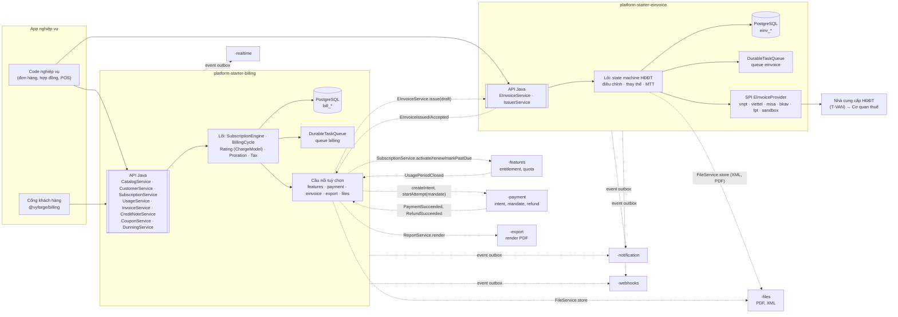
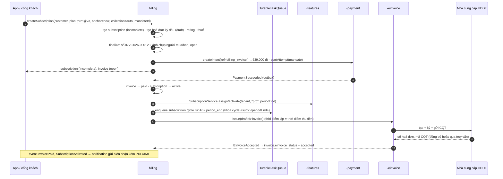
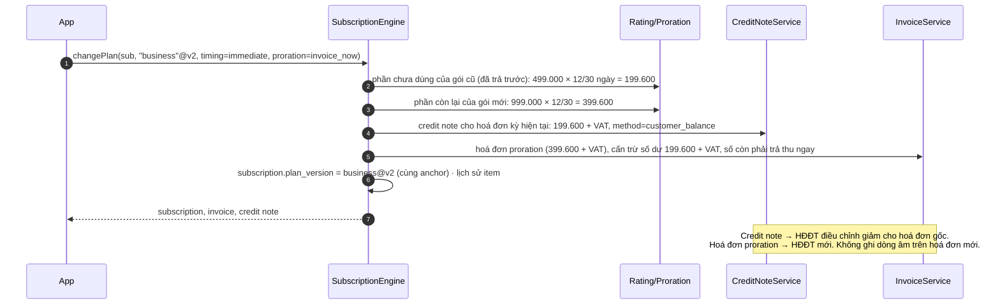
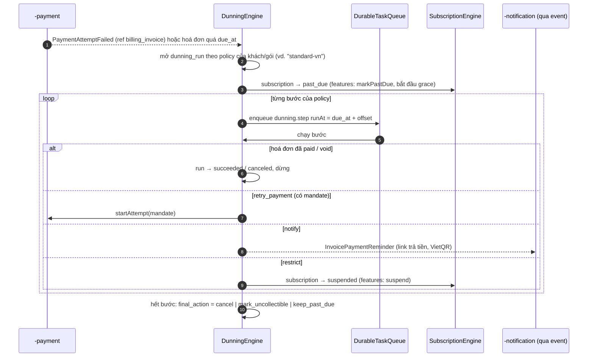
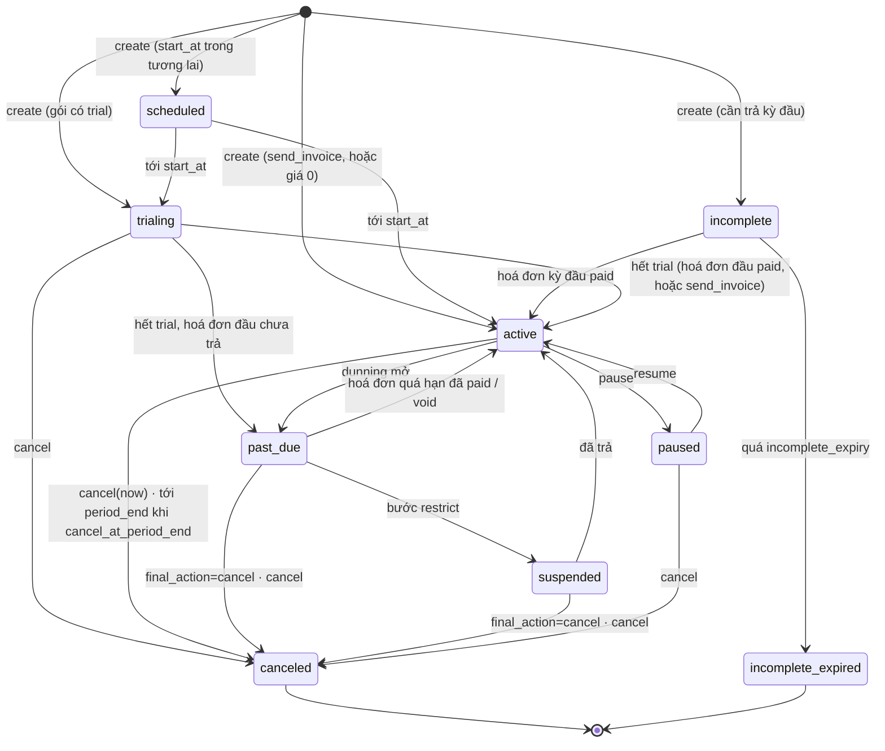
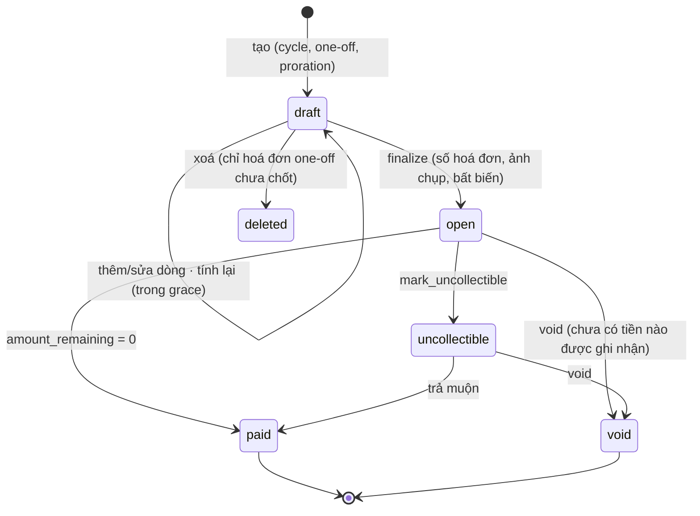
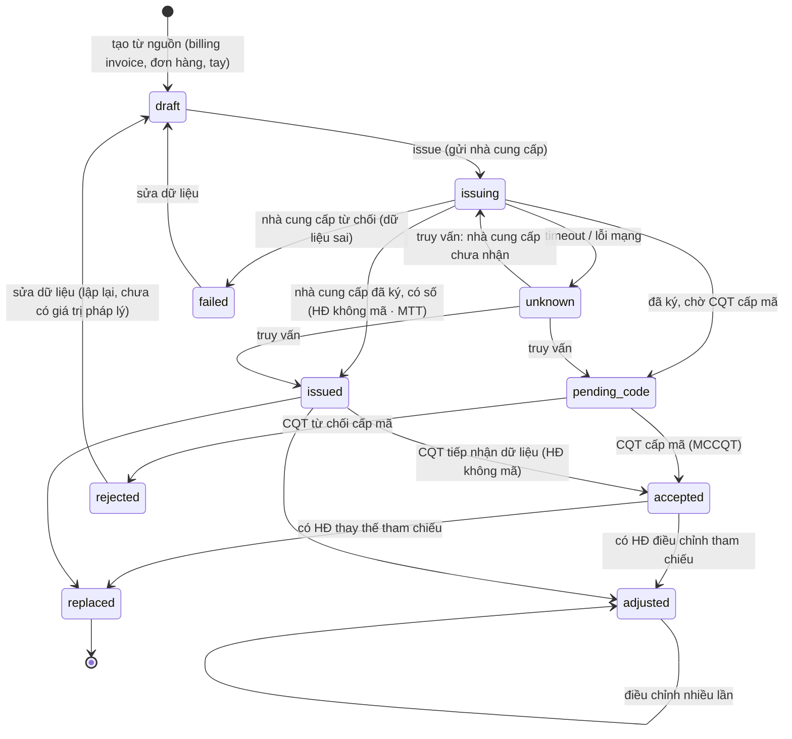
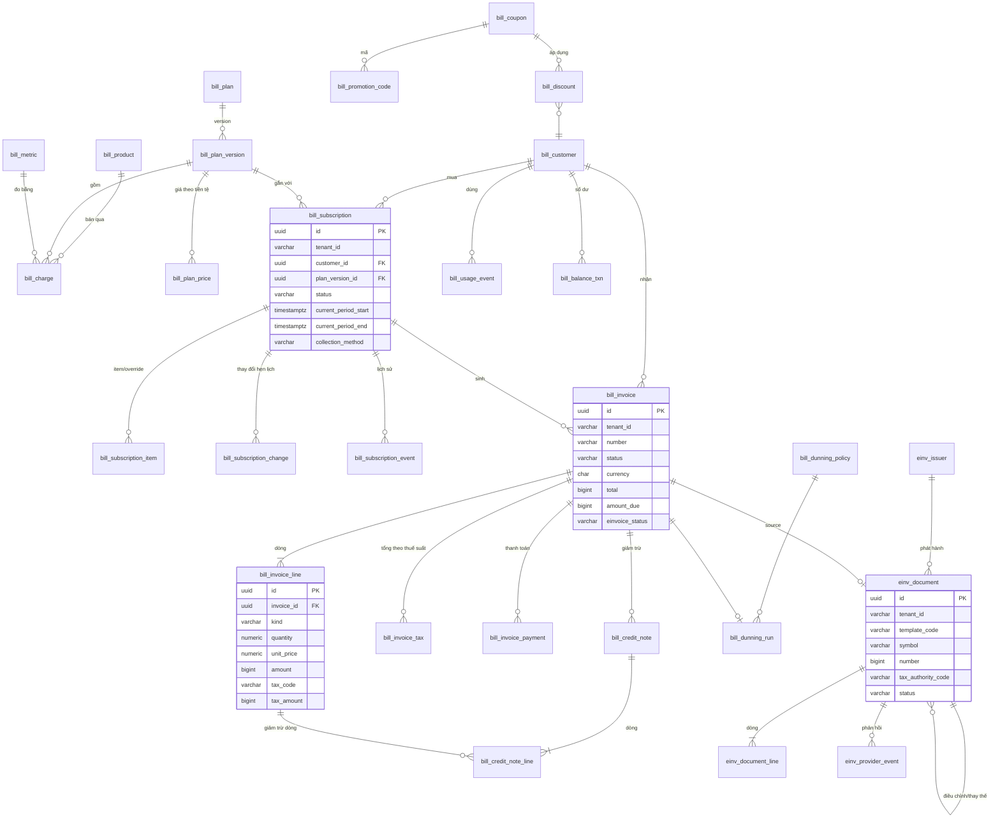

# Thiết kế module `billing` và `einvoice`: thu tiền theo gói, hoá đơn, thuế, hoá đơn điện tử VN

> **Trạng thái:** bản thiết kế giai đoạn 1 (26/10/2026), phiên forge-45, chờ review.
> **Sản phẩm:** `platform-starter-billing`, `platform-starter-einvoice` (platform-java 0.13.0); `@vyforge/billing`,
> `@vyforge/einvoice`, admin MFE `@vyforge/billing-admin`, `@vyforge/einvoice-admin` (platform-web).
> **Dùng khối chung** của platform-java 0.12.1: `SecretCipher`, `StarterSchemaMigrator`, `DurableTaskQueue` (phụ lục §5 của
> quy ước module).
> **Nối với** thiết kế đã duyệt: [features](../../../gh--d-features/docs/design/features.md) (gói, entitlement, mức dùng),
> [payment](../../../gh--d-payment/docs/design/payment.md) (thu tiền, mandate, hoàn tiền), notification, files, export,
> webhooks, realtime. Đường dẫn trên là worktree thiết kế; khi merge thì cùng nằm trong `docs/design/`.

Tóm tắt trong bảy dòng:

1. **Hai starter, một thiết kế.** `billing` lo gói giá, subscription, đo mức dùng, hoá đơn bán hàng, thuế, coupon, dunning.
   `einvoice` lo hoá đơn điện tử theo NĐ 254/2026 và TT 91/2026 (thay NĐ 123/2020, NĐ 70/2025 từ 01/07/2026) qua adapter nhà cung cấp. Bán lẻ, POS chỉ cần
   `einvoice`; SaaS nước ngoài chỉ cần `billing`. Hai starter nối nhau qua port và event, không phụ thuộc cứng.
2. **Không làm lại thứ đã có.** Quyền dùng (entitlement, hạn mức, đếm quota) thuộc `-features`. Thu tiền, mandate, hoàn tiền
   thuộc `-payment`. Billing là lớp *thương mại* ở giữa: biến gói và mức dùng thành tiền, rồi biến tiền thành chứng từ.
3. **Catalog có version bất biến** (học Kill Bill, Orb): subscription gắn với `plan_version`. Đổi giá tạo version mới, khách cũ
   giữ giá tới khi chuyển. Giá riêng theo hợp đồng là override trên subscription, không phải gói mới (học Lago).
4. **Hoá đơn là chứng từ bất biến sau khi chốt.** Sai thì lập credit note (điều chỉnh giảm) hoặc hoá đơn bổ sung, không sửa.
   Mô hình này khớp với cách VN xử lý hoá đơn điện tử sai (điều chỉnh, thay thế), nên một hoá đơn billing ánh xạ thẳng
   sang một hoá đơn điện tử.
5. **Tiền là số nguyên theo đơn vị nhỏ nhất; đơn giá và số lượng là thập phân.** Làm tròn một lần, ở một chỗ, theo luật
   ghi rõ. Thuế tính theo nhóm thuế suất sau chiết khấu, đúng cách hoá đơn VN trình bày.
6. **Mọi mốc thời gian là việc hẹn giờ trên `DurableTaskQueue`** (hết kỳ, hết trial, bước dunning, hết hạn nháp). Không có
   job quét toàn bảng, trừ một lưới an toàn.
7. **Ba chế độ bán:** platform bán cho tenant (nối entitlement của `-features`), tenant bán cho khách của mình (B2B/B2C),
   hoặc cả hai trong cùng một app. Cùng một mô hình dữ liệu; "người bán" luôn là tenant của dòng dữ liệu.

---

## Mục lục

1. [Bài toán và phạm vi](#1-bài-toán-và-phạm-vi)
2. [Nghiên cứu](#2-nghiên-cứu)
3. [Kiến trúc](#3-kiến-trúc)
4. [Mô hình dữ liệu](#4-mô-hình-dữ-liệu)
5. [API](#5-api)
6. [Mở rộng](#6-mở-rộng)
7. [Vận hành](#7-vận-hành)
8. [Bảo mật và tuân thủ](#8-bảo-mật-và-tuân-thủ)
9. [Kế hoạch triển khai](#9-kế-hoạch-triển-khai)
10. [Lệch quy ước và quyết định cần chọn](#10-lệch-quy-ước-và-quyết-định-cần-chọn)
11. [Đóng gói và triển khai độc lập](#11-đóng-gói-và-triển-khai-độc-lập)

---

## 1. Bài toán và phạm vi

### 1.1 Vì sao cần module riêng

Ba nhóm dự án trong danh mục đều phải tự làm cùng một khối việc:

- **SaaS do Vyforge dựng cho khách** (phần mềm quản lý trường học, phòng khám, chuỗi bán lẻ): thu phí thuê bao theo gói,
  tính thêm theo mức dùng (số hoá đơn, tin nhắn, dung lượng), dùng thử, nâng/hạ gói, khuyến mại.
- **Doanh nghiệp bán dịch vụ định kỳ cho khách của họ** (internet, học phí theo tháng, phí quản lý toà nhà, phòng gym, bảo
  trì thiết bị): hợp đồng định kỳ, công nợ, nhắc nợ.
- **Mọi doanh nghiệp ở VN có doanh thu** phải lập hoá đơn điện tử qua một nhà cung cấp (VNPT, Viettel, MISA, BKAV, FPT…),
  đúng thời điểm, đúng nội dung bắt buộc, xử lý sai sót bằng điều chỉnh/thay thế.

Tự viết ở từng dự án thường sai cùng một chỗ: làm tròn tiền và thuế lệch vài đồng so với HĐĐT; sửa hoá đơn đã chốt; tính
proration theo giá hiện tại thay vì giá đã thu; phát hành HĐĐT hai lần khi nhà cung cấp timeout; lập hoá đơn sai thời điểm;
không có đường xử lý mức dùng tới muộn; bỏ quên ký hiệu năm mới.

### 1.2 Trong phạm vi

| Nhóm | Nội dung |
|---|---|
| Catalog | Product, plan có version bất biến, charge với 7 mô hình giá + mô hình tự định nghĩa, billable metric (6 kiểu gộp), giá theo tiền tệ, add-on, cam kết tối thiểu |
| Subscription | Tạo, trial, nâng/hạ gói, số ghế, add-on, giá riêng theo hợp đồng, tạm dừng, huỷ, thay đổi hẹn lịch, migrate version, xem trước hoá đơn |
| Mức dùng | Nhận event có khử trùng, nhận từ `-features`, gộp theo kỳ, lọc và nhóm theo thuộc tính, event tới muộn |
| Hoá đơn bán hàng | Chu kỳ, one-off, proration; draft có grace; số hoá đơn liên tục; bất biến sau chốt; PDF; credit note; customer balance |
| Thuế | VAT VN (10/8/5/0%, KCT, KKKNT, khác) có hiệu lực theo ngày; giá gồm/chưa gồm thuế; làm tròn theo nhóm thuế suất |
| Đa tiền tệ | Giá theo tiền tệ, hoá đơn ngoại tệ kèm tỷ giá, tổng quy đổi VND cho thuế |
| Khuyến mại | Coupon (%, số tiền; một lần, N kỳ, mãi mãi), promotion code có điều kiện, áp theo gói/sản phẩm |
| Thu tiền | Qua `-payment` (tự trừ bằng mandate hoặc gửi link/VietQR), ghi nhận tay, trả một phần, trả thừa |
| Dunning | Policy nhiều bước theo tenant/gói/khách: thu lại, nhắc, hạn chế, huỷ; giờ yên lặng |
| Hoá đơn điện tử | Hồ sơ phát hành, phát hành có mã/không mã/máy tính tiền, điều chỉnh, thay thế, thông báo sai sót, lưu XML 10 năm, adapter 5 nhà cung cấp + sandbox |
| Quản trị | Admin MFE `billing` và `einvoice` (Multi-Zones), cổng khách tự phục vụ |

### 1.3 Kịch bản nghiệp vụ phải đáp ứng

"Hiện tại" là bản 0.13; "tương lai" là thứ thiết kế đã chừa chỗ.

| # | Kịch bản | Đặc thù | Khối đáp ứng | Bản |
|---|---|---|---|---|
| K1 | SaaS quản lý trường mầm non: gói Pro 499.000 đ/tháng chưa VAT, thu trước, khách liên kết ví ZaloPay để tự trừ; nhận HĐĐT ngay khi trừ tiền | VN | Subscription `advance` + `PaymentCollector` (mandate) + `EInvoiceTrigger` theo thời điểm thu tiền | Hiện tại |
| K2 | Gói Business 2 triệu/tháng gồm 2.000 hoá đơn điện tử; vượt thì 300 đ/hoá đơn, tính cuối tháng | VN | `-features` đếm quota (`einvoice.issued`) → `UsagePeriodClosed` → charge `per_unit` có `included_quantity` | Hiện tại |
| K3 | Khách nâng từ Pro lên Business ngày 18/10: trả phần chênh lệch ngay, nhận HĐĐT điều chỉnh giảm cho hoá đơn tháng 10 cũ và HĐĐT mới cho phần Business | VN | Proration theo ngày, credit note → điều chỉnh giảm, customer balance cấn trừ (§3.6) | Hiện tại |
| K4 | Doanh nghiệp B2B ký hợp đồng năm, giá riêng 18 triệu/năm (giá niêm yết 24 triệu), thanh toán chuyển khoản trong 30 ngày | VN | `overridePrice`, `collection_method = send_invoice`, `payment_terms_days = 30`, dunning theo hạn | Hiện tại |
| K5 | Dùng thử 14 ngày không cần thẻ; hết trial nếu chưa trả thì giữ dữ liệu, khoá tạo mới | Chung | `trialing` → `past_due` → `suspended` ↔ features `suspended-plan` | Hiện tại |
| K6 | Chuyển khoản ngân hàng chậm 2 ngày sau hạn: không khoá ngay | VN | Policy `standard-vn`: hạn chế từ ngày 10; `payment_terms_days`; ghi nhận tay | Hiện tại |
| K7 | Khuyến mại Tết giảm 30% 3 tháng đầu cho khách mới, mã `TET2027`, tối đa 500 lượt | VN | Coupon `percent`, `repeating` 3 kỳ, promotion code `firstTimeOnly`, `max_redemptions` | Hiện tại |
| K8 | Nền tảng API tính phí bậc thang: 10.000 lần đầu miễn phí, 10.001–1 triệu 20 đ/lần, trên 1 triệu 12 đ/lần; tách dòng theo loại API | Chung | Metric `count` + `group_by`, charge `graduated` | Hiện tại |
| K9 | Lưu trữ đám mây tính theo GB-giờ trung bình trong tháng | Chung | Aggregation `weighted_sum`, metric `recurring` | Hiện tại |
| K10 | Khách Singapore trả bằng USD, dịch vụ xuất khẩu 0%; HĐĐT ghi USD kèm tỷ giá | VN + quốc tế | `bill_plan_price` USD, `tax_exempt = reverse` → `VAT0`, `fx_rate_to_vnd` (§8.2) | Hiện tại |
| K11 | Hoá đơn ghi sai MST người mua đã được CQT cấp mã: lập HĐĐT điều chỉnh (hoặc thay thế) có văn bản thoả thuận | VN | `EInvoiceService.adjust/replace`, `agreement_ref`, quan hệ `related_document_id` | Hiện tại |
| K12 | Hoá đơn sai địa chỉ người mua (không sai tiền, MST): chỉ thông báo cho người mua và gửi Mẫu 04/SS-HĐĐT, không lập lại | VN | `adjust(direction=info)` → `einv_error_notice` (kind `explain`) | Hiện tại |
| K13 | Chuỗi cà phê dùng POS: HĐĐT khởi tạo từ máy tính tiền cho từng đơn, không dùng billing | VN | `-einvoice` độc lập, issuer `mode = cash_register`, ký hiệu ký tự 4 là `M` | Hiện tại (adapter có MTT) |
| K14 | Hộ kinh doanh doanh thu > 1 tỷ/năm (bỏ thuế khoán từ 2026) bán hàng, dùng hoá đơn bán hàng (mẫu số 2) | VN | Issuer `invoice_kind = 2`, `TaxCalculator` phương pháp trực tiếp | Hiện tại |
| K15 | Viễn thông/CNTT bán theo kỳ cần đối soát: lập hoá đơn sau đối soát, chậm nhất ngày 07 tháng sau | VN | Hoá đơn arrears ở `draft` với `grace_period`, kiểm `finalize_after` ≤ hạn luật, alert khi sắp quá hạn | Hiện tại |
| K16 | Một tenant có hai pháp nhân (hai MST), mỗi pháp nhân một dãy số hoá đơn và một issuer HĐĐT | VN | `settings.seller.legalEntities`, `bill_sequence` theo `invoice:<pháp nhân>`, `einv_issuer` theo MST | Hiện tại |
| K17 | Đổi giá gói Pro từ 499k lên 599k từ 01/01/2027; khách cũ giữ giá tới kỳ gia hạn tháng 3 | Chung | Plan version mới + `migrate(timing = at 2027-03-01)` (Orb, Kill Bill `effectiveDateForExistingSubscriptions`) | Hiện tại |
| K18 | Gia hạn hay hết đợt giảm VAT 8% (hiện tới 31/12/2026): hoá đơn lập từ 01/01/2027 tự dùng thuế suất đúng | VN | `bill_tax_rate` có `valid_from/valid_to` theo ngày lập | Hiện tại |
| K19 | Khách hàng doanh nghiệp tự xem, tải hoá đơn PDF/XML, đổi gói, trả nợ quá hạn qua cổng | Chung | `/me/*`, `@vyforge/billing/ui` | Hiện tại |
| K20 | Tính phí AI theo token, giá mỗi model khác nhau | Chung | Metric `sum` + `group_by: model` + `properties` theo nhóm; hoặc charge `dynamic` | Hiện tại |
| K21 | Trả trước gói credit (nạp 5 triệu, dùng dần cho phí mức dùng) | Chung, rủi ro pháp lý | Customer balance loại `promotion`/`prepaid` | Tương lai: cần pháp chế duyệt như ví trả trước của `-payment` |
| K22 | Đối tác bán lại (reseller) nhận hoa hồng; hoá đơn tổng hợp cho công ty mẹ, chi tiết theo chi nhánh | Chung | Customer hierarchy, invoice grouping | Tương lai |
| K23 | Đồng bộ hoá đơn, công nợ sang phần mềm kế toán (MISA AMIS, Fast) | VN | Event `InvoiceFinalized`, `CreditNoteIssued`; export | Tương lai (adapter) |
| K24 | Ghi nhận doanh thu theo kỳ (doanh thu chưa thực hiện cho gói năm) | Chung | Bút toán qua sổ cái `-payment` | Tương lai |

### 1.4 Ngoài phạm vi

| Không làm | Lý do / nơi làm |
|---|---|
| Entitlement, hạn mức, đếm quota real-time | `-features` (billing chỉ đẩy trạng thái và đọc mức dùng đã đóng kỳ) |
| Cổng thanh toán, mandate, hoàn tiền, sổ cái tiền | `-payment` |
| Kế toán đầy đủ (sổ cái tổng hợp, báo cáo tài chính, ghi nhận doanh thu) | Phần mềm kế toán của khách; billing phát event để đồng bộ |
| Tờ khai thuế, nộp thuế | Phần mềm kế toán/thuế |
| Ký số hoá đơn bằng USB token tại máy người dùng | Nhà cung cấp HĐĐT ký bằng HSM/ký số từ xa (§6.8). USB token không dùng được trong server |
| Tự làm tổ chức truyền nhận (T-VAN) hay gửi thẳng CQT | Phải là tổ chức được cấp phép; dùng nhà cung cấp |
| Báo giá, CPQ, hợp đồng điện tử | Module `esign`/CRM của dự án |
| Tính thuế nước ngoài (EU VAT, US sales tax) | SPI `TaxCalculator` cho dự án cần |

---

## 2. Nghiên cứu

Phiên bản và license kiểm ngày 26/10/2026 qua GitHub API (`releases/latest`) và trang tài liệu chính thức. Chỗ nào chỉ có
nguồn thứ cấp hoặc chưa kiểm được thì ghi rõ.

### 2.1 Hệ thống billing tham khảo

| Hệ thống | Loại, phiên bản, license | Mô hình dữ liệu | API, mở rộng | Điểm mạnh | Điểm yếu (với ta) |
|---|---|---|---|---|---|
| **Lago** ([repo](https://github.com/getlago/lago-api), [aggregation](https://getlago.com/docs/guide/billable-metrics/aggregation-types/overview), [upgrade/downgrade](https://getlago.com/docs/guide/subscriptions/upgrades-downgrades), [grace period](https://docs.getlago.com/guide/invoicing/invoicing-settings/grace-period)) | OSS, `lago-api` v1.55.0 (07/10/2026), **AGPL-3.0**, Rails + PostgreSQL (ClickHouse tuỳ chọn) | `customer`, `plan` (override là plan con `parent_id`), `charge` (`standard`, `graduated`, `package`, `percentage`, `volume`, `graduated_percentage`, `dynamic`, `custom`), `billable_metric` (`count`, `sum`, `max`, `unique_count`, `weighted_sum`, `latest`), `subscription` (`pending`, `active`, `terminated`, `canceled`, `incomplete`; `billing_time` calendar/anniversary), `event` (`transaction_id`), `invoice` + `fee`, `credit_note`, `wallet`, `tax`, `coupon`, `dunning_campaign`, `commitment` | REST, webhook `invoice.drafted`/`invoice.created`/`subscription.started`…; `pay_in_advance` theo charge | Bộ aggregation và charge model đầy đủ nhất; grace period cho hoá đơn nháp; nâng gói ngay, hạ gói cuối kỳ; credit note cho phần trả trước chưa dùng | AGPL, không nhúng được. Override phát hiện bằng so giá trị (dễ vỡ). Event tới sau khi chốt bị bỏ qua, không có đường điều chỉnh ([KB](https://knowledge.getlago.com/articles/1455954942), nguồn không chính thức) |
| **Kill Bill** ([repo](https://github.com/killbill/killbill), [subscription guide](https://docs.killbill.io/latest/userguide_subscription.html), [overdue](https://docs.killbill.io/latest/overdue.html)) | OSS, 0.24.22 (29/09/2026), **Apache-2.0**, Java + OSGi | Catalog XML có version theo `effectiveDate`; product `BASE`/`ADD_ON`/`STANDALONE`; plan có phase `TRIAL`/`DISCOUNT`/`FIXEDTERM`/`EVERGREEN`; `effectiveDateForExistingSubscriptions` lùi giá mới cho khách cũ. `InvoiceItemType`: `FIXED`, `RECURRING`, `USAGE`, `REPAIR_ADJ`, `CBA_ADJ`, `ITEM_ADJ`, `TAX`…; `InvoiceStatus` `DRAFT`/`COMMITTED`/`VOID` | `InvoicePluginApi.getAdditionalInvoiceItems` (thuế, phí riêng), dry-run invoice; overdue state theo tenant (`blockChanges`, `disableEntitlement…`); retry `8,8,8` ngày tách khỏi overdue | Catalog version + chính sách đổi gói khai báo (`IMMEDIATE`/`END_OF_TERM`/`START_OF_TERM`, `BillingAlignment`); dry run; overdue tách khỏi retry | Nặng (service riêng, OSGi, XML); không có credit note riêng (điều chỉnh bằng item) |
| **Stripe Billing** ([prices](https://docs.stripe.com/products-prices/manage-prices), [prorations](https://docs.stripe.com/billing/subscriptions/prorations), [invoices](https://docs.stripe.com/invoicing/overview), [meters](https://docs.stripe.com/billing/subscriptions/usage-based/meters/configure), [smart retries](https://docs.stripe.com/billing/revenue-recovery/smart-retries)) | SaaS | Product → Price (**bất biến** trừ `metadata`, `nickname`, `active`; `unit_amount_decimal`) → Subscription/Item; Invoice `draft`→`open`→`paid`/`void`/`uncollectible`; CreditNote; customer balance; Coupon/PromotionCode/Discount; Meter (`sum`, `count`, `last`; event trong 35 ngày qua, ≤ 5 phút tương lai, `identifier` khử trùng) | `proration_behavior` `create_prorations`/`always_invoice`/`none`, `proration_date`, `billing_mode=flexible` (credit theo giá **đã thu**); `create_preview`; số hoá đơn theo customer hoặc account | Mô hình hoá đơn và credit note chuẩn mực; preview; giá bất biến; customer balance | SaaS; proration mặc định theo giây, ghi dòng âm trên hoá đơn mới (không hợp HĐĐT VN); không có VAT VN, HĐĐT |
| **Chargebee** ([catalog 2.0](https://chargebee.com/docs/billing/2.0/product-catalog/product-catalog), [dunning v2](https://www.chargebee.com/docs/payments/2.0/dunning/dunning-v2.md)) | SaaS | Product family → Item (plan, addon, charge) → Item price (mỗi tiền tệ × chu kỳ một item price); invoice `posted`, `payment_due`, `not_paid`, `voided`… | Dunning cấu hình kỳ, tần suất, hành động cuối; phân loại hard/soft decline | Item price theo tiền tệ × chu kỳ rõ ràng; dunning có cấu hình | SaaS; chi tiết entitlement chưa kiểm được |
| **Orb** ([plan versions](https://www.withorb.com/blog/how-we-built-plan-versions-and-migrations), [price changes](https://docs.withorb.com/product-catalog/price-changes), [invoice structure](https://docs.withorb.com/guides/invoicing/structure)) | SaaS | Plan có version; subscription là các dòng thời gian giá; hoá đơn là trạng thái dẫn xuất, tính lại khi dòng thời gian đổi; `model_type` unit/tiered/bulk/package | Migration version có lịch (ngày cố định hoặc theo kỳ của từng khách), áp trước khi xuất hoá đơn; grace period cho event muộn | Version + migration là cách đổi giá sạch nhất | SaaS; độ dài grace period khử trùng chưa kiểm được |
| OpenMeter ([repo](https://github.com/openmeterio/openmeter)) | OSS, v1.0.0-beta.236 (09/10/2026), Apache-2.0, Go + Kafka + ClickHouse | Meter, entitlement, grant (đã dùng làm tham khảo cho `-features`) | CloudEvents | Ingest khối lượng lớn | Beta, hạ tầng nặng |
| Flexprice ([repo](https://github.com/flexprice/flexprice)) | OSS, v2.1.43 (23/10/2026), **AGPL-3.0** | — | — | — | AGPL |

Metronome đã được Stripe mua lại ([Stripe newsroom](https://stripe.com/newsroom/news/stripe-completes-metronome-acquisition)),
không xét riêng.

**Thư viện tiền tệ Java:** Moneta (JSR 354 RI) 1.4.5 (22/03/2025), Apache-2.0 ([repo](https://github.com/JavaMoney/jsr354-ri)),
gần 19 tháng không ra bản mới. Không dùng: một record `Money(long minor, String currency)` (đã có ở `-payment`) cộng
`BigDecimal` cho đơn giá là đủ, giống Stripe (`unit_amount` + `unit_amount_decimal`).

### 2.2 Văn bản pháp lý VN (kiểm bản hiện hành ngày 26–27/10/2026)

**Brief giao kiểm NĐ 123/2020, NĐ 70/2025, TT 32/2025. Cả ba đã hết hiệu lực từ 01/07/2026.** Thiết kế theo khung mới:

| Văn bản | Ban hành | Hiệu lực | Tình trạng |
|---|---|---|---|
| Luật Quản lý thuế 108/2025/QH15 | 10/12/2025 | 01/07/2026 (một số điều về hộ kinh doanh từ 01/01/2026) | Hiện hành, thay Luật QLT 2019 |
| **NĐ 254/2026/NĐ-CP** về hoá đơn, chứng từ điện tử | 30/06/2026 | 01/07/2026 | Hiện hành. Điều 43 bãi bỏ NĐ 123/2020 và NĐ 70/2025 |
| **TT 91/2026/TT-BTC** hướng dẫn | 30/06/2026 | 01/07/2026 | Hiện hành, thay TT 32/2025 (TT 32 đã thay TT 78/2021) |
| NĐ 123/2020, NĐ 70/2025, TT 32/2025 | | | **Hết hiệu lực 01/07/2026**. Hoá đơn lập theo các văn bản này nay điều chỉnh/thay thế theo quy định mới (chuyển tiếp, Điều 24 TT 91) |
| QĐ 1450/QĐ-TCT (07/10/2021), sửa bởi QĐ 1510/QĐ-TCT (21/09/2022): định dạng dữ liệu XML | | | Còn áp dụng theo [hoatieu](https://hoatieu.vn/phap-luat/quyet-dinh-1450-qd-tct-2021-211892). **Chưa tìm thấy** quyết định định dạng mới cho NĐ 254 (mẫu số 7, ký tự `F`) |
| Luật Thuế GTGT 48/2024/QH15; Luật 149/2025/QH15 sửa đổi; NĐ 181/2025/NĐ-CP (sửa bởi NĐ 359/2025, NĐ 144/2026) | | 01/07/2025; 01/01/2026 | Hiện hành |
| NQ 204/2025/QH15 + NĐ 174/2025/NĐ-CP: giảm VAT 10% → 8% | 17/06/2025; 30/06/2025 | 01/07/2025 – **31/12/2026** | Hiện hành; chưa có văn bản gia hạn sau 31/12/2026 |
| NQ 198/2025/QH15 (bỏ thuế khoán từ 01/01/2026); NĐ 68/2026, NĐ 141/2026 (hộ kinh doanh doanh thu > 1 tỷ/năm bắt buộc HĐĐT có mã hoặc từ máy tính tiền) | | 01/01/2026 | Hiện hành; ngưỡng 500 triệu của Luật 149/2025 và 1 tỷ của NĐ 141 chưa làm rõ quan hệ |

Nguồn: [toàn văn NĐ 254 trên chinhphu.vn](https://xaydungchinhsach.chinhphu.vn/toan-van-nghi-dinh-so-254-2026-nd-cp-ve-hoa-don-dien-tu-chung-tu-dien-tu-119260713164251972.htm),
[Forvis Mazars](https://www.forvismazars.com/vn/vi/n-ph-m-s-ki-n/c-p-nh-t-v-vi-t-nam/b-n-tin-thong-bao-chuyen-mon/b-n-tin-v-thu-va-phap-ly/ngh-d-nh-254-va-thong-t-91),
[EY](https://www.ey.com/vi_vn/technical/tax/tax-and-law-updates/nghi-dinh-254-2026-nd-cp-ve-hoa-don-dien-tu-va-chung-tu-dien-tu),
[Fraser](https://www.frasersvn.com/vi/legal-updates-and-publications/new-regulations-on-electronic-invoices-and-electronic-records-under-decree-no-254-2026-nd-cp-and-circular-no-91-2026-tt-btc),
[thuvienphapluat: điểm mới NĐ 254](https://thuvienphapluat.vn/ma-so-thue/phap-luat-thue/diem-moi-nghi-dinh-2542026ndcp-huong-dan-ve-hoa-don-chung-tu-dien-tu-227593.html),
[LuatVietnam: TT 91](https://luatvietnam.vn/thue-phi-le-phi/diem-moi-ve-hoa-don-dien-tu-tai-thong-tu-91-2026-565-110870-article.html),
[CV 4831/CT-CS](https://luatvietnam.vn/thue/cong-van-4831-ct-cs-2026-cua-cuc-thue-ve-noi-dung-moi-tai-nghi-dinh-254-2026-nd-cp-va-thong-tu-91-2026-tt-btc-440460-d6.html),
[thuvienphapluat: VAT 8% năm 2026](https://thuvienphapluat.vn/ma-so-thue/phap-luat-thue/nam-2026-con-ap-dung-muc-thue-suat-thue-gtgt-8-hay-khong-989951-218063.html),
[tapchicongthuong: ngưỡng 1 tỷ](https://tapchicongthuong.vn/chinh-thuc--nang-nguong-chiu-thue-voi-ho-kinh-doanh-len-1-ty-dong-nam--ap-dung-tu-1-1-2026-514336.htm).

**Giới hạn của việc kiểm:** file PDF nguyên văn NĐ 254 trên CDN chinhphu.vn trả "File not found"; số điều khoản của NĐ 254
và TT 91 lấy từ bài phân tích của EY, Fraser, LuatVietnam, MISA, Tạp chí Thuế, các nguồn khớp nhau. Pháp chế phải đối
chiếu nguyên văn trước pilot; thiết kế để mọi điểm phụ thuộc văn bản (thuế suất, ký hiệu, hạn lập, mẫu biểu) là dữ liệu
hoặc cấu hình, không phải code. Chi tiết áp vào thiết kế ở §8.2.

### 2.3 Nhà cung cấp hoá đơn điện tử

| Nhà cung cấp | Đã kiểm | Chưa kiểm được |
|---|---|---|
| **MISA meInvoice** | Tài liệu tích hợp chính thức [doc.meinvoice.vn](https://doc.meinvoice.vn/about/): tích hợp sâu (tạo, ký, phát hành, gửi, tải) và tích hợp nhanh; môi trường test `testapp.meinvoice.vn`. SDK cộng đồng (không chính thức) [MisaConnect.EInvoice](https://www.nuget.org/packages/MisaConnect.EInvoice): REST/JSON `testapi.meinvoice.vn/api/integration`, đăng nhập bằng MST + user + mật khẩu + AppId lấy token; có nháp, xem trước, tra cứu, thay thế, điều chỉnh | Endpoint chính thức chi tiết, cách ký (HSM hay ký phía client) |
| **Viettel S-Invoice** | Theo tài liệu connector [Viindoo](https://viindoo.com/documentation/15.0/applications/finance/accounting-and-invoicing/fiscal-localizations/issue-e-invoice-by-integrating-viindoo-with-viettel-s-s-invoice-service.html): demo `demo-sinvoice.viettel.vn:8443`, production `api-sinvoice.viettel.vn`, v2 `api-vinvoice.viettel.vn/services/einvoiceapplication/api/`; user/mật khẩu; phát hành, xem nháp, tải bản thể hiện, tra theo `transactionUuid`; chữ ký số gắn tài khoản (ký phía server) | Đường dẫn và xác thực chính xác của v2; API điều chỉnh/thay thế |
| **VNPT Invoice** | Tài liệu API cấp khi đăng ký dịch vụ | Toàn bộ (web service SOAP dạng `ImportAndPublishInv` theo hiểu biết chung, **chưa kiểm**) |
| **BKAV eHoaDon** | Chỉ có trang giới thiệu "tích hợp được" | Toàn bộ |
| **FPT eInvoice** | Không tìm thấy tài liệu công khai | Toàn bộ |

Hệ quả cho thiết kế: SPI `EInvoiceProvider` dựng theo **thao tác chung** (phát hành, truy vấn, điều chỉnh, thay thế, tải,
thông báo sai sót, tra MST), không theo API của một nhà cung cấp. Bản 0.13 làm adapter `sandbox` (giả lập đầy đủ vòng đời,
dùng cho dev, test và demo) và hai adapter có tài liệu kiểm được nhiều nhất (Viettel, MISA), viết theo tài liệu và sandbox
do nhà cung cấp cấp lúc triển khai. VNPT, BKAV, FPT làm khi dự án có hợp đồng và tài khoản sandbox (§9.3). Mọi nhà cung cấp
phải đã nâng cấp theo NĐ 254/TT 91 từ 01/07/2026; hỏi version API khi xin sandbox.

### 2.4 Học theo gì, không làm gì

**Học theo:**

| Từ | Học gì | Áp vào đâu |
|---|---|---|
| Kill Bill, Orb, Stripe | Plan/price bất biến khi đã có khách; version + migration có lịch, áp trước khi xuất hoá đơn | `bill_plan_version`, `CatalogService.migrate`, `bill_subscription_change` |
| Kill Bill, Lago, Chargebee | Đổi gói: nâng ngay, hạ cuối kỳ; chính sách khai báo theo gói và ghi đè theo lệnh | §3.6, `change_policy` |
| Stripe (`billing_mode=flexible`), Kill Bill (`REPAIR_ADJ`) | Credit theo **số đã thu**, không theo giá hiện tại; dòng proration không áp coupon | Credit note tham chiếu dòng hoá đơn gốc; `discountable = false` cho proration |
| Lago | 6 kiểu gộp; charge model; `transaction_id` khử trùng; grace period cho hoá đơn nháp; credit note phần trả trước khi nâng gói | `bill_metric`, `bill_charge`, `finalize_after` |
| Stripe | Vòng đời invoice `draft/open/paid/void/uncollectible`; credit note với ba cách trả (giảm nợ, số dư, hoàn tiền); customer balance; preview; event trong 35 ngày, ≤ 5 phút tương lai | §4.1, `max_event_age` |
| Stripe, Lago | Số hoá đơn gán **lúc chốt**, liên tục theo người bán (hoặc pháp nhân) | `bill_sequence` |
| Kill Bill | Overdue (hạn chế quyền) tách khỏi lịch thu lại; cấu hình theo tenant | Dunning policy có cả `retry_payment` và `restrict`, cấu hình độc lập |
| Kill Bill | Dry run, plugin thêm dòng hoá đơn (`getAdditionalInvoiceItems`) | `preview`, `BillingInterceptor.beforeFinalize` |
| `-payment` của chính mình | Janitor cho trạng thái `unknown`, không gửi lại lệnh ghi mù | Phát hành HĐĐT timeout → truy vấn rồi mới quyết |

**Không làm:**

- **Không nhúng Lago/Flexprice** (AGPL) và không chạy Kill Bill thành service riêng: billing là starter nhúng, chung
  transaction với nghiệp vụ.
- **Không ghi dòng âm** trên hoá đơn mới cho phần chưa dùng (cách Stripe): ở VN phải điều chỉnh hoá đơn gốc (§3.6).
- **Không proration theo giây** mặc định: theo ngày cho dễ đối chiếu trên hoá đơn VN.
- **Không smart retry bằng ML**: lịch cố định theo policy, có giờ yên lặng. Không chạy hai engine dunning (Lago khuyến cáo).
- **Không phát hiện override bằng so giá trị** (Lago): override lưu tường minh ở `bill_subscription_item`.
- **Không tự sinh XML gửi CQT, không làm T-VAN**: nhà cung cấp HĐĐT sinh, ký, truyền. Module giữ mô hình dữ liệu theo
  thành phần nghiệp vụ của định dạng XML để map sang API từng nhà cung cấp, và lưu XML trả về.
- **Không dùng Moneta**.

---

## 3. Kiến trúc

### 3.1 Vị trí giữa các module



Nét đứt là điểm nối tuỳ chọn: mỗi cầu nối là một bean `@ConditionalOnBean`/`@ConditionalOnClass`, nằm trong package
`bridge.<module>` của starter, phụ thuộc Maven `optional`. Thiếu module kia thì billing vẫn chạy (§11.1 có bảng "không có
module đó thì").

### 3.2 Khái niệm

| Khái niệm | Nghĩa | Học từ |
|---|---|---|
| **Seller** (người bán) | Tenant sở hữu dữ liệu. Chế độ platform: tenant vận hành (`default`); chế độ tenant: chính tenant khách hàng | — |
| **Customer** (`bill_customer`) | Người mua, có thông tin xuất hoá đơn (tên đơn vị, MST, địa chỉ, mã định danh cá nhân, email nhận hoá đơn), tiền tệ, múi giờ, điều khoản thanh toán. Có thể trỏ tới một tenant của platform (`entitlement_tenant_id`) | Stripe Customer, Lago Customer |
| **Product** | Thứ bán được: phí thuê bao, ghế, add-on, dịch vụ một lần, đơn vị dùng. Mang mặc định thuế (nhóm thuế suất, tên in trên hoá đơn, đơn vị tính) | Stripe Product |
| **Plan / PlanVersion** | Gói giá. Version `draft` → `published` (bất biến) → `retired`. Một version có chu kỳ, trial, tiền tệ và danh sách **charge** | Kill Bill catalog version, Orb plan version |
| **Charge** | Một khoản trong gói: product + mô hình giá (`flat`, `per_unit`, `graduated`, `volume`, `package`, `percentage`, `custom`) + thời điểm thu (`advance`/`arrears`) + metric nếu tính theo mức dùng | Lago charge, Stripe Price |
| **Billable metric** | Cách gộp mức dùng: `count`, `sum`, `max`, `unique_count`, `latest`, `weighted_sum`; lọc và nhóm theo thuộc tính | Lago billable metric |
| **Usage event** | Một lần dùng có `transaction_id` duy nhất, thời điểm, thuộc tính. Nguồn: app gửi, hoặc `-features` đóng kỳ | Lago event, OpenMeter CloudEvents |
| **Subscription** | Customer × plan version, có kỳ (anchor), trạng thái, item (số lượng ghế, add-on), override giá, thay đổi hẹn lịch | Stripe Subscription + Schedule |
| **Invoice** | Hoá đơn bán hàng: `draft` → `open` (đã chốt, có số) → `paid` / `void` / `uncollectible`. Dòng hoá đơn, tổng theo thuế suất, ảnh chụp người mua/người bán lúc chốt | Stripe Invoice, Lago grace period |
| **Credit note** | Chứng từ giảm trừ cho một hoá đơn đã chốt: hoàn tiền, cộng số dư, hoặc giảm số phải trả | Stripe Credit Note |
| **Customer balance** | Số dư tín dụng của khách với chính người bán (từ credit note, khuyến mại). Tự cấn trừ vào hoá đơn sau | Stripe customer balance, Lago wallet |
| **Coupon / Promotion code / Discount** | Coupon là quy tắc giảm giá; promotion code là mã khách nhập; discount là coupon đã gắn vào customer hoặc subscription | Stripe |
| **Dunning** | Chuỗi bước khi hoá đơn quá hạn: thu lại, nhắc, hạn chế, huỷ | Chargebee, Lago dunning campaign, Kill Bill overdue |
| **E-invoice document** (`einv_document`) | Hoá đơn điện tử theo NĐ 254: ký hiệu mẫu số, ký hiệu, số, mã CQT, XML; quan hệ điều chỉnh/thay thế | — (đặc thù VN) |
| **Issuer** (`einv_issuer`) | Hồ sơ người bán với một nhà cung cấp HĐĐT: MST, ký hiệu, loại hoá đơn, tài khoản API | — |

### 3.3 Ranh giới package

```
com.vyforge.platform.billing
├── (gốc)            API công khai: CatalogService, CustomerService, SubscriptionService, UsageService, InvoiceService,
│                    CreditNoteService, CouponService, DunningService, BillingSettingsService; record lệnh/kết quả;
│                    BillingErrors; BillingActions
├── event            Event công khai (record, TenantAwareEvent + IntegrationEvent)
├── spi              ChargeModel, ProrationPolicy, TaxCalculator, UsageSource, InvoiceNumberFormat, InvoiceRenderer,
│                    DocumentStore, ExchangeRateProvider, PaymentCollector, EntitlementSync, EInvoiceSink,
│                    DunningAction, BillingInterceptor
├── rating           Thuần Java, không Spring, không DB: tính tiền một charge, proration, thuế, làm tròn (test bằng bảng)
├── bridge.features  EntitlementSync → -features SubscriptionService; nghe UsagePeriodClosed      (@ConditionalOnBean)
├── bridge.payment   PaymentCollector → -payment; nghe PaymentSucceeded/RefundSucceeded           (@ConditionalOnBean)
├── bridge.einvoice  EInvoiceSink → -einvoice EInvoiceService; nghe EInvoice*                     (@ConditionalOnBean)
├── bridge.export    InvoiceRenderer → -export ReportService                                       (@ConditionalOnBean)
├── bridge.files     DocumentStore → -files FileService                                            (@ConditionalOnBean)
├── internal         entity, repository (JdbcClient), engine, state machine, task handler
└── web              REST controller, DTO, Problem Details

com.vyforge.platform.einvoice
├── (gốc)            EInvoiceService, IssuerService, EInvoiceQueryService; record; EInvoiceErrors; EInvoiceActions
├── event            EInvoiceIssued, EInvoiceAccepted, EInvoiceRejected, EInvoiceAdjusted, EInvoiceReplaced, ...
├── spi              EInvoiceProvider, ProviderDescriptor, ProviderCapability, EInvoiceInterceptor, SymbolPolicy
├── model            Mô hình hoá đơn theo NĐ 254 (TTChung, NDHDon...) thuần Java; validator nội dung bắt buộc (Điều 10)
├── provider.vnpt / .viettel / .misa / .bkav / .fpt / .sandbox
├── internal         entity, repository, engine, task handler
└── web              REST controller
```

Luật ArchUnit: `rating..` không phụ thuộc Spring hay JDBC; `spi..` không phụ thuộc Spring; `bridge.<m>..` là package duy
nhất được import class của module `<m>`; `provider..` chỉ phụ thuộc `spi..`, `model..` và `platform-starter-web`.

### 3.4 Luồng chính: subscription trả trước, tự trừ tiền, xuất HĐĐT

Kịch bản K1 (§1.3): SaaS bán gói Pro 499.000 đ/tháng (chưa VAT) cho tenant, thu trước, khách đã liên kết ví.



Điểm then chốt:

- `createSubscription` và hoá đơn đầu chạy trong **một transaction** với nghiệp vụ của app. `PaymentIntent` được tạo qua
  `PaymentCollector` trong cùng transaction (payment là starter nhúng), nên không có hoá đơn "mồ côi".
- Subscription **chưa mở quyền** cho tới khi kỳ đầu được thanh toán (`incomplete`), trừ khi `collection_method =
  send_invoice` (B2B trả sau theo điều khoản) hoặc gói có trial. Hết `incomplete_expiry` (mặc định 23 giờ, như Stripe) mà chưa
  trả thì `incomplete_expired`.
- E-invoice được phát hành theo `EInvoiceTrigger` (§6.6) để đúng thời điểm lập hoá đơn (§8.2).

### 3.5 Luồng chu kỳ: hết kỳ, tính mức dùng, gia hạn

```mermaid
sequenceDiagram
    autonumber
    participant Q as DurableTaskQueue
    participant C as BillingCycle
    participant U as UsageService
    participant R as Rating
    participant DB as PostgreSQL
    participant P as PaymentCollector

    Q->>C: subscription.cycle (sub 42, periodEnd 2026-11-01T00:00+07)
    C->>DB: select subscription for update · kiểm version, status, current_period_end
    alt mốc đã cũ (đã đổi gói, đã huỷ)
        C-->>Q: bỏ qua (done)
    else
        C->>DB: áp thay đổi hẹn lịch đến hạn (hạ gói, đổi số ghế, huỷ cuối kỳ)
        C->>U: aggregate(metric, sub, [periodStart, periodEnd)) cho mọi charge arrears
        U-->>C: giá trị theo nhóm
        C->>R: rate(charge, quantity, period) · discount · tax
        C->>DB: insert invoice (draft) + lines; mở kỳ mới; enqueue cycle kỳ sau
        alt metric chờ nguồn ngoài (features đóng kỳ) hoặc grace_period > 0
            C->>Q: enqueue invoice.finalize runAt = now + grace (khoá finalize:<invoice>)
        else
            C->>DB: finalize ngay: số hoá đơn, ảnh chụp, open
            C->>P: collect(invoice)
        end
    end
```

- Hoá đơn của kỳ gồm: phí **arrears** của kỳ vừa hết (mức dùng, phí trả sau) và phí **advance** của kỳ mới (phí thuê bao trả
  trước). Đây là cách Stripe và Lago gộp, nên mỗi tháng khách nhận một hoá đơn.
- Một hoá đơn chỉ có một tiền tệ. Subscription khác tiền tệ của cùng khách có hoá đơn riêng.
- **Nhiều subscription của cùng khách cùng anchor** có thể gộp một hoá đơn (`customer.invoice_grouping = per_customer`), mặc
  định tách theo subscription để mỗi hoá đơn điện tử gọn và dễ điều chỉnh.

### 3.6 Luồng đổi gói giữa kỳ (proration)



**Vì sao không ghi dòng âm "phần chưa dùng" lên hoá đơn mới** (như Stripe mặc định): ở VN, giảm giá trị của một hoá đơn đã
lập phải đi bằng hoá đơn điều chỉnh tham chiếu hoá đơn gốc (§8.2). Một dòng âm trên hoá đơn mới không có căn cứ pháp lý và
làm lệch doanh thu theo kỳ. Vì vậy billing tách hai chứng từ: credit note cho hoá đơn cũ, hoá đơn mới cho phần mới; số tiền
thì cấn trừ qua customer balance nên khách chỉ trả phần chênh lệch.

Chính sách mặc định (theo kinh nghiệm Lago và Kill Bill, có thể đổi theo gói và theo lệnh):

| Thay đổi | Mặc định | Lý do |
|---|---|---|
| Nâng gói (giá kỳ cao hơn) | `immediate` + `invoice_now` | Khách muốn dùng ngay; tiền vào trước khi mở quyền |
| Hạ gói | `period_end` (hẹn lịch) | Không phải hoàn tiền, không phát sinh HĐĐT điều chỉnh |
| Tăng số ghế | `immediate` + `invoice_now` | Như nâng gói |
| Giảm số ghế | `period_end` | Như hạ gói |
| Đổi chu kỳ (tháng → năm) | `immediate`, anchor mới | Credit phần chưa dùng, hoá đơn năm mới |
| Huỷ | `period_end` | `immediate` thì tuỳ `refund_policy`: `none` (mặc định), `prorated_credit`, `prorated_refund` |

Proration tính theo **ngày** trong múi giờ của customer (mặc định `Asia/Ho_Chi_Minh`): số ngày còn lại / số ngày của kỳ.
Hoá đơn in "từ ngày … đến ngày …" dễ đối chiếu hơn tính theo giây. `ProrationPolicy` SPI cho phép `second` hoặc `none`.

### 3.7 Luồng thu tiền thất bại và dunning



Policy mặc định `standard-vn` (tenant sửa được):

| Bước | Sau `due_at` | Hành động |
|---|---|---|
| 1 | 0 ngày | `retry_payment` (nếu có mandate) + `notify` "hoá đơn đến hạn" |
| 2 | 3 ngày | `retry_payment` + `notify` "quá hạn" kèm VietQR |
| 3 | 7 ngày | `notify` "sắp tạm ngưng" |
| 4 | 10 ngày | `restrict` (subscription → `suspended`, quyền về `suspended-plan` của features) |
| cuối | 30 ngày | `cancel` subscription; hoá đơn giữ `open` (công nợ), không tự `uncollectible` |

Chuyển khoản ngân hàng ở VN thường đối soát chậm 1–3 ngày, nên bước "hạn chế" để từ ngày 10 trở đi. Lịch thu lại tránh khung
22:00–07:00 (`quiet_hours`) để không trừ tiền lúc khách ngủ.

### 3.8 Luồng lỗi

| Tình huống | Hành vi |
|---|---|
| Usage event trùng `transaction_id` | Bỏ qua, trả `duplicate` (khử trùng qua `bill_usage_dedupe`) |
| Usage event tới muộn, kỳ đã chốt hoá đơn | Theo `late_usage_policy`: `next_invoice` (mặc định: ghi vào hoá đơn kỳ sau thành dòng "điều chỉnh mức dùng kỳ trước"), `reject`, hoặc `credit_or_debit` (credit note/hoá đơn bổ sung cho kỳ cũ) |
| Usage event có thời điểm trong tương lai > 5 phút hoặc cũ hơn `max_event_age` | Từ chối `billing.usage_timestamp_invalid` |
| Cycle task chạy hai lần (retry sau crash) | Khoá idempotent `cycle:<sub>:<periodEnd>` trên task và unique `(subscription_id, billing_reason, period_start)` trên hoá đơn: lần hai không tạo gì |
| Rating lỗi (charge `custom` ném lỗi) | Hoá đơn ở `draft` với `rating_error`; task retry theo backoff; hết lượt → `DEAD` + alert; kế toán sửa rồi `POST /invoices/{id}:finalize` |
| `-payment` không có hoặc tạo intent lỗi | Hoá đơn vẫn `open`; `collection_status = pending`; task `invoice.collect` retry. Không chặn chu kỳ |
| Thanh toán thừa | Phần thừa vào customer balance (`overpayment`), event `CustomerBalanceChanged` |
| Thanh toán thiếu (chuyển khoản thiếu) | `amount_paid` cộng dồn, hoá đơn giữ `open` với `amount_remaining`; dunning tiếp tục |
| Thanh toán tới sau khi hoá đơn `void` | Tiền đã nhận thật: vào customer balance + `review` (kế toán quyết hoàn hay giữ) |
| Hoá đơn điện tử bị CQT từ chối cấp mã | `einv_document` → `rejected`; hoá đơn billing giữ `open`/`paid`, `einvoice_status = rejected`; alert; sửa dữ liệu người mua rồi `reissue` (hoá đơn bị từ chối chưa có giá trị, phát hành lại không cần điều chỉnh) |
| Nhà cung cấp HĐĐT timeout khi phát hành | `unknown`; không gửi lại mù: task truy vấn theo `provider_ref` rồi mới quyết (học Kill Bill janitor, như `-payment`) |
| Customer thiếu dữ liệu bắt buộc cho HĐĐT (MST sai định dạng) | Kiểm lúc **finalize** hoá đơn billing (validator NĐ 254 Điều 10 của `einvoice.model`), lỗi `billing.buyer_info_invalid` trước khi có số hoá đơn |

---

## 4. Mô hình dữ liệu

### 4.1 State machine

**Subscription** (`bill_subscription.status`)



Đổi gói, đổi số lượng, gia hạn kỳ là thao tác **trong** `active` (không đổi trạng thái), ghi vào `bill_subscription_event`.
Ánh xạ sang `-features` (cầu nối `EntitlementSync`, §6.3):

| Billing | Lệnh gọi features |
|---|---|
| `trialing` | `startTrial(tenant, planKey, days)` |
| `active` lần đầu | `assign(tenant, planKey, periodEnd, ref)` |
| gia hạn kỳ (hoá đơn kỳ mới paid) | `renew(tenant, periodEnd, ref)` |
| `past_due` | `markPastDue(tenant, reason)` |
| `suspended` | `suspend(tenant, reason)` |
| `active` từ `past_due`/`suspended` | `activate(tenant, periodEnd, ref)` |
| đổi gói | `changePlan(tenant, planKey, NOW/PERIOD_END)` |
| add-on | `setAddon(tenant, addonKey, quantity)` |
| `canceled` | `cancel(tenant, atPeriodEnd, reason)` |

`ref` là `PaymentReference("billing", "<invoiceId>")`, nên lệnh lặp lại không có tác dụng hai lần (features khử trùng theo
`transactionId`).

**Invoice** (`bill_invoice.status`) và hai trục phụ



- `collection_status` (trục thu tiền): `none`, `pending`, `processing`, `failed`, `succeeded`. Do `PaymentCollector` cập nhật.
- `einvoice_status` (trục HĐĐT, bản sao từ `-einvoice`): `not_required`, `pending`, `issued`, `accepted`, `rejected`,
  `adjusted`, `replaced`, `failed`.
- Hoá đơn đã `paid` vẫn giảm được bằng credit note; credit note không đổi `status` của hoá đơn, chỉ cộng `amount_credited`
  (giống `refundState` của `-payment`: hai trục độc lập, không có tổ hợp kiểu `PAID_AND_PARTIALLY_CREDITED`).
- `void` một hoá đơn đã có HĐĐT `accepted` **không** được phép (HĐĐT không huỷ được, §8.2): phải dùng credit note toàn
  phần, từ đó einvoice lập hoá đơn điều chỉnh giảm hoặc thay thế. API trả `billing.invoice_void_requires_credit_note`.

**Credit note:** `draft` → `issued` → (`void` chỉ khi chưa có HĐĐT điều chỉnh và chưa hoàn tiền). `refund_status`: `none`,
`pending`, `succeeded`, `failed`.

**Dunning run:** `active` → `succeeded` (đã trả) | `exhausted` (hết bước) | `canceled` (void, tay).

**Hoá đơn điện tử** (`einv_document.status`)



`adjusted`/`replaced` là trạng thái của **hoá đơn gốc**; hoá đơn điều chỉnh hay thay thế là một `einv_document` mới, có
`relation_type` và `related_document_id`.

Mọi state machine khai báo bằng bảng chuyển trong code (`Transitions.of(...)`), như `-payment`: một chỗ duy nhất kiểm bảng,
ghi lịch sử, gọi interceptor, phát event. Test sinh tự động cho mọi cặp không có trong bảng.

### 4.2 ERD



### 4.3 Quy ước số và tiền

- **Số tiền** (`amount`, `total`, `tax_amount`…): `bigint` theo đơn vị nhỏ nhất của tiền tệ, luôn đi kèm `currency`. Cùng
  quy ước với `-payment`.
- **Đơn giá, số lượng, giá trị mức dùng**: `numeric(28, 10)` (`BigDecimal`), để có giá 0,35 đ/lần gọi API hay 1,5 GB.
  Giống `unit_amount_decimal` của Stripe.
- **Làm tròn một lần**, khi đổi `quantity × unit_price` thành `amount` của dòng, và khi tính thuế của nhóm thuế suất.
  `RoundingMode.HALF_UP` (cách làm tròn thông thường trên hoá đơn VN), tenant đổi được. Không làm tròn ở bước trung gian.
- **Thuế tính theo nhóm thuế suất** (`tax_rounding = per_group`, mặc định): tổng tiền chịu thuế của các dòng cùng thuế suất →
  thuế của nhóm → phân bổ ngược về dòng theo tỷ lệ (phần dư dồn vào dòng lớn nhất) để mỗi dòng có `tax_amount` khớp tổng.
  `per_line` cho dự án cần thuế từng dòng. Khớp cấu trúc "tổng hợp theo từng loại thuế suất" của HĐĐT.
- Tỷ giá: `numeric(18, 6)`.

### 4.4 DDL dự kiến (billing)

Mọi bảng thuộc tenant có `tenant_id varchar(63) not null`, index bắt đầu bằng `tenant_id` (ADR-0015). Mã trạng thái, loại,
mô hình giá là `varchar` kiểm ở code (quy ước §2); chỉ trạng thái state machine có `check`. Khoá chính UUID v7.

```sql
-- META-INF/vyforge/db/billing/V1__billing.sql (StarterSchemaMigrator, lịch sử flyway_schema_history_billing)

-- ===== Catalog =====
create table bill_product (
    id              uuid primary key,
    tenant_id       varchar(63)  not null,
    code            varchar(64)  not null,                 -- "pro-seat", "setup-fee", "api-call"
    name            varchar(255) not null,                 -- tên hiển thị; bản dịch trong attributes.i18n
    invoice_name    varchar(500),                          -- tên hàng hoá, dịch vụ in trên hoá đơn (NĐ 254 Điều 10)
    unit            varchar(50),                           -- đơn vị tính: "tháng", "người dùng", "lần gọi"
    kind            varchar(16)  not null,                 -- recurring | usage | one_off | addon
    tax_code        varchar(16),                           -- nhóm thuế mặc định (§6.5); null = theo cấu hình tenant
    tax_attributes  jsonb        not null default '{}',    -- {"vatReductionEligible": true, "hsCode": …}
    archived_at     timestamptz,
    attributes      jsonb        not null default '{}',
    schema_version  int          not null default 1,
    created_at timestamptz not null, created_by varchar(255), updated_at timestamptz, updated_by varchar(255),
    version         bigint       not null default 0,
    unique (tenant_id, code)
);

create table bill_metric (
    id              uuid primary key,
    tenant_id       varchar(63)  not null,
    code            varchar(64)  not null,                 -- "api.calls", "storage.gb", "einvoice.issued"
    name            varchar(255) not null,
    aggregation     varchar(16)  not null,                 -- count | sum | max | unique_count | latest | weighted_sum
    field           varchar(64),                           -- thuộc tính để sum/max/unique_count/latest
    filters         jsonb        not null default '[]',    -- [{"key":"region","values":["hn","hcm"]}] (Lago charge filter)
    group_by        text[]       not null default '{}',    -- tách dòng hoá đơn theo thuộc tính (vd. model AI)
    source          varchar(16)  not null default 'events',-- events | features (§6.4)
    feature_key     varchar(128),                          -- khi source=features
    recurring       boolean      not null default false,   -- giá trị mang sang kỳ sau (weighted_sum, unique_count ghế)
    rounding        jsonb,                                 -- {"mode":"ceil","precision":0}: làm tròn số lượng trước khi tính giá
    archived_at     timestamptz,
    attributes      jsonb        not null default '{}',
    created_at timestamptz not null, created_by varchar(255), updated_at timestamptz, updated_by varchar(255),
    version         bigint       not null default 0,
    unique (tenant_id, code)
);

create table bill_plan (
    id              uuid primary key,
    tenant_id       varchar(63)  not null,
    code            varchar(64)  not null,                 -- "pro", "business"
    name            varchar(255) not null,
    entitlement_plan_key varchar(64),                      -- khoá gói bên -features (null: không nối entitlement)
    kind            varchar(16)  not null default 'base',  -- base | addon
    sort_order      int          not null default 0,
    archived_at     timestamptz,
    attributes      jsonb        not null default '{}',
    created_at timestamptz not null, created_by varchar(255), updated_at timestamptz, updated_by varchar(255),
    version         bigint       not null default 0,
    unique (tenant_id, code)
);

create table bill_plan_version (
    id              uuid primary key,
    tenant_id       varchar(63)  not null,
    plan_id         uuid         not null references bill_plan (id),
    version         int          not null,
    status          varchar(16)  not null check (status in ('draft', 'published', 'retired')),
    interval_unit   varchar(8)   not null,                 -- day | week | month | year
    interval_count  int          not null check (interval_count > 0),
    fee_timing      varchar(8)   not null default 'advance',  -- advance | arrears (phí thuê bao)
    trial_days      int          not null default 0,
    minimum_commitment jsonb,                              -- {"VND": 5000000}: tối thiểu mỗi kỳ (Lago commitment)
    change_policy   jsonb        not null default '{}',    -- ghi đè bảng §3.6 cho gói này
    dunning_policy_code varchar(64),
    effective_from  timestamptz,                           -- khách mới dùng version này từ mốc này
    published_at    timestamptz,
    retired_at      timestamptz,
    attributes      jsonb        not null default '{}',
    created_at timestamptz not null, created_by varchar(255),
    unique (plan_id, version)
);
create index bill_plan_version_tenant_idx on bill_plan_version (tenant_id, plan_id, status);

-- Giá phí thuê bao của version theo tiền tệ (một version bán được bằng nhiều tiền tệ)
create table bill_plan_price (
    plan_version_id uuid         not null references bill_plan_version (id),
    tenant_id       varchar(63)  not null,
    currency        char(3)      not null,
    amount          numeric(28, 10) not null check (amount >= 0),   -- theo đơn vị chính (499000, 19.99)
    tax_behavior    varchar(16)  not null default 'exclusive',      -- exclusive | inclusive
    primary key (plan_version_id, currency)
);

create table bill_charge (
    id              uuid primary key,
    tenant_id       varchar(63)  not null,
    plan_version_id uuid         not null references bill_plan_version (id),
    product_id      uuid         not null references bill_product (id),
    metric_id       uuid         references bill_metric (id),       -- null: charge cố định/theo số lượng
    charge_model    varchar(32)  not null,                 -- flat | per_unit | graduated | volume | package | percentage | dynamic | custom:<code>
    timing          varchar(8)   not null,                 -- advance | arrears
    prorated        boolean      not null default true,
    properties      jsonb        not null,                 -- theo charge_model và tiền tệ: {"VND":{"tiers":[...]}} (§5.1)
    properties_schema int        not null default 1,
    min_amount      jsonb,                                 -- {"VND": 100000}
    included_quantity numeric(28, 10),                     -- số miễn phí trong kỳ (trừ trước khi tính giá)
    display_name    varchar(500),
    sort_order      int          not null default 0,
    attributes      jsonb        not null default '{}'
);
create index bill_charge_version_idx on bill_charge (plan_version_id);

-- ===== Khách hàng =====
create table bill_customer (
    id              uuid primary key,
    tenant_id       varchar(63)  not null,
    external_ref    varchar(128) not null,                 -- id khách trong app, hoặc "tenant:<slug>" ở chế độ platform
    entitlement_tenant_id varchar(63),                     -- tenant của platform nhận entitlement (chế độ platform)
    type            varchar(16)  not null,                 -- organization | individual
    legal_name      varchar(400),                          -- @PersonalData khi individual
    tax_code        varchar(20),                           -- MST (10 hoặc 10-3 số)
    personal_id     varchar(20),                           -- mã định danh cá nhân/CCCD khi NĐ 70 yêu cầu (@PersonalData SENSITIVE? §8.4)
    budget_unit_code varchar(20),                          -- mã ĐVQHNS (khách là đơn vị dự toán)
    address         varchar(500),                          -- @PersonalData
    country         char(2)      not null default 'VN',
    invoice_emails  text[]       not null default '{}',    -- @PersonalData: nơi nhận HĐĐT
    phone           varchar(20),                           -- @PersonalData
    contact_name    varchar(200),                          -- @PersonalData (người mua hàng)
    currency        char(3),                               -- tiền tệ mặc định
    locale          varchar(10)  not null default 'vi',
    timezone        varchar(40)  not null default 'Asia/Ho_Chi_Minh',
    payment_terms_days int       not null default 0,       -- net 0/15/30
    invoice_grouping varchar(16) not null default 'per_subscription',  -- per_subscription | per_customer
    tax_exempt      varchar(16)  not null default 'none',  -- none | exempt | reverse (xuất khẩu dịch vụ)
    default_mandate_ref varchar(128),                      -- mandate id bên -payment
    dunning_policy_code varchar(64),
    status          varchar(16)  not null default 'active',-- active | archived | anonymized
    attributes      jsonb        not null default '{}',
    schema_version  int          not null default 1,
    created_at timestamptz not null, created_by varchar(255), updated_at timestamptz, updated_by varchar(255),
    version         bigint       not null default 0,
    unique (tenant_id, external_ref)
);
create index bill_customer_tax_idx on bill_customer (tenant_id, tax_code) where tax_code is not null;

-- Số dư tín dụng của khách với người bán: append-only, số dư = tổng
create table bill_balance_txn (
    id              uuid primary key,
    tenant_id       varchar(63)  not null,
    customer_id     uuid         not null references bill_customer (id),
    currency        char(3)      not null,
    amount          bigint       not null check (amount <> 0),     -- dương: cộng số dư; âm: dùng/rút
    type            varchar(32)  not null,                 -- credit_note | applied_to_invoice | overpayment | manual | promotion | expiry | refund
    source_type     varchar(32),
    source_id       uuid,
    expires_at      timestamptz,                           -- số dư khuyến mại có hạn
    idempotency_key varchar(200) not null,
    note            varchar(500),
    created_at      timestamptz  not null,
    created_by      varchar(255),
    unique (tenant_id, idempotency_key)
);
create index bill_balance_txn_customer_idx on bill_balance_txn (tenant_id, customer_id, currency, created_at);
-- Số dư duy trì sẵn, khoá dòng khi dùng (như ledger_account_balance của -payment); không âm
create table bill_customer_balance (
    customer_id     uuid         not null references bill_customer (id),
    currency        char(3)      not null,
    tenant_id       varchar(63)  not null,
    balance         bigint       not null default 0 check (balance >= 0),
    version         bigint       not null default 0,
    primary key (customer_id, currency)
);

-- ===== Subscription =====
create table bill_subscription (
    id                  uuid primary key,
    tenant_id           varchar(63)  not null,
    customer_id         uuid         not null references bill_customer (id),
    plan_version_id     uuid         not null references bill_plan_version (id),
    external_ref        varchar(128),                      -- mã hợp đồng của app
    status              varchar(24)  not null check (status in ('scheduled', 'incomplete', 'incomplete_expired',
                            'trialing', 'active', 'past_due', 'suspended', 'paused', 'canceled')),
    currency            char(3)      not null,
    quantity            numeric(28, 10) not null default 1,  -- số ghế của phí thuê bao
    start_at            timestamptz  not null,
    billing_anchor      timestamptz  not null,             -- mốc chu kỳ; ngày 31 → ngày cuối tháng
    calendar_billing    boolean      not null default false, -- true: kỳ theo lịch (ngày 1), kỳ đầu prorate
    current_period_start timestamptz,
    current_period_end  timestamptz,
    trial_end_at        timestamptz,
    cancel_at_period_end boolean     not null default false,
    cancel_at           timestamptz,
    canceled_at         timestamptz,
    cancellation_reason varchar(64),
    ended_at            timestamptz,
    paused_at           timestamptz,
    resume_at           timestamptz,
    collection_method   varchar(16)  not null default 'charge_automatically', -- | send_invoice
    payment_terms_days  int,                               -- null: theo customer
    mandate_ref         varchar(128),
    dunning_policy_code varchar(64),
    previous_subscription_id uuid,                         -- chuỗi đổi gói khi tách subscription (đổi tiền tệ)
    entitlement_synced_version bigint,                     -- version đã đẩy sang -features (§6.3)
    metadata            jsonb        not null default '{}',
    attributes          jsonb        not null default '{}',
    schema_version      int          not null default 1,
    idempotency_key     varchar(255),
    created_at timestamptz not null, created_by varchar(255), updated_at timestamptz, updated_by varchar(255),
    version             bigint       not null default 0
);
create unique index bill_subscription_idem_uq on bill_subscription (tenant_id, idempotency_key) where idempotency_key is not null;
create index bill_subscription_customer_idx on bill_subscription (tenant_id, customer_id, status);
create index bill_subscription_plan_idx on bill_subscription (tenant_id, plan_version_id) where status not in ('canceled', 'incomplete_expired');
create index bill_subscription_period_idx on bill_subscription (current_period_end)
    where status in ('trialing', 'active', 'past_due', 'suspended');        -- lưới an toàn billing-sweep (toàn cục)

-- Item: add-on, số lượng, và override giá theo hợp đồng (lưu tường minh, không so giá trị như Lago)
create table bill_subscription_item (
    id                  uuid primary key,
    tenant_id           varchar(63)  not null,
    subscription_id     uuid         not null references bill_subscription (id),
    charge_id           uuid         references bill_charge (id),      -- override charge của gói
    addon_plan_version_id uuid       references bill_plan_version (id),-- hoặc add-on (gói kind=addon)
    quantity            numeric(28, 10) not null default 1,
    override_properties jsonb,                             -- giá riêng; null = giá của gói
    override_min_amount jsonb,
    started_at          timestamptz  not null,
    ended_at            timestamptz,
    reason              varchar(500),
    created_at timestamptz not null, created_by varchar(255),
    check (charge_id is not null or addon_plan_version_id is not null)
);
create index bill_subscription_item_sub_idx on bill_subscription_item (tenant_id, subscription_id) where ended_at is null;

-- Thay đổi hẹn lịch: hạ gói cuối kỳ, đổi số ghế, huỷ, migrate version (học Stripe subscription schedule, Orb migration)
create table bill_subscription_change (
    id                  uuid primary key,
    tenant_id           varchar(63)  not null,
    subscription_id     uuid         not null references bill_subscription (id),
    effective_at        timestamptz  not null,
    kind                varchar(32)  not null,             -- change_plan | change_quantity | set_addon | cancel | migrate_version | pause
    payload             jsonb        not null,
    payload_schema      int          not null default 1,
    status              varchar(16)  not null check (status in ('pending', 'applied', 'canceled', 'failed')),
    applied_at          timestamptz,
    error               varchar(1000),
    created_at timestamptz not null, created_by varchar(255)
);
create index bill_subscription_change_due_idx on bill_subscription_change (tenant_id, subscription_id, effective_at) where status = 'pending';

create table bill_subscription_event (
    id                  uuid primary key,
    tenant_id           varchar(63)  not null,
    subscription_id     uuid         not null,
    type                varchar(32)  not null,             -- status_changed | plan_changed | quantity_changed | renewed | addon_changed | migrated
    from_status         varchar(24),
    to_status           varchar(24),
    data                jsonb        not null default '{}',
    cause               varchar(32)  not null,             -- api | cycle | payment | dunning | schedule | migration
    actor               varchar(255),
    occurred_at         timestamptz  not null
);
create index bill_subscription_event_sub_idx on bill_subscription_event (tenant_id, subscription_id, occurred_at);

-- ===== Mức dùng =====
create table bill_usage_event (
    id                  uuid         not null,
    tenant_id           varchar(63)  not null,
    customer_id         uuid         not null,
    subscription_id     uuid,                              -- null: tự gán theo customer + metric khi tính
    metric_code         varchar(64)  not null,
    transaction_id      varchar(255) not null,
    ts                  timestamptz  not null,             -- thời điểm dùng (không phải lúc nhận)
    value               numeric(28, 10),                   -- cho sum/max/latest/weighted_sum; count bỏ trống
    properties          jsonb        not null default '{}',-- lọc, nhóm, unique key; không chứa PII (§8.4)
    precise_amount      numeric(28, 10),                   -- charge dynamic: số tiền của chính event
    source              varchar(16)  not null default 'api', -- api | features | import | correction
    received_at         timestamptz  not null,
    primary key (id, ts)
) partition by range (ts);
create index bill_usage_event_agg_idx on bill_usage_event (tenant_id, customer_id, metric_code, ts);

create table bill_usage_dedupe (
    tenant_id           varchar(63)  not null,
    transaction_id      varchar(255) not null,
    metric_code         varchar(64)  not null,
    event_ts            timestamptz  not null,
    created_at          timestamptz  not null,
    primary key (tenant_id, transaction_id)
);
create index bill_usage_dedupe_created_idx on bill_usage_dedupe (created_at);

-- ===== Hoá đơn =====
create table bill_sequence (
    tenant_id           varchar(63)  not null,
    key                 varchar(64)  not null,             -- "invoice", "credit_note", "invoice:<pháp nhân>"
    period              varchar(8)   not null,             -- "2026" | "202610" | "all" theo format
    next_value          bigint       not null,
    primary key (tenant_id, key, period)
);

create table bill_invoice (
    id                  uuid primary key,
    tenant_id           varchar(63)  not null,
    customer_id         uuid         not null references bill_customer (id),
    subscription_id     uuid         references bill_subscription (id),
    number              varchar(64),                       -- gán lúc finalize, liên tục không lỗ trong (tenant, key, period)
    status              varchar(16)  not null check (status in ('draft', 'open', 'paid', 'void', 'uncollectible', 'deleted')),
    billing_reason      varchar(32)  not null,             -- subscription_create | subscription_cycle | subscription_update | proration | usage_threshold | manual | late_usage
    currency            char(3)      not null,
    period_start        timestamptz,
    period_end          timestamptz,
    issue_date          date,                              -- ngày lập (giờ của người bán)
    due_at              timestamptz,
    subtotal            bigint       not null default 0,   -- tổng tiền trước chiết khấu (chưa thuế nếu exclusive)
    discount_total      bigint       not null default 0,
    taxable_total       bigint       not null default 0,
    tax_total           bigint       not null default 0,
    total               bigint       not null default 0,   -- phải trả trước khi cấn trừ
    balance_applied     bigint       not null default 0,   -- cấn trừ từ customer balance
    amount_paid         bigint       not null default 0,
    amount_credited     bigint       not null default 0,   -- tổng credit note
    amount_remaining    bigint       not null default 0,   -- total − balance_applied − amount_paid − credit giảm nợ
    tax_behavior        varchar(16)  not null default 'exclusive',
    fx_rate_to_vnd      numeric(18, 6),                    -- bắt buộc khi currency <> VND (§8.2)
    fx_rate_source      varchar(64),
    fx_rate_date        date,
    collection_method   varchar(16)  not null,
    collection_status   varchar(16)  not null default 'none',
    einvoice_status     varchar(16)  not null default 'not_required',
    einvoice_document_id uuid,
    seller_snapshot     jsonb,                             -- tên, MST, địa chỉ người bán lúc finalize
    buyer_snapshot      jsonb,                             -- @PersonalData: thông tin người mua lúc finalize
    snapshot_schema     int          not null default 1,
    memo                varchar(2000),
    pdf_ref             varchar(255),                      -- fileId của -files hoặc khoá DocumentStore
    finalize_after      timestamptz,                       -- hết grace thì tự finalize
    rating_error        varchar(1000),
    finalized_at        timestamptz,
    paid_at             timestamptz,
    voided_at           timestamptz,
    void_reason         varchar(500),
    idempotency_key     varchar(255),
    metadata            jsonb        not null default '{}',
    attributes          jsonb        not null default '{}',
    created_at timestamptz not null, created_by varchar(255), updated_at timestamptz, updated_by varchar(255),
    version             bigint       not null default 0
);
create unique index bill_invoice_number_uq on bill_invoice (tenant_id, number) where number is not null;
create unique index bill_invoice_cycle_uq on bill_invoice (subscription_id, billing_reason, period_start)
    where subscription_id is not null and billing_reason in ('subscription_create', 'subscription_cycle') and status <> 'deleted';
create unique index bill_invoice_idem_uq on bill_invoice (tenant_id, idempotency_key) where idempotency_key is not null;
create index bill_invoice_customer_idx on bill_invoice (tenant_id, customer_id, created_at desc);
create index bill_invoice_status_idx on bill_invoice (tenant_id, status, due_at);
create index bill_invoice_finalize_idx on bill_invoice (finalize_after) where status = 'draft';

create table bill_invoice_line (
    id                  uuid primary key,
    tenant_id           varchar(63)  not null,
    invoice_id          uuid         not null references bill_invoice (id),
    line_no             int          not null,             -- STT trên hoá đơn
    kind                varchar(24)  not null,             -- subscription | usage | proration | addon | one_off | minimum_commitment | late_usage | adjustment
    product_id          uuid         references bill_product (id),
    charge_id           uuid,
    subscription_item_id uuid,
    description         varchar(500) not null,             -- tên hàng hoá, dịch vụ
    unit                varchar(50),
    period_start        timestamptz,
    period_end          timestamptz,
    quantity            numeric(28, 10) not null,
    unit_price          numeric(28, 10) not null,          -- trước thuế nếu exclusive
    amount              bigint       not null check (amount >= 0),   -- thành tiền đã làm tròn
    discount_amount     bigint       not null default 0 check (discount_amount >= 0),
    taxable_amount      bigint       not null,             -- amount − discount_amount
    tax_code            varchar(16)  not null,             -- VAT10 | VAT8 | VAT5 | VAT0 | KCT | KKKNT | KHAC:<x> (§6.5)
    tax_rate            numeric(7, 4),                     -- 10.0000; null cho KCT/KKKNT
    tax_amount          bigint       not null default 0,
    total               bigint       not null,
    rating_detail       jsonb,                             -- bậc giá đã áp, số lượng từng bậc, giá trị metric, nhóm
    proration           jsonb,                             -- {"days":12,"periodDays":30,"creditedLineId":…}
    discountable        boolean      not null default true,
    attributes          jsonb        not null default '{}',
    unique (invoice_id, line_no)
);
create index bill_invoice_line_invoice_idx on bill_invoice_line (invoice_id);

create table bill_invoice_tax (
    invoice_id          uuid         not null references bill_invoice (id),
    tenant_id           varchar(63)  not null,
    tax_code            varchar(16)  not null,
    tax_rate            numeric(7, 4),
    taxable_amount      bigint       not null,
    tax_amount          bigint       not null,
    taxable_amount_vnd  bigint,                            -- quy đổi khi hoá đơn ngoại tệ
    tax_amount_vnd      bigint,
    primary key (invoice_id, tax_code)
);

create table bill_invoice_payment (
    id                  uuid primary key,
    tenant_id           varchar(63)  not null,
    invoice_id          uuid         not null references bill_invoice (id),
    amount              bigint       not null check (amount > 0),
    currency            char(3)      not null,
    source              varchar(16)  not null,             -- payment | manual | balance
    payment_intent_id   uuid,                              -- -payment
    payment_attempt_id  uuid,
    provider            varchar(32),
    provider_txn_id     varchar(128),
    paid_at             timestamptz  not null,
    idempotency_key     varchar(200) not null,             -- "payment:<attemptId>" → IPN lặp không ghi hai lần
    note                varchar(500),
    created_at timestamptz not null, created_by varchar(255),
    unique (tenant_id, idempotency_key)
);
create index bill_invoice_payment_invoice_idx on bill_invoice_payment (invoice_id);

create table bill_credit_note (
    id                  uuid primary key,
    tenant_id           varchar(63)  not null,
    invoice_id          uuid         not null references bill_invoice (id),
    customer_id         uuid         not null references bill_customer (id),
    number              varchar(64),
    status              varchar(16)  not null check (status in ('draft', 'issued', 'void')),
    reason              varchar(32)  not null,             -- proration | duplicate | product_unsatisfactory | order_change | billing_error | discount_after_issue | cancellation | other
    method              varchar(24)  not null,             -- reduce_amount_due | customer_balance | refund | out_of_band
    currency            char(3)      not null,
    subtotal            bigint       not null,
    tax_total           bigint       not null,
    total               bigint       not null check (total > 0),
    refund_status       varchar(16)  not null default 'none',
    refund_ref          uuid,                              -- refund id của -payment
    einvoice_status     varchar(16)  not null default 'not_required',
    einvoice_document_id uuid,
    einvoice_mode       varchar(16),                       -- adjust | replace (§6.6)
    memo                varchar(2000),
    issued_at           timestamptz,
    idempotency_key     varchar(255),
    attributes          jsonb        not null default '{}',
    created_at timestamptz not null, created_by varchar(255), updated_at timestamptz, updated_by varchar(255),
    version             bigint       not null default 0
);
create unique index bill_credit_note_number_uq on bill_credit_note (tenant_id, number) where number is not null;
create index bill_credit_note_invoice_idx on bill_credit_note (tenant_id, invoice_id);

create table bill_credit_note_line (
    id                  uuid primary key,
    tenant_id           varchar(63)  not null,
    credit_note_id      uuid         not null references bill_credit_note (id),
    invoice_line_id     uuid         not null references bill_invoice_line (id),
    quantity            numeric(28, 10),
    amount              bigint       not null check (amount > 0),   -- trước thuế
    tax_code            varchar(16)  not null,
    tax_amount          bigint       not null,
    description         varchar(500) not null
);
-- Tổng credit của một dòng không vượt taxable_amount của dòng: kiểm trong CreditNoteService với khoá dòng hoá đơn

-- ===== Coupon =====
create table bill_coupon (
    id                  uuid primary key,
    tenant_id           varchar(63)  not null,
    code                varchar(64)  not null,
    name                varchar(255) not null,             -- in trên hoá đơn: "Chiết khấu thương mại – Khuyến mại Tết"
    type                varchar(16)  not null,             -- percent | fixed_amount
    percent_off         numeric(7, 4),
    amount_off          jsonb,                             -- {"VND": 100000}
    duration            varchar(16)  not null,             -- once | repeating | forever
    duration_periods    int,
    applies_to          jsonb        not null default '{}',-- {"plans":[…],"products":[…]}; rỗng = mọi dòng discountable
    max_redemptions     int,
    redeem_by           timestamptz,
    times_redeemed      int          not null default 0,
    archived_at         timestamptz,
    attributes          jsonb        not null default '{}',
    created_at timestamptz not null, created_by varchar(255), updated_at timestamptz, updated_by varchar(255),
    version             bigint       not null default 0,
    unique (tenant_id, code)
);

create table bill_promotion_code (
    id                  uuid primary key,
    tenant_id           varchar(63)  not null,
    coupon_id           uuid         not null references bill_coupon (id),
    code                varchar(64)  not null,             -- mã khách nhập, không phân biệt hoa thường
    active              boolean      not null default true,
    max_redemptions     int,
    times_redeemed      int          not null default 0,
    expires_at          timestamptz,
    restrictions        jsonb        not null default '{}',-- {"firstTimeOnly":true,"minimumAmount":{"VND":500000},"customers":[…]}
    created_at timestamptz not null, created_by varchar(255),
    unique (tenant_id, code)
);

create table bill_discount (
    id                  uuid primary key,
    tenant_id           varchar(63)  not null,
    coupon_id           uuid         not null references bill_coupon (id),
    promotion_code_id   uuid,
    customer_id         uuid         not null references bill_customer (id),
    subscription_id     uuid,                              -- null: áp cho mọi hoá đơn của khách
    start_at            timestamptz  not null,
    end_at              timestamptz,                       -- tính từ duration
    periods_remaining   int,
    status              varchar(16)  not null default 'active',  -- active | ended | removed
    created_at timestamptz not null, created_by varchar(255)
);
create index bill_discount_customer_idx on bill_discount (tenant_id, customer_id) where status = 'active';

-- ===== Dunning =====
create table bill_dunning_policy (
    id                  uuid primary key,
    tenant_id           varchar(63)  not null,
    code                varchar(64)  not null,
    name                varchar(255) not null,
    steps               jsonb        not null,             -- [{"after":"P0D","actions":["retry_payment","notify"],"template":"invoice.due"},…]
    final_action        varchar(24)  not null,             -- cancel | mark_uncollectible | keep_past_due
    quiet_hours         jsonb,                             -- {"from":"22:00","to":"07:00"}
    minimum_amount      jsonb,                             -- dưới mức này không chạy (Lago threshold)
    is_default          boolean      not null default false,
    schema_version      int          not null default 1,
    created_at timestamptz not null, created_by varchar(255), updated_at timestamptz, updated_by varchar(255),
    version             bigint       not null default 0,
    unique (tenant_id, code)
);

create table bill_dunning_run (
    id                  uuid primary key,
    tenant_id           varchar(63)  not null,
    invoice_id          uuid         not null references bill_invoice (id),
    policy_id           uuid         not null references bill_dunning_policy (id),
    policy_snapshot     jsonb        not null,             -- policy lúc mở run: sửa policy không đổi run đang chạy
    status              varchar(16)  not null check (status in ('active', 'succeeded', 'exhausted', 'canceled')),
    next_step           int          not null default 0,
    steps_log           jsonb        not null default '[]',-- [{"step":1,"at":…,"action":"retry_payment","outcome":"failed","attemptId":…}]
    started_at          timestamptz  not null,
    ended_at            timestamptz,
    unique (invoice_id)
);

-- ===== Cấu hình theo tenant =====
create table bill_tenant_settings (
    tenant_id           varchar(63)  primary key,
    settings            jsonb        not null,             -- §6.7
    schema_version      int          not null default 1,
    updated_at          timestamptz  not null,
    updated_by          varchar(255),
    version             bigint       not null default 0
);

-- Thuế suất có hiệu lực theo thời gian. tenant_id null = mặc định của platform (seed), tenant ghi đè được
create table bill_tax_rate (
    id                  uuid primary key,
    tenant_id           varchar(63),
    tax_code            varchar(16)  not null,
    rate                numeric(7, 4),
    valid_from          date         not null,
    valid_to            date,                              -- hết ngày này
    legal_basis         varchar(255),                      -- "NĐ 174/2025/NĐ-CP"
    note                varchar(500)
);
create index bill_tax_rate_lookup_idx on bill_tax_rate (tax_code, valid_from);

create table bill_exchange_rate (
    tenant_id           varchar(63)  not null,
    currency            char(3)      not null,
    rate_date           date         not null,
    rate_to_vnd         numeric(18, 6) not null,
    source              varchar(64)  not null,             -- "vietcombank-transfer-buy", "manual"
    created_at timestamptz not null, created_by varchar(255),
    primary key (tenant_id, currency, rate_date, source)
);
```

### 4.5 DDL dự kiến (einvoice)

```sql
-- META-INF/vyforge/db/einvoice/V1__einvoice.sql (lịch sử flyway_schema_history_einvoice)

-- Hồ sơ phát hành: một người bán (MST) với một nhà cung cấp và một ký hiệu
create table einv_issuer (
    id                  uuid primary key,
    tenant_id           varchar(63)  not null,
    name                varchar(100) not null,             -- "Hoá đơn GTGT có mã - chi nhánh HN"
    seller_tax_code     varchar(20)  not null,
    seller_name         varchar(400) not null,
    seller_address      varchar(500) not null,
    seller_attributes   jsonb        not null default '{}',-- điện thoại, email, tài khoản ngân hàng in trên hoá đơn
    provider            varchar(32)  not null,             -- vnpt | viettel | misa | bkav | fpt | sandbox | ...
    environment         varchar(16)  not null,             -- sandbox | production
    invoice_kind        varchar(8)   not null,             -- ký tự 1 của ký hiệu mẫu số: 1 GTGT | 2 bán hàng | ... (§8.2)
    template_code       varchar(16)  not null,             -- ký hiệu mẫu số (1 ký tự số), vd. "1"
    symbol              varchar(16)  not null,             -- ký hiệu 6 ký tự, vd. "C26TAA" (năm đổi theo năm lập)
    symbol_policy       varchar(16)  not null default 'auto_year', -- auto_year: tự đổi 2 số năm; fixed
    mode                varchar(16)  not null,             -- with_code | without_code | cash_register
    public_config       jsonb        not null default '{}',-- mẫu hiển thị, mã cửa hàng, pattern của nhà cung cấp
    credentials_enc     text         not null,             -- SecretCipher, context einvoice:issuer:<tenant>:<id>
    status              varchar(16)  not null default 'active',
    is_default          boolean      not null default false,
    attributes          jsonb        not null default '{}',
    schema_version      int          not null default 1,
    created_at timestamptz not null, created_by varchar(255), updated_at timestamptz, updated_by varchar(255),
    version             bigint       not null default 0,
    unique (tenant_id, name)
);

create table einv_document (
    id                  uuid primary key,
    tenant_id           varchar(63)  not null,
    issuer_id           uuid         not null references einv_issuer (id),
    source_type         varchar(32)  not null,             -- billing_invoice | billing_credit_note | order | manual | pos
    source_id           varchar(128) not null,
    status              varchar(16)  not null check (status in ('draft', 'issuing', 'unknown', 'issued', 'pending_code',
                            'accepted', 'rejected', 'failed', 'adjusted', 'replaced')),
    relation_type       varchar(16)  not null default 'original', -- original | adjustment | replacement
    adjustment_direction varchar(8),                       -- increase | decrease | info (điều chỉnh thông tin)
    related_document_id uuid         references einv_document (id),
    related_ref         jsonb,                             -- hoá đơn gốc lập ngoài hệ thống: {templateCode, symbol, number, date}
    agreement_ref       varchar(255),                      -- văn bản thoả thuận điều chỉnh/thay thế (§8.2)
    correction_method   varchar(16),                       -- phương thức xử lý sai sót đã chọn lần đầu: adjust | replace (§8.2)
    reason              varchar(500),
    template_code       varchar(16)  not null,
    symbol              varchar(16)  not null,
    number              bigint,                            -- số hoá đơn (≤ 8 chữ số), do nhà cung cấp cấp
    issue_date          date,                              -- ngày lập
    signed_at           timestamptz,
    tax_authority_code  varchar(64),                       -- MCCQT
    lookup_code         varchar(64),                       -- mã tra cứu của nhà cung cấp
    lookup_url          varchar(500),
    currency            char(3)      not null,
    fx_rate             numeric(18, 6),
    payment_method      varchar(32),                       -- "TM/CK", "CK"...
    buyer               jsonb        not null,             -- @PersonalData: snapshot người mua
    totals              jsonb        not null,             -- tổng theo thuế suất, tổng tiền, bằng chữ
    payload_schema      int          not null default 1,
    provider_ref        varchar(128),                      -- id/fkey phía nhà cung cấp; unique theo issuer
    xml_ref             varchar(255),                      -- fileId (-files) hoặc khoá einv_blob
    pdf_ref             varchar(255),
    last_error_code     varchar(64),
    last_error          varchar(1000),
    idempotency_key     varchar(255) not null,             -- "billing_invoice:<id>" → không phát hành hai lần
    attributes          jsonb        not null default '{}',
    created_at timestamptz not null, created_by varchar(255), updated_at timestamptz, updated_by varchar(255),
    version             bigint       not null default 0,
    unique (tenant_id, idempotency_key),
    unique (issuer_id, provider_ref)
);
create unique index einv_document_number_uq on einv_document (issuer_id, template_code, symbol, number) where number is not null;
create index einv_document_source_idx on einv_document (tenant_id, source_type, source_id);
create index einv_document_status_idx on einv_document (tenant_id, status, created_at desc);
create index einv_document_open_idx on einv_document (updated_at) where status in ('issuing', 'unknown', 'pending_code');

create table einv_document_line (
    document_id         uuid         not null references einv_document (id),
    tenant_id           varchar(63)  not null,
    line_no             int          not null,
    nature              varchar(16)  not null,             -- goods | promotion | discount | note (tính chất dòng)
    item_code           varchar(64),
    item_name           varchar(500) not null,
    unit                varchar(50),
    quantity            numeric(28, 10),
    unit_price          numeric(28, 10),
    amount              bigint       not null,             -- thành tiền chưa thuế
    discount_rate       numeric(7, 4),
    discount_amount     bigint,
    tax_code            varchar(16)  not null,
    tax_rate            numeric(7, 4),
    tax_amount          bigint,
    attributes          jsonb        not null default '{}',
    primary key (document_id, line_no)
);

create table einv_provider_event (
    id                  uuid primary key,
    tenant_id           varchar(63)  not null,
    document_id         uuid         references einv_document (id),
    issuer_id           uuid         not null references einv_issuer (id),
    operation           varchar(32)  not null,             -- issue | query | adjust | replace | notify_error | callback | download
    request_digest      varchar(64),                       -- SHA-256 request (không lưu request có PII thô)
    response            jsonb,                             -- phản hồi đã che PII
    outcome             varchar(16)  not null,             -- ok | rejected | error | timeout
    duration_ms         int,
    at                  timestamptz  not null
);
create index einv_provider_event_doc_idx on einv_provider_event (tenant_id, document_id, at);

-- Thông báo hoá đơn có sai sót gửi CQT (Mẫu 04/SS-HĐĐT) khi luật còn yêu cầu (§8.2)
create table einv_error_notice (
    id                  uuid primary key,
    tenant_id           varchar(63)  not null,
    issuer_id           uuid         not null references einv_issuer (id),
    document_ids        uuid[]       not null,
    kind                varchar(16)  not null,             -- cancel | adjust | replace | explain
    status              varchar(16)  not null,             -- draft | sent | accepted | rejected
    provider_ref        varchar(128),
    response            jsonb,
    created_at timestamptz not null, created_by varchar(255), updated_at timestamptz
);

-- Kho XML/PDF khi không có -files: bản nén, giữ 10 năm
create table einv_blob (
    key                 varchar(255) primary key,
    tenant_id           varchar(63)  not null,
    content_type        varchar(100) not null,
    sha256              char(64)     not null,
    data                bytea        not null,             -- gzip
    created_at          timestamptz  not null
);

create table einv_tenant_settings (
    tenant_id           varchar(63)  primary key,
    settings            jsonb        not null,
    schema_version      int          not null default 1,
    updated_at timestamptz not null, updated_by varchar(255), version bigint not null default 0
);
```

Ghi chú:

- **Số hoá đơn billing** (`bill_invoice.number`) và **số hoá đơn điện tử** (`einv_document.number`) là hai số khác nhau.
  Số billing là số nội bộ cho mọi tiền tệ, mọi khách (kể cả khách nước ngoài không cần HĐĐT). Số HĐĐT do nhà cung cấp cấp
  theo ký hiệu, tăng liên tục trong năm. Hoá đơn billing lưu `einvoice_document_id` để in cả hai.
- **`bill_sequence`** cấp số bằng `update … set next_value = next_value + 1 returning` trong transaction finalize: khoá dòng
  ngắn, không lỗ số (transaction rollback thì số cũng rollback). Không dùng `sequence` của PostgreSQL vì sequence có lỗ.
- **Tổng tiền** (`subtotal`, `tax_total`, `total`…) là giá trị dẫn xuất từ dòng, lưu sẵn để truy vấn nhanh. Finalize kiểm
  lại; test kiểm bất biến `total = Σ line.total` và `tax_total = Σ invoice_tax.tax_amount`.
- **Bất biến sau finalize:** trigger chặn `update` các cột tiền và dòng của hoá đơn khác `draft` (như sổ cái của
  `-payment`), chỉ cho đổi `status`, `amount_paid`, `amount_credited`, `amount_remaining`, `collection_status`,
  `einvoice_*`, `pdf_ref`, `updated_*`, `version`.

### 4.6 Partition, retention, dung lượng

| Bảng | Chiến lược | Retention mặc định |
|---|---|---|
| `bill_usage_event` | Partition theo tháng của `ts`. Job `billing-usage-partitions` tạo trước 2 tháng, detach + drop partition quá hạn (cùng cách `ent_usage_record` của `-features`) | 25 tháng (`vyforge.billing.usage.retention`). Hoá đơn đã lưu giá trị gộp trong `rating_detail`, nên xoá event không làm mất căn cứ của hoá đơn. Dự án cần giữ event làm chứng từ thì đặt 10 năm |
| `bill_usage_dedupe` | Xoá theo `created_at` | `max_event_age` + 7 ngày (mặc định 35 + 7). Event cũ hơn `max_event_age` bị từ chối nên không cần nhớ lâu hơn |
| `bill_invoice*`, `bill_credit_note*`, `bill_invoice_payment`, `bill_balance_txn` | Không partition. 100 nghìn subscription × 12 kỳ = 1,2 triệu hoá đơn/năm, khoảng 5 dòng mỗi hoá đơn | **10 năm** sau năm tài chính (§8.3) |
| `einv_document*`, `einv_blob` | Không partition. XML khoảng 10–20 KB/hoá đơn (nén còn khoảng 3–5 KB) | **10 năm**; không có API xoá |
| `einv_provider_event` | Partition theo tháng khi vượt 50 triệu dòng | 2 năm (đã che PII) |
| `bill_subscription_event` | Không partition | Theo subscription, 10 năm |

Dung lượng ví dụ (một SaaS 100 nghìn khách, 20 triệu usage event/tháng): event khoảng 250 byte/dòng + index → khoảng 8 GB/tháng,
200 GB với 25 tháng; hoá đơn và HĐĐT khoảng 15 GB/10 năm. Event tần suất cao hơn nữa thì gộp ở app (Kill Bill cũng khuyên
gộp trước) hoặc dùng chế độ `fast` của `-features`, rồi gửi giá trị gộp mỗi giờ.

### 4.7 Tiến hoá schema

- Migration có version theo phụ lục 5.3: `classpath:META-INF/vyforge/db/billing` và `…/einvoice`, bảng lịch sử
  `flyway_schema_history_billing`, `flyway_schema_history_einvoice`, chạy trước `EntityManagerFactory`. Tắt bằng
  `vyforge.billing.schema.migrate=false` (và `einvoice`); file gộp cho DBA ở `META-INF/vyforge/sql/{billing,einvoice}.sql`.
- JSONB có version: `properties_schema` của charge (mỗi `ChargeModel` có `upcast(from, JsonNode)`), `snapshot_schema` của
  hoá đơn, `payload_schema` của HĐĐT và thay đổi hẹn lịch, `schema_version` của settings. Đọc được mọi version cũ, ghi
  version mới.
- `attributes` là chỗ mở rộng có kiểm soát: khoá phải đăng ký qua `AttributeDefinition` hoặc có tiền tố `x-`.
- Mô hình giá, aggregation, loại dòng, lý do credit note, mã thuế: `varchar` kiểm ở code. Thêm giá trị không cần migration.
- Mẫu XML của cơ quan thuế thay đổi (khi có quyết định định dạng mới): `einvoice.model` có version theo văn bản
  (`TT32_2025` …); mỗi adapter khai báo version nó hỗ trợ (§6.8).

---

## 5. API

### 5.1 Java (billing)

```java
package com.vyforge.platform.billing;

public interface CatalogService {
    ProductView upsertProduct(UpsertProduct command);
    MetricView upsertMetric(UpsertMetric command);
    PlanView createPlan(CreatePlan command);
    PlanVersionView draftVersion(String planCode, PlanVersionSpec spec);      // sửa được tới khi publish
    PlanVersionView publish(String planCode, int version, @Nullable Instant effectiveFrom);
    PlanVersionView retire(String planCode, int version);
    MigrationView migrate(String planCode, int fromVersion, int toVersion, MigrationTiming timing);  // now | next_period | at(date)
    PlanVersionView current(String planCode);                                  // version published có hiệu lực
}

public interface CustomerService {
    CustomerView upsert(UpsertCustomer command);                  // idempotent theo externalRef
    CustomerView get(UUID id);  Optional<CustomerView> byExternalRef(String externalRef);
    BalanceView balance(UUID customerId, String currency);
    BalanceView adjustBalance(UUID customerId, Money amount, String reason, String idempotencyKey);  // cần quyền riêng
    CustomerView anonymize(UUID customerId);                      // §8.4: giữ hoá đơn, xoá PII ngoài nghĩa vụ
}

public interface SubscriptionService {
    SubscriptionResult create(CreateSubscription command);        // trả subscription + hoá đơn kỳ đầu (nếu có)
    SubscriptionView get(UUID id);
    Page<SubscriptionView> search(SubscriptionQuery query, Pageable page);

    SubscriptionResult changePlan(UUID id, ChangePlan command);   // planCode, version?, timing, proration
    SubscriptionResult changeQuantity(UUID id, BigDecimal quantity, ChangeTiming timing, ProrationMode proration);
    SubscriptionResult setAddon(UUID id, String addonPlanCode, BigDecimal quantity, ChangeTiming timing);
    SubscriptionView overridePrice(UUID id, PriceOverride override);   // giá riêng theo hợp đồng, có lý do, audit
    SubscriptionResult cancel(UUID id, CancelSubscription command);    // now | period_end | at(date); refund_policy
    SubscriptionView pause(UUID id, @Nullable Instant resumeAt);
    SubscriptionView resume(UUID id);
    SubscriptionView extendTrial(UUID id, Instant newTrialEnd);
    void cancelScheduledChange(UUID changeId);

    /** Xem trước hoá đơn của thay đổi mà không ghi gì (dry run như Kill Bill, create_preview như Stripe). */
    InvoicePreview preview(UUID id, PreviewRequest request);
    InvoicePreview upcoming(UUID id);                             // hoá đơn kỳ tới với mức dùng tới hiện tại
}

public record CreateSubscription(
        UUID customerId,
        String planCode,
        @Nullable Integer planVersion,              // null: version hiện hành
        @Nullable String currency,                  // null: tiền tệ của customer
        BigDecimal quantity,
        @Nullable Instant startAt,                  // null: ngay
        @Nullable Instant billingAnchor,            // null: = startAt
        boolean calendarBilling,
        @Nullable Integer trialDays,                // null: theo gói
        CollectionMethod collectionMethod,          // CHARGE_AUTOMATICALLY | SEND_INVOICE
        @Nullable String mandateRef,
        List<AddonRequest> addons,
        @Nullable String promotionCode,
        @Nullable String externalRef,
        Map<String, String> metadata,
        @Nullable String idempotencyKey) {}

public interface UsageService {
    IngestResult ingest(UsageEvent event);                        // khử trùng theo transactionId
    BatchIngestResult ingestAll(List<UsageEvent> events);         // ≤ 1.000; từng event có kết quả riêng
    CurrentUsage current(UUID subscriptionId);                    // mức dùng kỳ hiện tại + số tiền ước tính
    List<UsageAggregate> aggregate(UsageQuery query);             // metric, khoảng thời gian, group by
}

public record UsageEvent(
        String externalCustomerRef,                 // hoặc customerId
        @Nullable UUID subscriptionId,
        String metricCode,
        String transactionId,                       // khoá khử trùng, ≤ 255 ký tự
        Instant timestamp,
        @Nullable BigDecimal value,
        Map<String, Object> properties,
        @Nullable BigDecimal preciseAmount) {}

public interface InvoiceService {
    InvoiceView createOneOff(CreateOneOffInvoice command);        // phí lắp đặt, tư vấn, bán lẻ không theo gói
    InvoiceView addLine(UUID invoiceId, InvoiceLineInput line);   // chỉ draft
    InvoiceView finalizeInvoice(UUID invoiceId);                  // số, ảnh chụp, bất biến; kiểm dữ liệu HĐĐT
    InvoiceView recalculate(UUID invoiceId);                      // draft: tính lại mức dùng (trong grace)
    InvoiceView recordPayment(UUID invoiceId, ManualPayment payment);   // CK đối soát tay, tiền mặt
    InvoiceView applyBalance(UUID invoiceId);                     // cấn trừ số dư (tự chạy lúc finalize)
    InvoiceView retryCollection(UUID invoiceId);
    InvoiceView voidInvoice(UUID invoiceId, String reason);       // chặn nếu đã có HĐĐT accepted
    InvoiceView markUncollectible(UUID invoiceId, String reason);
    InvoiceView get(UUID invoiceId);
    Page<InvoiceView> search(InvoiceQuery query, Pageable page);
    DocumentLink pdf(UUID invoiceId);                             // render qua InvoiceRenderer, lưu qua DocumentStore
}

public interface CreditNoteService {
    CreditNotePreview preview(CreateCreditNote command);
    CreditNoteView create(CreateCreditNote command);              // lines[{invoiceLineId, amount|quantity}], reason, method
    CreditNoteView voidCreditNote(UUID id, String reason);
    Page<CreditNoteView> search(CreditNoteQuery query, Pageable page);
}

public interface CouponService {
    CouponView create(CreateCoupon command);
    PromotionCodeView createPromotionCode(UUID couponId, CreatePromotionCode command);
    PromotionCheck check(String code, UUID customerId, @Nullable String planCode);   // cho UI nhập mã
    DiscountView apply(UUID customerId, @Nullable UUID subscriptionId, String codeOrCouponCode);
    void remove(UUID discountId);
}

public interface DunningService {
    DunningPolicyView upsertPolicy(UpsertDunningPolicy command);
    DunningRunView get(UUID invoiceId);
    DunningRunView pause(UUID invoiceId, Duration duration);      // khách hứa trả, kế toán tạm dừng
    DunningRunView cancel(UUID invoiceId, String reason);
}
```

`Money` dùng chung với `-payment` (đề xuất chuyển vào platform-core, §10.2 Q1). Giá trị thập phân (đơn giá, số lượng) dùng
`BigDecimal`.

**`properties` của charge** (JSON, theo tiền tệ, có schema theo `charge_model`):

```json
{ "VND": { "tiers": [
    { "upTo": 1000,  "unitPrice": "0",   "flatFee": "0" },
    { "upTo": 10000, "unitPrice": "200" },
    { "upTo": null,  "unitPrice": "120" } ] },
  "USD": { "tiers": [ { "upTo": 1000, "unitPrice": "0" }, { "upTo": 10000, "unitPrice": "0.008" }, { "upTo": null, "unitPrice": "0.005" } ] } }
```

| `charge_model` | Ý nghĩa | Ví dụ VN |
|---|---|---|
| `flat` | Số tiền cố định mỗi kỳ (× quantity của subscription) | Phí thuê bao 499.000 đ/tháng/ghế |
| `per_unit` | Đơn giá × số lượng | 1.500 đ/hoá đơn điện tử vượt gói |
| `graduated` | Bậc luỹ tiến, mỗi bậc giá riêng | Bậc thang giá kiểu điện sinh hoạt; API 1.000 lần đầu miễn phí |
| `volume` | Toàn bộ số lượng theo giá của bậc cuối cùng đạt tới | Tin nhắn ZNS: ≥ 10.000 tin thì cả lô 200 đ/tin |
| `package` | Giá theo gói N đơn vị, làm tròn lên | 100.000 đ cho mỗi 1.000 SMS |
| `percentage` | Phần trăm trên giá trị (kèm phí cố định mỗi giao dịch, min/max) | Sàn TMĐT thu 3% GMV + 1.000 đ/đơn |
| `dynamic` | Tiền lấy từ `preciseAmount` của từng event | Cước vận chuyển đã tính ở app |
| `custom:<code>` | Bean `ChargeModel` của app | Giá theo công thức hợp đồng |

### 5.2 Java (einvoice)

```java
package com.vyforge.platform.einvoice;

public interface EInvoiceService {
    /** Tạo nháp từ dữ liệu chuẩn hoá; kiểm nội dung bắt buộc (NĐ 254 Điều 10) ngay. Idempotent theo idempotencyKey. */
    EInvoiceView createDraft(EInvoiceDraft draft);
    /** Phát hành: gửi nhà cung cấp ký, cấp số, gửi CQT. Bất đồng bộ qua DurableTaskQueue; trả trạng thái issuing. */
    EInvoiceView issue(UUID documentId);
    EInvoiceView issueNow(EInvoiceDraft draft);                   // createDraft + issue
    EInvoiceView adjust(UUID originalId, Adjustment adjustment);  // tăng | giảm | thông tin; kèm agreementRef khi cần
    EInvoiceView replace(UUID originalId, EInvoiceDraft replacement, Replacement info);
    EInvoiceView sync(UUID documentId);                           // truy vấn nhà cung cấp ngay
    EInvoiceView resend(UUID documentId, List<String> emails);    // gửi lại cho người mua
    DocumentLink xml(UUID documentId);  DocumentLink pdf(UUID documentId);
    EInvoiceView get(UUID documentId);
    Page<EInvoiceView> search(EInvoiceQuery query, Pageable page);
    BuyerLookup lookupTaxCode(String taxCode);                    // tra MST qua nhà cung cấp (nếu hỗ trợ) để điền tên, địa chỉ
}

public record EInvoiceDraft(
        @Nullable UUID issuerId,                     // null: issuer mặc định của tenant
        SourceRef source,                            // ("billing_invoice", "<id>")
        LocalDate issueDate,
        Buyer buyer,                                 // tên đơn vị/cá nhân, MST, mã định danh, địa chỉ, email, mã ĐVQHNS
        String currency,
        @Nullable BigDecimal fxRate,
        String paymentMethod,
        List<EInvoiceLine> lines,
        @Nullable String note,
        Map<String, Object> attributes,
        String idempotencyKey) {}

public interface IssuerService {
    IssuerView create(CreateIssuer command);         // credentials vào SecretCipher, không trả lại
    IssuerView update(UUID id, UpdateIssuer command);
    ConnectionTest test(UUID id);                    // gọi API đọc của nhà cung cấp để kiểm khoá
    List<ProviderDescriptor> providers();            // danh mục + JSON Schema cấu hình cho UI
}
```

Một app bán lẻ không dùng billing gọi thẳng `EInvoiceService.issueNow(...)` từ đơn hàng; billing dùng cùng API qua cầu nối.

### 5.3 REST (phác thảo)

Billing: prefix `/api/v1/billing`. Einvoice: `/api/v1/einvoice`. Mọi lệnh ghi nhận `Idempotency-Key`. Lỗi là Problem
Details có `code` ổn định, vi/en.

| Method | Path | Action | Ghi chú |
|---|---|---|---|
| `GET/POST/PATCH` | `/products`, `/metrics` | `billing:catalog:{List,Get,Update}` | |
| `GET/POST` | `/plans`, `/plans/{code}/versions`, `POST …/versions/{v}:publish`, `:retire`, `:migrate` | `billing:plan:{List,Get,Create,Update,Publish,Migrate}` | Version đã publish không sửa được |
| `GET/POST/PATCH` | `/customers`, `/customers/{id}` | `billing:customer:{List,Get,Create,Update}` | PII che khi thiếu `billing:customer:GetPersonal` |
| `GET/POST` | `/customers/{id}/balance`, `…/balance:adjust` | `billing:balance:{Get,Adjust}` | |
| `GET/POST` | `/subscriptions`, `/subscriptions/{id}` | `billing:subscription:{List,Get,Create}` | |
| `POST` | `/subscriptions/{id}:{change-plan,change-quantity,set-addon,override-price,cancel,pause,resume,extend-trial}` | `billing:subscription:Update` (`override-price`: `billing:subscription:OverridePrice`) | |
| `POST` | `/subscriptions/{id}:preview`, `GET /subscriptions/{id}/upcoming-invoice` | `billing:subscription:Get` | Không ghi gì |
| `POST` | `/usage/events` (lô ≤ 1.000), `GET /usage?customerId=&metric=&from=&to=&groupBy=` | `billing:usage:{Ingest,Get}` | Ingest dùng được với token `client_credentials` của service |
| `GET/POST` | `/invoices`, `/invoices/{id}`, `:finalize`, `:void`, `:mark-uncollectible`, `:retry-collection`, `/payments` | `billing:invoice:*` | `:void` cần `billing:invoice:Void` |
| `GET` | `/invoices/{id}/pdf` | `billing:invoice:Get` | 302 tới link tải |
| `GET/POST` | `/credit-notes`, `:preview`, `:void` | `billing:credit-note:*` | |
| `GET/POST` | `/coupons`, `/promotion-codes`, `POST /promotion-codes:check`, `/customers/{id}/discounts` | `billing:coupon:*` | `:check` cho cổng khách (rate limit) |
| `GET/PUT` | `/dunning/policies`, `GET /invoices/{id}/dunning`, `:pause`, `:cancel` | `billing:dunning:*` | |
| `GET/PUT` | `/settings`, `/tax-rates`, `/exchange-rates` | `billing:settings:{Get,Update}` | |
| `GET` | `/me/subscriptions`, `/me/invoices`, `/me/invoices/{id}/pdf`, `POST /me/subscriptions/{id}:{change-plan,cancel}`, `/me/invoices/{id}:pay` | `billing:self:*` | Cổng khách: chỉ dữ liệu của customer gắn với principal (§8.5) |

| Method | Path (einvoice) | Action |
|---|---|---|
| `GET/POST/PATCH` | `/issuers`, `/issuers/{id}`, `:test`, `GET /providers` | `einvoice:issuer:*` |
| `GET/POST` | `/documents`, `/documents/{id}`, `:issue`, `:sync`, `:adjust`, `:replace`, `:resend` | `einvoice:document:{List,Get,Create,Issue,Adjust,Replace}` |
| `GET` | `/documents/{id}/xml`, `/pdf` | `einvoice:document:Get` |
| `GET/POST` | `/error-notices` | `einvoice:notice:*` |
| `POST` | `/callback/{provider}/{key}` | public, kiểm chữ ký/khoá theo nhà cung cấp (nếu nhà cung cấp có callback) |
| `GET` | `/lookup/tax-code/{mst}` | `einvoice:document:Create` |

### 5.4 Event công khai

Record Java trong `…billing.event` và `…einvoice.event`, implement `TenantAwareEvent` + `IntegrationEvent`, có
`schemaVersion`, đi qua outbox Modulith. Ra Kafka bằng `@Externalized("billing-events::#{subscriptionId() ?: invoiceId()}")`
để giữ thứ tự theo subscription/hoá đơn. Không chứa PII (không tên, MST cá nhân, email); consumer cần thì đọc API.

| Event | Khi nào | Ai dùng |
|---|---|---|
| `SubscriptionCreated`, `SubscriptionActivated`, `SubscriptionRenewed` | | app, notification, webhooks |
| `SubscriptionPlanChanged`, `SubscriptionQuantityChanged`, `SubscriptionScheduledChangeApplied` | | app, webhooks |
| `SubscriptionTrialEnding` (trước `trial-ending-notice`, mặc định 3 ngày) | | notification |
| `SubscriptionPastDue`, `SubscriptionSuspended`, `SubscriptionCanceled`, `SubscriptionPaused`, `SubscriptionResumed` | | app, notification |
| `InvoiceCreated` (draft), `InvoiceFinalized`, `InvoicePaid`, `InvoicePartiallyPaid`, `InvoiceVoided`, `InvoiceMarkedUncollectible`, `InvoiceOverdue` | | notification (gửi hoá đơn, biên nhận), webhooks, app |
| `InvoicePaymentFailed` | attempt thất bại | notification, dunning |
| `InvoicePaymentReminder` | bước `notify` của dunning | notification (có `payPath`, không có URL ký sẵn) |
| `CreditNoteIssued`, `CreditNoteVoided` | | notification, webhooks |
| `CustomerBalanceChanged` | | app |
| `UsageEventRejected` | event bị từ chối khi ingest lô bất đồng bộ | app (giám sát) |
| `EInvoiceIssued`, `EInvoiceAccepted`, `EInvoiceRejected`, `EInvoiceFailed`, `EInvoiceAdjusted`, `EInvoiceReplaced` | | billing (cập nhật `einvoice_status`), notification (gửi HĐĐT cho người mua), app |

Event nội bộ (không `@Externalized`): `InvoiceStatusChanged` cho `-realtime` (trang hoá đơn tự đổi "đã thanh toán").

Webhooks: module `-webhooks` đăng ký các loại `billing.subscription.*`, `billing.invoice.*`, `billing.credit_note.*`,
`einvoice.document.*`.

### 5.5 Package frontend

**`@vyforge/billing`** (app nghiệp vụ và cổng khách):

```ts
// server-only
createBillingClient({ baseUrl, getAccessToken })        // toàn bộ API, kể cả /me/*
createCheckoutAction(client, { authorize })              // tạo subscription + trả nextAction thanh toán (qua -payment)
createChangePlanAction, createCancelAction, createApplyPromotionAction
billingErrorMessages                                     // vi/en

// '@vyforge/billing/ui' (client, @vyforge/ui)
<PricingTable plans={…} currency="VND" interval="month" onSelect={…} />   // so sánh gói, nhãn VAT
<PlanChangeDialog preview={…} />                                            // hiện proration trước khi xác nhận
<InvoiceList />, <InvoiceView invoice={…} />                                // tải PDF, XML HĐĐT, mã tra cứu
<UpcomingInvoice />, <UsageSummary />                                       // mức dùng kỳ này, ước tính tiền
<PromotionCodeInput onApply={…} />
<SubscriptionStatusBanner />                                                // trial, quá hạn, tạm ngưng: nút trả ngay
```

Nút "trả ngay" dùng `PaymentNextAction`/`PaymentQr` của `@vyforge/payment` nếu app cài package đó (peer dependency tuỳ
chọn); không có thì hiển thị thông tin chuyển khoản tĩnh.

**`@vyforge/einvoice`**: client, `EInvoiceBadge` (trạng thái, mã CQT, mã tra cứu), `BuyerInfoForm` (MST tự điền tên
và địa chỉ qua `/lookup/tax-code`, kiểm định dạng MST, mã định danh), `einvoiceErrorMessages`.

---

## 6. Mở rộng

### 6.1 Bản đồ điểm mở rộng

| SPI / hook | Mặc định | Dùng để |
|---|---|---|
| `ChargeModel` | `flat`, `per_unit`, `graduated`, `volume`, `package`, `percentage`, `dynamic` | Thêm mô hình giá (`custom:<code>`) |
| `ProrationPolicy` | `DayProration` (ngày theo múi giờ khách) | `second`, `none`, theo tháng 30 ngày |
| `TaxCalculator` | `VietnamVatCalculator` (§6.5) | Thuế khác (thuế nhà thầu, thuế nước ngoài, engine thuế ngoài) |
| `UsageSource` | `EventsUsageSource` (bảng `bill_usage_event`), `FeaturesUsageSource` (cầu nối) | Nguồn mức dùng khác: ClickHouse, OpenMeter, Prometheus |
| `InvoiceNumberFormat` | `{prefix}{yyyy}-{seq:6}`, sequence theo năm | Theo pháp nhân, theo chi nhánh |
| `InvoiceRenderer` | Cầu nối `-export` (template `billing.invoice`); không có export thì không có PDF | Mẫu riêng, engine khác |
| `DocumentStore` | Cầu nối `-files` (bucket `billing-documents`, `einvoice-documents`); không có files thì `einv_blob`/bảng tương đương | S3 riêng, lưu trữ dài hạn |
| `ExchangeRateProvider` | `TableExchangeRates` (bảng `bill_exchange_rate`, nhập tay hoặc import) | Lấy tỷ giá tự động từ ngân hàng |
| `PaymentCollector` | Cầu nối `-payment`; không có payment thì `ManualCollector` (chỉ ghi nhận tay) | Cổng thu riêng của dự án |
| `EntitlementSync` | Cầu nối `-features`; không có thì no-op | Hệ thống quyền khác |
| `EInvoiceSink` | Cầu nối `-einvoice`; không có thì no-op | Gửi hoá đơn sang ERP/kế toán thay vì HĐĐT trực tiếp |
| `EInvoiceTrigger` | §6.6 | Quy tắc thời điểm phát hành riêng |
| `DunningAction` | `retry_payment`, `notify`, `restrict`, `cancel`, `mark_uncollectible` | Hành động riêng: tạo việc cho sales, gọi điện |
| `BillingInterceptor` (nhiều bean, `@Order`) | — | `beforeFinalize(invoice)` thêm dòng/kiểm, `afterFinalize`, `beforeSubscriptionChange` (chặn hạ gói khi đang vượt hạn mức), `afterSubscriptionChange`, `beforeCreditNote` (duyệt khi > X) |
| `EInvoiceProvider` | vnpt, viettel, misa, bkav, fpt, sandbox | Thêm nhà cung cấp (§6.8) |
| `EInvoiceMapper` | `DefaultBillingInvoiceMapper` | Đổi cách map hoá đơn billing → HĐĐT (tên hàng, gộp dòng, ghi chú) |
| `EInvoiceInterceptor` | — | `beforeIssue` (kiểm thêm), `afterAccepted` |
| `AttributeDefinition` | — | Đăng ký khoá `attributes` hợp lệ |

Mọi SPI ở `spi..` là Java thuần. Adapter test được bằng unit test, không cần Spring.

### 6.2 `ChargeModel`

```java
public interface ChargeModel {
    String code();                                                     // "graduated", "custom:hop-dong-x"
    JsonSchema propertiesSchema();                                     // cho UI dựng form và validate khi publish
    RatingResult rate(RatingInput input);                              // thuần, không I/O
    default JsonNode upcast(int fromVersion, JsonNode properties) { return properties; }
}

public record RatingInput(BigDecimal quantity, JsonNode properties, String currency, @Nullable BigDecimal preciseAmountSum,
        Period period, @Nullable Proration proration) {}
public record RatingResult(BigDecimal amount, BigDecimal unitPrice, BigDecimal quantity, JsonNode detail) {}
```

Ví dụ: hợp đồng thuê kênh có giá sàn và chiết khấu theo sản lượng quý.

```java
@Component
class FloorPlusDiscountModel implements ChargeModel {
    public String code() { return "custom:floor-discount"; }
    public RatingResult rate(RatingInput in) {
        var p = in.properties();
        var base = in.quantity().multiply(p.get("unitPrice").decimalValue());
        var discounted = in.quantity().compareTo(p.get("discountFrom").decimalValue()) >= 0
                ? base.multiply(BigDecimal.ONE.subtract(p.get("discountRate").decimalValue())) : base;
        var amount = discounted.max(p.get("floor").decimalValue());
        return RatingResult.of(amount, in.quantity(), Map.of("base", base, "floor", p.get("floor")));
    }
}
```

Publish gói có `custom:floor-discount` thì catalog kiểm bean tồn tại và `properties` khớp schema. Không sửa lõi, không
migration.

### 6.3 Nối `-features` (`EntitlementSync`)

- Bật khi có bean `com.vyforge.platform.features.SubscriptionService` và `bill_plan.entitlement_plan_key` khác null.
- Chỉ áp cho customer có `entitlement_tenant_id` (chế độ platform). Billing gọi features trong
  `TenantContext.run(entitlementTenantId, …)` sau khi đã kiểm quyền ở tenant vận hành, giống API `{tenantId}` của features.
- Gọi **sau commit** qua task `entitlement.sync` (khoá `ent-sync:<sub>:<version>`), không gọi trong transaction của billing:
  features và billing có thể nằm ở hai service (chế độ `platform-services`). Task đọc trạng thái mới nhất của subscription và
  đẩy sang features, nên chạy lại hay chạy lệch thứ tự đều hội tụ. `entitlement_synced_version` cho biết đã đồng bộ tới đâu.
- Billing đặt `current_period_end` của features bằng kỳ của billing, nên kỳ đo `BILLING` của features khớp kỳ hoá đơn.
- Không có features: app tự nghe `SubscriptionActivated`/`SubscriptionPastDue`… để mở/khoá quyền.

### 6.4 Mức dùng từ `-features` (`FeaturesUsageSource`)

Feature `METERED` của features vừa chặn quota vừa là căn cứ tính tiền vượt gói (kịch bản 7 của features). Để không đếm hai
lần:

1. `bill_metric.source = features`, `feature_key = einvoice.issued`.
2. Cầu nối nghe `UsagePeriodClosed(tenant, feature, periodStart, periodEnd, included, used, grantsConsumed, overage)` và ghi
   một usage event tổng hợp: `transaction_id = features:<feature>:<periodStart>`, `value = used`, `properties =
   {included, grantsConsumed, overage}`. Khử trùng nên event lặp vô hại.
3. Charge của gói đặt `included_quantity` bằng hạn mức của gói (hoặc dùng `properties.overage` qua metric `field =
   overage`), mô hình `per_unit` hay `graduated` cho phần vượt.
4. Hoá đơn kỳ có metric nguồn `features` ở `draft` tới khi nhận đủ `UsagePeriodClosed` của kỳ hoặc hết
   `features-wait` (mặc định 6 giờ), rồi mới finalize. Hết thời gian mà vẫn thiếu: finalize không có dòng đó, dòng sẽ vào
   hoá đơn kỳ sau theo `late_usage_policy` và alert.

App không dùng features thì gửi usage thẳng qua `UsageService.ingest`.

### 6.5 Thuế: `VietnamVatCalculator`

Thứ tự chọn mã thuế của một dòng (đầu tiên có giá trị thắng, học thứ tự của Lago nhưng đảo cho đúng ưu tiên):
`dòng hoá đơn` → `charge` → `product.tax_code` → `customer.tax_exempt` (`reverse` → `VAT0` nếu đủ điều kiện xuất khẩu) →
`settings.default_tax_code` của tenant.

| Mã | Nghĩa | Thuế suất |
|---|---|---|
| `VAT10`, `VAT8`, `VAT5`, `VAT0` | Thuế suất GTGT | Tra `bill_tax_rate` theo **ngày lập hoá đơn** |
| `KCT` | Không chịu thuế GTGT | — |
| `KKKNT` | Không kê khai, tính nộp thuế | — |
| `KHAC:<x>` | Trường hợp khác theo hướng dẫn (vd. tỷ lệ % trên doanh thu của người nộp thuế theo phương pháp trực tiếp) | theo cấu hình |

- **Giảm thuế GTGT tạm thời** (10% → 8%): là hai dòng trong `bill_tax_rate`: `VAT10` có `valid_to`, và quy tắc
  `VAT10 → VAT8` trong khoảng hiệu lực cho product có `tax_attributes.vatReductionEligible = true`. Thời hạn và văn bản ghi ở
  §8.2; khi Quốc hội gia hạn hay kết thúc, chỉ cần thêm dòng dữ liệu (migration `R__` của bảng seed hoặc API
  `/tax-rates`), không sửa code. App quyết định product nào đủ điều kiện (danh mục loại trừ do pháp chế dự án xác định).
- **Giá gồm thuế** (`tax_behavior = inclusive`): tách thuế từ tổng theo nhóm: `thuế = round(tổng × r / (1 + r))`, tiền chưa
  thuế = tổng − thuế. Bán lẻ B2C dùng inclusive; B2B dùng exclusive.
- **Người bán theo phương pháp trực tiếp** (hộ kinh doanh, doanh nghiệp nhỏ): issuer có `invoice_kind = 2` (hoá đơn bán
  hàng), dòng không có thuế GTGT riêng; `TaxCalculator` trả `KHAC` hoặc không thuế theo cấu hình của tenant.
- Thuế làm tròn theo nhóm (§4.3). `TaxCalculator` trả cả `taxable_amount_vnd`/`tax_amount_vnd` khi hoá đơn ngoại tệ.

### 6.6 Nối `-einvoice` và thời điểm phát hành (`EInvoiceTrigger`)

| Loại hoá đơn billing | Mặc định phát hành HĐĐT | Căn cứ (§8.2) |
|---|---|---|
| Phí trả trước (`fee_timing = advance`) | Khi **nhận tiền** (`InvoicePaid` hoặc mỗi lần trả một phần) | Thu tiền trước khi cung cấp dịch vụ: lập hoá đơn tại thời điểm thu tiền |
| Phí trả sau, mức dùng | Khi **finalize** (cuối kỳ, sau đối soát mức dùng) | Hoàn thành dịch vụ; dịch vụ phát sinh thường xuyên cần đối soát thì chậm nhất theo hạn đối soát |
| One-off giao hàng/dịch vụ xong | Khi **finalize** | Hoàn thành việc cung cấp |
| `collection_method = send_invoice`, B2B | Khi **finalize** | Như trên |
| Khách nước ngoài không cần HĐĐT | Theo `customer.attributes.einvoice = skip` | Dịch vụ xuất khẩu vẫn phải lập hoá đơn: chỉ tắt khi pháp chế dự án đồng ý |

- Hoá đơn trả một phần nhiều lần (đặt cọc, trả góp): mỗi lần thu tạo một HĐĐT cho phần đã thu? Không: mặc định một HĐĐT cho
  toàn hoá đơn khi trả đủ **hoặc** khi hết hạn lập theo luật, tuỳ cấu hình `einvoice.partial_payment = on_full | per_payment`.
  Pháp chế dự án chọn; mặc định `per_payment` vì an toàn hơn về thời điểm.
- Map: dòng billing → dòng HĐĐT (tên = `product.invoice_name` + kỳ "Tháng 10/2026"), chiết khấu → dòng tính chất "chiết khấu
  thương mại" hoặc giảm trực tiếp đơn giá (`einvoice.discount_presentation = line | unit_price`), tổng theo thuế suất.
- Credit note → HĐĐT **điều chỉnh giảm** tham chiếu HĐĐT gốc (mặc định) hoặc **thay thế** khi sai toàn bộ (`einvoice_mode =
  replace`, vd. sai tên người mua). Credit note `reason = billing_error` và chưa có HĐĐT (chưa phát hành) thì không cần HĐĐT.
- `EInvoiceAccepted` → `bill_invoice.einvoice_status = accepted`; `EInvoiceRejected`/`Failed` → alert và màn hình xử lý.

### 6.7 Cấu hình theo tenant

`bill_tenant_settings.settings` (JSONB, `schema_version`), không có dòng thì dùng `vyforge.billing.defaults.*`:

```json
{
  "seller": { "legalName": "Công ty CP ABC", "taxCode": "0101234567", "address": "…", "legalEntities": [] },
  "invoice": { "numberFormat": "INV-{yyyy}-{seq:6}", "sequenceReset": "yearly", "gracePeriod": "P0D",
               "paymentTermsDays": 0, "grouping": "per_subscription", "rounding": "HALF_UP", "taxRounding": "per_group",
               "defaultTaxCode": "VAT10", "taxBehavior": "exclusive", "memoTemplate": "…" },
  "usage": { "latePolicy": "next_invoice", "maxEventAge": "P35D", "featuresWait": "PT6H" },
  "proration": { "unit": "day", "upgrade": "invoice_now", "downgrade": "period_end", "cancelRefund": "none" },
  "subscription": { "incompleteExpiry": "PT23H", "trialEndingNotice": "P3D" },
  "dunning": { "defaultPolicy": "standard-vn" },
  "einvoice": { "enabled": true, "issuerId": "…", "partialPayment": "per_payment", "discountPresentation": "line" },
  "currencies": ["VND", "USD"]
}
```

Secret không nằm ở đây: thông tin đăng nhập nhà cung cấp HĐĐT nằm trong `einv_issuer.credentials_enc` (`SecretCipher`).

### 6.8 Thêm nhà cung cấp hoá đơn điện tử

```java
package com.vyforge.platform.einvoice.spi;

public interface EInvoiceProvider {
    ProviderDescriptor descriptor();     // code, tên, capabilities, JSON Schema cấu hình, version định dạng hỗ trợ
    IssueResult issue(IssueContext ctx); // Issued(number, signedAt, lookup) | PendingCode | Rejected(code, msg) | Unknown
    QueryResult query(QueryContext ctx); // trạng thái theo provider_ref: số, MCCQT, trạng thái CQT
    default IssueResult adjust(AdjustContext ctx) { throw unsupported(ADJUST); }
    default IssueResult replace(ReplaceContext ctx) { throw unsupported(REPLACE); }
    default Document download(DownloadContext ctx) { throw unsupported(DOWNLOAD); }   // XML, PDF
    default NoticeResult notifyError(NoticeContext ctx) { throw unsupported(ERROR_NOTICE); }
    default Optional<BuyerLookup> lookupTaxCode(LookupContext ctx) { return Optional.empty(); }
    default Optional<CallbackParser> callbacks() { return Optional.empty(); }
}
```

`ProviderCapability`: `ISSUE_WITH_CODE`, `ISSUE_WITHOUT_CODE`, `CASH_REGISTER`, `DRAFT_ON_PROVIDER`, `SERVER_SIGNING`
(nhà cung cấp ký bằng HSM/ký số từ xa), `ADJUST`, `REPLACE`, `ERROR_NOTICE`, `DOWNLOAD_XML`, `DOWNLOAD_PDF`, `QUERY`,
`CALLBACK`, `TAX_CODE_LOOKUP`, `SEND_EMAIL`.

Như `PaymentProvider`, adapter **không** đụng database, không biết tenant, không đổi trạng thái. Nó nhận context gồm dữ liệu
hoá đơn chuẩn hoá (`einvoice.model`), secrets đã giải mã, `RestClient` của platform (timeout, retry chỉ cho đọc, circuit
breaker), `Clock`; trả kết quả chuẩn hoá.

Các bước thêm nhà cung cấp (ví dụ "EasyInvoice"):

1. `EasyInvoiceProvider implements EInvoiceProvider` trong artifact dự án hoặc package `provider.easyinvoice`.
   `ProviderDescriptor`: code `easyinvoice`, capabilities, schema `{username, password(secret), pattern, serial}`.
2. Map `model.Invoice` → payload của nhà cung cấp; map mã lỗi về `EInvoiceFailureCode` chuẩn hoá (`buyer_invalid`,
   `symbol_invalid`, `duplicate`, `auth_failed`, `quota_exceeded`, `provider_maintenance`, `unknown`).
3. Đăng ký bean `@Bean EInvoiceProvider` hoặc qua `ServiceLoader`.
4. Chạy `EInvoiceProviderContractTests` (test-jar): phát hành, truy vấn, timeout → `Unknown`, phát hành lặp cùng khoá →
   không tạo hai hoá đơn, điều chỉnh, thay thế, map lỗi.
5. Tenant tạo issuer `easyinvoice` trên UI; form dựng từ JSON Schema.

**Chống phát hành trùng.** Mỗi adapter dùng `provider_ref` do lõi sinh (`fkey`/`transactionUuid`/`refId` tuỳ nhà cung cấp)
làm khoá idempotent phía nhà cung cấp. Timeout thì truy vấn theo khoá đó trước khi gửi lại. Đây là lỗi tốn kém nhất của
HĐĐT: phát hành trùng phải lập điều chỉnh để sửa.

### 6.9 Ví dụ: chặn hạ gói khi đang vượt hạn mức

```java
@Component
class DowngradeGuard implements BillingInterceptor {
    private final Entitlements entitlements;   // -features
    @Override
    public void beforeSubscriptionChange(SubscriptionChangeContext ctx) {
        if (ctx.isDowngrade() && entitlements.get("users").used() > ctx.targetLimit("users")) {
            throw new PlatformException(AppErrors.REDUCE_USERS_BEFORE_DOWNGRADE);
        }
    }
}
```

---

## 7. Vận hành

### 7.1 Cấu hình chính

```yaml
vyforge.billing:
  enabled: true
  mode: embedded                       # embedded | remote (platform-services §3.5)
  api.enabled: true
  zone: Asia/Ho_Chi_Minh               # múi giờ mặc định của khách và kỳ
  defaults: { … }                      # giá trị mặc định của settings (§6.7)
  cycle:
    sweep-cron: "0 */30 * * * *"       # lưới an toàn: subscription quá current_period_end mà chưa có task
  usage:
    max-event-age: 35d
    max-future-skew: 5m
    retention: 25M
    ingest-batch-max: 1000
  invoice:
    pdf.template: billing.invoice      # template của -export
  features-bridge.enabled: true        # chỉ có tác dụng khi có -features
  payment-bridge.enabled: true
  einvoice-bridge.enabled: true
vyforge.task.queues.billing: { max-attempts: 12, concurrency: 8, per-tenant-concurrency: 2 }

vyforge.einvoice:
  enabled: true
  mode: embedded
  providers:
    sandbox: { enabled: true }         # tắt ở production bằng profile
    viettel: { enabled: true }
    misa:    { enabled: true }
  issue.timeout: 30s
  query.schedule: [1m, 5m, 15m, 1h, 6h, 1d, 1d]   # unknown / pending_code
  storage: files                       # files | database (einv_blob)
vyforge.task.queues.einvoice: { max-attempts: 20, concurrency: 4, per-tenant-concurrency: 1 }
```

Task trên `DurableTaskQueue`:

| Queue | Kind | Khoá idempotent | Khi nào |
|---|---|---|---|
| `billing` | `subscription.cycle` | `cycle:<sub>:<periodEnd>` | Hết kỳ |
| `billing` | `subscription.trial-end`, `subscription.trial-ending`, `subscription.incomplete-expire`, `subscription.change` | `<kind>:<sub>:<mốc>` | Mốc của subscription |
| `billing` | `invoice.finalize` | `finalize:<invoice>` | Hết grace |
| `billing` | `invoice.collect` | `collect:<invoice>:<n>` | Sau finalize, thu lại |
| `billing` | `invoice.render` | `render:<invoice>` | Sau finalize: PDF |
| `billing` | `dunning.step` | `dunning:<run>:<step>` | Theo policy |
| `billing` | `entitlement.sync` | `ent-sync:<sub>:<version>` | Sau mỗi thay đổi subscription |
| `einvoice` | `document.issue`, `document.query`, `document.download` | `<kind>:<doc>[:<n>]` | Phát hành, chờ mã, lấy XML/PDF |

### 7.2 Metric, trace, log

| Metric | Loại | Tag |
|---|---|---|
| `vyforge.billing.subscriptions.transitions` | counter | `from`, `to` |
| `vyforge.billing.invoices.finalized` | counter | `reason`, `currency` |
| `vyforge.billing.invoices.amount` | summary (đơn vị chính) | `currency` |
| `vyforge.billing.invoices.open.overdue` | gauge | — |
| `vyforge.billing.cycle.duration` | timer | `outcome` |
| `vyforge.billing.cycle.lag.seconds` | gauge: subscription quá `current_period_end` lâu nhất mà chưa lập hoá đơn | — |
| `vyforge.billing.usage.ingested` | counter | `outcome` (accepted, duplicate, rejected_late, rejected_future, unknown_metric) |
| `vyforge.billing.collection` | counter | `outcome` |
| `vyforge.billing.dunning.runs` | counter | `outcome` (succeeded, exhausted, canceled) |
| `vyforge.billing.einvoice.deadline.at_risk` | gauge: hoá đơn cần HĐĐT còn < 24h tới hạn lập theo luật | — |
| `vyforge.einvoice.documents` | counter | `provider`, `outcome` (issued, accepted, rejected, failed) |
| `vyforge.einvoice.provider.requests` | timer | `provider`, `operation`, `outcome` |
| `vyforge.einvoice.pending.oldest.seconds` | gauge | `status` |

Không có `tenant_id` trong tag. Log và trace có MDC `tenant_id`, `request_id`, `subscription_id`/`invoice_id`. Span
`billing.cycle`, `billing.rate`, `einvoice.provider.<op>` (không có số tiền, PII). Health indicator `einvoiceProviders`
(`UNKNOWN` khi mạch mở), **không** thuộc nhóm readiness.

### 7.3 Alert gợi ý

| Alert | Điều kiện | Mức |
|---|---|---|
| `BillingCycleLag` | `cycle.lag.seconds` > 1h | critical (khách không được lập hoá đơn) |
| `BillingEInvoiceDeadlineAtRisk` | `deadline.at_risk` > 0 | critical (sắp lập HĐĐT trễ hạn luật) |
| `EInvoiceRejected` | `documents{outcome=rejected}` tăng | warning |
| `EInvoicePendingTooLong` | `pending.oldest.seconds{status=pending_code}` > 2h | warning |
| `EInvoiceProviderDown` | tỷ lệ lỗi > 50% trong 10 phút | critical |
| `BillingTaskDead` | task `billing`/`einvoice` thành `DEAD` | warning |
| `BillingUsageRejectedSpike` | `rejected_*` > 1% trong 15 phút | warning (app gửi sai giờ, sai metric) |
| `BillingInvariantBroken` | job kiểm hằng đêm: tổng hoá đơn ≠ tổng dòng, số dư âm, hoá đơn `open` có `amount_remaining` âm | critical |

### 7.4 Chế độ lỗi và xử lý tay

| Chế độ | Phát hiện | Xử lý |
|---|---|---|
| Rating lỗi | `rating_error`, task DEAD | Sửa charge (version mới) hoặc thêm dòng tay; `:finalize` |
| Nhà cung cấp HĐĐT sập | health, alert | Hoá đơn billing vẫn chốt và thu tiền; HĐĐT chờ trong queue; khi quá gần hạn luật thì alert để chuyển issuer dự phòng (tenant có thể có hai issuer) |
| CQT từ chối cấp mã | `EInvoiceRejected` | Màn hình "HĐĐT cần xử lý": sửa người mua → phát hành lại |
| Khách trả tiền vào hoá đơn đã void | `review` trên customer balance | Kế toán hoàn hoặc giữ làm số dư |
| Sai catalog đã publish | — | Version mới + migrate; hoá đơn đã chốt sửa bằng credit note |
| Ký hiệu năm mới chưa đăng ký với nhà cung cấp | phát hành lỗi `symbol_invalid` ngày 01/01 | `symbol_policy = auto_year` đổi năm; checklist cuối năm trong runbook; alert sớm từ 15/12 nếu issuer chưa `test` thành công với ký hiệu năm sau |

### 7.5 Giới hạn tải và dung lượng

- **Ingest:** một lần insert event + một insert dedupe (cùng transaction), khoảng 1–2 ms. Một replica nhận vài nghìn
  event/giây theo lô 1.000. Cao hơn nữa thì gộp ở app (§4.6).
- **Tính mức dùng:** truy vấn gộp theo index `(tenant, customer, metric, ts)` trên partition của kỳ. 1 triệu event/khách/kỳ
  vẫn dưới 1 giây. `CurrentUsage` (cổng khách) cache 60 giây theo subscription.
- **Chu kỳ đầu tháng:** 100 nghìn subscription cùng anchor ngày 1 → 100 nghìn task, concurrency 8, khoảng 20–50 ms mỗi
  task → khoảng 5–10 phút. Giới hạn `per-tenant-concurrency` để một tenant lớn không chiếm hết.
- **HĐĐT:** nhà cung cấp thường giới hạn tốc độ; `per-tenant-concurrency: 1` mặc định (dãy số theo ký hiệu tăng tuần tự),
  `@RateLimited` theo issuer. 100 nghìn hoá đơn đầu tháng ở 5 hoá đơn/giây mất khoảng 6 giờ, trong hạn lập.

---

## 8. Bảo mật và tuân thủ

### 8.1 Bảo mật

- **Phân quyền:** catalog `BillingActions` (`billing:catalog:*`, `billing:plan:*`, `billing:customer:*`,
  `billing:subscription:*`, `billing:usage:*`, `billing:invoice:*`, `billing:credit-note:*`, `billing:balance:*`,
  `billing:coupon:*`, `billing:dunning:*`, `billing:settings:*`, `billing:self:*`) và `EInvoiceActions`
  (`einvoice:issuer:*`, `einvoice:document:*`, `einvoice:notice:*`). Resource `vrn:billing:invoice/<id>` có thuộc tính
  `amount`, `customerId` cho `Condition` (vd. nhân viên chỉ tạo credit note ≤ 5 triệu).
- **Thao tác tiền** (credit note, void, mark uncollectible, điều chỉnh số dư, ghi nhận tay, override giá, điều chỉnh/thay
  thế HĐĐT) ghi `AuditLog` và cần MFA ở admin (`requireStepUp()` của `@vyforge/admin-shell`, như payment).
- **Secret** của nhà cung cấp HĐĐT: `SecretCipher` (context `einvoice:issuer:<tenant>:<id>`), chỉ ghi, không trả qua API,
  không log. Xoay khoá bằng job `einvoice-rekey` theo `needsRotation`.
- **SSRF:** adapter chỉ gọi host cố định theo `environment` của nhà cung cấp; base URL ghi đè chỉ ở cấu hình platform.
- **Cổng khách (`/me/*`):** customer được xác định bằng `CustomerResolver` (mặc định: `external_ref = sub` hoặc
  `tenant:<tenant_id>` cho chế độ platform), không bao giờ từ tham số request. Chống IDOR bằng test.
- **Usage ingest:** chỉ token có `billing:usage:Ingest` (service account); `properties` giới hạn 50 khoá, 2 KB; từ chối khoá
  trông như PII (email, SĐT, CCCD) theo validator của `-privacy`.
- **Promotion code:** `check` có rate limit theo người dùng và IP để chống dò mã.

### 8.2 Hoá đơn điện tử và thuế: quy định áp vào thiết kế

Căn cứ ở §2.2 (NĐ 254/2026, TT 91/2026, Luật QLT 108/2025, Luật GTGT 48/2024 và văn bản hướng dẫn). Số điều khoản theo
bài phân tích thứ cấp; pháp chế đối chiếu nguyên văn trước pilot.

| Quy định | Nội dung (tóm tắt) | Áp vào thiết kế |
|---|---|---|
| Thời điểm lập, dịch vụ (Điều 9 khoản 2 NĐ 254) | Lập khi hoàn thành dịch vụ, không phân biệt đã thu tiền; thu tiền trước hoặc trong khi cung cấp thì lập khi thu tiền; tiền đặt cọc bảo đảm hợp đồng không phải lập | `EInvoiceTrigger` (§6.6): trả trước → lúc nhận tiền; trả sau → lúc finalize. Khoản thu đánh dấu `deposit` không phát hành |
| Dịch vụ phát sinh thường xuyên cần đối soát (Điều 9 khoản 4 điểm a NĐ 254) | CNTT, nền tảng số, viễn thông, TMĐT, logistics…: lập khi đối soát xong, chậm nhất ngày 07 tháng sau hoặc 07 ngày sau kỳ quy ước ([Tạp chí Thuế](https://thuehaiquan.tapchikinhtetaichinh.vn/truong-hop-nao-duoc-lap-hoa-don-sau-doi-soat-163639.html)) | Hoá đơn usage có `grace_period` (tối đa 7 ngày, validator chặn cấu hình dài hơn khi bật `einvoice`); gauge `deadline.at_risk` |
| Giao dịch 22h–6h không có phần mềm lập tự động (khoản 5) | Lập chậm nhất ngày làm việc tiếp theo | Không cần: module phát hành tự động |
| Nội dung bắt buộc (Điều 10 NĐ 254) | Người mua: tên, địa chỉ, MST **hoặc** mã ĐVQHNS **hoặc** số định danh cá nhân; người tiêu dùng không cung cấp thì ghi "Bán cho người tiêu dùng"; người nước ngoài: hộ chiếu + quốc tịch; ngày lập và thời điểm ký số; chữ ký người mua không bắt buộc | `bill_customer`: `tax_code`, `budget_unit_code`, `personal_id`, `type`; validator `einvoice.model` lúc **finalize** hoá đơn billing; mặc định buyer "Bán cho người tiêu dùng" cho khách lẻ không có thông tin |
| Đồng tiền (Điều 10 NĐ 254) | Mặc định VND; nghiệp vụ bằng ngoại tệ theo pháp luật ngoại hối thì ghi ngoại tệ và **tỷ giá với VND** ([VCCI](https://vcci.com.vn/tin-tuc/huong-dan-the-hien-ty-gia-ngoai-te-tren-hoa-don-dien-tu)) | `fx_rate_to_vnd` bắt buộc khi `currency ≠ VND`; tổng quy đổi VND tính sẵn trong `bill_invoice_tax` cho kê khai (chưa xác định được có bắt buộc in trên hoá đơn) |
| Số hoá đơn | Tối đa 8 chữ số, tăng dần trong một ký hiệu, bắt đầu lại từ 1 mỗi năm | Do nhà cung cấp cấp; `einv_document_number_uq`; billing không tự đánh số HĐĐT |
| Ký hiệu (Điều 4, Phụ lục I TT 91) | Mẫu số 1 chữ số: 1 GTGT, 2 bán hàng, …, **7 TMĐT (mới)**, 8/9 tích hợp biên lai. Ký hiệu 6 ký tự: `C`/`K` (có/không mã) + 2 số năm + loại (`T` doanh nghiệp đăng ký, `M` máy tính tiền, `X` TMĐT, `F` GTGT kiêm tờ khai hoàn thuế, …) + 2 ký tự tự đặt. Ví dụ `1C26TAA` ([LuatVietnam](https://luatvietnam.vn/thue-phi-le-phi/giai-ma-ky-hieu-mau-va-ky-hieu-hoa-don-dien-tu-565-110328-article.html)) | `einv_issuer.template_code`, `symbol`, `symbol_policy = auto_year`; danh sách ký tự là dữ liệu kiểm ở code, thêm giá trị không cần migration |
| Có mã / không mã / máy tính tiền | Nguyên tắc dùng có mã; không mã cho một số ngành đủ điều kiện; máy tính tiền chuyển dữ liệu trong ngày | `einv_issuer.mode`; capability `CASH_REGISTER` |
| Xử lý sai sót (Điều 10 TT 91; NĐ 254) | (a) Sai tên, địa chỉ, số tiền bằng chữ… không ảnh hưởng MST, tiền, thuế: **thông báo** người mua + Mẫu 04/SS-HĐĐT, không lập lại. (b) Sai MST, hàng hoá, số lượng, đơn giá, thuế suất, tiền thuế: **điều chỉnh** (tăng ghi dương, giảm ghi âm) **hoặc thay thế**, ghi "Điều chỉnh/Thay thế cho hoá đơn Mẫu số… ký hiệu… số… ngày…". Hoá đơn máy tính tiền chỉ được thay thế. Người mua là tổ chức, hộ kinh doanh: **bắt buộc văn bản thoả thuận trước** khi điều chỉnh/thay thế; người tiêu dùng chỉ cần thông báo; miễn với giao dịch trên sàn TMĐT/nền tảng số và dữ liệu chuyển theo bảng tổng hợp. Nhiều sai sót trong tháng có thể gộp một hoá đơn kèm bảng kê 01/BK-ĐCTT. Sai sót sau phải theo phương thức đã chọn lần đầu | `adjust(direction = increase/decrease/info)`, `replace`; `info` → `einv_error_notice` (04/SS). `agreement_ref` **bắt buộc** khi người mua là tổ chức/hộ kinh doanh, trừ khi tenant khai báo giao dịch qua nền tảng số (`settings.einvoice.agreementExempt`). Hoá đơn gốc ghi `correction_method` lần đầu, lần sau phải cùng phương thức. Không có thao tác "huỷ" HĐĐT đã có giá trị |
| Lưu trữ | Thông điệp dữ liệu, thời hạn theo pháp luật kế toán (Luật Kế toán: tài liệu dùng ghi sổ ≥ 10 năm; con số 10 năm **chưa thấy** trong tóm tắt NĐ 254) | XML, PDF, `einv_document`, hoá đơn billing giữ 10 năm; không có API xoá |
| Định dạng dữ liệu | QĐ 1450/QĐ-TCT sửa bởi QĐ 1510/QĐ-TCT; cấu trúc gồm dữ liệu nghiệp vụ (`HDon/DLHDon/TTChung`, `NDHDon` với `NBan`, `NMua`, `DSHHDVu`, `TToan`), chữ ký số (`DSCKS`), mã CQT (`MCCQT`) — thẻ chi tiết **chưa kiểm** với phụ lục | `einvoice.model` theo các thành phần đó để map sang API nhà cung cấp; có version (`TCT_1450`, bản mới khi Cục Thuế công bố) |
| Thuế suất GTGT | 0/5/10%, KCT, KKKNT; giảm còn 8% tới 31/12/2026 trừ nhóm loại trừ (viễn thông, tài chính, bất động sản…; theo nguồn tổng hợp, CNTT nay được giảm) | `bill_tax_rate` theo ngày, cờ `vatReductionEligible` trên product |
| Phần mềm, dịch vụ phần mềm | **Không chịu thuế GTGT** (khoản 21 Điều 5 Luật 48/2024; khoản 13 Điều 4 NĐ 181/2025). Dịch vụ không xác định được là phần mềm, và dịch vụ tách riêng (tư vấn triển khai, đào tạo, vận hành) có thể chịu thuế ([MISA](https://sme.misa.vn/345925/ban-phan-mem-co-chiu-thue-gtgt-khong/)). Chưa có văn bản nói rõ SaaS là dịch vụ phần mềm | Không hard-code: product SaaS mặc định `tax_code` do tenant chọn (`KCT` hoặc `VAT10/8`); README ghi rõ phải hỏi pháp chế/kế toán. Dòng tư vấn, đào tạo là product riêng có thuế riêng |
| Dịch vụ xuất khẩu 0% (Điều 18 khoản 2 NĐ 181/2025) | Hợp đồng với tổ chức/cá nhân nước ngoài, thanh toán không dùng tiền mặt, tiêu dùng ngoài VN | `tax_exempt = reverse` → `VAT0` chỉ khi customer `country ≠ VN` và có cờ xác nhận hợp đồng; nếu product là `KCT` thì giữ `KCT` |
| Hộ kinh doanh (NQ 198/2025, NĐ 68/2026, NĐ 141/2026) | Bỏ thuế khoán từ 01/01/2026; doanh thu > 1 tỷ/năm bắt buộc HĐĐT có mã hoặc từ máy tính tiền | Issuer `invoice_kind = 2`, `mode = cash_register` hoặc `with_code`; K14 |

### 8.3 Lưu chứng từ kế toán

- Luật Kế toán 88/2015/QH13 và NĐ 174/2016/NĐ-CP: tài liệu dùng trực tiếp ghi sổ lưu tối thiểu 10 năm (cùng căn cứ đã
  dùng ở `-payment` §8.4). Hoá đơn, credit note, thanh toán, số dư, HĐĐT và XML: 10 năm.
- Toàn vẹn: hoá đơn bất biến sau finalize (trigger, §4.5); `bill_balance_txn` append-only; XML lưu kèm SHA-256. Role DB của
  app chỉ cần `INSERT/SELECT` trên `bill_balance_txn`, `einv_blob`.

### 8.4 Dữ liệu cá nhân: Luật 91/2025/QH15 và NĐ 356/2025/NĐ-CP

| Dữ liệu | Ở đâu | Phân loại đề xuất | Xử lý |
|---|---|---|---|
| Tên, địa chỉ, email, SĐT của khách cá nhân, người liên hệ | `bill_customer`, `buyer_snapshot`, `einv_document.buyer` | Cơ bản | `@PersonalData`; log qua `LogSafeJson`; API che khi thiếu `billing:customer:GetPersonal` |
| Số định danh cá nhân (CCCD), hộ chiếu | `bill_customer.personal_id`, snapshot | Đề xuất **nhạy cảm**? Số định danh là dữ liệu cá nhân cơ bản theo cách xếp nhóm phổ biến; **pháp chế dự án quyết** (chưa đối chiếu toàn văn NĐ 356) | Mã hoá cột bằng `SecretCipher` (context `billing:customer:<tenant>:<id>`), chỉ giải mã khi lập HĐĐT và khi có quyền |
| Mức dùng gắn với cá nhân | `bill_usage_event.properties` | Có thể là dữ liệu hành vi | Cấm PII trong `properties` (validator); retention 25 tháng |
| MST doanh nghiệp, tên công ty | | Không phải dữ liệu cá nhân (trừ hộ kinh doanh, MST cá nhân) | |

- **Căn cứ xử lý:** thực hiện hợp đồng và nghĩa vụ pháp lý (hoá đơn, thuế), không cần consent riêng.
- **Yêu cầu xoá:** dữ liệu trên hoá đơn đã lập thuộc nghĩa vụ lưu trữ, **không xoá**. `CustomerService.anonymize` xoá PII
  của `bill_customer` (khi không còn subscription sống) và để nguyên snapshot trên hoá đơn; trả `ErasureReport` có danh sách
  giữ lại kèm căn cứ, nối vào luồng DSR của `-privacy` (`BillingDataSubjectHandler`, như `-payment`).
- Event, metric, log không có PII (§5.4, §7.2).

### 8.5 Kiểm soát khác

- **Không tin số tiền từ client:** cổng khách chỉ gửi lựa chọn (gói, số ghế, mã khuyến mại); giá tính ở server.
- **Idempotency** trên mọi lệnh ghi (filter `Idempotency-Key` của platform) và khoá nghiệp vụ (`cycle:…`, `payment:<attempt>`).
- **Đồng thời:** finalize, ghi nhận thanh toán, credit note khoá dòng hoá đơn (`select … for update`) + `version`; cấn trừ số
  dư khoá `bill_customer_balance`.

---

## 9. Kế hoạch triển khai

### 9.1 Bản 0.13.0 (giai đoạn 2 của phiên này, sau "TRIỂN KHAI")

Java, platform-java, revision `0.13.0-SNAPSHOT`; mỗi bước có test và commit riêng.

1. **Khung hai starter:** `platform-starter-billing`, `platform-starter-einvoice`; thêm vào `pom.xml` gốc và `platform-bom`;
   auto-configuration (tôn trọng `vyforge.<module>.enabled=false`), properties, `StarterSchema.of("billing"/"einvoice")` +
   `V1__*.sql` + file gộp, `BillingErrors`/`EInvoiceErrors` vi/en, catalog action, `GET /api/v1/{billing,einvoice}/admin/info`.
2. **`rating` thuần Java:** 7 charge model, proration theo ngày, `VietnamVatCalculator`, làm tròn, phân bổ thuế. Test bảng
   (golden) + property-based (jqwik: tổng dòng = tổng hoá đơn, thuế nhóm = Σ thuế dòng, proration hai nửa = cả kỳ ± 1 đ).
3. **Catalog:** product, metric, plan, version (draft/publish/retire), giá theo tiền tệ, validate `properties` theo schema.
4. **Customer + balance** (khoá dòng, không âm), `personal_id` mã hoá.
5. **Usage:** ingest + dedupe + partition job; `EventsUsageSource` với 6 aggregation, filter, group by.
6. **Invoice:** draft, dòng, thuế, finalize (sequence, snapshot, trigger bất biến), one-off, ghi nhận tay, void, uncollectible,
   cấn trừ số dư; credit note (ba phương thức).
7. **Subscription engine + state machine:** create, trial, incomplete, cycle (task), change plan/quantity/addon với proration,
   override, pause/resume, cancel, scheduled change, migrate, preview/upcoming.
8. **Coupon/promotion/discount.**
9. **Dunning:** policy, run, step task, giờ yên lặng.
10. **Cầu nối:** `-payment` (collect, mandate, nghe `PaymentSucceeded`/`RefundSucceeded`/`PaymentAttemptFailed`), `-features`
    (`EntitlementSync`, `UsagePeriodClosed`), `-files`, `-export` (template mặc định `billing.invoice` HTML → PDF).
11. **einvoice lõi:** issuer (SecretCipher), `einvoice.model` + validator nội dung bắt buộc, document state machine, issue/query
    task, adjust/replace/notice, lưu XML/PDF, cầu nối billing → einvoice và event ngược.
12. **Adapter:** `sandbox` (đủ vòng đời, kể cả từ chối cấp mã, timeout) → `viettel` → `misa` theo tài liệu và sandbox của nhà
    cung cấp. Thiếu tài khoản sandbox thì làm theo tài liệu với WireMock và ghi rõ "chưa chạy thật" trong báo cáo.
13. **REST** + OpenAPI + `@RequiresPermission` + audit; metric, span, health; README.
14. **Web (platform-web):** `packages/billing` (`@vyforge/billing`, `/ui`, `/admin`), `packages/einvoice`
    (`@vyforge/einvoice`, `/admin`); i18n vi/en; test Vitest + MSW. App zone `billing-admin`, `einvoice-admin` dựng bằng
    `pnpm create-admin-zone` khi forge-37 xong (§11.3).

### 9.2 Test

| Loại | Nội dung |
|---|---|
| Unit (rating) | Mỗi charge model với bảng ví dụ lấy từ tài liệu Lago/Stripe (ghi nguồn trong fixture); proration tháng 28/29/30/31 ngày, anchor 31; giá gồm thuế; nhóm thuế; ngoại tệ USD 2 chữ số thập phân; property-based |
| Unit (state machine) | Sinh tự động mọi cặp (trạng thái, sự kiện) cho subscription, invoice, credit note, dunning, HĐĐT |
| Testcontainers PostgreSQL | Repository + `TenantIsolationTests`; trigger bất biến hoá đơn; sequence không lỗ khi rollback và khi chạy song song; cycle task chạy hai lần không tạo hai hoá đơn; ingest song song cùng `transaction_id`; số dư không âm khi cấn trừ song song; partition usage |
| Mô phỏng thời gian | `Clock` giả: chạy 14 tháng của một subscription (trial → nâng gói → quá hạn → dunning → suspended → trả → hạ gói → huỷ cuối kỳ), so toàn bộ hoá đơn sinh ra với kết quả kỳ vọng |
| Contract (WireMock) | Mỗi adapter HĐĐT: phát hành, truy vấn, timeout → `unknown` → truy vấn thấy đã phát hành (không phát hành lại), từ chối, điều chỉnh, thay thế, tải XML; `EInvoiceProviderContractTests` |
| Tích hợp module | Với `-payment` và `-features` thật trong cùng JVM (test scope): K1, K2, K3 end-to-end |
| ArchUnit | Ranh giới package (§3.3), `rating..` không Spring, `bridge.<m>` là chỗ duy nhất import module khác, `TENANT_ISOLATION`, `PERSONAL_DATA_ANNOTATED` |
| Catalog | `ErrorCatalogAssertions` vi/en, action catalog |
| Frontend | Vitest + MSW: client, action, `PricingTable`, `PlanChangeDialog`, `InvoiceList`, admin component (nhận `can`); lint, typecheck, build |

Phụ thuộc mới (chốt version lúc triển khai): `net.jqwik:jqwik` (EPL-2.0, test), `wiremock-standalone` (đã thêm bởi payment).

### 9.3 Để bản sau

| Bản | Việc |
|---|---|
| 0.14 | Adapter VNPT, BKAV, FPT (khi có hợp đồng + sandbox); chế độ `remote` của billing/einvoice (platform-services §3.5) nếu không kịp 0.13; test clock cho sandbox của tenant (kiểu Stripe test clocks) |
| 0.14 | Hoá đơn gộp theo khách (`per_customer`), customer hierarchy, ngưỡng mức dùng lập hoá đơn giữa kỳ (Lago progressive billing) |
| Theo pilot | Prepaid credits (K21, cần pháp chế), ghi nhận doanh thu qua sổ cái `-payment` (K24), đồng bộ phần mềm kế toán (K23), Mẫu 01/TTGD cho dịch vụ bán cho người tiêu dùng, mẫu số 7 (TMĐT) khi Cục Thuế công bố định dạng |

---

## 10. Lệch quy ước và quyết định cần chọn

### 10.1 Lệch quy ước

| Quy ước | Lệch | Lý do |
|---|---|---|
| Một module = một starter | Hai starter (`billing`, `einvoice`) trong một thiết kế | Hai nhóm người dùng khác nhau (POS chỉ cần HĐĐT; SaaS nước ngoài chỉ cần billing), khác nhịp thay đổi (HĐĐT theo luật). Đúng nguyên tắc 1 của MODULE_PLAN (tách artifact khi người dùng khác nhau). MODULE_PLAN đặt `-einvoice` ở P2; brief đưa vào phạm vi billing, nên làm ngay theo nguyên tắc làm platform trước của chủ sở hữu |
| Không phụ thuộc module khác | Cầu nối `bridge.<m>` import class của `-features`, `-payment`, `-files`, `-export`, `-einvoice` | Phụ thuộc Maven `optional`, bean `@ConditionalOnClass` + `@ConditionalOnBean`; thiếu module thì có cài mặc định (§6.1). Không có phụ thuộc cứng |
| Tenant lấy từ token | Cầu nối features chạy lệnh trong `TenantContext.run(entitlementTenantId)` của customer | Chế độ platform: người bán (tenant vận hành) đổi gói của tenant khách. Giống API `{tenantId}` của features, chỉ cho subscription của tenant vận hành (kiểm ở cầu nối) |
| Callback nhà cung cấp HĐĐT không có JWT | Tenant lấy từ `callback key` của issuer sau khi kiểm chữ ký/khoá | Như `notify_key` của `-payment` (đã duyệt trong ADR-0020) |

### 10.2 Quyết định đã tự chốt (có thể đổi khi duyệt)

| # | Quyết định | Lý do |
|---|---|---|
| D1 | Thiết kế theo **NĐ 254/2026 + TT 91/2026**, không theo NĐ 123/NĐ 70/TT 32 như brief | Ba văn bản trong brief hết hiệu lực từ 01/07/2026 (§2.2) |
| D2 | Billing có subscription riêng, đẩy trạng thái sang subscription của `-features` | Features chỉ quản lý quyền của tenant; billing cần khách không phải tenant (chế độ tenant bán cho khách), item, giá riêng, kỳ, hoá đơn |
| D3 | Proration tách credit note (cho hoá đơn cũ) và hoá đơn mới, cấn trừ qua customer balance | HĐĐT VN không cho dòng âm thay cho điều chỉnh hoá đơn gốc |
| D4 | Mức dùng tính lúc lập hoá đơn bằng truy vấn gộp, không duy trì bảng tổng hợp | Đơn giản, đúng; đủ cho khối lượng dự kiến (§7.5). Bảng rollup để sau |
| D5 | Số hoá đơn billing tách khỏi số HĐĐT | Billing phục vụ cả khách không cần HĐĐT; số HĐĐT do nhà cung cấp cấp theo ký hiệu |
| D6 | Adapter HĐĐT 0.13: `sandbox`, `viettel`, `misa`; VNPT, BKAV, FPT để 0.14 | Chỉ hai nhà cung cấp có tài liệu kiểm được một phần (§2.3) |
| D7 | Mặc định phần mềm/SaaS **không** gán sẵn `KCT` | Chưa có văn bản nói rõ SaaS là dịch vụ phần mềm; tenant tự chọn theo tư vấn thuế |
| D8 | `EInvoiceTrigger` mặc định `per_payment` với hoá đơn trả trước trả nhiều lần | An toàn hơn về thời điểm lập (lập khi thu tiền) |

### 10.3 Cần người dùng hoặc phiên điều phối chọn

| # | Câu hỏi | Đề xuất |
|---|---|---|
| Q1 | `Money` đang nằm trong `com.vyforge.platform.payment`. Billing cần cùng kiểu. Chuyển vào `platform-core` (`com.vyforge.platform.core.money.Money`) trong 0.13, khi payment chưa release? | **Chuyển** (payment đổi import, không đổi hành vi). Nếu không, billing có `Money` riêng và cầu nối đổi kiểu |
| Q2 | ADR: mục `billing` và `einvoice` trong ADR-0020 chung, hay ADR riêng? | Mục trong ADR-0020 như các module P1 |
| Q3 | Pháp chế xác nhận: (a) SaaS có là "dịch vụ phần mềm" KCT; (b) số định danh cá nhân là dữ liệu nhạy cảm hay cơ bản; (c) có bắt buộc in tổng quy đổi VND trên hoá đơn ngoại tệ | Thiết kế đã để cả ba thành cấu hình |
| Q4 | Cần tài khoản sandbox Viettel S-Invoice và MISA meInvoice (và VNPT nếu pilot dùng) | Xin trước khi viết adapter; không có thì adapter chỉ test bằng WireMock |

---

## 11. Đóng gói và triển khai độc lập

Theo mục 6 của quy ước module và kiến trúc đã chốt trong [platform-services](../../../gh--psvc/docs/design/platform-services.md)
(D1–D10, §4.11–4.12, §5.1–5.2): Next.js Multi-Zones, zone `/m/<module>`, khung `@vyforge/admin-shell`, component ở
`@vyforge/<module>/admin`, app `platform-admin/apps/<module>-admin`, endpoint `GET /api/v1/<module>/admin/info`.
Billing và einvoice là **hai đơn vị triển khai**, mỗi đơn vị ba phần.

### 11.1 Backend

| Cách chạy | billing | einvoice |
|---|---|---|
| Nhúng (`mode: embedded`, mặc định) | Mặc định: subscription và hoá đơn commit cùng transaction nghiệp vụ | Mặc định cho POS/bán lẻ |
| Trong `platform-services` | Được: một catalog, một bộ hoá đơn cho nhiều app (chế độ platform bán cho tenant). App gọi REST/`remote`, nhận event qua Kafka topic `billing-events` | Được: một bộ issuer cho nhiều app; topic `einvoice-events` |
| Deployment riêng (cùng image `platform-services`, chỉ bật module) | Khi tách kiểm toán doanh thu | Khi cần cách ly mạng ra nhà cung cấp HĐĐT, cùng deployment với payment (`platform-services-payment`) là hợp lý |

`GET /api/v1/billing/admin/info` và `GET /api/v1/einvoice/admin/info` (platform-services §5.1):

```json
{ "module": "billing", "version": "0.13.0", "apiVersion": 1, "mode": "embedded",
  "capabilities": ["usage", "coupons", "dunning", "bridge.payment", "bridge.features", "bridge.einvoice", "pdf"] }
{ "module": "einvoice", "version": "0.13.0", "apiVersion": 1, "mode": "embedded",
  "capabilities": ["provider.sandbox", "provider.viettel", "provider.misa", "cash_register", "adjust", "replace", "error_notice"] }
```

`capabilities` theo bean thật đang có (không có `-payment` thì không có `bridge.payment`), để MFE ẩn màn hình không dùng được.

**Phụ thuộc cứng** chỉ tới khối nền: `platform-core` (`TenantContext`, `SecretCipher`), `-web`, `-jpa`
(`StarterSchemaMigrator`), `-scheduling` (`DurableTaskQueue`, `@ClusterScheduled`), `-messaging`, `-authz`, `-audit`,
`-privacy`. Không phụ thuộc cứng module P1 nào; billing không phụ thuộc cứng einvoice và ngược lại.

| Module | Điểm nối | Không có module đó thì |
|---|---|---|
| `-features` | `EntitlementSync`, `UsagePeriodClosed` | App tự nghe event subscription để mở/khoá quyền; usage gửi thẳng billing |
| `-payment` | `PaymentCollector`, event payment | Chỉ ghi nhận thanh toán tay (chuyển khoản đối soát) |
| `-einvoice` | `EInvoiceSink`, event HĐĐT | Không phát hành HĐĐT tự động; `einvoice_status = not_required` |
| `-export` | `InvoiceRenderer` | Không có PDF; xem hoá đơn dạng HTML ở cổng khách |
| `-files` | `DocumentStore` | PDF không lưu (render khi cần); XML HĐĐT lưu `einv_blob` |
| `-notification`, `-webhooks`, `-realtime` | Nghe event | Không gửi email/webhook/cập nhật trực tiếp; event vẫn có |

### 11.2 Package frontend

- **`@vyforge/billing`**: client server-only, Server Action (checkout, đổi gói, huỷ, nhập mã), component cổng khách
  (`/ui`), `billingErrorMessages` vi/en. Không phụ thuộc `/admin`.
- **`@vyforge/einvoice`**: client, `EInvoiceBadge`, `BuyerInfoForm`, `einvoiceErrorMessages`.

### 11.3 Admin microfrontend

Component nằm ở `@vyforge/billing/admin` và `@vyforge/einvoice/admin`: chỉ dùng `@vyforge/ui`, nhận dữ liệu và Server
Action qua props, nhận `can` để ẩn nút, không tự đọc cookie hay env (platform-services §4.12). App zone
`platform-admin/apps/billing-admin` và `apps/einvoice-admin` (`basePath` `/m/billing`, `/m/einvoice`) dựng bằng
`pnpm create-admin-zone <module>` khi forge-37 xong; trang chỉ ghép component, gọi `requireModuleAccess`, và
`requireStepUp()` cho thao tác tiền. API quản trị nhận `X-Vyforge-Tenant` qua `OperatorTenantSelection` khi chạy trong
`platform-services` (§5.6).

**Màn hình billing** (O = người vận hành, T = tenant admin):

| Màn hình | Route | Nhóm | Action | Component |
|---|---|---|---|---|
| Tổng quan: MRR, hoá đơn quá hạn, dunning đang chạy, HĐĐT cần xử lý | `/overview` | O+T | `billing:invoice:List` | `BillingOverview` |
| Khách hàng: danh sách, chi tiết (subscription, hoá đơn, số dư, discount) | `/customers`, `/customers/[id]` | O+T | `billing:customer:*`, `billing:balance:*` | `CustomerTable`, `CustomerDetail`, `BalanceAdjustForm` |
| Subscription: tạo, đổi gói (xem trước proration), số ghế, add-on, giá riêng, tạm dừng, huỷ, thay đổi hẹn lịch | `/subscriptions`, `/subscriptions/[id]` | O+T | `billing:subscription:*` | `SubscriptionTable`, `SubscriptionDetail`, `PlanChangeDialog`, `PriceOverrideForm` |
| Hoá đơn: danh sách, chi tiết, finalize, ghi nhận thanh toán, void, uncollectible, tải PDF/XML, trạng thái HĐĐT | `/invoices`, `/invoices/[id]` | O+T | `billing:invoice:*` | `InvoiceTable`, `InvoiceDetail`, `ManualPaymentForm`, `OneOffInvoiceForm` |
| Credit note | `/credit-notes` | O+T | `billing:credit-note:*` | `CreditNoteForm` (chọn dòng, xem trước, phương thức), `CreditNoteTable` |
| Catalog: product, metric, gói và version (ma trận charge, bậc giá), publish, migrate | `/catalog/*` | O+T | `billing:catalog:*`, `billing:plan:*` | `ProductTable`, `MetricEditor`, `PlanEditor`, `ChargeEditor` (form từ JSON Schema của charge model), `MigrationDialog` |
| Mức dùng: tra cứu theo khách/metric, event bị từ chối | `/usage` | O+T | `billing:usage:Get` | `UsageExplorer` |
| Khuyến mại | `/coupons` | O+T | `billing:coupon:*` | `CouponTable`, `CouponForm`, `PromotionCodeTable` |
| Dunning: policy, run đang chạy (tạm dừng, huỷ) | `/dunning` | O+T | `billing:dunning:*` | `DunningPolicyEditor`, `DunningRunTable` |
| Cài đặt: người bán/pháp nhân, số hoá đơn, thuế suất, tỷ giá, proration, grace | `/settings` | O+T | `billing:settings:*` | `BillingSettingsForm`, `TaxRateTable`, `ExchangeRateTable` |
| Gói dịch vụ của platform bán cho tenant (chế độ platform) | `/platform-plans` | O | `billing:plan:*` trên `vrn:billing:plan/*` của tenant vận hành | dùng lại `PlanEditor`, `SubscriptionTable` lọc theo `entitlement_tenant_id` |

**Màn hình einvoice:**

| Màn hình | Route | Nhóm | Action | Component |
|---|---|---|---|---|
| Hoá đơn điện tử: tìm, chi tiết (XML, PDF, mã CQT, lịch sử nhà cung cấp), phát hành, đồng bộ, gửi lại | `/documents`, `/documents/[id]` | O+T | `einvoice:document:*` | `EInvoiceTable`, `EInvoiceDetail` |
| Cần xử lý: bị từ chối, lỗi, chờ mã quá lâu, sắp trễ hạn | `/attention` | O+T | `einvoice:document:Issue` | `EInvoiceAttentionList` |
| Điều chỉnh, thay thế, thông báo sai sót (04/SS) | `/documents/[id]/correct` | O+T | `einvoice:document:Adjust/Replace`, `einvoice:notice:*` | `CorrectionWizard` (chọn phương thức theo loại sai sót, nhập văn bản thoả thuận) |
| Hồ sơ phát hành (issuer): nhà cung cấp, MST, ký hiệu, chế độ, kiểm kết nối | `/issuers` | O+T | `einvoice:issuer:*` | `IssuerForm` (form từ JSON Schema của provider), `IssuerTable` |
| Tình trạng nhà cung cấp (mạch, độ trễ, tỷ lệ lỗi) toàn hệ thống | `/providers` | O | `einvoice:issuer:List` trên `vrn:einvoice:issuer/*` | `ProviderHealthBoard` |

**Manifest** (hợp đồng `contract: 1`, platform-services §5.2):

```ts
// platform-admin/apps/billing-admin/admin.manifest.ts
export default defineAdminManifest({
  contract: 1,
  name: 'billing',
  version: pkg.version,
  title: { vi: 'Thu phí và hoá đơn', en: 'Billing' },
  icon: 'receipt',
  order: 300,
  audiences: ['operator', 'tenant'],
  minPermission: { anyOf: [{ action: 'billing:invoice:List', resource: 'vrn:billing:invoice/*' },
                           { action: 'billing:subscription:List', resource: 'vrn:billing:subscription/*' }] },
  entitlement: 'admin.billing',
  api: { base: '/api/v1/billing', requires: '>=0.13.0 <1.0.0' },
  menu: [
    { id: 'overview', path: '/overview', title: { vi: 'Tổng quan', en: 'Overview' } },
    { id: 'customers', path: '/customers', title: { vi: 'Khách hàng', en: 'Customers' },
      permission: { action: 'billing:customer:List', resource: 'vrn:billing:customer/*' } },
    { id: 'subscriptions', path: '/subscriptions', title: { vi: 'Thuê bao', en: 'Subscriptions' },
      permission: { action: 'billing:subscription:List', resource: 'vrn:billing:subscription/*' } },
    { id: 'invoices', path: '/invoices', title: { vi: 'Hoá đơn', en: 'Invoices' },
      permission: { action: 'billing:invoice:List', resource: 'vrn:billing:invoice/*' } },
    { id: 'catalog', path: '/catalog/plans', title: { vi: 'Gói và giá', en: 'Plans & pricing' },
      permission: { action: 'billing:plan:List', resource: 'vrn:billing:plan/*' } },
    { id: 'coupons', path: '/coupons', title: { vi: 'Khuyến mại', en: 'Coupons' },
      permission: { action: 'billing:coupon:List', resource: 'vrn:billing:coupon/*' } },
    { id: 'dunning', path: '/dunning', title: { vi: 'Nhắc nợ', en: 'Dunning' },
      permission: { action: 'billing:dunning:List', resource: 'vrn:billing:dunning/*' } },
    { id: 'settings', path: '/settings', title: { vi: 'Cài đặt', en: 'Settings' },
      permission: { action: 'billing:settings:Get', resource: 'vrn:billing:settings/*' } },
    { id: 'platform-plans', path: '/platform-plans', title: { vi: 'Gói của platform', en: 'Platform plans' },
      audience: 'operator' },
  ],
  health: '/api/health',
});
// einvoice-admin: name 'einvoice', title { vi: 'Hoá đơn điện tử', en: 'E-invoices' }, icon 'file-check',
// api.base '/api/v1/einvoice', entitlement 'admin.einvoice', menu: documents, attention, issuers, providers (operator)
```

i18n vi/en nằm trong package. Shell cấp phiên, token, locale, khung giao diện.

