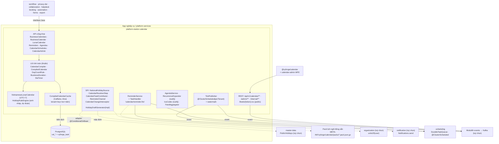
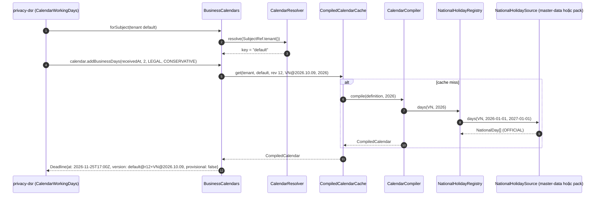
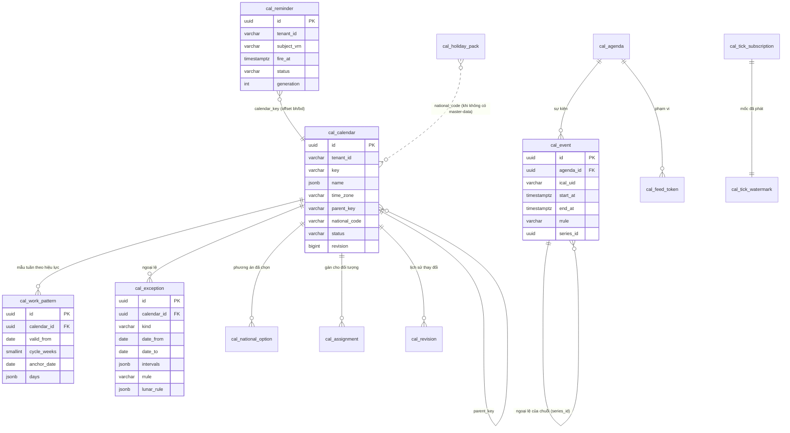

# Thiết kế: `platform-starter-calendar` và `@vyforge/calendar`

> Trạng thái: **thiết kế, chờ duyệt** (forge-55, 27/10/2026). Nhánh `docs/design-calendar`.
> Theo `module-conventions.md` (mục 1–6, gồm khối dùng chung của platform-java 0.12.1) và kiến trúc admin microfrontend
> đã chốt trong `docs/design/platform-services.md` (D1–D10, mục 4.11–4.12, 5.1–5.6). Phạm vi theo
> `docs/research/2026-10-gap-analysis.md` mục 2.7 và 6.7. Nối với các thiết kế đã merge: master-data (mục 3.9, lịch nghỉ
> quốc gia), privacy-dsr (port `WorkingDays`), workflow (port `BusinessCalendar`, đơn vị `bd`/`bh`), collaboration
> (`TodoDueCalculator`, `ReminderScheduler`), forms (`SubmissionInterceptor` kiểm ngày làm việc), cms-content (lịch xuất
> bản dùng component lịch).

Lịch làm việc là khối nền mà workflow, privacy-dsr, collaboration, helpdesk, booking, automation đều cần, nhưng không
module nào nên tự giữ. Module này trả lời ba câu hỏi theo **lịch của đúng tenant, đúng chi nhánh, đúng ca**: *lúc này có
phải giờ làm việc không*, *hạn N ngày (giờ) làm việc tính từ lúc này là khi nào*, *giữa hai mốc có bao nhiêu thời gian
làm việc*. Ngoài ra module lo phần **âm lịch Việt Nam** (UTC+7), **nhắc việc** theo thời gian thật hoặc theo giờ làm
việc, **sự kiện thời gian** theo múi giờ của tenant, **lịch lặp RRULE**, **xuất/nhập iCalendar**, và một **sổ lịch
(agenda)** gọn cho lịch công tác, lịch họp, lịch hiển thị chung từ nhiều module.

## Mục lục

- [0. Tóm tắt quyết định](#0-tóm-tắt-quyết-định)
- [1. Bài toán và phạm vi](#1-bài-toán-và-phạm-vi)
- [2. Nghiên cứu](#2-nghiên-cứu)
- [3. Kiến trúc](#3-kiến-trúc)
- [4. Mô hình dữ liệu](#4-mô-hình-dữ-liệu)
- [5. API](#5-api)
- [6. Mở rộng](#6-mở-rộng)
- [7. Vận hành](#7-vận-hành)
- [8. Bảo mật và tuân thủ](#8-bảo-mật-và-tuân-thủ)
- [9. Kế hoạch triển khai](#9-kế-hoạch-triển-khai)
- [9a. Đóng gói và triển khai độc lập](#9a-đóng-gói-và-triển-khai-độc-lập)
- [10. Lệch quy ước và quyết định](#10-lệch-quy-ước-và-quyết-định)
- [Phụ lục A. Ranh giới với các module khác](#phụ-lục-a-ranh-giới-với-các-module-khác)
- [Phụ lục B. Dữ liệu lịch nghỉ 2026–2027 đã kiểm](#phụ-lục-b-dữ-liệu-lịch-nghỉ-20262027-đã-kiểm)
- [Phụ lục C. Nguồn đã kiểm](#phụ-lục-c-nguồn-đã-kiểm)

---

## 0. Tóm tắt quyết định

| # | Quyết định | Lý do ngắn |
|---|---|---|
| C1 | **Lịch làm việc = ba lớp chồng nhau**, ưu tiên từ trên xuống: (1) *ngoại lệ* của tenant (nghỉ riêng, làm thêm, đổi giờ), (2) *lịch quốc gia* (ngày lễ, nghỉ bù, hoán đổi, làm bù) kèm lựa chọn phương án của tenant, (3) *mẫu tuần* (giờ làm theo thứ, chu kỳ nhiều tuần, có hiệu lực theo ngày). Một tenant có nhiều lịch (`default`, `cn-hcm`, `cskh-24x7`, `ca-dem`…), lịch con kế thừa lịch cha | Cách của Odoo (`resource.calendar` + `leave_ids` + `global_leave_ids`) và Jira SLA calendar (giờ theo ngày + ngày nghỉ), thêm lớp quốc gia có version mà hai hệ đó để người dùng nhập tay |
| C2 | **Dữ liệu lịch nghỉ quốc gia ở master-data, tính toán ở calendar** (xác nhận ranh giới master-data mục 3.9, Q1). Calendar khai báo SPI `NationalHolidaySource`; adapter master-data bật bằng `@ConditionalOnBean(PublicHolidays.class)`; không có master-data thì đọc **pack cùng định dạng** đóng sẵn trong starter, người vận hành nhập pack mới không cần deploy | Một nơi công bố, nhiều nơi dùng; vẫn cài calendar độc lập được (quy ước 6) |
| C3 | **Mô hình "phương án nghỉ" (holiday option)** cho khu vực doanh nghiệp: văn bản hằng năm thường cho người sử dụng lao động *chọn* (Quốc khánh 2026: 2/9 + chọn 1/9 hoặc 3/9; Tết 2027: chọn 1 trong 3 phương án). Dữ liệu quốc gia mang nhóm phương án; lịch tenant ghi phương án đã chọn, chưa chọn thì dùng phương án mặc định của nhóm | Đúng văn bản 2026–2027 (Phụ lục B). Không hệ tham khảo nào mô hình hoá điều này |
| C4 | **Âm lịch VN tự cài theo UTC+7**, không dùng `cn.6tail:lunar` ở runtime. Đã chạy thử: thư viện này (lịch Trung Quốc, UTC+8) cho **Tết 2030 là 03/02** trong khi lịch VN là **02/02**; lệch tương tự ở Tết 2007, 2053 và Giỗ Tổ 2037, 2038, 2085, 2086, 2095, 2100 (mục 2.4) | Giỗ Tổ và Tết là ngày nghỉ luật định; sai một ngày là sai SLA. Thuật toán thiên văn (Meeus) công khai, ~250 dòng, test bằng bảng ngày Tết đã công bố |
| C5 | **Lõi tính toán là hàm thuần trên "lịch đã biên dịch"** (`CompiledCalendar`): mảng khoảng làm việc theo năm + tổng tích luỹ, nên `addBusinessDays`, `addBusinessDuration`, `businessDurationBetween` là O(log n), không I/O. Cache theo `(tenant, key, revision, năm)` | SLA của workflow/helpdesk được gọi rất nhiều; chạy ở chế độ `remote` chỉ cần tải snapshot |
| C6 | **Quy tắc đếm ngày có tên, chọn được theo lời gọi** (`DayCountRule`): `LEGAL` (không tính ngày bắt đầu, hạn là cuối ngày làm việc thứ N, theo BLDS 2015 Điều 147–148), `SAME_TIME` (giữ giờ trong ngày, kiểu "2bd" của workflow), `CUTOFF(15:00)` (nhận sau giờ chốt thì tính từ ngày làm việc kế tiếp) | Mỗi nghiệp vụ hiểu "N ngày làm việc" khác nhau; không ép một nghĩa |
| C7 | **Năm chưa có dữ liệu chính thức**: tính bằng *dự đoán theo quy tắc* (âm lịch + Điều 112) và gắn cờ `provisional`; lời gọi có thể chọn `UnknownYearPolicy.CONSERVATIVE` (chỉ trừ cuối tuần: hạn sớm hơn, an toàn cho hạn luật như privacy-dsr) | Đúng yêu cầu của privacy-dsr: "sai số nghiêng về an toàn" |
| C8 | **Kết quả mang `CalendarVersion`** (`default@r12+VN@2026.10.09`). Hạn đã lưu không tự đổi khi lịch đổi; module dùng nghe `BusinessCalendarChanged{key, affectedFrom, affectedTo}` để tự quyết tính lại | privacy-dsr lưu `calendar_version`; workflow tăng `generation` khi tính lại |
| C9 | **Nhắc việc (`Reminders`) chạy trên `DurableTaskQueue`** (queue `calendar`, `runAt`, idempotency key), mốc theo thời gian thật hoặc theo giờ làm việc (`-4bh` trước hạn), lặp theo RRULE, kênh qua notification nếu có, luôn phát event `ReminderDue` | Một hệ việc nền (quy ước 5.2); collaboration và privacy-dsr chuyển sang dùng mà không đổi hợp đồng |
| C10 | **Không dùng Spring Modulith Moments cho sự kiện nghiệp vụ.** Đọc mã nguồn 2.1.1: Moments chạy `@Scheduled("@hourly"/"@daily")` ở **mọi** instance, một `zone-id` cho cả app, không lưu mốc đã phát, không bù khi app tắt. Calendar tự phát `BusinessDayStarted`, `BusinessPeriodStarted`… theo múi giờ và lịch của từng tenant, bằng `@ClusterScheduled` + watermark + idempotency | Nhiều replica sẽ phát trùng; tenant ở múi giờ khác nhau; mất sự kiện khi deploy là không chấp nhận được với automation |
| C11 | **Lịch lặp và iCalendar dùng ical4j 4.4.0 (BSD-3-Clause)** ở server. Frontend không tự mở rộng RRULE; xem trước lần lặp gọi API | Một bộ máy RRULE duy nhất, tránh lệch giữa JS và Java; `rrule` (npm) 2.8.1 không cập nhật từ 11/2023 |
| C12 | **Sổ lịch (agenda) gọn + nguồn hợp nhất.** Calendar lưu sự kiện của chính nó (lịch công tác tuần, lịch họp, sự kiện công ty) và gom sự kiện của module khác qua SPI `CalendarFeedContributor` (to-do, hạn hồ sơ, lịch hẹn booking, lịch xuất bản CMS) mà **không sao chép** dữ liệu | Lịch công tác tuần của lãnh đạo là nhu cầu rất phổ biến ở cơ quan VN; một màn hình lịch cho mọi thứ có hạn |
| C13 | **Gán lịch cho đối tượng** (`cal_assignment`: người dùng, đơn vị tổ chức, tài nguyên) có hiệu lực theo ngày; `CalendarResolver` tìm lịch theo thứ tự người → đơn vị (qua organization nếu có) → mặc định tenant | Workflow cần "hạn theo lịch của chi nhánh người xử lý"; booking cần lịch của bác sĩ/quầy |
| C14 | **Web dùng FullCalendar 7.1.3 (MIT), chỉ plugin chuẩn** (`daygrid`, `timegrid`, `list`, `interaction`). Không dùng plugin premium (`resource-timeline`… có license thương mại riêng) | License sạch cho khách on-prem; lịch tài nguyên dạng timeline để booking tự làm khi cần |

---

## 1. Bài toán và phạm vi

### 1.1 Use case

| Nhóm | Hiện tại | Tương lai |
|---|---|---|
| Lịch làm việc | Tuần làm việc, giờ làm theo ca, nghỉ trưa, thứ Bảy cách tuần, ca đêm qua nửa đêm, lịch theo chi nhánh/phòng/ca, kế thừa lịch cha, đổi giờ có hiệu lực từ ngày | Lịch theo cá nhân kết hợp nghỉ phép (đọc từ HRM của dự án qua SPI) |
| Ngày nghỉ | Lịch quốc gia VN (người lao động `VN`, khu vực công `VN-GOV`), nghỉ bù, hoán đổi, làm bù, phương án do doanh nghiệp chọn; ngày nghỉ riêng của tenant; lịch nước khác qua pack | Ngày nghỉ theo địa phương (lễ hội tỉnh) nếu có văn bản |
| Tính toán | `isWorkingTime`, `addBusinessDays`, `addBusinessDuration`, `businessDurationBetween`, ngày làm việc kế tiếp/trước, điều chỉnh ngày rơi vào ngày nghỉ, khoảng làm việc trong một khoảng thời gian | SLA nhiều mức có tạm dừng (`SlaTimer`) dùng chung cho helpdesk |
| Âm lịch | Đổi âm ↔ dương theo UTC+7, tháng nhuận, can chi, hiển thị ngày âm trên lịch, sinh nháp ngày lễ năm mới | Ngày giỗ, rằm/mùng một cho app tôn giáo, bán lẻ |
| Nhắc việc | Nhắc tại thời điểm, trước/sau mốc theo giờ thật hoặc giờ làm việc, lặp RRULE, kênh qua notification, event cho app | Nhắc thông minh theo lịch rảnh của người nhận |
| Sự kiện thời gian | `BusinessDayStarted/Ended`, `BusinessPeriodStarted` (tuần/tháng/quý/năm theo ngày làm việc), lịch chạy `ScheduleSpec` ("ngày làm việc đầu tiên của tháng 08:30") cho automation, export định kỳ | Trigger theo âm lịch |
| Sổ lịch | Lịch công tác tuần, lịch họp, sự kiện công ty, lặp RRULE, ngoại lệ một lần, người tham dự (user nội bộ), mức hiển thị, xuất/nhập ICS, link đăng ký (webcal) | Đồng bộ hai chiều CalDAV/Google/Microsoft 365 qua adapter |
| Giao diện | Lịch tháng/tuần/ngày/danh sách, chọn ngày làm việc, xem trước hạn, trình soạn mẫu tuần, trình soạn RRULE | Lịch tài nguyên dạng timeline |

### 1.2 Kịch bản nghiệp vụ phải đáp ứng

| # | Kịch bản | Đặc thù | Cần gì | Khi nào |
|---|---|---|---|---|
| K1 | **DSR theo NĐ 356/2025**: yêu cầu nhận 16:40 thứ Sáu 20/11/2026; hạn phản hồi 2 ngày làm việc. Thứ Ba 24/11 là Ngày Văn hoá Việt Nam (NQ 28/2026/QH16) | VN, luật | `addBusinessDays(t, 2, LEGAL)` = hết ngày thứ Tư 25/11 (bỏ qua T7, CN và 24/11); trả `CalendarVersion` để privacy lưu | Hiện tại |
| K2 | **Một cửa ở UBND phường**: hồ sơ nộp sau giờ chốt chiều được tính từ ngày làm việc kế tiếp; hạn giải quyết 10 ngày làm việc; trả kết quả trước 16:00 ngày hạn | VN, khu vực công, lịch `VN-GOV` có hoán đổi (thứ Hai 31/8/2026 nghỉ, thứ Bảy 22/8/2026 làm bù) | `DayCountRule.cutoff(15:00)`, lịch kế thừa `VN-GOV`, làm bù dùng giờ của ngày được hoán đổi | Hiện tại |
| K3 | **Doanh nghiệp chọn phương án Quốc khánh 2026**: nghỉ 2/9 và chọn 3/9 (thay vì 1/9) | VN, BLLĐ 2019 Điều 112; thông báo 2026 | Nhóm phương án trong dữ liệu quốc gia; tenant chọn trong admin; hạn đang mở được báo `BusinessCalendarChanged` | Hiện tại |
| K4 | **Tết 2027 (TB 11483/TB-BNV)**: khu vực công nghỉ 04–10/02/2027; doanh nghiệp chọn 1 trong 3 phương án, phải báo người lao động trước 30 ngày | VN | `VN-GOV` có 5 ngày Tết + 2 nghỉ bù; `VN` có nhóm phương án 3 lựa chọn; admin nhắc tenant chọn trước 30 ngày | Hiện tại |
| K5 | **Helpdesk CSKH 2 khung**: kênh thường 08:00–17:30 T2–T6 + 08:00–12:00 T7; kênh VIP 24x7 trừ mùng 1–3 Tết. Hạn phản hồi 4 giờ làm việc, tạm dừng khi chờ khách | Nhiều lịch trong một tenant | Hai lịch, lịch VIP `nationalCode = none` + ngoại lệ lặp theo âm lịch; `SlaTimer` (chạy/dừng) | Đợt C (helpdesk) |
| K6 | **Nhà máy 3 ca**: ca đêm 22:00–06:00 qua nửa đêm, thứ Bảy làm cách tuần (chu kỳ 2 tuần từ mốc 05/01/2026) | Ca, chu kỳ | Khoảng qua nửa đêm thuộc ngày bắt đầu; `cycleWeeks = 2`, `anchorDate` | Hiện tại |
| K7 | **Chuỗi bán lẻ có chi nhánh ở Singapore**: chi nhánh SG dùng lịch nghỉ `SG`, múi giờ `Asia/Singapore`; workflow phê duyệt liên chi nhánh tính hạn theo lịch của người xử lý | Đa quốc gia | Pack `holiday-day:SG`; `CalendarResolver.forSubject(user)` theo đơn vị | Tương lai gần |
| K8 | **Nhắc duyệt đơn nghỉ phép** (collaboration K3): hạn 2 ngày làm việc, nhắc trước 4 giờ làm việc, quá hạn báo trưởng phòng | — | `Reminders.schedule(anchor=due, offset=-4bh)`; event `ReminderDue`; tính lại khi lịch đổi | Hiện tại |
| K9 | **Báo cáo tự động ngày làm việc đầu tiên của tháng lúc 08:30** (automation, export); nếu ngày 1 rơi vào Tết thì chạy ngày làm việc kế tiếp | VN | `ScheduleSpec.nthBusinessDay(1, MONTH, 08:30)`; sự kiện không trùng giữa replica, bù khi app tắt | Đợt C (automation) |
| K10 | **Lịch công tác tuần của Giám đốc Sở** công bố công khai trên cổng thông tin, cán bộ đăng ký theo dõi trên điện thoại | VN, khu vực công | Sổ lịch `agenda` của đơn vị, mức `PUBLIC`, xuất ICS, link webcal có token thu hồi được; trang công khai đọc qua BFF | Hiện tại |
| K11 | **Phòng khám đặt lịch**: slot khám chỉ trong giờ làm việc của bác sĩ trừ ngày nghỉ và giờ bận | Booking | `workingIntervals(range)` theo lịch gán cho bác sĩ, trừ khoảng bận từ `CalendarFeedContributor` của booking | Đợt C (booking) |
| K12 | **Form đặt phòng**: "ngày nhận phòng phải sau hôm nay ít nhất 1 ngày làm việc"; date picker ẩn ngày nghỉ, hiện ngày âm và tên ngày lễ | forms, web | `SubmissionInterceptor` mẫu của calendar; `<BusinessDatePicker>` | Hiện tại |
| K13 | **Cuối năm chưa có thông báo nghỉ Tết năm sau** (thường có vào tháng 10–12): hạn SLA tháng 2 năm sau được tính theo dự đoán, gắn `provisional`, cảnh báo người vận hành; khi văn bản ra, công bố dữ liệu, tenant được báo hạn đang mở bị ảnh hưởng | VN | Sinh nháp theo âm lịch (`HolidayDraftGenerator`), health `calendar.national-data`, event `BusinessCalendarChanged` | Hiện tại |
| K14 | **Khách on-prem không ra Internet** nhập pack lịch nghỉ bằng file đã ký; không cài master-data | VN, on-prem | Pack định dạng master-data 4.5, kiểm chữ ký Ed25519, lưu trong `cal_holiday_pack` | Hiện tại |
| K15 | **Người dùng nhập lịch họp từ Outlook (.ics)** và đăng ký lịch nghỉ của công ty vào Google Calendar cá nhân | Interop | Nhập/xuất RFC 5545 (VEVENT, RRULE, EXDATE, VTIMEZONE) | Hiện tại |
| K16 | **Hạn nộp hồ sơ theo BLDS 2015 Điều 148**: ngày cuối của thời hạn (tính theo ngày lịch) rơi vào ngày nghỉ thì lùi sang hết ngày làm việc kế tiếp | VN, luật | `adjust(date, NEXT_WORKING_DAY)`; `addCalendarDays(..., rollForward=true)` | Hiện tại |

### 1.3 Không thuộc phạm vi

- **Nghỉ phép, chấm công, bảng lương của nhân viên.** Thuộc HRM của dự án; calendar chỉ có SPI `PersonalAbsenceSource`
  để trừ ngày vắng khi tính lịch rảnh (bản sau).
- **Đặt lịch hẹn, slot, sức chứa, giữ chỗ.** Thuộc `booking`; calendar cho giờ làm việc và khoảng bận.
- **Workflow, SLA nhiều mức, escalation.** Thuộc workflow/helpdesk; calendar cho phép tính và `SlaTimer`.
- **Lưu dữ liệu lịch nghỉ quốc gia khi có master-data.** master-data giữ; calendar chỉ đọc.
- **Đồng bộ hai chiều với Google/Microsoft/CalDAV.** Bản sau, qua SPI `ExternalCalendarSync`.
- **Phòng họp, tài nguyên, check-in.** booking.

---

## 2. Nghiên cứu

### 2.1 Văn bản pháp lý VN về ngày nghỉ và cách tính thời hạn

| Văn bản | Nội dung dùng cho thiết kế | Kiểm |
|---|---|---|
| **Bộ luật Lao động 2019** (45/2019/QH14), Điều 112 | Ngày nghỉ lễ, tết hưởng nguyên lương: Tết Dương lịch 1 ngày (1/1); Tết Âm lịch 5 ngày; Chiến thắng 30/4 1 ngày; Quốc tế lao động 1/5 1 ngày; Quốc khánh 2 ngày (2/9 và 1 ngày liền kề trước hoặc sau); Giỗ Tổ Hùng Vương 1 ngày (10/3 âm lịch). Trùng ngày nghỉ hằng tuần thì nghỉ bù ngày kế tiếp. Thủ tướng quyết định cụ thể ngày nghỉ Tết Âm lịch và Quốc khánh | Nguồn thứ cấp ([vneconomy](https://vneconomy.vn/nguoi-lao-dong-co-22-ngay-nghi-le-tet-trong-nam-2025.htm), [thuvienphapluat](https://thuvienphapluat.vn/hoi-dap-phap-luat/tu-khi-nao-le-quoc-khanh-duoc-nghi-2-ngay-138014384.html)); trang văn bản gốc trên thuvienphapluat trả 403 khi kiểm. Nội dung trùng với mã nguồn `python-holidays` (dẫn BLLĐ) |
| **Nghị quyết 28/2026/QH16** về phát triển văn hoá Việt Nam, Điều 2 | Ngày 24/11 hằng năm là **Ngày Văn hoá Việt Nam**, người lao động được nghỉ, hưởng nguyên lương. Thông qua 24/04/2026, hiệu lực 01/07/2026. Tổng ngày nghỉ lễ, tết thành 12 | [LuatVietnam](https://luatvietnam.vn/tin-van-ban-moi/tu-hom-nay-01-7-2026-nguoi-lao-dong-chinh-thuc-co-them-1-ngay-nghi-huong-nguyen-luong-186-109961-article.html), [Xây dựng chính sách – Chính phủ](https://xaydungchinhsach.chinhphu.vn/ngay-24-11-hang-nam-la-ngay-van-hoa-viet-nam-nguoi-lao-dong-duoc-nghi-huong-nguyen-luong-119260113152642414.htm). **Điều 112 BLLĐ chưa được sửa** theo: dự thảo Luật sửa đổi BLLĐ 2026 đang lấy ý kiến bổ sung 24/11 vào Điều 112 ([thuvienphapluat](https://thuvienphapluat.vn/banan/tin-tuc/toan-van-du-thao-luat-sua-doi-bo-luat-lao-dong-moi-nhat-2026-bo-sung-ngay-nghi-le-tet-trong-nam-chi-50507.html)). Hệ quả: quy tắc nghỉ bù khi 24/11 trùng cuối tuần chưa rõ → dữ liệu theo thông báo hằng năm, không suy ra |
| **Ngày Văn hoá Việt Nam 2026** | Nghỉ thứ Ba 24/11/2026, **không hoán đổi** (Phó Thủ tướng đồng ý phương án của Bộ Nội vụ, tin 02/10/2026). Phương án 4 ngày (đổi 23/11 sang 28/11) bị bỏ | [Tiền Phong](https://tienphong.vn/cong-chuc-nguoi-lao-dong-duoc-nghi-ngay-2411-khong-hoan-doi-ngay-lam-viec-post1881722.tpo), [Dân trí](https://dantri.com.vn/noi-vu/chinh-phu-chot-nghi-1-ngay-ngay-van-hoa-viet-nam-2026-20260919231056506.htm), [Thanh Niên](https://thanhnien.vn/bo-noi-vu-thay-doi-de-xuat-ngay-van-hoa-viet-nam-nghi-1-ngay-khong-hoan-doi-185260920073806526.htm) |
| **Thông báo 9441/TB-BNV** (Quốc khánh 2026) | Khu vực công nghỉ 29/8–02/9/2026 (5 ngày): hoán đổi thứ Hai 31/8 sang **thứ Bảy 22/8 làm bù**. Doanh nghiệp: nghỉ 2/9 và **chọn** 1/9 hoặc 3/9 | [Báo Lào Cai](https://baolaocai.vn/thu-bay-ngay-228-nhung-ai-phai-di-lam-bu-post906228.html), [Tạp chí Công Thương](https://tapchicongthuong.vn/chinh-thuc--cong-chuc--nguoi-lao-dong-duoc-nghi-5-ngay-dip-le-quoc-khanh-2026-538937.htm), [Hà Tĩnh](https://hatinh.gov.vn/vi/bai-viet/-ha-tinh-trien-khai-lich-nghi-le-quoc-khanh-29-nam-2026) |
| **Thông báo 11483/TB-BNV** (09/10/2026, Tết Âm lịch và Quốc khánh 2027) | Khu vực công nghỉ Tết **04/02–10/02/2027** (5 ngày Tết + 2 ngày nghỉ bù), Quốc khánh 4 ngày 02/9–05/9/2027. Doanh nghiệp chọn 1 trong 3 phương án Tết (1+4, 2+3, 3+2 ngày trước/sau Tết), báo người lao động trước ít nhất 30 ngày | [LuatVietnam](https://luatvietnam.vn/linh-vuc-khac/lich-nghi-tet-nguyen-dan-2027-duoc-chot-the-nao-tai-thong-bao-11483-tb-bnv-883-113717-article.html), [Báo Chính phủ](https://baochinhphu.vn/nghi-tet-am-lich-2027-keo-dai-7-ngay-nghi-quoc-khanh-4-ngay-102261010095648278.htm), [Tuổi Trẻ](https://tuoitre.vn/bo-noi-vu-thong-bao-chi-tiet-lich-nghi-tet-am-lich-quoc-khanh-2027-100261010082304185.htm), [VietnamPlus](https://www.vietnamplus.vn/bo-noi-vu-huong-dan-doanh-nghiep-3-phuong-an-nghi-tet-am-lich-nam-2027-post1141406.vnp) |
| **Bộ luật Dân sự 2015**, Điều 147–148 | Thời hạn tính bằng ngày: ngày đầu tiên không tính; kết thúc vào thời điểm kết thúc ngày cuối cùng; ngày cuối cùng là ngày nghỉ cuối tuần hoặc ngày lễ thì kết thúc vào thời điểm kết thúc **ngày làm việc tiếp theo** | Nguồn thứ cấp ([Tạp chí Tòa án](https://tapchitoaan.vn/khong-co-vuong-mac-ve-tinh-thoi-han-trong-to-tung-dan-su), [Luật Minh Khuê](https://luatminhkhue.vn/thoi-han-la-gi-cach-tinh-thoi-han-theo-quy-dinh-cua-phap-luat.aspx)). Là cơ sở của `DayCountRule.LEGAL` và `adjust(NEXT_WORKING_DAY)` |
| **NĐ 356/2025/NĐ-CP** | Bên kiểm soát dữ liệu phản hồi trong 02 ngày làm việc (bảng SLA trong thiết kế privacy-dsr mục 2.1) | Đã kiểm ở thiết kế privacy-dsr |
| Giờ chốt nhận hồ sơ một cửa | Nhiều cơ quan quy định giờ chốt nhận hồ sơ trong ngày (nhận sau giờ chốt tính sang ngày làm việc kế tiếp). **Chưa tìm được điều khoản gốc** trong NĐ 118/2025/NĐ-CP | Thiết kế để giờ chốt là **cấu hình theo lời gọi/quy trình**, không ghi cứng |

**Kết luận cho mô hình dữ liệu:**

1. Ngày nghỉ cụ thể từng năm *không suy ra được hoàn toàn* từ luật: Tết do Thủ tướng chọn (ngày trước/sau giao thừa),
   Quốc khánh có ngày liền kề do người sử dụng lao động chọn, hoán đổi và làm bù khác giữa khu vực công và doanh nghiệp,
   24/11 chưa có quy tắc nghỉ bù. → Dữ liệu năm là **dữ liệu công bố** có nguồn văn bản; quy tắc chỉ dùng để *sinh nháp*
   và *dự đoán*.
2. Có ít nhất hai lịch quốc gia khác nhau trong cùng năm: `VN` (người lao động nói chung, có nhóm phương án) và `VN-GOV`
   (cán bộ, công chức, viên chức; có hoán đổi và làm bù). Khớp với master-data mục 3.9.
3. Có **ngày làm bù vào thứ Bảy** (22/8/2026) → lịch phải biết *ngày đó làm theo giờ của ngày nào* (giờ của thứ Hai
   31/8 được hoán đổi).
4. Văn bản ra **muộn** (Tết 2027 công bố 09/10/2026) và có thể đổi sau khi đã đề xuất (24/11/2026 đổi từ 4 ngày sang
   1 ngày) → cần version, diff, event và chính sách cho năm chưa công bố.

### 2.2 So sánh hệ thống tham khảo

| Hệ thống | Phiên bản, license | Mô hình dữ liệu | API | Điểm mạnh | Điểm yếu |
|---|---|---|---|---|---|
| **Odoo `resource.calendar`** ([mã nguồn 19.0](https://github.com/odoo/odoo/blob/19.0/addons/resource/models/resource_calendar.py)) | Odoo 19 (09/2025), LGPL-3.0 | `resource.calendar` (`tz`, `hours_per_day`, `two_weeks_calendar`, `schedule_type` fixed/flexible, `full_time_required_hours`) → `attendance_ids` (`dayofweek`, `hour_from`, `hour_to`, `day_period` sáng/chiều/nghỉ trưa, `week_type` cho tuần chẵn/lẻ) và `leave_ids`/`global_leave_ids` (`resource.calendar.leaves` có `date_from`, `date_to`, `resource_id` rỗng = ngày nghỉ chung) | Python: `plan_days(days, day_dt, compute_leaves)`, `plan_hours(hours, day_dt)`, `get_work_hours_count(start, end)`, `_work_intervals_batch(start, end, resources)` = attendance trừ leave | Mô hình gọn, tính bằng *khoảng* (intervals) — cùng ý tưởng `CompiledCalendar`; nghỉ chung và nghỉ theo người tách bạch; lịch hai tuần | Chỉ có chu kỳ 2 tuần; ngày lễ nhập tay theo công ty, không có lớp quốc gia/version; không có ngày làm bù; giờ là float (`8.5`) dễ lỗi làm tròn |
| **Frappe/ERPNext Holiday List** ([docs](https://docs.frappe.io/erpnext/user/manual/en/holiday-list)) | Frappe HR v15/v16, GPL-3.0 | `Holiday List` (from/to date, bảng `holidays`), "Add Weekly Holidays" sinh cả ngày nghỉ tuần thành dòng; nhập ngày lễ theo quốc gia bằng gói `holidays` (python); gán mặc định ở Company, có Holiday List Assignment, Workstation | DocType REST chung | Đơn giản, người dùng hiểu ngay; nhập ngày lễ theo quốc gia | Ngày nghỉ tuần là dòng dữ liệu (phải sinh lại mỗi năm); không có giờ làm việc trong Holiday List (nằm ở Shift Type); không có làm bù |
| **Jira Service Management SLA calendars** ([docs](https://support.atlassian.com/jira-service-management-cloud/docs/set-up-sla-calendars/)) | Cloud (SaaS) | Calendar: tên, múi giờ, giờ làm theo từng thứ (nhiều khoảng một ngày, mặc định 09:00–17:00), danh sách ngày nghỉ; SLA chọn calendar ở từng goal | UI, REST nội bộ | Nhiều khoảng một ngày (nghỉ trưa), calendar gắn theo goal (mỗi loại yêu cầu một lịch) | Ngày lễ nhập tay; không kế thừa; không có lịch quốc gia |
| **Zendesk Schedules** ([API](https://developer.zendesk.com/api-reference/ticketing/ticket-management/schedules/)) | SaaS API v2 | `schedule {name, time_zone, intervals[{start_time, end_time}]}` — phút tính từ 0h Chủ nhật, không vượt nửa đêm; `holidays {name, start_date, end_date}` nhiều ngày | REST `/business_hours/schedules/{id}/holidays?start_date&end_date` | Biểu diễn khoảng bằng số phút gọn, dễ so sánh; ngày nghỉ nhiều ngày một dòng | Ca qua nửa đêm phải tách thủ công; không làm bù; không phương án |
| **Google Calendar API v3 Events** ([reference](https://developers.google.com/workspace/calendar/api/v3/reference/events)) | SaaS | `start`/`end` (`date` cho cả ngày hoặc `dateTime` + `timeZone` IANA), `recurrence[]` (RRULE/EXRULE/RDATE/EXDATE, không có DTSTART), instance có `recurringEventId` + `originalStartTime`, `iCalUID`, `sequence`, `eventType` (`default`, `outOfOffice`, `focusTime`, `workingLocation`…), `reminders.overrides` (≤ 5, `email`/`popup`, 0–40320 phút), `transparency` | REST, `instances`, đồng bộ tăng dần bằng `syncToken` | Chuẩn de facto cho sự kiện lặp và ngoại lệ; tách cả ngày/giờ; `transparency` cho free/busy | Không có khái niệm ngày làm việc/SLA; reminder không theo giờ làm việc |
| **python-holidays** ([vietnam.py](https://github.com/vacanza/holidays/blob/main/holidays/countries/vietnam.py)) | 0.107 (PyPI), MIT | Lớp quốc gia sinh ngày lễ theo quy tắc (lịch Trung Quốc cho Tết), `special_public_holidays` theo năm dạng *(ngày nghỉ, ngày làm bù)* (vd. 2026: 31/8 ↔ 22/8) | Thư viện | Đã có 24/11, có làm bù theo năm kèm nguồn | Tết lấy từ lịch Trung Quốc; chỉ một lịch (không tách khu vực công/doanh nghiệp); không có phương án; Python |
| **Jollyday** ([repo](https://github.com/focus-shift/jollyday), [Holidays_vn.xml](https://github.com/focus-shift/jollyday/blob/main/jollyday-core/src/main/resources/holidays/Holidays_vn.xml)) | v2.22.1 (15/10/2026), Apache-2.0, Java | XML theo quốc gia, quy tắc cố định/di động | Java `HolidayManager` | Java, nhiều nước | File VN **chỉ có 5 ngày dương lịch cố định** (1/1, 30/4, 1/5, 2/9, 24/11), **không có Tết, Giỗ Tổ**, không nghỉ bù → không dùng được cho VN |
| **ical4j** ([repo](https://github.com/ical4j/ical4j)) | 4.4.0 (Maven Central, 02/10/2026), BSD-3-Clause | Mô hình RFC 5545 đầy đủ (VEVENT, VTODO, VTIMEZONE, `Recur`), dùng `java.time` từ 4.x | Java | Parse/sinh ICS chuẩn, mở rộng RRULE kèm múi giờ | API khá nặng; chỉ dùng ở biên (adapter), không lộ ra API công khai |
| **FullCalendar** ([repo](https://github.com/fullcalendar/fullcalendar)) | 7.1.3 (npm 16/10/2026), MIT; plugin premium có license riêng (`@fullcalendar/resource-timeline` "SEE LICENSE IN LICENSE.md") | Event object `{start, end, allDay, rrule?}`; `businessHours`; `eventSources` (hàm lấy theo khoảng) | React `@fullcalendar/react` 7.1.3 | Hiển thị tháng/tuần/ngày/danh sách, kéo thả, `businessHours` tô vùng giờ làm | Không tính ngày làm việc; plugin timeline tài nguyên không MIT |

### 2.3 Spring Modulith Moments (C10)

[Tài liệu 2.1.1](https://docs.spring.io/spring-modulith/reference/moments.html) và
[mã nguồn `Moments` tag 2.1.1](https://github.com/spring-projects/spring-modulith/blob/2.1.1/spring-modulith-moments/src/main/java/org/springframework/modulith/moments/support/Moments.java):

- Phát `HourHasPassed`, `DayHasPassed`, `WeekHasPassed`, `MonthHasPassed`, `QuarterHasPassed`, `YearHasPassed`; cấu hình
  `granularity`, `zone-id` (mặc định UTC), `locale`, `quarter-start-month`; `TimeMachine` dịch thời gian cho test.
- Cơ chế: `@Scheduled(cron = "@hourly")` và `@Scheduled(cron = "@daily")` trên bean `Moments`; **không lưu mốc đã phát,
  không bù khi app tắt**; trạng thái duy nhất là `shift` trong bộ nhớ. Mỗi replica tự phát → N replica phát N lần.
- platform-java đang dùng Spring Modulith 2.1.1 (`platform-bom`); bản mới nhất trên Maven Central là 2.2.0-RC1.

**Kết luận:** Không dùng Moments làm trigger nghiệp vụ. Học theo: tên event dạng "đã qua", `TimeMachine` cho test →
calendar dùng `java.time.Clock` bean và cung cấp `CalendarTimeTravel` trong `platform-test` để dịch thời gian và chạy
bù mọi tick trung gian (giống `shiftBy`). App vẫn dùng Moments cho việc nội bộ không cần chính xác được, calendar không
chặn.

### 2.4 Âm lịch Việt Nam: kiểm `cn.6tail:lunar` (C4)

`cn.6tail:lunar` 1.7.7 (Maven Central, cập nhật 05/11/2025, MIT, Java 1.5+, không phụ thuộc) là thư viện âm lịch Trung
Quốc. Lịch VN dùng cùng quy tắc (tháng bắt đầu ở ngày có trăng mới, tháng 11 chứa Đông chí, tháng nhuận là tháng đầu tiên
không có trung khí) nhưng **tính theo giờ Hà Nội UTC+7** từ 1968, Trung Quốc theo UTC+8
([Nhân Dân](https://nhandan.vn/chung-quanh-thong-tin-ve-ngay-am-lich-khac-nhau-tren-mot-so-loai-lich-post489744.html),
[RFA](https://www.rfa.org/vietnamese/in_depth/WhyVietnameseLunarCalendarDiffersFromChina_GMinh-20070207.html),
[quy tắc tính của Hồ Ngọc Đức](https://www.informatik.uni-leipzig.de/~duc/amlich/calrules_en.html)).

Kiểm thực tế (27/10/2026): viết thuật toán trăng mới/kinh độ mặt trời theo Meeus với tham số múi giờ, so với
`Lunar.fromYmd(y, m, d).getSolar()` của 1.7.7 cho mồng 1 tháng Giêng và 10/3 âm lịch, năm 1900–2100. Với tham số UTC+8,
thuật toán trùng thư viện ở mọi năm có Tết; với UTC+7 thì lệch:

| Năm | Tết VN (UTC+7) | `cn.6tail:lunar` | Giỗ Tổ VN (UTC+7) | `cn.6tail:lunar` |
|---|---|---|---|---|
| 1985 | 21/01/1985 | 20/02/1985 (lệch **một tháng**, đúng sự kiện lịch sử) | — | — |
| 2007 | 17/02/2007 | 18/02/2007 | — | — |
| 2009 | — | — | 04/04/2009 | 05/04/2009 |
| 2030 | **02/02/2030** | 03/02/2030 | — | — |
| 2037 | — | — | 24/04/2037 | 25/04/2037 |
| 2038 | — | — | 13/04/2038 | 14/04/2038 |
| 2053 | 18/02/2053 | 19/02/2053 | — | — |
| 2085, 2086, 2095, 2100 | — | — | lệch 1 ngày | |

Đối chiếu năm hiện hành: thuật toán UTC+7 cho Tết 2026 = 17/02/2026, Giỗ Tổ 2026 = 26/04/2026 (khớp thông báo nghỉ
bù 27/4/2026), Tết 2027 = 06/02/2027 (khớp TB 11483: 04/02/2027 là 28 tháng Chạp, 10/02/2027 là mùng 5), Giỗ Tổ
2027 = 16/04/2027, Giỗ Tổ 2019 = 14/04/2019 (khớp thông báo nghỉ bù 15/04/2019); năm nhuận tháng 6 (2025), nhuận
tháng 5 (2028).

**Quyết định:** cài `VietnameseLunarCalendar` riêng (thuật toán thiên văn công khai, viết lại từ công thức của Meeus,
không chép mã có điều khoản "phi thương mại"), tham số múi giờ mặc định 7. `cn.6tail:lunar` chỉ là **test dependency**
để đối chiếu tự động: hai bên phải trùng khi đặt múi giờ 8, và danh sách năm lệch khi đặt múi giờ 7 phải đúng bảng trên.
Phạm vi hỗ trợ 1900–2199; ngoài phạm vi ném `LunarOutOfRangeException`.

### 2.5 Học theo và không làm

| Học theo | Từ |
|---|---|
| Tính bằng *khoảng làm việc* (attendance − leave), có hàm batch theo khoảng thời gian | Odoo `_work_intervals_batch` |
| Nhiều khoảng mỗi ngày (nghỉ trưa), nhiều lịch, mỗi SLA chọn lịch | Jira SLA calendars |
| Ngày nghỉ nhiều ngày là một dòng `start_date..end_date` | Zendesk holidays |
| Làm bù theo năm dạng *(ngày nghỉ ↔ ngày làm)* kèm nguồn văn bản | python-holidays `special_public_holidays` |
| `start.date` vs `start.dateTime` + `timeZone`; `recurringEventId`/`originalStartTime` cho ngoại lệ; `iCalUID` + `sequence`; `transparency` | Google Calendar API |
| `TimeMachine` dịch thời gian trong test | Spring Modulith Moments |
| `businessHours` để tô vùng làm việc trên lịch | FullCalendar |

| Không làm | Lý do |
|---|---|
| Sinh ngày nghỉ tuần thành dòng dữ liệu (Frappe) | Phình dữ liệu, phải sinh lại hằng năm; mẫu tuần + biên dịch là đủ |
| Giờ dạng số thực (Odoo `8.5`) | Lỗi làm tròn; dùng `LocalTime` và phút |
| Lấy Tết/Giỗ Tổ từ thư viện lịch Trung Quốc (python-holidays, `cn.6tail:lunar`) | Sai ở 2030, 2053, Giỗ Tổ 2037/2038 (mục 2.4) |
| Moments làm trigger nghiệp vụ | Không cluster-safe, không bù, một múi giờ (mục 2.3) |
| Server CalDAV đầy đủ ở bản đầu | Lớn, ít dự án cần; xuất ICS + webcal đủ cho K10, K15 |
| Mở rộng RRULE ở trình duyệt | Hai bộ máy cho ra hai kết quả khác nhau ở biên múi giờ |
| Plugin premium của FullCalendar | License thương mại riêng |

---

## 3. Kiến trúc

### 3.1 Khái niệm

| Khái niệm | Nghĩa | Ví dụ |
|---|---|---|
| **Lịch quốc gia** (`nationalCode`) | Dữ liệu công bố theo năm: ngày nghỉ lễ, nghỉ bù, hoán đổi, làm bù, nhóm phương án; mỗi ngày có nguồn văn bản | `VN`, `VN-GOV`, `SG` |
| **Lịch làm việc** (`BusinessCalendar`, khoá `key`) | Của một tenant: múi giờ, mẫu tuần, lịch quốc gia kế thừa (+ phương án đã chọn), ngoại lệ, lịch cha | `default`, `cn-hcm`, `cskh-vip`, `ca-dem` |
| **Mẫu tuần** (`WorkPattern`) | Khoảng giờ làm theo thứ, chu kỳ 1–4 tuần tính từ `anchorDate`, có hiệu lực từ `validFrom` | T2–T6 08:00–12:00, 13:30–17:30; T7 tuần lẻ 08:00–12:00 |
| **Ngoại lệ** (`CalendarException`) | Thay đổi của tenant đè lên mọi lớp dưới: `CLOSED` (nghỉ), `OPEN` (làm, có giờ), `HOURS` (đổi giờ); một ngày, nhiều ngày, hoặc lặp RRULE/âm lịch | Nghỉ du lịch công ty 15–16/7; 24/12 làm đến 12:00; mùng 1–3 Tết âm lịch hằng năm đóng cửa |
| **Lịch biên dịch** (`CompiledCalendar`) | Kết quả gộp ba lớp cho một năm: danh sách khoảng làm việc (epoch giây), loại ngày, tổng tích luỹ | Bất biến, cache |
| **Phiên bản lịch** (`CalendarVersion`) | Chuỗi định danh dữ liệu đã dùng để tính: `key@r<revision>+<national>@<datasetVersion>[+opt:<hash>]` | `default@r12+VN-GOV@2026.10.09` |
| **Gán lịch** (`CalendarAssignment`) | Đối tượng → lịch, có hiệu lực theo ngày | user `u-123` → `ca-dem` từ 01/11/2026; đơn vị `cn-hcm` → `cn-hcm` |
| **Nhắc** (`Reminder`) | Mốc phải báo, gắn đối tượng, có thể lặp, có thể theo giờ làm việc | "Nhắc trước hạn 4 giờ làm việc" |
| **Sổ lịch** (`Agenda`) và **sự kiện** (`CalendarEvent`) | Sự kiện của calendar (lịch công tác, họp) | Lịch công tác tuần của Ban Giám đốc |
| **Nguồn lịch** (`CalendarFeedContributor`) | Module khác đưa sự kiện (chỉ đọc) vào màn hình lịch | to-do (collaboration), hạn hồ sơ (workflow), lịch hẹn (booking), lịch xuất bản (cms) |
| **Tick** | Sự kiện thời gian theo lịch của tenant | `BusinessDayStarted{key: default, date: 2026-11-25}` |

### 3.2 Thành phần



**Phụ thuộc cứng:** `platform-core`, `-jpa`, `-web`, `-security`, `-authz`, `-audit`, `-scheduling` (task queue, cluster
job), `-messaging` (event). **Tuỳ chọn** (`<optional>true</optional>` + `@ConditionalOnBean`): master-data,
organization, notification, files (lưu file ICS nhập lớn), features (giới hạn). Không module P1 nào bắt buộc.

Package (giống workflow, privacy-dsr):

```
com.vyforge.platform.calendar
├── api/            BusinessCalendars, BusinessCalendar, LunarCalendar, Reminders, Agendas, CalendarSchedules,
│                   CalendarAdmin, record/enum công khai (DayInfo, DayKind, BusinessDuration, DayCountRule…)
├── core/           CalendarCompiler, CompiledCalendar, IntervalMath, SlaTimer, DayCountEngine
├── lunar/          VietnameseLunarCalendar, Astronomy (Meeus), CanChi, HolidayRuleEngine
├── national/       NationalHolidayRegistry, PackNationalHolidaySource, MasterDataNationalHolidaySource,
│                   PackVerifier (Ed25519 + JCS, dùng chung định dạng master-data 4.5)
├── reminder/       ReminderService, ReminderFireHandler, OffsetResolver
├── tick/           TickPublisher, TickWatermarkRepository, ScheduleSpecEvaluator
├── agenda/         AgendaService, RecurrenceExpander, IcsCodec, FeedAggregator, FeedTokenService
├── spi/            NationalHolidaySource, CalendarResolverStep, CalendarFeedContributor, ReminderChannel,
│                   CalendarChangeInterceptor, PersonalAbsenceSource (bản sau)
├── integration/    masterdata, organization, notification, privacy (DSR contributor), forms (interceptor mẫu)
├── web/            controller công khai, admin, internal, feed
├── remote/         client HTTP + snapshot cho mode=remote
└── internal/       entity, repository, migration
```

### 3.3 Port và adapter

| Port (SPI) | Mặc định | Adapter khác |
|---|---|---|
| `NationalHolidaySource` | `PackNationalHolidaySource`: pack trong classpath (`VN`, `VN-GOV` từ 2024) + pack người vận hành nhập (`cal_holiday_pack`) | `MasterDataNationalHolidaySource` (`@ConditionalOnBean(PublicHolidays.class)`, ưu tiên cao hơn); dự án tự cài (vd. đọc từ hệ thống nội bộ của tập đoàn) |
| `CalendarResolverStep` (chuỗi) | `ExplicitAssignmentStep` (`cal_assignment` theo user/resource) → `TenantDefaultStep` | `OrgUnitStep` (organization: `unitsOf(user)` → gán theo đơn vị, đi lên cây) |
| `CalendarFeedContributor` | Sổ lịch của calendar | collaboration (to-do có hạn), workflow (hạn hồ sơ), booking (lịch hẹn, khoảng bận), cms-content (lịch xuất bản), privacy-dsr (hạn DSR) — mỗi module tự cài khi có calendar |
| `ReminderChannel` | `EventOnlyChannel` (chỉ phát `ReminderDue`) | `NotificationReminderChannel` (`@ConditionalOnBean(Notifications.class)`), app tự cài (gửi vào hệ thống khác) |
| `CalendarChangeInterceptor` | Không có | Chặn sửa lịch khi đang khoá sổ chấm công; bắt buộc nhập lý do khi sửa ngày quá khứ |
| `HolidayDraftGenerator` (SPI của master-data) | Calendar cài `LunarHolidayDraftGenerator` khi có `MasterDataAdmin` | — |
| `PersonalAbsenceSource` (bản sau) | Không có | HRM của dự án: ngày nghỉ phép của người, để tính lịch rảnh/hạn theo người |

### 3.4 Lõi tính toán

**Biên dịch** (`CalendarCompiler.compile(definition, year)` → `CompiledCalendar`), làm theo từng ngày địa phương `d`
trong năm, theo múi giờ của lịch:

```
1. pattern   = WorkPattern có validFrom ≤ d lớn nhất          (của lịch, nếu không có thì của lịch cha)
   week      = floor((d − anchorDate) / 7) mod cycleWeeks
   base      = pattern.intervals[week][dayOfWeek(d)]           (có thể rỗng)
2. national  = các ngày quốc gia của d (sau khi áp phương án đã chọn)
   HOLIDAY | COMPENSATORY_DAY_OFF | SWAPPED_DAY_OFF  → base = ∅, kind = tương ứng
   MAKEUP_WORKING_DAY(swappedWith = s)                → base = intervals của ngày s theo pattern
                                                         (không có s thì intervals của thứ Hai)
3. parent    = áp ngoại lệ của lịch cha (đệ quy, sâu tối đa 3)
4. exception = ngoại lệ của chính lịch, theo thứ tự: CLOSED → ∅; OPEN → intervals của ngoại lệ (hoặc base nếu trống);
               HOURS → thay intervals. Nhiều ngoại lệ cùng ngày: cái tạo sau thắng, admin cảnh báo trùng
5. intervals → khoảng thời gian tuyệt đối: [ZonedDateTime(d, from, zone), ZonedDateTime(d', to, zone)) với
               d' = d+1 nếu to ≤ from (ca qua nửa đêm). Giờ không tồn tại khi chuyển DST: dời theo ZonedDateTime.
               Khoảng chồng nhau giữa ngày d và ca đêm của d−1 được gộp.
```

Kết quả lưu dạng mảng nguyên thuỷ: `long[] starts, ends` (epoch giây, đã sắp, không chồng), `long[] cumSeconds` (tổng
thời gian làm việc tích luỹ tới hết khoảng i), `byte[] dayKind` (366 phần tử), `int[] cumWorkingDays`. Một năm với 2
khoảng/ngày ≈ 520 khoảng ≈ 15 KB. Cache Caffeine theo `(tenant, key, revision, nationalDatasetVersion, year)`, tối đa
`vyforge.calendar.cache.max-entries` (mặc định 5.000), TTL 24 giờ (quy ước cache bắt buộc TTL), xoá khi có
`BusinessCalendarChanged` hoặc dữ liệu quốc gia đổi.

**Phép tính** (mọi phép đều nhận `Instant` hoặc `LocalDate`, làm việc trên nhiều năm liên tiếp khi cần):

| Phép | Cách tính | Độ phức tạp |
|---|---|---|
| `isWorkingTime(t)` | tìm nhị phân `starts`, kiểm `t < ends[i]` | O(log n) |
| `businessDurationBetween(a, b)` | `cumAt(b) − cumAt(a)`, `cumAt(t)` = cum tới khoảng trước + phần đã qua của khoảng chứa t | O(log n) |
| `addBusinessDuration(t, d)` | tìm khoảng có `cum ≥ cumAt(t) + d` (nhị phân trên `cumSeconds`), cộng phần dư | O(log n) |
| `addBusinessDays(t, n, rule)` | dùng `cumWorkingDays` để nhảy tới ngày làm việc thứ n, rồi áp `rule.endAt` | O(log n) |
| `businessDaysBetween(d1, d2)` | hiệu `cumWorkingDays` | O(1) |
| `workingIntervals(a, b)` | cắt mảng theo `[a, b)` | O(log n + k) |
| `n < 0` | đối xứng, đi lùi | như trên |

Giới hạn tìm kiếm: tối đa `vyforge.calendar.max-horizon-years` (mặc định 5) tính từ mốc; lịch không có giờ làm việc nào
trong khoảng đó (vd. lịch bị cấu hình rỗng) ném `CalendarHorizonExceededException` (`calendar.horizon_exceeded`) thay
vì lặp vô hạn.

**Quy tắc đếm ngày** (`DayCountRule`, record bất biến, có preset):

| Thành phần | Giá trị | Nghĩa |
|---|---|---|
| `start` | `EXCLUDE_START_DAY` | Ngày chứa mốc không tính (BLDS Điều 147); ngày làm việc thứ 1 là ngày làm việc *sau* ngày đó |
| | `INCLUDE_IF_BEFORE(cutoff)` | Mốc trước giờ chốt và ngày đó là ngày làm việc thì ngày đó là ngày thứ 0 (đếm từ ngày kế); sau giờ chốt hoặc ngày nghỉ thì coi như nhận vào đầu ngày làm việc kế tiếp |
| | `FROM_INSTANT` | Đếm theo mốc chính xác (cho `SAME_TIME`) |
| `endAt` | `END_OF_DAY` | 24:00 giờ địa phương của ngày làm việc thứ n (BLDS Điều 148) |
| | `END_OF_WORKING_HOURS` | Hết khoảng làm việc cuối của ngày thứ n |
| | `SAME_TIME_OF_DAY` | Cùng giờ trong ngày với mốc (mốc ngoài giờ thì dời về đầu giờ làm việc kế tiếp trước khi đếm) |
| | `AT(LocalTime)` | Một giờ cố định (vd. trả kết quả trước 16:00) |

Preset: `DayCountRule.LEGAL = (EXCLUDE_START_DAY, END_OF_DAY)`, `SAME_TIME = (FROM_INSTANT, SAME_TIME_OF_DAY)`,
`DayCountRule.cutoff(LocalTime) = (INCLUDE_IF_BEFORE(cutoff), END_OF_WORKING_HOURS)`. Ví dụ K1: nhận 16:40 thứ Sáu
20/11/2026, `LEGAL`, n = 2 → ngày làm việc 1 = thứ Hai 23/11, thứ Ba 24/11 nghỉ (Ngày Văn hoá), ngày làm việc 2 = thứ
Tư 25/11 → hạn `2026-11-25T24:00+07:00` = `2026-11-25T17:00:00Z`.

**`BusinessDuration`** (ngữ pháp chung với workflow mục 3.7): `^-?\d+(bd|bh|bm)$` cho ngày/giờ/phút làm việc, hoặc
ISO-8601 `P…`/`PT…` cho thời gian lịch. `parse("2bd")`, `parse("-4bh")`, `parse("PT30M")`. `bd` mặc định áp
`SAME_TIME`; lời gọi có thể truyền rule khác.

**`SlaTimer`** (record thuần, caller lưu JSON): `{budget: BusinessDuration, segments: [{start, end?, running}]}`;
`pause(at)`, `resume(at)`, `elapsed(calendar, now)`, `dueAt(calendar)` (tính lại khi đang chạy), `breached(now)`. Helpdesk
dùng cho "4 giờ làm việc, dừng khi chờ khách"; workflow giữ cơ chế `generation` của mình và có thể dùng `SlaTimer` để
tính phần còn lại.

### 3.5 Lịch quốc gia và phương án

Dữ liệu đọc qua `NationalHolidaySource.days(code, from, toExclusive)`, trả `NationalDay`:

```java
public record NationalDay(LocalDate date, NationalDayKind kind,   // HOLIDAY, COMPENSATORY_DAY_OFF, SWAPPED_DAY_OFF,
                                                                   // MAKEUP_WORKING_DAY, OPTIONAL_DAY_OFF
                          @Nullable String holidayCode,            // tet-am-lich, quoc-khanh, van-hoa-vn…
                          @Nullable LocalDate swappedWith,         // MAKEUP 22/8 ↔ SWAPPED 31/8
                          @Nullable String optionGroup,            // "2026-quoc-khanh-lien-ke"
                          @Nullable String option,                 // "truoc" | "sau"
                          boolean optionDefault,                   // phương án dùng khi tenant chưa chọn
                          LocalizedText name, List<LegalRef> legalRefs, Status status) {} // OFFICIAL | PROVISIONAL
```

- `OPTIONAL_DAY_OFF` chỉ có hiệu lực khi phương án của nó được chọn (hoặc là mặc định và tenant chưa chọn). Ví dụ
  Quốc khánh 2026 ở `VN`: 2/9 `HOLIDAY`; 1/9 `OPTIONAL_DAY_OFF` (`truoc`); 3/9 `OPTIONAL_DAY_OFF` (`sau`). Mặc định:
  phương án trùng khu vực công (1/9), theo khuyến khích của Bộ Nội vụ.
- Tết 2027 ở `VN`: các ngày Tết chắc chắn (mùng 1–2, vì cả ba phương án đều có) là `HOLIDAY`; các ngày còn lại thuộc
  nhóm `2027-tet` với ba phương án `1+4`, `2+3`, `3+2`; nghỉ bù khi trùng cuối tuần nằm trong từng phương án.
- **Đề nghị master-data** (mục 10.3, Q1): bổ sung `kind = OPTIONAL_DAY_OFF` và ba thuộc tính `optionGroup`, `option`,
  `optionDefault`, `swappedWith` vào item `holiday-day:*`. Định dạng pack giữ `format: 1` vì chỉ thêm thuộc tính.
- Tenant chọn phương án trong admin (`PUT /admin/calendars/{key}/national-options/{group}`), ghi audit. Admin hiện
  banner khi còn nhóm chưa chọn và ngày đầu tiên của nhóm cách hôm nay ≤ 45 ngày (luật yêu cầu báo người lao động trước
  30 ngày cho Tết 2027).

**Năm chưa công bố.** `NationalHolidayRegistry.status(code, year)` = `OFFICIAL` | `PROVISIONAL` (có nháp/dự đoán) |
`MISSING`. Khi `MISSING`/`PROVISIONAL`, `HolidayRuleEngine` dự đoán theo quy tắc: 1/1, 30/4, 1/5, 2/9 + 1 ngày liền kề
(mặc định 1/9 hoặc 3/9 theo luật hoán đổi năm trước, xem 10.2), 24/11 (từ 2026), Giỗ Tổ (10/3 âm lịch), Tết (29 hoặc 30
tháng Chạp → mùng 4, hoặc theo mẫu năm trước), nghỉ bù khi trùng cuối tuần. Mọi kết quả tính có dùng năm dự đoán mang
`provisional = true`. Lời gọi chọn:

- `UnknownYearPolicy.PREDICT` (mặc định): dùng dự đoán (đúng cho hiển thị, booking, nhắc việc);
- `UnknownYearPolicy.CONSERVATIVE`: chỉ trừ cuối tuần và ngày lễ dương lịch cố định → hạn sớm hơn hoặc bằng thực tế.
  privacy-dsr dùng chế độ này cho hạn luật.

### 3.6 Luồng chính: tính hạn (embedded)



### 3.7 Luồng: công bố dữ liệu quốc gia mới (K13)

```mermaid
sequenceDiagram
  autonumber
  participant OP as Người vận hành
  participant MD as master-data (hoặc admin calendar khi không có master-data)
  participant L as NationalDataListener (calendar)
  participant C as CompiledCalendarCache
  participant DB as cal_* (revision)
  participant APP as workflow / privacy / collaboration
  OP->>MD: Sinh nháp năm 2027 (HolidayDraftGenerator của calendar)
  MD-->>OP: Nháp theo âm lịch UTC+7 (PROVISIONAL)
  OP->>MD: Sửa theo TB 11483/TB-BNV, gắn nguồn, công bố
  MD-->>L: MasterDataPublished{list: holiday-day:VN-GOV, effectiveDates[]}
  L->>C: invalidate(national = VN-GOV, years 2027)
  L->>DB: tìm lịch tenant dùng VN-GOV (mọi tenant, theo trang)
  loop từng lịch bị ảnh hưởng (task 'calendar/national-changed', theo tenant)
    L-->>APP: BusinessCalendarChanged{tenant, key, cause: NATIONAL_DATA, affectedFrom: 2027-02-04, affectedTo: 2027-02-11}
  end
  Note over APP: Module tự quyết: privacy giữ hạn đã lưu (chỉ báo admin);<br/>workflow tính lại việc ACTIVE có due_at trong khoảng (generation+1)
```

Phát event theo tenant đi qua `DurableTaskQueue` (queue `calendar`, kind `national-changed`, idempotency
`<code>:<datasetVersion>:<tenant>`), nên 10.000 tenant không phát trong một transaction.

### 3.8 Luồng: nhắc việc (K8)

```mermaid
sequenceDiagram
  autonumber
  participant CO as collaboration
  participant RM as Reminders
  participant DB as cal_reminder
  participant Q as DurableTaskQueue
  participant H as ReminderFireHandler
  participant CH as ReminderChannel (notification)
  participant EV as Modulith events
  CO->>RM: schedule(subject=collab:todo/77, anchor=dueAt, offset=-4bh, calendar=forSubject(assignee), channel=notification:todo.due-soon, idempotencyKey=todo77:due-soon)
  RM->>RM: fireAt = calendar.addBusinessDuration(dueAt, -4h)
  RM->>DB: insert (status SCHEDULED, generation 1)
  RM->>Q: enqueue(queue=calendar, kind=reminder.fire, runAt=fireAt, key=<id>:1:0) (cùng transaction)
  Q->>H: run (đúng giờ, một replica)
  H->>DB: đọc reminder; khác generation/đã huỷ → bỏ qua
  H->>CH: deliver(reminder) (idempotency theo id + occurrence)
  H->>EV: ReminderDue{subject, reminderId, occurrence, fireAt}
  H->>DB: lặp RRULE → occurrence+1, fireAt mới, enqueue tiếp; không lặp → FIRED
  alt kênh lỗi
    H-->>Q: ném lỗi → retry backoff (max 8) → DEAD
    Q-->>DB: (listener) status FAILED, phát ReminderFailed
  end
```

Lịch đổi (`BusinessCalendarChanged`) → `ReminderRecalculator` tính lại `fireAt` của nhắc `SCHEDULED` có offset theo giờ
làm việc trong khoảng bị ảnh hưởng: tăng `generation`, enqueue việc mới; việc cũ tự bỏ qua ở bước kiểm generation (cách
workflow mục 3.7.5 đã làm).

### 3.9 Luồng: tick theo lịch tenant (K9)

```mermaid
sequenceDiagram
  autonumber
  participant J as @ClusterScheduled(cron "0 * * * * *", perTenant) TickPublisher
  participant W as cal_tick_watermark
  participant CC as CompiledCalendar
  participant Q as DurableTaskQueue
  participant H as TickHandler
  participant EV as Modulith events (+Kafka)
  J->>W: đọc watermark (tenant, calendar, stream)
  J->>CC: các mốc trong (watermark, now]: đầu/cuối ngày làm việc, đầu tuần/tháng/quý/năm làm việc, ScheduleSpec đã đăng ký
  loop mỗi mốc (tối đa catch-up 7 ngày; quá thì bỏ và phát TickGapDetected)
    J->>Q: enqueue(kind=tick, key=<cal>:<stream>:<instant>)
  end
  J->>W: watermark = now
  Q->>H: run
  H->>EV: BusinessDayStarted / BusinessPeriodStarted / ScheduleFired{specId}
```

- Chỉ tenant **có người đăng ký** stream mới được quét (`cal_tick_subscription`, do `CalendarSchedules.register` hoặc
  `@BusinessDayListener` khai báo lúc khởi động), để 10.000 tenant không sinh 10.000 lần đọc mỗi phút vô ích.
- Mốc tính bằng `CompiledCalendar` nên "ngày làm việc đầu tiên của tháng" tự đúng với Tết, làm bù.
- Nghe event: `@ApplicationModuleListener void on(BusinessDayStarted e)` (Modulith, chạy sau commit, có
  `event_publication`); tick ra Kafka khi `vyforge.calendar.events.externalize=true`.

### 3.10 Sổ lịch, lặp, iCalendar

- `CalendarEvent` theo mô hình Google: `allDay` (`startDate`/`endDate` dạng ngày, end loại trừ) hoặc `startAt`/`endAt` +
  `timeZone` IANA; chuỗi lặp lưu ở bản ghi gốc (`rrule`, `rdates`, `exdates`); ngoại lệ một lần là bản ghi con
  (`seriesId`, `originalStart`), xoá một lần = thêm `exdate` hoặc ngoại lệ `status = CANCELLED`.
- Sửa "lần này và các lần sau": tách chuỗi (đặt `UNTIL` cho chuỗi cũ, tạo chuỗi mới cùng `icalUid` gốc + hậu tố), như
  Google.
- Mở rộng lần lặp: `RecurrenceExpander` (ical4j `Recur`) trong khoảng truy vấn, giới hạn 2.000 lần mỗi chuỗi mỗi truy vấn
  và khoảng truy vấn ≤ 366 ngày. RRULE có thêm tham số mở rộng của Vyforge **`X-VY-BUSINESS=<calendarKey>;
  X-VY-ADJUST=NEXT|PREV|SKIP`** (lưu riêng cột, không trong chuỗi RRULE chuẩn) để lặp "theo ngày làm việc": mỗi lần rơi
  vào ngày nghỉ thì dời hoặc bỏ. Khi xuất ICS, chuỗi có điều chỉnh được xuất thành `RDATE` đã tính sẵn cho 2 năm tới.
- Lặp theo âm lịch (giỗ, rằm): `lunarRule {month?, day, leapPolicy: SKIP|USE_REGULAR}` — không có trong RFC 5545, xuất
  ICS thành `RDATE` 10 năm.
- `FeedAggregator.events(range, viewer, sources[])` gọi song song sổ lịch và các `CalendarFeedContributor` (timeout 2 s
  mỗi nguồn, nguồn lỗi trả cờ `partial`), mỗi contributor tự kiểm quyền người xem.
- **Xuất ICS:** `GET /agendas/{key}.ics`, `GET /calendars/{key}/holidays.ics?years=` (ngày nghỉ của lịch làm việc).
  **Đăng ký (webcal):** `GET /feeds/{token}.ics` — token 32 byte ngẫu nhiên, lưu SHA-256, gắn người tạo và phạm vi
  (agenda nào, `BUSY_ONLY` hay đầy đủ), thu hồi được, hết hạn tuỳ chọn; rate limit 60/phút/token.
- **Nhập ICS:** upload (≤ 5 MB, ≤ 5.000 VEVENT) → xem trước → ghi vào agenda; khoá trùng là `icalUid` + `recurrence-id`
  (nhập lại cập nhật, không nhân bản). Nhập file ngày nghỉ (VEVENT cả ngày) vào ngoại lệ `CLOSED` của lịch làm việc.

### 3.11 Luồng lỗi

| Lỗi | Hành vi |
|---|---|
| Lịch `key` không tồn tại | `CalendarNotFoundException` (`calendar.not_found`, 404). `forSubject` luôn rơi về lịch mặc định của tenant; tenant chưa có lịch nào → tự tạo `default` (T2–T6 08:00–12:00, 13:00–17:00, `VN`, `Asia/Ho_Chi_Minh`) lúc đọc đầu tiên, ghi audit `system` |
| Nguồn quốc gia lỗi (master-data `remote` không gọi được) | Dùng snapshot cuối của adapter; không có snapshot → pack đóng sẵn; metric `vyforge.calendar.national.fallback` + health `DEGRADED` |
| Năm chưa công bố | Dự đoán + `provisional` (3.5); health báo `WARN` sau `vyforge.calendar.national.expect-next-year-by` (mặc định 15/11) |
| Vượt horizon / lịch rỗng | `calendar.horizon_exceeded` (422) |
| RRULE sai, vượt giới hạn mở rộng | `calendar.recurrence_invalid` (400), `calendar.recurrence_too_many` (422) |
| Âm lịch ngoài 1900–2199 | `calendar.lunar_out_of_range` (400) |
| Kênh nhắc lỗi | Retry backoff (`DurableTaskQueue`), hết lượt → `FAILED` + `ReminderFailed`; admin retry/cancel |
| App tắt khi tới mốc tick | Watermark bù tối đa 7 ngày; dài hơn → `TickGapDetected{from, to}` cho admin |
| Contributor lịch lỗi/chậm | Bỏ nguồn đó, `partial: true`, metric |
| Chế độ `remote`, server không gọi được | Tính bằng snapshot đã tải (có hạn `stale-after` 24 h); quá hạn → vẫn tính, gắn `stale: true`, health `DEGRADED`; ghi (admin, nhắc) trả `503 calendar.dependency_unavailable` |

---

## 4. Mô hình dữ liệu

### 4.1 ERD



### 4.2 DDL dự kiến

Flyway riêng (quy ước 5.3): `classpath:META-INF/vyforge/db/calendar`, bảng lịch sử `flyway_schema_history_calendar`,
file gộp cho DBA `META-INF/vyforge/sql/calendar.sql`. Mọi bảng có dữ liệu tenant dùng `TenantEntity` (`tenant_id` +
`@TenantId`). Enum nghiệp vụ là `varchar` kiểm ở code (quy ước 2).

```sql
-- V1__calendar_core.sql
create table cal_calendar (
    id                 uuid         primary key,
    tenant_id          varchar(64)  not null,
    key                varchar(64)  not null,                    -- [a-z0-9][a-z0-9-]{0,63}
    name               jsonb        not null,                    -- LocalizedText {"vi","en"}
    description        jsonb,
    time_zone          varchar(64)  not null default 'Asia/Ho_Chi_Minh',
    parent_key         varchar(64),                              -- kế thừa; sâu tối đa 3, kiểm vòng ở code
    national_code      varchar(32),                              -- 'VN' | 'VN-GOV' | 'SG' | null (không theo lịch quốc gia)
    is_default         boolean      not null default false,
    unknown_year_policy varchar(16) not null default 'PREDICT',  -- PREDICT | CONSERVATIVE (mặc định của lịch; lời gọi đè được)
    status             varchar(16)  not null default 'ACTIVE',   -- ACTIVE | ARCHIVED
    revision           bigint       not null default 1,          -- tăng mỗi thay đổi ảnh hưởng tính toán
    color              varchar(16),
    attributes         jsonb        not null default '{}',
    schema_version     int          not null default 1,
    created_at         timestamptz  not null default now(),
    created_by         varchar(100),
    updated_at         timestamptz  not null default now(),
    updated_by         varchar(100),
    version            bigint       not null default 0,          -- optimistic lock
    constraint uq_cal_calendar_key unique (tenant_id, key)
);
create unique index uq_cal_calendar_default on cal_calendar (tenant_id) where is_default;

create table cal_work_pattern (
    id             uuid        primary key,
    tenant_id      varchar(64) not null,
    calendar_id    uuid        not null references cal_calendar(id) on delete cascade,
    valid_from     date        not null,                         -- mẫu có hiệu lực từ ngày này tới mẫu kế tiếp
    cycle_weeks    smallint    not null default 1 check (cycle_weeks between 1 and 4),
    anchor_date    date        not null,                         -- thứ Hai của tuần 0 trong chu kỳ
    days           jsonb       not null,                         -- xem 4.3
    schema_version int         not null default 1,
    created_at     timestamptz not null default now(),
    created_by     varchar(100),
    constraint uq_cal_pattern unique (calendar_id, valid_from)
);

create table cal_exception (
    id           uuid         primary key,
    tenant_id    varchar(64)  not null,
    calendar_id  uuid         not null references cal_calendar(id) on delete cascade,
    kind         varchar(16)  not null,                          -- CLOSED | OPEN | HOURS
    date_from    date,                                           -- một ngày hoặc khoảng (cả hai đầu tính)
    date_to      date,
    rrule        varchar(500),                                   -- lặp dương lịch (FREQ=YEARLY;BYMONTH=8;BYMONTHDAY=15)
    lunar_rule   jsonb,                                          -- lặp âm lịch {"month":1,"days":[1,2,3],"leap":"SKIP"}
    valid_from   date,                                           -- giới hạn cho ngoại lệ lặp
    valid_to     date,
    intervals    jsonb,                                          -- [["08:00","12:00"]] cho OPEN/HOURS
    name         jsonb        not null,
    reason       text,
    source       varchar(16)  not null default 'MANUAL',         -- MANUAL | IMPORT_ICS | API
    legal_refs   jsonb        not null default '[]',
    attributes   jsonb        not null default '{}',
    created_at   timestamptz  not null default now(),
    created_by   varchar(100),
    constraint ck_cal_exception_shape check (
        (date_from is not null and date_to is not null and date_to >= date_from and rrule is null and lunar_rule is null)
     or (rrule is not null and lunar_rule is null)
     or (lunar_rule is not null and rrule is null))
);
create index ix_cal_exception_range on cal_exception (calendar_id, date_from, date_to);

create table cal_national_option (
    tenant_id    varchar(64)  not null,
    calendar_id  uuid         not null references cal_calendar(id) on delete cascade,
    option_group varchar(64)  not null,                          -- '2026-quoc-khanh-lien-ke'
    option       varchar(32)  not null,                          -- 'sau'
    chosen_at    timestamptz  not null default now(),
    chosen_by    varchar(100),
    note         text,
    primary key (calendar_id, option_group)
);

create table cal_assignment (
    id            uuid        primary key,
    tenant_id     varchar(64) not null,
    subject_type  varchar(32) not null,                           -- USER | ORG_UNIT | RESOURCE | <app-defined>
    subject_id    varchar(128) not null,
    calendar_key  varchar(64) not null,
    valid_from    date        not null,
    valid_to      date,                                           -- loại trừ
    created_at    timestamptz not null default now(),
    created_by    varchar(100),
    constraint uq_cal_assignment unique (tenant_id, subject_type, subject_id, valid_from)
);
create index ix_cal_assignment_subject on cal_assignment (tenant_id, subject_type, subject_id);

create table cal_revision (                                       -- lịch sử thay đổi để giải thích "vì sao hạn đổi"
    tenant_id     varchar(64) not null,
    calendar_id   uuid        not null references cal_calendar(id) on delete cascade,
    revision      bigint      not null,
    cause         varchar(32) not null,                           -- PATTERN | EXCEPTION | OPTION | PARENT | SETTINGS
    affected_from date,
    affected_to   date,
    summary       jsonb       not null,                           -- diff tóm tắt
    changed_at    timestamptz not null default now(),
    changed_by    varchar(100),
    primary key (calendar_id, revision)
);

-- Dữ liệu quốc gia khi KHÔNG có master-data (dữ liệu dùng chung: tenant_id = '_platform', không TenantEntity)
create table cal_holiday_pack (
    id               uuid         primary key,
    code             varchar(32)  not null,                       -- 'VN', 'VN-GOV'
    dataset_version  varchar(32)  not null,                       -- '2026.10.09'
    format           int          not null,
    content          jsonb        not null,                       -- pack đầy đủ (định dạng master-data 4.5)
    sha256           varchar(64)  not null,
    signer_kid       varchar(64)  not null,
    status           varchar(16)  not null default 'ACTIVE',      -- ACTIVE | SUPERSEDED
    imported_at      timestamptz  not null default now(),
    imported_by      varchar(100),
    constraint uq_cal_pack unique (code, dataset_version)
);

-- V2__calendar_reminder.sql
create table cal_reminder (
    id               uuid          primary key,
    tenant_id        varchar(64)   not null,
    subject_vrn      varchar(300)  not null,                      -- vrn:collaboration:todo/77
    owner_sub        varchar(100),                                -- người nhận chính (PII: chỉ id)
    kind             varchar(64)   not null,                      -- do module đặt: 'todo.due-soon'
    anchor_at        timestamptz,                                 -- mốc gốc (hạn)
    offset_spec      varchar(32),                                 -- '-4bh', 'PT-30M', null = fire_at tuyệt đối
    calendar_key     varchar(64),                                 -- cho offset bd/bh
    rrule            varchar(500),                                -- lặp
    until_at         timestamptz,
    fire_at          timestamptz   not null,                      -- lần kế tiếp
    occurrence       int           not null default 0,
    channel          varchar(64)   not null default 'event',      -- 'event' | 'notification:<type>' | SPI khác
    payload          jsonb         not null default '{}',         -- dữ liệu cho kênh (không chứa PII thô; xem 8.2)
    payload_schema_version int     not null default 1,
    status           varchar(16)   not null default 'SCHEDULED',  -- SCHEDULED | FIRED | CANCELLED | FAILED | PAUSED
    generation       int           not null default 1,
    idempotency_key  varchar(200)  not null,
    last_fired_at    timestamptz,
    last_error       text,
    created_at       timestamptz   not null default now(),
    created_by       varchar(100),
    updated_at       timestamptz   not null default now(),
    version          bigint        not null default 0,
    constraint uq_cal_reminder_idem unique (tenant_id, idempotency_key)
);
create index ix_cal_reminder_subject on cal_reminder (tenant_id, subject_vrn);
create index ix_cal_reminder_due on cal_reminder (tenant_id, calendar_key, fire_at) where status = 'SCHEDULED';
create index ix_cal_reminder_purge on cal_reminder (updated_at) where status in ('FIRED','CANCELLED','FAILED');

-- V3__calendar_tick.sql
create table cal_tick_subscription (
    id            uuid         primary key,
    tenant_id     varchar(64)  not null,
    calendar_key  varchar(64)  not null,
    stream        varchar(64)  not null,                          -- BUSINESS_DAY | BUSINESS_PERIOD | SCHEDULE:<specId>
    spec          jsonb,                                          -- ScheduleSpec khi stream = SCHEDULE
    owner         varchar(64)  not null,                          -- module/app đăng ký
    enabled       boolean      not null default true,
    created_at    timestamptz  not null default now(),
    constraint uq_cal_tick_sub unique (tenant_id, calendar_key, stream, owner)
);
create table cal_tick_watermark (
    subscription_id uuid        primary key references cal_tick_subscription(id) on delete cascade,
    tenant_id       varchar(64) not null,
    last_tick_at    timestamptz not null,
    updated_at      timestamptz not null default now()
);

-- V4__calendar_agenda.sql
create table cal_agenda (
    id            uuid         primary key,
    tenant_id     varchar(64)  not null,
    key           varchar(64)  not null,
    name          jsonb        not null,
    owner_type    varchar(16)  not null,                          -- USER | ORG_UNIT | RESOURCE | TENANT
    owner_id      varchar(128),
    visibility    varchar(16)  not null default 'INTERNAL',       -- PRIVATE | INTERNAL | PUBLIC
    default_tz    varchar(64)  not null default 'Asia/Ho_Chi_Minh',
    color         varchar(16),
    business_calendar_key varchar(64),                            -- tô giờ làm việc, kiểm sự kiện ngoài giờ
    attributes    jsonb        not null default '{}',
    schema_version int         not null default 1,
    created_at    timestamptz  not null default now(),
    created_by    varchar(100),
    version       bigint       not null default 0,
    constraint uq_cal_agenda_key unique (tenant_id, key)
);

create table cal_event (
    id              uuid          primary key,
    tenant_id       varchar(64)   not null,
    agenda_id       uuid          not null references cal_agenda(id) on delete cascade,
    ical_uid        varchar(255)  not null,
    sequence        int           not null default 0,
    series_id       uuid          references cal_event(id) on delete cascade,  -- ngoại lệ của một chuỗi
    original_start  timestamptz,                                  -- RECURRENCE-ID
    all_day         boolean       not null default false,
    start_at        timestamptz,                                  -- sự kiện có giờ
    end_at          timestamptz,
    start_date      date,                                         -- sự kiện cả ngày (end loại trừ)
    end_date        date,
    time_zone       varchar(64)   not null,
    rrule           varchar(500),
    rdates          jsonb,
    exdates         jsonb,
    business_adjust jsonb,                                        -- {"calendar":"default","adjust":"NEXT"} (3.10)
    lunar_rule      jsonb,
    range_start     timestamptz   not null,                       -- lần đầu
    range_end       timestamptz,                                  -- hết lần cuối; null = vô hạn
    title           varchar(300)  not null,
    description     text,
    location        varchar(300),
    status          varchar(16)   not null default 'CONFIRMED',   -- CONFIRMED | TENTATIVE | CANCELLED
    visibility      varchar(16)   not null default 'DEFAULT',     -- DEFAULT | PUBLIC | PRIVATE | BUSY_ONLY
    transparency    varchar(16)   not null default 'OPAQUE',      -- OPAQUE | TRANSPARENT
    organizer_sub   varchar(100),
    attendees       jsonb         not null default '[]',          -- [{"sub":"u-1","role":"REQ","status":"ACCEPTED"}]
    reminders       jsonb         not null default '[]',          -- [{"offset":"-PT15M","channel":"notification:..."}]
    source          varchar(32)   not null default 'MANUAL',      -- MANUAL | IMPORT_ICS | API
    attributes      jsonb         not null default '{}',
    schema_version  int           not null default 1,
    created_at      timestamptz   not null default now(),
    created_by      varchar(100),
    updated_at      timestamptz   not null default now(),
    updated_by      varchar(100),
    version         bigint        not null default 0,
    constraint uq_cal_event_uid unique nulls not distinct (agenda_id, ical_uid, original_start), -- PostgreSQL 15+
    constraint ck_cal_event_time check ((all_day and start_date is not null and end_date > start_date)
                                     or (not all_day and start_at is not null and end_at >= start_at))
);
create index ix_cal_event_range on cal_event (tenant_id, agenda_id, range_start, range_end);
create index ix_cal_event_series on cal_event (series_id) where series_id is not null;
create index ix_cal_event_attendee on cal_event using gin (attendees jsonb_path_ops);

create table cal_feed_token (
    id            uuid         primary key,
    tenant_id     varchar(64)  not null,
    owner_sub     varchar(100) not null,
    token_hash    varchar(64)  not null unique,                   -- SHA-256 hex
    scope         jsonb        not null,                          -- {"agendas":["bgd"],"mode":"BUSY_ONLY","holidays":true}
    expires_at    timestamptz,
    revoked_at    timestamptz,
    last_used_at  timestamptz,
    created_at    timestamptz  not null default now()
);

create table cal_tenant_settings (
    tenant_id      varchar(64)  primary key,
    settings       jsonb        not null,                          -- 6.2
    schema_version int          not null default 1,
    updated_at     timestamptz  not null default now(),
    updated_by     varchar(100),
    version        bigint       not null default 0
);
```

RLS tuỳ chọn như các module khác (`vyforge.calendar.rls.enabled`); `cal_holiday_pack` là dữ liệu dùng chung nên nằm ngoài
filter `@TenantId`, đọc qua repository riêng trong `internal` (cách master-data 10.1 đã làm, có ngoại lệ ArchUnit).

### 4.3 Cột JSON

`cal_work_pattern.days` (`schema_version: 1`):

```json
{
  "weeks": [
    { "MON": [["08:00","12:00"],["13:30","17:30"]], "TUE": [["08:00","12:00"],["13:30","17:30"]],
      "WED": [["08:00","12:00"],["13:30","17:30"]], "THU": [["08:00","12:00"],["13:30","17:30"]],
      "FRI": [["08:00","12:00"],["13:30","17:30"]], "SAT": [["08:00","12:00"]], "SUN": [] },
    { "MON": [["08:00","12:00"],["13:30","17:30"]], "TUE": [["08:00","12:00"],["13:30","17:30"]],
      "WED": [["08:00","12:00"],["13:30","17:30"]], "THU": [["08:00","12:00"],["13:30","17:30"]],
      "FRI": [["08:00","12:00"],["13:30","17:30"]], "SAT": [], "SUN": [] }
  ],
  "dayStartsAt": "00:00"
}
```

- `weeks.length = cycle_weeks`. Khoảng `[from, to)`; `to ≤ from` nghĩa là qua nửa đêm (ca đêm `["22:00","06:00"]`);
  `"24:00"` hợp lệ cho `to`. Khoảng trong một ngày không được chồng (kiểm khi lưu).
- `dayStartsAt` (bản sau) cho doanh nghiệp tính "ngày" từ 06:00.

`lunar_rule`: `{"month": 1, "days": [1,2,3], "leap": "SKIP" | "USE_REGULAR", "includeLastDayOfPrevYear": true}` (đóng
cửa từ 30 Tết tới mùng 3).

### 4.4 Quy mô, retention, partition

| Bảng | Ước lượng (10.000 tenant) | Retention |
|---|---|---|
| `cal_calendar`, `cal_work_pattern`, `cal_exception`, `cal_assignment` | ~5 lịch, ~50 ngoại lệ/năm mỗi tenant → < 1 triệu dòng | Giữ (cần để giải thích hạn cũ) |
| `cal_revision` | ~100/tenant/năm | 5 năm (`vyforge.calendar.retention.revisions`) |
| `cal_reminder` | Phụ thuộc collaboration/workflow: có thể 10–50 triệu/năm | `FIRED`/`CANCELLED`/`FAILED` xoá sau 90 ngày (job `@ClusterScheduled` xoá theo lô 5.000) |
| `cal_event` | ~1.000 sự kiện/tenant/năm | Giữ; tenant offboarding xoá theo tenant |
| `cal_tick_*` | ~số lịch × stream | — |

Không partition ở bản đầu. `cal_reminder` có index một phần theo trạng thái và purge theo lô; nếu vượt 100 triệu dòng
thì partition theo `created_at` tháng (đánh giá lại ở bản sau, giống `vyforge_task`).

### 4.5 Tiến hoá schema

- JSON có `schema_version`; bộ đọc hỗ trợ bản hiện tại và bản trước, nâng cấp khi ghi.
- Kind/enum mới (vd. `NationalDayKind` mới) thêm ở code; giá trị lạ đọc từ nguồn ngoài → bỏ qua ngày đó kèm metric
  `vyforge.calendar.national.unknown_kind` (không sập).
- Pack đọc `format` 1 và bản trước (quy tắc của master-data 4.4).
- `CompiledCalendar` không lưu DB, đổi cấu trúc chỉ cần đổi khoá cache (`compilerVersion` là một phần của khoá).

---

## 5. API

### 5.1 Java

```java
package com.vyforge.platform.calendar.api;

/** Điểm vào. Mọi phương thức chạy trong TenantContext hiện tại. */
public interface BusinessCalendars {
    BusinessCalendar get(String key);                                  // CalendarNotFoundException
    BusinessCalendar defaultCalendar();                                // tự tạo 'default' nếu tenant chưa có
    BusinessCalendar forSubject(SubjectRef subject, LocalDate asOf);   // user → đơn vị → mặc định (CalendarResolver)
    default BusinessCalendar forSubject(SubjectRef subject) { return forSubject(subject, LocalDate.now(clock())); }
    List<CalendarSummary> list();
    Clock clock();
}

/** Một lịch đã gắn tenant + key. Bất biến về nghĩa: mọi kết quả kèm version dữ liệu đã dùng. */
public interface BusinessCalendar {
    String key();
    ZoneId zone();
    CalendarVersion version();

    // Hỏi
    boolean isWorkingDay(LocalDate date);
    boolean isWorkingTime(Instant at);
    DayInfo day(LocalDate date);                                       // kind, intervals, holiday name, lunar, provisional
    List<DayInfo> days(LocalDate from, LocalDate toExclusive);         // ≤ 731 ngày
    List<TimeRange> workingIntervals(Instant from, Instant toExclusive);
    LocalDate nextWorkingDay(LocalDate date);                          // ngày làm việc > date
    LocalDate previousWorkingDay(LocalDate date);
    Instant nextWorkingTime(Instant at);                               // at nếu đang trong giờ làm
    LocalDate adjust(LocalDate date, Adjustment adjustment);           // NONE | NEXT_WORKING_DAY | PREVIOUS_WORKING_DAY | MODIFIED_FOLLOWING

    // Tính
    Deadline addBusinessDays(Instant from, int days, DayCountRule rule, CalcOptions options);
    default Deadline addBusinessDays(Instant from, int days) { return addBusinessDays(from, days, DayCountRule.SAME_TIME, CalcOptions.DEFAULT); }
    LocalDate addBusinessDays(LocalDate from, int days);               // ngày thuần, không tính ngày bắt đầu
    Deadline addBusinessDuration(Instant from, Duration workingTime, CalcOptions options);
    Deadline add(Instant from, BusinessDuration duration, CalcOptions options);   // "2bd", "4bh", "-4bh", "P2D"
    Deadline addCalendarDays(Instant from, int days, boolean rollForwardToWorkingDay); // BLDS Điều 148
    Duration businessDurationBetween(Instant from, Instant to);       // âm nếu to < from
    int businessDaysBetween(LocalDate fromExclusive, LocalDate toInclusive);
}

public record Deadline(Instant at, CalendarVersion version, boolean provisional) {}
public record CalcOptions(UnknownYearPolicy unknownYear) {               // PREDICT | CONSERVATIVE
    public static final CalcOptions DEFAULT = new CalcOptions(UnknownYearPolicy.PREDICT);
    public static final CalcOptions CONSERVATIVE = new CalcOptions(UnknownYearPolicy.CONSERVATIVE);
}
public record CalendarVersion(String key, long revision, @Nullable String nationalCode,
                              @Nullable String nationalDataset, @Nullable String optionsHash) {
    public String asString();                                            // "default@r12+VN@2026.10.09"
    public static CalendarVersion parse(String s);
}
public record DayInfo(LocalDate date, DayKind kind,                     // WORKING | WEEKEND | HOLIDAY | COMPENSATORY |
                                                                         // SWAPPED_OFF | MAKEUP_WORKING | TENANT_CLOSED | TENANT_OPEN
                      List<LocalTimeRange> intervals, @Nullable LocalizedText label, @Nullable String holidayCode,
                      @Nullable LocalDate swappedWith, LunarDate lunar, boolean provisional, Source source) {}
public record DayCountRule(StartRule start, EndRule endAt) {
    public static final DayCountRule LEGAL, SAME_TIME;
    public static DayCountRule cutoff(LocalTime cutoff);
}
public record BusinessDuration(long amount, Unit unit) {                // BUSINESS_DAYS | BUSINESS_HOURS | BUSINESS_MINUTES | CALENDAR (Duration/Period)
    public static BusinessDuration parse(String text);                  // BusinessDurationFormatException
    public String format();
}

/** SLA có tạm dừng (3.4). Thuần, caller lưu JSON. */
public record SlaTimer(BusinessDuration budget, List<Segment> segments) {
    public SlaTimer start(Instant at); public SlaTimer pause(Instant at); public SlaTimer resume(Instant at);
    public Duration elapsed(BusinessCalendar cal, Instant now);
    public Optional<Instant> dueAt(BusinessCalendar cal);               // empty khi đang dừng
    public boolean breached(BusinessCalendar cal, Instant now);
}

/** Âm lịch Việt Nam (UTC+7). */
public interface LunarCalendar {
    LunarDate toLunar(LocalDate solar);
    LocalDate toSolar(int lunarYear, int month, int day, boolean leapMonth); // LunarDateInvalidException
    Optional<Integer> leapMonth(int lunarYear);
    CanChi canChi(LunarDate date);                                       // năm/tháng/ngày: "Bính Ngọ", "Canh Dần"…
    LocalDate tet(int lunarYear);                                        // mồng 1 tháng Giêng
}
public record LunarDate(int year, int month, int day, boolean leap) {}

/** Dữ liệu quốc gia đã hợp nhất (đọc). */
public interface NationalHolidays {
    List<NationalDay> days(String code, LocalDate from, LocalDate toExclusive);
    YearStatus status(String code, int year);                          // OFFICIAL | PROVISIONAL | MISSING
    List<OptionGroup> optionGroups(String code, int year);
    Set<String> codes();
}

/** Nhắc việc. */
public interface Reminders {
    ReminderRef schedule(ReminderRequest request);                      // trong transaction của caller; idempotent theo key
    void reschedule(String idempotencyKey, Instant newAnchor);          // vd. hạn đổi
    void cancel(String idempotencyKey);
    int cancelBySubject(String subjectVrn);
    Optional<ReminderView> find(String idempotencyKey);
}
public record ReminderRequest(String subjectVrn, String kind, String idempotencyKey,
                              @Nullable Instant at,                     // hoặc anchor + offset
                              @Nullable Instant anchor, @Nullable BusinessDuration offset,
                              @Nullable String calendarKey,             // null = forSubject(owner) hoặc mặc định
                              @Nullable String rrule, @Nullable Instant until,
                              @Nullable String ownerSub, String channel, Map<String, Object> payload) {}

/** Lịch chạy theo ngày làm việc cho automation, export, báo cáo. */
public interface CalendarSchedules {
    ScheduleRef register(String owner, String calendarKey, ScheduleSpec spec);   // idempotent theo (owner, spec.id)
    void unregister(String owner, String specId);
    List<Instant> preview(String calendarKey, ScheduleSpec spec, Instant from, int count);
}
public sealed interface ScheduleSpec {
    String id();
    record Rrule(String id, String rrule, LocalTime at, Adjustment adjust) implements ScheduleSpec {}
    record NthBusinessDay(String id, int n, Period period, LocalTime at) implements ScheduleSpec {} // n=1 đầu, -1 cuối; MONTH|QUARTER|YEAR|WEEK
    record EveryBusinessDay(String id, LocalTime at) implements ScheduleSpec {}
}

/** Sổ lịch. */
public interface Agendas {
    AgendaView create(AgendaCreate cmd);
    EventView createEvent(String agendaKey, EventInput input);
    EventView updateEvent(UUID eventId, EventInput input, EditScope scope, long expectedVersion);  // THIS | THIS_AND_FOLLOWING | ALL
    void deleteEvent(UUID eventId, EditScope scope, @Nullable Instant occurrence);
    List<Occurrence> occurrences(OccurrenceQuery query);                // đã mở rộng, đã lọc quyền, gồm contributor
    ImportPreview previewIcs(String agendaKey, InputStream ics);
    ImportResult importIcs(String agendaKey, UUID previewId);
    void exportIcs(IcsExportRequest request, OutputStream out);
}

/** Quản trị (admin REST dùng lại). */
public interface CalendarAdmin {
    CalendarDetail create(CalendarCreate cmd);
    CalendarDetail update(String key, CalendarUpdate cmd, long expectedVersion);
    void archive(String key);
    CalendarDetail putPattern(String key, WorkPatternInput pattern);     // validFrom ≥ hôm nay trừ khi có quyền sửa quá khứ
    ExceptionView addException(String key, ExceptionInput input);
    void removeException(String key, UUID exceptionId);
    void chooseOption(String key, String optionGroup, String option, @Nullable String note);
    void assign(String key, SubjectRef subject, LocalDate validFrom, @Nullable LocalDate validTo);
    ImpactReport previewImpact(String key, CalendarChange change);       // "đổi này dời bao nhiêu hạn đang mở" (6.1 ImpactProbe)
}
```

`SubjectRef` = `(type, id)`: `user/<sub>`, `org-unit/<id>`, `resource/<id>`, `tenant`.

### 5.2 REST (OpenAPI phác thảo)

Route gateway `/api/v1/calendar/**` (platform-services 5.1, `strip-prefix: false`).

```yaml
# Công khai cho frontend (BFF, token người dùng)
GET  /calendars                                   # danh sách lịch tenant (key, tên, zone)            calendar:calendar:List
GET  /calendars/{key}/days?from&to                # DayInfo[] (≤ 731 ngày) — date picker, lịch tháng      calendar:calendar:Get
GET  /calendars/{key}/business-hours?from&to      # khoảng làm việc (cho FullCalendar businessHours)     calendar:calendar:Get
POST /calendars/{key}:compute                     # {op: addBusinessDays|add|between|adjust|isWorkingTime, args…}
                                                  #  → {result, version, provisional}                     calendar:calendar:Get
GET  /calendars/{key}/holidays.ics?years=2026,2027                                                         calendar:calendar:Get
GET  /national/{code}/days?year=2027              # ngày quốc gia + trạng thái + nguồn văn bản           (đăng nhập)
GET  /lunar/convert?date=2026-11-24 | ?lunar=2027-01-01&leap=false                                        (đăng nhập)
POST /recurrence:preview                          # {rrule, start, tz, businessAdjust?, lunarRule?, count≤50} → instants + mô tả vi/en
GET  /agendas                                     # agenda người xem được                                calendar:agenda:List
GET  /occurrences?agendas=a,b&sources=todo,workflow&from&to   # FullCalendar eventSources                calendar:event:Read
POST /agendas/{key}/events                        # EventInput                                           calendar:event:Create
PATCH /events/{id}?scope=THIS|THIS_AND_FOLLOWING|ALL&occurrence=   (If-Match: version)                   calendar:event:Update
DELETE /events/{id}?scope&occurrence                                                                      calendar:event:Delete
POST /agendas/{key}/imports  (multipart .ics)  → preview;  POST /agendas/{key}/imports/{id}:commit         calendar:event:Create
GET  /agendas/{key}.ics                                                                                   calendar:event:Read
POST /feeds                                       # tạo link đăng ký → {url (hiện 1 lần), id}            calendar:feed:Create
DELETE /feeds/{id}                                                                                        calendar:feed:Revoke
GET  /feeds/{token}.ics                           # public-paths; rate limit 60/phút/token; ETag

# Quản trị (admin MFE, trang /admin của app)
GET  /admin/info                                  # {module: calendar, version, apiVersion: 1, capabilities, mode}
GET|POST /admin/calendars;  GET|PATCH|DELETE /admin/calendars/{key}
PUT  /admin/calendars/{key}/patterns/{validFrom}; DELETE …                                               calendar:calendar:Update
GET|POST /admin/calendars/{key}/exceptions; DELETE /admin/calendars/{key}/exceptions/{id}                 calendar:exception:Edit
POST /admin/calendars/{key}/exceptions:import     # .ics/.csv ngày nghỉ                                  calendar:exception:Edit
GET  /admin/calendars/{key}/national-options?year;  PUT /admin/calendars/{key}/national-options/{group}   calendar:option:Choose
POST /admin/calendars/{key}:impact                # xem trước ảnh hưởng của một thay đổi                calendar:calendar:Update
GET  /admin/calendars/{key}/revisions                                                                     calendar:calendar:Get
GET|POST|DELETE /admin/assignments                                                                        calendar:assignment:Edit
GET  /admin/reminders?status&subject&kind;  POST /admin/reminders/{id}:retry|:cancel                      calendar:reminder:*
GET  /admin/schedules                             # đăng ký tick/ScheduleSpec, watermark, lỗi            calendar:schedule:List
GET|PUT /admin/settings                                                                                   calendar:settings:*
# Người vận hành (tenant vận hành, MFA)
GET  /admin/national                              # mã lịch, năm, trạng thái, nguồn (pack/master-data)   calendar:national:Read
POST /admin/national/packs                        # nhập pack (chỉ khi không có master-data)            calendar:national:Import
POST /admin/national/{code}/drafts/{year}         # sinh nháp theo âm lịch (chỉ khi không có master-data) calendar:national:Import

# Nội bộ (mode=remote; gateway chặn)
GET  /internal/snapshots/calendars?keys&years     # định nghĩa đã hợp nhất + ngày quốc gia (ETag)
GET  /internal/snapshots/national/{code}?years
POST /internal/reminders, DELETE /internal/reminders/{key}   # Reminders ở remote (Idempotency-Key bắt buộc)
PUT  /internal/schedules/{owner}                  # đăng ký ScheduleSpec của app
```

Lỗi (Problem Details, `platform-errors*.properties` vi/en): `calendar.not_found`, `calendar.key_conflict`,
`calendar.parent_cycle`, `calendar.pattern_overlap`, `calendar.pattern_invalid_time`, `calendar.past_change_forbidden`,
`calendar.option_unknown`, `calendar.horizon_exceeded`, `calendar.range_too_large`, `calendar.recurrence_invalid`,
`calendar.recurrence_too_many`, `calendar.lunar_out_of_range`, `calendar.lunar_invalid`, `calendar.ics_invalid`,
`calendar.ics_too_large`, `calendar.pack.signature_invalid`, `calendar.pack.managed_by_master_data`,
`calendar.feed.revoked`, `calendar.event.version_conflict`, `calendar.dependency_unavailable`.

### 5.3 Event công khai

Mọi event là `TenantAwareEvent`, `schemaVersion: 1`; ra Kafka (`@Externalized("vyforge.calendar::#{tenantId()}")`)
khi `vyforge.calendar.events.externalize=true`.

| Event | Khi | Payload |
|---|---|---|
| `BusinessCalendarChanged` | Lịch đổi (mẫu, ngoại lệ, phương án, lịch cha, dữ liệu quốc gia) | `key`, `revision`, `previousRevision`, `cause` (`PATTERN`, `EXCEPTION`, `OPTION`, `PARENT`, `NATIONAL_DATA`), `affectedFrom`, `affectedTo`, `version` |
| `NationalOptionPending` | Còn nhóm phương án chưa chọn và ngày đầu ≤ 45 ngày | `key`, `optionGroup`, `firstDate`, `options[]`, `default` |
| `ReminderDue` | Tới giờ nhắc | `reminderId`, `subjectVrn`, `kind`, `occurrence`, `fireAt`, `ownerSub`, `payload` |
| `ReminderFailed` | Kênh lỗi hết lượt | `reminderId`, `subjectVrn`, `kind`, `lastError` (đã che) |
| `BusinessDayStarted` / `BusinessDayEnded` | Đầu khoảng làm việc đầu tiên / cuối khoảng cuối của ngày làm việc | `key`, `date`, `at` |
| `BusinessPeriodStarted` | Ngày làm việc đầu tiên của tuần/tháng/quý/năm | `key`, `period`, `date` |
| `ScheduleFired` | Mốc của `ScheduleSpec` đã đăng ký | `owner`, `specId`, `key`, `scheduledAt`, `firedAt` |
| `TickGapDetected` | App tắt quá hạn bù | `key`, `stream`, `from`, `to` |
| `CalendarEventChanged` | Sự kiện sổ lịch tạo/sửa/huỷ | `agendaKey`, `eventId`, `icalUid`, `change` (`CREATED`, `UPDATED`, `CANCELLED`), `attendeeSubs[]` (để notification gửi lời mời), `start` |
| `NationalDataStale` | Sau ngày `expect-next-year-by` mà năm sau chưa `OFFICIAL` | `code`, `year`, `status` |

Xoá cache giữa replica/app: Valkey `vyforge:calendar:changed` `{tenant, key, revision}` và
`vyforge:calendar:national-changed` `{code, datasetVersion}` (giống features, master-data).

### 5.4 Package frontend `@vyforge/calendar` (platform-web)

| Entry | Nội dung |
|---|---|
| `@vyforge/calendar/server` | `createCalendarClient({ baseUrl, getAccessToken })` (server-only, qua `@vyforge/api-client`): `days`, `compute`, `occurrences`, event CRUD, `previewRecurrence`, `lunar` |
| `@vyforge/calendar` (component, `@vyforge/ui`) | `<WorkCalendarMonth>` (lưới tháng tô ngày làm việc/nghỉ/làm bù, chú thích, ngày âm, nguồn văn bản khi hover); `<BusinessDatePicker>` (vô hiệu ngày nghỉ theo `DayInfo[]`, hiện ngày âm, tên ngày lễ, cảnh báo `provisional`); `<DeadlinePreview>` ("Hạn: 17:00 thứ Tư 25/11/2026 — 2 ngày làm việc, bỏ qua 24/11 Ngày Văn hoá Việt Nam"); `<AgendaCalendar>` (FullCalendar 7.1.3: `daygrid`, `timegrid`, `list`, `interaction`; `eventSources` gọi Server Action; `businessHours` từ API; locale vi/en); `<EventEditor>`; `<RecurrenceEditor>` (sinh RRULE, mô tả và 5 lần kế tiếp lấy từ `POST /recurrence:preview`); `<LunarDateBadge>` |
| `@vyforge/calendar/react` | Hook client: `useCalendarDays(key, month, { action })` (cache theo tháng), `useDeadline(...)` |
| `@vyforge/calendar/admin` | Component quản trị (9a.3) |
| `@vyforge/calendar/messages` | i18n vi/en (tên thứ, ngày lễ, can chi, mô tả RRULE) |

Peer dependency: `@fullcalendar/core|react|daygrid|timegrid|list|interaction` 7.1.3 (MIT). Không dùng plugin premium.
Không gọi API từ trình duyệt trực tiếp: dữ liệu qua Server Component/Server Action (BFF, ADR-0006), như master-data 5.4.

---

## 6. Mở rộng

### 6.1 SPI

| SPI | Mục đích | Ví dụ cụ thể |
|---|---|---|
| `NationalHolidaySource` | Nguồn dữ liệu quốc gia; nhiều nguồn sắp theo `order()`, nguồn đầu tiên có `code` thắng | `MasterDataNationalHolidaySource`; tập đoàn tự cài nguồn đọc từ HRM trung tâm |
| `CalendarResolverStep` | Một bước trong chuỗi tìm lịch cho đối tượng | `OrgUnitStep` (organization); dự án bệnh viện: `DoctorShiftStep` đọc lịch trực theo khoa |
| `CalendarFeedContributor` | Đưa sự kiện chỉ đọc vào màn hình lịch | `TodoFeedContributor` (collaboration, nguồn `todo`), `WorkflowDeadlineFeedContributor` (nguồn `workflow`), `BookingFeedContributor` (nguồn `booking`, cũng là nguồn khoảng bận) |
| `CalendarImpactProbe` | Cho admin biết "thay đổi này ảnh hưởng bao nhiêu hạn đang mở" trước khi lưu | workflow đếm việc `ACTIVE` có `due_at` trong khoảng; privacy-dsr đếm yêu cầu mở |
| `ReminderChannel` | Cách giao nhắc | `NotificationReminderChannel` (`notification:<type>` → `Notifications.send` với `correlationKey = reminderId:occurrence`); dự án cài `zalo-oa-direct` |
| `CalendarChangeInterceptor` | `beforeChange(change)` (chặn được, thêm cảnh báo), `afterChange(change)` | Chặn sửa tháng đã khoá sổ chấm công; bắt buộc lý do khi sửa ngày đã qua |
| `HolidayDraftGenerator` (của master-data) | Sinh nháp lịch nghỉ năm mới | Calendar cài bằng `HolidayRuleEngine` (âm lịch UTC+7) |
| `PersonalAbsenceSource` (bản sau) | Ngày vắng của một người | HRM của dự án |
| `ExternalCalendarSync` (bản sau) | Đồng bộ sổ lịch với Google/Microsoft/CalDAV | Adapter Microsoft Graph cho khách dùng M365 |

Ví dụ: workflow cài port của mình bằng calendar.

```java
@Bean
@ConditionalOnBean(BusinessCalendars.class)
WorkflowBusinessCalendar calendarAdapter(BusinessCalendars calendars) {
    return new WorkflowBusinessCalendar() {                                      // port BusinessCalendar của workflow
        public Instant addBusinessDuration(String key, Instant start, BusinessDuration d) {
            return calendars.get(key).add(start, d, CalcOptions.DEFAULT).at();
        }
        public Duration businessDurationBetween(String key, Instant a, Instant b) {
            return calendars.get(key).businessDurationBetween(a, b);
        }
        public boolean isWorkingTime(String key, Instant at) { return calendars.get(key).isWorkingTime(at); }
    };
}
```

privacy-dsr (`CalendarWorkingDays`):

```java
public Instant addWorkingDays(Instant from, int days, ZoneId zone) {
    return calendars.defaultCalendar()
            .addBusinessDays(from, days, DayCountRule.LEGAL, CalcOptions.CONSERVATIVE).at();
}
public Instant addCalendarDays(Instant from, int days, ZoneId zone) {
    return calendars.defaultCalendar().addCalendarDays(from, days, false).at();     // "ngày" = cuối ngày thứ n
}
```

Nguồn lịch của collaboration:

```java
@Component
@ConditionalOnBean(Agendas.class)
class TodoFeedContributor implements CalendarFeedContributor {
    public String source() { return "todo"; }
    public List<FeedItem> items(FeedQuery q) {                      // q.viewer(), q.from(), q.to()
        return todos.dueBetween(q.viewer(), q.from(), q.to()).stream()
                .map(t -> FeedItem.allDayOrTimed(t.id(), t.summary(), t.dueAt(), t.dueDate())
                                  .link("/todos/" + t.id()).color("amber").readOnly())
                .toList();
    }
}
```

### 6.2 Cấu hình theo tenant (`cal_tenant_settings.settings`, `schema_version: 1`)

```json
{
  "defaultCalendar": "default",
  "defaultTimeZone": "Asia/Ho_Chi_Minh",
  "defaultNationalCode": "VN",
  "optionDefaults": "FOLLOW_GOV",
  "pastChangePolicy": "REQUIRE_REASON",
  "agenda": { "enabled": true, "publicAgendas": true, "feeds": { "enabled": true, "maxPerUser": 5, "ttlDays": 365 } },
  "reminders": { "defaultChannel": "notification:calendar.reminder", "quietHours": null },
  "lunarDisplay": true
}
```

- `optionDefaults`: `FOLLOW_GOV` (mặc định: phương án trùng khu vực công) | `FIRST` | `NONE` (không chọn thì không nghỉ
  ngày tuỳ chọn — chỉ dùng khi doanh nghiệp tự quản ngày nghỉ).
- `pastChangePolicy`: `ALLOW` | `REQUIRE_REASON` | `DENY` (sửa ngày đã qua làm đổi lịch sử SLA).
- Không có secret nên không cần `SecretCipher`. Giá trị mặc định cấp platform: `vyforge.calendar.defaults.*`.

### 6.3 Thêm lịch nước khác

1. Dựng pack `holiday-day:SG` bằng `tools/masterdata-packs` (hoặc tay), ký bằng khoá tin cậy.
2. Có master-data: nhập ở admin master-data. Không có: `POST /admin/national/packs`.
3. Tenant tạo lịch `cn-sg` với `nationalCode = SG`, `timeZone = Asia/Singapore`, gán cho đơn vị chi nhánh.

Không phải sửa code. Quy tắc dự đoán cho năm chưa công bố chỉ có cho `VN`/`VN-GOV`; mã khác ở trạng thái `MISSING` thì
chỉ trừ cuối tuần và gắn `provisional`.

### 6.4 Thêm kênh nhắc

Cài `ReminderChannel` với `id()` (`"zalo-oa"`), `deliver(ReminderDelivery)` idempotent theo `deliveryKey`, ném
`RetryableChannelException` cho lỗi tạm. Kênh xuất hiện trong `admin/info.capabilities` (`reminder.channel.zalo-oa`).

---

## 7. Vận hành

### 7.1 Cấu hình

```yaml
vyforge:
  calendar:
    enabled: true
    mode: embedded                       # embedded | remote (platform-services 3.5)
    remote:
      url: http://platform-services
      stale-after: 24h                   # snapshot cũ hơn → stale=true, health DEGRADED
    schema:
      migrate: true
    defaults:
      time-zone: Asia/Ho_Chi_Minh
      national-code: VN
      pattern: "MON-FRI 08:00-12:00,13:00-17:00"
    national:
      sources: [master-data, pack]       # thứ tự ưu tiên
      packs:
        classpath: classpath*:META-INF/vyforge/calendar/packs/*.pack.json.gz
        trusted-keys: { vyforge-packs-2026: "base64…" }   # dùng chung khoá với master-data
      expect-next-year-by: "11-15"       # sau ngày này năm sau chưa OFFICIAL → health WARN, NationalDataStale
      predict-years-ahead: 2
    cache:
      max-entries: 5000
      ttl: 24h
    max-horizon-years: 5
    max-range-days: 731
    reminders:
      queue: calendar
      max-attempts: 8
      retention: 90d
      recalc-batch-size: 1000
    ticks:
      enabled: true
      cron: "0 * * * * *"
      max-catch-up: 7d
    agenda:
      enabled: true
      max-expansion: 2000
      ics:
        max-bytes: 5MB
        max-events: 5000
    events:
      externalize: false
    rls:
      enabled: false
```

### 7.2 Metric (Micrometer)

| Metric | Loại | Tag |
|---|---|---|
| `vyforge.calendar.compute` | timer | `op` (`addBusinessDays`, `add`, `between`, `isWorkingTime`…), `outcome` |
| `vyforge.calendar.compile` | timer | `cause` (`miss`, `invalidated`) |
| `vyforge.calendar.cache` | Caffeine stats (`cache.gets{result=hit|miss}`) | `cache=calendar-compiled` |
| `vyforge.calendar.provisional` | counter | `code` — số phép tính dùng năm dự đoán |
| `vyforge.calendar.national.years` | gauge | `code`, `status` — năm có dữ liệu OFFICIAL tới đâu |
| `vyforge.calendar.national.fallback` | counter | `from`, `to` (master-data → pack) |
| `vyforge.calendar.reminders.scheduled` / `fired` / `failed` | counter | `kind`, `channel` |
| `vyforge.calendar.reminders.lag` | timer | — (thời điểm chạy − `fire_at`) |
| `vyforge.calendar.ticks` | counter | `stream`, `outcome` |
| `vyforge.calendar.ticks.gap` | counter | `stream` |
| `vyforge.calendar.feed.requests` | counter | `outcome` (`ok`, `revoked`, `rate_limited`) |
| `vyforge.calendar.contributor` | timer | `source`, `outcome` (`ok`, `timeout`, `error`) |

Span OTel: `calendar.compile`, `calendar.compute`, `calendar.reminder.fire`, `calendar.ics.import`; log có `tenant_id`,
`request_id`, `calendar_key`.

**Health** `calendar`: `UP`; `WARN`/`DEGRADED` khi (a) năm sau chưa `OFFICIAL` sau `expect-next-year-by`, (b) đang dùng
pack fallback vì master-data lỗi, (c) snapshot `remote` quá `stale-after`, (d) có `ScheduleSpec` bị gap.

### 7.3 Alert gợi ý

| Alert | Điều kiện | Mức |
|---|---|---|
| `CalendarNationalDataMissing` | `vyforge.calendar.national.years{status="OFFICIAL"}` < năm hiện tại + 1 và ngày > 15/11 | warning |
| `CalendarNationalDataMissingCurrentYear` | Năm hiện tại không `OFFICIAL` | critical |
| `CalendarReminderLag` | p95 `reminders.lag` > 2 phút trong 10 phút | warning |
| `CalendarReminderFailures` | `reminders.failed` tăng > 50/giờ | warning |
| `CalendarTickGap` | `ticks.gap` > 0 | warning |
| `CalendarProvisionalSpike` | `provisional` > 1.000/giờ trong tháng 12–1 | info (nhắc người vận hành nhập văn bản Tết) |

### 7.4 Tải, dung lượng, chế độ lỗi

- Tính toán: sau khi cache ấm, `addBusinessDays`/`businessDurationBetween` < 5 µs (mục tiêu benchmark JMH: ≥ 200.000
  phép/giây/lõi). Biên dịch một lịch một năm < 2 ms. 10.000 tenant × 3 lịch × 2 năm × 15 KB ≈ 900 MB nếu ấm hết → cache
  giới hạn 5.000 mục (~75 MB), tenant ít dùng biên dịch lại khi cần.
- Nhắc: mỗi nhắc là một `vyforge_task`; tải theo khả năng của `DurableTaskQueue` (giới hạn đồng thời queue `calendar`
  mặc định 16, theo tenant 4).
- Tick: chỉ tenant có đăng ký; mỗi phút một lượt quét theo trang 500 đăng ký.
- `occurrences`: khoảng ≤ 366 ngày, ≤ 2.000 lần/chuỗi, ≤ 5.000 mục/lượt (quá thì `truncated: true`).
- Chế độ lỗi theo bảng 3.11. Calendar không gọi mạng ngoài trên đường tính (dữ liệu quốc gia đã nằm trong bộ nhớ/DB).

---

## 8. Bảo mật và tuân thủ

### 8.1 Phân quyền (catalog action `calendar:*`)

| Action | Resource (VRN) | Ai (policy nền gợi ý) |
|---|---|---|
| `calendar:calendar:List`, `calendar:calendar:Get` | `vrn:calendar:calendar/<key>` | Mọi người dùng đã đăng nhập của tenant |
| `calendar:calendar:Create`, `Update`, `Archive` | `vrn:calendar:calendar/*` | Tenant admin |
| `calendar:exception:Edit` | `vrn:calendar:calendar/<key>` | Tenant admin, HR (ngày nghỉ công ty) |
| `calendar:option:Choose` | `vrn:calendar:calendar/<key>` | Tenant admin, HR |
| `calendar:assignment:Edit` | `vrn:calendar:assignment/*` | Tenant admin, HR |
| `calendar:calendar:EditPast` | `vrn:calendar:calendar/<key>` | Tenant admin (khi `pastChangePolicy` cho phép) |
| `calendar:reminder:List`, `Retry`, `Cancel` | `vrn:calendar:reminder/*` | Tenant admin, vận hành |
| `calendar:schedule:List` | `vrn:calendar:schedule/*` | Tenant admin |
| `calendar:agenda:List`, `Create`, `Update`, `Delete` | `vrn:calendar:agenda/<key>` | Theo `owner_type`: chủ agenda cá nhân; thư ký/chánh văn phòng cho agenda đơn vị |
| `calendar:event:Read`, `Create`, `Update`, `Delete` | `vrn:calendar:agenda/<key>` (thuộc tính `visibility`) | Theo agenda; `PUBLIC` đọc qua trang công khai của app (BFF) |
| `calendar:feed:Create`, `Revoke` | `vrn:calendar:feed/*` | Người dùng (chỉ feed của mình); admin thu hồi mọi feed |
| `calendar:settings:Get`, `Update` | `vrn:calendar:settings/tenant` | Tenant admin |
| `calendar:national:Read` | `vrn:calendar:national/*` | Đăng nhập |
| `calendar:national:Import` | `vrn:calendar:national/*` | **Chỉ người vận hành** (tenant vận hành, MFA, như `masterdata:pack:Import`) |

Mọi thao tác ghi có `@Audited` (diff tóm tắt, `revision`, lý do). Sửa ngày đã qua và chọn phương án luôn ghi lý do.

### 8.2 Dữ liệu cá nhân (Luật 91/2025/QH15, NĐ 356/2025/NĐ-CP)

| Dữ liệu | Có PII? | Xử lý |
|---|---|---|
| Lịch làm việc, ngày nghỉ, phương án | Không | — |
| `cal_assignment` (user → lịch ca) | Có (định danh `sub`, gián tiếp cho biết ca làm) | Chỉ lưu `sub`; xoá theo DSR |
| `cal_reminder` | Có (`owner_sub`, `subject_vrn`) | `payload` không chứa PII thô (chỉ id, khoá i18n); module gọi phải tuân thủ (kiểm bằng `LogSafeJson` khi log); purge 90 ngày |
| `cal_event` | Có thể có (tiêu đề "Khám cho bệnh nhân X", người tham dự, địa điểm) | `title`, `description`, `location` đánh `@PersonalData(category = CONTENT)`; `attendees` chỉ `sub`; `visibility = BUSY_ONLY` để feed chỉ lộ "Bận"; dữ liệu nhạy cảm (sức khoẻ) nên để module chuyên trách (booking) giữ và chỉ đưa vào lịch qua contributor |
| Feed token | Token là bí mật | Lưu SHA-256, hiện một lần, thu hồi được, hết hạn, log chỉ 6 ký tự đầu |

- **DSR:** calendar cài `PersonalDataContributor` của privacy-dsr (`@ConditionalOnBean`): *xuất* sự kiện người đó tổ
  chức/tham dự, nhắc của họ, gán lịch; *xoá/ẩn danh* bằng cách gỡ `sub` khỏi `attendees`, xoá nhắc và feed token, ẩn
  danh `organizer_sub` của sự kiện thuộc agenda đơn vị (giữ sự kiện của tổ chức).
- **Chuyển dữ liệu ra nước ngoài:** calendar không gọi dịch vụ ngoài ở bản đầu. `ExternalCalendarSync` (bản sau) phải bật
  theo tenant, có cảnh báo chuyển dữ liệu (giống geocoding của master-data).
- **Nhập ICS** là dữ liệu không tin cậy: giới hạn kích thước, tắt mọi URL/attachment trong VEVENT (không tải), làm sạch
  `DESCRIPTION` (text thuần), không cho `X-` property lạ đi vào `attributes`.

### 8.3 Pháp lý về ngày nghỉ

- Dữ liệu ngày nghỉ là **dữ liệu công bố có nguồn**: mỗi ngày có `legalRefs` (số văn bản, ngày); admin hiện nguồn khi
  hover. Ngày dự đoán luôn có nhãn "dự kiến".
- Calendar **không quyết** ngày nghỉ thay doanh nghiệp: phương án là lựa chọn của tenant, có audit (người chọn, lúc chọn,
  ghi chú), phục vụ chứng minh đã thông báo người lao động (Tết 2027: trước 30 ngày).
- Lịch `VN-GOV` chỉ là dữ liệu tham chiếu; khu vực công dùng `VN-GOV`, doanh nghiệp dùng `VN` + phương án.

---

## 9. Kế hoạch triển khai

### 9.1 Thứ tự (platform-java `platform-starter-calendar`, `0.13.0-SNAPSHOT`)

Interface công khai (bước 1–3) chốt trước để workflow (39), privacy-dsr (44), collaboration (40) viết adapter song song
(gap analysis mục 5: `calendar` phải chốt interface trước khi workflow và privacy-dsr triển khai).

| # | Phần | Test |
|---|---|---|
| 1 | `api/` (record, interface, `BusinessDuration.parse`, `DayCountRule`, `CalendarVersion`), thêm module vào `pom.xml` gốc và `platform-bom` | Unit: parse/format `BusinessDuration`, `CalendarVersion` round-trip |
| 2 | `lunar/`: `Astronomy` (Meeus), `VietnameseLunarCalendar` UTC+7, can chi | Unit: bảng Tết VN 1968–2100 (dựng từ thuật toán, đối chiếu điểm với nguồn công bố: 2007 = 17/02, 2026 = 17/02, 2027 = 06/02, 2030 = 02/02), Giỗ Tổ 2019 = 14/04, 2026 = 26/04; **test chéo** với `cn.6tail:lunar` 1.7.7 (scope `test`): múi 8 trùng mọi năm 1900–2100, múi 7 lệch đúng danh sách 2.4; tháng nhuận (2025 nhuận tháng 6, 2028 nhuận tháng 5) |
| 3 | `core/`: `CalendarCompiler`, `CompiledCalendar`, `DayCountEngine`, `SlaTimer` (thuần, không Spring) | Unit + property-based (jqwik): `between(a, add(a, d)) == d`; `add` đơn điệu; `isWorkingTime` khớp `workingIntervals`; ca qua nửa đêm; DST (`Europe/Berlin` 29/03/2026); chu kỳ 2 tuần; K1, K2, K3, K6 thành test có tên |
| 4 | `national/`: pack (đọc, kiểm chữ ký Ed25519 + JCS dùng chung code với master-data nếu đã có, không thì bản riêng cùng định dạng), pack seed `VN`, `VN-GOV` 2024–2027 (Phụ lục B), `HolidayRuleEngine`, `NationalHolidayRegistry`, phương án | Unit: dự đoán 2028 khớp quy tắc; phương án mặc định `FOLLOW_GOV`; pack sai chữ ký bị từ chối |
| 5 | `internal/` + Flyway V1–V4, `BusinessCalendars`/`CalendarAdmin` embedded, resolver chain, cache + invalidation (Valkey) | Testcontainers PostgreSQL: CRUD, revision, `BusinessCalendarChanged`, tenant isolation (ArchUnit `TENANT_ISOLATION` + test A/B), optimistic lock |
| 6 | `reminder/` trên `DurableTaskQueue` | Testcontainers: nhắc tuyệt đối, `-4bh`, RRULE 3 lần, đổi lịch → generation, kênh lỗi → `FAILED`, idempotent khi `schedule` lặp |
| 7 | `tick/` + `CalendarSchedules` | Testcontainers + `CalendarTimeTravel`: 2 replica giả lập không phát trùng; tắt 3 ngày → bù đủ; ngày 1 rơi vào Tết → `NthBusinessDay(1, MONTH)` chạy ngày làm việc kế tiếp |
| 8 | `agenda/`: event CRUD, mở rộng ical4j, ngoại lệ chuỗi, ICS nhập/xuất, feed token | Unit ICS round-trip (file mẫu Google, Outlook, Apple); Testcontainers: tách chuỗi THIS_AND_FOLLOWING; feed bị thu hồi trả 404 |
| 9 | `integration/`: master-data (`NationalHolidaySource`, `HolidayDraftGenerator`, nghe `MasterDataPublished`), organization (`OrgUnitStep`), notification (`ReminderChannel`), privacy (`PersonalDataContributor`), forms (interceptor mẫu) | Test với bean giả của từng module + test "không có module" (context vẫn lên, capability tắt) |
| 10 | `web/`: REST công khai, admin, internal, `admin/info`, Problem Details vi/en | MockMvc + contract (OpenAPI snapshot) |
| 11 | `remote/`: snapshot client + `CalendarContractTests` chạy cùng kịch bản ở `embedded` và `remote` (platform-services 3.5) | Testcontainers `platform-services` |
| 12 | platform-web `packages/calendar` (`@vyforge/calendar`) | Vitest + Testing Library (date picker vô hiệu ngày nghỉ, `DeadlinePreview`), Storybook; lint, typecheck, build |
| 13 | `platform-admin/apps/calendar-admin` bằng `pnpm create-admin-zone calendar` khi forge-37 xong | Playwright qua shell |
| 14 | README, mục ADR-0020, `THIRD-PARTY-DATA.md` (nguồn ngày nghỉ) | — |

### 9.2 Phụ thuộc mới (platform-bom)

| Artifact | Version | License | Scope |
|---|---|---|---|
| `org.mnode.ical4j:ical4j` | 4.4.0 | BSD-3-Clause | compile (chỉ trong `agenda/`, `IcsCodec`; không lộ ra API) |
| `cn.6tail:lunar` | 1.7.7 | MIT | **test** (đối chiếu) |
| `net.jqwik:jqwik` | bản trong BOM test hiện có (nếu chưa có: bản ổn định mới nhất) | EPL-2.0 | test |
| `@fullcalendar/core`, `react`, `daygrid`, `timegrid`, `list`, `interaction` | 7.1.3 | MIT | platform-web (peer của `@vyforge/calendar`) |

Không thêm Spring Modulith Moments (C10). Caffeine đã có qua Spring Boot.

### 9.3 Để bản sau

- `ExternalCalendarSync` (Google, Microsoft 365, CalDAV) và server CalDAV.
- `PersonalAbsenceSource` (lịch rảnh theo người, có nghỉ phép).
- `dayStartsAt` (ngày làm việc bắt đầu 06:00 cho ca).
- Ngày nghỉ địa phương (cấp tỉnh) khi có văn bản.
- Lịch tài nguyên dạng timeline (cần plugin premium hoặc tự làm) — thuộc booking.
- Partition `cal_reminder`.

---

## 9a. Đóng gói và triển khai độc lập

Theo module-conventions mục 6 và platform-services D1–D10, 4.11–4.12, 5.1–5.6.

### 9a.1 Backend

| Cách chạy | Cấu hình | Ghi chú |
|---|---|---|
| **Starter nhúng** (mặc định) | `platform-starter-calendar` | Đủ tính năng cho dự án một app |
| **Trong `platform-services`** | `SERVICES_MODULES=…,calendar` | Khuyến nghị khi ≥ 2 app dùng chung lịch tenant (một nơi quản trị lịch, một nơi chạy nhắc và tick). App đặt `vyforge.calendar.mode=remote` |
| **Server riêng** | Image `platform-services` chỉ bật `calendar` | Hiếm |
| Tắt từng phần | `vyforge.calendar.agenda.enabled=false`, `vyforge.calendar.ticks.enabled=false` | Chỉ dùng lịch làm việc + nhắc |

**Chế độ `remote`:** không migration, không job, không handler.

| Interface | Đường ở `remote` | Token |
|---|---|---|
| `BusinessCalendars`, `BusinessCalendar`, `NationalHolidays`, `LunarCalendar` | **Tính cục bộ** từ snapshot `/internal/snapshots/calendars` + `/national/{code}` (ETag), làm mới khi nhận `vyforge:calendar:changed` qua Valkey chung, poll 60 s dự phòng; lõi tính toán và âm lịch là thuần nên chạy được ở app | Client credentials + `X-Tenant-Id` |
| `Reminders` | REST `/internal/reminders` (`Idempotency-Key` bắt buộc), gọi **sau commit** của app (outbox Modulith của app → listener gọi REST), để nhắc không tạo khi transaction nghiệp vụ rollback | Client credentials + `X-Tenant-Id` |
| `CalendarSchedules.register` | `PUT /internal/schedules/{owner}` lúc khởi động; tick tới app qua Kafka `vyforge.calendar` (`ScheduleFired` có `owner`) | Client credentials |
| `Agendas`, `CalendarAdmin` | REST công khai/admin qua token exchange | Token exchange |
| `CalendarFeedContributor` của app | **Không hỗ trợ ở bản đầu** khi calendar ở server: màn hình lịch của app gộp nguồn ở BFF (`@vyforge/calendar` nhận nhiều `eventSources`) | — |
| `ReminderDue` cho app | Kafka `vyforge.calendar` (khi `events.externalize=true`), consumer idempotent `ProcessedMessages` | — |

**Route gateway** (thêm vào bảng platform-services 5.1):

| Route | Đích | `public-paths` | Rate limit |
|---|---|---|---|
| `/api/v1/calendar/**` | `platform-services` (hoặc app nhúng) | `GET /feeds/*.ics` (module tự kiểm token) | Chung; `/feeds/**` 60/phút/token và 300/phút/IP; `:compute` 600/phút/người |

**Không phụ thuộc cứng module P1 khác** (bảng 3.3). workflow, privacy-dsr, collaboration, helpdesk, booking, automation,
forms **dùng** calendar qua port của chính họ + `@ConditionalOnBean(BusinessCalendars.class)`; calendar không import code
của họ (trừ cài SPI của họ trong `integration/` với dependency `optional`).

### 9a.2 Package frontend `@vyforge/calendar`

Như mục 5.4. Component nhận dữ liệu và Server Action qua props. Màn hình quản trị chỉ ở subpath `/admin`.

### 9a.3 Admin microfrontend (`/m/calendar`, app `platform-admin/apps/calendar-admin`)

Component quản trị ở `@vyforge/calendar/admin` (D5), nhận `can` để ẩn nút, không tự đọc cookie hay env. Nhóm
(platform-services 4.8): **O** = người vận hành, **T** = tenant admin.

| Màn hình | Nhóm | Action | Component | API |
|---|---|---|---|---|
| Danh sách lịch làm việc: khoá, tên, múi giờ, lịch quốc gia, lịch cha, số đối tượng gán, mặc định | T (O xem qua "tenant đang xem") | `calendar:calendar:List` | `CalendarTable` | `GET /admin/calendars` |
| Chi tiết lịch: **xem năm** (12 tháng, tô loại ngày, ngày âm, nguồn văn bản), so sánh với lịch cha | T | `calendar:calendar:Get` | `CalendarYearView` | `GET /calendars/{key}/days` |
| Mẫu tuần: lưới thứ × giờ kéo thả, chu kỳ 1–4 tuần, hiệu lực từ ngày, xem trước số giờ/tuần | T | `calendar:calendar:Update` | `WeeklyPatternEditor` | `PUT /admin/calendars/{key}/patterns/{validFrom}` |
| Ngoại lệ: thêm nghỉ/làm/đổi giờ, một ngày, khoảng, lặp dương/âm lịch; nhập ICS/CSV; **xem trước ảnh hưởng** ("dời 37 hạn đang mở") | T | `calendar:exception:Edit` | `ExceptionTable`, `ExceptionForm`, `ImpactDialog` | `/admin/calendars/{key}/exceptions`, `:impact` |
| **Phương án nghỉ** theo năm: nhóm, các lựa chọn, mặc định, hạn báo người lao động, chọn + ghi chú | T | `calendar:option:Choose` | `NationalOptionsPanel` | `/admin/calendars/{key}/national-options` |
| Gán lịch: người dùng, đơn vị (chọn từ organization nếu có), tài nguyên; hiệu lực | T | `calendar:assignment:Edit` | `AssignmentTable` | `/admin/assignments` |
| Lịch sử thay đổi (revision, nguyên nhân, người sửa, khoảng ảnh hưởng) | T | `calendar:calendar:Get` | `RevisionTimeline` | `/admin/calendars/{key}/revisions` |
| Nhắc việc: lọc theo trạng thái/kind/đối tượng, retry, huỷ | T | `calendar:reminder:*` | `ReminderTable` | `/admin/reminders` |
| Lịch chạy (ScheduleSpec, tick): đăng ký, lần chạy kế tiếp, watermark, gap | T | `calendar:schedule:List` | `ScheduleTable` | `/admin/schedules` |
| Sổ lịch và feed: agenda của tenant, quyền, feed đang mở, thu hồi | T | `calendar:agenda:*`, `calendar:feed:Revoke` | `AgendaTable`, `FeedTokenTable` | `/agendas`, `/feeds` |
| Cài đặt tenant (6.2) | T | `calendar:settings:*` | `CalendarSettingsForm` | `/admin/settings` |
| **Lịch quốc gia**: mã lịch × năm × trạng thái (OFFICIAL/PROVISIONAL/MISSING), nguồn (master-data/pack), ngày và văn bản | O | `calendar:national:Read` | `NationalYearMatrix` | `GET /admin/national` |
| **Nhập pack, sinh nháp** (chỉ khi không có master-data; có master-data thì nút chuyển sang `/m/master-data/holidays`) | O | `calendar:national:Import` | `HolidayPackImport`, `HolidayDraftEditor` | `POST /admin/national/packs`, `/drafts/{year}` |
| Công cụ: đổi âm–dương, thử tính hạn với rule bất kỳ | O+T | `calendar:calendar:Get` | `LunarConverter`, `DeadlineCalculator` | `/lunar/convert`, `:compute` |

**Manifest** (`apps/calendar-admin/admin.manifest.ts`, hợp đồng `contract: 1`):

```ts
import { defineAdminManifest } from '@vyforge/admin-shell/manifest';
import pkg from './package.json' with { type: 'json' };

export default defineAdminManifest({
  contract: 1,
  name: 'calendar',
  version: pkg.version,
  title: { vi: 'Lịch làm việc', en: 'Business calendar' },
  icon: 'calendar-days',
  order: 160,
  audiences: ['operator', 'tenant'],
  minPermission: { anyOf: [{ action: 'calendar:calendar:List', resource: 'vrn:calendar:calendar/*' }] },
  entitlement: 'admin.calendar',
  api: { base: '/api/v1/calendar', requires: '>=0.13.0 <1.0.0' },
  menu: [
    { id: 'calendars', path: '/calendars', title: { vi: 'Lịch làm việc', en: 'Calendars' },
      permission: { action: 'calendar:calendar:List', resource: 'vrn:calendar:calendar/*' } },
    { id: 'options', path: '/options', title: { vi: 'Phương án nghỉ lễ', en: 'Holiday options' },
      permission: { action: 'calendar:option:Choose', resource: 'vrn:calendar:calendar/*' } },
    { id: 'assignments', path: '/assignments', title: { vi: 'Gán lịch', en: 'Assignments' },
      permission: { action: 'calendar:assignment:Edit', resource: 'vrn:calendar:assignment/*' } },
    { id: 'reminders', path: '/reminders', title: { vi: 'Nhắc việc', en: 'Reminders' },
      permission: { action: 'calendar:reminder:List', resource: 'vrn:calendar:reminder/*' } },
    { id: 'schedules', path: '/schedules', title: { vi: 'Lịch chạy', en: 'Schedules' },
      permission: { action: 'calendar:schedule:List', resource: 'vrn:calendar:schedule/*' } },
    { id: 'agendas', path: '/agendas', title: { vi: 'Sổ lịch', en: 'Agendas' },
      permission: { action: 'calendar:agenda:List', resource: 'vrn:calendar:agenda/*' } },
    { id: 'national', path: '/national', title: { vi: 'Lịch nghỉ quốc gia', en: 'National holidays' },
      permission: { action: 'calendar:national:Read', resource: 'vrn:calendar:national/*' }, audience: 'operator' },
    { id: 'settings', path: '/settings', title: { vi: 'Cài đặt', en: 'Settings' },
      permission: { action: 'calendar:settings:Get', resource: 'vrn:calendar:settings/tenant' } },
  ],
  health: '/api/health',
});
```

`capabilities` của `GET /admin/info`: `national.master-data` | `national.pack`, `lunar`, `reminders`,
`reminder.channel.<id>`, `ticks`, `agenda`, `agenda.ics`, `agenda.feeds`, `resolver.org-unit`, `impact.<module>`. Không
có `agenda` thì ẩn menu Sổ lịch; có `national.master-data` thì màn hình nhập pack chuyển hướng sang master-data. Nhãn
vi/en trong `@vyforge/calendar/admin/messages`; lỗi backend dịch theo `code`. Nhập pack yêu cầu MFA (`requireStepUp()`).
Thao tác người vận hành trên tenant khác dùng "tenant đang xem" (platform-services 5.6).

---

## 10. Lệch quy ước và quyết định

### 10.1 Lệch quy ước

| Lệch | Lý do | Kiểm soát |
|---|---|---|
| `cal_holiday_pack` là dữ liệu dùng chung, không `@TenantId` | Lịch quốc gia dùng cho mọi tenant | Repository trong `internal`, ngoại lệ ArchUnit đúng package, test "tenant không ghi được pack" |
| Lõi tính toán chạy ở app cả khi `mode=remote` (snapshot), không gọi REST cho mỗi phép tính | Workflow/helpdesk gọi rất nhiều; độ trễ mạng không chấp nhận được | Snapshot có ETag, version; `CalendarContractTests` chạy cả hai chế độ |
| Không dùng Spring Modulith Moments như gap analysis gợi ý | Không cluster-safe, không bù, một múi giờ (2.3) | Tick riêng trên `@ClusterScheduled` + `DurableTaskQueue`; `CalendarTimeTravel` cho test |
| Không dùng `cn.6tail:lunar` ở runtime như gap analysis gợi ý | Sai ngày VN ở 2030, 2053, Giỗ Tổ 2037/2038… (2.4) | Tự cài UTC+7, thư viện ở scope test để đối chiếu |
| `CalendarFeedContributor` của app không chạy khi calendar ở `platform-services` | Gọi ngược app từ server là phức tạp (cùng lý do files 3.4) | BFF gộp nhiều nguồn ở frontend |

### 10.2 Quyết định đã tự chốt (có thể đổi khi duyệt)

1. Ba lớp (ngoại lệ > quốc gia > mẫu tuần), lịch cha sâu tối đa 3 (C1).
2. Lịch quốc gia đọc từ master-data khi có, pack cùng định dạng khi không (C2).
3. Phương án nghỉ mặc định `FOLLOW_GOV`: khi tenant chưa chọn, dùng phương án trùng khu vực công (Bộ Nội vụ khuyến
   khích doanh nghiệp làm vậy). Dự đoán ngày liền kề Quốc khánh cho năm chưa công bố: ngày liền kề mà khu vực công dùng
   năm gần nhất cùng thứ trong tuần; không có thì 1/9.
4. Ngày làm bù (`MAKEUP_WORKING_DAY`) làm theo giờ của ngày được hoán đổi (`swappedWith`).
5. Ngày Văn hoá 24/11 trùng cuối tuần: **không** tự sinh nghỉ bù trong dự đoán cho tới khi Điều 112 được sửa hoặc có
   thông báo năm; dữ liệu năm công bố sẽ có (2.1). Với `CONSERVATIVE` thì vẫn an toàn (không thêm ngày nghỉ).
6. `DayCountRule.LEGAL` kết thúc 24:00 ngày làm việc thứ n (BLDS Điều 148); `SAME_TIME` cho `bd` của workflow.
7. Kết quả tính không lưu; hạn do module dùng tự lưu kèm `CalendarVersion` (C8).
8. Tick tự làm; chỉ quét tenant có đăng ký; bù tối đa 7 ngày.
9. Sổ lịch có trong bản đầu (K10, K15), không đồng bộ ngoài.
10. Lặp theo ngày làm việc và theo âm lịch là phần mở rộng Vyforge, xuất ICS thành `RDATE` đã tính sẵn.
11. Tenant chưa có lịch: tự tạo `default` (T2–T6, 08:00–12:00 và 13:00–17:00, `VN`) — giờ hành chính phổ biến; tenant
    khu vực công đổi sang `VN-GOV` trong cài đặt.

### 10.3 Cần người dùng hoặc phiên điều phối xác nhận

| # | Câu hỏi | Đề xuất |
|---|---|---|
| Q1 | **Trả lời master-data 10.3 Q1:** đồng ý ranh giới mục 3.9 của master-data (dữ liệu ở master-data; SPI `NationalHolidaySource` ở calendar; calendar cài `HolidayDraftGenerator`), **kèm đề nghị** master-data thêm `kind = OPTIONAL_DAY_OFF` và thuộc tính `optionGroup`, `option`, `optionDefault`, `swappedWith` cho `holiday-day:*` (mục 3.5) | Đồng ý; phiên master-data thêm 4 thuộc tính vào schema của list (không đổi `format` pack) |
| Q2 | Đổi so với gap analysis: không dùng Moments và `cn.6tail:lunar` ở runtime (10.1) | Đồng ý (có bằng chứng ở 2.3, 2.4) |
| Q3 | Tên method chốt cho các module đang chờ: `addBusinessDays(Instant, int, DayCountRule, CalcOptions)`, `add(Instant, BusinessDuration, CalcOptions)`, `businessDurationBetween`, `isWorkingTime`; privacy-dsr dùng `LEGAL` + `CONSERVATIVE`; workflow dùng `add(..)` với `bd` = `SAME_TIME` | Phiên điều phối báo workflow (39), privacy-dsr (44), collaboration (40) sửa adapter theo mục 6.1 |
| Q4 | Sổ lịch (agenda) có nằm trong calendar hay tách module riêng | Giữ trong calendar, tắt được bằng `agenda.enabled=false` (một nơi cho RRULE/ICS) |
| Q5 | Pháp chế xác nhận cách hiểu "N ngày làm việc" cho DSR (`LEGAL`: không tính ngày nhận, hết 24:00 ngày thứ N) và giờ chốt nhận hồ sơ một cửa | Cần trước khi dự án khu vực công đi vào vận hành |
| Q6 | Pack seed `VN`/`VN-GOV` 2024–2027 do ai ký (cùng khoá với master-data, master-data 10.3 Q3) | Cùng khoá, cùng quy trình phát hành |

---

## Phụ lục A. Ranh giới với các module khác

| Module | Dùng gì của calendar | Cách nối | Ai làm |
|---|---|---|---|
| privacy-dsr | `addBusinessDays(.., LEGAL, CONSERVATIVE)`, `addCalendarDays`, `CalendarVersion`; (sau) `Reminders` | Adapter `CalendarWorkingDays` của privacy (`@ConditionalOnBean(BusinessCalendars.class)`); calendar cài `PersonalDataContributor` | privacy (adapter), calendar (contributor) |
| workflow | `add(.., BusinessDuration)`, `businessDurationBetween`, `isWorkingTime`, `forSubject`, `businessDaysBetween` cho `ConditionFunctions`; `BusinessCalendarChanged` để tính lại | Port `BusinessCalendar` của workflow + adapter; `CalendarFeedContributor`, `CalendarImpactProbe` do workflow cài | workflow |
| collaboration | `TodoDueCalculator` → `addBusinessDays`; `ReminderScheduler` → `Reminders`; to-do lặp RRULE → `RecurrenceExpander` qua `CalendarSchedules.preview` | Adapter của collaboration; `TodoFeedContributor` | collaboration |
| master-data | Calendar đọc `PublicHolidays`, nghe `MasterDataPublished`, cài `HolidayDraftGenerator` | `integration/masterdata` trong calendar, dependency `optional` | calendar |
| organization | `OrgUnitStep` dùng `unitsOf(user, at)` | `integration/organization`, `optional` | calendar |
| notification | `NotificationReminderChannel`; `CalendarEventChanged` → lời mời họp | `integration/notification`, `optional`; notification type `calendar.reminder`, `calendar.invitation` khai trong `META-INF/vyforge/notification/types/calendar.yml` | calendar |
| forms | `SubmissionInterceptor` mẫu `BusinessDayConstraint` ("sau hôm nay ≥ n ngày làm việc") | `integration/forms`, `optional` | calendar |
| helpdesk (đợt C) | `SlaTimer`, `forSubject(queue)`, `BusinessCalendarChanged` | Port của helpdesk | helpdesk |
| booking (đợt C) | `workingIntervals`, lịch gán cho tài nguyên, `BookingFeedContributor` (khoảng bận), xuất ICS lịch hẹn | Port của booking | booking |
| automation (đợt C) | `CalendarSchedules`, `ScheduleFired`, `BusinessDayStarted` làm trigger; `businessDaysBetween` trong điều kiện | Port của automation | automation |
| export | Job định kỳ theo `ScheduleSpec` | Tuỳ chọn | export |
| cms-content | Lịch xuất bản hiển thị bằng `<AgendaCalendar>`; `CmsScheduleFeedContributor` | Tuỳ chọn | cms-content |

## Phụ lục B. Dữ liệu lịch nghỉ 2026–2027 đã kiểm

Dùng để dựng pack seed và làm test (nguồn ở 2.1; ngày âm tính bằng thuật toán UTC+7 ở 2.4). "GOV" = `VN-GOV`, "LĐ" =
`VN` (người lao động nói chung).

| Ngày | Thứ | GOV | LĐ | Ghi chú, nguồn |
|---|---|---|---|---|
| 01/01/2026 | Năm | HOLIDAY | HOLIDAY | Tết Dương lịch (BLLĐ Điều 112) |
| 16/02–20/02/2026 | Hai–Sáu | HOLIDAY (5 ngày Tết; 14–15, 21–22/02 là cuối tuần) | HOLIDAY | Tết Bính Ngọ, mùng 1 = 17/02/2026; khu vực công nghỉ 14/02–22/02 ([Báo Chính phủ – XDCS](https://xaydungchinhsach.chinhphu.vn/de-xuat-phuong-an-nghi-tet-am-lich-nghi-le-quoc-khanh-nam-2026-119251002130522291.htm), [VietNamNet](https://vietnamnet.vn/lich-nghi-tet-nguyen-dan-2026-nguoi-lao-dong-nghi-9-ngay-lien-tiep-2488245.html)) |
| 26/04/2026 | CN | HOLIDAY | HOLIDAY | Giỗ Tổ (10/3 Bính Ngọ) |
| 27/04/2026 | Hai | COMPENSATORY_DAY_OFF | COMPENSATORY_DAY_OFF | Nghỉ bù Giỗ Tổ ([Báo Lào Cai](https://baolaocai.vn/lich-nghi-dip-le-gio-to-hung-vuong-va-dip-304-152026-post894187.html), [Hà Tĩnh](https://hatinh.gov.vn/vi/bai-viet/lich-nghi-le-gio-to-hung-vuong-304-15-quoc-khanh-29-nam-2026)) |
| 30/04/2026, 01/05/2026 | Năm, Sáu | HOLIDAY | HOLIDAY | Không hoán đổi |
| 22/08/2026 | Bảy | MAKEUP_WORKING_DAY (`swappedWith` 31/08) | — | TB 9441/TB-BNV |
| 31/08/2026 | Hai | SWAPPED_DAY_OFF | — | TB 9441/TB-BNV |
| 01/09/2026 | Ba | HOLIDAY | OPTIONAL_DAY_OFF (`2026-quoc-khanh-lien-ke`/`truoc`, mặc định) | Doanh nghiệp chọn 1/9 hoặc 3/9 |
| 02/09/2026 | Tư | HOLIDAY | HOLIDAY | Quốc khánh |
| 03/09/2026 | Năm | — | OPTIONAL_DAY_OFF (`…`/`sau`) | |
| 24/11/2026 | Ba | HOLIDAY | HOLIDAY | Ngày Văn hoá VN, không hoán đổi (NQ 28/2026/QH16; tin 02/10/2026) |
| 01/01/2027 | Sáu | HOLIDAY | HOLIDAY | |
| 04/02–08/02/2027 | Năm–Hai | HOLIDAY (5 ngày Tết: 28 Chạp → mùng 3; 06–07/02 là T7, CN) | Nhóm `2027-tet`: 3 phương án (1+4, 2+3, 3+2), mặc định trùng GOV (2+3) | Tết Đinh Mùi, mùng 1 = 06/02/2027 (TB 11483/TB-BNV) |
| 09/02–10/02/2027 | Ba–Tư | COMPENSATORY_DAY_OFF | theo phương án | 2 ngày nghỉ bù do Tết trùng T7, CN |
| 16/04/2027 | Sáu | PROVISIONAL HOLIDAY | PROVISIONAL HOLIDAY | Giỗ Tổ 10/3 Đinh Mùi theo thuật toán; chờ thông báo |
| 30/04/2027, 01/05/2027 | Sáu, Bảy | PROVISIONAL HOLIDAY; 03/05 PROVISIONAL COMPENSATORY | như GOV | 1/5 rơi T7 → nghỉ bù thứ Hai 03/05 theo BLLĐ; chờ thông báo |
| 02/09/2027, 03/09/2027 | Năm, Sáu | HOLIDAY (nghỉ 02–05/09) | 2/9 HOLIDAY + phương án 1/9 hoặc 3/9 (chưa có hướng dẫn: PROVISIONAL, mặc định 3/9 theo GOV) | TB 11483/TB-BNV |
| 24/11/2027 | Tư | PROVISIONAL HOLIDAY | PROVISIONAL HOLIDAY | Bộ Nội vụ đề xuất nghỉ đúng ngày, không hoán đổi ([Góc nhìn pháp lý](https://gocnhinphaply.nguoiduatin.vn/lich-nghi-24112026-va-tet-nguyen-dan-2027-theo-cong-van-10065-cbccvc-va-nguoi-lao-dong-duoc-nghi-bao-nhieu-ngay-53154.html)) |

Phương án Tết 2027 của doanh nghiệp được ghi theo cấu trúc "số ngày cuối năm Bính Ngọ + số ngày đầu năm Đinh Mùi"; ngày
cụ thể của từng phương án dựng khi lập pack từ bản gốc của TB 11483/TB-BNV (bài báo chỉ nêu số ngày).

## Phụ lục C. Nguồn đã kiểm

Kiểm ngày 27/10/2026 bằng WebSearch/WebFetch, Maven Central, npm registry, GitHub API, và chạy thử mã.

| Nguồn | Dùng cho |
|---|---|
| [NQ 28/2026/QH16 – LuatVietnam](https://luatvietnam.vn/tin-van-ban-moi/tu-hom-nay-01-7-2026-nguoi-lao-dong-chinh-thuc-co-them-1-ngay-nghi-huong-nguyen-luong-186-109961-article.html), [XDCS Chính phủ](https://xaydungchinhsach.chinhphu.vn/ngay-24-11-hang-nam-la-ngay-van-hoa-viet-nam-nguoi-lao-dong-duoc-nghi-huong-nguyen-luong-119260113152642414.htm) | 24/11, hiệu lực 01/07/2026 |
| [Dự thảo sửa BLLĐ 2026 – thuvienphapluat](https://thuvienphapluat.vn/banan/tin-tuc/toan-van-du-thao-luat-sua-doi-bo-luat-lao-dong-moi-nhat-2026-bo-sung-ngay-nghi-le-tet-trong-nam-chi-50507.html) | Điều 112 chưa sửa |
| [Tiền Phong](https://tienphong.vn/cong-chuc-nguoi-lao-dong-duoc-nghi-ngay-2411-khong-hoan-doi-ngay-lam-viec-post1881722.tpo), [Dân trí](https://dantri.com.vn/noi-vu/chinh-phu-chot-nghi-1-ngay-ngay-van-hoa-viet-nam-2026-20260919231056506.htm), [Thanh Niên](https://thanhnien.vn/bo-noi-vu-thay-doi-de-xuat-ngay-van-hoa-viet-nam-nghi-1-ngay-khong-hoan-doi-185260920073806526.htm), [VnExpress](https://vnexpress.net/trinh-bo-sung-nghi-mot-ngay-dip-van-hoa-viet-nam-khong-hoan-doi-lam-viec-5122382.html) | 24/11/2026 nghỉ 1 ngày |
| [Báo Lào Cai – làm bù 22/8](https://baolaocai.vn/thu-bay-ngay-228-nhung-ai-phai-di-lam-bu-post906228.html), [Tạp chí Công Thương](https://tapchicongthuong.vn/chinh-thuc--cong-chuc--nguoi-lao-dong-duoc-nghi-5-ngay-dip-le-quoc-khanh-2026-538937.htm) | Quốc khánh 2026, TB 9441/TB-BNV |
| [LuatVietnam – TB 11483/TB-BNV](https://luatvietnam.vn/linh-vuc-khac/lich-nghi-tet-nguyen-dan-2027-duoc-chot-the-nao-tai-thong-bao-11483-tb-bnv-883-113717-article.html), [Tuổi Trẻ](https://tuoitre.vn/bo-noi-vu-thong-bao-chi-tiet-lich-nghi-tet-am-lich-quoc-khanh-2027-100261010082304185.htm), [Báo Chính phủ](https://baochinhphu.vn/nghi-tet-am-lich-2027-keo-dai-7-ngay-nghi-quoc-khanh-4-ngay-102261010095648278.htm), [VietnamPlus](https://www.vietnamplus.vn/bo-noi-vu-huong-dan-doanh-nghiep-3-phuong-an-nghi-tet-am-lich-nam-2027-post1141406.vnp) | Tết, Quốc khánh 2027 |
| [Tạp chí Tòa án](https://tapchitoaan.vn/khong-co-vuong-mac-ve-tinh-thoi-han-trong-to-tung-dan-su), [Luật Minh Khuê](https://luatminhkhue.vn/thoi-han-la-gi-cach-tinh-thoi-han-theo-quy-dinh-cua-phap-luat.aspx) | BLDS 2015 Điều 147–148 (nguồn thứ cấp) |
| [Nhân Dân](https://nhandan.vn/chung-quanh-thong-tin-ve-ngay-am-lich-khac-nhau-tren-mot-so-loai-lich-post489744.html), [RFA](https://www.rfa.org/vietnamese/in_depth/WhyVietnameseLunarCalendarDiffersFromChina_GMinh-20070207.html), [Hồ Ngọc Đức – quy tắc](https://www.informatik.uni-leipzig.de/~duc/amlich/calrules_en.html) | Âm lịch VN theo UTC+7 |
| [`cn.6tail:lunar` (Maven Central)](https://central.sonatype.com/artifact/cn.6tail/lunar), [6tail/lunar-java](https://github.com/6tail/lunar-java) | 1.7.7, MIT; chạy thử đối chiếu |
| [Spring Modulith Moments 2.1.1](https://docs.spring.io/spring-modulith/reference/moments.html), [mã nguồn `Moments`](https://github.com/spring-projects/spring-modulith/blob/2.1.1/spring-modulith-moments/src/main/java/org/springframework/modulith/moments/support/Moments.java) | C10 |
| [ical4j](https://github.com/ical4j/ical4j) (Maven Central 4.4.0, BSD-3-Clause) | RRULE, ICS |
| [FullCalendar](https://github.com/fullcalendar/fullcalendar) (npm 7.1.3, MIT; `resource-timeline` license riêng) | Web |
| [rrule (npm)](https://github.com/jkbrzt/rrule) 2.8.1, BSD-3-Clause, bản cuối 11/2023 | Lý do không dùng ở web |
| [Odoo `resource_calendar.py` 19.0](https://github.com/odoo/odoo/blob/19.0/addons/resource/models/resource_calendar.py) | So sánh |
| [Frappe Holiday List](https://docs.frappe.io/erpnext/user/manual/en/holiday-list) | So sánh |
| [Jira SLA calendars](https://support.atlassian.com/jira-service-management-cloud/docs/set-up-sla-calendars/) | So sánh |
| [Zendesk Schedules API](https://developer.zendesk.com/api-reference/ticketing/ticket-management/schedules/) | So sánh |
| [Google Calendar Events](https://developers.google.com/workspace/calendar/api/v3/reference/events) | So sánh, mô hình sự kiện |
| [python-holidays `vietnam.py`](https://github.com/vacanza/holidays/blob/main/holidays/countries/vietnam.py) (0.107, MIT) | So sánh, làm bù theo năm |
| [Jollyday `Holidays_vn.xml`](https://github.com/focus-shift/jollyday/blob/main/jollyday-core/src/main/resources/holidays/Holidays_vn.xml) (v2.22.1, Apache-2.0) | Thiếu Tết/Giỗ Tổ → không dùng |
