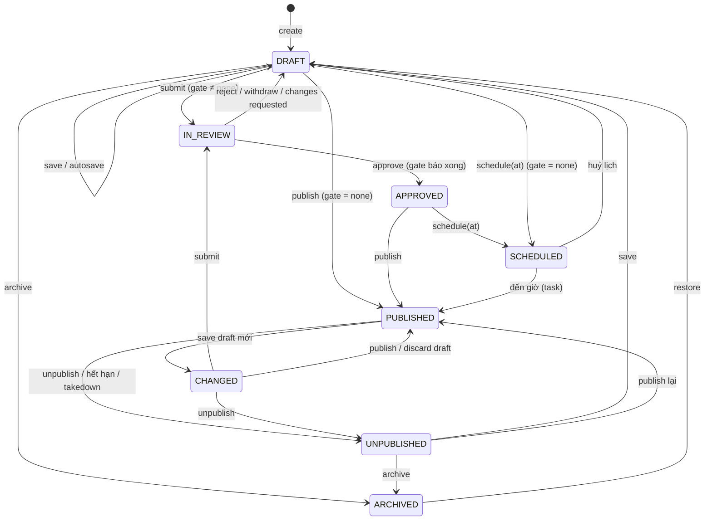
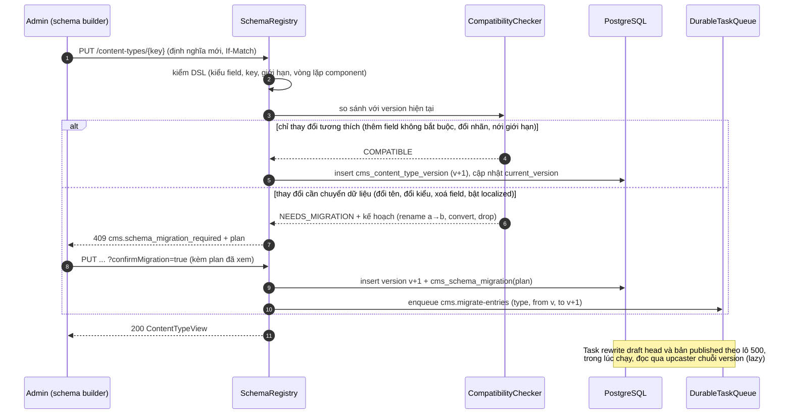
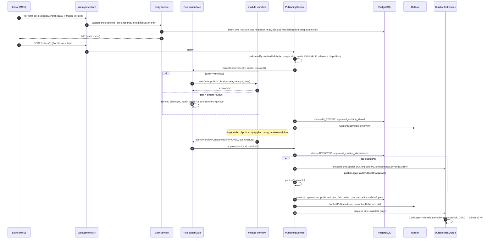
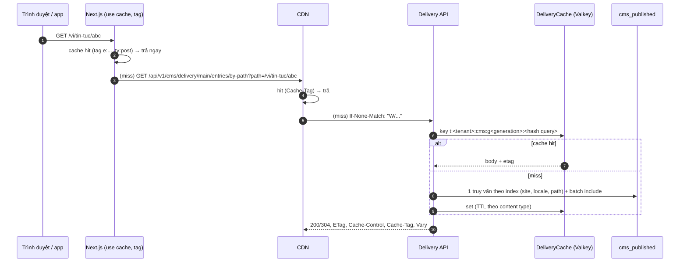
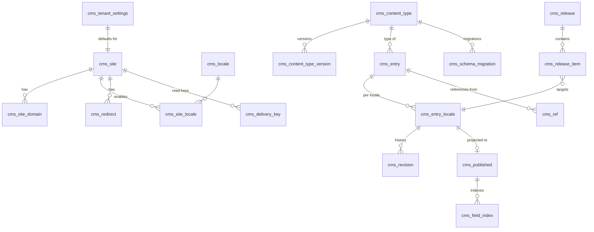
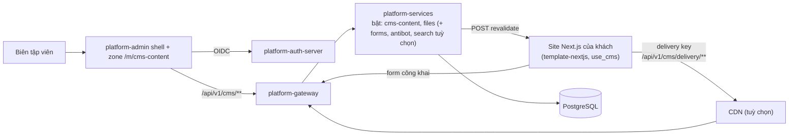

# Thiết kế module cms-content: `platform-starter-cms-content` + `@vyforge/cms-content` + zone `cms-content-admin`

> **Trạng thái:** đề xuất, chờ duyệt (26/10/2026).
> **Phạm vi:** headless CMS dùng chung cho mọi dự án Vyforge. Gồm content type định nghĩa động (schema builder), trang,
> bài viết, banner, FAQ, trang tĩnh, menu, editor theo block, đa ngôn ngữ, media qua module files, draft → review →
> publish (qua module workflow khi có), lên lịch, version, khôi phục, preview, API delivery nhanh (cache, CDN, ETag),
> SEO, sitemap, redirect, phân quyền theo tenant và IAM.
> **Nền:** platform-java 0.12.1 (`SecretCipher`, `DurableTaskQueue`, `StarterSchemaMigrator`), platform-web 0.9.0. Theo
> quy ước chung của các module P1 (mục 1–6 của `module-conventions.md`).
> **Quyết định lớn:** **tự xây lõi CMS trên Java/PostgreSQL**, không nhúng Payload CMS. Lý do ở mục 2.3. Quyết định này
> sửa dòng "Payload CMS khi dự án cần" của MODULE_PLAN (mục "Không tự xây"), nên cần một ADR riêng (mục 10).

Mục lục:
1. [Bài toán và phạm vi](#1-bài-toán-và-phạm-vi)
2. [Nghiên cứu](#2-nghiên-cứu)
3. [Kiến trúc](#3-kiến-trúc)
4. [Mô hình dữ liệu](#4-mô-hình-dữ-liệu)
5. [API](#5-api)
6. [Mở rộng](#6-mở-rộng)
7. [Vận hành](#7-vận-hành)
8. [Bảo mật và tuân thủ](#8-bảo-mật-và-tuân-thủ)
9. [Kế hoạch triển khai](#9-kế-hoạch-triển-khai)
10. [Đóng gói và triển khai độc lập](#10-đóng-gói-và-triển-khai-độc-lập)
11. [Lệch quy ước và quyết định](#11-lệch-quy-ước-và-quyết-định)

---

## 1. Bài toán và phạm vi

### 1.1 Vì sao cần một module riêng

Gần như dự án nào của khách hàng cũng có phần nội dung do người không phải lập trình viên sửa: trang giới thiệu, tin
tức, banner khuyến mãi trên app, FAQ, điều khoản sử dụng, chính sách bảo mật. Hiện mỗi dự án tự làm theo một trong ba
cách, cách nào cũng có lỗi lặp lại:

- **Viết cứng trong code frontend.** Sửa một câu chữ phải build và deploy lại. Bộ phận marketing phụ thuộc đội dev.
- **Bảng `news`/`banner` tự làm trong app.** Không có draft, không có version, không duyệt, không lên lịch. Không có
  đa ngôn ngữ, hoặc thêm cột `title_en` ở mọi nơi. Ảnh dán URL ngoài. Không có cache, nên trang chủ app gọi DB mỗi lần mở.
- **Dựng WordPress/Strapi riêng cạnh app.** Thêm một runtime (PHP hoặc Node), một DB, một hệ người dùng và phân quyền
  riêng, không theo tenant, không theo IAM của Vyforge. Khách hàng on-prem phải vận hành thêm một hệ. Dữ liệu cá nhân
  (tác giả, người gửi form) nằm ngoài các cơ chế của platform-starter-privacy.

Module cms-content đưa phần nội dung vào cùng nền tảng: cùng tenant, cùng IAM, cùng audit, cùng outbox/event, cùng module
files cho media, cùng module workflow cho duyệt bài, cùng shell `platform-admin` cho quản trị.

### 1.2 Phạm vi

| Nhóm | Trong phạm vi (bản 0.13.0) | Để bản sau |
|---|---|---|
| Mô hình nội dung | Content type động (collection, singleton), schema builder, 22 kiểu field (mục 6.1), component dùng lại, block (dynamic zone), reference giữa bản ghi, cây phân cấp (trang cha/con, danh mục), preset sẵn: `page`, `post`, `banner`, `faq`, `static-page`, `menu`, `category`, `tag`, `author`; content type khai báo bằng code (app) hoặc bằng UI (tenant); version schema, nâng cấp dữ liệu khi schema đổi | Field tính toán (formula), quan hệ hai chiều tự đồng bộ |
| Editor | Rich text theo ProseMirror JSON (Tiptap 3), block editor, embed có allowlist, media picker, trường SEO, autosave, khoá mềm khi đang sửa, so sánh revision | Visual page builder kéo thả trên khung trang (Puck), cộng tác đồng thời kiểu Google Docs (Yjs) |
| Đa ngôn ngữ | Locale theo tenant/site, chuỗi fallback, field `localized` hay dùng chung, publish theo từng locale, đồng bộ field không dịch, trạng thái dịch | Dịch máy qua module ai, tích hợp TMS (Crowdin, Lokalise) |
| Media | Field `media` tham chiếu file của module files (bucket `cms-media`), alt/caption theo locale, focal point, preset ảnh | DAM riêng (thư mục, bộ sưu tập, quyền theo thư mục) |
| Xuất bản | Draft, gửi duyệt, duyệt/từ chối (sẵn có hoặc qua module workflow), publish, unpublish, lên lịch publish/unpublish, release (gói nhiều bản ghi publish cùng lúc), version, khôi phục, preview có token, live preview, gỡ khẩn cấp | Môi trường nội dung (dev/staging/prod) riêng như Contentful; A/B test nội dung |
| Phân phối | Delivery API REST (đọc bản đã publish), lọc/sắp xếp/phân trang, nạp reference theo độ sâu, tìm theo path, cache nhiều tầng, `ETag`/`304`, `Cache-Control` có `stale-while-revalidate`, cache tag cho CDN và Next.js, purge khi publish, sync API (delta) cho app mobile | GraphQL, delivery qua edge function, đẩy nội dung sang static export |
| SEO | Nhóm field SEO, `hreflang`, canonical, robots, Open Graph, JSON-LD theo mẫu, sitemap (index + theo locale, chia 50.000 URL), `robots.txt`, redirect 301 tự tạo khi đổi slug, redirect do người dùng nhập | Báo cáo SEO (độ dài title, ảnh thiếu alt) có điểm số |
| Phân quyền | Theo tenant (`TenantContext`), action IAM `cms:*`, điều kiện theo content type, locale, site, tác giả, trạng thái | Quyền theo từng field |
| Đa site | Nhiều site trong một tenant (thương hiệu, kênh web/app), nội dung dùng chung giữa site | |
| Nhập dữ liệu | Nhập/xuất schema (JSON), nhập WordPress WXR | Nhập từ Strapi/Payload/Contentful |
| Frontend | `@vyforge/cms-content`: client delivery (server-only), renderer React cho rich text và block, helper metadata/sitemap/robots cho Next.js, draft mode, route revalidate; `@vyforge/cms-content/admin` + zone `cms-content-admin` (`/m/cms-content`, Next.js Multi-Zones): quản trị | Renderer cho React Native (template-expo) |

### 1.3 Kịch bản nghiệp vụ phải đáp ứng

| # | Kịch bản | Yêu cầu rút ra | Khối đáp ứng |
|---|---|---|---|
| K1 | **Website doanh nghiệp vi/en.** Trang Giới thiệu, Dịch vụ, Liên hệ ghép từ block (hero, lưới tính năng, CTA, form liên hệ, bản đồ). Marketing tự sửa, không cần dev | Block editor, preset `page`, path phân cấp, đa ngôn ngữ, SEO | §6.1 field `blocks`, §3.7 routing, §4 `cms_published` |
| K2 | **Tin tức của ngân hàng:** biên tập viên viết, pháp chế duyệt, trưởng phòng truyền thông duyệt cuối, đăng lúc 8:00 sáng thứ Hai | Duyệt nhiều cấp, lên lịch, khoá nội dung khi đang duyệt, audit ai duyệt bản nào | `PublicationGate` → module workflow §3.5, lịch §3.6, `cms_revision` bất biến |
| K3 | **Banner khuyến mãi trên app mobile:** vị trí `home-top`, hiệu lực từ 01/11 đến 11/11, chỉ kênh app, thứ tự ưu tiên, ảnh khác nhau cho vi/en; gắn nhãn "Quảng cáo" (Luật Quảng cáo sửa đổi 75/2025/QH15) | Lọc theo field (vị trí, kênh), khoảng hiệu lực tự ẩn, ảnh theo locale, cache CDN ngắn | Preset `banner` (`visibleFrom`/`visibleTo`), `cms_field_index`, §3.8 cache |
| K4 | **FAQ chăm sóc khách hàng** theo nhóm, sắp xếp tay, tìm kiếm không dấu ("tai khoan" khớp "tài khoản"); chatbot (module ai) đọc qua API | Thứ tự trong nhóm, tìm không dấu, API cho máy | Preset `faq`, field `orderable`, FTS `unaccent` hoặc module search §6.7 |
| K5 | **Điều khoản sử dụng, chính sách bảo mật** (thông báo xử lý dữ liệu cá nhân theo Luật 91/2025/QH15): mỗi bản công bố có số phiên bản và ngày hiệu lực; module privacy-dsr ghi người dùng đã đồng ý bản nào; bản cũ phải xem lại được nguyên văn | Revision đã publish bất biến, mã phiên bản ổn định, API đọc theo revision | Preset `static-page` có `legalVersion`, `GET /delivery/.../revisions/{id}`, event `ContentPublished` (mục 5.3) |
| K6 | **Cổng thông tin nội bộ (intranet):** thông báo, quy chế chỉ nhân viên đã đăng nhập xem; một số chỉ phòng ban xem | Delivery có xác thực, lọc theo đối tượng xem | `audience` của site và bản ghi, delivery bằng token người dùng §3.9 |
| K7 | **Gỡ khẩn cấp:** cơ quan chức năng yêu cầu gỡ một bài trong thời hạn (Luật An ninh mạng 116/2025/QH15: 24 giờ, khẩn cấp 6 giờ). Phải gỡ khỏi mọi locale, mọi site, xoá cache CDN, giữ nhật ký | Một thao tác gỡ toàn bộ, purge đồng bộ, audit có lý do | `takedown` §3.6.3, `CdnPurger`, `AuditLog` |
| K8 | **Chiến dịch 11.11 của sàn TMĐT:** landing page, 6 banner, FAQ khuyến mãi, menu mới cùng lên lúc 0:00; có lỗi thì quay lại trạng thái trước trong một thao tác | Release nhiều bản ghi, publish nguyên tử, rollback, preview cả release | `cms_release` §3.6.2, perspective `release` §3.9 |
| K9 | **SaaS đa tenant:** mỗi khách hàng tự quản lý trang trợ giúp của họ; một khách thêm content type "Chi nhánh" (tên, địa chỉ theo đơn vị hành chính mới sau sắp xếp 2025, giờ mở cửa, toạ độ) mà không cần dev | Schema builder theo tenant, field tuỳ biến cắm thêm, cách ly tenant | `cms_content_type` theo tenant, `FieldTypeProvider` (field `vn-address` lấy từ module master-data) §6.2 |
| K10 | **Tập đoàn nhiều thương hiệu:** 3 website, FAQ và chính sách dùng chung, tin tức riêng từng site; mỗi site có domain, bộ locale riêng | Đa site trong tenant, bản ghi dùng chung | `cms_site`, `cms_entry.site_ids` |
| K11 | **App mobile đọc nội dung offline:** mở app tải phần thay đổi kể từ lần trước, không tải lại toàn bộ | Sync API theo con trỏ | `GET /delivery/{site}/sync` §5.2 |
| K12 | **Chuyển từ WordPress sang:** 4.000 bài, giữ URL cũ (redirect 301), giữ ảnh, sitemap mới gửi Google | Import WXR, redirect, sitemap | `ContentImporter` WXR, `cms_redirect`, §3.10 |
| K13 | **Trang tuyển dụng:** tin tuyển dụng có hạn nộp, tự hết hạn, structured data `JobPosting` cho Google | Unpublish theo lịch, JSON-LD theo mẫu | Lịch unpublish, `StructuredDataTemplate` §3.10 |
| K14 | **Tạp chí điện tử / trang tin của cơ quan báo chí** (Luật Báo chí 126/2025/QH15): ghi tác giả, nguồn, đính chính có ghi chú công khai, giữ bản đã đăng | Ghi chú đính chính, lưu revision đã publish vĩnh viễn, tác giả là bản ghi `author` | Preset `post` có `corrections[]`, retention revision §4.4 |
| K15 | **Thông báo bảo trì trong app/website** do người vận hành bật trong vài phút, hiện ngay, không chờ cache | Purge tức thì, TTL ngắn cho singleton | Singleton `notice`, `Cache-Control` theo content type, revalidate `expire: 0` |
| K16 | **Footer của website TMĐT** phải công khai thông tin chủ sở hữu, chính sách, cách khiếu nại (Luật Thương mại điện tử 122/2025/QH15, Điều 11) | Singleton dùng chung cho mọi trang, bắt buộc field | Singleton `site-settings`, field `required` |
| K17 | **Website marketing không có app nghiệp vụ:** khách chỉ mua CMS cho website giới thiệu; không có backend Java của dự án. Site Next.js đọc thẳng delivery API, biên tập viên dùng zone admin, đăng nhập qua platform-auth-server | CMS chạy độc lập (trong `platform-services` hoặc chạy riêng), delivery qua gateway, form công khai không cần backend của dự án | §10.5, module forms + antibot |

Kịch bản đặc thù Việt Nam: K2 (duyệt nhiều cấp kiểu ngân hàng), K3 (Luật Quảng cáo), K5 (Luật 91/2025), K7 (Luật An
ninh mạng 2025), K9 (địa chỉ theo đơn vị hành chính mới), K14 (Luật Báo chí 2025), K16 (Luật TMĐT 2025). Yêu cầu xuyên
suốt: slug tiếng Việt bỏ dấu đúng (`đ` → `d`, "Giới thiệu" → `gioi-thieu`), sắp xếp theo collation tiếng Việt, tìm
kiếm không dấu.

### 1.4 Ngoài phạm vi

- Website builder kiểu Wix (theme, hosting trang). Module là **headless**: chỉ quản lý và phát nội dung. Trang web do app
  Next.js của dự án render (`template-nextjs`).
- Form builder nhận dữ liệu người dùng: thuộc module `forms` (gap analysis 2.8), chống bot qua `antibot` (2.12). CMS chỉ có
  block `form` tham chiếu một form của module forms (mục 6.7); site gửi dữ liệu thẳng tới API của forms, không qua app
  nghiệp vụ.
- Bình luận của độc giả (module collaboration lo comment nội bộ; comment công khai để bản sau).
- Thương mại (sản phẩm, giá): thuộc nghiệp vụ của app. CMS chỉ chứa nội dung mô tả.

---

## 2. Nghiên cứu

Phiên bản và license kiểm ngày 26/10/2026 qua npm registry, GitHub releases, Maven Central và tài liệu chính thức (link ở
từng dòng).

### 2.1 Hệ thống tham khảo

| Hệ thống | Phiên bản, license | Mô hình dữ liệu | API | Điểm mạnh | Điểm yếu |
|---|---|---|---|---|---|
| **Payload CMS** | `payload` 3.92.0 (22/10/2026), MIT ([LICENSE](https://github.com/payloadcms/payload/blob/main/LICENSE.md)). 4.0 đang beta (4.0.0-beta.4, 22/10/2026) với "framework adapter" tách lõi khỏi Next.js, TanStack Start là adapter đầu tiên, giảm `depth` mặc định xuống 1 ([4.0 beta](https://payloadcms.com/posts/releases/payload-4-beta-redesigned-admin-tanstack-mcp), [versioning](https://payloadcms.com/docs/beta/migration-guide/versioning)) | Config-as-code (TypeScript): collection, global, field. Postgres qua Drizzle: schema DB **sinh từ config**, mỗi lần đổi config cần migration (dev dùng `push`) ([Postgres](https://payloadcms.com/docs/database/postgres)). Bảng phụ `_locales`, `_rels`, `_v` (version) theo hậu tố. Drafts thêm field `_status` (`draft`/`published`), version trong bảng `_[slug]_versions` ([drafts](https://payloadcms.com/docs/versions/drafts)). Localization theo field (`localized: true`), fallback locale; `localizeStatus` (publish theo locale) còn beta | REST, GraphQL, Local API cùng một bộ access control; hook theo collection/field | Editor Lexical tốt, live preview, schedule publish qua Jobs queue, plugin multi-tenant chính thức (field `tenant`, kiểm khi ghi) ([multi-tenant](https://payloadcms.com/docs/plugins/multi-tenant)), MIT | Đổi schema = sửa code + deploy + migration: **tenant không tự thêm content type được**. Có auth, access control, job queue, admin riêng: trùng với IAM, `DurableTaskQueue`, `platform-admin`. Đổi field sang `localized` làm mất dữ liệu field đó ([localization](https://payloadcms.com/docs/configuration/localization)). Đang chuyển 3 → 4 (đổi framework adapter, đổi mặc định) |
| **Strapi** | `@strapi/strapi` 5.59.0 (21/10/2026). MIT cho phần ngoài thư mục `ee/`; `ee/` theo license Enterprise ([LICENSE](https://github.com/strapi/strapi/blob/develop/LICENSE)) | Content type (collection/single), component, dynamic zone. Strapi 5 có **`documentId`** (24 ký tự) gom mọi locale và cả bản draft/published của một bản ghi; mỗi (locale, status) là một dòng ([Document](https://docs.strapi.io/cms/api/document)) | Document Service: `findOne/findMany/create/update/delete/publish/unpublish/discardDraft/count`, tham số `status` (`draft`/`published`), `locale` (cả `'*'`) ([Document Service](https://docs.strapi.io/cms/api/document-service)). REST/GraphQL mặc định trả bản published, Document Service mặc định trả draft | Mô hình documentId + dòng theo (locale, status) rất rõ; dynamic zone; Content-Type Builder trên UI; Releases | **Review Workflows chỉ có ở gói Enterprise**; phải ở đúng stage yêu cầu mới publish được; tối đa 200 workflow × 200 stage ([review workflows](https://docs.strapi.io/cms/features/review-workflows)). Content-Type Builder chỉ chạy ở dev mode (sửa file schema, restart) |
| **Directus** | v12.5.1 (23/10/2026). License **Monospace Sustainable Core License 1.0 (MSCL-1.0-GPL)**: cấm "Competing Use", chuyển sang GPL-3.0 sau 4 năm; miễn phí cho tổ chức doanh thu dưới 5 triệu USD và dưới 50 nhân viên, cần license key ([license](https://github.com/directus/directus/blob/main/license), [releases](https://github.com/directus/directus/releases)). (Thiết kế files ghi BSL 1.1 là thông tin cũ.) | Không có mô hình riêng: bọc lên **bảng SQL thật** của DB (introspect), metadata trong `directus_*` | REST/GraphQL tự sinh, filter JSON mạnh | Dùng DB có sẵn; schema builder tạo bảng thật | License không hợp để Vyforge đóng gói bán lại cho khách; DDL thật theo tenant khi chạy là rủi ro vận hành |
| **Sanity** | `sanity` (Studio) 6.20.0 (19/10/2026), MIT; Content Lake là SaaS đóng | Document JSON, schema chỉ ở Studio (DB không ép). Draft là document riêng có `_id` tiền tố `drafts.` ([perspectives](https://www.sanity.io/docs/content-lake/perspectives)). Rich text = **Portable Text** (mảng block JSON) | GROQ; **perspective**: `published` (mặc định từ API 2025-02-19), `drafts`, `raw`, hoặc ngăn xếp release id (`['release-a','release-b']`, tự thêm `published` ở cuối). Truy vấn draft phải `useCdn: false` | Perspective là cách gọn để cùng một truy vấn chạy cho production, preview và release. Content Releases. Portable Text tách nội dung khỏi HTML | Content Lake là SaaS đặt ở nước ngoài (vướng chuyển dữ liệu xuyên biên giới với khách hàng VN), không tự host |
| **Contentful** | SaaS đóng | Space → environment → content type (field, locale) → entry/asset. Field localized theo locale | CDA (đọc, qua CDN), CMA (ghi), Preview API, Sync API (delta). CDA: **request trúng cache CDN không bị giới hạn; request tới origin giới hạn 55 req/s**, quá thì 429 + `X-Contentful-RateLimit-Reset`; CMA mặc định 7 req/s ([CDA](https://www.contentful.com/developers/docs/references/content-delivery-api/)) | Tách API đọc (CDN) / ghi / preview rõ ràng; Sync API cho app offline; environment cho schema | SaaS ngoài nước, giá theo số bản ghi/locale; content type không có version tường minh |
| **Ghost** | `ghost` 6.72.0 (20/10/2026), MIT | Cố định: post, page, tag, author, tier; nội dung lưu Lexical JSON, phát ra HTML | Content API chỉ đọc, `?key=` dùng được ở trình duyệt vì chỉ lộ dữ liệu công khai, "fully cachable", header `Accept-Version` ([Content API](https://docs.ghost.org/content-api)) | Delivery key công khai chỉ đọc bản published, đơn giản; SEO, sitemap, AMP sẵn | Không có content type động; không đa ngôn ngữ thật |
| **WordPress** | 7.1.3 (06/10/2026), GPL-2.0+ ([releases](https://wordpress.org/download/releases/)) | `wp_posts` + `wp_postmeta` (EAV), revision là post con. Block Gutenberg lưu trong `post_content` dạng HTML có **chú thích phân cách** `<!-- wp:image {...} -->`, thuộc tính JSON trong chú thích ([data flow](https://developer.wordpress.org/block-editor/explanations/architecture/data-flow/)) | REST API `/wp-json/wp/v2` | Hệ sinh thái lớn, WXR là chuẩn xuất/nhập thực tế (dùng cho K12) | EAV chậm khi lọc; block lưu trong HTML phải có cặp parser/serializer đúng mới đọc lại được, không sửa tay được; PHP, plugin là mặt tấn công lớn |

Thành phần editor và thư viện:

| Thành phần | Phiên bản, license | Ghi chú cho thiết kế |
|---|---|---|
| Tiptap (`@tiptap/core`) | 3.32.0 (13/10/2026), MIT | Bọc ProseMirror, headless, output là **ProseMirror JSON** (cây `doc` → node → mark) ổn định, dễ kiểm schema và render ở cả JS lẫn Java. **Chọn** cho rich text |
| Lexical (`lexical`) | 0.52.0 (28/09/2026), MIT, chưa 1.0 | Payload và Ghost dùng. JSON phụ thuộc phiên bản node (`exportJSON` của từng node), chưa ổn định API |
| BlockNote (`@blocknote/core`) | 0.56.0, MPL-2.0 | Editor kiểu Notion trên Tiptap; MPL và một số gói XL license thương mại. Không chọn, nhưng định dạng tương thích (đều ProseMirror) |
| Editor.js | 2.31.7, Apache-2.0 | Block JSON đơn giản, nhưng rich text trong block vẫn là HTML string |
| Puck (`@puckeditor/core`) | 0.23.0 (07/08/2026), MIT | Visual page builder kéo thả cho React. Để bản sau làm chế độ "page builder" trên cùng dữ liệu block (§9.3) |
| Portable Text (`@portabletext/react`) | 8.0.1, MIT | Tham khảo cách mô tả rich text bằng mảng block; không dùng định dạng này |
| networknt `json-schema-validator` | 3.0.8, Apache-2.0 | Kiểm `attributes` và field `json` có schema; xuất JSON Schema của content type cho client |
| OWASP Java HTML Sanitizer | 20261011.1, Apache-2.0 | Chỉ cho field/block `rawHtml` (tắt mặc định) |
| jsoup | 1.23.2, MIT | Parse HTML khi nhập WordPress, chuyển sang ProseMirror JSON |

Chuẩn và hạ tầng phân phối:

| Chủ đề | Nguồn | Áp dụng |
|---|---|---|
| Sitemap | [sitemaps.org](https://www.sitemaps.org/protocol.html): ≤ 50.000 URL và ≤ 50 MB (chưa nén) mỗi file, index ≤ 50.000 sitemap, `<loc>` < 2.048 ký tự, `lastmod` W3C Datetime là ngày trang đổi thật | Chia file theo site × locale × trang 50.000 (mục 3.10) |
| Next.js cache tag | [revalidateTag](https://nextjs.org/docs/app/api-reference/functions/revalidateTag) (Next.js 16.4.3): `revalidateTag(tag, profile)`, `'max'` = stale-while-revalidate, `{ expire: 0 }` = hết hạn ngay khi gọi từ webhook; tag ≤ 256 ký tự, phân biệt hoa thường; một tham số là cách cũ (deprecated); gán tag bằng `cacheTag` trong `'use cache'` hoặc `fetch(..., { next: { tags } })` | Route revalidate của `@vyforge/cms-content` (mục 5.5) |
| CDN cache tag | [Cloudflare Cache-Tag](https://developers.cloudflare.com/cache/how-to/purge-cache/purge-by-tags/): tổng header ≤ 16 KB (~1.000 tag), tag ASCII in được, không dấu cách, **không phân biệt hoa thường**; purge API nhận tag ≤ 1.024 ký tự | Tag chữ thường, ngắn (`e:<uuid>`), tối đa 64 tag mỗi response (mục 3.8) |
| HTTP caching | RFC 9110 (ETag, `If-None-Match`), RFC 9111 (`Cache-Control`), RFC 5861 (`stale-while-revalidate`, `stale-if-error`) | Mục 3.8 |

### 2.2 Học theo và không làm

| Học theo | Từ | Trong thiết kế |
|---|---|---|
| Một bản ghi = một id ổn định gom mọi locale và mọi trạng thái | Strapi 5 `documentId` | `cms_entry.id` + `cms_entry_locale` (mục 4) |
| Publish theo từng locale, field không dịch đồng bộ giữa các locale | Strapi 5, Payload `localizeStatus` | Head theo (entry, locale); field `localized: false` ghi vào mọi locale khi lưu |
| Perspective: một truy vấn, nhiều góc nhìn (published, draft, release) | Sanity | Tham số `perspective` của delivery API (mục 3.9) |
| Release gom nhiều thay đổi publish cùng lúc | Sanity Releases, Strapi Releases | `cms_release` (mục 3.6.2) |
| Tách API đọc (qua CDN), API ghi, API preview; Sync API | Contentful | `/delivery/**` (public, cache), `/api/v1/cms/**` (quản trị), `perspective=draft` cần token, `/sync` |
| Key đọc công khai chỉ lộ bản đã publish | Ghost Content API | `cms_delivery_key` (mục 3.9) |
| Component, block (dynamic zone) khai báo trong schema | Strapi, Payload `blocks` | Field `component`, `blocks` (mục 6.1) |
| Schema khai báo bằng code cho dev, và schema tạo trên UI cho tenant | Payload (code), Strapi/Contentful (UI) | `source = CODE` (chỉ đọc trên UI) và `source = TENANT` (mục 3.4) |
| Rich text là cây JSON, không phải HTML | Sanity Portable Text, Payload/Ghost Lexical | ProseMirror JSON + allowlist node/mark (mục 6.4) |
| Giảm độ sâu nạp reference mặc định | Payload 4.0 (`depth` mặc định 1) | `include` mặc định 1, tối đa 3 |
| Schedule publish chạy qua hàng đợi việc, không phải cron trong request | Payload (Jobs queue) | `DurableTaskQueue`, queue `cms` (mục 3.6) |

| Không làm | Lý do |
|---|---|
| Nhúng Payload/Strapi làm lõi | Mục 2.3 |
| DDL thật theo content type (mỗi type một bảng, như Payload/Directus) | Tenant tạo type khi đang chạy; DDL theo tenant làm Flyway, RLS, backup, review khó kiểm soát; số bảng tăng theo số tenant. Thay bằng JSONB + bảng index có kiểu (mục 4.1) |
| EAV cho toàn bộ dữ liệu (như `wp_postmeta`) | Đọc một bản ghi phải ghép hàng chục dòng. Chỉ dùng bảng index cho field được đánh dấu `filterable`/`sortable` |
| Block lưu trong HTML (Gutenberg) | Phải có parser đúng mới đọc lại được; khó kiểm an toàn |
| Draft là bản ghi riêng có id tiền tố (Sanity `drafts.`) | Dễ lọt draft ra API khi quên lọc. Dùng bảng revision riêng, delivery chỉ đọc bảng `cms_published` |
| Review workflow tự viết đầy đủ trong CMS | Đã có module workflow. CMS chỉ có bước duyệt đơn giản sẵn có và một cổng (`PublicationGate`) để module workflow cắm vào |
| GraphQL ở bản đầu | REST + filter đủ cho K1–K16; GraphQL sinh từ schema động cần làm kỹ (độ sâu, chi phí truy vấn). Để bản sau |
| Môi trường nội dung kiểu Contentful | Dùng tenant/app riêng cho staging + nhập/xuất schema (mục 5.2) |

### 2.3 Tích hợp Payload CMS hay tự xây

Bốn phương án:

| | A. Payload là service riêng (Node) cạnh platform | B. Nhúng Payload vào app Next.js của từng dự án | C. Tự xây lõi Java + admin React (**chọn**) | D. Strapi/Directus |
|---|---|---|---|---|
| Tenant, IAM | Payload có collection `users`, auth và access control riêng. Phải viết **cầu nối OIDC tới platform-auth-server** (custom auth strategy của Payload đọc phiên OIDC/JWT, tạo hoặc đồng bộ user Payload theo `sub`), **ánh xạ tenant** (claim `tenant_id` → document của collection `tenants` của plugin multi-tenant) và ánh xạ quyền (policy IAM → hàm `access` của từng collection, phải gọi `/api/v1/iam/me/evaluate` cho từng thao tác hoặc chép quyền thô thành role). Hai nơi quyết định quyền, đồng bộ user hai chiều | Như A, trong từng app | `TenantContext`, `Authz.check`, `cms:*` như mọi module | Như A; Review Workflows của Strapi là Enterprise |
| Content type do tenant tự thêm (K9) | **Không được**: schema là code TypeScript, đổi phải build, deploy, migration Drizzle. Một config cho mọi tenant | Không được | Có: schema là dữ liệu có version | Strapi: chỉ ở dev mode; Directus: được (DDL thật) |
| Admin trong shell `platform-admin` (mục 6 của quy ước) | Admin Payload là cả một app Next.js có route, session, layout riêng; chỉ ghép được kiểu "link sang app khác", không chung menu, quyền, giao diện `@vyforge/ui` | Như A | Zone `/m/cms-content` theo hợp đồng của shell (manifest `contract: 1`) | Như A |
| Event, outbox, job, audit | Payload có hook và Jobs queue riêng; muốn đưa ra Kafka phải viết thêm, không có outbox chung với nghiệp vụ | Như A | Spring Modulith outbox, `DurableTaskQueue`, `AuditLog` có sẵn | Như A |
| Media | Upload của Payload, hoặc plugin S3; không qua quét virus, quota, retention của module files | Như A | Module files (quét, quota, CDN, Luật 91) | Như A |
| Vận hành on-prem | Thêm runtime Node, DB riêng hoặc schema riêng, migration riêng | Mỗi app thêm DB/migration Payload | Một starter trong app Java hoặc trong `platform-services` | Thêm runtime; Directus cần license key |
| Chạy độc lập với app nghiệp vụ (gap analysis mục 3) | Được (app Node riêng), nhưng thêm một runtime và một DB | Không: gắn vào app của dự án | Được: starter trong `platform-services` hoặc chạy riêng (§10.5) | Được |
| Ổn định phiên bản | 3.x sắp sang 4.0 (đổi framework adapter, đổi mặc định, codemod) | Như A, nhân với số dự án | Tự quyết | Strapi ổn; Directus đổi license |
| Công sức | Bridge auth/tenant/IAM + đóng gói + admin bridge: lớn, và phải bảo trì mãi | Nhỏ cho một dự án, lớn khi nhân lên | Lớn nhất ban đầu (ước tính mục 9) | Như A + vướng license |
| Editor, live preview | Có sẵn, tốt | Có sẵn | Tự làm, dùng Tiptap 3 (MIT) cho editor | Có sẵn |

**Chọn C.** Ba yêu cầu của brief không đạt được với A/B: content type do tenant định nghĩa khi chạy (K9), một hệ phân
quyền theo tenant và IAM, và admin đóng gói được thành microfrontend trong shell chung để bán theo module. Payload là
một framework ứng dụng hoàn chỉnh (auth, DB schema, job, admin), nên tích hợp nghĩa là chạy song song hai nền tảng.
Phần đắt nhất của Payload mà Vyforge cần là editor; phần này lấy từ Tiptap (MIT) mà không kéo theo cả framework.

Những gì giữ lại từ hướng Payload:

- Dự án chỉ cần một website marketing đơn lẻ, đội dự án quen Payload và chấp nhận một hệ người dùng riêng, vẫn được
  dùng Payload ngoài platform. Khi đó vẫn **bắt buộc đăng nhập qua platform-auth-server** (ADR-0008): Payload dùng custom
  auth strategy kiểm JWT/phiên OIDC, tắt đăng nhập mật khẩu cục bộ, một tenant mỗi bản cài (không dùng plugin
  multi-tenant). Đây là hướng dẫn trong README của template, không phải module được platform hỗ trợ. MODULE_PLAN đổi câu "Payload CMS khi dự án cần" thành "cms-content của platform; Payload
  chỉ cho website đơn lẻ không cần tenant/IAM".
- Mô hình dữ liệu của C đủ gần Payload/Strapi để viết importer sau này (§9.3).

Rủi ro của C và cách giảm: editor là phần khó nhất → dùng Tiptap, giới hạn bộ node ở bản đầu (mục 6.4), không làm cộng
tác đồng thời; khối lượng lớn → chia bản 0.13.0 (lõi, delivery, admin cơ bản) và 0.14.0 (release, live preview, import
WXR) (mục 9).

---

## 3. Kiến trúc

### 3.1 Thành phần

```mermaid
flowchart LR
  subgraph Admin["platform-admin shell"]
    MFE["zone cms-content-admin (/m/cms-content)<br/>@vyforge/cms-content/admin<br/>schema builder, editor Tiptap,<br/>release, redirect, cài đặt"]
  end
  subgraph Site["App Next.js của dự án"]
    SDK["@vyforge/cms-content<br/>client delivery, renderer,<br/>metadata, sitemap, revalidate"]
  end
  subgraph Starter["platform-starter-cms-content (trong app Java hoặc platform-services)"]
    direction TB
    MAPI["Management API<br/>/api/v1/cms/**"]
    DAPI["Delivery API<br/>/api/v1/cms/delivery/**"]
    SCH["SchemaRegistry<br/>content type, version, upcaster"]
    ENT["EntryService<br/>draft, revision, lock, validate"]
    PUB["PublishingService<br/>state machine, schedule, release, takedown"]
    GATE["PublicationGate (SPI)<br/>none, simple-review, workflow"]
    PROJ["DeliveryProjector<br/>cms_published, cms_field_index, cms_ref"]
    DEL["DeliveryService<br/>query, include, perspective, ETag"]
    CACHE["DeliveryCache<br/>Valkey/Caffeine, generation"]
    INV["InvalidationService<br/>tag, CdnPurger, RevalidateNotifier"]
    SEO["SeoService<br/>sitemap, robots, redirect, hreflang"]
    MED["MediaResolver (SPI)"]
  end
  DB[("PostgreSQL<br/>cms_*")]
  Q[["DurableTaskQueue<br/>queue cms"]]
  OB[["Outbox (event_publication)"]]
  FILES["module files<br/>(nếu có)"]
  WF["module workflow<br/>(nếu có)"]
  SRCH["module search<br/>(nếu có)"]
  CDN["CDN<br/>(Cloudflare, Fastly, Bunny,<br/>Varnish/nginx)"]
  MFE -->|BFF| MAPI
  SDK -->|delivery key / token| DAPI
  CDN --> DAPI
  MAPI --> SCH & ENT & PUB & SEO
  PUB --> GATE
  GATE -.->|@ConditionalOnBean| WF
  PUB --> PROJ --> DB
  ENT --> DB
  DAPI --> DEL --> CACHE --> DB
  PUB --> Q
  Q --> INV --> CDN
  INV -->|POST /api/cms/revalidate| SDK
  PUB --> OB
  OB -.-> SRCH
  ENT --> MED -.-> FILES
```

Nguyên tắc:

- **CQRS nhẹ.** Phía ghi (`cms_entry`, `cms_entry_locale`, `cms_revision`) phục vụ editor. Phía đọc (`cms_published`,
  `cms_field_index`, `cms_ref`) là bản chiếu đã chuẩn hoá cho delivery, cập nhật **trong cùng transaction** với publish
  (không có độ trễ giữa "đã publish" và "đọc được ở origin"). Cache và CDN là tầng ngoài, xoá theo tag sau commit.
- **Delivery không bao giờ đọc bảng draft.** Draft chỉ đọc qua `perspective=draft` có token preview, và đi đường riêng.
- **Mọi phụ thuộc module khác là tuỳ chọn** (files, workflow, search, realtime, notification, collaboration,
  master-data, ai). Điểm nối là SPI của CMS + `@ConditionalOnBean`/`@ConditionalOnClass`.

### 3.2 Gói Java

| Package | Nội dung | Phụ thuộc |
|---|---|---|
| `com.vyforge.platform.cms` | API công khai: `ContentTypes`, `ContentEntries`, `Publishing`, `Releases`, `ContentDelivery`, `Redirects`, `Sitemaps`, record, enum, event | không |
| `…cms.spi` | `FieldTypeProvider`, `FieldValidator`, `ContentLifecycleInterceptor`, `PublicationGate`, `MediaResolver`, `CdnPurger`, `RevalidateNotifier`, `PreviewUrlBuilder`, `SlugGenerator`, `SchemaUpcaster`, `DeliveryTransformer`, `StructuredDataTemplate`, `ContentImporter`, `AudienceResolver`, `ContentSearchProvider` | không |
| `…cms.schema` | Registry, DSL field, kiểm schema, so sánh tương thích, sinh JSON Schema và kiểu TypeScript, preset | `json-schema-validator` |
| `…cms.entry` | Lưu draft, revision, khoá mềm, validate, đồng bộ field không dịch, slug, reference | `-jpa` (JDBC) |
| `…cms.richtext` | Kiểm ProseMirror JSON theo allowlist, trích plain text, tính số từ, sanitize `rawHtml` | OWASP sanitizer |
| `…cms.publish` | State machine, gate, lịch, release, takedown, projector | `-scheduling` (`DurableTaskQueue`) |
| `…cms.delivery` | Truy vấn, filter DSL, include, perspective, ETag, cache, sync | `platform-core` cache |
| `…cms.seo` | Sitemap, robots, redirect, hreflang, JSON-LD | |
| `…cms.invalidate` | Tag, purge CDN, notifier Next.js | `-web` (`RestClient`) |
| `…cms.web` | Controller quản trị và delivery, error code | `-web`, `-security`, `-authz` |
| `…cms.integration.files` / `.workflow` / `.search` / `.realtime` / `.notification` | Adapter tới module khác, mỗi cái `@ConditionalOnBean` | artifact của module đó, `<optional>true</optional>` |
| `…cms.importer.wxr` | Nhập WordPress WXR | jsoup |

### 3.3 Vòng đời bản ghi (state machine theo từng locale)



- Trạng thái lưu ở `cms_entry_locale.status` dạng `varchar` (kiểm ở code), có cột `published_revision_id` và
  `draft_revision_id` riêng, nên "đang công khai bản nào" và "đang sửa bản nào" độc lập với nhãn trạng thái.
- `CHANGED` = có bản publish và có draft mới hơn (nhãn "Changed" của Payload).
- Sửa nội dung khi `IN_REVIEW`/`APPROVED`/`SCHEDULED`: bị chặn (`cms.entry_locked_for_review`), trừ người có
  `cms:entry:EditInReview`; sửa thì quay về `DRAFT` và huỷ phê duyệt/lịch. Bản được duyệt là **một revision cụ thể**
  (`approved_revision_id`), không phải "bản mới nhất", nên không thể duyệt bản A rồi publish bản B.
- `ARCHIVED` ẩn khỏi danh sách mặc định; xoá thật (`delete`) chỉ khi không có bản publish và không bị tham chiếu bắt buộc.

### 3.4 Schema: content type có version



- **Nguồn schema:** `CODE` (bean `ContentTypeDefinition` hoặc YAML của app, đồng bộ lúc khởi động, chỉ đọc trên UI),
  `PRESET` (preset của platform, tenant bật/tắt và thêm field được nhưng không xoá field gốc), `TENANT` (tạo trên UI).
- **Revision lưu `schema_version`.** Đọc revision cũ thì chạy chuỗi `SchemaUpcaster` (do CompatibilityChecker sinh từ
  plan, hoặc do dev viết cho type `CODE`) để đưa về version hiện tại. Khôi phục bản cũ luôn ra dữ liệu hợp schema mới.
- Xoá field: field đánh dấu `deprecated` (ẩn trên editor, delivery vẫn trả trong 30 ngày, có cảnh báo), sau đó mới xoá
  khỏi schema ở version tiếp. Dữ liệu cũ vẫn còn trong revision cũ.
- Bật `localized` cho field đang dùng chung: giá trị hiện tại được chép sang mọi locale (không mất dữ liệu, khác Payload).
- Giới hạn: ≤ 200 field mỗi type (tính cả component lồng), component lồng ≤ 5 tầng, block type ≤ 50 mỗi field.

### 3.5 Lưu draft, gửi duyệt và xuất bản



Luồng lỗi:

| Lỗi | Xử lý |
|---|---|
| Hai người cùng sửa | `If-Match` lệch → 412 `cms.version_conflict`, trả version mới nhất; editor cho so sánh và gộp tay. Khoá mềm (`locked_by`, 2 phút, gia hạn bằng heartbeat) cảnh báo trước khi mở |
| Validate lỗi khi submit/publish | 422 `cms.validation_failed`, `errors[]` có `path` (`blocks[2].data.title`) và `code` |
| Reference tới bản ghi chưa publish | 422 `cms.reference_unpublished` (tuỳ type: `referencePolicy: require-published` mặc định, hoặc `skip` = delivery bỏ qua reference đó) |
| Media chưa sẵn sàng / bị cách ly | 422 `cms.media_not_available` |
| Module workflow không phản hồi khi start | Transaction submit rollback, 503 `cms.gate_unavailable`; editor thử lại. Không có trạng thái treo |
| Workflow bị huỷ/từ chối | Event từ workflow → `DRAFT`, `ContentRejected` có lý do (đã che PII) |
| Đến giờ lịch nhưng bản ghi đã bị sửa | Task kiểm `approved_revision_id`/`scheduled_revision_id` vẫn khớp; lệch thì bỏ, ghi `ContentScheduleSkipped` |
| Purge CDN lỗi | Task retry backoff (5 lần, tối đa 10 phút); `DEAD` → alert + màn hình task; origin đã đúng, `s-maxage` ngắn giới hạn thời gian sai |

### 3.6 Lịch, release, gỡ khẩn cấp

#### 3.6.1 Lịch publish/unpublish

- Lịch là task `cms.publish` / `cms.unpublish` trên `DurableTaskQueue` (queue `cms`) với `next_run_at` = giờ hẹn và
  `idempotency_key` = `entry:locale:action:revision`. `enqueue` trong cùng transaction nghiệp vụ, nên huỷ lịch = cancel task
  trong cùng transaction.
- Job `@ClusterScheduled` "cms-schedule-sweeper" mỗi phút quét `cms_entry_locale.scheduled_at <= now()` không có task
  sống (phòng task bị huỷ nhầm khi khôi phục backup). Độ trễ mục tiêu: publish trong vòng 60 giây sau giờ hẹn (p99).
- Content type có `visibleFrom`/`visibleTo` (banner, khuyến mãi): đây là **lọc lúc đọc**, không phải lịch. Delivery tự
  thêm điều kiện thời gian, và `Cache-Control` không vượt quá thời điểm đổi trạng thái gần nhất của kết quả (mục 3.8).
- Múi giờ: lưu UTC; UI hiển thị theo `Asia/Ho_Chi_Minh` mặc định (cấu hình theo tenant).

#### 3.6.2 Release

Release gom nhiều (entry, locale, action, revision) để publish/unpublish cùng lúc:

- Trạng thái: `OPEN` → `LOCKED` (đóng băng revision, kiểm hợp lệ toàn bộ) → `SCHEDULED` → `PUBLISHING` → `PUBLISHED` |
  `FAILED`; từ `PUBLISHED` có `revert` (tạo release ngược, đưa mọi mục về revision publish trước đó).
- Publish release = **một transaction** cho phía đọc (≤ 1.000 mục mỗi release; lớn hơn thì từ chối khi `LOCKED`). Lỗi một
  mục thì cả release rollback (K8 cần nguyên tử).
- Preview release: `perspective=release:<id>` (mục 3.9).
- Gate: release cần phê duyệt thì đi qua `PublicationGate` ở cấp release (`requestApproval(release)`).

#### 3.6.3 Gỡ khẩn cấp (takedown)

`POST /entries/{id}:takedown {reason, legalBasis, ticketRef}` (quyền `cms:entry:Takedown`):

1. Một transaction: unpublish mọi locale ở mọi site, xoá dòng `cms_published`, `cms_field_index`, đặt `takedown=true`
   (chặn publish lại cho đến khi người có `cms:entry:Takedown` gỡ cờ), huỷ lịch và gỡ khỏi release đang mở.
2. Purge đồng bộ trước khi trả lời (timeout 20 giây): tag `e:<id>` + mọi path của bản ghi trên CDN, notifier Next.js với
   `expire: 0`. Lỗi purge vẫn trả 200, kèm danh sách đích chưa purge được và task retry.
3. `AuditLog` ghi lý do, căn cứ, người làm, request id. Event `ContentTakenDown`.

Mục tiêu: nội dung biến mất khỏi origin ngay khi commit, khỏi CDN trong ≤ 5 phút, đáp ứng thời hạn 6 giờ khẩn cấp của
Luật An ninh mạng 2025 với nhiều dư địa.

### 3.7 URL, path và site

- `cms_site`: mỗi tenant có ≥ 1 site (`default`). Site có `baseUrl`, locale được phép, locale mặc định, `localePrefix`
  (`always` | `except-default` | `never`), `audience` (`public` | `authenticated`), cài đặt sitemap/robots.
- Content type có `routing`: `null` (không có trang riêng: banner, FAQ), `pattern` (`/tin-tuc/{slug}`,
  `/{category.slug}/{slug}`), hoặc `hierarchical` (trang cha/con: path = path của cha + slug).
- Path được tính lúc publish và lưu ở `cms_published.path`; unique theo (tenant, site, locale, path). Đổi slug hoặc đổi
  cha → path mới → tự tạo redirect 301 từ path cũ (`cms_redirect.source = AUTO`) và cập nhật path của các trang con
  (task `cms.repath`, cũng tạo redirect cho trang con).
- `SlugGenerator` mặc định: bỏ dấu tiếng Việt theo Unicode NFD + bảng riêng cho `đ/Đ`, chữ thường, `[^a-z0-9]+` → `-`,
  ≤ 120 ký tự; trùng thì thêm `-2`, `-3`. Slug unique theo (type, site, locale) hoặc theo cha với type phân cấp.

### 3.8 Phân phối nhanh: cache nhiều tầng



| Tầng | Cơ chế | Xoá khi publish |
|---|---|---|
| Next.js | `@vyforge/cms-content` gán `cacheTag` cho mỗi lần gọi: `cms`, `cms:ty:<type>`, `cms:e:<entryId>` | `RevalidateNotifier` POST tới route revalidate của app (HMAC), route gọi `revalidateTag(tag, 'max')`; takedown và K15 dùng `{ expire: 0 }` |
| CDN | Header `Cache-Control: public, max-age=0, s-maxage=<ttl>, stale-while-revalidate=<swr>, stale-if-error=86400`; `Cache-Tag`/`Surrogate-Key` (theo adapter); `Vary: Accept-Language` không dùng (locale nằm trong URL) | `CdnPurger` theo tag; adapter không hỗ trợ tag thì purge theo URL (CMS biết path) |
| Delivery cache | Platform-core cache (Valkey hoặc Caffeine), key có **generation** của tenant/site: tăng generation là vô hiệu hoá toàn bộ mà không phải quét key. TTL bắt buộc (mặc định 10 phút) | Publish một bản ghi: xoá key theo tag (set Valkey `t:<tenant>:cms:tag:<tag>` chứa key); thay đổi lớn (release, đổi schema) tăng generation |
| HTTP | `ETag` = hash nội dung response (SHA-256 cắt 16 byte, weak) → `304` khi khớp | Tự đổi khi nội dung đổi |

- TTL theo content type: mặc định `s-maxage=300, stale-while-revalidate=86400`; singleton thông báo (K15)
  `s-maxage=30`; nội dung có `visibleFrom/visibleTo` thì `s-maxage = min(ttl, giây tới mốc đổi trạng thái gần nhất)`.
- Response chứa tag của **mọi bản ghi được include** (từ `cms_ref`), nên sửa một tác giả sẽ purge các bài có nạp tác giả
  đó. Quá 64 tag thì dùng tag type (`cms:ty:author`) thay cho từng bản ghi.
- Tag chữ thường, chỉ ASCII (Cloudflare không phân biệt hoa thường, Next.js giới hạn 256 ký tự).
- `perspective=draft`/`release`: `Cache-Control: private, no-store`, không qua cache.
- Mục tiêu hiệu năng tại origin (PostgreSQL 18, 1 vCPU cho app): đọc một bản ghi theo path p95 ≤ 15 ms khi cache hit,
  ≤ 50 ms khi miss (include 1 tầng); danh sách 20 mục có filter p95 ≤ 80 ms. Kiểm bằng load test `vyforge-ci load-test`.

### 3.9 Delivery API: perspective, xác thực, audience

| Perspective | Đọc từ | Ai dùng | Cache |
|---|---|---|---|
| `published` (mặc định) | `cms_published` | Mọi client có delivery key của site (hoặc không cần key khi site `public` và bật `anonymous`) | Có |
| `draft` | Draft head (đã upcast), fallback về published nếu locale chưa có draft | Token preview (ký, ≤ 1 giờ, phạm vi site hoặc một entry) hoặc người có `cms:entry:Preview` | Không |
| `release:<id>` | Mục của release đè lên published | Token preview phạm vi release | Không |
| `revision:<id>` | Một revision đã từng publish (K5) | Như `published`, chỉ cho revision có `was_published=true` | Có (bất biến, `max-age` dài) |

- **Tenant của delivery request** lấy từ **thông tin xác thực đã kiểm**, không từ header tự do: delivery key (lưu SHA-256,
  gắn tenant + site), token preview (ký HMAC bằng khoá của tenant mã hoá bằng `SecretCipher`), hoặc JWT người dùng
  (claim `tenant_id`). Chế độ ẩn danh theo domain (`cms_site_domain`, ánh xạ host → tenant/site, tắt mặc định) chỉ trả
  nội dung `published` của site `public`; ghi rõ ở mục 11.1.
- **Audience** (K6): site `authenticated` bắt buộc JWT; bản ghi có field hệ thống `audience` (`public` | `authenticated`
  | danh sách group IAM). Delivery lọc theo `AudienceResolver` (mặc định đọc group từ token). Response có audience khác
  `public` trả `Cache-Control: private`.
- Delivery key có thể dùng ở trình duyệt (như Ghost) vì chỉ đọc bản `published` công khai; rate limit theo key
  (`@RateLimited`, mặc định 50 req/s cho request không trúng CDN, tham chiếu 55 req/s của Contentful).

### 3.10 SEO, sitemap, redirect

- **Nhóm field `seo`** (bật theo content type): `metaTitle` (≤ 70 ký tự, cảnh báo), `metaDescription` (≤ 160), `canonical`,
  `robots` (`index`/`noindex`, `follow`/`nofollow`), `ogTitle`, `ogDescription`, `ogImage` (media), `twitterCard`,
  `structuredData` (chọn mẫu JSON-LD: `Article`, `NewsArticle`, `FAQPage`, `JobPosting`, `Organization`,
  `BreadcrumbList`, `Event`, `Product` mô tả; dữ liệu điền từ field của bản ghi theo ánh xạ trong schema).
  Mặc định: `metaTitle` ← title, `metaDescription` ← plain text 160 ký tự đầu, `ogImage` ← ảnh đại diện.
- **hreflang**: delivery trả `alternates` = path của cùng bản ghi ở các locale đã publish + `x-default`.
- **Sitemap**: `GET /delivery/{site}/sitemap.xml` (index) → `sitemap-{locale}-{n}.xml` (≤ 50.000 URL mỗi file), `lastmod`
  = `cms_published.content_updated_at` (thời điểm nội dung đổi, không phải lúc sinh). Chỉ gồm bản ghi có `routing`,
  `robots=index`, audience `public`. Sinh theo yêu cầu, cache theo tag `cms:sitemap:<site>`, xoá khi publish/unpublish.
  Có `xhtml:link` hreflang trong sitemap.
- **robots.txt** theo site (cấu hình), tự thêm dòng `Sitemap:`.
- **Redirect**: `cms_redirect` (`source = AUTO | MANUAL | IMPORT`), mã 301/302/307/308/410, khớp chính xác hoặc tiền tố,
  phát hiện vòng lặp và chuỗi > 3 bước khi lưu. Delivery `by-path` trả `{"redirect": {"to", "status"}}` khi path cũ khớp.

### 3.11 Media qua module files

- Field `media` lưu `{fileId, alt?, caption?, focalPoint?, crop?}` (alt/caption theo locale khi field `localized`).
- Upload từ editor dùng `@vyforge/files` (bucket mặc định `cms-media`: public sau khi quét sạch, preset ảnh
  `cms-thumb`, `cms-card`, `cms-hero`, `cms-og` 1200×630; bucket `cms-private` cho file tải về cần audience).
- Khi lưu draft, CMS gọi `Attachments.attach(fileId, EntityRef("cms:entry", entryId), slot = field path)`; khi bản ghi bị
  xoá thì `detachAll`. Quyền đọc file private suy ra từ quyền đọc bản ghi (`access: entity` của files, entity type
  `cms:entry`, `read-action: cms:entry:Get`).
- Delivery trả `{id, url, width, height, mimeType, alt, variants: {thumb: url, …}}` qua `MediaResolver`; URL public ổn
  định của files (`{cdnBase}/public/{tenant}/{bucket}/{blobId}[/{variant}]`) nên cache được lâu.
- Không có module files: field `media` không dùng được; schema builder chỉ cho `externalMedia` (URL, kiểm allowlist host).

### 3.12 Đa tenant

- Mọi bảng thuộc tenant có `tenant_id varchar(63) not null` (`TenantEntity`), index bắt đầu bằng `tenant_id`. Luật ArchUnit
  `TENANT_ISOLATION` áp cho package `cms`.
- Ngoại lệ: content type `source = CODE`/`PRESET` lưu một bản ở cấp platform (`tenant_id = '*'`, truy vấn đánh dấu
  `@TenantExempt`), tenant chỉ lưu phần mở rộng (`cms_content_type.extends_id`).
- Key cache `t:<tenant>:cms:…`, tag CDN có tiền tố tenant khi CDN dùng chung nhiều tenant (`t-<tenant>:e:<id>`), header
  Kafka `tenant_id`, task chạy trong `TenantContext.run`.
- Giới hạn theo tenant (từ module features nếu có, qua `CmsQuotaProvider`): số content type, số bản ghi, số locale, số
  site, số revision giữ lại.

---

## 4. Mô hình dữ liệu

### 4.1 Ý tưởng chính

- **Dữ liệu bản ghi là JSONB** theo schema có version (`cms_revision.data`, `cms_published.data`). Không có DDL theo
  content type.
- **Lọc và sắp xếp** dùng bảng `cms_field_index` có cột theo kiểu (`v_text`, `v_num`, `v_ts`, `v_bool`, `v_ref`), chỉ cho
  field có `filterable`/`sortable`/`unique`. Mỗi (bản ghi, locale, stage, field, giá trị) là một dòng; field nhiều giá
  trị (tag, reference nhiều) là nhiều dòng.
- **Ba lớp:** định danh (`cms_entry`), trạng thái theo locale (`cms_entry_locale`), lịch sử bất biến (`cms_revision`);
  cộng với bản chiếu đọc (`cms_published`).

### 4.2 ERD



### 4.3 DDL dự kiến

```sql
-- META-INF/vyforge/db/cms/V1__cms.sql (StarterSchemaMigrator, lịch sử flyway_schema_history_cms)

create table cms_tenant_settings (
  tenant_id        varchar(63) primary key,
  default_locale   varchar(16)  not null default 'vi',
  time_zone        varchar(64)  not null default 'Asia/Ho_Chi_Minh',
  preview_secret   text,                        -- SecretCipher, context cms:preview:<tenant>
  cdn              jsonb        not null default '{}',   -- {type, zone, ...}; secret trong cdn_secret
  cdn_secret       text,                        -- SecretCipher, context cms:cdn:<tenant>
  revalidate       jsonb        not null default '[]',   -- [{url, secretRef}] endpoint revalidate của app
  revalidate_secret text,                       -- SecretCipher
  limits           jsonb        not null default '{}',
  attributes       jsonb        not null default '{}',
  schema_version   int          not null default 1,
  version          bigint       not null default 0,
  updated_at       timestamptz  not null default now()
);

create table cms_locale (
  tenant_id     varchar(63) not null,
  code          varchar(16) not null,            -- BCP 47: vi, en, zh-Hans
  name          jsonb       not null,            -- {"vi":"Tiếng Việt","en":"Vietnamese"}
  fallback      varchar(16)[] not null default '{}',   -- chuỗi fallback, kiểm không vòng lặp ở code
  enabled       boolean     not null default true,
  primary key (tenant_id, code)
);

create table cms_site (
  id             uuid primary key,
  tenant_id      varchar(63) not null,
  key            varchar(63) not null,           -- dùng trong URL delivery
  name           varchar(200) not null,
  base_url       varchar(500),
  default_locale varchar(16) not null,
  locale_prefix  varchar(20) not null default 'except-default',
  audience       varchar(20) not null default 'public',
  anonymous      boolean     not null default false,   -- cho phép đọc không key theo domain
  seo            jsonb       not null default '{}',    -- robots.txt, sitemap options, mặc định og
  attributes     jsonb       not null default '{}',
  version        bigint      not null default 0,
  created_at     timestamptz not null default now(),
  unique (tenant_id, key)
);
create table cms_site_locale (
  tenant_id varchar(63) not null, site_id uuid not null references cms_site(id) on delete cascade,
  locale varchar(16) not null, primary key (site_id, locale)
);
create table cms_site_domain (                      -- chỉ dùng khi bật đọc ẩn danh theo host
  host varchar(253) primary key,                    -- toàn cục: một host thuộc đúng một tenant/site (@TenantExempt)
  tenant_id varchar(63) not null, site_id uuid not null references cms_site(id) on delete cascade,
  verified_at timestamptz                           -- xác minh sở hữu domain (TXT record) trước khi dùng
);

create table cms_content_type (
  id              uuid primary key,
  tenant_id       varchar(63) not null,             -- '*' cho CODE/PRESET dùng chung
  key             varchar(63) not null,             -- api id: post, page, branch
  kind            varchar(20) not null,             -- COLLECTION | SINGLETON
  source          varchar(20) not null,             -- CODE | PRESET | TENANT
  extends_id      uuid references cms_content_type(id),   -- tenant mở rộng preset
  name            jsonb not null,                   -- nhãn vi/en
  current_version int  not null,
  settings        jsonb not null default '{}',      -- draftable, localized, gate, routing, seo, cache, titleField...
  status          varchar(20) not null default 'ACTIVE',  -- ACTIVE | DISABLED
  attributes      jsonb not null default '{}',
  version         bigint not null default 0,
  created_at      timestamptz not null default now(),
  updated_at      timestamptz not null default now(),
  unique (tenant_id, key)
);

create table cms_content_type_version (
  type_id      uuid not null references cms_content_type(id),
  tenant_id    varchar(63) not null,
  version      int  not null,
  definition   jsonb not null,                      -- danh sách field (DSL mục 6.1), bất biến
  dsl_version  int  not null default 1,             -- version của chính DSL
  checksum     varchar(64) not null,
  created_by   varchar(255),
  created_at   timestamptz not null default now(),
  primary key (type_id, version)
);

create table cms_schema_migration (
  id          uuid primary key,
  tenant_id   varchar(63) not null,
  type_id     uuid not null,
  from_version int not null, to_version int not null,
  plan        jsonb not null,                       -- [{op: rename|convert|drop|localize, ...}]
  status      varchar(20) not null,                 -- PENDING | RUNNING | DONE | FAILED
  progress    jsonb not null default '{}',
  created_at  timestamptz not null default now()
);

create table cms_entry (
  id           uuid primary key,                    -- UUID v7, ổn định cho mọi locale/trạng thái
  tenant_id    varchar(63) not null,
  type_id      uuid not null references cms_content_type(id),
  site_ids     uuid[] not null default '{}',        -- rỗng = mọi site của tenant
  parent_id    uuid references cms_entry(id),       -- type phân cấp
  position     numeric(20,10),                      -- thứ tự tay (fractional index)
  takedown     boolean not null default false,
  created_by   varchar(255),
  created_at   timestamptz not null default now(),
  archived_at  timestamptz,
  attributes   jsonb not null default '{}',
  version      bigint not null default 0
);
create index cms_entry_type on cms_entry (tenant_id, type_id, created_at desc);
create index cms_entry_parent on cms_entry (tenant_id, parent_id) where parent_id is not null;

create table cms_entry_locale (
  tenant_id             varchar(63) not null,
  entry_id              uuid not null references cms_entry(id) on delete cascade,
  locale                varchar(16) not null,
  status                varchar(20) not null,       -- DRAFT | IN_REVIEW | APPROVED | SCHEDULED | PUBLISHED | CHANGED | UNPUBLISHED | ARCHIVED
  title                 varchar(500),               -- chép từ titleField để liệt kê nhanh
  slug                  varchar(200),
  draft_revision_id     uuid,
  published_revision_id uuid,
  approved_revision_id  uuid,
  gate_ref              varchar(200),               -- id tiến trình workflow / yêu cầu duyệt
  scheduled_action      varchar(20),                -- PUBLISH | UNPUBLISH
  scheduled_at          timestamptz,
  scheduled_revision_id uuid,
  first_published_at    timestamptz,
  published_at          timestamptz,
  locked_by             varchar(255),
  locked_until          timestamptz,
  updated_by            varchar(255),
  updated_at            timestamptz not null default now(),
  version               bigint not null default 0,
  primary key (entry_id, locale)
);
create index cms_entry_locale_list on cms_entry_locale (tenant_id, status, updated_at desc);
create index cms_entry_locale_sched on cms_entry_locale (scheduled_at) where scheduled_at is not null;
create index cms_entry_locale_title on cms_entry_locale
  using gin (tenant_id, (lower(immutable_unaccent(title))) gin_trgm_ops);   -- tìm trong admin, extension pg_trgm + unaccent

create table cms_revision (
  id             uuid primary key,                  -- UUID v7
  tenant_id      varchar(63) not null,
  entry_id       uuid not null,
  locale         varchar(16) not null,
  revision_no    int  not null,
  schema_version int  not null,                     -- version của content type khi lưu
  data           jsonb not null,                    -- dữ liệu theo schema (chỉ field của locale + field dùng chung)
  data_hash      varchar(64) not null,              -- bỏ qua autosave trùng
  kind           varchar(20) not null,              -- AUTOSAVE | SAVE | PUBLISH | RESTORE | IMPORT | MIGRATION
  was_published  boolean not null default false,
  message        varchar(500),
  created_by     varchar(255),
  created_at     timestamptz not null default now(),
  unique (entry_id, locale, revision_no)
);
create index cms_revision_entry on cms_revision (tenant_id, entry_id, locale, revision_no desc);

-- Bản chiếu đọc cho delivery: chỉ chứa bản đã publish
create table cms_published (
  tenant_id          varchar(63) not null,
  entry_id           uuid not null,
  locale             varchar(16) not null,
  type_key           varchar(63) not null,
  site_ids           uuid[] not null default '{}',
  revision_id        uuid not null,
  path               varchar(1000),                 -- null với type không có routing
  slug               varchar(200),
  parent_id          uuid,
  position           numeric(20,10),
  audience           varchar(200) not null default 'public',
  visible_from       timestamptz,
  visible_to         timestamptz,
  data               jsonb not null,                -- đã upcast về schema hiện tại, đã chuẩn hoá cho delivery
  search_text        tsvector,                      -- 'simple' + unaccent của title/summary/plain text
  etag               varchar(64) not null,
  published_at       timestamptz not null,
  first_published_at timestamptz not null,
  content_updated_at timestamptz not null,          -- lastmod của sitemap
  seq                bigint not null,               -- tăng theo tenant, dùng cho sync API
  primary key (entry_id, locale)
);
create unique index cms_published_path on cms_published (tenant_id, locale, path) where path is not null;
                                                    -- unique theo site kiểm ở code khi site_ids giao nhau
create index cms_published_type on cms_published (tenant_id, type_key, locale, published_at desc);
create index cms_published_seq on cms_published (tenant_id, seq);
create index cms_published_search on cms_published using gin (search_text);

create table cms_field_index (
  tenant_id  varchar(63) not null,
  entry_id   uuid not null,
  locale     varchar(16) not null,
  stage      char(1) not null,                      -- P = published, D = draft (cho admin)
  type_key   varchar(63) not null,
  field      varchar(200) not null,                 -- đường dẫn: category, seo.robots, price
  v_text     varchar(500) collate "vi-VN-x-icu",
  v_num      numeric,
  v_ts       timestamptz,
  v_bool     boolean,
  v_ref      uuid
);
create index cms_fi_text on cms_field_index (tenant_id, type_key, locale, stage, field, v_text) where v_text is not null;
create index cms_fi_num  on cms_field_index (tenant_id, type_key, locale, stage, field, v_num)  where v_num  is not null;
create index cms_fi_ts   on cms_field_index (tenant_id, type_key, locale, stage, field, v_ts)   where v_ts   is not null;
create index cms_fi_ref  on cms_field_index (tenant_id, v_ref) where v_ref is not null;
create index cms_fi_entry on cms_field_index (entry_id, locale, stage);
-- field unique: kiểm bằng truy vấn + advisory lock theo (tenant, type, field, value) khi ghi

create table cms_ref (                              -- đồ thị tham chiếu, cho include, purge phụ thuộc, chặn xoá
  tenant_id  varchar(63) not null,
  from_entry uuid not null,
  from_locale varchar(16) not null,
  stage      char(1) not null,
  field      varchar(200) not null,
  to_kind    varchar(10) not null,                  -- ENTRY | FILE
  to_id      uuid not null,
  required   boolean not null default false
);
create index cms_ref_to on cms_ref (tenant_id, to_kind, to_id);
create index cms_ref_from on cms_ref (from_entry, from_locale, stage);

create table cms_release (
  id          uuid primary key,
  tenant_id   varchar(63) not null,
  name        varchar(200) not null,
  status      varchar(20) not null,                 -- OPEN | LOCKED | SCHEDULED | PUBLISHING | PUBLISHED | FAILED | REVERTED
  publish_at  timestamptz,
  gate_ref    varchar(200),
  reverts_id  uuid references cms_release(id),
  created_by  varchar(255),
  created_at  timestamptz not null default now(),
  published_at timestamptz,
  attributes  jsonb not null default '{}',
  version     bigint not null default 0
);
create table cms_release_item (
  release_id  uuid not null references cms_release(id) on delete cascade,
  tenant_id   varchar(63) not null,
  entry_id    uuid not null,
  locale      varchar(16) not null,
  action      varchar(20) not null,                 -- PUBLISH | UNPUBLISH
  revision_id uuid,                                 -- đóng băng khi LOCKED
  previous_revision_id uuid,                        -- để revert
  primary key (release_id, entry_id, locale)
);

create table cms_redirect (
  id         uuid primary key,
  tenant_id  varchar(63) not null,
  site_id    uuid not null references cms_site(id) on delete cascade,
  locale     varchar(16),
  source_path varchar(1000) not null,
  match_type varchar(10) not null default 'EXACT',  -- EXACT | PREFIX
  target     varchar(1000) not null,                -- path hoặc URL tuyệt đối
  status     smallint not null default 301,         -- 301 | 302 | 307 | 308 | 410
  source     varchar(10) not null,                  -- AUTO | MANUAL | IMPORT
  entry_id   uuid,
  hits       bigint not null default 0,
  created_at timestamptz not null default now(),
  unique (site_id, source_path, locale)
);

create table cms_delivery_key (
  id          uuid primary key,
  tenant_id   varchar(63) not null,
  site_id     uuid not null references cms_site(id) on delete cascade,
  name        varchar(200) not null,
  key_hash    varchar(64) not null unique,          -- SHA-256 của key; key chỉ hiện một lần lúc tạo
  key_prefix  varchar(12) not null,                 -- cms_pk_ab12 để nhận diện
  perspectives varchar(20)[] not null default '{published}',
  allowed_origins varchar(500)[] not null default '{}',   -- CORS khi dùng ở trình duyệt
  rate_limit  int,
  expires_at  timestamptz,
  revoked_at  timestamptz,
  last_used_at timestamptz,
  created_at  timestamptz not null default now()
);

create sequence cms_published_seq_gen;              -- seq dùng chung, sync API lọc theo tenant
```

Ghi chú:

- `immutable_unaccent()` và trigram dùng bản chung của `platform-starter-jpa` (gap analysis 2.19, P0, chưa làm); nếu
  lúc triển khai `-jpa` chưa có thì CMS tạo hàm cùng tên, cùng định nghĩa trong migration của mình (`create or replace`)
  để sau gộp không đổi gì. Extension `unaccent`, `pg_trgm` là điều kiện cài đặt (Testcontainers dùng PostgreSQL 18 có contrib).
- Nhãn đa ngôn ngữ của **metadata** (tên content type, nhãn field, nhãn enum, tên locale, tên site) dùng `LocalizedText`
  của `-jpa` (gap analysis mục 3), lưu cột JSONB như các cột `name` ở trên. **Nội dung bản ghi** không dùng
  `LocalizedText` mà dùng dòng theo locale (`cms_entry_locale`, `cms_revision`), vì mỗi locale có draft, duyệt và publish
  riêng (mục 2.2).
- Collation `vi-VN-x-icu` cần PostgreSQL build với ICU (mặc định của image chính thức). Không có ICU thì migration dùng
  collation mặc định và ghi cảnh báo.
- `cms_published.data` đã upcast: delivery không chạy upcaster khi đọc.

### 4.4 Partition, retention, dung lượng

| Bảng | Tăng trưởng | Chiến lược |
|---|---|---|
| `cms_revision` | Lớn nhất. Autosave mỗi 10 giây khi đang gõ, bỏ qua nếu `data_hash` trùng | Retention theo tenant: giữ mọi revision `was_published` và `SAVE` thủ công vô thời hạn (K5, K14); `AUTOSAVE` giữ 20 bản gần nhất mỗi (entry, locale) và tối đa 30 ngày. Job `cms-revision-pruner` (`@ClusterScheduled`, `perTenant`). Chưa partition ở bản đầu; khi > 50 triệu dòng thì partition theo hash `entry_id` (8 phần) |
| `cms_field_index` | ≈ số field index × số locale × 2 stage × số bản ghi | Xoá/ghi lại theo (entry, locale, stage) khi lưu/publish. Không partition |
| `cms_published` | ≤ số bản ghi × số locale | Không partition |
| `cms_redirect` | Tăng theo đổi slug | Không xoá tự động; màn hình báo redirect không có lượt truy cập 12 tháng |

Ước lượng: tenant lớn 100.000 bản ghi × 2 locale × (1 published + 10 revision giữ lại) × 8 KB (JSONB nén TOAST) ≈ 17 GB
cho `cms_revision`; `cms_published` ≈ 1,6 GB. Bình thường (website doanh nghiệp, ≤ 5.000 bản ghi) dưới 1 GB.

### 4.5 Tiến hoá schema

- **Schema DB của module** (bảng `cms_*`): Flyway có version, `StarterSchemaMigrator`, `flyway_schema_history_cms`, file
  gộp cho DBA `META-INF/vyforge/sql/cms.sql`.
- **Schema nội dung** (content type): version bất biến + upcaster (mục 3.4).
- **DSL schema** (`dsl_version` trong `cms_content_type_version`): khi thêm thuộc tính mới cho field, đọc định nghĩa cũ
  bằng giá trị mặc định; đổi không tương thích thì có bộ chuyển DSL trong code.
- **Rich text** (`{"type":"doc","schemaVersion":1,...}`): node/mark mới là thay đổi tương thích; renderer gặp node lạ thì
  bỏ qua và render con (nếu có).
- **Payload event và JSON delivery**: thêm field là tương thích; bỏ/đổi nghĩa thì tăng `schemaVersion` của event và
  version của delivery API (`/api/v2/cms/delivery`).
- `attributes` JSONB ở bảng chính cho key mở rộng do app định nghĩa (kiểm bằng JSON Schema khai báo trong cấu hình).

---

## 5. API

### 5.1 Java (API công khai)

```java
package com.vyforge.platform.cms;

/** Content type của tenant hiện tại (gồm CODE/PRESET đã hợp nhất phần mở rộng của tenant). Kiểm quyền qua Authz. */
public interface ContentTypes {
    List<ContentTypeView> list();
    Optional<ContentTypeView> find(String key);
    ContentTypeView create(ContentTypeDraft draft);                          // source = TENANT
    SchemaChangeResult update(String key, ContentTypeDraft draft, long expectedVersion, boolean confirmMigration);
    void disable(String key);
    JsonNode jsonSchema(String key, @Nullable Integer version);             // JSON Schema 2020-12 cho client
    SchemaBundle exportSchemas(Collection<String> keys);                    // chuyển giữa tenant/môi trường
    ImportResult importSchemas(SchemaBundle bundle, ImportMode mode);       // DRY_RUN | APPLY
}

/** Phía ghi: bản ghi và draft. */
public interface ContentEntries {
    EntryView create(String typeKey, String locale, JsonNode data, CreateOptions options);   // site, parent, position
    EntryView saveDraft(UUID entryId, String locale, JsonNode data, SaveOptions options);    // expectedVersion, autosave, message
    EntryView addLocale(UUID entryId, String locale, @Nullable String copyFrom);
    Optional<EntryView> find(UUID entryId, String locale, ReadStage stage);                   // DRAFT | PUBLISHED
    PageResponse<EntrySummary> list(EntryQuery query, int page, int size);                    // lọc type, status, locale, field, q
    List<RevisionSummary> revisions(UUID entryId, String locale);
    RevisionView revision(UUID revisionId);                                                   // đã upcast
    RevisionDiff diff(UUID fromRevisionId, UUID toRevisionId);
    EntryView restore(UUID entryId, String locale, UUID revisionId);                          // tạo draft mới từ revision cũ
    EntryView move(UUID entryId, @Nullable UUID parentId, @Nullable UUID afterSiblingId);
    LockView lock(UUID entryId, String locale);                                               // khoá mềm, heartbeat
    void unlock(UUID entryId, String locale);
    void archive(UUID entryId);
    void delete(UUID entryId);                                                                // chặn nếu đang publish hoặc bị tham chiếu bắt buộc
    List<ReferrerView> referrers(UUID entryId);
}

/** Xuất bản. */
public interface Publishing {
    EntryView submit(UUID entryId, String locale, @Nullable String note);
    EntryView withdraw(UUID entryId, String locale);
    EntryView approve(UUID entryId, String locale, UUID revisionId, @Nullable String note);  // gate simple-review
    EntryView reject(UUID entryId, String locale, String reason);
    EntryView publish(UUID entryId, String locale, PublishOptions options);                  // revisionId?, các locale khác?
    EntryView unpublish(UUID entryId, String locale, @Nullable String reason);
    EntryView schedule(UUID entryId, String locale, ScheduleAction action, Instant at);
    EntryView cancelSchedule(UUID entryId, String locale);
    EntryView discardDraft(UUID entryId, String locale);
    TakedownResult takedown(UUID entryId, TakedownRequest request);                          // mọi locale, mọi site, purge đồng bộ
    PreviewLink previewLink(UUID entryId, String locale, Duration ttl);                       // URL trang của site + token
}

public interface Releases {
    ReleaseView create(String name);
    ReleaseView addItem(UUID releaseId, UUID entryId, String locale, ReleaseAction action);
    ReleaseView removeItem(UUID releaseId, UUID entryId, String locale);
    ReleaseView lock(UUID releaseId);                       // kiểm hợp lệ, đóng băng revision
    ReleaseView schedule(UUID releaseId, Instant at);
    ReleaseView publishNow(UUID releaseId);
    ReleaseView revert(UUID releaseId);                     // tạo release ngược
    PreviewLink previewLink(UUID releaseId, String siteKey, Duration ttl);
}

/** Phía đọc. Dùng được trong app (server-side) không qua HTTP. */
public interface ContentDelivery {
    Optional<DeliveryEntry> get(DeliveryContext ctx, UUID entryId);
    Optional<PathResolution> byPath(DeliveryContext ctx, String path);       // entry hoặc redirect
    Optional<DeliveryEntry> singleton(DeliveryContext ctx, String typeKey);
    DeliveryPage list(DeliveryContext ctx, DeliveryQuery query);
    SyncPage sync(DeliveryContext ctx, @Nullable String cursor, int limit);
}

public record DeliveryContext(String siteKey, String locale, Perspective perspective, int include,
        @Nullable Set<String> fields, boolean fallback) {}
public sealed interface Perspective permits Perspective.Published, Perspective.Draft, Perspective.Release, Perspective.Revision {}
public record DeliveryQuery(String typeKey, List<Filter> filters, List<Sort> sort, @Nullable String q,
        int page, int size) {}                                                 // size ≤ 100

public interface Redirects { /* CRUD + test(path) */ }
public interface Sitemaps { SitemapIndex index(String siteKey); SitemapChunk chunk(String siteKey, String locale, int n); }
```

Record chính (rút gọn):

```java
public record EntryView(UUID id, String type, String locale, EntryStatus status, @Nullable String title,
        @Nullable String slug, @Nullable String path, JsonNode data, int schemaVersion,
        @Nullable UUID draftRevisionId, @Nullable UUID publishedRevisionId, List<LocaleState> locales,
        @Nullable Instant scheduledAt, @Nullable LockView lock, Instant updatedAt, long version) {}
public record DeliveryEntry(UUID id, String type, String locale, @Nullable String path, JsonNode data,
        SeoView seo, List<Alternate> alternates, Instant publishedAt, String etag, Set<String> cacheTags) {}
```

`EntryStatus`, `ReleaseStatus`… là enum Java (hợp đồng API); DB lưu chuỗi, client đọc theo kiểu "không biết thì coi như
khác".

### 5.2 REST (phác thảo OpenAPI)

Quản trị: tiền tố `/api/v1/cms`. Delivery: `/api/v1/cms/delivery/{site}`. Lỗi là Problem Details có `code`. Phân trang
`PageResponse`. Ghi có `Idempotency-Key`; sửa có `If-Match` (version).

```yaml
openapi: 3.1.0
info: { title: platform-starter-cms-content, version: 0.13.0 }
paths:
  # Schema
  /api/v1/cms/content-types: { get: {}, post: { summary: Tạo type (cms:contentType:Create) } }
  /api/v1/cms/content-types/{key}:
    get: {}
    put: { summary: Đổi schema; 409 cms.schema_migration_required kèm plan; ?confirmMigration=true }
    delete: { summary: Tắt type (không xoá dữ liệu) }
  /api/v1/cms/content-types/{key}/versions: { get: {} }
  /api/v1/cms/content-types/{key}/json-schema: { get: { summary: JSON Schema 2020-12 (?version=) } }
  /api/v1/cms/content-types/{key}/typescript: { get: { summary: Kiểu TS cho codegen } }
  /api/v1/cms/schema:export: { post: {} }
  /api/v1/cms/schema:import: { post: { summary: mode=DRY_RUN|APPLY } }
  /api/v1/cms/schema-migrations: { get: {} }

  # Bản ghi
  /api/v1/cms/entries:
    get: { summary: Lọc type, locale, status, site, q, author, filter[field][op]=, sort, page/size }
    post: { summary: Tạo (type, locale, data, siteIds, parentId) }
  /api/v1/cms/entries/{id}: { get: { summary: Mọi locale, trạng thái }, delete: {} }
  /api/v1/cms/entries/{id}/locales/{locale}:
    get: { summary: Draft head (?stage=PUBLISHED) }
    post: { summary: Thêm locale (copyFrom) }
  /api/v1/cms/entries/{id}/locales/{locale}/draft: { put: { summary: Lưu draft (If-Match, ?autosave=true) } }
  /api/v1/cms/entries/{id}/locales/{locale}:submit: { post: {} }
  /api/v1/cms/entries/{id}/locales/{locale}:withdraw: { post: {} }
  /api/v1/cms/entries/{id}/locales/{locale}:approve: { post: { summary: Body revisionId (gate simple-review) } }
  /api/v1/cms/entries/{id}/locales/{locale}:reject: { post: {} }
  /api/v1/cms/entries/{id}/locales/{locale}:publish: { post: {} }
  /api/v1/cms/entries/{id}/locales/{locale}:unpublish: { post: {} }
  /api/v1/cms/entries/{id}/locales/{locale}:schedule: { post: { summary: "{action, at}" }, delete: {} }
  /api/v1/cms/entries/{id}/locales/{locale}:discard-draft: { post: {} }
  /api/v1/cms/entries/{id}/locales/{locale}/revisions: { get: {} }
  /api/v1/cms/entries/{id}/locales/{locale}/revisions/{rev}: { get: {} }
  /api/v1/cms/entries/{id}/locales/{locale}/revisions/{rev}:restore: { post: {} }
  /api/v1/cms/revisions/diff: { get: { summary: "?from=&to=" } }
  /api/v1/cms/entries/{id}/locales/{locale}/lock: { put: { summary: Lấy/gia hạn khoá mềm }, delete: {} }
  /api/v1/cms/entries/{id}/locales/{locale}/preview-link: { post: {} }
  /api/v1/cms/entries/{id}:move: { post: {} }
  /api/v1/cms/entries/{id}:archive: { post: {} }
  /api/v1/cms/entries/{id}:takedown: { post: { summary: "{reason, legalBasis, ticketRef} (cms:entry:Takedown)" } }
  /api/v1/cms/entries/{id}/referrers: { get: {} }
  /api/v1/cms/slugs:check: { post: { summary: Gợi ý slug từ title, kiểm trùng } }

  # Release
  /api/v1/cms/releases: { get: {}, post: {} }
  /api/v1/cms/releases/{id}: { get: {}, delete: {} }
  /api/v1/cms/releases/{id}/items: { post: {}, delete: {} }
  /api/v1/cms/releases/{id}:lock: { post: {} }
  /api/v1/cms/releases/{id}:schedule: { post: {} }
  /api/v1/cms/releases/{id}:publish: { post: {} }
  /api/v1/cms/releases/{id}:revert: { post: {} }

  # SEO, site, locale, khoá đọc, cài đặt
  /api/v1/cms/redirects: { get: {}, post: {} }
  /api/v1/cms/redirects/{id}: { put: {}, delete: {} }
  /api/v1/cms/redirects:test: { post: { summary: Thử một path, trả chuỗi redirect } }
  /api/v1/cms/sites: { get: {}, post: {} }
  /api/v1/cms/sites/{key}: { get: {}, put: {}, delete: {} }
  /api/v1/cms/sites/{key}/domains: { get: {}, post: { summary: Trả TXT record để xác minh } }
  /api/v1/cms/sites/{key}/delivery-keys: { get: {}, post: { summary: Key trả về một lần } }
  /api/v1/cms/delivery-keys/{id}: { delete: { summary: Thu hồi } }
  /api/v1/cms/locales: { get: {}, put: {} }
  /api/v1/cms/settings: { get: {}, put: { summary: Secret chỉ ghi, không đọc lại } }
  /api/v1/cms/settings/cdn:test: { post: { summary: Purge thử một tag giả } }
  /api/v1/cms/tasks: { get: { summary: status=DEAD|FAILED, kind } }
  /api/v1/cms/tasks/{id}:retry: { post: {} }
  /api/v1/cms/tasks/{id}:cancel: { post: {} }
  /api/v1/cms/templates: { get: {}, post: {} }
  /api/v1/cms/templates/{id}: { get: {}, put: {}, delete: {} }
  /api/v1/cms/templates/{id}/versions: { get: {}, post: { summary: Tạo version mới } }
  /api/v1/cms/templates/{id}/versions/{v}:activate: { post: {} }
  /api/v1/cms/templates/{id}/preview: { post: { summary: Render với dữ liệu mẫu } }
  /api/v1/cms/imports/wxr: { post: { summary: fileId của module files; chạy nền, trả jobId } }

  # Delivery (public path, xác thực bằng delivery key / token preview / JWT)
  /api/v1/cms/delivery/{site}/entries:
    get:
      summary: Danh sách bản đã publish
      parameters:
        - { name: type, in: query, required: true }
        - { name: locale, in: query }
        - { name: filter, in: query, style: deepObject, description: "filter[category.slug][eq]=khuyen-mai, ops: eq ne in nin lt lte gt gte exists contains" }
        - { name: sort, in: query, description: "-publishedAt,title" }
        - { name: q, in: query }
        - { name: include, in: query, description: "0..3, mặc định 1" }
        - { name: fields, in: query }
        - { name: perspective, in: query, description: "published | draft | release:<id>" }
        - { name: page, in: query }
        - { name: size, in: query }
      responses: { '200': {}, '304': {} }
  /api/v1/cms/delivery/{site}/entries/{id}: { get: {} }
  /api/v1/cms/delivery/{site}/by-path: { get: { summary: "?path=/vi/tin-tuc/abc → entry | redirect | 404" } }
  /api/v1/cms/delivery/{site}/singletons/{type}: { get: {} }
  /api/v1/cms/delivery/{site}/revisions/{revisionId}: { get: { summary: Revision từng publish (K5), bất biến } }
  /api/v1/cms/delivery/{site}/sync: { get: { summary: "?cursor= → {items, deleted, nextCursor}" } }
  /api/v1/cms/delivery/{site}/sitemap.xml: { get: {} }
  /api/v1/cms/delivery/{site}/sitemap-{locale}-{n}.xml: { get: {} }
  /api/v1/cms/delivery/{site}/robots.txt: { get: {} }
  /api/v1/cms/delivery/{site}/content-types: { get: { summary: Schema công khai của type có delivery } }
```

Ví dụ response delivery:

```json
{
  "id": "0193f1c2-7b7a-7c3e-9d1a-2f6c1e0b9a11",
  "type": "post",
  "locale": "vi",
  "path": "/tin-tuc/lai-suat-thang-11",
  "publishedAt": "2026-11-02T01:00:00Z",
  "data": {
    "title": "Lãi suất tháng 11",
    "cover": { "id": "…", "url": "https://cdn.example.vn/public/acme/cms-media/…", "width": 1600, "height": 900,
               "alt": "Biểu đồ lãi suất", "variants": { "card": "…/cms-card" } },
    "author": { "id": "…", "type": "author", "data": { "name": "Phòng Truyền thông" } },
    "body": { "type": "doc", "schemaVersion": 1, "content": [ { "type": "paragraph", "content": [ { "type": "text", "text": "…" } ] } ] },
    "blocks": [ { "id": "b1", "type": "cta", "data": { "label": "Mở tài khoản", "href": "/mo-tai-khoan" } } ]
  },
  "seo": { "title": "Lãi suất tháng 11 | Ngân hàng A", "description": "…", "canonical": "https://…", "robots": "index,follow",
           "og": { "image": "…/cms-og" }, "jsonLd": [ { "@type": "NewsArticle", "headline": "…" } ] },
  "alternates": [ { "locale": "en", "path": "/en/news/november-rates" }, { "locale": "x-default", "path": "/tin-tuc/lai-suat-thang-11" } ]
}
```

Mã lỗi (`CmsErrors`, vi/en trong `i18n/platform-errors`):

| Code | HTTP | Khi nào |
|---|---|---|
| `cms.type_not_found`, `cms.entry_not_found`, `cms.site_not_found`, `cms.locale_not_enabled` | 404/404/404/422 | |
| `cms.schema_invalid` | 400 | DSL sai; `errors[]` theo path |
| `cms.schema_migration_required` | 409 | Đổi schema cần chuyển dữ liệu; `params.plan` |
| `cms.schema_readonly` | 403 | Sửa type `CODE` |
| `cms.validation_failed` | 422 | `errors[]` path + code (`required`, `max_length`, `pattern`, `unique`, `invalid_reference`…) |
| `cms.version_conflict` | 412 | `If-Match` lệch |
| `cms.entry_locked` | 423 | Người khác giữ khoá mềm (cảnh báo; ghi đè được bằng `force` nếu có quyền) |
| `cms.entry_locked_for_review` | 409 | Sửa khi đang duyệt |
| `cms.invalid_transition` | 409 | Chuyển trạng thái không hợp lệ; `params.from`, `params.action` |
| `cms.reference_unpublished`, `cms.media_not_available` | 422 | |
| `cms.slug_taken`, `cms.path_conflict` | 409 | |
| `cms.entry_referenced` | 409 | Xoá bản ghi đang bị tham chiếu bắt buộc |
| `cms.takedown_active` | 409 | Publish bản ghi đang bị gỡ khẩn cấp |
| `cms.gate_unavailable` | 503 | Module workflow lỗi khi gửi duyệt |
| `cms.release_too_large`, `cms.release_invalid` | 422 | |
| `cms.redirect_loop` | 422 | |
| `cms.quota_exceeded` | 403 | Vượt giới hạn gói (cùng cách của module features) |
| `cms.delivery_unauthorized` | 401 | Thiếu/sai delivery key hoặc token preview |
| `cms.filter_invalid` | 400 | Field không `filterable`, toán tử sai kiểu |

### 5.3 Event công khai

Record Java `implements TenantAwareEvent`, có `schemaVersion`, publish qua outbox của Spring Modulith; ra Kafka khi bật
`vyforge.cms.events.externalize=true` (topic `vyforge.cms`, key `entryId`, header `tenant_id`). Không chứa nội dung bản
ghi hay PII; consumer cần thì gọi delivery API (có `revisionId` để đọc đúng bản).

| Event | Khi nào | Trường chính |
|---|---|---|
| `ContentEntryCreated`, `ContentEntryDeleted`, `ContentEntryArchived` | | `entryId`, `type`, `siteIds` |
| `ContentDraftSaved` | Lưu draft (không externalize mặc định) | `entryId`, `locale`, `revisionId`, `autosave` |
| `ContentSubmittedForReview`, `ContentApproved`, `ContentRejected`, `ContentReviewWithdrawn` | Theo gate | `entryId`, `locale`, `revisionId`, `gateRef` |
| `ContentPublished` | Publish (kể cả qua lịch, release) | `entryId`, `type`, `locale`, `revisionId`, `path`, `previousPath?`, `siteIds`, `firstPublish` |
| `ContentUnpublished` | Unpublish, hết `visibleTo` không tính | `entryId`, `type`, `locale`, `path`, `reason` (`MANUAL`, `SCHEDULE`, `TAKEDOWN`) |
| `ContentScheduled`, `ContentScheduleSkipped` | | `entryId`, `locale`, `action`, `at` |
| `ContentTakenDown` | Gỡ khẩn cấp | `entryId`, `locales`, `ticketRef` |
| `ReleasePublished`, `ReleaseFailed`, `ReleaseReverted` | | `releaseId`, `itemCount` |
| `ContentTypeChanged` | Schema version mới | `typeKey`, `version`, `migration` |
| `ContentCacheInvalidated` | Sau khi tính tag (cho hệ ngoài tự purge) | `tags`, `paths`, `siteKey` |

Ai nghe: module search đánh chỉ mục khi `ContentPublished`/`Unpublished`; webhooks chuyển ra ngoài (catalog event type
`cms.entry.published`… khai báo qua `WebhookEventCatalog` khi module webhooks có mặt); notification báo người duyệt khi
`ContentSubmittedForReview`, báo tác giả khi `ContentRejected`; realtime đẩy trạng thái tới editor đang mở; ai cập nhật
embedding cho chatbot (K4).

### 5.4 Action catalog (authz)

`CmsActions implements PermissionAction`, đăng ký qua `ActionCatalog`. Resource bản ghi chứa type để viết policy theo type:
`vrn:cms:entry/{typeKey}/{entryId}`.

| Action | Resource | Mô tả |
|---|---|---|
| `cms:contentType:List` / `Get` | `vrn:cms:content-type/{key}` | Xem schema |
| `cms:contentType:Create` / `Update` / `Disable` | `vrn:cms:content-type/{key}` | Schema builder |
| `cms:entry:List` | `vrn:cms:entry/{typeKey}/*` | Liệt kê |
| `cms:entry:Get` | `vrn:cms:entry/{typeKey}/{id}` | Xem draft, revision |
| `cms:entry:Create` / `Update` / `Delete` / `Archive` | `…/{id}` | Sửa nội dung |
| `cms:entry:Submit` / `Approve` / `Publish` / `Unpublish` / `Schedule` | `…/{id}` | Xuất bản |
| `cms:entry:EditInReview` | `…/{id}` | Sửa khi đang duyệt |
| `cms:entry:Restore` | `…/{id}` | Khôi phục revision |
| `cms:entry:Preview` | `…/{id}` | Đọc `perspective=draft`, tạo link preview |
| `cms:entry:Takedown` | `…/{id}` | Gỡ khẩn cấp, gỡ cờ takedown |
| `cms:entry:EditRawHtml` | `…/{id}` | Sửa block `rawHtml` (nếu type cho phép) |
| `cms:release:*` (`List`, `Get`, `Create`, `Update`, `Publish`, `Revert`) | `vrn:cms:release/{id}` | |
| `cms:redirect:Manage` | `vrn:cms:site/{key}` | |
| `cms:site:Manage`, `cms:locale:Manage` | `vrn:cms:site/{key}`, `vrn:cms:locale/*` | |
| `cms:deliveryKey:Manage` | `vrn:cms:site/{key}` | |
| `cms:settings:Get` / `Update` | `vrn:cms:settings/*` | CDN, revalidate, preview secret |
| `cms:task:Manage` | `vrn:cms:task/*` | Retry/cancel task |
| `cms:import:Run` | `vrn:cms:import/*` | Nhập WXR, nhập schema |
| `cms:template:List` / `Get` / `Create` / `Update` / `Publish` | `vrn:cms:template/{kind}/{key}` | Mẫu theo quy ước template chung (mục 6.8) |

`ResourceAttributesResolver` cho `cms:entry` cung cấp `resource.type`, `resource.locale`, `resource.status`,
`resource.siteKeys`, `resource.createdBy`, `resource.audience`. Ví dụ policy "cộng tác viên chỉ viết và gửi duyệt bài
`post` của mình, không publish":

```json
{
  "Statement": [{
    "Effect": "Allow",
    "Action": ["cms:entry:Create", "cms:entry:Get", "cms:entry:Update", "cms:entry:Submit", "cms:entry:Preview"],
    "Resource": "vrn:cms:entry/post/*",
    "Condition": { "StringEquals": { "resource.createdBy": "${principal.sub}" } }
  }, {
    "Effect": "Allow",
    "Action": ["cms:entry:List"],
    "Resource": "vrn:cms:entry/post/*"
  }]
}
```

Policy dựng sẵn: `vyforge:CmsAdministrator` (mọi `cms:*`), `vyforge:CmsEditor` (sửa + publish mọi type, không schema,
không settings), `vyforge:CmsAuthor` (như ví dụ trên cho mọi type), `vyforge:CmsReviewer` (`Get`, `List`, `Approve`,
`Preview`), `vyforge:CmsDeveloper` (schema + delivery key, không nội dung).

### 5.5 Frontend `@vyforge/cms-content`

| Entry | Chạy ở | Nội dung |
|---|---|---|
| `@vyforge/cms-content` | server-only | `createCmsClient({ baseUrl, site, deliveryKey })`: `getEntry`, `getByPath`, `getSingleton`, `list`, `sync`, tự gán `cacheTag` theo `cacheTags` của response (Next.js `'use cache'`), tự chuyển sang `perspective=draft` khi `draftMode()` bật; kiểu sinh từ JSON Schema (`cms-typegen`) |
| `@vyforge/cms-content/next` | server-only | `createCmsPageHandlers` cho route `[...slug]` (resolve path → entry/redirect/notFound), `cmsMetadata(entry)` → `Metadata` của Next.js (title, description, canonical, `alternates.languages`, openGraph, robots), `cmsSitemap()` → `app/sitemap.ts`, `cmsRobots()`, `createRevalidateRoute({ secret })` (kiểm HMAC + timestamp, gọi `revalidateTag(tag, 'max')` hoặc `{ expire: 0 }`), `createDraftModeRoute()` (nhận token preview, bật `draftMode`) |
| `@vyforge/cms-content/render` | client + server | `<RichText doc components>` render ProseMirror JSON (allowlist node/mark, link an toàn, ảnh qua `next/image`), `<Blocks blocks components>` map block type → component của dự án, `<JsonLd>`; `toPlainText(doc)` |
| `@vyforge/cms-content/preview` | client | `useLivePreview()` nhận `postMessage` từ admin (origin đã khai báo) hoặc realtime, cập nhật dữ liệu không reload; thanh "Đang xem bản nháp" |
| `@vyforge/cms-content/admin` | client + server | Component quản trị (D5 của platform-services): props + Server Action qua props + `can`; `createCmsAdminClient` (mục 10.2) |
| CLI `cms-typegen` | node | Tải JSON Schema của site, sinh `cms-types.d.ts` |

Phụ thuộc: `@vyforge/api-client`, `@vyforge/i18n`; `/render` không phụ thuộc `@vyforge/ui` (dự án tự quyết giao diện);
`/admin` dùng `@vyforge/ui`, `@vyforge/files/ui`, Tiptap 3.

---

## 6. Mở rộng

### 6.1 DSL content type và kiểu field

Khai báo bằng YAML/JSON (UI sinh ra cùng định dạng) hoặc bằng bean `ContentTypeDefinition` (builder Java):

```yaml
vyforge:
  cms:
    content-types:
      post:
        kind: collection
        name: { vi: Bài viết, en: Post }
        settings:
          draftable: true
          localized: true
          gate: workflow:cms-publish-2-levels      # none | simple-review | workflow:<definitionKey>
          routing: { pattern: "/tin-tuc/{slug}" }
          title-field: title
          seo: { enabled: true, structured-data: NewsArticle }
          cache: { s-maxage: 300 }
          revisions: { keep-autosave: 20 }
        fields:
          - { key: title, type: text, localized: true, required: true, max-length: 200, sortable: true }
          - { key: slug, type: slug, from: title, localized: true, required: true }
          - { key: summary, type: textarea, localized: true, max-length: 300 }
          - { key: cover, type: media, accept: [image/*], required: true }
          - { key: category, type: reference, to: [category], filterable: true }
          - { key: tags, type: reference, to: [tag], many: true, max: 10, filterable: true }
          - { key: author, type: reference, to: [author] }
          - { key: body, type: richText, localized: true, marks: [bold, italic, link, code], nodes: [heading, list, quote, image, table, embed] }
          - key: blocks
            type: blocks
            localized: true
            blocks: [cta, gallery, faq-list, video]
          - key: corrections
            type: repeater
            fields:
              - { key: at, type: datetime, required: true }
              - { key: note, type: textarea, localized: true, required: true }
          - { key: featured, type: boolean, filterable: true, default: false }
    components:
      cta:
        fields:
          - { key: label, type: text, required: true }
          - { key: href, type: url, allow-relative: true }
          - { key: style, type: enum, options: [primary, secondary], default: primary }
```

Kiểu field có sẵn:

| Nhóm | Kiểu | Lưu JSON | Index được |
|---|---|---|---|
| Chữ | `text`, `textarea`, `email`, `url`, `slug`, `color` | string | text |
| Số, logic | `number` (`integer`/`decimal`, min/max, đơn vị), `boolean` | number / bool | num / bool |
| Thời gian | `date`, `datetime`, `time` | ISO-8601 | ts |
| Lựa chọn | `enum` (options có nhãn vi/en, nhiều giá trị) | string / string[] | text |
| Nội dung | `richText` (ProseMirror JSON), `markdown` (chỉ khi type bật) | object / string | không (plain text vào `search_text`) |
| Cấu trúc | `component` (nhóm field), `repeater` (mảng component), `blocks` (mảng block có `type`), `json` (có JSON Schema) | object / array | field con có thể index |
| Liên kết | `reference` (1 hoặc nhiều, `to` một hoặc nhiều type), `media`, `externalMedia` | `{id}` / `[{id}]` | ref |
| Địa lý | `geo` (`lat`, `lng`) | object | không (bản sau: PostGIS) |
| Hệ thống | `seo` (nhóm cố định mục 3.10), `audience`, `visibility` (`visibleFrom`/`visibleTo`) | object | ts |

Thuộc tính chung: `key` (`^[a-z][a-zA-Z0-9]{0,62}$`), `label` vi/en, `help`, `required` (bắt buộc khi publish; draft được
thiếu), `localized`, `default`, `unique`, `filterable`, `sortable`, `hidden`, `readOnly`, `deprecated`, `condition`
(hiện field khi field khác thoả điều kiện, chỉ ảnh hưởng UI), `validators` (tên `FieldValidator` cắm thêm), `attributes`.

### 6.2 Thêm kiểu field (`FieldTypeProvider`)

```java
public interface FieldTypeProvider {
    String type();                                         // "vn-address"
    JsonNode optionsSchema();                              // JSON Schema cho thuộc tính của field trong DSL
    void validate(FieldContext ctx, JsonNode value, ValidationErrors errors);
    List<IndexValue> indexValues(FieldContext ctx, JsonNode value);   // giá trị đưa vào cms_field_index
    default JsonNode toDelivery(FieldContext ctx, JsonNode value) { return value; }
    default Optional<String> plainText(JsonNode value) { return Optional.empty(); }
    AdminEditor adminEditor();                             // tên editor component đăng ký ở admin MFE
}
```

Ví dụ K9: field `vn-address` (tỉnh/thành, phường/xã theo danh mục đơn vị hành chính hiện hành, số nhà). Provider ở
`…cms.integration.masterdata` (`@ConditionalOnBean` dịch vụ danh mục của module master-data) kiểm mã đơn vị còn hiệu lực,
index `provinceCode` để lọc "chi nhánh ở Hà Nội", trả `toDelivery` kèm tên đầy đủ. Phía admin, MFE đăng ký editor
`vn-address` qua registry editor của `@vyforge/cms-content/admin` (`registerFieldEditor('vn-address', Component)`).

### 6.3 Hook vòng đời và SPI

| SPI | Mặc định | Ví dụ mở rộng |
|---|---|---|
| `ContentLifecycleInterceptor` (`beforeSave`, `afterSave`, `beforePublish`, `afterPublish`, `beforeUnpublish`, `beforeDelete`) | không có | Chặn publish bài có từ cấm; tự gắn `legalVersion` tăng dần khi publish trang điều khoản (K5); gắn nhãn "Quảng cáo" bắt buộc cho banner (K3) |
| `FieldValidator` (theo tên) | `vn-phone`, `no-external-links`, `image-min-size` | Kiểm số giấy phép trong footer TMĐT (K16) |
| `PublicationGate` | `none`, `simple-review`, `workflow` (khi có module workflow) | Gate gọi hệ duyệt nội bộ của ngân hàng qua API |
| `MediaResolver` | files (nếu có), `external` | DAM riêng của khách |
| `CdnPurger` | `none`, `cloudflare` (tag), `fastly` (surrogate key), `bunny` (tag), `varnish` (`xkey` qua `PURGE`), `nginx` (URL) | CDN của nhà cung cấp VN (VNCDN, Viettel CDN) qua API riêng |
| `RevalidateNotifier` | `nextjs` (POST HMAC tới route revalidate) | App không phải Next.js (Nuxt, Astro) |
| `PreviewUrlBuilder` | theo `routing` + `site.baseUrl` + `/api/cms/draft?token=` | URL preview trên app mobile (deep link) |
| `SlugGenerator` | bỏ dấu tiếng Việt | Slug Hán–Việt, slug giữ dấu (IDN) |
| `SchemaUpcaster` | sinh từ plan migration | Chuyển dữ liệu phức tạp cho type `CODE` |
| `DeliveryTransformer` | không có | Thêm field tính toán vào response (giá từ hệ thống bán hàng) |
| `StructuredDataTemplate` | 8 mẫu ở mục 3.10 | `MedicalOrganization` cho bệnh viện |
| `AudienceResolver` | group trong JWT | Đối tượng theo phòng ban từ module organization |
| `ContentSearchProvider` | PostgreSQL FTS (`search_text`, `unaccent`) | Module search (hybrid, gợi ý, typo) |
| `ContentImporter` | `wxr` | Strapi export, Payload, CSV FAQ |
| `CmsQuotaProvider` | `cms_tenant_settings.limits` | Module features theo gói |

### 6.4 Rich text an toàn

- Định dạng: ProseMirror JSON (`{"type":"doc","schemaVersion":1,"content":[...]}`) do Tiptap 3 sinh ra.
- Node mặc định: `paragraph`, `heading` (2–4), `bulletList`, `orderedList`, `listItem`, `blockquote`, `codeBlock`,
  `horizontalRule`, `hardBreak`, `image` (chỉ `fileId`, không URL tự do), `table*`, `embed` (`provider` thuộc allowlist:
  `youtube`, `vimeo`, `google-maps`, `facebook-video`, `tiktok`; lưu `provider` + `id`, không lưu iframe), `entryLink`
  (link tới bản ghi khác bằng id, delivery đổi thành path). Mark: `bold`, `italic`, `underline`, `strike`, `code`, `link`,
  `subscript`, `superscript`, `highlight`.
- Server kiểm toàn bộ cây theo allowlist của field: node/mark lạ → 422; `link.href` chỉ `http(s)`, `mailto`, `tel`, path
  tương đối; `rel="noopener noreferrer"` cho link ngoài; độ sâu ≤ 20; kích thước ≤ 1 MB mỗi field.
- `rawHtml` là block riêng, tắt mặc định; bật theo type và cần `cms:entry:EditRawHtml`; lưu sau khi qua OWASP Java HTML
  Sanitizer (policy: không `script`, `style`, `on*`, `iframe` ngoài allowlist).
- Renderer `<RichText>` render bằng React element (không `dangerouslySetInnerHTML`), trừ block `rawHtml` đã sanitize.

### 6.5 Cấu hình theo tenant

| Nhóm | Tenant đổi được? |
|---|---|
| Locale, site, domain, delivery key | Có |
| Content type `TENANT` | Có (schema builder) |
| Preset/CODE | Bật/tắt type; thêm field (mở rộng); không xoá/sửa field gốc |
| Gate theo type | Có: chọn `none`/`simple-review`/định nghĩa workflow của tenant |
| CDN, revalidate endpoint, preview secret | Có, secret mã hoá bằng `SecretCipher` (context `cms:<kind>:<tenant>`), chỉ ghi |
| TTL cache | Trong khoảng platform cho phép (`s-maxage` 10–3.600 giây) |
| Retention autosave | Chỉ trong khoảng platform (5–100 bản, 7–365 ngày); không giảm retention revision đã publish |
| Giới hạn (số type, bản ghi, locale, site) | Không: lấy từ `CmsQuotaProvider` |

### 6.6 Thêm CDN mới (ví dụ)

```java
@Component
class VncdnPurger implements CdnPurger {
    public String type() { return "vncdn"; }
    public Capabilities capabilities() { return Capabilities.urlOnly(); }   // không có tag → CMS gửi URL
    public PurgeResult purge(PurgeRequest req, CdnConfig cfg, SecretResolver secrets) {
        // gọi API của nhà cung cấp qua RestClient của -web (timeout, retry, circuit breaker)
    }
    public Health health(CdnConfig cfg, SecretResolver secrets) { ... }
}
```

Cấu hình tenant `cdn: { type: vncdn, zone: "…" }`. Không sửa lõi. Test hợp đồng `CdnPurgerContractTests` (test-jar) chạy
với WireMock.

### 6.7 Nối với module khác (tuỳ chọn)

| Module | Điểm nối | Khi không có |
|---|---|---|
| files | `MediaResolver`, `Attachments` (bucket `cms-media`, entity type `cms:entry`) | Chỉ `externalMedia` |
| workflow | `WorkflowPublicationGate`: start định nghĩa theo `gate` của type, business key `cms:entry:<id>:<locale>`, nghe event hoàn tất/huỷ. Hợp đồng chốt với forge-39 (mục 9.4) | `simple-review` |
| search | `ContentSearchProvider` + module search nghe `ContentPublished` | PostgreSQL FTS |
| realtime | Topic `cms.entry.<id>` cho presence/khoá mềm và trạng thái; live preview qua realtime khi không dùng `postMessage` | Editor thăm dò khoá mỗi 30 giây |
| notification | Listener `ContentSubmittedForReview` → người duyệt, `ContentRejected` → tác giả (khi gate không phải workflow; workflow tự nhắc) | Không gửi |
| collaboration | Comment trên bản ghi (`EntityRef cms:entry`) trong editor | Không có tab comment |
| webhooks | `WebhookEventCatalog` của CMS khai báo `cms.entry.published`, `cms.entry.unpublished`, `cms.release.published` | Không có |
| features | `CmsQuotaProvider` theo gói | Giới hạn trong settings |
| master-data | Field `vn-address` | Không có field này |
| privacy-dsr | Tra cứu bản ghi theo `createdBy` (tác giả), field có `personal-data` | |
| ai | (bản sau) dịch máy, gợi ý SEO; hiện chỉ nghe event để làm embedding | |
| forms + antibot | Block `form` (`{formId}`) và field `reference` tới form; delivery trả `formId` + URL submit công khai của module forms; captcha do antibot cấp. Site gửi form thẳng tới forms | Không có block `form` |
| admin-kit, ops-console, settings (gap analysis đợt A) | Admin dùng `DataTable`, `ResourceForm`, `AuditTimeline`, `TaskMonitor` của `@vyforge/admin-kit` khi có; màn `/tasks` chuyển sang ops-console khi module đó ra; cài đặt CMS có thể đăng ký vào `settings` | Component riêng trong `@vyforge/cms-content/admin` dựng trên `@vyforge/ui` |

### 6.8 Mẫu (template) theo quy ước template dùng chung

Gap analysis (mục 3) chốt một **quy ước template chung** cho notification, export, esign, cms, ai: cùng mô hình version,
i18n, preview, quyền `*:template:*`, cùng component editor trong `admin-kit`. Trong CMS, "template" là:

| Loại | Ví dụ | Dùng ở |
|---|---|---|
| `entry` (mẫu bản ghi) | "Landing chiến dịch": hero + lưới sản phẩm + FAQ + CTA dựng sẵn; "Tin tuyển dụng" có sẵn đoạn quyền lợi | Nút "Tạo từ mẫu" trong editor |
| `structured-data` (mẫu JSON-LD) | Ánh xạ field → `NewsArticle`, `JobPosting` (mục 3.10) | Nhóm `seo` |
| `seo-title` | `{title} \| {site.name}` | Mặc định `metaTitle` theo type/site |

Theo quy ước: bảng `cms_template` (`tenant_id`, `kind`, `key`, `content_type_key?`, `status`), `cms_template_version`
bất biến (`version`, `body` JSONB theo schema của type, `schema_version`, `locale` hoặc nội dung theo locale, người tạo),
một version `ACTIVE`; preview bằng dữ liệu mẫu; quyền `cms:template:List/Get/Create/Update/Publish`; editor dùng component
template chung của `admin-kit` khi có (trước đó dùng chính `EntryEditor` ở chế độ mẫu). Tạo bản ghi từ mẫu là **chép**
nội dung (bản ghi không phụ thuộc mẫu về sau). Chi tiết bảng theo quy ước chung khi quy ước được viết thành văn bản;
nếu quy ước đổi tên cột thì CMS theo quy ước.

---

## 7. Vận hành

### 7.1 Cấu hình chính (giá trị mặc định)

```yaml
vyforge:
  cms:
    enabled: true
    schema:
      migrate: true                  # StarterSchemaMigrator, bảng flyway_schema_history_cms
    admin:
      api-enabled: true              # tắt nếu app chỉ đọc (delivery) từ platform-services
    delivery:
      enabled: true
      base-path: /api/v1/cms/delivery
      anonymous-by-host: false       # mục 3.9
      default-include: 1
      max-include: 3
      max-page-size: 100
      cache: { ttl: 10m, store: auto }           # auto = Valkey nếu có, không thì Caffeine
      http: { s-maxage: 300s, stale-while-revalidate: 1d, stale-if-error: 1d }
      rate-limit: { per-key: 50/s }
    editor:
      autosave-interval: 10s
      lock-ttl: 2m
    revisions:
      keep-autosave: 20
      autosave-max-age: 30d
    schedule:
      sweep-interval: 1m
    release:
      max-items: 1000
    invalidation:
      queue: cms
      takedown-sync-timeout: 20s
    events:
      externalize: false
      topic: vyforge.cms
    limits:                          # trần của platform; gói (features) có thể thấp hơn
      content-types: 100
      fields-per-type: 200
      locales: 20
      sites: 20
      entry-size: 2MB
```

### 7.2 Metric, trace, log

| Metric | Loại | Tag |
|---|---|---|
| `vyforge.cms.delivery.requests` | timer | `site`, `endpoint`, `perspective`, `cache` (`hit`/`miss`/`304`), `status` |
| `vyforge.cms.delivery.cache.size` | gauge | `store` |
| `vyforge.cms.entries.saved` | counter | `type`, `kind` (autosave/save) |
| `vyforge.cms.publish` | counter + timer | `type`, `trigger` (`manual`/`schedule`/`release`/`takedown`), `outcome` |
| `vyforge.cms.schedule.lag` | timer | (giờ chạy thật − giờ hẹn) |
| `vyforge.cms.invalidation` | timer + counter | `target` (`cdn`/`nextjs`/`cache`), `adapter`, `outcome` |
| `vyforge.cms.schema.migration.entries` | counter | `type`, `outcome` |
| `vyforge.cms.review.pending` | gauge | `type` |
| `vyforge.task.*` | (của `DurableTaskQueue`) | `queue=cms`, `kind` |

Span OTel: `cms.delivery.query`, `cms.publish`, `cms.invalidate`, `cms.schema.migrate`. Log có `tenant_id`, `request_id`,
`entry_id`, `locale`; không log nội dung bản ghi. Health indicator: `cmsCdn` (purge thử theo chu kỳ 5 phút, chỉ báo
`UNKNOWN` khi chưa cấu hình), `cmsSchedule` (task trễ > 5 phút → `DOWN`).

### 7.3 Alert gợi ý

| Alert | Điều kiện |
|---|---|
| `CmsDeliveryLatencyHigh` | p95 `vyforge.cms.delivery.requests{cache="miss"}` > 200 ms trong 10 phút |
| `CmsDeliveryErrors` | tỷ lệ 5xx > 1% trong 5 phút |
| `CmsScheduleLag` | p99 `vyforge.cms.schedule.lag` > 2 phút |
| `CmsInvalidationDead` | có task `cms.invalidate` ở `DEAD` |
| `CmsTakedownPurgeFailed` | purge của takedown lỗi (mức critical) |
| `CmsReviewBacklog` | `vyforge.cms.review.pending` > 50 trong 24 giờ (khi không dùng workflow, nơi có SLA riêng) |
| `CmsSchemaMigrationFailed` | migration `FAILED` |

### 7.4 Chế độ lỗi

| Lỗi | Hậu quả | Xử lý |
|---|---|---|
| PostgreSQL chậm/không vào được | Delivery miss lỗi | CDN `stale-if-error` 1 ngày + Next.js giữ bản cũ; site công khai vẫn chạy |
| Valkey không vào được | Mất cache tầng app | Tự chuyển sang đọc DB (fail-open), metric `cache=bypass`; không lỗi request |
| CDN purge lỗi | CDN trả bản cũ tới hết `s-maxage` | Task retry; alert khi `DEAD`; takedown báo ngay trong response |
| Endpoint revalidate của app lỗi | Next.js trả bản cũ tới hết tuổi cache | Task retry; app nên đặt `cacheLife` có `expire` hữu hạn |
| Module workflow lỗi | Không gửi duyệt được | 503 `cms.gate_unavailable`; publish trực tiếp vẫn dùng được cho người có quyền khi type cho phép `gate-bypass` (mặc định tắt) |
| Module files lỗi | Không upload media mới | Lưu draft vẫn được; publish kiểm media → 422 nếu file chưa `AVAILABLE` |
| Migration schema lỗi giữa chừng | Một phần bản ghi đã chuyển | Đọc vẫn đúng nhờ upcaster lazy; task tiếp tục từ checkpoint, retry/cancel ở màn hình task |

### 7.5 Giới hạn tải và dung lượng

- Delivery là đường nóng: một truy vấn chính + một truy vấn batch cho include mỗi tầng (không N+1); filter qua
  `cms_field_index` với tối đa 5 điều kiện và 2 khoá sắp xếp mỗi request (nhiều hơn → 400 `cms.filter_invalid`).
- Phân trang offset tối đa trang 100 (`page*size ≤ 10.000`); sâu hơn dùng sync API (con trỏ theo `seq`).
- Ghi: autosave tối đa 1 lần/5 giây mỗi (người, bản ghi); release ≤ 1.000 mục; import WXR theo lô 200 bài, chạy nền.
- Ước lượng tải: website lớn 2.000 req/s vào site, CDN hit 95% → ~100 req/s tới origin, cache app hit 80% → ~20 req/s
  tới PostgreSQL. Một replica app 1 vCPU đủ; hai replica cho sẵn sàng cao.

### 7.6 Hạ tầng đi kèm

- PostgreSQL 18 với extension `unaccent`, `pg_trgm` và ICU.
- Valkey (tuỳ chọn, khuyên dùng khi > 1 replica).
- Module files + storage + CDN cho media (tuỳ chọn).
- CDN phía trước delivery (tuỳ chọn; không có CDN thì cache app + Next.js vẫn đủ cho tải vừa).

---

## 8. Bảo mật và tuân thủ

### 8.1 Mối đe doạ và biện pháp

| Mối đe doạ | Biện pháp |
|---|---|
| Lộ draft/nội dung chưa công bố qua API công khai | Delivery chỉ đọc `cms_published`; draft cần token preview ký, sống ≤ 1 giờ, phạm vi hẹp; `no-store` |
| XSS qua nội dung | Rich text là JSON theo allowlist, render bằng React element; link chỉ scheme an toàn; embed theo provider; `rawHtml` tắt mặc định + sanitizer + quyền riêng; SVG upload theo chính sách của files (luôn `attachment`) |
| Đọc chéo tenant | `TenantContext`, `TENANT_ISOLATION`, delivery key gắn tenant, tag CDN có tiền tố tenant khi dùng chung CDN, test cách ly bắt buộc |
| Chiếm domain cho đọc ẩn danh | `cms_site_domain` cần xác minh TXT trước khi có hiệu lực; tắt mặc định |
| Lạm dụng delivery key ở trình duyệt | Key chỉ đọc `published`, `allowed_origins` cho CORS, rate limit theo key, thu hồi ngay |
| Rò secret CDN/revalidate | `SecretCipher` (AES-256-GCM, AAD theo context), API chỉ ghi, không log; route revalidate kiểm HMAC-SHA256 + timestamp ±5 phút chống replay |
| Open redirect qua `cms_redirect` | Đích tuyệt đối phải thuộc allowlist host của site (cấu hình), mặc định chỉ path tương đối |
| Truy vấn tốn tài nguyên (filter, include sâu) | Giới hạn mục 7.5, timeout truy vấn 2 giây (`statement_timeout` theo transaction delivery) |
| Leo thang quyền qua schema builder (thêm field `rawHtml`) | Kiểu `rawHtml` chỉ thêm được khi người sửa schema có `cms:entry:EditRawHtml` và `vyforge.cms.raw-html.allowed=true` |
| Sửa lịch sử | `cms_revision` chỉ insert (không có API sửa), audit mọi publish/unpublish/takedown/khôi phục |

### 8.2 Luật Bảo vệ dữ liệu cá nhân 91/2025/QH15 và NĐ 356/2025/NĐ-CP

- **Dữ liệu cá nhân trong CMS:** `created_by`/`updated_by` (sub nội bộ), bản ghi `author` (tên, ảnh, tiểu sử của người
  viết bài), field do tenant thêm có thể chứa dữ liệu cá nhân (số điện thoại chi nhánh, ảnh nhân viên). Field khai báo
  được thuộc tính `personal-data: basic | sensitive`; preset `author` đánh dấu sẵn.
- **Không làm:** CMS không là nơi nhận dữ liệu người dùng cuối (form liên hệ gửi về app). Event không chứa nội dung bản ghi.
- **Quyền của chủ thể:** `ContentPrivacy` (khi có module privacy-dsr): tìm bản ghi theo `createdBy` và field
  `personal-data` khớp chủ thể; xoá/ẩn danh: bản ghi `author` thay bằng "Tác giả đã ẩn danh" và gỡ ảnh, revision cũ chứa dữ
  liệu đó được ẩn danh (ngoại lệ có căn cứ: revision đã publish thuộc diện lưu trữ theo luật báo chí/lưu trữ được báo lại
  trong báo cáo xoá kèm căn cứ, giống `ErasureReport` của files).
- **Thông báo xử lý dữ liệu và đồng ý (K5):** CMS lưu bản công bố bất biến của văn bản chính sách và cung cấp
  `revisionId` ổn định; việc ghi nhận đồng ý thuộc module privacy-dsr.
- **Log:** không log `data`; audit qua `AuditLog` đã che PII (`LogSafeJson`).
- **Dữ liệu ở trong nước:** CMS chạy trên hạ tầng của khách; không gửi nội dung ra dịch vụ nước ngoài, trừ CDN do tenant
  tự cấu hình (ghi chú trong màn hình cài đặt CDN về chuyển dữ liệu ra nước ngoài khi nội dung có dữ liệu cá nhân).

### 8.3 Quy định ngành về nội dung

| Văn bản (đã kiểm hiệu lực 26/10/2026) | Liên quan | Khối đáp ứng |
|---|---|---|
| Luật An ninh mạng số 116/2025/QH15 (thông qua 10/12/2025, hiệu lực 01/7/2026): ngăn chặn, xoá thông tin vi phạm theo yêu cầu trong 24 giờ, khẩn cấp 6 giờ; lưu nhật ký hệ thống ([LuatVietnam](https://luatvietnam.vn/doanh-nghiep/doanh-nghiep-cung-cap-dich-vu-tren-internet-can-luu-y-gi-khi-luat-an-ninh-mang-2025-co-hieu-luc-561-106259-article.html), [TVPL](https://thuvienphapluat.vn/van-ban/Cong-nghe-thong-tin/Luat-An-ninh-mang-2025-so-116-2025-QH15-666020.aspx)) | Gỡ nội dung nhanh, có nhật ký | Takedown §3.6.3, audit |
| Nghị định 147/2024/NĐ-CP về dịch vụ Internet và thông tin trên mạng (hiện hành; dự thảo sửa đổi 2026 đang lấy ý kiến, chưa ban hành) ([BVHTTDL](https://bvhttdl.gov.vn/sua-doi-bo-sung-mot-so-dieu-cua-nghi-dinh-so-1472024nd-cp-xay-dung-mot-khuon-kho-phap-ly-so-hien-dai-minh-bach-on-dinh.htm)) | Trang thông tin điện tử tổng hợp cần giấy phép, quy định nguồn tin; trang của doanh nghiệp/nội bộ | Ngoài phạm vi kỹ thuật; CMS hỗ trợ field nguồn tin, ghi chú giấy phép ở singleton `site-settings` |
| Luật Báo chí số 126/2025/QH15 (hiệu lực 01/7/2026) ([LuatVietnam](https://luatvietnam.vn/bai-viet-lien-quan/luat-bao-chi-2025-422610.html)) | Cơ quan báo chí: tác giả, đính chính, lưu bản đã đăng | K14: `corrections[]`, revision đã publish giữ vĩnh viễn |
| Luật Quảng cáo sửa đổi số 75/2025/QH15 (hiệu lực 01/01/2026) ([TVPL](https://thuvienphapluat.vn/van-ban/Thuong-mai/Luat-Quang-cao-sua-doi-2025-so-75-2025-QH15-555035.aspx)) | Nội dung quảng cáo phải phân biệt được với nội dung thường | Preset `banner` có field `isAdvertisement` + interceptor tuỳ chọn bắt buộc nhãn |
| Luật Thương mại điện tử số 122/2025/QH15 (hiệu lực 01/7/2026), Điều 11 công khai thông tin trên nền tảng ([TVPL](https://thuvienphapluat.vn/van-ban/Thuong-mai/Luat-Thuong-mai-dien-tu-2025-so-122-2025-QH15-662035.aspx)) | Thông tin chủ quản, chính sách, khiếu nại | Singleton `site-settings` có field bắt buộc (K16) |

CMS không tự đảm bảo tuân thủ nội dung (đó là trách nhiệm của khách hàng); module cung cấp cơ chế (duyệt, gỡ, nhật ký, giữ
bản đã đăng). Các văn bản trên dẫn qua trang tổng hợp pháp luật; khi khách hàng dùng làm căn cứ pháp lý cần đối chiếu
Công báo.

### 8.4 Kiểm thử bảo mật bắt buộc

- Delivery không bao giờ trả draft (test với mọi perspective, mọi trạng thái, có/không key).
- Cách ly tenant: tenant A không đọc/sửa/preview được bản ghi, release, redirect, key của tenant B (kể cả qua `by-path`,
  sync, sitemap).
- Rich text: bộ payload XSS (link `javascript:`, `data:`, node lạ, attr lạ) bị từ chối ở server và không render ở client.
- Token preview: hết hạn, sai chữ ký, sai phạm vi entry/release, dùng cho tenant khác.
- Revalidate route: sai HMAC, timestamp cũ, replay.
- Open redirect, redirect loop.

---

## 9. Kế hoạch triển khai

### 9.1 Phần code và thứ tự

Bản **0.13.0** (lõi đủ cho K1–K7, K9–K11, K13, K15–K16):

| # | Phần | Test |
|---|---|---|
| 1 | Skeleton starter, auto-config, `StarterSchemaMigrator` (`V1__cms.sql`), error code, action catalog, properties | Context test, migration trên Testcontainers PostgreSQL 18 |
| 2 | Schema: DSL, 22 kiểu field, kiểm schema, registry (CODE/PRESET/TENANT), version, CompatibilityChecker, upcaster, JSON Schema export, preset | Unit (bảng thay đổi → phân loại), property-based cho upcaster |
| 3 | Entry: create, saveDraft, locale, đồng bộ field không dịch, validate, slug VN, revision, khoá mềm, restore, diff, reference, `cms_field_index` stage D | Unit + Testcontainers |
| 4 | Rich text: allowlist, plain text, sanitizer `rawHtml` | Unit với bộ payload XSS |
| 5 | Publishing: state machine, `PublicationGate` (`none`, `simple-review`), projector (`cms_published`, index, ref, path, redirect AUTO), lịch (`DurableTaskQueue`), sweeper, takedown | Unit state machine (bảng chuyển trạng thái đầy đủ), Testcontainers |
| 6 | Delivery: query/filter/sort, include batch, perspective published/draft/revision, ETag/304, cache (Caffeine + Valkey), `Cache-Control`, tag, sync API, delivery key, token preview | Testcontainers (PostgreSQL, Valkey), test hiệu năng nhẹ (JMH tuỳ chọn) |
| 7 | Invalidation: `CdnPurger` (cloudflare, fastly, bunny, varnish, nginx, none), `RevalidateNotifier` nextjs | WireMock, `CdnPurgerContractTests` |
| 8 | SEO: nhóm `seo`, hreflang, JSON-LD 8 mẫu, sitemap chia file, robots, redirect CRUD + test | Unit, kiểm XML sitemap theo XSD |
| 9 | Site, locale, settings (secret qua `SecretCipher`), quota | Testcontainers |
| 10 | Tích hợp tuỳ chọn: files (`MediaResolver`, attachments), search, realtime, notification, webhooks catalog | Test với starter đó có/không có trên classpath (`ApplicationContextRunner`) |
| 11 | REST controller quản trị + delivery, OpenAPI | MockMvc, contract test Pact cho delivery (consumer: `@vyforge/cms-content`) |
| 12 | `@vyforge/cms-content`: client, `/next`, `/render`, `/preview`, `cms-typegen` | Vitest, test render XSS, typecheck |
| 13 | `@vyforge/cms-content/admin`: danh sách, editor (Tiptap 3, block, media picker, SEO), schema builder, revision/diff, lịch, site/locale/key/redirect/settings, task | Vitest + Playwright (luồng tạo → duyệt → publish) |
| 14 | README, ADR, `template-nextjs` câu hỏi `use_cms` (trang `[...slug]`, sitemap, robots, revalidate, draft mode; mục 10.5), endpoint `GET /api/v1/cms/admin/info`, chế độ `remote` cho `ContentDelivery` | Test template (Copier render + build), contract test hai chế độ |
| 15 | Mẫu theo quy ước template chung (`cms_template*`, mục 6.8) | Testcontainers |

Bản **0.14.0**: release (§3.6.2) + perspective `release`, gate `workflow` (sau khi module workflow ổn định API), live
preview, import WXR, nhập/xuất schema có UI, `vn-address` (khi có master-data).

Ước lượng: 0.13.0 khoảng 6–7 tuần-người backend + 5–6 tuần-người frontend (editor và schema builder chiếm phần lớn);
0.14.0 khoảng 4 tuần-người.

### 9.2 Phụ thuộc Maven / npm

- Bắt buộc: `platform-starter-web`, `-security`, `-authz`, `-jpa`, `-scheduling`, `-audit`, `-privacy`, `-messaging`;
  `com.networknt:json-schema-validator` 3.0.8; `com.googlecode.owasp-java-html-sanitizer` 20261011.1.
- Tuỳ chọn (`<optional>true</optional>`): `platform-starter-files`, `-realtime`, `-notification`, `-webhooks`,
  `-features`, `-workflow`, `-search`; `org.jsoup:jsoup` 1.23.2 (importer).
- npm: `@tiptap/core`, `@tiptap/react`, `@tiptap/starter-kit`, `@tiptap/pm` 3.32.x (MIT) chỉ trong `/admin`.

### 9.3 Để bản sau

GraphQL; visual page builder (Puck 0.23, MIT) trên cùng dữ liệu `blocks`; cộng tác đồng thời (Yjs + realtime); môi trường
nội dung; quyền theo field; dịch máy và gợi ý SEO qua module ai; importer Strapi/Payload/Contentful; renderer React Native;
A/B test nội dung (nối module features); field `geo` với PostGIS; DAM.

### 9.4 Điểm nối cần chốt với module khác

| Module | Cần chốt | Ai |
|---|---|---|
| workflow (forge-39) | API start tiến trình theo `definitionKey` + `businessKey` + biến; event hoàn tất (`APPROVED`/`REJECTED`/`CANCELLED`) có `businessKey`; cách gắn "đối tượng" là revision cụ thể; inbox người duyệt hiển thị link về editor | forge-39 + forge-43 khi triển khai 0.14.0. Bản 0.13.0 không phụ thuộc |
| files | Entity type `cms:entry` trong `vyforge.files.entity-types`, bucket `cms-media`/`cms-private` khai báo sẵn bởi starter CMS (bean `FileBucketDefinition`) | Đã khớp API files đã duyệt |
| search (forge-41) | Tài liệu index từ `ContentPublished`; `ContentSearchProvider` gọi search theo `type`, `locale`, `site` | forge-41 |
| platform-services (forge-37) | CMS chạy trong `platform-services` (delivery là public path qua gateway `/api/v1/cms/delivery/**`), kỹ thuật MFE | forge-37 |
| api-access (forge-42) | Delivery key có thể chuyển sang cơ chế API key chung nếu module api-access cung cấp; bản đầu CMS giữ `cms_delivery_key` riêng (đơn giản, chỉ đọc) | forge-42 |
| privacy-dsr (forge-44) | `ContentPrivacy` (tìm, ẩn danh theo chủ thể) | forge-44 |

---

## 10. Đóng gói và triển khai độc lập

Theo mục 6 của quy ước module và kiến trúc đã chốt trong `docs/design/platform-services.md` (forge-37: D1–D10, mục
4.11–4.12, 5.1–5.4): cms-content là một đơn vị triển khai độc lập gồm ba phần, mỗi phần cài hoặc bỏ riêng được.

### 10.1 Backend

Một artifact `platform-starter-cms-content`, ba cách chạy (D7):

| Cách chạy | Cấu hình | Ghi chú |
|---|---|---|
| **(a) Nhúng vào app** | thêm `platform-starter-cms-content`, `vyforge.cms.mode: embedded` (mặc định) | Cần các starter nền (mục 9.2). Thiếu `DataSource`, `DurableTaskQueue`, `Authz` hoặc `AuditLog` thì module không bật (`@ConditionalOnBean`), app vẫn khởi động. `vyforge.cms.enabled=false` tắt toàn bộ auto-config |
| **(b) Trong `platform-services`** | image `platform-services`, bật module bằng cấu hình | Khuyến nghị khi ≥ 2 app dùng chung nội dung (một tenant nhiều website/app). Route gateway mục 10.4 |
| **(c) Chạy riêng** | vẫn image `platform-services`, chỉ bật cms-content | Khi tải delivery lớn hoặc khách chỉ mua CMS |
| Tách đọc/ghi | `vyforge.cms.admin.api-enabled=false` trên replica delivery | Replica chỉ đọc, có thể trỏ read replica của PostgreSQL |

**Chế độ `remote` (D8)** cho app Java cần đọc nội dung khi CMS chạy ở `platform-services`: `vyforge.cms.mode: remote`
thay `ContentDelivery` bằng client gọi `/api/v1/cms/internal/delivery/**` (client credentials, tenant truyền theo cách
của mục 3.6 platform-services). Chỉ phần đọc (`ContentDelivery`) có remote ở 0.13.0; phía ghi (`ContentEntries`,
`Publishing`) chỉ dùng qua admin MFE nên không cần remote. Test hợp đồng chạy cùng bộ test cho cả hai chế độ.

Không phụ thuộc cứng module P1 khác. Mọi tích hợp ở mục 6.7 nằm trong package `integration.*`, mỗi cái bật bằng
`@ConditionalOnBean`/`@ConditionalOnClass` với artifact tương ứng là `optional`.

**Endpoint bắt buộc** (mục 5.1 platform-services):

```yaml
/api/v1/cms/admin/info:
  get:
    summary: Version và khả năng của backend cms-content; cần đăng nhập, không cần action riêng
    responses:
      '200':
        content:
          application/json:
            example:
              module: cms-content
              version: 0.13.0
              apiVersion: 1
              mode: services            # embedded | services
              capabilities: [media.files, gate.simple-review, gate.workflow, search.module, realtime.presence,
                             cdn.cloudflare, revalidate.nextjs, releases, import.wxr, field.vn-address]
```

`capabilities` cho MFE ẩn màn hình không dùng được: không có `media.files` thì editor chỉ cho `externalMedia`; không có
`releases` (0.13.0) thì ẩn mục "Phát hành"; không có `gate.workflow` thì schema builder chỉ cho chọn `none`/`simple-review`.

API quản trị nhận "tenant đang xem" của người vận hành (`OperatorTenantSelection`, mục 5.6 platform-services) cho các
màn hình bản người vận hành.

### 10.2 Package frontend `@vyforge/cms-content`

Một package trong platform-web, các subpath ở mục 5.5:

- `@vyforge/cms-content`, `/next`, `/render`, `/preview`: cho app nghiệp vụ và website (client delivery server-only,
  route `[...slug]`, metadata, sitemap, robots, revalidate, draft mode, renderer, live preview).
- `@vyforge/cms-content/admin`: **component quản trị** (D5), dùng ở ba nơi: zone `cms-content-admin` bản người vận hành,
  cùng zone ở chế độ tenant admin, và trang `/admin/content` dựng sẵn trong app nghiệp vụ (template-nextjs). Theo mục 4.12
  của platform-services: component nhận dữ liệu và Server Action qua props, nhận `can` để ẩn nút, không tự đọc cookie
  hay env. Kèm `createCmsAdminClient({ baseUrl, getAccessToken })` (server-only) cho trang của zone.

### 10.3 Admin microfrontend: zone `cms-content-admin`

- **Kỹ thuật:** Next.js Multi-Zones (D1). App `platform-admin/apps/cms-content-admin`, `basePath: '/m/cms-content'`,
  dựng bằng `pnpm create-admin-zone cms-content` khi forge-37 xong bước P2. App chỉ là lớp mỏng: route, trang, Server
  Action ghép từ `@vyforge/cms-content/admin`; khung, đăng nhập, CSP, registry lấy từ `@vyforge/admin-shell` (module
  không làm các phần này).
- **Gắn lúc chạy** qua registry (D2): thêm `{"name":"cms-content","url":"http://platform-admin-cms-content:3000"}` vào
  `ADMIN_MODULES` và app `platform-admin-cms-content` trong infra. Bật theo tenant bằng entitlement `admin.cms-content`
  (giao diện) và `module.cms-content` (backend, `ModuleEntitlementFilter`). Đường delivery công khai không qua filter
  này (nó tự xác định tenant bằng delivery key), nhưng delivery kiểm `module.cms-content` của tenant lấy từ key và trả
  404 `module.not_enabled` khi tenant bị tắt module.
- **Editor nạp lười:** Tiptap và các editor field chỉ nạp ở trang editor (`next/dynamic`), trang danh sách nhẹ.
- **Editor cho kiểu field tuỳ biến (mục 6.2):** multi-zones không chia sẻ JS lúc chạy, nên editor của field tuỳ biến
  đăng ký **lúc build** của zone (`registerFieldEditor('vn-address', VnAddressEditor)` trong `apps/cms-content-admin`).
  Kiểu field mà zone không có editor riêng thì dùng editor chung sinh form từ `optionsSchema`/JSON Schema của field
  (`JsonSchemaFieldEditor`), nên thêm `FieldTypeProvider` ở backend không làm hỏng admin. Khách cần editor riêng thì
  build zone có thêm editor đó (cùng template, image ký như mọi zone theo mục 4.9 platform-services).
- **Live preview:** trang editor nhúng site của khách trong `iframe` (cần `frame-src` tới `site.baseUrl`). CSP chung của
  `@vyforge/admin-shell` đặt `frame-ancestors 'none'` và không có `frame-src` ngoài; zone cms-content cần thêm
  `frame-src` theo danh sách `baseUrl` của các site của tenant. Đây là nới CSP, nên phải qua cấu hình chung và review
  (mục 4.9 platform-services); cho tới khi được duyệt, live preview mở tab mới (`window.open` + `postMessage` với origin
  kiểm chặt) thay vì iframe. Ghi ở mục 11.3.
- **Thao tác nhạy cảm:** gỡ khẩn cấp (`takedown`) và tắt cờ takedown dùng `requireStepUp()` (MFA) như thao tác tiền của
  payment.

**Màn hình, nhóm, quyền, component** (O = người vận hành, T = tenant admin; như bảng mục 6 của platform-services):

| Màn hình (path sau `/m/cms-content/<locale>`) | Nhóm | Action | Component (`@vyforge/cms-content/admin`) | API |
|---|---|---|---|---|
| `/entries` danh sách nội dung theo type (lọc trạng thái, locale, site, tác giả, tìm) | T | `cms:entry:List` | `EntryTable`, `EntryFilters` | `GET /entries` |
| `/entries/[id]/[locale]` editor: field, rich text, block, media, SEO, locale, autosave, khoá mềm, preview, gửi duyệt/publish/lịch | T | `cms:entry:Get`; sửa `Update`; nút theo `Submit`/`Publish`/`Schedule`/`Preview` | `EntryEditor`, `RichTextEditor`, `BlocksEditor`, `MediaField` (dùng `FilePicker` của `@vyforge/files/admin`), `SeoPanel`, `LocaleSwitcher`, `PublishBar`, `LockBanner` | `/entries/{id}/locales/{locale}/**`, `/slugs:check` |
| Lịch sử, so sánh revision, khôi phục (tab trong editor) | T | `cms:entry:Get` / `Restore` | `RevisionList`, `RevisionDiff` | `/revisions`, `/revisions/diff`, `:restore` |
| `/review` hàng chờ duyệt (gate simple-review) | T | `cms:entry:Approve` | `ReviewQueue`, `ReviewDialog` | `GET /entries?status=IN_REVIEW`, `:approve`, `:reject` |
| `/calendar` lịch xuất bản | T | `cms:entry:List` | `PublishCalendar` | `GET /entries?scheduled=true` |
| `/pages` cây trang (kéo thả cha/con, thứ tự) | T | `cms:entry:Update` | `PageTree` | `:move` |
| `/releases` release: tạo, thêm mục, khoá, lên lịch, publish, revert, preview (0.14.0, capability `releases`) | T | `cms:release:*` | `ReleaseTable`, `ReleaseEditor` | `/releases/**` |
| `/schema` schema builder: content type, component, field, xem trước form, kế hoạch migration | T | `cms:contentType:*` | `ContentTypeTable`, `SchemaBuilder`, `FieldEditorPanel`, `MigrationPlanDialog` | `/content-types/**`, `/schema-migrations` |
| `/redirects` redirect: danh sách, thêm, thử path, nhập CSV | T | `cms:redirect:Manage` | `RedirectTable`, `RedirectTester` | `/redirects/**` |
| `/sites` site, domain, locale | T | `cms:site:Manage`, `cms:locale:Manage` | `SiteForm`, `DomainVerification`, `LocaleTable` | `/sites/**`, `/locales` |
| `/keys` delivery key | T | `cms:deliveryKey:Manage` | `DeliveryKeyTable`, `CreatedKeyDialog` | `/sites/{key}/delivery-keys`, `/delivery-keys/{id}` |
| `/settings` CDN, revalidate, preview, TTL, retention | T | `cms:settings:Update` | `CmsSettingsForm`, `CdnTestButton` | `/settings`, `/settings/cdn:test` |
| `/tasks` task nền lỗi (purge, lịch, migration, import) | O+T | `cms:task:Manage` | `CmsTaskTable` | `/tasks/**` |
| `/takedowns` gỡ khẩn cấp và nhật ký | T | `cms:entry:Takedown` (+ MFA) | `TakedownDialog`, `TakedownLog` | `:takedown`, audit |
| `/templates` mẫu bản ghi, mẫu JSON-LD, mẫu tiêu đề SEO (quy ước template chung, mục 6.8) | T | `cms:template:*` | `TemplateTable`, editor template của `admin-kit` (hoặc `EntryEditor` chế độ mẫu) | `/templates/**` |
| `/import` nhập WordPress, nhập/xuất schema | T | `cms:import:Run` | `WxrImportWizard`, `SchemaTransfer` | `/imports/wxr`, `/schema:*` |
| `/ops` tổng quan theo tenant: số bản ghi, dung lượng revision, task lỗi, lượng delivery, tenant dùng nhiều | O | `cms:settings:Get` trên `vrn:cms:settings/platform` | `CmsOpsOverview` *(API mới `GET /api/v1/cms/admin/ops/stats`, xuyên tenant, chỉ tenant vận hành)* | `/admin/ops/stats` |

CMS chủ yếu là việc của tenant (biên tập viên của khách hàng); người vận hành dùng màn hình `T` qua "tenant đang xem"
khi hỗ trợ khách, cộng `/ops` và `/tasks`. Nhãn vi/en có sẵn, component dùng `@vyforge/ui`; toolbar editor dựng bằng
`@vyforge/ui`.

**Manifest** (`apps/cms-content-admin/admin.manifest.ts`, `contract: 1`, kiểm zod lúc build, phục vụ tại
`GET /m/cms-content/api/admin-manifest`):

```ts
import { defineAdminManifest } from '@vyforge/admin-shell/manifest';
import pkg from './package.json' with { type: 'json' };

export default defineAdminManifest({
  contract: 1,
  name: 'cms-content',
  version: pkg.version,
  title: { vi: 'Nội dung', en: 'Content' },
  icon: 'file-text',
  order: 200,
  audiences: ['tenant', 'operator'],
  minPermission: { anyOf: [{ action: 'cms:entry:List', resource: 'vrn:cms:entry/*' },
                           { action: 'cms:contentType:List', resource: 'vrn:cms:content-type/*' }] },
  entitlement: 'admin.cms-content',
  api: { base: '/api/v1/cms', requires: '>=0.13.0 <1.0.0' },
  menu: [
    { id: 'entries', path: '/entries', title: { vi: 'Nội dung', en: 'Entries' },
      permission: { action: 'cms:entry:List', resource: 'vrn:cms:entry/*' } },
    { id: 'pages', path: '/pages', title: { vi: 'Cây trang', en: 'Page tree' },
      permission: { action: 'cms:entry:List', resource: 'vrn:cms:entry/page/*' } },
    { id: 'review', path: '/review', title: { vi: 'Chờ duyệt', en: 'Review' },
      permission: { action: 'cms:entry:Approve', resource: 'vrn:cms:entry/*' } },
    { id: 'calendar', path: '/calendar', title: { vi: 'Lịch xuất bản', en: 'Calendar' },
      permission: { action: 'cms:entry:List', resource: 'vrn:cms:entry/*' } },
    { id: 'releases', path: '/releases', title: { vi: 'Phát hành', en: 'Releases' },
      permission: { action: 'cms:release:List', resource: 'vrn:cms:release/*' } },
    { id: 'schema', path: '/schema', title: { vi: 'Mô hình nội dung', en: 'Content model' },
      permission: { action: 'cms:contentType:List', resource: 'vrn:cms:content-type/*' } },
    { id: 'seo', path: '/redirects', title: { vi: 'Chuyển hướng', en: 'Redirects' },
      permission: { action: 'cms:redirect:Manage', resource: 'vrn:cms:site/*' } },
    { id: 'settings', path: '/settings', title: { vi: 'Cài đặt', en: 'Settings' },
      permission: { action: 'cms:settings:Get', resource: 'vrn:cms:settings/*' },
      children: [
        { id: 'sites', path: '/sites', title: { vi: 'Site và ngôn ngữ', en: 'Sites and locales' },
          permission: { action: 'cms:site:Manage', resource: 'vrn:cms:site/*' } },
        { id: 'keys', path: '/keys', title: { vi: 'Khoá đọc', en: 'Delivery keys' },
          permission: { action: 'cms:deliveryKey:Manage', resource: 'vrn:cms:site/*' } },
        { id: 'templates', path: '/templates', title: { vi: 'Mẫu', en: 'Templates' },
          permission: { action: 'cms:template:List', resource: 'vrn:cms:template/*' } },
        { id: 'import', path: '/import', title: { vi: 'Nhập dữ liệu', en: 'Import' },
          permission: { action: 'cms:import:Run', resource: 'vrn:cms:import/*' } },
      ] },
    { id: 'tasks', path: '/tasks', title: { vi: 'Tác vụ nền', en: 'Background tasks' },
      permission: { action: 'cms:task:Manage', resource: 'vrn:cms:task/*' } },
    { id: 'ops', path: '/ops', title: { vi: 'CMS theo tenant', en: 'CMS by tenant' }, audience: 'operator' },
  ],
  health: '/api/health',
});
```

Mục `releases` hiện trong menu nhưng trang tự ẩn nội dung và báo "cần backend ≥ 0.14.0" khi `admin/info` không có
capability `releases` (manifest không có điều kiện theo capability).

### 10.4 Gateway và quyền truy cập

| Route | Đích | `public-paths` | Rate limit |
|---|---|---|---|
| `/api/v1/cms/**` (quản trị) | App nhúng hoặc `platform-services` | — | Chung; autosave 12/phút/người/bản ghi (ở module) |
| `/api/v1/cms/delivery/**` | Như trên | **Toàn bộ** (xác thực bằng delivery key/token preview/JWT trong module) | Theo key 50 req/s (ở module, request không trúng CDN); sitemap 60/phút/IP |
| `/api/v1/cms/internal/**` | — | — | Gateway chặn, 404 |

### 10.5 Chạy độc lập với app nghiệp vụ

Yêu cầu của gap analysis (mục 3, mục 4.2): site marketing của khách phải đọc được nội dung qua delivery API mà không cần
app nghiệp vụ (K17). Bản triển khai "chỉ CMS":



| Thành phần | Bắt buộc | Ghi chú |
|---|---|---|
| `platform-services` chỉ bật `cms-content` (+ `files` cho media) | Có | Cách (b)/(c) của mục 10.1. Không cần app Java của dự án |
| platform-auth-server, iam-server (hoặc authz `local` trong platform-services), gateway | Có | Đăng nhập biên tập viên, quyền `cms:*` |
| platform-admin shell + zone `cms-content-admin` (+ `files-admin`) | Có | Gắn qua `ADMIN_MODULES` |
| Site Next.js | Có | Tạo từ `template-nextjs` với câu hỏi Copier `use_cms: true`: sinh route `[...slug]`, `sitemap.ts`, `robots.ts`, route revalidate, route draft mode, renderer block mẫu, biến môi trường `CMS_DELIVERY_URL`, `CMS_SITE`, `CMS_DELIVERY_KEY`, `CMS_REVALIDATE_SECRET`. Site không cần đăng nhập người dùng; delivery key nằm ở server của site |
| forms + antibot | Không | Form liên hệ, ứng tuyển trên site |
| CDN | Không | Khuyên dùng cho site công khai |

Site không gọi API quản trị và không giữ token người dùng. Preview: biên tập viên bấm "Xem trước" → link tới
`/api/cms/draft?token=…` của site → site bật `draftMode` và đọc `perspective=draft` bằng token preview (mục 3.9).
Câu hỏi `use_cms` của `template-nextjs` là việc của phiên triển khai (mục 9.1, bước 14).

---

## 11. Lệch quy ước và quyết định

### 11.1 Lệch quy ước

| Lệch | Lý do |
|---|---|
| **Tự xây CMS**, trái với MODULE_PLAN ("Không tự xây … CMS"; "Payload CMS khi dự án cần") | Mục 2.3: content type do tenant tạo khi chạy, IAM/tenant thống nhất, admin MFE trong shell chung là yêu cầu của brief và mục 6 của quy ước; Payload không đáp ứng mà không chạy song song cả một nền tảng thứ hai. Cần ADR riêng và sửa MODULE_PLAN |
| Delivery là public path, tenant lấy từ delivery key/token preview (không phải JWT); tuỳ chọn lấy theo host | ADR-0015 cấm lấy tenant từ header/query/body tự do. Delivery key và token preview là thông tin xác thực đã kiểm ở server (tương đương token), không phải giá trị client tự khai. Chế độ theo host chỉ đọc nội dung công khai, cần xác minh domain, tắt mặc định |
| Content type `CODE`/`PRESET` lưu với `tenant_id = '*'` (`@TenantExempt`) | Danh mục dùng chung của platform, giống `ff_flag` của features |
| `cms_site_domain` không có khoá chính theo tenant | Host là duy nhất toàn cục |
| Bảng `cms_field_index` kiểu EAV có kiểu | Thay cho DDL theo content type (mục 2.2) |
| Delivery key riêng (`cms_delivery_key`), chưa dùng module api-access | api-access đang thiết kế song song; key của CMS chỉ đọc, phạm vi site. Chuyển sang cơ chế chung khi api-access ổn định (mục 9.4) |
| Prefix action/metric/config là `cms` (không phải `cms-content`) | Ngắn, khớp tên miền nghiệp vụ; artifact và package npm vẫn là `cms-content` |

### 11.2 Quyết định đã tự chốt (có thể đổi khi duyệt)

1. **Tự xây lõi (phương án C)**, editor dùng Tiptap 3 (MIT), rich text lưu ProseMirror JSON.
2. **JSONB + bảng index có kiểu**, không DDL theo content type.
3. **Publish theo từng locale**; field không dịch đồng bộ giữa locale khi lưu (như Strapi 5).
4. **Bản chiếu đọc `cms_published` cập nhật trong cùng transaction với publish** (đọc ngay sau publish ở origin là đúng).
5. **Gate mặc định `none`**; `simple-review` sẵn có; `workflow` ở 0.14.0. Duyệt gắn với một revision cụ thể.
6. **Delivery REST trước, GraphQL sau.**
7. **Release ở 0.14.0**, publish nguyên tử, ≤ 1.000 mục.
8. **Một artifact Java** (`platform-starter-cms-content`), tắt được nửa quản trị hoặc nửa delivery bằng cấu hình.
9. **Retention:** revision đã publish và lưu tay giữ vô thời hạn; autosave 20 bản/30 ngày.
10. **ADR:** ADR riêng (không chỉ một mục trong ADR-0020) vì đảo một quyết định của MODULE_PLAN.
11. **Không dùng Payload nên không cần cầu nối OIDC/ánh xạ tenant cho Payload**; biên tập viên đăng nhập bằng
    platform-auth-server như mọi zone (D3 của platform-services).
12. **Chạy độc lập:** bản "chỉ CMS" = `platform-services` bật cms-content + files, shell + zone, site từ
    `template-nextjs` (`use_cms`) (mục 10.5).
13. **Admin theo kiến trúc đã chốt của forge-37:** zone `/m/cms-content`, component ở `@vyforge/cms-content/admin`,
    không có package `@vyforge/cms-content-admin` riêng.

### 11.3 Cần người dùng chọn

Không có câu hỏi chặn triển khai. Điểm nên xác nhận khi duyệt:

1. Đồng ý đảo quyết định "Payload CMS khi dự án cần" của MODULE_PLAN sang tự xây (mục 2.3).
2. Phạm vi 0.13.0 / 0.14.0 như mục 9.1 (release, gate workflow, live preview, import WXR để 0.14.0).
3. Live preview trong `iframe` cần thêm `frame-src` (danh sách `baseUrl` của site theo tenant) vào CSP chung của
   `@vyforge/admin-shell`. Nếu không duyệt, live preview mở tab mới (mục 10.3).
