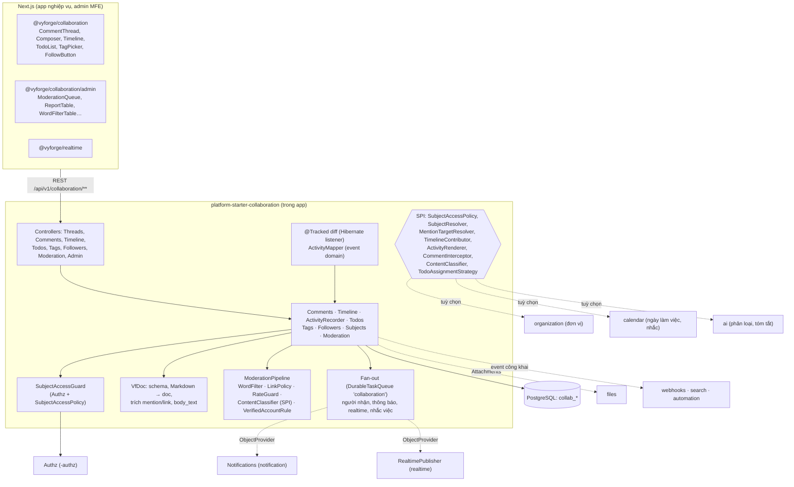
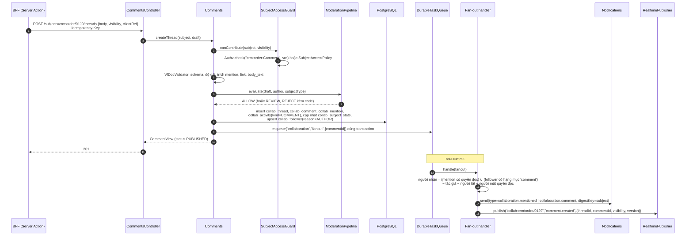
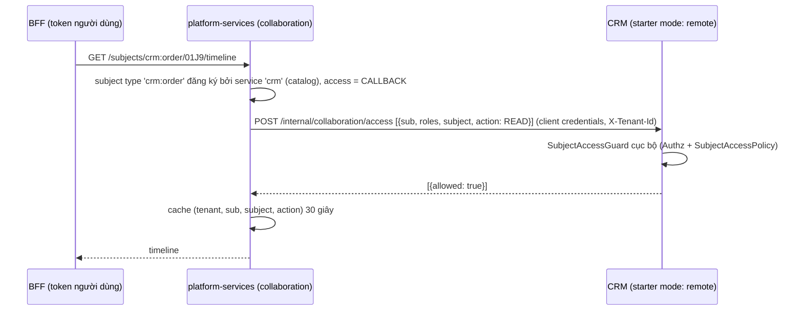
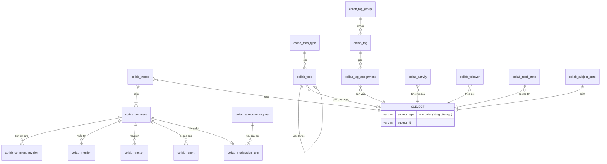

# Thiết kế module collaboration (`platform-starter-collaboration`, `@vyforge/collaboration`)

> **Trạng thái:** bản thiết kế chờ duyệt (27/10/2026). Nền: platform-java 0.12.1 (`SecretCipher`, `DurableTaskQueue`,
> `StarterSchemaMigrator`), platform-web 0.9.0. Bản triển khai đầu tiên nhắm `0.13.0`.
>
> Liên quan: [MODULE_PLAN.md](../MODULE_PLAN.md), [gap analysis §3](../research/2026-10-gap-analysis.md) (thêm
> activity/to-do và kiểm duyệt nội dung), `platform-services.md` của forge-37 (D1–D10, §4.11–4.12, §5.1–5.2), ADR-0009
> (IAM), ADR-0011 (danh bạ), ADR-0015 (tenant ở tầng dữ liệu). Nối với thiết kế files, notification, realtime,
> webhooks, features, search, privacy-dsr; dùng (tuỳ chọn) calendar, organization khi hai module này có.

## Tóm tắt quyết định

| # | Quyết định | Lý do ngắn |
|---|---|---|
| C1 | **Một module gồm năm khả năng gắn vào bất kỳ bản ghi nghiệp vụ nào**: trao đổi (thread, comment, ghi chú), dòng thời gian (activity), việc cần làm (to-do), tổ chức (tag, follow, đã đọc), kiểm duyệt. Bản ghi được chỉ bằng `SubjectRef(type, id)`, `type` dạng `<service>:<resource>` như `EntityRef` của files | Học Odoo (`mail.thread` + `mail.activity.mixin` là mixin cho mọi model) và Frappe (Comment, ToDo theo `reference_type`/`reference_name`). App không phải tạo bảng comment riêng cho từng loại bản ghi |
| C2 | **Quyền đi theo bản ghi cha.** Loại bản ghi khai báo action đọc/góp ý (`crm:order:Get`, `crm:order:Comment`…) hoặc cài `SubjectAccessPolicy`. Module chỉ có action riêng cho việc vượt lên trên quyền cha: kiểm duyệt, xoá bài người khác, quản trị nhãn, cấu hình | Giống `AttachmentAccessPolicy` của files. Ai xem được đơn hàng thì xem được trao đổi trên đơn |
| C3 | **Hai lớp hiển thị trên một bản ghi:** `INTERNAL` (nhân viên) và `PUBLIC` (khách, cộng đồng). Ghi chú (`NOTE`) luôn `INTERNAL` | Học Jira Service Management (`jsdPublic`) và Odoo (Log note vs Send message). Helpdesk và cổng khách hàng cần cả hai trên cùng ticket |
| C4 | **Thread hai tầng:** comment gốc + các trả lời phẳng; trả lời có `reply_to_id` để trích dẫn, không lồng sâu hơn. Thread có trạng thái mở/đã giải quyết/khoá, có `anchor` tuỳ chọn (field, đoạn văn bản, vị trí) | Linear, GitHub, Liveblocks đều hai tầng. Lồng sâu khó đọc trên mobile, khó phân trang |
| C5 | **Nội dung lưu dạng cây JSON có schema hẹp** (`vf-doc/1`: đoạn văn, đậm/nghiêng/code/link, danh sách, trích dẫn, khối code, mention). Không lưu HTML. Server kiểm schema, tự tính `body_text` và tự trích mention, link. Nhận Markdown ở API (chuyển bằng commonmark-java) | Liveblocks (`CommentBody`) và Linear (`bodyData`) cũng lưu cây. Không có HTML thì không có XSS lưu trữ; render ở React bằng component, email render ở server có escape |
| C6 | **Sửa có lịch sử, xoá là tombstone.** Mỗi lần sửa lưu bản cũ vào `collab_comment_revision`. Xoá thì ẩn nội dung, giữ chỗ trong thread ("Bình luận đã bị xoá"); bản cũ bị dọn sau thời hạn trừ khi đang là bằng chứng kiểm duyệt hoặc legal hold | Liveblocks giữ comment đã xoá với `deletedAt`. Cần bằng chứng khi có tranh chấp hoặc yêu cầu của cơ quan chức năng |
| C7 | **Activity ghi khi xảy ra (write-time) vào một bảng partition theo tháng**, từ bốn nguồn: gọi API, field đánh dấu `@Tracked` (tự tính diff như `tracking=True` của Odoo), event domain qua `ActivityMapper`, và chính module (comment, to-do, tag). Nguồn ngoài (audit, notification, workflow) ghép lúc đọc qua `TimelineContributor` | Một truy vấn cho timeline, có retention và hiển thị riêng. Không copy toàn bộ audit log (audit là bằng chứng, timeline là giao diện) |
| C8 | **To-do gắn bản ghi kiểu `mail.activity`**: loại việc, người hoặc nhóm được giao, hạn (có thể theo ngày làm việc), nhắc, đánh dấu xong kèm phản hồi và **kết quả** (vd. `APPROVED`/`REJECTED`), chuỗi việc tiếp theo. Việc xong ghi vào timeline. To-do cũng có thể không gắn bản ghi (việc cá nhân) | Gap analysis §3. Odoo 19 cho cả phê duyệt đơn giản đi qua activity. Workflow đầy đủ thuộc module workflow, luật tự động thuộc automation |
| C9 | **Follow theo hạng mục** (comment, ghi chú, thay đổi, to-do, sự kiện). Tự follow khi tạo bản ghi, viết comment, được mention, được giao việc. Bỏ follow là "tắt hẳn", không bị tự follow lại | Học `mail.followers.subtype_ids` của Odoo và cách Linear/GitHub tự đăng ký người tham gia |
| C10 | **Thông báo đi qua notification**, không tự gửi email. Module chỉ tính người nhận (follower ∩ hạng mục − người gây ra − người không còn quyền đọc) rồi gọi `Notifications.send` với `digestKey` theo bản ghi. Không cài notification thì chỉ có event | Notification đã có digest (K4: 20 bình luận trong 10 phút gộp một email) và preference |
| C11 | **Realtime theo kiểu "báo rồi tải lại"**: topic `collab:<service>/<resource>/<id>` chỉ mang id, loại thay đổi và hiển thị; client gọi API để lấy nội dung đã lọc quyền | Một topic phục vụ được cả người xem nội bộ lẫn khách mà không lộ ghi chú nội bộ qua kênh realtime |
| C12 | **Kiểm duyệt có ba chế độ theo loại bản ghi và tenant:** `OFF` (trao đổi nội bộ), `POST` (đăng ngay, duyệt sau khi bị báo cáo hoặc khớp bộ lọc), `PRE` (chờ duyệt trước khi hiện). Có bộ lọc từ khoá tiếng Việt (chuẩn hoá bỏ dấu, chống lách bằng ký tự), báo cáo vi phạm, hạn chế người dùng, hàng đợi có hạn xử lý, SPI `ContentClassifier` cho bộ phân loại (module ai) | Gap analysis §3. ABP CMS Kit chỉ có duyệt toàn cục, bật/tắt; dự án có nội dung công khai cần nhiều hơn |
| C13 | **Hồ sơ "nội dung công khai" theo NĐ 147/2024/NĐ-CP**: có thể bắt buộc tài khoản đã xác thực số điện thoại di động VN (hoặc số định danh cá nhân) mới được viết; yêu cầu gỡ của cơ quan có thẩm quyền có hạn 24 giờ (khẩn cấp 6 giờ, 3 giờ theo Luật An ninh mạng 116/2025/QH15); khiếu nại có căn cứ của người dùng hạn 48 giờ. Tất cả là cấu hình, mặc định tắt | NĐ 147 áp dụng cho mạng xã hội và trang thông tin điện tử; trao đổi nội bộ trên CRM không thuộc diện này. Module cung cấp công cụ, pháp chế của dự án quyết định có bật không |
| C14 | **Mặc định nhúng vào app** (như export ở D10), vì quyền cha và diff field nằm trong app. Chạy được ở `platform-services`: starter ở `mode: remote` mở endpoint nội bộ để server hỏi lại quyền theo lô | Quyền theo `Condition` của app (chi nhánh, chủ bản ghi) chỉ app mới tính được |
| C15 | Admin MFE `/m/collaboration`: hàng đợi kiểm duyệt, báo cáo, yêu cầu gỡ, bộ lọc, hạn chế người dùng, danh mục nhãn, loại việc, cấu hình theo loại bản ghi. Component ở `@vyforge/collaboration/admin` | `platform-services.md` D1, D5, §4.12 |

---

## 1. Bài toán và phạm vi

### 1.1 Bài toán

Mọi app nghiệp vụ của Vyforge (CRM, HRM, e-office, helpdesk, thương mại điện tử) đều cần trao đổi quanh một bản ghi:
"anh xem giúp đơn này", "đã gọi khách, hẹn thứ Sáu", "ai đổi hạn mức từ 500 lên 800 triệu?". Nếu mỗi app tự làm thì mỗi
nơi một bảng comment, một kiểu mention, một cách gửi thông báo, và không ai làm kiểm duyệt hay xoá dữ liệu cá nhân cho
đúng. Odoo giải bài này bằng chatter dùng chung cho mọi model; Vyforge cần một khối tương đương, nhúng được vào app Java,
quyền theo IAM của Vyforge, giao diện React.

### 1.2 Phạm vi

| Trong phạm vi (0.13.0) | Để bản sau | Ngoài phạm vi (module khác) |
|---|---|---|
| Thread, comment, trả lời, ghi chú nội bộ, ghim | Trả lời qua email (email vào thành comment) | Chat 1–1 và nhóm không gắn bản ghi (module `chat` P2) |
| Mention người, nhóm IAM, đơn vị tổ chức, `@followers` | Comment neo vào video, PDF, toạ độ ảnh (chỉ có `anchor` dạng dữ liệu) | Soạn thảo cùng lúc nhiều người (CRDT, Yjs) |
| Đính kèm qua files, reaction, sửa có lịch sử, xoá mềm | Gợi ý trả lời, tóm tắt thread bằng AI (module ai qua SPI) | Workflow nhiều bước, phê duyệt nhiều cấp (module workflow) |
| Dòng thời gian: diff field, event, comment, to-do, nguồn ngoài | Luật tự giao việc (round-robin, theo tải): SPI có sẵn, luật nằm ở automation | Luật "khi A thì B" do tenant cấu hình (automation) |
| To-do: loại việc, giao người/nhóm, hạn, nhắc, kết quả, chuỗi việc | Việc lặp lại theo RRULE (dùng calendar khi có) | Lịch hẹn, đặt chỗ (booking) |
| Tag dùng chung, nhóm tag, follow theo hạng mục, trạng thái đã đọc | Đánh giá sao (rating) | Hỏi đáp công khai kiểu diễn đàn |
| Kiểm duyệt, báo cáo vi phạm, bộ lọc từ khoá, hạn chế người dùng, yêu cầu gỡ có SLA | Bộ phân loại độc hại tự host (SPI có sẵn) | Xác thực số điện thoại, VNeID (auth-server, ekyc) |
| Realtime, thông báo, webhooks, search, DSR, admin MFE | | |

### 1.3 Kịch bản nghiệp vụ phải đáp ứng

| # | Kịch bản | Yêu cầu rút ra | Thành phần |
|---|---|---|---|
| K1 | **Đơn hàng CRM:** nhân viên bán hàng viết "@ketoan kiểm giúp công nợ", đính kèm ảnh uỷ nhiệm chi. Nhóm kế toán (group IAM) nhận thông báo; ai không xem được đơn thì không được mention | Mention nhóm, kiểm quyền đọc của người được mention, đính kèm theo quyền bản ghi | `MentionTargetResolver`, files `AttachmentAccessPolicy` cho `collaboration:comment` |
| K2 | **Ticket helpdesk:** nhân viên trả lời khách (công khai) và trao đổi nội bộ "khách này hay khiếu nại" (ghi chú) trên cùng ticket. Khách vào cổng chỉ thấy phần công khai | Hai lớp `INTERNAL`/`PUBLIC`, lọc ở API và realtime | C3, C11 |
| K3 | **Đơn nghỉ phép HRM:** hệ thống tạo to-do "Duyệt đơn nghỉ phép" cho quản lý trực tiếp, hạn 2 ngày làm việc, nhắc trước 4 giờ, quá hạn báo cả trưởng phòng. Quản lý bấm "Duyệt" kèm ý kiến → app nhận event và đổi trạng thái đơn | To-do có kết quả, hạn theo ngày làm việc (calendar), nhắc và leo thang, event `TodoCompleted` | C8, `TodoType.outcomes`, `BusinessCalendar` (tuỳ chọn) |
| K4 | **Văn bản đến (e-office):** lãnh đạo ghi bút phê "Giao phòng KH-TC chủ trì, hạn 15/11", văn thư theo dõi tiến độ; timeline ghi đủ luân chuyển, ai mở, ai đổi hạn | To-do giao cho đơn vị (organization), activity theo event domain, timeline nhiều nguồn | `ActivityMapper`, mention `ORG_UNIT` |
| K5 | **Quản lý dự án SaaS:** comment neo vào một đoạn mô tả task, thread được "giải quyết", reaction 👍, 20 bình luận trong 10 phút chỉ thành một email | `anchor`, resolve/reopen, reaction, digest | C4, C10 |
| K6 | **Bình luận công khai dưới sản phẩm/bài viết (thương mại điện tử, báo, cộng đồng):** chỉ tài khoản đã xác thực số điện thoại mới bình luận được; từ tục tĩu viết không dấu hay chèn dấu chấm ("đ.m") vẫn bị chặn; người xem báo cáo vi phạm; cơ quan chức năng yêu cầu gỡ trong 24 giờ | Hồ sơ nội dung công khai NĐ 147, bộ lọc tiếng Việt, báo cáo, SLA gỡ | C12, C13 |
| K7 | **Hồ sơ vay (ngân hàng, tài chính tiêu dùng):** timeline "Hạn mức: 500.000.000 → 800.000.000 (Nguyễn Văn A, 10:05)"; comment không sửa được sau 15 phút; thread về tranh chấp bị khoá và giữ nguyên (legal hold) | `@Tracked` với định dạng tiền tệ, `editWindow` theo loại bản ghi, khoá thread, legal hold | C6, C7 |
| K8 | **Hồ sơ bệnh án:** ghi chú lâm sàng chỉ nội bộ; thay đổi field nhạy cảm (chẩn đoán) chỉ ghi "đã cập nhật chẩn đoán", không ghi giá trị; email thông báo không chứa nội dung bình luận | Che giá trị field `@PersonalData(SENSITIVE)` trong activity; notification chỉ có tiêu đề và link | §8.2 |
| K9 | **Nhãn dùng chung:** "VIP", "Nợ xấu", "Cần gọi lại" dùng cho cả khách hàng lẫn đơn hàng; nhóm nhãn "Mức ưu tiên" chỉ chọn một; lọc danh sách khách theo nhãn | Tag có nhóm, nhóm loại trừ lẫn nhau, phạm vi theo loại bản ghi, truy vấn bản ghi theo tag | `collab_tag_group.exclusive` |
| K10 | **Theo dõi:** giám đốc theo dõi mọi đơn > 500 triệu chỉ cho phần thay đổi trạng thái, không nhận từng comment; người được giao tự theo dõi; người bỏ theo dõi không bị thêm lại | Follow theo hạng mục, lý do follow, bỏ follow "dính" | C9 |
| K11 | **Danh sách đơn hàng** hiện "💬 5 · 2 mới · 1 việc quá hạn · VIP" cho 50 dòng một lần | API tóm tắt theo lô, bảng thống kê theo bản ghi | `collab_subject_stats`, `POST /subjects/summary` |
| K12 | **Yêu cầu xoá dữ liệu cá nhân (Luật 91/2025):** cựu nhân viên hoặc khách yêu cầu xoá; comment của họ được ẩn danh, thread vẫn đọc được; reaction, follow bị xoá | `PersonalDataContributor` của privacy-dsr | §8.2 |
| K13 | **Chuyển từ hệ cũ:** nhập 2 triệu comment và lịch sử từ Odoo/Excel, giữ tác giả, thời gian, không gửi thông báo | API nhập theo lô, `source=IMPORT`, tắt fan-out | `POST /internal/import` |
| K14 | **Nhiều app dùng chung:** CRM và HRM cùng chạy; người dùng mở "Việc của tôi" thấy việc của cả hai | Chế độ `platform-services` (C14) hoặc gom ở BFF | §3.6 |
| K15 | **Xoá, gộp bản ghi cha:** đơn bị xoá thì trao đổi theo chính sách (xoá ngay, giữ N ngày, giữ mãi); gộp hai khách hàng trùng thì gộp cả trao đổi | `subjectDeleted`, `moveSubject` | `Subjects` |
| K16 | **Cơ quan nhà nước, tài liệu mật:** comment nội bộ không được đi ra hệ thống ngoài (không webhooks, không search cloud), không đính kèm file ra ngoài | Cấu hình theo loại bản ghi tắt webhooks/search/notification ngoài kênh in-app | `SubjectTypeSettings.egress` |

---

## 2. Nghiên cứu

Các phiên bản, license kiểm ngày 27/10/2026 bằng npm registry, GitHub API và trang tài liệu chính thức (link trong bảng).

### 2.1 Hệ thống tham khảo

| Hệ thống | Phiên bản, license | Mô hình dữ liệu | API | Điểm mạnh | Điểm yếu (với Vyforge) |
|---|---|---|---|---|---|
| **Odoo** chatter + activities ([mixins](https://www.odoo.com/documentation/19.0/developer/reference/backend/mixins.html), [mail_activity.py](https://github.com/odoo/odoo/blob/19.0/addons/mail/models/mail_activity.py), [mail_activity_type.py](https://github.com/odoo/odoo/blob/19.0/addons/mail/models/mail_activity_type.py), [mail_followers.py](https://github.com/odoo/odoo/blob/19.0/addons/mail/models/mail_followers.py)) | 19.0 (09/2025), Community LGPL-3.0 | `mail.message` (`model`, `res_id`, `parent_id`, `message_type`, `subtype_id`); `mail.followers` (`res_model`, `res_id`, `partner_id`, `subtype_ids`, unique theo bộ ba); `mail.activity` (`res_model`, `res_id`, `activity_type_id`, `summary`, `note`, `date_deadline`, `user_id`, `state` = `overdue`/`today`/`planned`/`done` tính theo múi giờ người được giao, `feedback`, `previous_activity_type_id`); `mail.activity.type` (`delay_count`/`delay_unit`/`delay_from`, `chaining_type` = `suggest`/`trigger`, `default_user_id`, `category`) | `message_post(body, message_type, subtype, parent_id, attachments)`, `message_subscribe(partner_ids, subtype_ids)`, field `tracking=True`, `_track_subtype()`, `action_feedback(feedback)` | Mixin cho mọi model; follower theo subtype; tracking field tự động; activity xong thì **lưu trữ (archive)** và đăng message "đã xong" lên bản ghi; chuỗi việc tiếp theo; dọn activity quá hạn quá cũ bằng autovacuum | Gắn chặt ORM Python; quyền theo ACL/record rule của Odoo; HTML trong message (phải sanitize); không có kiểm duyệt nội dung |
| **Jira Cloud** REST v3 ([OpenAPI](https://developer.atlassian.com/cloud/jira/platform/swagger-v3.v3.json), [issue comments](https://developer.atlassian.com/cloud/jira/platform/rest/v3/api-group-issue-comments/)) | SaaS, OpenAPI `1001.0.0-SNAPSHOT` (lấy 27/10/2026) | `Comment`: `id`, `author`, `updateAuthor`, `body` (Atlassian Document Format, cây JSON), `renderedBody`, `created`, `updated`, `visibility` (`type` = `group`/`role`, `identifier`), `jsdPublic`, `properties` (khoá-giá trị mở rộng). Comment **phẳng**, không thread. Changelog của issue tách riêng | `GET/POST /issue/{id}/comment` (`startAt`, `maxResults`, `orderBy`, `expand`), `PUT/DELETE /comment/{id}`; quyền "Browse projects" + "Add comments" của project chứa issue | Quyền theo bản ghi cha; `visibility` theo group/role; tách công khai/nội bộ cho service desk; `properties` cho app mở rộng; ADF là cây, không phải HTML | Không có thread, reaction qua API công khai; tách comment và changelog thành hai luồng nên client phải tự ghép |
| **Linear** GraphQL ([schema.graphql](https://github.com/linear/linear/blob/master/packages/sdk/src/schema.graphql)) | SaaS; SDK `@linear/sdk` 99.0.0, MIT | `Comment`: `body` (markdown), `bodyData` (cây), `parent`/`parentId` (thread hai tầng), `editedAt`, `resolvedAt`, `resolvingUser`, `resolvingComment`, `quotedText`, `reactions`/`reactionData`, `threadSummary`, `externalThread`, `botActor`, `onBehalfOf`; liên kết cha bằng nhiều cột nullable (`issueId`, `projectId`, `projectUpdateId`, `initiativeId`…). `Reaction`: `emoji`, `user`, `comment`. `IssueHistory`: cột kiểu `fromX`/`toX` cho từng field (`fromState`/`toState`, `fromAssignee`/`toAssignee`, `addedLabelIds`…) | GraphQL, `commentCreate`, subscription qua webhook | Thread hai tầng + resolve; trích đoạn (`quotedText`); comment của bot, thay mặt người khác; tóm tắt thread | Mỗi loại cha một cột FK (không mở rộng cho app khác); history có cột cố định cho từng field (không hợp với bản ghi do app định nghĩa) |
| **Liveblocks Comments** ([concepts](https://liveblocks.io/docs/ready-made-features/comments/concepts), [mentions](https://liveblocks.io/docs/ready-made-features/comments/users-and-mentions), [notifications](https://liveblocks.io/docs/ready-made-features/comments/email-notifications)) | SaaS; `@liveblocks/react-ui`, `@liveblocks/node` 3.24.5, Apache-2.0 (gói client) | Room → thread (`id`, `roomId`, `resolved`, `visibility` public/private, `metadata`) → comment (`body` là `CommentBody` dạng cây, `editedAt`, `deletedAt`: comment xoá vẫn ở lại, `body` bị bỏ). Thread chỉ bị xoá khi mọi comment đã xoá. Mention `kind: user\|group` | Hook React, REST server, webhook `CommentCreatedEvent`, `CommentEditedEvent`, `CommentDeletedEvent`, `CommentReactionAddedEvent`, `ThreadMarkedAsResolvedEvent`…; `resolveMentionSuggestions`, `resolveGroupsInfo` | Mention nhóm có danh sách thành viên; inbox gộp theo thread ("4 comment mới" là một thông báo); webhook `notification` gom tối đa 30 phút/người; bỏ qua email khi người nhận đã đọc | SaaS nước ngoài (dữ liệu ra khỏi VN); quyền theo room do app ký token, không theo policy IAM có `Condition`; không có kiểm duyệt |
| **Velt** ([docs](https://velt.dev/docs/llms.txt), [self-hosting comments](https://velt.dev/docs/self-hosting/partial/comments.md)) | SaaS; `@veltdev/react` 6.0.34, ISC | Comment annotation (thread) gắn vào phần tử, ô bảng, đoạn văn, khung video; trạng thái, người được giao, người liên quan | SDK, webhook; **data provider**: nội dung comment, người nhận, mention, URL đính kèm nằm ở DB của khách, Velt chỉ giữ id, vị trí, trạng thái; ghi vào DB khách trước, thành công mới ghi Velt | Nhiều kiểu neo (`anchor`); tách dữ liệu nhạy cảm khỏi lõi đồng bộ; có bản self-host toàn phần (GCP, AWS/Azure beta) | Hệ đóng; nhiều giao diện phụ thuộc DOM của trang; vẫn cần dịch vụ ngoài cho bản partial |
| **Frappe** ([todo.json](https://github.com/frappe/frappe/blob/develop/frappe/desk/doctype/todo/todo.json)) | v16.53.0 (22/10/2026), MIT | `ToDo`: `status` Open/Closed/Cancelled, `priority`, `date` (hạn), `allocated_to`, `description`, `reference_type` + `reference_name` (dynamic link), `role`, `assigned_by`, `assignment_rule`; `Comment` và `Version` (lịch sử thay đổi) theo `reference_doctype`/`reference_name`; Assignment Rule (round robin, theo tải, theo field) | REST `/api/resource/ToDo`, `frappe.desk.form.assign_to` | Dynamic link đơn giản; việc giao theo vai trò; luật tự giao việc | Không có thread, reaction; quyền thô theo doctype |
| **ABP CMS Kit** ([comments](https://abp.io/docs/latest/modules/cms-kit/comments)) | 10.7.0 (06/10/2026), LGPL-3.0 | Comment theo `EntityType` + `EntityId`, có trả lời; Reaction, Tag (`EntityTag`), Rating là module riêng cùng kiểu khoá | `CmsKitCommentOptions.EntityTypes`; cài đặt "cần duyệt" (mặc định tắt, **toàn cục, không theo tenant**); `AllowedExternalUrls` theo loại bản ghi; reCAPTCHA | Gần mô hình Vyforge nhất (.NET); có duyệt comment, danh sách URL cho phép | Duyệt bật/tắt toàn cục; xoá comment xoá luôn trả lời trực tiếp; không có activity, to-do, follow |

Thư viện dự kiến dùng:

| Thư viện | Phiên bản (27/10/2026) | License | Dùng cho |
|---|---|---|---|
| Tiptap (`@tiptap/react`, `@tiptap/extension-mention`) ([repo](https://github.com/ueberdosis/tiptap)) | 3.32.0 | MIT | Ô soạn comment ở web: JSON ProseMirror khớp với `vf-doc/1`, mention có gợi ý. Lazy load |
| Lexical | 0.52.0 | MIT | Phương án thay thế (không chọn: chưa 1.0, JSON không theo ProseMirror) |
| commonmark-java ([repo](https://github.com/commonmark/commonmark-java)) | 0.31.0 (22/10/2026) | BSD-2-Clause | Nhận Markdown ở API, nhập dữ liệu cũ → `vf-doc/1` |
| OWASP java-html-sanitizer ([repo](https://github.com/OWASP/java-html-sanitizer)) | release 20261011.1 | Apache-2.0 | Chỉ khi **nhập** HTML từ hệ cũ (Odoo `mail.message.body`) → làm sạch rồi chuyển sang `vf-doc/1`. Không dùng ở đường đọc |

(Version Maven của hai thư viện Java lấy theo tag GitHub; kiểm lại trên Maven Central khi code.)

### 2.2 Văn bản pháp lý (kiểm bản hiện hành)

| Văn bản | Hiện trạng (27/10/2026) | Nội dung liên quan | Nguồn |
|---|---|---|---|
| **NĐ 147/2024/NĐ-CP** (quản lý, cung cấp, sử dụng dịch vụ Internet và thông tin trên mạng), ban hành 09/11/2024 | **Còn hiệu lực** từ 25/12/2024. Có **dự thảo sửa đổi, bổ sung** đang lấy ý kiến (hội thảo 23/07/2026, Cục PT-TH và TTĐT, Bộ VHTTDL), **chưa ban hành** | Mạng xã hội xác thực tài khoản bằng số điện thoại di động tại VN; chỉ khi người dùng xác nhận không có số VN mới dùng số định danh cá nhân (điểm e khoản 3 Điều 23; điểm b khoản 3 Điều 27 với mạng xã hội trong nước). Chỉ tài khoản đã xác thực mới được đăng tải thông tin (viết bài, **bình luận**, livestream). Gỡ thông tin vi phạm, kể cả bình luận, trong 24 giờ kể từ yêu cầu của cơ quan có thẩm quyền (qua điện thoại, văn bản, phương tiện điện tử); khiếu nại có căn cứ của người dùng chậm nhất 48 giờ. Trẻ dưới 16 tuổi do cha mẹ/người giám hộ đăng ký. Dự thảo 2026 giữ yêu cầu xác thực bằng "số điện thoại đã xác thực hoặc số định danh cá nhân", thêm biện pháp nhận diện người dùng trẻ em | [LuậtViệtNam](https://luatvietnam.vn/tin-van-ban-moi/tu-25-12-2024-tai-khoan-mang-xa-hoi-da-xac-thuc-bang-so-dien-thoai-moi-duoc-dang-bai-186-99855-article.html), [Luật Việt An (tóm tắt Điều 23, 36)](https://luatvietan.vn/nghi-dinh-147-2024-nd-cp-quan-ly-cung-cap-su-dung-dich-vu-internet-va-thong-tin-tren-mang.html), [SGGP](https://www.sggp.org.vn/tu-hom-nay-25-12-xac-thuc-tai-khoan-mang-xa-hoi-bang-so-dien-thoai-di-dong-post774719.html), [Báo Tuyên Quang về dự thảo, 24/07/2026](https://baotuyenquang.com.vn/khoa-hoc-cong-nghe/202607/sua-doi-nghi-dinh-so-1472024nd-cp-de-xay-dung-moi-truong-internet-an-toan-78858c3/) |
| **Luật An ninh mạng 2025, số 116/2025/QH15** | Thông qua 10/12/2025, **hiệu lực 01/07/2026** | Doanh nghiệp viễn thông, Internet, mạng xã hội ngăn chặn, xoá thông tin vi phạm trong 24 giờ theo yêu cầu của lực lượng chuyên trách; khẩn cấp đe doạ an ninh quốc gia tối đa 6 giờ, khẩn cấp liên quan an ninh quốc gia hoặc tính mạng 3 giờ. Chính phủ sẽ quy định chi tiết | [LuậtViệtNam](https://luatvietnam.vn/tin-van-ban-moi/mang-xa-hoi-buoc-go-noi-dung-vi-pham-trong-3-6-gio-doi-voi-truong-hop-khan-cap-186-106179-article.html), [Thư viện pháp luật](https://thuvienphapluat.vn/van-ban/cong-nghe-thong-tin/Luat-An-ninh-mang-2025-so-116-2025-QH15-666020.aspx) |
| Luật Bảo vệ dữ liệu cá nhân 91/2025/QH15, NĐ 356/2025/NĐ-CP | Hiệu lực 01/01/2026 (theo README platform-java) | Comment, mention, follow, reaction là dữ liệu cá nhân; quyền xoá, xuất của chủ thể | §8.2 |

Chưa đọc được toàn văn Điều 3, 23, 27 của NĐ 147 từ nguồn chính thức (Công báo, vanban.chinhphu.vn chặn trình đọc tự
động; Thư viện pháp luật trả 403). Các mốc 24/48 giờ lấy từ hai bản tóm tắt độc lập khớp nhau. Pháp chế của dự án đối
chiếu toàn văn trước khi bật hồ sơ "nội dung công khai", và **kiểm lại khi nghị định sửa đổi được ban hành**. Mọi mốc
thời gian ở module là cấu hình, không viết cứng (§6.3).

### 2.3 Học theo và không làm

| Học theo | Từ | Ở đâu trong thiết kế |
|---|---|---|
| Mixin cho mọi bản ghi, khoá `(type, id)` động | Odoo, Frappe, ABP | `SubjectRef`, C1 |
| Follower theo hạng mục (subtype), tự follow người tham gia | Odoo `mail.followers.subtype_ids` | C9, `collab_follower.categories` |
| Tracking field khai báo bằng annotation, diff tự động | Odoo `tracking=True` | `@Tracked`, §3.4 |
| Activity có loại, hạn, chuỗi việc (`suggest`/`trigger`), xong thì lưu trữ và ghi lên timeline; trạng thái quá hạn tính lúc đọc theo múi giờ người được giao | Odoo `mail.activity` | C8, §4 `collab_todo` |
| Giao việc cho vai trò/nhóm, luật tự giao việc | Frappe ToDo, Assignment Rule | `assignee_group`, SPI `TodoAssignmentStrategy` |
| Hiển thị theo group/role, tách công khai/nội bộ | Jira `visibility`, `jsdPublic` | C3 |
| Nội dung là cây JSON, render ở client | Jira ADF, Linear `bodyData`, Liveblocks `CommentBody` | C5 |
| Thread hai tầng, resolve, trích đoạn | Linear, Liveblocks | C4, `quoted_text` |
| Comment xoá giữ tombstone | Liveblocks `deletedAt` | C6 |
| Thông báo gộp theo thread, bỏ email nếu đã đọc | Liveblocks | C10 (dùng digest của notification + `collab_read_state`) |
| Mention nhóm có `kind` | Liveblocks | `MentionTarget.kind` |
| Tách dữ liệu nhạy cảm khỏi kênh đồng bộ | Velt data provider | C11: realtime chỉ mang id |
| Danh sách URL cho phép theo loại bản ghi, duyệt trước | ABP CMS Kit | `LinkPolicy`, `moderation: PRE` |
| `properties`/`metadata` mở rộng cho app | Jira, Liveblocks | `attributes` JSONB có giới hạn |

| Không làm | Lý do |
|---|---|
| Cột FK riêng cho từng loại cha (Linear) | App khác không thêm được loại cha mà không đổi schema |
| Lịch sử field với cột cố định `fromX`/`toX` (Linear `IssueHistory`) | Field do app định nghĩa; dùng `changes` JSONB có `field`, `from`, `to` |
| Lưu HTML (Odoo) | XSS lưu trữ, sanitize mỗi lần đọc; khó trích mention |
| Comment lồng nhiều tầng | Khó đọc, khó phân trang; trả lời trích dẫn (`reply_to_id`) đủ cho nhu cầu |
| Duyệt toàn cục bật/tắt (ABP) | Mỗi loại bản ghi, mỗi tenant cần chế độ riêng |
| Xoá comment kéo theo xoá trả lời (ABP) | Mất ngữ cảnh của người khác; dùng tombstone |
| Dùng SaaS (Liveblocks, Velt) làm backend | Dữ liệu ra nước ngoài, không chạy on-prem, quyền không theo IAM của Vyforge. Chỉ học mô hình |
| Soạn thảo đồng thời (CRDT) | Comment ngắn, khoá lạc quan bằng `version` là đủ |
| Copy toàn bộ audit log sang timeline | Audit là bằng chứng (không sửa, quyền riêng); timeline là giao diện có retention. Ghép lúc đọc qua `TimelineContributor` nếu tenant muốn |

---
## 3. Kiến trúc

### 3.1 Sơ đồ thành phần



Starter phụ thuộc các starter nền (`-web`, `-security`, `-jpa`, `-authz`, `-audit`, `-privacy`, `-scheduling`,
`-messaging`, `-ratelimit`). **Không phụ thuộc cứng module P1 nào.** files, notification, realtime, search, calendar,
organization, ai được dùng qua `ObjectProvider`/`@ConditionalOnBean`; vắng thì tính năng tương ứng tắt và `admin/info`
không báo capability đó.

### 3.2 Gói Java

```
com.vyforge.platform.collaboration          API công khai: Comments, Threads, Timeline, ActivityRecorder, Todos, Tags,
                                            Followers, ReadState, Subjects, Moderation; record SubjectRef, CommentView…
com.vyforge.platform.collaboration.spi      SubjectAccessPolicy, SubjectResolver, MentionTargetResolver, TimelineContributor,
                                            ActivityMapper, ActivityRenderer, CommentInterceptor, ContentClassifier,
                                            TodoAssignmentStrategy, TodoDueCalculator, ReactionSet
com.vyforge.platform.collaboration.doc      VfDoc, VfDocValidator, MarkdownImporter, HtmlImporter, PlainTextRenderer
com.vyforge.platform.collaboration.tracking @Tracked, @TrackedEntity, TrackingListener, ValueFormatter
com.vyforge.platform.collaboration.events   Event công khai (§5.3)
com.vyforge.platform.collaboration.internal Entity, repository, fan-out, moderation pipeline, job (không phải API)
com.vyforge.platform.collaboration.web      Controller, DTO, ProblemCodes
com.vyforge.platform.collaboration.remote   Client HTTP cho mode: remote, endpoint kiểm quyền ngược (§3.6)
```

ArchUnit: `internal` không được gọi từ ngoài module; `spi` không phụ thuộc `internal`; luật `TENANT_ISOLATION`.

### 3.3 Khái niệm

| Khái niệm | Ý nghĩa | Ví dụ |
|---|---|---|
| **Subject type** | Loại bản ghi nghiệp vụ dùng collaboration. Khai báo bằng YAML hoặc bean: action đọc/góp ý, tính năng bật, chế độ kiểm duyệt, retention, chính sách khi bản ghi bị xoá | `crm:order`, `helpdesk:ticket`, `cms:article` |
| **Subject** | Một bản ghi cụ thể: `SubjectRef(type, id)`. VRN suy ra `vrn:<service>:<resource>/<id>` | `SubjectRef("crm:order", "01J9…")` |
| **Thread** | Một cuộc trao đổi trên subject: comment gốc + trả lời. Có `visibility`, `status`, `anchor` | Thread "Công nợ" trên đơn hàng |
| **Comment** | Một bài trong thread. `kind` = `COMMENT` hoặc `NOTE`; `author_kind` = `USER`/`SYSTEM`/`BOT`/`EXTERNAL` | |
| **Activity** | Một dòng trên timeline của subject: thay đổi field, event, comment mới, to-do xong, tag | "Trạng thái: Nháp → Đã duyệt" |
| **To-do** | Việc cần làm, có thể gắn subject. Có loại, người/nhóm được giao, hạn, nhắc, kết quả | "Gọi lại khách" hạn 30/10 |
| **Tag** | Nhãn dùng chung trong tenant, thuộc nhóm (tuỳ chọn), áp cho subject | "VIP" trong nhóm "Hạng khách" |
| **Follower** | Người theo dõi subject, theo một tập hạng mục | |
| **Hạng mục (category)** | Phân loại activity để follow và lọc: `comment`, `note`, `change`, `todo`, `event`, `tag`, `attachment` và hạng mục do app khai báo (`crm.payment`) | Như subtype của Odoo |
| **Moderation item** | Một mục trong hàng đợi kiểm duyệt cho một comment, có lý do, hạn xử lý, quyết định | |
| **Takedown request** | Yêu cầu gỡ của cơ quan có thẩm quyền: số hiệu, thời điểm nhận, hạn, nội dung bị yêu cầu | Công văn số 123/CV-… |

### 3.4 Luồng chính

**Viết comment (đường thường, `moderation: OFF` hoặc `POST`):**



**Thay đổi field được theo dõi (`@Tracked`):**

```mermaid
sequenceDiagram
  autonumber
  participant App as Service của app
  participant H as Hibernate
  participant T as TrackingListener
  participant R as ActivityRecorder
  participant DB as PostgreSQL
  App->>H: order.setStatus(APPROVED); order.setCreditLimit(800tr) (trong @Transactional)
  H->>T: PostUpdateEvent(oldState, newState, dirty properties)
  T->>T: lọc field @Tracked, định dạng giá trị (ValueFormatter: tiền, ngày, enum → nhãn),<br/>che field @PersonalData theo cấu hình
  T->>R: record(subject, kind=CHANGE, changes=[{field:'status',from,to},{field:'creditLimit',from,to}])
  R->>DB: insert collab_activity (cùng transaction; rollback thì mất cùng)
  R->>R: enqueue fanout (follower hạng mục 'change')
```

Một transaction sửa nhiều field của cùng subject chỉ tạo **một** activity (gộp trong `TrackingListener` theo subject
trước khi flush). Thay đổi trong 3 phút đầu sau khi tạo bản ghi có thể bỏ qua (`tracking.ignore-after-create`, mặc định
0 = không bỏ; Linear bỏ qua thay đổi trong 3 phút đầu để timeline gọn).

**To-do có kết quả (K3):**

```mermaid
sequenceDiagram
  autonumber
  participant App as HRM (LeaveService)
  participant TD as Todos
  participant CAL as TodoDueCalculator (calendar nếu có)
  participant Q as DurableTaskQueue
  participant U as Quản lý (web)
  App->>TD: create(subject=hrm:leave/77, type=approval, assignee=managerOf(sub), due=2 ngày làm việc)
  TD->>CAL: due(now, 2 BUSINESS_DAYS, tenant calendar)
  TD->>Q: enqueue remind(runAt = due − 4h), overdue(runAt = due)
  TD-->>App: TodoView
  U->>TD: complete(todoId, outcome=APPROVED, feedback="Đồng ý")
  TD->>TD: kiểm outcome ∈ type.outcomes; status DONE; activity kind=TODO_DONE
  TD-->>App: event TodoCompleted(outcome=APPROVED) (Modulith, sau commit)
  App->>App: @ApplicationModuleListener: leave.approve()
  Note over Q: task remind/overdue chạy sau thấy DONE → no-op
```

**Đọc timeline:**

1. `Timeline.page(subject, cursor, filter)` kiểm quyền đọc subject một lần.
2. Đọc `collab_activity` theo `(tenant, subject_type, subject_id, occurred_at desc, id desc)`, lọc `visibility` theo
   người xem (`PUBLIC` chỉ thấy activity công khai), lọc hạng mục.
3. Gọi các `TimelineContributor` khớp subject type (audit, notification, workflow…), mỗi contributor trả tối đa
   `limit` mục cũ hơn cursor; trộn theo `(occurred_at, id)` (k-way merge), cắt `limit`, cursor là `(occurred_at, source,
   id)` của mục cuối. Contributor lỗi hoặc quá `contributor-timeout` (500 ms) thì bỏ qua và trả cờ `partial: true`.
4. Hydrate theo lô: comment (cho activity `COMMENT`), to-do, tên người (`SubjectResolver`/danh bạ), nhãn i18n
   (`ActivityRenderer`).

### 3.5 Luồng lỗi và luồng đặc biệt

| Tình huống | Xử lý |
|---|---|
| Không có quyền góp ý trên subject | `403 collaboration.subject_forbidden`. Không có quyền **đọc** thì `404 collaboration.subject_not_found` (không lộ bản ghi tồn tại) |
| Subject không tồn tại (`SubjectResolver.exists` = false) | `404`. Subject type không cài resolver thì tin app (app đã kiểm khi render trang) |
| Body sai schema, quá dài (`max-body-chars` 20.000), quá nhiều mention (50) | `400 collaboration.body_invalid` kèm `errors[]` theo đường dẫn node |
| Trùng `Idempotency-Key` hoặc `clientRef` trong 24 giờ | Trả comment cũ (200), không tạo mới |
| Sửa khi `version` đã đổi | `409 collaboration.version_conflict` kèm bản hiện tại |
| Sửa sau `editWindow` | `403 collaboration.edit_window_closed` (người có `collaboration:comment:ModerateAny` vẫn sửa được, có lý do) |
| Thread `LOCKED` | Viết/sửa/reaction trả `423 collaboration.thread_locked` |
| Bộ lọc trả `REJECT` | `422 collaboration.content_rejected` với `params.reason` (`profanity`, `link_not_allowed`, `duplicate`…). Không tạo bản ghi; ghi metric và (tuỳ cấu hình) audit |
| Bộ lọc trả `REVIEW` hoặc `moderation: PRE` | Comment lưu với `status = PENDING_REVIEW`, chỉ tác giả và người kiểm duyệt thấy; tạo `collab_moderation_item`; không fan-out tới khi được duyệt |
| Tài khoản chưa xác thực (hồ sơ NĐ 147) | `403 collaboration.account_not_verified` với `params.required = PHONE` để giao diện dẫn sang trang xác thực của auth-server |
| Người dùng bị hạn chế (`MUTED`/`BANNED`) | `403 collaboration.user_restricted` kèm `until` |
| Vượt rate limit (mặc định 10 comment/phút/người, 300/giờ/tenant cho subject công khai) | `429` từ `-ratelimit` |
| Mention người không đọc được subject | Comment vẫn lưu; mention đó đánh dấu `inaccessible`, không thông báo; response có `warnings[]` (`collaboration.mention_no_access`) để giao diện báo người viết |
| Đính kèm file chưa `AVAILABLE` (đang quét virus) | Gắn được; danh sách hiện trạng thái "đang kiểm tra"; file nhiễm virus thì files gỡ và collaboration ghi activity `ATTACHMENT_REMOVED` |
| Fan-out lỗi (notification lỗi tạm) | Task retry có backoff; `DEAD` thì hiện ở `TaskQueueTable`; comment không bị ảnh hưởng |
| Người nhận mất quyền giữa lúc viết và lúc fan-out | Kiểm quyền lại lúc fan-out (theo lô, `Authz` có cache), mất quyền thì bỏ |
| Subject bị xoá | App gọi `Subjects.deleted(ref)` hoặc phát event có `@SubjectDeleted`; theo `onSubjectDeleted` của type: `PURGE` (enqueue xoá), `RETAIN(30d)` (đánh dấu, ẩn, xoá sau), `KEEP` |
| Gộp bản ghi (K15) | `Subjects.move(from, to)`: chuyển thread, activity (thêm một activity `MERGED`), follower (gộp hạng mục), tag (bỏ trùng), to-do; chạy theo lô 1.000 dòng trong task |
| Realtime không có hoặc mất kết nối | Client vẫn đúng nhờ tải lại khi focus/`reset` (R1 của realtime) |

### 3.6 Chế độ chạy và kiểm quyền khi ở `platform-services`

| Chế độ | Mô tả |
|---|---|
| `embedded` (mặc định, khuyến nghị) | Bảng `collab_*` trong DB của app. Quyền cha kiểm ngay trong app. `@Tracked` ghi activity cùng transaction |
| `remote` | App dùng cùng interface Java; lời gọi đi REST tới `platform-services` (`/api/v1/collaboration/internal/**`), activity từ `@Tracked`/`ActivityMapper` đi qua outbox của app ra Kafka `collaboration-activities` (giữ tính nguyên tử với transaction nghiệp vụ). Starter ở app **mở thêm** `POST /api/v1/<app>/internal/collaboration/access` để server hỏi quyền theo lô |

Kiểm quyền ở server khi subject thuộc app khác:



Subject type đăng ký với `access: IAM` (chỉ cần action và VRN, không `Condition` theo thuộc tính của app) thì server tự
kiểm bằng `Authz` ở `mode: remote` (iam-server), không gọi ngược. Cách này giống hạn chế đã ghi ở files (§3.4 của
`platform-services.md`), nhưng có thêm đường callback để không mất quyền theo bản ghi.

---
## 4. Mô hình dữ liệu

### 4.1 ERD



`SUBJECT` không phải bảng của module: là bản ghi của app, chỉ được tham chiếu bằng `(subject_type, subject_id)`, không
có FK. Mọi bảng có `tenant_id` (`@TenantId`), mọi khoá chính và chỉ mục bắt đầu bằng `tenant_id`. Id là UUID v7
(`BaseEntity`), nên sắp theo id gần đúng theo thời gian.

### 4.2 Nguyên tắc tiến hoá schema

- Enum nghiệp vụ là `varchar` kiểm ở code (`status`, `kind`, `reason`…), không `CHECK` cứng trừ các giá trị lõi của state
  machine. Thêm giá trị là thay đổi tương thích; client gặp giá trị lạ thì coi như "khác".
- Payload JSONB có `schema_version` (`body`, `changes`, `anchor`, `settings`). Đọc bản cũ bằng upcaster ở code, không
  migrate dữ liệu hàng loạt.
- `attributes jsonb` cho app mở rộng: tối đa 4 KB, khoá `^[a-z][a-zA-Z0-9_.]{0,63}$`, kiểm theo JSON Schema khai báo ở
  subject type (nếu có). Không chứa PII (luật ArchUnit không bắt được, nên kiểm lúc ghi theo danh sách khoá cấm).
- Migration có version ở `META-INF/vyforge/db/collaboration`, bảng lịch sử `flyway_schema_history_collaboration`
  (`StarterSchema.of("collaboration")`), file gộp `META-INF/vyforge/sql/collaboration.sql`.

### 4.3 DDL dự kiến

```sql
-- V1__collaboration.sql (rút gọn: bỏ created_by/updated_by/version của BaseEntity ở các bảng phụ khi không cần)

create table collab_thread (
    id               uuid primary key,
    tenant_id        varchar(100) not null,
    subject_type     varchar(100) not null,                 -- 'crm:order'
    subject_id       varchar(100) not null,
    visibility       varchar(16)  not null default 'INTERNAL',  -- INTERNAL | PUBLIC
    status           varchar(16)  not null default 'OPEN',      -- OPEN | RESOLVED | LOCKED
    anchor           jsonb,                                   -- {schema_version, kind: field|text|position|page, ...}
    title            varchar(200),                            -- tuỳ chọn ("Công nợ")
    root_comment_id  uuid,
    comment_count    int          not null default 0,         -- chỉ đếm PUBLISHED
    last_comment_at  timestamptz,
    resolved_by      varchar(100),
    resolved_at      timestamptz,
    locked_reason    varchar(500),
    legal_hold       boolean      not null default false,
    attributes       jsonb        not null default '{}',
    created_at       timestamptz  not null,
    created_by       varchar(100) not null,
    updated_at       timestamptz  not null,
    version          bigint       not null default 0
);
create index collab_thread_subject_ix on collab_thread (tenant_id, subject_type, subject_id, last_comment_at desc);

create table collab_comment (
    id               uuid primary key,
    tenant_id        varchar(100) not null,
    thread_id        uuid         not null references collab_thread (id),
    subject_type     varchar(100) not null,                 -- lặp lại để truy vấn theo subject và DSR không cần join
    subject_id       varchar(100) not null,
    parent_id        uuid,                                    -- null = comment gốc; khác null = id comment gốc
    reply_to_id      uuid,                                    -- trả lời cụ thể (để trích dẫn), cùng thread
    kind             varchar(16)  not null default 'COMMENT', -- COMMENT | NOTE | SYSTEM
    visibility       varchar(16)  not null,                   -- bằng visibility của thread; NOTE luôn INTERNAL
    author_kind      varchar(16)  not null default 'USER',    -- USER | SYSTEM | BOT | EXTERNAL
    author_sub       varchar(100),                            -- null khi đã ẩn danh (DSR)
    author_ref       varchar(200),                            -- EXTERNAL: 'customer:123', BOT: 'bot:ai-summary'
    on_behalf_of     varchar(100),                            -- người được thay mặt (trợ lý viết hộ)
    status           varchar(20)  not null default 'PUBLISHED',
        -- PUBLISHED | PENDING_REVIEW | HIDDEN | REJECTED | DELETED | ERASED
    body_format      varchar(20)  not null default 'vf-doc/1',
    body             jsonb,                                   -- null khi DELETED/ERASED
    body_text        text,                                    -- văn bản thuần (search, lọc, email, preview)
    body_hash        bytea,                                   -- sha256(body_text chuẩn hoá): chống đăng trùng
    quoted_text      varchar(1000),                           -- đoạn được trích (anchor text)
    pinned_at        timestamptz,
    pinned_by        varchar(100),
    edited_at        timestamptz,
    edit_count       int          not null default 0,
    deleted_at       timestamptz,
    deleted_by       varchar(100),
    delete_reason    varchar(40),                             -- AUTHOR | MODERATOR | TAKEDOWN | SUBJECT_DELETED | DSR
    reaction_summary jsonb        not null default '{}',      -- {"+1": 3, "heart": 1}; nguồn thật ở collab_reaction
    attachments      jsonb        not null default '[]',      -- ảnh chụp [{fileId, name, size, contentType}] để render nhanh
    links            jsonb        not null default '[]',      -- link đã trích (host, url) cho LinkPolicy và preview
    source           varchar(16)  not null default 'WEB',     -- WEB | API | EMAIL | IMPORT | SYSTEM
    client_ref       varchar(100),                            -- id phía client (gửi lại khi mạng chập chờn)
    schema_version   int          not null default 1,
    attributes       jsonb        not null default '{}',
    created_at       timestamptz  not null,                   -- IMPORT được đặt thời gian cũ
    updated_at       timestamptz  not null,
    version          bigint       not null default 0
);
create index collab_comment_thread_ix  on collab_comment (tenant_id, thread_id, created_at, id);
create index collab_comment_subject_ix on collab_comment (tenant_id, subject_type, subject_id, created_at desc);
create index collab_comment_author_ix  on collab_comment (tenant_id, author_sub, created_at desc);   -- DSR, "bình luận của tôi"
create index collab_comment_review_ix  on collab_comment (tenant_id, status) where status in ('PENDING_REVIEW','HIDDEN');
create unique index collab_comment_client_ref_uq on collab_comment (tenant_id, author_sub, client_ref) where client_ref is not null;

create table collab_comment_revision (
    id            uuid primary key,
    tenant_id     varchar(100) not null,
    comment_id    uuid         not null references collab_comment (id),
    revision_no   int          not null,
    body          jsonb,                                    -- bản TRƯỚC khi sửa
    body_text     text,
    edited_by     varchar(100) not null,
    edited_at     timestamptz  not null,
    reason        varchar(40)  not null default 'EDIT',     -- EDIT | MODERATOR_EDIT | DELETE | HIDE
    purge_after   timestamptz,                              -- null = giữ (legal hold, bằng chứng)
    unique (tenant_id, comment_id, revision_no)
);

create table collab_mention (
    tenant_id     varchar(100) not null,
    comment_id    uuid         not null references collab_comment (id),
    target_kind   varchar(16)  not null,                    -- USER | GROUP | ORG_UNIT | FOLLOWERS
    target_id     varchar(100) not null,                    -- sub, groupId, unitId, '*'
    accessible    boolean      not null default true,       -- false = người được nhắc không đọc được subject
    created_at    timestamptz  not null,
    primary key (tenant_id, comment_id, target_kind, target_id)
);
create index collab_mention_target_ix on collab_mention (tenant_id, target_kind, target_id, created_at desc);   -- "nhắc tới tôi"

create table collab_reaction (
    tenant_id     varchar(100) not null,
    comment_id    uuid         not null references collab_comment (id),
    user_sub      varchar(100) not null,
    reaction      varchar(32)  not null,                    -- khoá trong ReactionSet: '+1', 'heart', 'eyes', 'check'
    created_at    timestamptz  not null,
    primary key (tenant_id, comment_id, user_sub, reaction)
);

create table collab_activity (
    id              uuid         not null,
    tenant_id       varchar(100) not null,
    subject_type    varchar(100) not null,
    subject_id      varchar(100) not null,
    occurred_at     timestamptz  not null,
    kind            varchar(24)  not null,   -- CHANGE | COMMENT | NOTE | EVENT | TODO_CREATED | TODO_DONE | TODO_CANCELLED
                                             -- | TAG | ATTACHMENT | MERGED | CREATED | DELETED | SYSTEM
    category        varchar(40)  not null,   -- hạng mục follow/lọc: change, comment, todo, event, crm.payment…
    verb            varchar(100),            -- khoá i18n: 'crm.order.approved'
    actor_kind      varchar(16)  not null default 'USER',
    actor_sub       varchar(100),
    visibility      varchar(16)  not null default 'INTERNAL',
    summary         jsonb,                   -- {key, params} để render i18n (ActivityRenderer)
    changes         jsonb,                   -- [{field, label?, from, to, masked?}] (CHANGE)
    ref_type        varchar(30),             -- COMMENT | TODO | FILE | TAG | EXTERNAL
    ref_id          varchar(100),
    source          varchar(16)  not null,   -- API | TRACKING | EVENT | MODULE | IMPORT | REMOTE
    source_key      varchar(200),            -- idempotency: event id, 'tracking:<txId>:<subject>'
    correlation_id  varchar(100),            -- request id / trace
    schema_version  int          not null default 1,
    attributes      jsonb        not null default '{}',
    primary key (tenant_id, occurred_at, id)
) partition by range (occurred_at);
create index collab_activity_subject_ix on collab_activity (tenant_id, subject_type, subject_id, occurred_at desc, id desc);
create unique index collab_activity_source_uq on collab_activity (tenant_id, source_key, occurred_at) where source_key is not null;
-- Unique index của bảng partition phải chứa khoá partition, nên chỉ chặn trùng khi cùng occurred_at. Nguồn EVENT/TRACKING
-- luôn lấy occurred_at từ event (giao lại vẫn cùng giá trị); API không có occurred_at thì ActivityRecorder kiểm thêm
-- source_key trong 7 ngày gần nhất trước khi ghi.
-- Partition theo tháng, tạo trước 3 tháng bằng job (@ClusterScheduled), mặc định giữ mãi; tenant đặt retention thì xoá theo dòng,
-- toàn platform đặt retention thì DETACH/DROP partition.

create table collab_todo_type (
    id              uuid primary key,
    tenant_id       varchar(100) not null,                  -- '*' = mặc định platform (khai báo trong code, đồng bộ lúc khởi động)
    key             varchar(64)  not null,                  -- 'call', 'meeting', 'upload', 'approval', 'review'
    name            jsonb        not null,                  -- LocalizedText {vi, en}
    icon            varchar(40),
    category        varchar(20)  not null default 'DEFAULT',  -- DEFAULT | UPLOAD | CALL | MEETING | APPROVAL
    subject_types   text[]       not null default '{}',     -- rỗng = mọi loại
    default_delay   jsonb,                                  -- {amount: 2, unit: BUSINESS_DAY|DAY|HOUR|WEEK, from: NOW|PREVIOUS}
    default_assignee jsonb,                                 -- {kind: USER|GROUP|SUBJECT_OWNER|MANAGER_OF_OWNER, id?}
    reminders       jsonb        not null default '[]',     -- [{before: 'PT4H'}, {after: 'P1D', escalateTo: 'MANAGER'}]
    outcomes        jsonb        not null default '[]',     -- [{key: APPROVED, name, feedbackRequired}, {key: REJECTED, ...}]
    chaining        jsonb,                                  -- {mode: SUGGEST|TRIGGER, next: ['call']}
    keep_done       boolean      not null default true,
    active          boolean      not null default true,
    source          varchar(10)  not null default 'CODE',   -- CODE | TENANT
    attributes      jsonb        not null default '{}',
    unique (tenant_id, key)
);

create table collab_todo (
    id               uuid primary key,
    tenant_id        varchar(100) not null,
    subject_type     varchar(100),                          -- null = việc cá nhân
    subject_id       varchar(100),
    type_key         varchar(64)  not null,
    summary          varchar(300) not null,
    note             jsonb,                                 -- vf-doc/1
    assignee_sub     varchar(100),
    assignee_group   varchar(100),                          -- giao cho nhóm: ai trong nhóm cũng nhận (claim) được
    assignee_kind    varchar(16)  not null default 'USER',  -- USER | GROUP | ORG_UNIT
    status           varchar(16)  not null default 'OPEN',  -- OPEN | DONE | CANCELLED
    priority         varchar(10)  not null default 'NORMAL',-- LOW | NORMAL | HIGH | URGENT
    due_at           timestamptz,                           -- mốc tuyệt đối
    due_date         date,                                  -- hạn chỉ có ngày, theo múi giờ của tenant (Asia/Ho_Chi_Minh)
    due_policy       jsonb,                                 -- {amount, unit, calendar} để tính lại khi đổi lịch
    snoozed_until    timestamptz,
    outcome          varchar(40),
    feedback         text,
    done_at          timestamptz,
    done_by          varchar(100),
    previous_todo_id uuid,
    created_by       varchar(100) not null,
    automated        boolean      not null default false,   -- tạo bởi hệ thống/luật
    rule_ref         varchar(100),                          -- luật/strategy đã giao việc
    source           varchar(16)  not null default 'WEB',
    attributes       jsonb        not null default '{}',
    created_at       timestamptz  not null,
    updated_at       timestamptz  not null,
    version          bigint       not null default 0
);
create index collab_todo_assignee_ix on collab_todo (tenant_id, assignee_sub, status, due_at);        -- "việc của tôi"
create index collab_todo_group_ix    on collab_todo (tenant_id, assignee_group, status, due_at) where assignee_group is not null;
create index collab_todo_subject_ix  on collab_todo (tenant_id, subject_type, subject_id, status);
create index collab_todo_due_ix      on collab_todo (tenant_id, due_at) where status = 'OPEN';

create table collab_tag_group (
    id            uuid primary key,
    tenant_id     varchar(100) not null,
    key           varchar(64)  not null,
    name          jsonb        not null,
    exclusive     boolean      not null default false,      -- một subject chỉ có một tag trong nhóm (K9: mức ưu tiên)
    subject_types text[]       not null default '{}',
    position      int          not null default 0,
    unique (tenant_id, key)
);

create table collab_tag (
    id            uuid primary key,
    tenant_id     varchar(100) not null,
    group_id      uuid         references collab_tag_group (id),
    name          varchar(60)  not null,
    name_norm     varchar(60)  not null,                    -- chữ thường, bỏ dấu, đ→d: chống trùng "Vip"/"VIP"/"víp"
    color         varchar(16),                              -- token màu của @vyforge/ui, không phải mã hex tự do
    description   varchar(300),
    subject_types text[]       not null default '{}',
    archived      boolean      not null default false,
    usage_count   int          not null default 0,
    created_at    timestamptz  not null,
    created_by    varchar(100) not null,
    version       bigint       not null default 0
);
create unique index collab_tag_name_uq on collab_tag (tenant_id, coalesce(group_id, '00000000-0000-0000-0000-000000000000'::uuid), name_norm);

create table collab_tag_assignment (
    tenant_id     varchar(100) not null,
    tag_id        uuid         not null references collab_tag (id),
    subject_type  varchar(100) not null,
    subject_id    varchar(100) not null,
    assigned_by   varchar(100) not null,
    assigned_at   timestamptz  not null,
    primary key (tenant_id, subject_type, subject_id, tag_id)
);
create index collab_tag_assignment_tag_ix on collab_tag_assignment (tenant_id, tag_id, subject_type);  -- lọc danh sách theo tag

create table collab_follower (
    tenant_id     varchar(100) not null,
    subject_type  varchar(100) not null,
    subject_id    varchar(100) not null,
    user_sub      varchar(100) not null,
    categories    text[]       not null,                    -- ['comment','change','todo'] ; rỗng + muted = đã bỏ theo dõi
    muted         boolean      not null default false,      -- "dính": tự follow không thêm lại
    reason        varchar(16)  not null,                    -- MANUAL | AUTHOR | MENTIONED | ASSIGNED | OWNER | RULE | CREATOR
    created_at    timestamptz  not null,
    primary key (tenant_id, subject_type, subject_id, user_sub)
);
create index collab_follower_user_ix on collab_follower (tenant_id, user_sub) where not muted;          -- "đang theo dõi"

create table collab_read_state (
    tenant_id     varchar(100) not null,
    user_sub      varchar(100) not null,
    subject_type  varchar(100) not null,
    subject_id    varchar(100) not null,
    last_read_at  timestamptz  not null,
    primary key (tenant_id, user_sub, subject_type, subject_id)
);

create table collab_subject_stats (
    tenant_id          varchar(100) not null,
    subject_type       varchar(100) not null,
    subject_id         varchar(100) not null,
    comment_count      int not null default 0,              -- INTERNAL + PUBLIC đã đăng
    public_comment_count int not null default 0,
    open_thread_count  int not null default 0,
    open_todo_count    int not null default 0,
    next_todo_due_at   timestamptz,                         -- việc mở gần hạn nhất (cho cột "quá hạn")
    follower_count     int not null default 0,
    attachment_count   int not null default 0,
    last_activity_at   timestamptz,
    last_comment_at    timestamptz,
    deleted_at         timestamptz,                         -- subject bị xoá, chờ dọn theo onSubjectDeleted
    primary key (tenant_id, subject_type, subject_id)
);
-- Cập nhật cùng transaction bằng UPDATE ... SET x = x + 1 (không đọc rồi ghi). Có job đối soát hằng đêm.

-- Kiểm duyệt
create table collab_moderation_item (
    id             uuid primary key,
    tenant_id      varchar(100) not null,
    comment_id     uuid         not null references collab_comment (id),
    subject_type   varchar(100) not null,
    subject_id     varchar(100) not null,
    reason         varchar(30)  not null,   -- PRE_MODERATION | FILTER_MATCH | CLASSIFIER | REPORTS | AUTHORITY | MANUAL
    reason_detail  jsonb,                   -- {filterIds, classifier: {label, score}, reportCount}
    status         varchar(16)  not null default 'PENDING',  -- PENDING | APPROVED | REMOVED | ESCALATED
    priority       int          not null default 0,
    due_at         timestamptz,             -- hạn xử lý (24h yêu cầu cơ quan, 48h khiếu nại có căn cứ)
    takedown_id    uuid,
    assigned_to    varchar(100),
    decided_by     varchar(100),
    decided_at     timestamptz,
    decision       varchar(20),             -- APPROVE | HIDE | DELETE | EDIT | RESTRICT_USER
    decision_note  varchar(1000),
    created_at     timestamptz  not null,
    version        bigint       not null default 0
);
create unique index collab_moderation_open_uq on collab_moderation_item (tenant_id, comment_id) where status in ('PENDING','ESCALATED');
create index collab_moderation_queue_ix on collab_moderation_item (tenant_id, status, due_at nulls last, priority desc);

create table collab_report (
    id             uuid primary key,
    tenant_id      varchar(100) not null,
    comment_id     uuid         not null references collab_comment (id),
    reporter_sub   varchar(100),            -- null sau DSR
    reason         varchar(30)  not null,   -- SPAM | HARASSMENT | HATE | ILLEGAL | PRIVACY | FALSE_INFO | OTHER
    detail         varchar(1000),
    status         varchar(16)  not null default 'OPEN',     -- OPEN | ACCEPTED | DISMISSED
    moderation_item_id uuid,
    created_at     timestamptz  not null,
    unique (tenant_id, comment_id, reporter_sub)
);

create table collab_takedown_request (
    id             uuid primary key,
    tenant_id      varchar(100) not null,
    authority      varchar(200) not null,   -- tên cơ quan
    reference_no   varchar(100),            -- số công văn, mã yêu cầu
    channel        varchar(16)  not null,   -- DOCUMENT | PHONE | ELECTRONIC
    urgency        varchar(16)  not null default 'NORMAL',   -- NORMAL (24h) | URGENT (6h) | CRITICAL (3h)
    received_at    timestamptz  not null,
    due_at         timestamptz  not null,
    status         varchar(16)  not null default 'OPEN',     -- OPEN | DONE | PARTIAL | REJECTED
    description    text,
    evidence_file_id uuid,                  -- file công văn (files, bucket riêng, legal hold)
    handled_by     varchar(100),
    completed_at   timestamptz,
    response_note  text,
    created_by     varchar(100) not null,
    created_at     timestamptz  not null,
    version        bigint       not null default 0
);

create table collab_word_filter (
    id            uuid primary key,
    tenant_id     varchar(100) not null,    -- '*' = danh sách của platform
    list_key      varchar(64)  not null,    -- 'profanity-vi', 'competitors', 'phone-numbers'
    pattern       varchar(200) not null,
    match_mode    varchar(16)  not null,    -- WORD | PHRASE | SUBSTRING | REGEX
    normalized    varchar(200) not null,    -- pattern sau chuẩn hoá (§6.4)
    action        varchar(16)  not null,    -- REJECT | REVIEW | MASK
    applies_to    varchar(16)  not null default 'PUBLIC',     -- PUBLIC | ALL
    active        boolean      not null default true,
    created_by    varchar(100) not null,
    created_at    timestamptz  not null
);
create index collab_word_filter_tenant_ix on collab_word_filter (tenant_id, active);

create table collab_user_restriction (
    id            uuid primary key,
    tenant_id     varchar(100) not null,
    user_sub      varchar(100) not null,
    kind          varchar(16)  not null,    -- PRE_MODERATED | MUTED | BANNED
    scope_type    varchar(100),             -- null = mọi subject type
    until         timestamptz,              -- null = vô thời hạn
    reason        varchar(500) not null,
    created_by    varchar(100) not null,
    created_at    timestamptz  not null,
    revoked_at    timestamptz
);
create index collab_user_restriction_ix on collab_user_restriction (tenant_id, user_sub) where revoked_at is null;

-- Cấu hình theo tenant (ghi đè subject type và mặc định của platform)
create table collab_settings (
    tenant_id       varchar(100) not null,
    scope           varchar(120) not null,  -- 'tenant' hoặc 'type:crm:order'
    settings        jsonb        not null,  -- {schema_version, ...} (§6.3)
    updated_at      timestamptz  not null,
    updated_by      varchar(100) not null,
    version         bigint       not null default 0,
    primary key (tenant_id, scope)
);
```

Đính kèm **không có bảng riêng**: file gắn vào comment bằng `Attachments.attach(fileId, EntityRef("collaboration:comment",
commentId))` của files. Collaboration cài `AttachmentAccessPolicy` cho `collaboration:comment` (đọc được file khi đọc
được comment). Cột `collab_comment.attachments` chỉ là ảnh chụp để render, cập nhật khi nhận `FileAttached`,
`FileDetached`, `FileQuarantined` của files.

Đính kèm của to-do (Odoo `attachment_ids`) dùng `EntityRef("collaboration:todo", todoId)` theo cùng cách.

### 4.4 Partition, retention, dung lượng

| Bảng | Partition | Retention mặc định | Dọn bằng |
|---|---|---|---|
| `collab_activity` | Theo tháng (`occurred_at`) | Giữ mãi; `retention.activity` theo tenant hoặc subject type (vd. 5 năm) | Job theo tenant xoá theo lô 5.000 dòng; platform đặt trần thì drop partition |
| `collab_comment` | Không (truy vấn theo subject, id v7) | Theo vòng đời subject | Job `subject-purge` khi subject bị xoá |
| `collab_comment_revision` | Không | Bản cũ của comment đã xoá: 90 ngày (`retention.deleted-revisions`); bản sửa thường: giữ cùng comment | Job đặt và dọn theo `purge_after` |
| `collab_moderation_item`, `collab_report` | Không | 2 năm sau khi có quyết định (`retention.moderation`, cấu hình; chưa kiểm được quy định lưu trữ cụ thể của NĐ 147, pháp chế quyết định) | Job |
| `collab_takedown_request` | Không | 5 năm (cấu hình) | Job; file công văn có legal hold ở files |
| `collab_todo` | Không | Việc `DONE`/`CANCELLED` giữ 2 năm (`retention.todos-done`; `keep_done=false` thì xoá ngay sau khi ghi activity) | Job |
| `collab_read_state` | Không | 180 ngày không cập nhật | Job |

Ước lượng cho tenant lớn (500 nhân viên, 1 triệu bản ghi nghiệp vụ hoạt động mỗi năm): 2 triệu comment/năm (~1,5 KB/dòng
kèm chỉ mục → ~3 GB), 25 triệu activity/năm (~0,6 KB → ~15 GB, ~2 triệu dòng một partition), 5 triệu to-do. Dự án có
trên 100 triệu activity/năm nên đặt retention hoặc chuyển partition cũ sang tablespace rẻ.

---
## 5. API

### 5.1 Java (API công khai)

```java
package com.vyforge.platform.collaboration;

/** Bản ghi nghiệp vụ. type dạng "<service>:<resource>" (giống EntityRef của files), id do app đặt. */
public record SubjectRef(String type, String id) {
    public String vrn() { ... }                  // "vrn:crm:order/01J9…"
    public String topicPath() { ... }            // "crm/order/01J9…" (realtime không cho ':' trong path)
}

/** Mọi method chạy trong tenant hiện tại, kiểm quyền theo subject của người gọi (RequestContext), trừ khi gọi asSystem(). */
public interface Comments {
    CommentView createThread(SubjectRef subject, NewThread request);       // comment gốc + thread
    CommentView reply(UUID threadId, NewComment request);                  // replyToId tuỳ chọn
    CommentView edit(UUID commentId, EditComment request);                 // cần version; lưu revision
    void delete(UUID commentId, @Nullable String reason);                  // tombstone
    CommentView pin(UUID commentId, boolean pinned);
    ReactionSummary react(UUID commentId, String reaction, boolean add);
    Optional<CommentView> find(UUID commentId);
    List<CommentRevisionView> revisions(UUID commentId);                   // cần quyền đọc subject + là tác giả hoặc moderator
    ReportView report(UUID commentId, ReportReason reason, @Nullable String detail);
    Comments asSystem(String actorRef);                                    // comment của hệ thống/bot, bỏ kiểm quyền người dùng
}

public interface Threads {
    CursorPage<ThreadView> list(SubjectRef subject, ThreadQuery query);    // visibility, status, anchor.kind, cursor
    ThreadView get(UUID threadId, CommentPageRequest comments);            // kèm trang comment đầu
    CursorPage<CommentView> comments(UUID threadId, @Nullable String cursor, int limit);
    ThreadView resolve(UUID threadId);
    ThreadView reopen(UUID threadId);
    ThreadView lock(UUID threadId, String reason);                        // collaboration:thread:Lock
    ThreadView unlock(UUID threadId);
}

/** Ghi activity. Gọi trong transaction nghiệp vụ: rollback thì mất cùng. Idempotent theo sourceKey. */
public interface ActivityRecorder {
    void record(SubjectRef subject, ActivityEntry entry);
    void recordAll(Collection<SubjectActivity> entries);                  // import, tối đa 1.000
}

public interface Timeline {
    TimelinePage page(SubjectRef subject, TimelineQuery query);           // kinds, categories, visibility, cursor, limit ≤ 100
}

public interface Todos {
    TodoView create(NewTodo request);                                      // subject tuỳ chọn
    TodoView update(UUID todoId, UpdateTodo request);                      // summary, note, due, priority (version)
    TodoView reassign(UUID todoId, Assignee assignee, @Nullable String note);
    TodoView claim(UUID todoId);                                           // việc giao nhóm → người nhận
    TodoView snooze(UUID todoId, Instant until);
    TodoView complete(UUID todoId, @Nullable String outcome, @Nullable String feedback);
    TodoView cancel(UUID todoId, @Nullable String reason);
    Optional<TodoView> find(UUID todoId);
    CursorPage<TodoView> list(TodoQuery query);                            // theo subject, theo người, theo nhóm, quá hạn…
    Todos asSystem(String actorRef);
}

public interface Tags {
    TagView create(NewTag request);                                        // khi tenant cho tạo tự do, hoặc collaboration:tag:Manage
    TagView update(UUID tagId, UpdateTag request);
    void archive(UUID tagId);
    void merge(UUID fromTagId, UUID intoTagId);                            // gộp nhãn trùng
    List<TagView> search(TagQuery query);                                  // q (không dấu), group, subjectType
    List<TagView> of(SubjectRef subject);
    Map<SubjectRef, List<TagView>> of(Collection<SubjectRef> subjects);   // ≤ 200
    void assign(SubjectRef subject, Collection<UUID> tagIds);              // nhóm exclusive: gỡ tag cũ cùng nhóm
    void unassign(SubjectRef subject, Collection<UUID> tagIds);
    CursorPage<SubjectRef> subjectsWith(String subjectType, TagFilter filter, @Nullable String cursor, int limit);
}

public interface Followers {
    FollowView follow(SubjectRef subject, Set<String> categories);         // người gọi
    void unfollow(SubjectRef subject);                                     // muted = true
    void add(SubjectRef subject, String userSub, FollowReason reason, @Nullable Set<String> categories);   // hệ thống/quản lý
    Optional<FollowView> mine(SubjectRef subject);
    CursorPage<FollowView> list(SubjectRef subject, @Nullable String cursor, int limit);
    CursorPage<SubjectRef> followedBy(String userSub, @Nullable String subjectType, @Nullable String cursor, int limit);
}

public interface ReadState {
    void markRead(SubjectRef subject);
    Map<SubjectRef, SubjectSummary> summaries(Collection<SubjectRef> subjects);   // ≤ 200; đếm, chưa đọc, việc quá hạn, tag
}

/** Vòng đời subject do app báo. */
public interface Subjects {
    void deleted(SubjectRef subject);                                      // theo onSubjectDeleted của type
    void restored(SubjectRef subject);                                     // trong thời gian RETAIN
    void move(SubjectRef from, SubjectRef to);                             // gộp bản ghi (chạy nền)
    void setVisibilityFloor(SubjectRef subject, Visibility floor);         // vd. hồ sơ chuyển "mật": ẩn PUBLIC
}

public interface Moderation {
    CursorPage<ModerationItemView> queue(ModerationQuery query);
    ModerationItemView decide(UUID itemId, ModerationDecision decision);   // APPROVE | HIDE | DELETE | EDIT | RESTRICT_USER
    TakedownView openTakedown(NewTakedown request);                        // tính due_at theo urgency
    TakedownView completeTakedown(UUID takedownId, TakedownResult result);
    RestrictionView restrict(String userSub, NewRestriction request);
    void liftRestriction(UUID restrictionId);
}
```

Record chính (rút gọn):

```java
public record NewThread(Visibility visibility, CommentKind kind, VfDocInput body, @Nullable Anchor anchor,
        @Nullable String title, List<UUID> attachmentFileIds, @Nullable String clientRef,
        @Nullable Boolean notify, Map<String, Object> attributes) {}
public sealed interface VfDocInput permits VfDocInput.Doc, VfDocInput.Markdown, VfDocInput.PlainText {}
public record CommentView(UUID id, UUID threadId, SubjectRef subject, @Nullable UUID parentId, @Nullable UUID replyToId,
        CommentKind kind, Visibility visibility, Author author, CommentStatus status, @Nullable VfDoc body,
        @Nullable String quotedText, List<MentionView> mentions, List<AttachmentSnapshot> attachments,
        ReactionSummary reactions, boolean pinned, @Nullable Instant editedAt, int editCount, Instant createdAt,
        long version, CommentPermissions can, List<Warning> warnings) {}
public record CommentPermissions(boolean edit, boolean delete, boolean pin, boolean moderate, boolean react) {}
public record ActivityEntry(ActivityKind kind, String category, @Nullable String verb, @Nullable Summary summary,
        List<FieldChange> changes, Visibility visibility, @Nullable String refType, @Nullable String refId,
        @Nullable String sourceKey, @Nullable Instant occurredAt, Map<String, Object> attributes) {
    public static Builder event(String verb) { ... }
    public static Builder change() { ... }
}
public record FieldChange(String field, @Nullable LocalizedText label, @Nullable Object from, @Nullable Object to,
        boolean masked) {}
public record NewTodo(@Nullable SubjectRef subject, String type, String summary, @Nullable VfDocInput note,
        Assignee assignee, @Nullable DueSpec due, TodoPriority priority, @Nullable UUID previousTodoId,
        @Nullable String idempotencyKey, Map<String, Object> attributes) {}
public sealed interface Assignee permits Assignee.User, Assignee.Group, Assignee.OrgUnit, Assignee.Strategy {}
public sealed interface DueSpec permits DueSpec.At, DueSpec.Date, DueSpec.Relative {}   // Relative(2, BUSINESS_DAY)
```

`CommentView.can` do server tính (giống `DecisionView`): giao diện ẩn nút theo đó, không tự suy luận.

Ghi activity bằng annotation (Odoo `tracking=True`):

```java
@Entity
@TrackedEntity(subjectType = "crm:order", category = "change")   // id của entity là subject id
class Order extends TenantEntity {
    @Tracked(label = "order.field.status") @Enumerated(STRING) OrderStatus status;
    @Tracked(label = "order.field.creditLimit", format = "money:VND") BigDecimal creditLimit;
    @Tracked(label = "order.field.assignee", format = "user") String assigneeSub;
    @Tracked @PersonalData(category = SENSITIVE) String diagnosis;   // ghi "đã cập nhật", không ghi giá trị (masked)
    String internalNote;                                              // không theo dõi
}
```

Ghi activity từ event domain (không cần sửa service phát event):

```java
@Component
class OrderActivities implements ActivityMapper<OrderApproved> {
    public Class<OrderApproved> eventType() { return OrderApproved.class; }
    public Optional<SubjectActivity> map(OrderApproved e) {
        return Optional.of(SubjectActivity.of(new SubjectRef("crm:order", e.orderId().toString()),
                ActivityEntry.event("crm.order.approved").category("event")
                        .summary("crm.order.approved", Map.of("approver", e.approverSub()))
                        .sourceKey("evt:" + e.eventId()).build()));
    }
}
```

### 5.2 REST (phác thảo OpenAPI)

Tiền tố `/api/v1/collaboration` (cả khi nhúng: app mount dưới prefix của mình theo quy ước, vd. `/api/v1/crm/collaboration`
nếu cấu hình `vyforge.collaboration.web.base-path`). `{type}` là `crm:order` (dấu `:` hợp lệ trong path segment). Ghi
nhận `Idempotency-Key` (`-web`). Lỗi theo Problem Details, mã ổn định ở §5.5.

| Method | Path | Ghi chú |
|---|---|---|
| `GET` | `/subjects/{type}/{id}/threads` | `visibility`, `status`, `cursor`, `limit` (≤ 50); trả kèm 3 comment cuối mỗi thread |
| `POST` | `/subjects/{type}/{id}/threads` | Tạo thread + comment gốc. Body: `{visibility, kind, body \| markdown, anchor?, attachments[], clientRef?, notify?}` |
| `GET` | `/threads/{threadId}` · `/threads/{threadId}/comments?cursor=` | |
| `POST` | `/threads/{threadId}/comments` | Trả lời. `replyToId?` |
| `POST` | `/threads/{threadId}/resolve` · `/reopen` · `/lock` · `/unlock` | |
| `PATCH` | `/comments/{commentId}` | `{body, version}`; `If-Match` tương đương `version` |
| `DELETE` | `/comments/{commentId}` | `?reason=` (moderator) |
| `GET` | `/comments/{commentId}/revisions` | |
| `PUT` / `DELETE` | `/comments/{commentId}/reactions/{reaction}` | Idempotent |
| `PUT` / `DELETE` | `/comments/{commentId}/pin` | |
| `POST` | `/comments/{commentId}/reports` | `{reason, detail?}`; mỗi người một báo cáo trên một comment |
| `GET` | `/subjects/{type}/{id}/timeline` | `kinds`, `categories`, `cursor`, `limit` (≤ 100), `include=comments,todos` (hydrate) |
| `POST` | `/subjects/summary` | `{subjects: [{type,id}] ≤ 200}` → đếm, chưa đọc, việc quá hạn, tag (K11) |
| `PUT` | `/subjects/{type}/{id}/read` | Đánh dấu đã đọc |
| `GET` / `PUT` / `DELETE` | `/subjects/{type}/{id}/followers/me` | `PUT {categories[]}`; `DELETE` = bỏ theo dõi (dính) |
| `GET` / `POST` | `/subjects/{type}/{id}/followers` | Danh sách; thêm người khác cần `collaboration:follower:Manage` hoặc quyền ghi subject |
| `GET` | `/subjects/{type}/{id}/tags` · `PUT /subjects/{type}/{id}/tags` `{tagIds[]}` (thay cả tập) · `PUT/DELETE /subjects/{type}/{id}/tags/{tagId}` | |
| `GET` / `POST` | `/tags` (`q`, `group`, `subjectType`) · `PATCH/DELETE /tags/{id}` · `POST /tags/{id}/merge` | |
| `GET` | `/tags/{tagId}/subjects?type=` | Cursor; app dùng để lọc danh sách (hoặc join ở DB của app khi nhúng) |
| `GET` / `POST` | `/subjects/{type}/{id}/todos` | |
| `GET` | `/todos?assignee=me\|<sub>&group=&status=&due=overdue\|today\|week&subjectType=&cursor=` | "Việc của tôi", việc của nhóm |
| `PATCH` | `/todos/{todoId}` | |
| `POST` | `/todos/{todoId}/complete` `{outcome?, feedback?}` · `/cancel` · `/claim` · `/reassign` · `/snooze` | |
| `GET` | `/todo-types?subjectType=` | |
| `GET` | `/mentions/suggest?subject={type}:{id}&q=&kinds=USER,GROUP,ORG_UNIT` | ≤ 20 gợi ý, chỉ người đọc được subject (kiểm theo lô); tìm không dấu |
| `GET` | `/me/mentions?cursor=` · `/me/following?cursor=` | |
| `GET` | `/admin/info` | Hợp đồng MFE (§11.3) |
| `GET` | `/admin/moderation/items?status=&reason=&subjectType=&cursor=` · `POST /admin/moderation/items/{id}/decision` | |
| `GET` | `/admin/reports?status=` | |
| `GET` / `POST` | `/admin/takedowns` · `GET/PATCH /admin/takedowns/{id}` · `POST /admin/takedowns/{id}/items` `{commentIds[] \| urls[]}` · `POST /admin/takedowns/{id}/complete` | |
| `GET` / `POST` / `PATCH` / `DELETE` | `/admin/word-filters` · `POST /admin/word-filters/test` `{text}` | Thử bộ lọc không lưu |
| `GET` / `POST` / `DELETE` | `/admin/restrictions` | |
| `GET` / `PUT` | `/admin/settings` · `/admin/subject-types` · `/admin/subject-types/{type}/settings` | Ghi đè theo tenant (§6.3) |
| `GET` / `POST` / `PATCH` | `/admin/todo-types` · `/admin/tag-groups` | |
| `GET` | `/admin/stats?from=&to=` | Số comment, việc quá hạn, hàng đợi, thời gian xử lý |
| `GET` / `POST` | `/admin/tasks` · `/admin/tasks/{id}/retry` · `/cancel` | `TaskAdmin` queue `collaboration` |
| `POST` | `/internal/activities` · `/internal/import` · `PUT /internal/catalogs/{service}` | Chỉ cho starter `mode: remote` và công cụ nhập (gateway chặn `/internal/**`) |

```yaml
# Trích OpenAPI
/api/v1/collaboration/subjects/{type}/{id}/threads:
  post:
    parameters:
      - { name: type, in: path, required: true, schema: { type: string, pattern: '^[a-z][a-z0-9-]*:[a-z][a-z0-9-]*$' } }
      - { name: id, in: path, required: true, schema: { type: string, maxLength: 100 } }
      - { name: Idempotency-Key, in: header, schema: { type: string } }
    requestBody:
      content:
        application/json:
          schema:
            type: object
            required: [visibility]
            properties:
              visibility: { type: string, enum: [INTERNAL, PUBLIC] }
              kind: { type: string, enum: [COMMENT, NOTE], default: COMMENT }
              body: { $ref: '#/components/schemas/VfDoc' }
              markdown: { type: string, maxLength: 20000 }
              anchor: { $ref: '#/components/schemas/Anchor' }
              attachments: { type: array, maxItems: 20, items: { type: string, format: uuid } }
              clientRef: { type: string, maxLength: 100 }
              notify: { type: boolean, default: true }
    responses:
      '201': { content: { application/json: { schema: { $ref: '#/components/schemas/Comment' } } } }
      '202': { description: Đã nhận, chờ kiểm duyệt (status PENDING_REVIEW) }
      '403': { description: 'collaboration.subject_forbidden | account_not_verified | user_restricted' }
      '422': { description: 'collaboration.content_rejected' }
components:
  schemas:
    VfDoc:
      type: object
      required: [type, content]
      properties:
        type: { const: doc }
        version: { const: 1 }
        content: { type: array, maxItems: 500, items: { $ref: '#/components/schemas/VfNode' } }
    # VfNode: paragraph | heading(level 3–4) | bulletList | orderedList | listItem | blockquote | codeBlock(language)
    #         | hardBreak | text(marks: bold, italic, strike, code, link{href}) | mention{kind, id, label}
```

### 5.3 Event công khai

Spring application event (`TenantAwareEvent`, có `schemaVersion`), phát sau commit qua Modulith.
`vyforge.collaboration.events.externalize=true` thì ra Kafka topic `vyforge.collaboration` (key = `subjectType:subjectId`
để giữ thứ tự theo bản ghi). Event **không** mang body comment, chỉ id và metadata; consumer cần nội dung thì gọi API (có
kiểm quyền).

| Event | Khi | Trường chính |
|---|---|---|
| `CommentCreated` | Comment được đăng (kể cả sau khi duyệt) | `commentId`, `threadId`, `subject`, `kind`, `visibility`, `authorSub`, `mentionedSubs[]`, `isReply` |
| `CommentEdited`, `CommentDeleted`, `CommentHidden`, `CommentRestored` | | `commentId`, `subject`, `actorSub`, `reason` |
| `ThreadResolved`, `ThreadReopened`, `ThreadLocked` | | `threadId`, `subject`, `actorSub` |
| `UserMentioned` | Một người được nhắc (sau mở rộng nhóm) | `commentId`, `subject`, `mentionedSub`, `viaKind` |
| `TodoCreated`, `TodoAssigned`, `TodoDueSoon`, `TodoOverdue` | | `todoId`, `subject?`, `type`, `assignee`, `dueAt` |
| `TodoCompleted` | Đánh dấu xong | `todoId`, `subject?`, `type`, `outcome`, `doneBy`, `feedbackPresent` |
| `TodoCancelled` | | `todoId`, `reason` |
| `TagAssigned`, `TagUnassigned` | | `subject`, `tagId`, `tagKey`, `actorSub` |
| `SubjectFollowed`, `SubjectUnfollowed` | | `subject`, `userSub`, `reason` |
| `ActivityRecorded` | Activity mới (mọi nguồn) | `activityId`, `subject`, `kind`, `category`, `verb` |
| `ContentReported` | Có báo cáo | `commentId`, `reason`, `reportCount` |
| `ModerationDecided` | Quyết định kiểm duyệt | `itemId`, `commentId`, `decision`, `reason` |
| `TakedownOpened`, `TakedownCompleted`, `TakedownOverdue` | | `takedownId`, `urgency`, `dueAt` |

Webhooks: starter khai báo `WebhookEventCatalog` (khi có webhooks) cho `collaboration.comment.created`,
`collaboration.todo.completed`, `collaboration.tag.assigned`; mặc định **không** gửi comment `INTERNAL` ra ngoài trừ khi
subject type bật `egress.webhooks: internal` (K16).

### 5.4 Action catalog (authz)

Quyền **trên bản ghi** đến từ subject type (§6.1), không phải từ catalog dưới đây. Catalog chỉ gồm việc vượt quyền cha
hoặc quản trị module. Resource: `vrn:collaboration:<resource>/<subjectType>/<id>` để viết được policy theo loại bản ghi
(vd. kiểm duyệt chỉ `cms:article`).

| Action | Resource | Ý nghĩa |
|---|---|---|
| `collaboration:comment:ModerateAny` | `vrn:collaboration:comment/<subjectType>/*` | Ẩn, sửa, xoá comment của người khác; xem comment `PENDING_REVIEW`/`HIDDEN` |
| `collaboration:comment:ViewHistory` | `vrn:collaboration:comment/<subjectType>/*` | Xem lịch sử sửa của comment người khác |
| `collaboration:thread:Lock` | `vrn:collaboration:thread/<subjectType>/*` | Khoá/mở khoá thread, đặt legal hold |
| `collaboration:moderation:List` / `:Decide` | `vrn:collaboration:moderation/*` | Hàng đợi kiểm duyệt |
| `collaboration:report:List` | `vrn:collaboration:report/*` | |
| `collaboration:takedown:List` / `:Manage` | `vrn:collaboration:takedown/*` | Yêu cầu gỡ của cơ quan |
| `collaboration:filter:List` / `:Manage` | `vrn:collaboration:filter/*` | Bộ lọc từ khoá |
| `collaboration:restriction:List` / `:Manage` | `vrn:collaboration:restriction/*` | Hạn chế người dùng |
| `collaboration:tag:Manage` | `vrn:collaboration:tag/*` | Tạo, sửa, gộp, lưu trữ nhãn và nhóm nhãn |
| `collaboration:todo:ListAll` / `:ManageAny` | `vrn:collaboration:todo/<subjectType>/*` | Xem/giao lại việc của người khác (trưởng nhóm) |
| `collaboration:todo-type:Manage` | `vrn:collaboration:todo-type/*` | |
| `collaboration:follower:Manage` | `vrn:collaboration:follower/<subjectType>/*` | Thêm/bớt người theo dõi khác mình |
| `collaboration:settings:Get` / `:Update` | `vrn:collaboration:settings/*` | Cấu hình tenant, subject type |
| `collaboration:stats:Get` | `vrn:collaboration:stats` | |
| `collaboration:task:Manage` | `vrn:collaboration:task/*` | Việc nền |

Policy mặc định gợi ý (tenant admin tự gắn): `CollaborationModerator` (moderation, report, filter, restriction, `comment:ModerateAny`),
`CollaborationAdmin` (mọi action trên), `TeamLead` (`todo:ListAll`, `todo:ManageAny` với `Condition` theo nhóm).

### 5.5 Mã lỗi

`collaboration.subject_not_found`, `subject_forbidden`, `subject_type_unknown`, `feature_disabled` (vd. tag tắt cho type),
`body_invalid`, `body_too_long`, `too_many_mentions`, `version_conflict`, `edit_window_closed`, `thread_locked`,
`content_rejected`, `account_not_verified`, `user_restricted`, `duplicate_content`, `reaction_not_allowed`,
`todo_outcome_invalid`, `todo_not_open`, `tag_exclusive_conflict`, `tag_not_allowed_for_type`, `already_reported`,
`takedown_invalid_state`. Message vi/en trong `platform-errors_collaboration*.properties`; frontend có
`collaborationErrorMessages`.

### 5.6 Package frontend `@vyforge/collaboration`

| Subpath | Nội dung |
|---|---|
| `@vyforge/collaboration/server` | `createCollaborationClient({ baseUrl, getAccessToken })` (server-only, `@vyforge/api-client`); Server Action dựng sẵn: `createCommentAction`, `editCommentAction`, `deleteCommentAction`, `reactAction`, `resolveThreadAction`, `completeTodoAction`, `assignTagsAction`, `followAction` (mỗi cái nhận `authorize`, như `createFormAction`) |
| `@vyforge/collaboration` (component) | `Chatter` (gói đủ: tab Trao đổi / Ghi chú / Việc / Lịch sử, như chatter của Odoo), `CommentThread`, `CommentItem`, `CommentComposer` (Tiptap lazy, mention, dán ảnh → upload qua `@vyforge/files`), `VfDocRenderer` (render cây, không `dangerouslySetInnerHTML`), `ReactionBar`, `Timeline`, `ActivityItem`, `FieldChangeList`, `TodoList`, `TodoForm`, `TodoBadge` (quá hạn/hôm nay/sắp tới), `MyTodos`, `TagPicker`, `TagChips`, `FollowButton`, `FollowerList`, `UnreadBadge`, `ReportDialog` |
| `@vyforge/collaboration/hooks` | `useThreads`, `useTimeline`, `useTodos` (TanStack Query), `useCollabLive(subject)` (nghe topic realtime khi có `@vyforge/realtime`, invalidate query) |
| `@vyforge/collaboration/messages` | i18n vi/en (cả nhãn activity mặc định) |
| `@vyforge/collaboration/admin` | Component quản trị (§11.3) |

Mọi component nhận dữ liệu và action qua props, nhận `can` để ẩn nút; không đọc cookie, env. Dùng `@vyforge/ui`.

---
## 6. Mở rộng

### 6.1 Khai báo subject type (YAML hoặc bean của app)

```yaml
# src/main/resources/META-INF/vyforge/collaboration/subject-types/crm.yml
subject-types:
  crm:order:
    name: { vi: "Đơn hàng", en: "Order" }
    access:
      mode: ACTIONS                     # ACTIONS | POLICY (bean SubjectAccessPolicy) | IAM (khi ở platform-services, §3.6)
      read: crm:order:Get               # xem thread INTERNAL, timeline, tag, việc
      contribute: crm:order:Comment     # viết comment, reaction (mặc định = read)
      write: crm:order:Update           # gắn tag, giao việc, thêm follower
      public-read: crm:order:GetPublic  # tuỳ chọn: khách xem phần PUBLIC (cổng khách hàng)
    features: [comments, notes, timeline, todos, tags, followers, attachments, reactions]
    visibilities: [INTERNAL]            # loại chỉ nội bộ: PUBLIC bị từ chối
    edit-window: 24h                    # 0 = không sửa; null = không giới hạn
    moderation: OFF                     # OFF | POST | PRE
    categories:                         # hạng mục riêng ngoài mặc định
      crm.payment: { vi: "Thanh toán", en: "Payments", default-follow: true }
    auto-follow: [CREATOR, AUTHOR, MENTIONED, ASSIGNED]
    on-subject-deleted: RETAIN_30D      # PURGE | RETAIN_<n>D | KEEP
    egress: { webhooks: none, search: true, notification-content: title-only }   # K16
    attributes-schema: classpath:collaboration/order-attributes.schema.json        # tuỳ chọn
  cms:article:
    name: { vi: "Bài viết", en: "Article" }
    access: { mode: ACTIONS, read: cms:article:Get, contribute: cms:article:Comment, public-read: cms:article:GetPublic }
    features: [comments, reactions]
    visibilities: [PUBLIC]
    moderation: POST
    public-profile: VN_SOCIAL           # hồ sơ NĐ 147 (§8.3)
    edit-window: 15m
```

Bean khi luật phức tạp hơn (giống `AttachmentAccessPolicy` của files):

```java
@Component
class TicketAccess implements SubjectAccessPolicy {
    public String subjectType() { return "helpdesk:ticket"; }
    /** Gọi theo lô (timeline, gợi ý mention, fan-out). Mặc định từng cái một. */
    public Map<String, AccessDecision> decide(Principal p, Collection<String> ids, SubjectAction action) {
        // khách hàng (portal) chỉ đọc PUBLIC của ticket mình mở; nhân viên theo nhóm hỗ trợ
        return tickets.accessFor(p, ids, action);
    }
}

@Component
class TicketResolver implements SubjectResolver {   // tên, link, chủ bản ghi để hiện trong thông báo và "việc của tôi"
    public String subjectType() { return "helpdesk:ticket"; }
    public Map<String, SubjectInfo> resolve(Collection<String> ids) {
        return tickets.find(ids).stream().collect(toMap(t -> t.id().toString(),
                t -> new SubjectInfo(t.code() + " · " + t.title(), "/tickets/" + t.id(), t.ownerSub(), t.exists())));
    }
}
```

### 6.2 SPI

| SPI | Mặc định | Ví dụ thay/bổ sung |
|---|---|---|
| `SubjectAccessPolicy` | Theo action khai báo | Ticket helpdesk (portal khách), hồ sơ bệnh án (bác sĩ điều trị) |
| `SubjectResolver` | Không có (hiện `type#id`) | Tên đơn, link; module workflow cài cho hồ sơ |
| `MentionTargetResolver` | `USER` (danh bạ auth-server, ADR-0011), `GROUP` (group IAM của `-authz`), `FOLLOWERS` | `ORG_UNIT` do organization cài (`unitsOf`, thành viên); `ROLE` do dự án cài |
| `TimelineContributor` | Không có | `AuditTimelineContributor` (bật bằng cấu hình: đọc `AuditLog.forResource(vrn)`), notification (lần gửi email cho khách), workflow (bước hồ sơ), payment (giao dịch) |
| `ActivityMapper<E>` | Không có | App map event domain → activity |
| `ActivityRenderer` | Render theo khoá i18n trong `summary` | Mẫu riêng cho verb của app |
| `ValueFormatter` | `money:<ccy>`, `date`, `datetime`, `enum`, `user`, `bool`, `ref:<type>` | Định dạng riêng (`percent`, địa chỉ hành chính sau sáp nhập) |
| `CommentInterceptor` | Không có | `beforeCreate` (chặn, sửa, đổi visibility, ép duyệt), `afterCreate` (gắn nhãn tự động) |
| `ContentClassifier` | Không có | Module ai: phân loại độc hại, spam, lộ dữ liệu cá nhân (CCCD, số thẻ) → `REVIEW`/`MASK` |
| `TodoAssignmentStrategy` | `DIRECT` | `ROUND_ROBIN_IN_GROUP`, `LEAST_OPEN_TODOS` (Frappe Assignment Rule); luật theo field thuộc automation |
| `TodoDueCalculator` | Ngày lịch, múi giờ tenant | calendar: `addBusinessDays`, giờ làm việc, ngày lễ VN |
| `ReminderScheduler` | `DurableTaskQueue` (`runAt`) | calendar khi có (reminder, RRULE) |
| `ReactionSet` | `+1`, `-1`, `heart`, `laugh`, `eyes`, `check`, `rocket`, `pray` | Tenant thu hẹp; dự án thêm |
| `VerifiedAccountCheck` | Đọc claim `phone_number_verified` (OIDC Core) và `vyforge_identity_verified` của token | Gọi ekyc/auth-server khi claim không có trong token |

### 6.3 Cấu hình theo tenant

Ba tầng, tầng sau ghi đè tầng trước: mặc định platform (`application.yml`) → subject type (YAML của app) → tenant
(`collab_settings`, scope `tenant` và `type:<subjectType>`). Tenant chỉ **thu hẹp** những gì liên quan an toàn (không mở
`PUBLIC` cho type chỉ nội bộ, không tắt kiểm duyệt khi app đặt `PRE`), trừ khi app khai báo
`tenant-may-relax: [moderation]`.

```json
{
  "schema_version": 1,
  "edit_window": "PT24H",
  "max_body_chars": 20000,
  "reactions": ["+1", "heart", "check"],
  "tags": { "free_creation": false },
  "todos": { "default_reminder": "PT4H", "overdue_escalation": "MANAGER" },
  "moderation": {
    "mode": "POST",
    "report_threshold": 3,
    "auto_hide_on_threshold": true,
    "link_policy": { "mode": "ALLOWLIST", "hosts": ["vyforge.vn", "zalo.me"] },
    "duplicate_window": "PT1M",
    "require_verified_account": "PHONE",
    "sla": { "authority_normal": "PT24H", "authority_urgent": "PT6H", "authority_critical": "PT3H", "user_complaint": "PT48H" }
  },
  "retention": { "activity": "P5Y", "deleted_revisions": "P90D", "moderation": "P2Y", "todos_done": "P2Y" },
  "notifications": { "digest_window": "PT10M", "content_in_email": false }
}
```

API quản trị: `GET/PUT /admin/settings`, `/admin/subject-types/{type}/settings` (kiểm JSON Schema, `version` lạc quan,
ghi audit `collaboration:settings:Update`). Có cache (TTL 60 giây, xoá khi đổi, có tiền tố tenant).

### 6.4 Kiểm duyệt: pipeline và bộ lọc tiếng Việt

Thứ tự đánh giá một comment (dừng ở `REJECT` đầu tiên; `REVIEW` và `MASK` cộng dồn):

1. `VerifiedAccountRule` (hồ sơ công khai) → `403 account_not_verified`.
2. `RestrictionRule` (`BANNED`/`MUTED` → `403`; `PRE_MODERATED` → `REVIEW`).
3. Rate limit (`@RateLimited`), `DuplicateRule` (cùng `body_hash` của cùng người trong `duplicate_window`).
4. `LinkPolicy` (cho phép/chặn theo host, giới hạn số link; link tới IP, punycode lạ → `REVIEW`).
5. `WordFilter` (từ khoá platform + tenant).
6. `ContentClassifier` (SPI, timeout 800 ms; quá giờ thì bỏ qua với `moderation: POST`, coi là `REVIEW` với `PRE`).
7. `CommentInterceptor.beforeCreate` của app.
8. Chế độ của type: `PRE` → `REVIEW` cho mọi người không có `ModerateAny`.

**Chuẩn hoá cho bộ lọc** (áp cho cả pattern và nội dung, giữ bảng vị trí để `MASK` thay đúng đoạn gốc):

| Bước | Ví dụ |
|---|---|
| Unicode NFC, chữ thường | "ĐM" → "đm" |
| Bỏ dấu, `đ` → `d` | "địt" → "dit" (bộ lọc khớp cả bản có dấu và không dấu) |
| Ký tự thay chữ thường gặp: `0→o`, `1/!→i`, `3→e`, `4/@→a`, `5/$→s`, `7→t` | "ch0 ch3t" → "cho chet" |
| Bỏ ký tự chèn giữa các chữ trong một từ: `.`, `*`, `-`, `_`, khoảng trắng đơn giữa các chữ cái lẻ | "đ.m", "d m" → "dm" |
| Gộp chữ lặp ≥ 3 lần | "nguuuuu" → "ngu" |
| Telex/VNI bị gõ sai (`dduwowngf` …) | Không làm ở bản đầu (tỉ lệ dương tính giả cao) |

`WORD` khớp theo ranh giới âm tiết sau chuẩn hoá (tránh chặn "dm" trong "admin"); `PHRASE` khớp chuỗi âm tiết liên tiếp;
`REGEX` chỉ người vận hành tạo được (RE2/J để tránh ReDoS, thời gian chạy ≤ 5 ms/comment). Danh sách `profanity-vi`
của platform đi kèm starter (dạng dữ liệu, tenant tắt được từng mục), không viết cứng trong code.

Bộ chuẩn hoá tiếng Việt cũng có trong thiết kế search (S4, K9). Đề xuất đặt **một** `VietnameseText.normalize()` trong
`platform-core` dùng chung cho search, tags (`name_norm`), mention suggest và bộ lọc (§10.2, Q2).

### 6.5 Ví dụ: thêm loại mention mới (đơn vị tổ chức)

```java
@Component
@ConditionalOnBean(OrgDirectory.class)               // module organization
class OrgUnitMentionResolver implements MentionTargetResolver {
    public String kind() { return "ORG_UNIT"; }
    public List<MentionSuggestion> suggest(String q, SubjectRef subject, int limit) {
        return org.searchUnits(q, limit).stream().map(u -> MentionSuggestion.of("ORG_UNIT", u.id(), u.name())).toList();
    }
    public Set<String> expand(String unitId) { return org.members(unitId, /* includeDescendants */ false); }   // ≤ max-group-expansion (200)
}
```

Nhóm có hơn `max-group-expansion` người thì không tự mở rộng: comment vẫn hiện mention nhóm, thông báo gửi cho
`max-group-expansion` người đầu theo thứ tự ổn định, và cảnh báo người viết (tránh "@toàn công ty" gửi 5.000 email).

### 6.6 Ví dụ: nối audit vào timeline

```yaml
vyforge.collaboration.timeline.contributors.audit:
  enabled: true
  subject-types: [crm:order]
  actions: ["crm:order:*"]          # chỉ các action này
  visibility: INTERNAL
```

`AuditTimelineContributor` đọc `auditLog.forResource(tenantId, subject.vrn(), limit)`, đổi thành mục timeline
`kind = AUDIT` (chỉ người có `audit:entry:List` mới thấy, kiểm một lần mỗi trang).

### 6.7 Thông báo (khi có notification)

Starter khai báo type trong `META-INF/vyforge/notification/types/collaboration.yml`:

| Type | Category | Kênh mặc định | Digest |
|---|---|---|---|
| `collaboration.mentioned` | `collaboration` (TRANSACTIONAL) | in_app, email | `subject`, cửa sổ trượt 10 phút, trần 1 giờ |
| `collaboration.replied` | `collaboration` | in_app, email | như trên |
| `collaboration.followed_activity` | `collaboration-following` | in_app; email tắt mặc định | `subject`, 30 phút |
| `collaboration.todo_assigned` | `todos` | in_app, email | không |
| `collaboration.todo_due_soon`, `collaboration.todo_overdue` | `todos` | in_app, email | `recipient` theo ngày (8h sáng, khi có digest theo lịch) |
| `collaboration.content_reported`, `collaboration.takedown_due` | `moderation` | in_app, email | không |

Dữ liệu gửi sang notification: `subjectTitle`, `subjectUrl`, `actorName`, `excerpt` (160 ký tự `body_text`, **bỏ trống**
khi `notification-content: title-only` hoặc comment `NOTE` của type nhạy cảm), `commentUrl`. Email trả lời vào thread là
bản sau (cần inbound của notification).

### 6.8 Realtime (khi có realtime)

Namespace `collab` khai báo bằng `TopicNamespace` (`@ConditionalOnClass`):

| Topic | Ai subscribe | Type | `data` (v1) |
|---|---|---|---|
| `collab:<service>/<resource>/<id>` | Người có `read` **hoặc** `public-read` trên subject | `comment.created`, `comment.updated`, `comment.deleted`, `thread.updated`, `reaction.changed`, `activity.created`, `todo.changed`, `tags.changed` | `{ threadId?, commentId?, activityId?, visibility, version }` (không nội dung) |
| `user:collab` (`toUser`) | Chính người dùng | `todo.assigned`, `todo.counts`, `mention.created` | `{ todoId?, openCount, overdueCount }` |

Client nhận tin có `visibility: INTERNAL` mà người xem chỉ có `public-read` thì bỏ qua (không tải lại). Presence "đang
xem/đang gõ" dùng `presence: true` của namespace và tin client `collab.typing` (tuỳ chọn, tắt mặc định).

---

## 7. Vận hành

### 7.1 Cấu hình chính

| Khoá `vyforge.collaboration.*` | Mặc định | |
|---|---|---|
| `enabled` | `true` | `false` tắt toàn bộ auto-config (quy ước của `platform-services`) |
| `mode` | `embedded` | `remote` (§3.6) |
| `remote.url`, `remote.access-callback-path` | — / `/internal/collaboration/access` | |
| `schema.migrate` | `true` | |
| `web.base-path` | `/api/v1/collaboration` | |
| `max-body-chars` / `max-mentions` / `max-attachments` | 20.000 / 50 / 20 | |
| `max-group-expansion` | 200 | |
| `timeline.contributor-timeout` | 500 ms | |
| `fanout.batch-size` | 500 người nhận/task | |
| `tracking.enabled` / `tracking.ignore-after-create` | `true` / `0` | |
| `events.externalize` | `false` | Kafka `vyforge.collaboration` |
| `ingress.kafka.enabled` / `.topic` | `false` / `collaboration-activities` | Chỉ ở `platform-services` |
| `retention.*` | §4.4 | |
| `queue.concurrency` / `.per-tenant` | 8 / 2 | Queue `collaboration` của `DurableTaskQueue` |

### 7.2 Metric, trace, log

| Metric | Tag |
|---|---|
| `vyforge.collaboration.comments` (counter) | `subject_type`, `kind`, `visibility`, `outcome` (`published`, `pending`, `rejected`) |
| `vyforge.collaboration.moderation.queue` (gauge) | `status`, `reason` |
| `vyforge.collaboration.moderation.decision.duration` (timer: từ tạo đến quyết định) | `reason` |
| `vyforge.collaboration.takedown.open` (gauge), `.overdue` (gauge) | `urgency` |
| `vyforge.collaboration.filter.matches` | `list`, `action` |
| `vyforge.collaboration.activity.recorded` | `source`, `kind` |
| `vyforge.collaboration.timeline.duration` (timer), `.contributor.errors` | `contributor` |
| `vyforge.collaboration.fanout.recipients` (distribution), `.duration` | |
| `vyforge.collaboration.todos.overdue` (gauge theo tenant, cập nhật 5 phút) | `type` |
| `vyforge.collaboration.access.callback` (timer, outcome) | `service` |

Span OTel cho `createThread`, `timeline.page`, `fanout`, `access.callback`. Log có `tenant_id`, `request_id`; không
log `body`, `body_text` (luôn qua `LogSafeJson`).

### 7.3 Alert gợi ý

| Alert | Điều kiện |
|---|---|
| `CollaborationTakedownNearDue` | Có takedown `OPEN` còn < 2 giờ tới hạn (critical khi quá hạn) |
| `CollaborationModerationBacklog` | `moderation.queue{status="PENDING"}` > 200 trong 30 phút, hoặc mục khiếu nại quá 48 giờ |
| `CollaborationFanoutDead` | Task `DEAD` của queue `collaboration` > 0 trong 15 phút |
| `CollaborationTimelineSlow` | p95 `timeline.duration` > 800 ms trong 10 phút |
| `CollaborationAccessCallbackFailing` | Tỉ lệ lỗi callback > 5% (chế độ services) |

### 7.4 Chế độ lỗi

| Thành phần lỗi | Ảnh hưởng | Hành vi |
|---|---|---|
| notification | Không có email/in-app | Task fan-out retry; comment vẫn đăng |
| realtime | Không cập nhật trực tiếp | Client tải lại khi focus |
| files | Không đính kèm được | Comment không đính kèm vẫn được |
| `ContentClassifier` | Không phân loại | `POST`: bỏ qua (metric); `PRE`: vào hàng đợi |
| organization, calendar | Không mention đơn vị, hạn tính theo ngày lịch | Capability tắt trong `admin/info`; to-do vẫn tạo với hạn ngày lịch và ghi `due_policy` để tính lại |
| Callback quyền về app (services) | Không đọc được subject của app đó | `503 collaboration.access_unavailable` (không mở quyền khi lỗi) |
| PostgreSQL | Module không hoạt động | Như app |

### 7.5 Giới hạn tải

- Viết: mục tiêu 200 comment/giây/replica (một transaction ~6 câu lệnh). Fan-out tách khỏi request.
- Đọc timeline: p95 < 150 ms cho trang 50 mục không contributor; chỉ mục `collab_activity_subject_ix` phủ truy vấn.
- `POST /subjects/summary` 200 subject: 3 truy vấn (`collab_subject_stats`, `collab_read_state`, tag), p95 < 50 ms.
- Subject "nóng" (bài viết công khai 50.000 comment): phân trang cursor, không đếm `count(*)`, `comment_count` từ stats;
  rate limit theo subject cho `PUBLIC` (`subject-rate`, mặc định 60 comment/phút).
- Fan-out lớn (1.000 follower): chia task theo `fanout.batch-size`, notification nhận `sendAll`.

---
## 8. Bảo mật và tuân thủ

### 8.1 Mối đe doạ và biện pháp

| Mối đe doạ | Biện pháp |
|---|---|
| XSS lưu trữ qua comment | Không lưu HTML (C5). `VfDocValidator` chỉ nhận node/mark trong danh sách; `link.href` chỉ `https:`, `http:`, `mailto:`, `tel:` (chặn `javascript:`, `data:`); render bằng React. Email render ở server với escape. Nhập HTML từ hệ cũ đi qua OWASP sanitizer rồi chuyển cây |
| Đọc chéo tenant | `@TenantId` mọi bảng, mọi truy vấn có `tenant_id`; topic realtime không mang tenant; ArchUnit `TENANT_ISOLATION` |
| Đọc trao đổi của bản ghi không có quyền (IDOR) | Mọi API đi qua `SubjectAccessGuard` theo subject của comment/thread/to-do (không tin `subject` từ client khi đã có `commentId`); thiếu quyền đọc → 404 |
| Lộ ghi chú nội bộ cho khách | `visibility` lọc ở truy vấn (không lọc ở client); realtime không mang nội dung; event, webhooks, search tôn trọng `visibility` và `egress` |
| Mention để dò người dùng | Gợi ý mention chỉ trả người đọc được subject, tối đa 20, rate limit 30/phút; không trả email/số điện thoại, chỉ tên hiển thị và avatar |
| Spam thông báo bằng mention nhóm | `max-group-expansion`, rate limit, quyền mention nhóm có thể giới hạn theo policy (`collaboration:mention:Group` là action tuỳ chọn, mặc định cho phép) |
| Sửa lén nội dung sau khi người khác đã trả lời | Lịch sử sửa luôn lưu; giao diện hiện "đã sửa" và cho xem bản trước (người có quyền đọc subject xem được lịch sử comment của chính thread nếu type bật `history-visible: true`, mặc định chỉ tác giả và moderator) |
| ReDoS qua bộ lọc regex | RE2/J, chỉ người vận hành tạo regex, giới hạn thời gian |
| Lạm dụng báo cáo để ẩn bài | `auto_hide_on_threshold` đếm người báo cáo khác nhau, tài khoản mới (< 7 ngày) tính nửa trọng số; báo cáo sai nhiều lần → giảm trọng số người báo cáo |
| File độc hại đính kèm | Quét virus và chính sách bucket của files; ảnh chụp `attachments` cập nhật khi file bị cách ly |

### 8.2 Luật 91/2025/QH15 và NĐ 356/2025/NĐ-CP

| Dữ liệu | Phân loại | Xử lý |
|---|---|---|
| `author_sub`, `user_sub` (follow, reaction, read state), `reporter_sub` | Dữ liệu cá nhân cơ bản (định danh trong hệ thống) | `@PersonalData` trên entity; không log rõ |
| `body`, `body_text`, `quoted_text`, revision | Có thể chứa dữ liệu cá nhân bất kỳ, kể cả nhạy cảm (sức khoẻ, tài chính) | Không đưa vào log, event, metric; notification chỉ excerpt khi được phép; search theo `egress.search` |
| `changes` của activity | Theo field nguồn | Field `@PersonalData(SENSITIVE)` mặc định `masked` (chỉ ghi "đã cập nhật"), `@PersonalData(BASIC)` ghi giá trị khi type đặt `tracking.personal-data: show` |
| `collab_takedown_request` | Thông tin cơ quan, không phải PII của người dùng (trừ nội dung bị yêu cầu) | Quyền riêng `collaboration:takedown:*` |

**Yêu cầu của chủ thể dữ liệu (K12):** starter cài `PersonalDataContributor` của privacy-dsr (`@ConditionalOnBean`):

- `discover/export`: comment do người đó viết (kèm subject, thời gian, nội dung), mention tới họ, to-do được giao, follow,
  reaction, báo cáo họ gửi.
- `erase`: comment → `status = ERASED`, `body = null`, `author_sub = null`, `author_ref = 'erased'`; revision của các
  comment đó bị xoá; reaction, follow, read state bị xoá; mention tới họ đổi `target_id` thành hash; to-do đang mở được
  chuyển cho người quản lý theo cấu hình (không xoá việc của tổ chức); activity giữ, `actor_sub` thành null. Comment đang
  là bằng chứng (legal hold, takedown) được giữ và báo cáo kèm căn cứ.
- `rectify`: không áp dụng cho nội dung trao đổi (là ghi nhận lịch sử); tác giả tự sửa trong `edit_window`.

Không cài privacy-dsr thì có `CollaborationErasure` (Java API) để luồng DSR của app tự gọi, như `FileErasure` của files.

### 8.3 NĐ 147/2024/NĐ-CP và Luật An ninh mạng 2025 (hồ sơ `public-profile: VN_SOCIAL`)

**Phạm vi áp dụng.** NĐ 147 áp cho mạng xã hội, trang thông tin điện tử (tổng hợp), dịch vụ nội dung trên mạng. Trao đổi
nội bộ trên CRM/HRM, ticket giữa doanh nghiệp và khách của mình nhiều khả năng không thuộc diện "mạng xã hội"; bình luận
công khai dưới bài viết, sản phẩm, diễn đàn cộng đồng thì có thể thuộc diện. **Module không tự kết luận**: dự án bật hồ
sơ khi pháp chế xác định cần.

Hồ sơ `VN_SOCIAL` bật các mặc định sau cho subject type (mỗi mục vẫn chỉnh được):

| Yêu cầu | Căn cứ (§2.2) | Cách module đáp ứng |
|---|---|---|
| Chỉ tài khoản đã xác thực mới đăng tải, bình luận | NĐ 147 điểm e khoản 3 Điều 23, điểm b khoản 3 Điều 27 | `require_verified_account: PHONE` (mặc định của hồ sơ), hoặc `PHONE_OR_NATIONAL_ID` (khi người dùng xác nhận không có số di động VN). Kiểm qua `VerifiedAccountCheck`: claim `phone_number_verified=true` (OIDC Core) hoặc `vyforge_identity_verified` do auth-server/ekyc phát. **Việc xác thực số điện thoại thuộc auth-server** (gap analysis §2.19) |
| Gỡ thông tin vi phạm theo yêu cầu của cơ quan có thẩm quyền trong 24 giờ; khẩn cấp 6 giờ/3 giờ | NĐ 147 (Điều 36, theo tóm tắt), Luật ANM 116/2025 | Màn hình "Yêu cầu gỡ" (`collab_takedown_request`): nhập cơ quan, số công văn, kênh nhận, mức khẩn, file công văn (legal hold); `due_at` tính từ `received_at`; chọn comment hoặc dán URL; một nút "Gỡ tất cả" ẩn (`HIDDEN`, `delete_reason = TAKEDOWN`) và giữ bằng chứng; alert trước hạn 2 giờ; báo cáo kết quả xuất được (export) |
| Giải quyết khiếu nại có căn cứ của người dùng chậm nhất 48 giờ | NĐ 147 (theo tóm tắt) | Báo cáo vi phạm tạo `collab_moderation_item` với `due_at = +48h`; hàng đợi sắp theo hạn; metric thời gian xử lý |
| Trẻ dưới 16 tuổi do cha mẹ/người giám hộ đăng ký | NĐ 147 | Thuộc auth-server (đăng ký tài khoản). Module đọc claim `age_band`/`minor` nếu có để áp `PRE_MODERATED` (tuỳ chọn) |
| Không đăng thông tin bị cấm | Luật ANM 2025 (Điều 25 theo tóm tắt), Luật ANM 2018 Điều 8 | Bộ lọc, báo cáo với lý do `ILLEGAL`, bộ phân loại (SPI) |
| Lưu vết xử lý | | Mọi quyết định kiểm duyệt, takedown ghi `AuditLog` (`collaboration:moderation:Decide`, `collaboration:takedown:Manage`) kèm `actingTenant` khi người vận hành làm thay |

Dự thảo sửa đổi NĐ 147 (07/2026) chưa ban hành. Khi ban hành, nếu có yêu cầu mới (vd. nhận diện người dùng trẻ em) thì
thêm vào hồ sơ dưới dạng cấu hình, không đổi schema.

### 8.4 Kiểm thử bảo mật bắt buộc

- Payload XSS (``, `javascript:` trong link, node lạ) bị từ chối ở API; renderer không tạo HTML thô.
- Người không có quyền đọc subject: mọi endpoint (comment id, thread id, to-do id, revision, reaction) trả 404.
- Khách (`public-read`) không thấy `INTERNAL` qua threads, timeline, summary, realtime, search.
- Tenant A không đọc/ghi được dữ liệu tenant B (test hai tenant cho từng repository).
- Bộ lọc: bộ test tiếng Việt (có dấu, không dấu, chèn ký tự, lặp chữ) và bộ "không được chặn" (admin, Đà Nẵng, "ngủ ngon").

---

## 9. Kế hoạch triển khai

### 9.1 Phần code và thứ tự

| # | Phần | Test |
|---|---|---|
| 1 | Module `platform-starter-collaboration` (0.13.0-SNAPSHOT), pom gốc, `platform-bom`; `StarterSchema.of("collaboration")`, `V1__collaboration.sql`, file gộp | Testcontainers PostgreSQL: migration chạy trên DB rỗng và DB có bảng app |
| 2 | `SubjectRef`, subject type registry (YAML + bean), `SubjectAccessGuard`, `SubjectAccessPolicy`, action catalog | `TestAuthz`: ACTIONS, POLICY, 404 vs 403 |
| 3 | `VfDoc`: schema, validator, Markdown importer, plain text, trích mention/link | Unit: bộ payload hợp lệ/không hợp lệ, XSS |
| 4 | Threads, Comments (tạo, trả lời, sửa có revision, xoá tombstone, pin, reaction), stats | Testcontainers: version conflict, edit window, idempotency, tombstone |
| 5 | Activity: `ActivityRecorder`, partition + job tạo partition, `@Tracked` (Hibernate listener, gộp theo transaction), `ActivityMapper`, `Timeline` với k-way merge và `TimelineContributor` | Testcontainers: rollback không còn activity; diff đúng; masked PII; cursor ổn định |
| 6 | Followers, ReadState, summary theo lô | |
| 7 | Tags, nhóm exclusive, `name_norm`, merge | |
| 8 | Todos, todo types (code + tenant), hạn (ngày lịch + `TodoDueCalculator`), nhắc và quá hạn qua `DurableTaskQueue`, outcome, chuỗi việc | `Clock` giả; task chạy sau khi DONE là no-op |
| 9 | Fan-out (queue `collaboration`), nối notification (`ObjectProvider`), type YAML | Test với `Notifications` giả: người nhận đúng (mention không quyền bị bỏ, người tắt bị bỏ) |
| 10 | Realtime namespace `collab`, `user:collab` | Test với `RealtimePublisher` giả |
| 11 | files: `AttachmentAccessPolicy` cho `collaboration:comment`/`:todo`, nghe event files | Test với files nhúng (khi files đã merge) hoặc giả |
| 12 | Kiểm duyệt: pipeline, bộ chuẩn hoá tiếng Việt, word filter, link policy, restriction, report, moderation queue, takedown + SLA, `VerifiedAccountCheck` | Bộ test tiếng Việt §8.4; SLA với `Clock` giả |
| 13 | REST + OpenAPI, Problem codes vi/en, `admin/info`, `TaskAdmin` bọc REST | MockMvc + test hợp đồng OpenAPI |
| 14 | privacy-dsr `PersonalDataContributor`, `CollaborationErasure`; search `SearchDocumentSource` (`collab-comments`); webhooks catalog | Test có điều kiện (`@ConditionalOnBean`) |
| 15 | `mode: remote` + endpoint callback quyền + Kafka ingest | `CollaborationContractTests` chạy cùng kịch bản ở hai chế độ (quy ước của `platform-services`) |
| 16 | Web `packages/collaboration`: client, Server Action, component, hooks, messages; Storybook | Vitest + Testing Library; MSW |
| 17 | `@vyforge/collaboration/admin` + app `platform-admin/apps/collaboration-admin` (`pnpm create-admin-zone collaboration` khi forge-37 xong) | Playwright smoke trong `platform-admin/e2e` |
| 18 | README module, mục ADR (theo phiên điều phối) | |

`./mvnw -s $MVN_SETTINGS clean install` toàn repo xanh; web: lint, typecheck, test, build xanh.

### 9.2 Phụ thuộc

- Maven: starter nền của platform; `org.commonmark:commonmark` (BSD-2), `com.google.re2j:re2j` (BSD-3, kiểm version khi
  code), `com.googlecode.owasp-java-html-sanitizer` (Apache-2.0, chỉ cho importer, `optional`).
- npm: `@tiptap/react`, `@tiptap/starter-kit`, `@tiptap/extension-mention` (MIT) là dependency của
  `@vyforge/collaboration`; editor nằm trong subpath client riêng để trang chỉ đọc không tải Tiptap.

### 9.3 Để bản sau

- Email trả lời vào thread (inbound của notification), comment từ Zalo OA.
- Luật tự giao việc theo field, SLA nhiều mức (automation, calendar).
- Neo comment vào PDF/ảnh/video (chỉ có `anchor` dạng dữ liệu ở 0.13).
- Tóm tắt thread, gợi ý trả lời, phân loại độc hại tự host (module ai).
- Đánh giá sao (rating), bình chọn (engagement P2).
- Việc lặp lại (RRULE) qua calendar.

### 9.4 Điểm nối với module khác (chốt hợp đồng)

| Module | Hướng | Hợp đồng |
|---|---|---|
| files | collaboration → files | `Attachments.attach(fileId, EntityRef("collaboration:comment", id))`; collaboration cài `AttachmentAccessPolicy` cho `collaboration:comment`, `collaboration:todo`; nghe `FileAttached`, `FileDetached` (và sự kiện cách ly nếu files phát) |
| notification | collaboration → notification | Type ở §6.7, `digestKey = subjectType:subjectId`, `correlationKey = todo:<id>` để `acknowledge` khi việc xong (dừng nhắc) |
| realtime | collaboration → realtime | §6.8 |
| webhooks | collaboration → webhooks | `WebhookEventCatalog` §5.3 |
| search | search ← collaboration | `SearchDocumentSource` index `collab-comments` (`subjectRefs` = tác giả cho DSR, `access` = subject type + id để post-filter) |
| privacy-dsr | privacy-dsr ← collaboration | `PersonalDataContributor` §8.2 |
| calendar | collaboration → calendar (tuỳ chọn) | `TodoDueCalculator`, `ReminderScheduler` qua port |
| organization | collaboration → organization (tuỳ chọn) | `MentionTargetResolver(ORG_UNIT)`, `Assignee.OrgUnit`, `MANAGER_OF_OWNER` dùng `managerOf` |
| workflow, automation, helpdesk | ← collaboration | Gọi `Todos`, `Comments.asSystem`, `ActivityRecorder`; nghe `TodoCompleted`, `CommentCreated` |
| features | collaboration → features (tuỳ chọn) | Feature `module.collaboration`, `admin.collaboration`; giới hạn tuỳ chọn `collaboration.public-comments` (bật hồ sơ công khai theo gói) |
| auth-server | collaboration ← claim | `phone_number_verified`, `vyforge_identity_verified` (cần auth-server phát; gap analysis §2.19) |
| ai | collaboration → ai (tuỳ chọn) | `ContentClassifier` |

---

## 10. Lệch quy ước và quyết định cần người dùng chọn

### 10.1 Lệch quy ước

| Lệch | Lý do |
|---|---|
| Khuyến nghị **nhúng** thay vì chạy ở `platform-services` (giống export ở D10, nhưng vẫn hỗ trợ services) | Quyền theo bản ghi cha có `Condition` theo thuộc tính của app; `@Tracked` cần chung transaction. Chế độ services có callback quyền (§3.6) |
| Bảng `collab_activity` partition theo tháng có khoá chính gồm `occurred_at` | Bắt buộc với partition của PostgreSQL; id vẫn duy nhất (UUID v7) |
| API có thêm endpoint nội bộ ở **app** (`/internal/collaboration/access`) khi `mode: remote` | Hướng gọi ngược (server → app) chưa có ở module khác; dùng cùng xác thực client credentials và rule chặn `/internal/**` của gateway |

### 10.2 Quyết định đã tự chốt (đổi được khi duyệt)

| # | Quyết định | Phương án khác |
|---|---|---|
| Q1 | Một module `collaboration` gồm cả comment, activity, to-do, tag, follow, kiểm duyệt | Tách `moderation` thành module riêng để cms-content, forms dùng. Chọn gộp vì kiểm duyệt ở 0.13 chỉ áp cho comment; khi cms-content cần thì tách `ModerationPipeline` thành starter con, API không đổi |
| Q2 | Đề xuất chuyển bộ chuẩn hoá tiếng Việt (bỏ dấu, `đ→d`, ký tự thay chữ) vào `platform-core` (`VietnameseText`) để search, collaboration, tags dùng chung | Mỗi module tự có (trùng code, lệch kết quả) |
| Q3 | Nội dung `vf-doc/1` theo JSON ProseMirror (Tiptap) | Markdown thuần (đơn giản, nhưng mention và trích mention kém chắc chắn) |
| Q4 | Thread hai tầng | Lồng nhiều tầng |
| Q5 | Activity ghi khi xảy ra, nguồn ngoài ghép lúc đọc | Chỉ ghép lúc đọc từ audit (không cần bảng, nhưng timeline chậm và không có `visibility`) |
| Q6 | `SubjectRef` riêng của collaboration, cùng định dạng `EntityRef` của files | Đưa `EntityRef` vào `platform-core` dùng chung (đề xuất cho 0.14 khi có module thứ ba dùng) |
| Q7 | Mốc SLA 24h/6h/3h/48h là cấu hình của hồ sơ `VN_SOCIAL`, mặc định tắt | Viết cứng |

### 10.3 Cần người dùng hoặc phiên điều phối xác nhận

1. **auth-server phát claim `phone_number_verified`** (và luồng xác thực số di động VN) để hồ sơ NĐ 147 dùng được. Chưa
   có thì hồ sơ `VN_SOCIAL` chỉ chạy được với `VerifiedAccountCheck` do dự án tự cài.
2. **Q2:** chấp nhận thêm `VietnameseText` vào `platform-core` (một phiên khác làm hoặc collaboration làm trong 0.13)?
3. Thời hạn lưu bằng chứng kiểm duyệt và yêu cầu gỡ (đang để 2 năm/5 năm): pháp chế xác nhận sau khi đọc toàn văn NĐ 147.

---

## 11. Đóng gói và triển khai độc lập

Theo mục 6 của quy ước module và `platform-services.md` (D1–D10, §4.11–4.12, §5.1–5.2).

### 11.1 Backend

| Cách chạy | Khi nào | Ghi chú |
|---|---|---|
| Starter `platform-starter-collaboration` nhúng vào app (mặc định, khuyến nghị) | Một app, hoặc mỗi app một kho trao đổi riêng | Bảng `collab_*` trong DB của app |
| Trong `platform-services` (`SERVICES_MODULES=…,collaboration`) | Nhiều app cần "Việc của tôi", tag dùng chung giữa các app (K14) | App đặt `vyforge.collaboration.mode: remote`; quyền theo bản ghi qua callback (§3.6); activity qua Kafka `collaboration-activities` |
| Deployment riêng (cùng image `platform-services`, chỉ bật collaboration) | Nội dung công khai lượng lớn (bình luận báo, thương mại điện tử) cần scale và cách ly | Database riêng `services_collaboration` nếu cần |

Không phụ thuộc cứng module P1 nào (§3.1, §9.4). `vyforge.collaboration.enabled=false` tắt toàn bộ.

### 11.2 Package frontend `@vyforge/collaboration`

§5.6. Phụ thuộc `@vyforge/ui`, `@vyforge/api-client`, `@vyforge/i18n`, `@vyforge/query`; `@vyforge/files` và
`@vyforge/realtime` là peer dependency tuỳ chọn (không có thì ẩn nút đính kèm, không nghe realtime).

### 11.3 Admin microfrontend (`platform-admin/apps/collaboration-admin`, `/m/collaboration`)

Component nằm ở `@vyforge/collaboration/admin`, nhận dữ liệu và Server Action qua props, nhận `can`. App zone dựng bằng
`pnpm create-admin-zone collaboration` khi forge-37 xong. API qua gateway: `/api/v1/collaboration/**` khi chạy ở
`platform-services`; khi nhúng thì `api.base` lấy từ biến `COLLABORATION_API_BASE` (vd. `/api/v1/crm/collaboration`),
nhiều app thì `COLLABORATION_BACKENDS` và ô chọn app (như export §6.3 của `platform-services.md`).

Nhóm: `O` = người vận hành, `T` = tenant admin (và người vận hành đang xem tenant đó), `O+T` = cả hai.

| Màn hình | Nhóm | Action | API | Component |
|---|---|---|---|---|
| Tổng quan: comment theo loại bản ghi, hàng đợi, việc quá hạn, takedown đang mở | O+T | `collaboration:stats:Get` | `GET /admin/stats` | `CollaborationStats` |
| Hàng đợi kiểm duyệt: lọc lý do/loại bản ghi/hạn, xem ngữ cảnh thread, duyệt/ẩn/xoá/sửa/hạn chế người viết (thao tác hàng loạt) | O+T | `collaboration:moderation:List/Decide` | `GET /admin/moderation/items`, `POST …/{id}/decision` | `ModerationQueue`, `ModerationDecisionDialog` |
| Báo cáo vi phạm | O+T | `collaboration:report:List` | `GET /admin/reports` | `ReportTable` |
| Yêu cầu gỡ của cơ quan có thẩm quyền: tạo, đính kèm công văn, chọn nội dung, đồng hồ đếm hạn, hoàn tất, xuất báo cáo | O+T | `collaboration:takedown:List/Manage` | `/admin/takedowns/**` | `TakedownTable`, `TakedownForm`, `SlaCountdown` |
| Bộ lọc từ khoá: danh sách platform (chỉ xem ở T, tắt từng mục), danh sách tenant, thử văn bản | O+T | `collaboration:filter:List/Manage` | `/admin/word-filters/**` | `WordFilterTable`, `WordFilterTester` |
| Hạn chế người dùng | O+T | `collaboration:restriction:List/Manage` | `/admin/restrictions` | `RestrictionTable`, `RestrictUserDialog` |
| Nhãn và nhóm nhãn: tạo, đổi màu, gộp, lưu trữ, số lần dùng | T | `collaboration:tag:Manage` | `/tags/**`, `/admin/tag-groups` | `TagCatalog`, `TagGroupForm`, `TagMergeDialog` |
| Loại việc: khai báo trong code (chỉ xem, ghi đè được hạn/nhắc/kết quả), loại riêng của tenant | T | `collaboration:todo-type:Manage` | `/admin/todo-types` | `TodoTypeTable`, `TodoTypeForm` |
| Loại bản ghi: tính năng bật, chế độ kiểm duyệt, hồ sơ công khai, edit window, retention, egress | T | `collaboration:settings:Get/Update` | `/admin/subject-types/**` | `SubjectTypeTable`, `SubjectTypeSettingsForm` |
| Cấu hình tenant (reaction, digest, nội dung trong email) | T | `collaboration:settings:Get/Update` | `/admin/settings` | `CollaborationSettingsForm` |
| Việc nền queue `collaboration` (fan-out, nhắc, dọn) | O+T | `collaboration:task:Manage` | `/admin/tasks/**` | `TaskQueueTable` (`@vyforge/admin-shell`) |
| Mặc định platform: danh sách từ khoá `profanity-vi`, bộ reaction, mốc SLA mặc định | O | `collaboration:settings:Update` trên `vrn:collaboration:settings/platform` | `/admin/platform-settings` | `PlatformDefaultsForm` |

Thao tác ghi đều ghi audit; `AuditTrail` của `@vyforge/admin-shell` hiện lịch sử của takedown, bộ lọc, cấu hình. i18n
vi/en, giao diện `@vyforge/ui`.

`GET /api/v1/collaboration/admin/info`:

```json
{ "module": "collaboration", "version": "0.13.0", "apiVersion": 1, "mode": "embedded",
  "capabilities": ["comments", "timeline", "todos", "tags", "moderation", "takedown",
                   "attachments", "notifications", "realtime", "mentions.org-unit", "business-days", "classifier"] }
```

`attachments`, `notifications`, `realtime`, `mentions.org-unit`, `business-days`, `classifier` chỉ có khi module tương
ứng được cài; MFE ẩn màn hình/trường phụ thuộc (vd. không có `classifier` thì ẩn ngưỡng điểm phân loại).

Manifest (`contract: 1`, §5.2 của `platform-services.md`):

```ts
// platform-admin/apps/collaboration-admin/admin.manifest.ts
import { defineAdminManifest } from '@vyforge/admin-shell/manifest';
import pkg from './package.json' with { type: 'json' };

export default defineAdminManifest({
  contract: 1,
  name: 'collaboration',
  version: pkg.version,
  title: { vi: 'Cộng tác', en: 'Collaboration' },
  icon: 'messages-square',
  order: 160,
  audiences: ['operator', 'tenant'],
  minPermission: { anyOf: [
    { action: 'collaboration:moderation:List', resource: 'vrn:collaboration:moderation/*' },
    { action: 'collaboration:settings:Get', resource: 'vrn:collaboration:settings/*' },
    { action: 'collaboration:tag:Manage', resource: 'vrn:collaboration:tag/*' } ] },
  entitlement: 'admin.collaboration',
  api: { base: '/api/v1/collaboration', requires: '>=0.13.0 <1.0.0' },
  menu: [
    { id: 'overview', path: '/', title: { vi: 'Tổng quan', en: 'Overview' },
      permission: { action: 'collaboration:stats:Get', resource: 'vrn:collaboration:stats' } },
    { id: 'moderation', path: '/moderation', title: { vi: 'Kiểm duyệt', en: 'Moderation' },
      permission: { action: 'collaboration:moderation:List', resource: 'vrn:collaboration:moderation/*' },
      children: [
        { id: 'reports', path: '/moderation/reports', title: { vi: 'Báo cáo vi phạm', en: 'Reports' },
          permission: { action: 'collaboration:report:List', resource: 'vrn:collaboration:report/*' } },
        { id: 'takedowns', path: '/moderation/takedowns', title: { vi: 'Yêu cầu gỡ', en: 'Takedown requests' },
          permission: { action: 'collaboration:takedown:List', resource: 'vrn:collaboration:takedown/*' } },
        { id: 'filters', path: '/moderation/filters', title: { vi: 'Bộ lọc từ khoá', en: 'Word filters' },
          permission: { action: 'collaboration:filter:List', resource: 'vrn:collaboration:filter/*' } },
        { id: 'restrictions', path: '/moderation/restrictions', title: { vi: 'Hạn chế người dùng', en: 'User restrictions' },
          permission: { action: 'collaboration:restriction:List', resource: 'vrn:collaboration:restriction/*' } } ] },
    { id: 'tags', path: '/tags', title: { vi: 'Nhãn', en: 'Tags' },
      permission: { action: 'collaboration:tag:Manage', resource: 'vrn:collaboration:tag/*' } },
    { id: 'todo-types', path: '/todo-types', title: { vi: 'Loại việc', en: 'Activity types' },
      permission: { action: 'collaboration:todo-type:Manage', resource: 'vrn:collaboration:todo-type/*' } },
    { id: 'subject-types', path: '/subject-types', title: { vi: 'Loại bản ghi', en: 'Record types' },
      permission: { action: 'collaboration:settings:Get', resource: 'vrn:collaboration:settings/*' } },
    { id: 'tasks', path: '/tasks', title: { vi: 'Việc nền', en: 'Background tasks' },
      permission: { action: 'collaboration:task:Manage', resource: 'vrn:collaboration:task/*' } },
    { id: 'platform-defaults', path: '/platform', title: { vi: 'Mặc định platform', en: 'Platform defaults' },
      audience: 'operator' },
  ],
  health: '/api/health',
});
```

Màn hình cho người dùng cuối ("Việc của tôi", "Nhắc tới tôi", "Đang theo dõi") **không** nằm trong admin MFE: đó là
component `MyTodos`, `MyMentions`, `FollowingList` của `@vyforge/collaboration` mà app nghiệp vụ đặt vào trang của mình.
