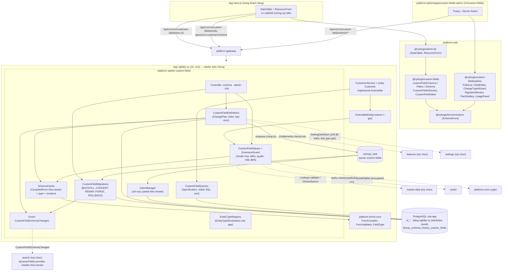
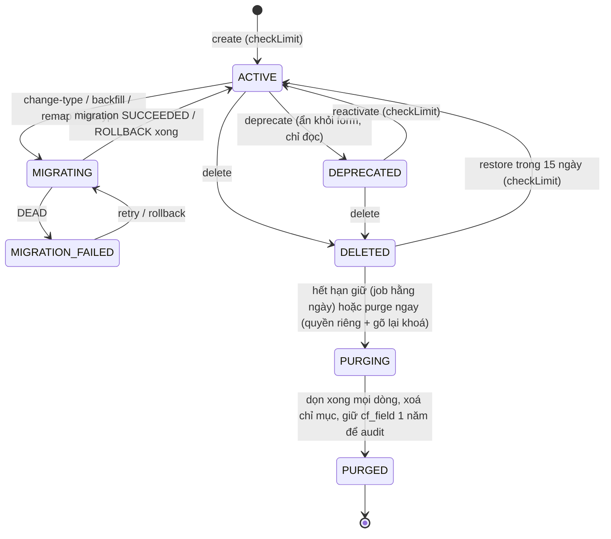
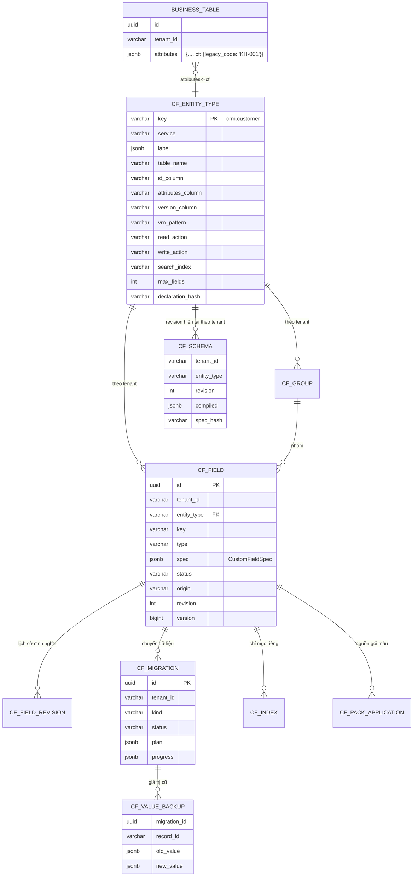

# Thiết kế module custom-fields: trường tuỳ biến theo tenant (`platform-starter-custom-fields` + `@vyforge/custom-fields` + zone `custom-fields-admin`)

> **Trạng thái:** đề xuất, chờ duyệt (27/10/2026), phiên forge-71, giai đoạn 1 (thiết kế).
> **Phạm vi:** tenant admin tự thêm trường cho một loại bản ghi mà app khai báo là mở rộng được (`Extensible`): kiểu, bắt
> buộc, danh sách chọn (tĩnh hoặc từ master-data), giá trị mặc định, quyền xem/sửa theo action IAM, đánh dấu dữ liệu cá
> nhân, hiển thị trong danh sách, lọc, sắp xếp, tìm kiếm. Giá trị nằm trong cột `attributes` JSONB đã có theo quy ước,
> được kiểm bằng JSON Schema sinh từ định nghĩa, có chỉ mục GIN và chỉ mục biểu thức khi cần. Render bằng
> `@vyforge/forms` trong `ResourceForm`/`DataTable` của admin-kit; đẩy thay đổi sang search qua event. Có vòng đời tiến
> hoá: đổi kiểu có chuyển dữ liệu, ngừng dùng, xoá có thời gian khôi phục, dọn dữ liệu cũ; giới hạn số trường theo gói.
> **Nền:** platform-java 0.12.1 (`SecretCipher`, `DurableTaskQueue`, `StarterSchemaMigrator`), platform-web 0.9.0. Theo
> `module-conventions.md` mục 1–6 và kiến trúc admin microfrontend của `platform-services.md` (D1–D10, mục 4.11–4.12, 5).
> **Đã đối chiếu với thiết kế đã merge:** forms (`platform-forms-core`, `FieldType`, `ChoiceSource`, renderer), admin-kit
> (§6.3 hợp đồng `customFieldColumns/Filters/Schema`, §5.2.1 quy ước bộ lọc, sub-template `extensible`), search (§6.3
> `dynamicFields("custom", provider)`), master-data (K21, `Lookups.validate`, `x-vyforge-lookup`), features (`Entitlements`,
> `UsageGaugeProvider` đã code), settings (`SettingDefinition` trong `platform-core`), licensing (D9, khoá module),
> privacy-dsr (`PersonalDataContributor`), jpa-extras (schema `vyforge`, `LocalizedText`), platform-services (D7, D10,
> §5.2, §6.3 export).
>
> **Quyết định lớn:**
> 1. **Tự xây**, không nhúng engine EAV hay low-code. Giá trị ở **một khoá con `cf` trong cột `attributes`** của bảng
>    nghiệp vụ (kiểu Odoo `Properties`), không thêm cột (Frappe) và không bảng EAV (mục 2.3).
> 2. **Dùng lại `platform-forms-core`** cho kiểu field, biên dịch JSON Schema và kiểm giá trị. Định nghĩa một trường tuỳ
>    biến **là** một `FieldSpec` cộng phần lưu trữ (lọc, chỉ mục, quyền, PII). Không có bộ kiểu thứ hai.
> 3. **Luôn nhúng trong app sở hữu bảng** (giống export, platform-services D10). Không có chế độ `remote`: việc kiểm khi
>    lưu, chuyển dữ liệu và dọn dữ liệu phải chạy cạnh bảng nghiệp vụ. `platform-services` cũng nhúng starter nếu có
>    entity mở rộng được.
> 4. **Hợp đồng nhẹ ở `platform-core`** (`Extensible`, `ExtensibleType`, port `ExtensionGuard` mặc định không làm gì) để
>    entity của app và của module khác khai báo được mà không phụ thuộc starter.
> 5. **Mọi thay đổi định nghĩa được phân loại trước khi áp** (`ChangePlan`: an toàn / cần kiểm dữ liệu / cần chuyển dữ
>    liệu / bị cấm). Đổi kiểu và dọn dữ liệu chạy nền theo lô, có bản sao lưu giá trị cũ 30 ngày để hoàn tác.

Mục lục:
0. [Tóm tắt quyết định](#0-tóm-tắt-quyết-định)
1. [Bài toán và phạm vi](#1-bài-toán-và-phạm-vi)
2. [Nghiên cứu](#2-nghiên-cứu)
3. [Kiến trúc](#3-kiến-trúc)
4. [Mô hình dữ liệu](#4-mô-hình-dữ-liệu)
5. [API](#5-api)
6. [Mở rộng](#6-mở-rộng)
7. [Vận hành](#7-vận-hành)
8. [Bảo mật và tuân thủ](#8-bảo-mật-và-tuân-thủ)
9. [Kế hoạch triển khai](#9-kế-hoạch-triển-khai)
10. [Đóng gói và triển khai độc lập](#10-đóng-gói-và-triển-khai-độc-lập)
11. [Lệch quy ước và quyết định](#11-lệch-quy-ước-và-quyết-định)
12. [Nguồn đã kiểm](#12-nguồn-đã-kiểm)

---

## 0. Tóm tắt quyết định

**Quyết định về module:** thêm **một** đơn vị triển khai mới, `custom-fields`, gồm starter Java, package web và admin
MFE. Không gộp vào forms: forms quản lý *form và bài nộp* (bảng `form_*` của chính nó), còn custom-fields quản lý *định
nghĩa trường gắn vào bảng của người khác* và vòng đời dữ liệu trên các bảng đó. Hai module dùng chung lõi
`platform-forms-core` (đã tách sẵn cho đúng mục đích này, forms §3.1). Thêm vào `platform-core` một package nhỏ
`com.vyforge.platform.core.extensible`. Không bỏ module nào.

| # | Quyết định | Lý do ngắn |
|---|---|---|
| C1 | Giá trị ở `attributes -> 'cf'` (object phẳng `{key: value}`), không thêm cột, không bảng EAV | Thêm trường không cần DDL, không khoá bảng, không cần quyền ALTER của app ở runtime; GIN trên `attributes->'cf'` phục vụ lọc bằng cho mọi trường. Odoo 17+ đi đúng hướng này với `fields.Properties` (jsonb). EAV làm mọi truy vấn danh sách phải pivot (mục 2.3) |
| C2 | Khoá con `cf` riêng, không trộn với khoá `attributes` của app | App và module khác đã dùng `attributes` cho khoá của họ (`applicationId`, `einvoice`…). Tách khoá thì JSON Schema của custom-fields là `additionalProperties: false` trong phạm vi `cf`, dọn dữ liệu chỉ đụng `cf`, không có xung đột tên |
| C3 | `FieldSpec` + `FieldType` của `platform-forms-core` là mô hình kiểu duy nhất; custom-fields chỉ thêm `FieldStorage` (cách lọc, sắp xếp, đánh chỉ mục, map sang search) cho từng kiểu | Một renderer, một bộ kiểm, cùng mã lỗi `forms.field.*` cho form và trường tuỳ biến (forms K11) |
| C4 | Kiểm khi lưu theo nguyên tắc **"kiểm khi chạm"**: bản ghi mới kiểm đủ; bản ghi cũ chỉ báo lỗi ở trường *bị thay đổi*, trường cũ sai luật mới chỉ thành cảnh báo | Thêm trường bắt buộc vào bảng 200.000 khách hàng không được làm hỏng mọi thao tác sửa khác (Salesforce chặn mọi lần lưu, hay bị than phiền). Tenant có thể bật chế độ `STRICT` |
| C5 | Quyền theo trường bằng action IAM (`readAction`, `writeAction`), mặc định thừa kế action của entity; trường `SENSITIVE` bắt buộc có action riêng | Giống ABP `Policy.Permissions` cho extra property, nhưng dùng `Authz.check(action, vrn)` của vyforge nên viết được policy theo điều kiện |
| C6 | Chỉ mục: một GIN `jsonb_path_ops` trên `attributes->'cf'` cho mọi bảng mở rộng được (app tạo trong migration); thêm chỉ mục biểu thức B-tree **riêng phần (partial) theo tenant** cho trường cần sắp xếp/lọc khoảng khi tenant đủ lớn, có hạn mức theo gói | `jsonb_path_ops` nhỏ hơn và nhanh hơn `jsonb_ops` cho `@>`, `@?` (tài liệu PostgreSQL 18). Cùng khoá ở hai tenant có thể khác kiểu, nên chỉ mục kiểu hoá phải riêng theo tenant |
| C7 | Đổi kiểu, điền mặc định cho bản ghi cũ, đổi mã lựa chọn, dọn trường đã xoá là **migration** chạy trên `DurableTaskQueue`, theo lô keyset, có chạy thử (dry run), có sao lưu giá trị cũ, hoàn tác được trong 30 ngày | Salesforce đổi kiểu không tương thích thì xoá dữ liệu; Frappe chỉ cho đổi trong nhóm tương thích và chặn khi dữ liệu dài quá. Vyforge làm được cả hai mà không mất dữ liệu ngầm |
| C8 | Xoá trường là xoá mềm 15 ngày rồi mới dọn dữ liệu; khoá (`key`) không dùng lại được trước khi dọn xong | Salesforce giữ trường đã xoá 15 ngày. Tránh trường mới cùng tên đọc nhầm giá trị cũ |
| C9 | Không đổi tên khoá. Nhãn (`label`, vi/en) đổi tự do | Khoá nằm trong dữ liệu, chỉ mục, index search, policy IAM, file xuất. Frappe chặn đổi tên trường hệ thống vì lý do tương tự |
| C10 | Luôn nhúng trong app sở hữu bảng (như export, D10); không có `mode: remote`. MFE gọi API của app, nhiều app thì `CUSTOM_FIELDS_BACKENDS` | Migration và kiểm khi lưu phải chạy cùng database, cùng transaction với bảng nghiệp vụ |
| C11 | Giới hạn theo gói qua `-features`: `custom-fields.fields` (tổng trường đang dùng của tenant) và `custom-fields.indexed` (số chỉ mục riêng); trần cứng theo entity type do app khai (mặc định 100, tối đa 300) | Giống Salesforce/HubSpot giới hạn theo edition. Trần cứng bảo vệ kích thước dòng và chi phí kiểm |
| C12 | Search nhận thay đổi qua event `CustomFieldSchemaChanged` có `searchImpact` (`NONE`/`FILTER`/`REINDEX`) và qua provider `dynamicFields` đã thiết kế ở search §6.3 | Đúng hợp đồng search; chỉ trường `searchable` mới cần dựng generation mới cho riêng tenant đó |

---

## 1. Bài toán và phạm vi

### 1.1 Use case

Cùng một sản phẩm (CRM, HRM, phòng khám, quản lý trường học) bán cho nhiều khách hàng. Mỗi khách cần thêm vài trường
riêng vào màn hình chuẩn mà không ai phải sửa code, thêm cột hay deploy lại. Gap analysis §2.9 đặt module ở P1, phụ thuộc
`forms`, `-jpa`, search (tuỳ chọn). Admin-kit (K12) đã giữ chỗ: "Khách A thêm trường *Mã khách hàng cũ*: cột hiện trong
bảng, lọc được nếu đánh dấu lọc được, form có ô mới, không deploy lại".

Hiện tại các module tự kiểm `attributes` bằng JSON Schema khai báo trong code (`AttributeDefinition` của billing,
`ApplicationAttributeSchema` của api-access, `AttributesSchema` của ekyc, collaboration). Đó là **khoá do lập trình viên
khai**. custom-fields bổ sung **khoá do tenant admin khai lúc chạy**, có giao diện quản trị, quyền, vòng đời.

Tương lai: `automation` dùng trường tuỳ biến trong điều kiện "khi X thì Y"; `analytics` dùng làm chiều phân tích;
`contacts` (P2), `helpdesk`, `booking` khai entity của họ là `Extensible`; `workflow` dùng trường tuỳ biến của đề nghị
trong điều kiện rẽ nhánh.

### 1.2 Trong phạm vi

| Nhóm | Nội dung |
|---|---|
| Khai báo loại bản ghi | App/module đánh dấu entity là `Extensible` và khai `EntityTypeDeclaration`: khoá (`crm.customer`), nhãn, bảng, cột, mẫu VRN, action đọc/ghi, index search, trần số trường |
| Định nghĩa trường | Khoá, nhãn vi/en, mô tả, kiểu (bộ con của 25 kiểu forms + kiểu cắm thêm), tuỳ chọn của kiểu, bắt buộc, bắt buộc theo điều kiện, hiện theo điều kiện, mặc định, danh sách chọn tĩnh hoặc từ master-data, nhóm (section), thứ tự, quyền xem/sửa, mức dữ liệu cá nhân, mã hoá giá trị, hiển thị trong danh sách, lọc, sắp xếp, tìm kiếm, facet |
| Giá trị | Chuẩn hoá và kiểm khi lưu (JPA listener tự động hoặc gọi API), lọc theo quyền khi đọc, giá trị hiển thị theo locale, mặc định khi tạo |
| Truy vấn | Bộ lọc theo quy ước admin-kit (`cf.<key>`, `cf.<key>From/To`, `cf.<key>Present`), sắp xếp, `Specification` JPA và mảnh SQL cho jOOQ/JDBC |
| Chỉ mục | GIN chung; chỉ mục biểu thức riêng theo tenant tạo/xoá bằng job `CONCURRENTLY` |
| Tiến hoá | Phân loại thay đổi, chạy thử, migration nền (đổi kiểu, điền mặc định, đổi mã lựa chọn, dọn dữ liệu), hoàn tác, ngừng dùng, xoá mềm, khôi phục |
| Gói mẫu | Bộ trường dựng sẵn theo ngành (phòng khám, trường học, bất động sản), xuất/nhập định nghĩa giữa tenant và giữa môi trường (giống fixtures của Frappe) |
| Tích hợp | Search (dynamic fields + event), export/import (cột động), privacy (PII, xoá, kho dữ liệu cá nhân), IAM (thuộc tính policy), features (hạn mức), audit |
| Giao diện | `@vyforge/custom-fields` (cột, bộ lọc, khối form, ô hiển thị), `/admin` (danh sách trường, trình sửa, wizard đổi kiểu, theo dõi migration, gói mẫu), zone `custom-fields-admin` |

### 1.3 Kịch bản nghiệp vụ phải đáp ứng

| # | Kịch bản | Điểm khó | Đáp ứng bằng |
|---|---|---|---|
| K1 | **CRM bán cho 20 khách:** khách A thêm "Mã khách hàng cũ" (text, duy nhất trong tenant, lọc được); khách B thêm "Nguồn giới thiệu" (chọn từ danh mục) | Không fork code, không thêm cột; mỗi tenant thấy trường của mình | `cf_field` theo tenant; `unique: true` kiểm bằng truy vấn GIN `@>` trong transaction (mục 3.5); `select` có `source: master-data:crm.lead-source` |
| K2 | **Danh sách chọn từ master-data** (VN): "Ngân hàng nhận lương" chọn từ danh mục `bank`; "Tỉnh/thành" theo ĐVHC 2 cấp sau sắp xếp 2025 | Danh mục có hiệu lực, mã hết hiệu lực vẫn phải hiển thị được ở bản ghi cũ | `ChoiceSource` master-data; kiểm bằng `Lookups.validate(list, code, asOf)`; `EXPIRED` chỉ là cảnh báo với bản ghi cũ (C4), lỗi với bản ghi mới; kiểu `vn-address` |
| K3 | **Phòng khám:** thêm "Nhóm máu", "Tiền sử dị ứng" vào hồ sơ bệnh nhân | Dữ liệu sức khoẻ là **dữ liệu cá nhân nhạy cảm** (Luật 91/2025/QH15); chỉ bác sĩ xem | `personalData: SENSITIVE` buộc `readAction` riêng (`clinic:patient:GetMedical`), mã hoá giá trị (`encrypted: true`), không cho `listVisible`/`searchable` mặc định, audit mỗi lần đọc |
| K4 | **HRM:** "Số sổ BHXH" (kiểu cắm thêm `bhxh-code`), "Số CCCD" (`cccd`), "Mã số thuế cá nhân" | Kiểm checksum đặc thù VN; MST cá nhân chuyển sang số định danh 12 số từ 01/07/2025 (forms §6.1) | Kiểu `cccd`, `tax-code-vn` (`holder: PERSON`) của forms; `bhxh-code` qua `FieldType` SPI (forms §6.6) + `FieldStorage` mặc định cho chuỗi |
| K5 | **Thêm trường bắt buộc vào bảng đang có 200.000 khách hàng** | Bản ghi cũ chưa có giá trị; người sửa số điện thoại không được bị chặn vì trường mới | C4 "kiểm khi chạm"; tuỳ chọn điền mặc định cho bản ghi cũ (migration `BACKFILL`) |
| K6 | **Đổi kiểu:** "Số năm kinh nghiệm" tạo nhầm là text, cần đổi sang integer để lọc khoảng | Có giá trị không chuyển được ("5 năm", "hơn 3") | `ChangePlan` chạy thử: đếm chuyển được/không chuyển được + mẫu; chọn xử lý giá trị hỏng (bỏ trống và sao lưu, hoặc chặn); migration nền; hoàn tác trong 30 ngày |
| K7 | **Xoá nhầm trường** "Hạn hợp đồng" có dữ liệu của 3.000 bản ghi | Phải khôi phục được | Xoá mềm 15 ngày (`DELETED`), dữ liệu còn nguyên; `restore`; sau hạn mới dọn và sao lưu |
| K8 | **Gói Basic tối đa 10 trường, Pro 50 trường, Enterprise 200**; nâng gói thì dùng tiếp | Đếm đúng trường đang dùng, không đếm trường đã xoá xong | `Entitlements.checkLimit("custom-fields.fields", n)` khi tạo/khôi phục; `UsageGaugeProvider` đếm trường `ACTIVE` + `DEPRECATED` + `DELETED` chưa dọn |
| K9 | **Tìm kiếm và facet:** sale tìm khách theo "Mã khách hàng cũ", lọc theo "Nguồn giới thiệu" trong ô tìm kiếm chung | Trường của từng tenant khác nhau trong cùng index | search `dynamicFields("custom", provider)`; field dưới tiền tố `custom.`; event `CustomFieldSchemaChanged` với `searchImpact` |
| K10 | **Quyền theo trường:** "Hạn mức tín dụng" chỉ kế toán trưởng sửa, sale chỉ xem | Một form, hai mức quyền | `writeAction: crm:customer:UpdateCredit`; renderer nhận `readonly` theo quyền; server từ chối 403 nếu đổi trường không có quyền |
| K11 | **Trường học:** cùng phần mềm cho trường mầm non và THPT; mầm non cần "Người đưa đón", THPT cần "Khối thi" | Bộ trường theo loại khách hàng | Gói mẫu (`FieldPack`) "Mầm non", "THPT" áp một lần; tenant sửa tiếp |
| K12 | **Nhập Excel 50.000 khách hàng** có cột trường tuỳ biến; xuất báo cáo có cột tuỳ biến | Ánh xạ cột theo nhãn tiếng Việt; lỗi theo dòng | Export/import gọi `CustomFieldValues.validate` theo lô, cột động từ `columns(entityType, locale)` (mục 6.6) |
| K13 | **Chuyển định nghĩa từ môi trường thử sang chính thức** (tenant UAT → tenant prod của cùng khách) | Không gõ lại 40 trường | Xuất/nhập định nghĩa JSON có version; nhập là "kế hoạch" có diff trước khi áp |
| K14 | **Chi nhánh chỉ thấy khách của vùng mình** theo trường tuỳ biến "Vùng" | Policy IAM theo thuộc tính tuỳ biến | Trường có `policyAttribute: true` được `ResourceAttributesResolver` đưa vào `resource.custom.region` (mục 8.1) |
| K15 | **Xoá dữ liệu theo yêu cầu chủ thể** (DSR): khách đòi xoá dữ liệu cá nhân | Trường tuỳ biến cũng chứa PII mà code app không biết | `CustomFieldValues.erasePersonalData` dùng trong `PersonalDataContributor` của app; kho dữ liệu cá nhân (RoPA) nhận danh sách trường PII theo tenant |
| K16 | **Bất động sản:** "Hướng nhà" (chọn), "Diện tích (m²)" (number, sắp xếp), "Giá (VND)" (`money-vnd`, lọc khoảng); tenant có 2 triệu tin | Sắp xếp và lọc khoảng nhanh trên bảng lớn | Chỉ mục biểu thức partial theo tenant (C6), có hạn mức `custom-fields.indexed`; khuyến nghị dùng search cho facet nhiều chiều |

### 1.4 Ngoài phạm vi

| Không làm | Ai lo / để khi nào |
|---|---|
| Tenant tạo **loại bản ghi mới** (custom object, bảng mới) | Không làm (low-code, đúng thứ brief admin-kit bảo không làm). Nếu cần, cms-content (content type) |
| Ghi đè nhãn, ẩn, thứ tự **trường gốc** của app theo tenant (Property Setter của Frappe) | Settings (admin-kit §6.3 đã để bản sau) |
| Trường **tính toán** (công thức, kiểu HubSpot `calculation_equation`), trường tổng hợp (roll-up) | Bản sau (mục 9.3); cần ngôn ngữ biểu thức an toàn, chung với `automation` |
| Trường quan hệ tới bản ghi bất kỳ của app (many2one tuỳ ý) | Chỉ tham chiếu qua `ChoiceSource` có sẵn (người dùng IAM, đơn vị tổ chức, danh mục). Quan hệ tuỳ ý để bản sau |
| Lịch sử từng giá trị (field history tracking của Salesforce) | `AuditChanges` của app đã ghi diff `attributes`; collaboration activity hiện được. Không có bảng riêng |
| Kiểu `file`, `signature` trong trường tuỳ biến bản đầu | `file` cần files gắn vào bản ghi của app (`Attachments`): bản 0.14 (mục 9.3) |

---

## 2. Nghiên cứu

Version và license kiểm ngày 27/10/2026: GitHub Releases API (`gh api repos/<repo>/releases/latest`, `.../license`),
Maven Central `maven-metadata.xml`, npm registry. Mô tả hành vi lấy từ tài liệu chính thức hoặc mã nguồn (link kèm).
Chỗ chỉ có nguồn thứ cấp được ghi **(nguồn thứ cấp)**.

### 2.1 Hệ thống tham khảo

| Hệ thống | Version, license | Mô hình dữ liệu | API, UI | Điểm mạnh | Điểm yếu |
|---|---|---|---|---|---|
| **ABP Framework**: Module Entity Extensions ([docs](https://abp.io/docs/latest/framework/architecture/modularity/extending/module-entity-extensions)) | 10.7.0 (06/10/2026), LGPL-3.0 | Mặc định lưu ở cột JSON `ExtraProperties` của bảng. `MapEfCoreProperty` đưa một thuộc tính ra **cột riêng** (cần migration); nếu cột rỗng thì lùi về `ExtraProperties` rồi chuyển sang cột khi lưu | Khai bằng code (`ObjectExtensionManager.AddOrUpdateProperty<T>`), không phải lúc chạy. `UI.OnTable`, `UI.OnCreateForm`, `UI.OnEditForm`, `UI.Order`; `Api.OnCreate/OnUpdate/OnGet.IsAvailable`; `Attributes` (Required, StringLength) và `Validators` tự viết; enum thành combobox; `UI.Lookup.Url` cho chọn từ API; `Policy.Permissions`, `Policy.Features` theo thuộc tính | Một nơi khai báo áp cho UI, API và kiểm; quyền và feature theo từng thuộc tính; cột JSON không cần migration | Không do tenant tự định nghĩa (dynamic definition chỉ có ở bản thương mại); lookup lưu thêm `<Name>_Text` và **không đồng bộ** khi tên nguồn đổi; ẩn khỏi form không chặn API (phải tắt cả hai) |
| **Frappe Framework**: Custom Field, Customize Form ([custom_field.py](https://github.com/frappe/frappe/blob/version-16/frappe/custom/doctype/custom_field/custom_field.py), [customize_form.py](https://github.com/frappe/frappe/blob/version-16/frappe/custom/doctype/customize_form/customize_form.py)) | v16.53.0 (22/10/2026), MIT | Mỗi Custom Field là một bản ghi (DocType `Custom Field`, tên `<DocType>-<fieldname>`), `fieldname` sinh từ nhãn với tiền tố `custom_`; `on_update` gọi `frappe.db.updatedb(doctype)` để **đồng bộ cột thật** của bảng | Thuộc tính: `insert_after`, `fieldtype`, `options`, `reqd`, `in_list_view`, `in_standard_filter`, `permlevel`, `depends_on`… App cài trường bằng `create_custom_fields` (gộp, chỉ `updatedb` một lần mỗi DocType). Đổi kiểu chỉ trong nhóm `ALLOWED_FIELDTYPE_CHANGE` (vd. `Currency/Float/Percent`, `Data/Select`, `Text/Small Text/Long Text`); thu hẹp độ dài thì quét dữ liệu, có dòng dài quá thì chặn và liệt kê bản ghi. Không đổi tên trường `is_system_generated` | Cột thật nên lọc/sắp xếp/báo cáo như trường gốc; danh sách nhóm đổi kiểu tương thích rõ ràng; chặn mất dữ liệu khi thu hẹp | ALTER TABLE lúc chạy (khoá bảng, cần quyền DDL, mỗi site một schema nên mới làm được); không hợp bảng chung nhiều tenant của vyforge. Xoá trường không thấy dọn cột trong `on_trash` |
| **Odoo**: `fields.Properties` ([fields_properties.py, nhánh 19.0](https://github.com/odoo/odoo/blob/19.0/odoo/orm/fields_properties.py)); Studio (EE) | 19 (09/2025), LGPL-3.0 (Community) | Bản ghi con lưu **chỉ giá trị** trong cột `jsonb` (`_column_type = ('jsonb', 'jsonb')`); **định nghĩa nằm ở bản ghi cha** (`PropertiesDefinition`, cũng jsonb): vd. thuộc tính của lead do đội bán hàng (`crm.team`) định nghĩa, thuộc tính của task do project định nghĩa. Kiểu: `boolean, integer, float, char, text, html, date, datetime, monetary, selection, tags, many2one, many2many, separator` | Định nghĩa sửa ngay trên form; mục bị xoá được đánh dấu `definition_deleted` rồi lọc khỏi định nghĩa; khi đọc **bỏ qua giá trị không còn định nghĩa**, lựa chọn không còn trong danh sách đọc ra `False`. Studio (EE) thêm trường thật `x_` | Một cột jsonb, thêm thuộc tính không đổi schema; định nghĩa theo "cha" (đội, dự án) chứ không chỉ theo công ty | Giá trị mồ côi vẫn nằm trong DB (không thấy code dọn); không có quyền theo thuộc tính; không ghi nhiều bản ghi khác định nghĩa trong một lần |
| **Salesforce**: custom fields | SaaS | Trường thật của object (`__c`), hạn mức theo edition: Enterprise 500, Unlimited 800 trường mỗi object **(nguồn thứ cấp: [Certinia help](https://help.certinia.com/main/2021.1/Subsystems/ACC/Content/Setup/SystemAdmin/aSetupBudgetsPage.htm))** | Field-level security theo profile/permission set; trường xoá nằm trong danh sách **15 ngày**, khôi phục được, sau đó xoá vĩnh viễn ([Salesforce Developers](https://developer.salesforce.com/docs/platform/pkg1-dev/guide/unused-package-components.html)). Đổi sang kiểu không tương thích thì **dữ liệu bị đặt null** ([Change Data Capture docs](https://developer.salesforce.com/docs/atlas.en-us.244.0.change_data_capture.meta/change_data_capture/cdc_field_conversion_single_event.htm)); khôi phục trường thì mất cờ required/unique **(nguồn thứ cấp: [SalesforceBen](https://www.salesforceben.com/how-to-restore-deleted-salesforce-fields/))** | Chuẩn ngành về vòng đời trường (xoá mềm, hạn mức, FLS) | Đổi kiểu mất dữ liệu ngầm (chỉ cảnh báo); không có chạy thử |
| **HubSpot**: Properties API v3 ([guide](https://developers.hubspot.com/docs/api-reference/crm-properties-v3/guide), [limits](https://developers.hubspot.com/docs/api-reference/crm-limits-tracking-v3/guide)) | SaaS | Tách **`type`** (kiểu dữ liệu: `bool, enumeration, date, datetime, string, number`) và **`fieldType`** (cách hiển thị: `select, radio, checkbox, text, textarea, phonenumber, calculation_equation`…); mỗi `type` chỉ nhận một số `fieldType`; `groupName` bắt buộc | `hasUniqueValue` (tối đa 10 trường duy nhất mỗi object, dùng làm `idProperty`); `dataSensitivity=sensitive` để đọc trường nhạy cảm (Enterprise, beta); hạn mức trường tuỳ biến theo gói, xem qua `GET /crm/v3/limits/custom-properties` (`byObjectType`) | Tách kiểu dữ liệu và widget; trường duy nhất làm khoá ngoài cho tích hợp; API giới hạn rõ ràng | `enumeration` lưu chuỗi ngăn bằng `;`; công thức chỉ sửa qua API |
| **PostgreSQL 18**: jsonb và GIN ([docs 18](https://www.postgresql.org/docs/current/datatype-json.html)) | 18.6, PostgreSQL License | `jsonb_ops` (mặc định) hỗ trợ `? ?| ?& @> @? @@`; `jsonb_path_ops` chỉ `@> @? @@` nhưng **thường nhỏ hơn nhiều và nhanh hơn**; không có mục cho cấu trúc rỗng (`{"a": {}}`). Chỉ mục GIN trên biểu thức con (`(jdoc -> 'tags')`) nhỏ và nhanh hơn chỉ mục cả cột | — | Lọc bằng mọi khoá bằng một chỉ mục | GIN không phục vụ sắp xếp, lọc khoảng: cần B-tree biểu thức |

Thư viện dùng lại (đã có trong forms): `com.networknt:json-schema-validator` **3.0.8** (Apache-2.0, Maven Central
02/10/2026; GitHub Releases mới nhất ghi `2.0.8` vì repo phát hành 3.x chỉ qua Maven), `@rjsf/core` **6.11.0**
(Apache-2.0, npm).

### 2.2 Học theo và không làm

| Học theo | Từ | Ở vyforge |
|---|---|---|
| Lưu giá trị trong một cột jsonb, định nghĩa ở chỗ khác | Odoo `Properties`, ABP `ExtraProperties` | `attributes -> 'cf'` + bảng `cf_field` |
| Một khai báo điều khiển UI (bảng, form tạo/sửa) **và** API **và** kiểm | ABP | `listVisible`, `formVisible`, `readAction`/`writeAction` áp ở cả REST lẫn renderer |
| Quyền và feature theo từng trường | ABP `Policy.Permissions/Features` | `readAction`/`writeAction`; trường có `requiresEntitlement` (vd. chỉ gói Pro thấy) |
| Nhóm đổi kiểu tương thích; quét dữ liệu trước khi thu hẹp | Frappe `ALLOWED_FIELDTYPE_CHANGE`, `validate_fieldtype_length` | `TypeConversionMatrix` + `ChangePlan` chạy thử có mẫu bản ghi lỗi |
| Tiền tố/khu riêng cho trường tuỳ biến, tránh đụng tên | Frappe `custom_`, Odoo Studio `x_` | Khoá con `cf` (C2) |
| Cài trường bằng code theo lô cho app | Frappe `create_custom_fields` | `FieldPack` (gói mẫu) áp theo tenant, có diff |
| Xoá mềm 15 ngày, hạn mức theo gói, trường duy nhất | Salesforce, HubSpot | C8, C11, `unique` (tối đa 5 trường duy nhất mỗi entity type) |
| Tách kiểu dữ liệu và widget | HubSpot `type`/`fieldType` | `FieldType` (kiểu) + `uiSchema`/`widget` (forms) |
| `jsonb_path_ops` trên biểu thức con | PostgreSQL docs | C6 |

| Không làm | Lý do |
|---|---|
| ALTER TABLE lúc chạy (Frappe, Salesforce, Odoo Studio) | Bảng chung nhiều tenant: một tenant thêm trường làm khoá bảng của mọi tenant; app không có quyền DDL ở runtime (nguyên tắc tối thiểu quyền) |
| Bảng EAV (`entity_id, field_id, value`) | Mỗi trang danh sách phải pivot hoặc join N lần; kiểu giá trị mất; dữ liệu nằm xa bản ghi nên export, xoá, sao lưu phải nhớ bảng thứ hai |
| Định nghĩa theo bản ghi cha tuỳ ý (Odoo) | Bản đầu chỉ theo tenant + entity type. Odoo cho định nghĩa theo đội/dự án; vyforge để bản sau qua `scope` (mục 9.3) nếu có nhu cầu thật |
| Đổi kiểu làm mất dữ liệu ngầm (Salesforce) | Luôn chạy thử và sao lưu |
| Lưu thêm bản sao nhãn của lookup (`<Name>_Text` của ABP) | Không đồng bộ được khi nguồn đổi. vyforge chỉ lưu mã, nhãn lấy lúc đọc qua `ChoiceSource.resolve` (master-data có snapshot rẻ) |
| Giá trị mồ côi nằm mãi trong DB (Odoo) | Migration `PURGE` dọn sau 15 ngày |
| Lưu nhiều lựa chọn thành chuỗi ngăn `;` (HubSpot) | Mảng JSON, lọc bằng `@>` |

### 2.3 Lưu ở đâu: jsonb, cột thật hay EAV

| Tiêu chí | Cột thật (Frappe) | EAV | **jsonb `attributes->'cf'` (chọn)** |
|---|---|---|---|
| Thêm trường | DDL, khoá bảng | Một dòng | Một dòng `cf_field` |
| Bảng chung nhiều tenant | Cột của tenant A xuất hiện ở mọi tenant | Được | Được |
| Lọc bằng | B-tree | Join + chỉ mục | GIN `@>` một chỉ mục cho mọi khoá |
| Sắp xếp, lọc khoảng | Tốt | Kém | B-tree biểu thức partial theo tenant khi cần (C6) |
| Đọc một bản ghi kèm trường | Một dòng | N dòng | Một dòng |
| Kiểu dữ liệu | DB đảm bảo | Mất (thường là text) | JSON Schema ở app + hàm ép kiểu trong SQL |
| Xoá/xuất theo chủ thể dữ liệu | Theo cột | Bảng thứ hai | Cùng dòng |

Rủi ro của jsonb và cách giảm: dòng to làm TOAST (giá trị trên khoảng 2 KB bị nén/tách ra bảng phụ) → giới hạn `cf` ≤
32 KB và độ dài từng giá trị (mục 7.5); thống kê planner kém cho biểu thức jsonb → chỉ mục biểu thức có thống kê riêng;
cập nhật một khoá viết lại cả dòng (MVCC) → không khác cột thật về bản chất.

---

## 3. Kiến trúc

### 3.1 Thành phần và artifact

| Artifact | Nội dung | Phụ thuộc |
|---|---|---|
| `platform-core` (mở rộng, package `com.vyforge.platform.core.extensible`) | `Extensible`, `@ExtensibleType`, `ExtensionGuard` (port, mặc định `NOOP`), `ExtensionViolationException`, `CustomFieldsKeys` (hằng `cf`) | Không thêm |
| `platform-starter-jpa` (mở rộng nhỏ) | `ExtensibleEntityListener` (`@PrePersist/@PreUpdate` gọi `ExtensionGuard`), converter `Map<String,Object> ↔ jsonb` đã có | `platform-core` |
| `platform-starter-custom-fields` (mới) | Bảng `cf_*`, `CustomFieldDefinitions`, `CustomFieldValues`, `CustomFieldQueries`, `CustomFieldMigrations`, cài `ExtensionGuard`, `IndexManager`, task handler, REST, event, auto-config, tích hợp tuỳ chọn | `platform-forms-core`, `-jpa`, `-web`, `-security`, `-authz`, `-audit`, `-privacy`, `-scheduling`; tuỳ chọn: master-data, features, search, settings, export, organization |
| `@vyforge/custom-fields` (platform-web) | Server client, hàm ghép cột/bộ lọc/schema cho admin-kit, `CustomFieldsSection`, `CustomFieldValue`, `/admin` | `@vyforge/forms/renderer`, `@vyforge/admin-kit`, `@vyforge/ui`, `@vyforge/api-client`, `@vyforge/i18n`; tuỳ chọn `@vyforge/master-data` |
| Zone `platform-admin/apps/custom-fields-admin` | `/m/custom-fields`, ghép từ `@vyforge/custom-fields/admin` | `@vyforge/admin-shell` |

### 3.2 Sơ đồ thành phần



Package Java (`com.vyforge.platform.customfields`):

| Package | Nội dung |
|---|---|
| `…customfields` (API công khai) | `CustomFieldDefinitions`, `CustomFieldValues`, `CustomFieldQueries`, `CustomFieldMigrations`, `EntityTypes`, record view/command, `CustomFieldsErrors`, event |
| `…customfields.spi` | `EntityTypeDeclaration`, `FieldStorage`, `ValueConverter`, `CustomFieldInterceptor`, `ExtensibleDataAccess`, `FieldPackProvider`, `ConditionAttributeSource` |
| `…customfields.internal` | entity, repository, `ChangePlanner`, `DefinitionLinter`, `SchemaCache`, task handler, `IndexManager`, `JdbcExtensibleDataAccess` |
| `…customfields.web` | controller schema/admin/info, DTO |
| `…customfields.integration.*` | `search`, `masterdata`, `features`, `privacy`, `export`, `authz` (thuộc tính policy), `settings`; mỗi package `@ConditionalOnClass` + `@ConditionalOnBean` |

### 3.3 Khai báo entity mở rộng được

App làm hai việc: entity implement `Extensible`, và khai `EntityTypeDeclaration`.

```java
@Entity
@Table(name = "crm_customer")
@ExtensibleType("crm.customer")
class Customer extends TenantEntity implements Extensible {
    @JdbcTypeCode(SqlTypes.JSON)
    @Column(name = "attributes", nullable = false)
    private Map<String, Object> attributes = new LinkedHashMap<>();

    @Override public Map<String, Object> getAttributes() { return attributes; }
    @Override public void setAttributes(Map<String, Object> value) { this.attributes = value; }
}

@Bean
EntityTypeDeclaration customerType() {
    return EntityTypeDeclaration.of("crm.customer", Customer.class)
            .label("Khách hàng", "Customer")
            .table("crm_customer")                         // id, tenant_id, attributes, version: mặc định theo quy ước
            .vrn(c -> "vrn:crm:customer/" + c.getId())
            .actions("crm:customer:Get", "crm:customer:Update")
            .searchIndex("crm.customers")                   // tuỳ chọn: index của search có dynamicFields("custom")
            .maxFields(100)                                 // trần cứng của app, ≤ 300
            .conditionAttributes("segment", "branchId")     // trường gốc mà visibleWhen/requiredWhen được tham chiếu
            .build();
}
```

Migration của app cho bảng mở rộng được (sub-template `resource` của admin-kit sinh sẵn khi `type: extensible`):

```sql
alter table crm_customer add column if not exists attributes jsonb not null default '{}'
    check (jsonb_typeof(attributes) = 'object');
create index if not exists ix_crm_customer_cf on crm_customer using gin ((attributes -> 'cf') jsonb_path_ops);
```

`EntityTypeRegistry` lúc khởi động kiểm: bảng và cột tồn tại, có chỉ mục GIN trên `attributes->'cf'` (thiếu thì cảnh báo
và health `DEGRADED`, không chặn khởi động), action có trong `ActionCatalog`. Khai báo được ghi vào `cf_entity_type` để
admin MFE và job đọc được kể cả khi chạy ở replica khác.

### 3.4 Định nghĩa trường và biên dịch

Một trường là `CustomFieldSpec` = `FieldSpec` của forms + phần lưu trữ:

```json
{
  "key": "legacy_code",
  "type": "text",
  "label": { "vi": "Mã khách hàng cũ", "en": "Legacy customer code" },
  "description": { "vi": "Mã trong phần mềm cũ, dùng khi đối chiếu" },
  "required": false,
  "options": { "maxLength": 30, "pattern": "^[A-Z0-9-]+$" },
  "default": null,
  "group": "migration",
  "order": 10,
  "storage": {
    "unique": true, "listVisible": true, "formVisible": true,
    "filterable": true, "sortable": true, "searchable": "A", "facetable": false,
    "indexed": false, "encrypted": false
  },
  "access": { "readAction": null, "writeAction": null, "policyAttribute": false },
  "personalData": null
}
```

Ví dụ danh sách chọn từ master-data (K1, K2) và trường nhạy cảm (K3):

```json
{ "key": "lead_source", "type": "select",
  "label": { "vi": "Nguồn giới thiệu", "en": "Lead source" },
  "options": { "source": { "kind": "master-data", "list": "crm.lead-source", "asOf": "now" } },
  "storage": { "listVisible": true, "filterable": true, "facetable": true } }

{ "key": "blood_type", "type": "select",
  "label": { "vi": "Nhóm máu", "en": "Blood type" },
  "options": { "choices": [ { "value": "A+" }, { "value": "A-" }, { "value": "B+" }, { "value": "B-" },
                            { "value": "AB+" }, { "value": "AB-" }, { "value": "O+" }, { "value": "O-" } ] },
  "storage": { "encrypted": true },
  "access": { "readAction": "clinic:patient:GetMedical", "writeAction": "clinic:patient:UpdateMedical" },
  "personalData": { "level": "SENSITIVE", "dataType": "health.blood_type" } }
```

**Biên dịch.** Mỗi lần định nghĩa đổi, `SchemaCompiler` dựng một `FormSpec` ảo (mỗi nhóm là một section) từ các trường
`ACTIVE` + `DEPRECATED` của (tenant, entity type), gọi `FormCompiler.compile` của forms, rồi bọc kết quả:

```
EntitySchema (cf_schema.compiled, theo revision)
├─ dataSchema: { type: object, additionalProperties: false, properties: { legacy_code: {...}, ... },
│                allOf: [ if/then cho requiredWhen ] }          ← kiểm khoá con `cf`
├─ uiSchema, messages (vi/en)                                   ← renderer SchemaForm
├─ fieldIndex: key → FieldInfo (forms) + StorageInfo (filter ops, sort expr, search mapping, quyền, PII)
├─ revision, specHash, compilerVersion
```

Trường `DEPRECATED` có trong `dataSchema` (giá trị cũ còn hợp lệ) nhưng `ui:widget: hidden` và `readOnly: true`; ghi
giá trị mới vào trường `DEPRECATED` bị từ chối. Trường `DELETED` không có trong schema; giá trị của nó trong dữ liệu bị
**bỏ qua khi đọc** và **giữ nguyên khi ghi** (không xoá, để khôi phục được) cho tới khi `PURGE`.

`SchemaCache`: Caffeine theo `(tenant, entityType)`, TTL 5 phút, xoá khi nhận `vyforge:customfields:changed`
`{tenant, entityType, revision}` qua Valkey (giống `vyforge:features:changed`) và khi revision trong bản ghi
`cf_schema` mới hơn (kiểm rẻ bằng `select revision` mỗi 30 giây nếu không có Valkey).

### 3.5 Luồng chính: lưu bản ghi có trường tuỳ biến

```mermaid
sequenceDiagram
    autonumber
    participant U as Trình duyệt (ResourceForm)
    participant B as BFF / Server Action
    participant C as CustomerController (app)
    participant S as CustomerService
    participant H as Hibernate flush
    participant L as ExtensibleEntityListener
    participant V as CustomFieldValues (ExtensionGuard)
    participant K as SchemaCache
    participant A as Authz
    participant DB as PostgreSQL (tx nghiệp vụ)

    U->>B: submit {name, phone, attributes: {cf: {legacy_code: "kh-001", lead_source: "fb"}}}
    B->>C: PUT /api/v1/crm/customers/42 (If-Match: version)
    C->>S: update(42, dto)
    S->>DB: select … for update (theo @Version)
    S->>S: customer.setAttributes(merge(cũ, dto.attributes))
    S->>H: commit → flush
    H->>L: @PreUpdate(customer)
    L->>V: beforeSave("crm.customer", oldCf, newCf, ctx{vrn, principal, isNew=false})
    V->>K: schema(tenant, "crm.customer")
    K-->>V: EntitySchema rev 7
    V->>V: diff old/new → khoá đổi: legacy_code, lead_source
    V->>A: check(writeAction của từng khoá đổi, vrn:crm:customer/42)
    V->>V: normalize (FieldType.normalize: "kh-001" → "KH-001"), mã hoá trường encrypted
    V->>V: FormValidator.validate(dataSchema, newCf) + FieldType.validate + Lookups.validate("crm.lead-source","fb")
    V->>DB: unique: select 1 … where tenant_id=? and id<>42 and attributes->'cf' @> '{"legacy_code":"KH-001"}'
    V->>V: lỗi ở khoá đổi → ném; lỗi ở khoá không đổi → cảnh báo (C4)
    V-->>L: newCf đã chuẩn hoá (+ _warnings vào RequestContext)
    L-->>H: tiếp tục flush
    H->>DB: update crm_customer set attributes=…, version=version+1
    DB-->>S: ok
    S-->>C: CustomerView (CustomFieldValues.read lọc theo readAction)
    C-->>B: 200 + header Vyforge-Warnings (nếu có)
```

**Luồng lỗi:**

| Tình huống | Kết quả |
|---|---|
| Giá trị sai kiểu/ràng buộc ở khoá đổi | `400 custom_fields.invalid`, `errors[]` với `field` là JSON pointer `/attributes/cf/legacy_code` và `code` của forms (`forms.field.pattern`…). Server Action của `@vyforge/forms` đẩy vào `extraErrors` |
| Đổi khoá không có `writeAction` | `403 custom_fields.field_forbidden` `{field}`; không lộ giá trị hiện tại |
| Ghi khoá lạ (không có trong schema, không phải `DELETED`) | `400 custom_fields.unknown_field` (chế độ `STRICT`) hoặc bị bỏ đi + cảnh báo (`LENIENT`, mặc định cho API nhập) |
| Ghi vào trường `DEPRECATED` hoặc `MIGRATING` | `409 custom_fields.field_readonly` / `custom_fields.field_migrating` |
| Trùng giá trị `unique` | `409 custom_fields.duplicate_value` `{field}`. Hai transaction ghi cùng lúc: kiểm trong transaction không đủ; với trường `unique` starter tạo **chỉ mục unique biểu thức partial theo tenant** (mục 4.3) nên DB chặn lần thứ hai, lỗi `23505` được map sang cùng mã |
| master-data không trả lời (remote) | Theo `vyforge.custom-fields.lookup-failure`: `REJECT` (mặc định với bản ghi mới) hoặc `ACCEPT_UNVERIFIED` (ghi `cf_pending_verification`, job kiểm lại) |
| Schema chưa nạp được (DB lỗi) | Ném lỗi, transaction rollback; không bao giờ lưu khi chưa kiểm |
| Dòng vượt 32 KB phần `cf` | `400 custom_fields.too_large` |

App không dùng JPA (jOOQ, JDBC) gọi thẳng `CustomFieldValues.apply(entityType, old, incoming, ctx)` trước khi ghi.
Đọc ra API: `CustomFieldValues.read(entityType, ref, attributes, opts)` trả `cf` đã bỏ khoá không có quyền đọc, đã giải mã
trường `encrypted` nếu có quyền, kèm `display` theo locale khi `opts.withDisplay` (nhãn lựa chọn, tên tỉnh, `1.234.567 ₫`).
Jackson module `CustomFieldsJacksonModule` làm việc này tự động cho DTO có `@ExtensibleView("crm.customer")`.

### 3.6 Thay đổi định nghĩa: `ChangePlan`

Mọi lệnh sửa định nghĩa đi qua `ChangePlanner`, trả kế hoạch trước khi áp (`POST …/fields/{key}/plan`).

| Loại | Ví dụ | Cách áp |
|---|---|---|
| `SAFE` | Đổi nhãn, mô tả, nhóm, thứ tự; thêm lựa chọn; nới ràng buộc (`maxLength` 30 → 50); bỏ `required`; bật `listVisible`; đổi `readAction` | Áp ngay, revision +1 |
| `VALIDATING` | Thêm `required`; thu hẹp ràng buộc; bỏ lựa chọn; bật `unique` | Đếm bản ghi vi phạm bằng SQL (`count`, 20 mẫu). Có vi phạm: tenant chọn (a) vẫn áp, bản ghi cũ thành cảnh báo khi chạm (C4); (b) kèm migration `REMAP` (bỏ lựa chọn: ánh xạ mã cũ → mã mới) hoặc `BACKFILL` (thêm required: điền mặc định); (c) huỷ. Bật `unique` mà có trùng thì **chặn** (liệt kê nhóm trùng) |
| `CONVERTING` | Đổi kiểu trong ma trận tương thích; bật/tắt `encrypted` | Migration `CONVERT` nền; trường ở `MIGRATING` (đọc được, không ghi được) tới khi xong |
| `INDEXING` | Bật `sortable`/`indexed` cần chỉ mục riêng; bật `searchable` | Job `IndexManager` hoặc event cho search; trường dùng được ngay, chỉ chậm hơn tới khi chỉ mục `READY` |
| `FORBIDDEN` | Đổi khoá; đổi sang kiểu ngoài ma trận; bật `encrypted` cho trường `filterable`/`sortable`/`unique` | `422 custom_fields.change_forbidden` kèm gợi ý (tạo trường mới + migration `COPY`) |

**Ma trận đổi kiểu** (`TypeConversionMatrix`, mở rộng bằng `ValueConverter`):

| Từ → sang | Cách chuyển | Giá trị không chuyển được |
|---|---|---|
| `text` ↔ `textarea` | Giữ nguyên (sang `text` kiểm `maxLength`) | Dài quá: theo lựa chọn `onInvalid` |
| `text` → `integer`/`number`/`money-vnd` | Parse theo locale vi (`1.234,5`, `1,234.5`, bỏ `₫`, `đ`, khoảng trắng) | `"5 năm"`, `"hơn 3"` |
| `integer` → `number` | Giữ nguyên | — |
| `number` → `integer` | Chỉ khi phần thập phân bằng 0 | `2.5` |
| `text` → `select`/`radio` | Ánh xạ giá trị → mã lựa chọn (bảng ánh xạ do admin sửa trong wizard, gợi ý bằng so khớp không dấu) | Giá trị không có trong ánh xạ |
| `select` → `checkboxes` | `"a"` → `["a"]` | — |
| `checkboxes` → `select` | Chỉ khi ≤ 1 phần tử | Nhiều lựa chọn |
| `select`/`email`/`url`/`phone-vn`/`cccd`/`tax-code-vn` → `text` | Mã/chuỗi giữ nguyên (select: chọn giữ mã hay nhãn vi) | — |
| `text` → `email`/`url`/`phone-vn`/`cccd`/`tax-code-vn` | `FieldType.normalize` + `validate` | Sai định dạng/checksum |
| `date` → `datetime` | `00:00` theo múi giờ tenant (settings `core.regional.timezone`) | — |
| `datetime` → `date` | Ngày theo múi giờ tenant | — |
| `boolean` → `select` | `true/false` → mã chọn | — |
| `text` → `date` | Nhận `dd/MM/yyyy`, `yyyy-MM-dd` | Khác mẫu |

`onInvalid`: `BLOCK` (chạy thử có giá trị hỏng thì không cho áp), `CLEAR` (đặt rỗng, giá trị cũ vào `cf_value_backup`),
`KEEP_AS_LEGACY` (giữ nguyên giá trị cũ dưới khoá phụ `cf._legacy.<key>`, hiện trong form như ghi chú chỉ đọc, đếm vào
kích thước). Mặc định `BLOCK`.

### 3.7 Luồng migration (đổi kiểu, K6)

```mermaid
sequenceDiagram
    autonumber
    participant A as Tenant admin (ChangeTypeWizard)
    participant API as CustomFieldsAdminController
    participant P as ChangePlanner
    participant D as ExtensibleDataAccess (JDBC)
    participant Q as DurableTaskQueue
    participant M as MigrationHandler
    participant E as Event (outbox)

    A->>API: POST …/fields/years_exp/plan {type: integer}
    API->>P: plan(change)
    P->>D: quét thử theo lô (đọc, không ghi): chuyển được / không / rỗng + 20 mẫu
    P-->>A: ChangePlan{kind: CONVERTING, convertible: 18.240, invalid: 312, samples[], estimate: 40 s}
    A->>API: POST …/fields/years_exp/change-type {type: integer, onInvalid: CLEAR, planToken}
    API->>API: kiểm planToken (định nghĩa chưa đổi từ lúc plan, ≤ 30 phút)
    API->>API: tx: field.status = MIGRATING, cf_migration(PENDING), revision+1
    API->>Q: enqueue custom-fields/convert (idem: migration id)
    API->>E: CustomFieldSchemaChanged{years_exp: TYPE_CHANGING, searchImpact: NONE}
    API-->>A: 202 {migrationId}
    loop mỗi lô 500 (keyset theo id, tenant hiện tại)
        Q->>M: handle(cursor)
        M->>D: select id, version, attributes->'cf'->'years_exp' … where tenant_id=? and id > cursor and attributes->'cf' @? '$.years_exp' limit 500 for update skip locked
        M->>M: convert từng giá trị
        M->>D: insert cf_value_backup (giá trị cũ của dòng đổi)
        M->>D: update … set attributes = jsonb_set(…), version = version + 1 where id = any(?)
        M->>M: lưu cursor, đếm, commit; còn → enqueue lô tiếp
    end
    M->>M: field.type = integer, status = ACTIVE, revision+1, cf_migration SUCCEEDED
    M->>E: CustomFieldMigrationCompleted + CustomFieldSchemaChanged{years_exp: TYPE_CHANGED, searchImpact: REINDEX}
    Note over E: search bridge: ReindexService.reindex("crm.customers", tenant hiện tại)
```

Quy tắc:

- **Từng lô một transaction**, `FOR UPDATE SKIP LOCKED` để không chờ dòng người dùng đang sửa; dòng bị bỏ qua được quét
  lại ở vòng cuối (tối đa 3 vòng, còn sót thì `SUCCEEDED_WITH_SKIPPED` kèm danh sách id).
- **Tăng `version`** của dòng (nếu entity có `@Version`) để bản sửa đang mở trên trình duyệt với dữ liệu cũ bị `409` chứ
  không ghi đè giá trị đã chuyển.
- Trong lúc `MIGRATING`, ghi vào khoá đó bị từ chối (`409 custom_fields.field_migrating`); khoá khác ghi bình thường.
  Giá trị đọc ra vẫn là giá trị cũ hoặc mới tuỳ dòng; renderer hiện nhãn "Đang chuyển đổi".
- **Hoàn tác** (`POST /migrations/{id}/rollback`, trong 30 ngày): chạy migration `ROLLBACK` đọc `cf_value_backup` và ghi
  lại giá trị cũ cho dòng mà giá trị hiện tại vẫn đúng là giá trị migration đã ghi (dòng đã bị người dùng sửa sau đó thì
  bỏ qua, liệt kê); khôi phục định nghĩa cũ từ `cf_field_revision`.
- Huỷ giữa chừng: dừng sau lô hiện tại, tự chạy `ROLLBACK` cho phần đã làm.
- Audit: một bản ghi audit cho cả migration (`customfields:field:ChangeType`, người làm, số dòng), không ghi từng dòng.
- Lỗi lặp lại (DB, deadlock): retry backoff của queue; quá `max-attempts` → `DEAD`, field ở `MIGRATION_FAILED` (đọc được,
  ghi được theo **kiểu cũ**), alert, admin chọn retry hoặc rollback.

Migration khác cùng khung: `BACKFILL` (điền mặc định cho dòng chưa có), `REMAP` (đổi mã lựa chọn), `COPY` (sang trường
mới, cho đổi kiểu ngoài ma trận), `ENCRYPT`/`DECRYPT`, `PURGE` (xoá khoá khỏi mọi dòng), `ROLLBACK`, `REKEY` (mã hoá lại
khi `SecretCipher.needsRotation`).

### 3.8 State machine của trường



`DELETED` vẫn tính vào hạn mức (giống Salesforce: trường đã xoá chiếm chỗ cho tới khi xoá hẳn), để không lách hạn mức
bằng xoá rồi tạo. Khoá của trường chỉ dùng lại được sau `PURGED`.

### 3.9 Truy vấn: lọc và sắp xếp

Quy ước bộ lọc của admin-kit (§5.2.1), thêm tiền tố `cf.`:

| Tham số | Kiểu trường | SQL sinh ra (tham số hoá) |
|---|---|---|
| `cf.lead_source=fb&cf.lead_source=zalo` | chọn, text, boolean | `(a->'cf' @> '{"lead_source":"fb"}' or a->'cf' @> '{"lead_source":"zalo"}')` (GIN) |
| `cf.tags=vip` | `checkboxes` | `a->'cf' @> '{"tags":["vip"]}'` |
| `cf.areaFrom=50&cf.areaTo=100` | number, integer, money, date, datetime | `vyforge.cf_num(a->'cf'->'area') >= 50 and … < 100` (B-tree partial nếu có) |
| `cf.legacy_codePresent=true` | mọi kiểu | `a->'cf' @? '$.legacy_code'` (GIN) |
| `sort=cf.area,desc` | `sortable` | `order by vyforge.cf_num(a->'cf'->'area') desc nulls last, id desc` |
| `q=…` | `searchable` | Không ở DB: chuyển sang search nếu có; không có search thì `ILIKE` trên `vyforge.fold(a->'cf'->>'k')` cho tối đa 5 trường `searchable`, chỉ khi tenant < `query.fold-scan-max-rows` (mặc định 50.000) |

`CustomFieldQueries.specification(entityType, params)` trả `Specification<T>` (Hibernate 7 `function('jsonb_contains')`
qua hàm HQL đăng ký sẵn ở `-jpa`); `sql(entityType, params, alias)` trả `SqlFragment(sql, args)` cho jOOQ/JDBC. Trường
không `filterable`/`sortable`, hoặc người dùng không có `readAction`, bị từ chối `400 custom_fields.filter_not_allowed`
(không lọc trên trường mình không được xem: chống dò giá trị). Trường `encrypted` không bao giờ lọc được.

Hàm SQL (schema `vyforge`, tạo bằng `R__custom_fields_functions.sql` của starter, `immutable parallel safe`, không ném
lỗi):

```sql
create or replace function vyforge.cf_num(v jsonb) returns numeric language sql immutable parallel safe as
$$ select case when jsonb_typeof(v) = 'number' then (v #>> '{}')::numeric end $$;
create or replace function vyforge.cf_text(v jsonb) returns text language sql immutable parallel safe as
$$ select case when jsonb_typeof(v) in ('string','number','boolean') then v #>> '{}' end $$;
-- date ('YYYY-MM-DD') và datetime (ISO-8601 UTC 'Z', chuẩn hoá khi lưu) so sánh đúng theo chuỗi → dùng cf_text
```

---

## 4. Mô hình dữ liệu

### 4.1 ERD



### 4.2 DDL dự kiến

Flyway riêng `classpath:META-INF/vyforge/db/custom-fields`, bảng lịch sử `flyway_schema_history_custom_fields`, chạy bằng
`StarterSchemaMigrator` (phụ lục 5.3). SQL gộp cho DBA ở `META-INF/vyforge/sql/custom-fields.sql`.

```sql
-- V1__custom_fields_init.sql

-- Khai báo của code (không theo tenant). Ghi đè mỗi lần khởi động nếu declaration_hash đổi.
create table cf_entity_type (
    key                varchar(100) primary key check (key ~ '^[a-z][a-z0-9-]*\.[a-z][a-z0-9-]*$'),
    service            varchar(50)  not null,
    label              jsonb        not null,
    table_name         varchar(63)  not null,
    id_column          varchar(63)  not null default 'id',
    tenant_column      varchar(63)  not null default 'tenant_id',
    attributes_column  varchar(63)  not null default 'attributes',
    version_column     varchar(63),
    vrn_pattern        varchar(255) not null,              -- 'vrn:crm:customer/{id}'
    read_action        varchar(150) not null,
    write_action       varchar(150) not null,
    search_index       varchar(100),
    max_fields         int          not null default 100 check (max_fields between 1 and 300),
    condition_attrs    jsonb        not null default '[]',
    declaration_hash   varchar(64)  not null,
    updated_at         timestamptz  not null default now()
);

create table cf_group (
    id           uuid         primary key,
    tenant_id    varchar(64)  not null,
    entity_type  varchar(100) not null references cf_entity_type (key),
    key          varchar(40)  not null check (key ~ '^[a-z][a-z0-9_]{0,39}$'),
    label        jsonb        not null,                     -- LocalizedText
    sort_order   int          not null default 0,
    collapsed    boolean      not null default false,
    created_at   timestamptz  not null default now(),
    updated_at   timestamptz  not null default now(),
    version      bigint       not null default 0,
    unique (tenant_id, entity_type, key)
);

create table cf_field (
    id             uuid         primary key,
    tenant_id      varchar(64)  not null,
    entity_type    varchar(100) not null references cf_entity_type (key),
    key            varchar(40)  not null check (key ~ '^[a-z][a-z0-9_]{1,39}$' and key not like '\_%'),
    type           varchar(50)  not null,                   -- khoá FieldType (forms); kiểm ở code, không enum DB
    spec           jsonb        not null,                   -- CustomFieldSpec đầy đủ
    schema_version int          not null default 1,         -- version của định dạng spec
    group_id       uuid         references cf_group (id) on delete set null,
    sort_order     int          not null default 0,
    status         varchar(20)  not null default 'ACTIVE',  -- ACTIVE|DEPRECATED|MIGRATING|MIGRATION_FAILED|DELETED|PURGING|PURGED
    origin         varchar(20)  not null default 'TENANT',  -- TENANT|PACK|IMPORT
    origin_ref     varchar(150),                            -- 'pack:clinic@1'
    locked         boolean      not null default false,     -- gói mẫu khoá kiểu/khoá
    personal_data  varchar(10),                             -- null|BASIC|SENSITIVE (sao từ spec để truy vấn RoPA)
    revision       int          not null default 1,
    deleted_at     timestamptz,
    purge_after    timestamptz,
    attributes     jsonb        not null default '{}',
    created_by     varchar(255),
    created_at     timestamptz  not null default now(),
    updated_at     timestamptz  not null default now(),
    version        bigint       not null default 0
);
-- khoá duy nhất cho trường còn "sống"; PURGED giải phóng khoá
create unique index ux_cf_field_key on cf_field (tenant_id, entity_type, key) where status <> 'PURGED';
create index ix_cf_field_purge on cf_field (purge_after) where status = 'DELETED';
create index ix_cf_field_pd on cf_field (tenant_id, personal_data) where personal_data is not null and status <> 'PURGED';

create table cf_field_revision (
    field_id     uuid         not null references cf_field (id),
    revision     int          not null,
    spec         jsonb        not null,
    change_kind  varchar(20)  not null,                     -- SAFE|VALIDATING|CONVERTING|INDEXING|STATUS
    change_note  varchar(500),
    changed_by   varchar(255),
    changed_at   timestamptz  not null default now(),
    primary key (field_id, revision)
);

create table cf_schema (
    tenant_id        varchar(64)  not null,
    entity_type      varchar(100) not null references cf_entity_type (key),
    revision         int          not null,
    compiled         jsonb        not null,                 -- EntitySchema (dataSchema, uiSchema, messages, fieldIndex)
    spec_hash        varchar(64)  not null,
    compiler_version varchar(20)  not null,
    updated_at       timestamptz  not null default now(),
    primary key (tenant_id, entity_type)
);

create table cf_migration (
    id              uuid         primary key,
    tenant_id       varchar(64)  not null,
    entity_type     varchar(100) not null,
    field_id        uuid         not null references cf_field (id),
    kind            varchar(20)  not null,                  -- CONVERT|BACKFILL|REMAP|COPY|ENCRYPT|DECRYPT|PURGE|ROLLBACK|REKEY
    status          varchar(30)  not null,                  -- PENDING|RUNNING|SUCCEEDED|SUCCEEDED_WITH_SKIPPED|FAILED|DEAD|CANCELLED|ROLLED_BACK
    plan            jsonb        not null,                  -- {from, to, onInvalid, mapping, planHash}
    schema_version  int          not null default 1,
    progress        jsonb        not null default '{}',     -- {cursor, scanned, changed, invalid, skipped[], pass}
    rollback_of     uuid         references cf_migration (id),
    task_id         uuid,                                   -- vyforge_task
    backup_until    timestamptz,
    last_error      varchar(2000),
    requested_by    varchar(255),
    created_at      timestamptz  not null default now(),
    finished_at     timestamptz,
    version         bigint       not null default 0
);
create index ix_cf_migration_active on cf_migration (tenant_id, field_id) where status in ('PENDING','RUNNING');

create table cf_value_backup (
    migration_id  uuid         not null references cf_migration (id) on delete cascade,
    tenant_id     varchar(64)  not null,
    record_id     varchar(64)  not null,
    old_value     jsonb,                                    -- null = khoá không có
    new_value     jsonb,
    primary key (migration_id, record_id)
);

create table cf_index (
    id            uuid         primary key,
    tenant_id     varchar(64)  not null,
    field_id      uuid         not null references cf_field (id),
    kind          varchar(20)  not null,                    -- SORT_NUM|SORT_TEXT|UNIQUE
    index_name    varchar(63)  not null unique,             -- cfx_<hash 16 hex>
    ddl           text         not null,
    status        varchar(20)  not null,                    -- PENDING|BUILDING|READY|FAILED|DROPPING
    last_error    varchar(2000),
    created_at    timestamptz  not null default now(),
    updated_at    timestamptz  not null default now()
);

create table cf_pack_application (
    tenant_id     varchar(64)  not null,
    pack_key      varchar(100) not null,                    -- 'vyforge.clinic'
    pack_version  int          not null,
    applied_by    varchar(255),
    applied_at    timestamptz  not null default now(),
    result        jsonb        not null,                    -- trường tạo/bỏ qua/xung đột
    primary key (tenant_id, pack_key, pack_version)
);
```

`cf_pending_verification` (giá trị lookup ghi khi master-data không trả lời, mục 3.5) để bản 0.14 nếu không có dự án
nào bật `ACCEPT_UNVERIFIED`; bản đầu chỉ có `REJECT`.

### 4.3 Chỉ mục trên bảng nghiệp vụ

| Chỉ mục | Ai tạo | DDL |
|---|---|---|
| GIN chung | Migration của app (sub-template admin-kit) | `create index ix_<t>_cf on <t> using gin ((attributes -> 'cf') jsonb_path_ops)` |
| Sắp xếp/khoảng số | `IndexManager` (job, `CONCURRENTLY`, ngoài transaction) | `create index concurrently cfx_<h> on <t> (vyforge.cf_num(attributes -> 'cf' -> 'area'), id) where tenant_id = 'acme'` |
| Sắp xếp text/ngày | như trên | `… (vyforge.cf_text(attributes -> 'cf' -> 'signed_on'), id) where tenant_id = 'acme'` |
| Unique | như trên, **trước** khi trường `unique` thành `ACTIVE` | `create unique index concurrently cfx_<h> on <t> (vyforge.cf_text(attributes -> 'cf' -> 'legacy_code')) where tenant_id = 'acme' and attributes -> 'cf' ? 'legacy_code'` |

Quy tắc của `IndexManager`:

- Chỉ tạo chỉ mục sắp xếp khi tenant có ≥ `index.min-rows` dòng (mặc định 20.000; ít hơn thì quét theo `tenant_id` đủ
  nhanh) **hoặc** tenant admin bật `indexed: true` tường minh. Unique luôn có chỉ mục (đúng đắn quan trọng hơn chi phí).
- Hạn mức: `Entitlements.checkLimit("custom-fields.indexed", n)` (unique không tính); trần mỗi bảng
  `index.max-per-table` (mặc định 200 chỉ mục `cfx_` trên một bảng, vì mỗi chỉ mục làm chậm ghi của mọi tenant). Vượt
  trần → `422 custom_fields.index_capacity`, gợi ý dùng search.
- `tenant_id` trong DDL là literal (bắt buộc cho partial index): chỉ nhận `tenant_id` đã kiểm `^[a-z0-9-]{1,64}$` và
  định danh qua `quote_ident`/`quote_literal`; DDL lưu trong `cf_index.ddl` để DBA xem lại.
- Dựng lỗi (`CONCURRENTLY` để lại chỉ mục `INVALID`) → drop rồi thử lại theo backoff; quá ngưỡng → `FAILED`, alert.
- Xoá trường, đổi kiểu → `DROPPING` → `drop index concurrently`.
- Bảng phân vùng (partition): `create index concurrently` không chạy trên bảng cha (search §4.3 gặp cùng vấn đề) → tạo
  trên từng partition; `EntityTypeDeclaration.partitioned(true)` để `IndexManager` biết.

### 4.4 Partition, retention, dung lượng

- `cf_field`, `cf_group`, `cf_schema`: nhỏ (≤ 300 trường × số entity type × số tenant). Không partition.
- `cf_value_backup`: lớn nhất (một dòng mỗi bản ghi bị migration đổi). Giữ `backup-retention` (mặc định 30 ngày,
  settings `custom-fields.backup-retention`), job `@ClusterScheduled` hằng ngày xoá theo `cf_migration.backup_until`.
  100.000 dòng × ~200 byte ≈ 20 MB mỗi migration.
- `cf_field` ở `PURGED` giữ 1 năm để audit/RoPA, rồi xoá cùng `cf_field_revision`.
- Dữ liệu trong `attributes->'cf'` theo vòng đời bản ghi của app (xoá mềm, retention của jpa-extras/privacy-dsr).

### 4.5 Tiến hoá schema

- `cf_field.spec` có `schema_version`; bản đọc chuyển đổi spec cũ lên mới khi nạp (`SpecUpgrader`), ghi lại khi sửa.
- `cf_schema.compiled` gắn `compiler_version`; đổi compiler (nâng `platform-forms-core`) → job khởi động biên dịch lại
  lười (khi đọc thấy version cũ).
- Trạng thái, kiểu, origin là `varchar` kiểm ở code (quy ước 2). Thêm cột: migration `V<n>__…` mới trong location riêng.
- Định dạng xuất/nhập định nghĩa (`custom-fields.export.v1`) có `formatVersion`; bản nhập nhận version cũ.

---

## 5. API

### 5.1 Java

**`platform-core`** (`com.vyforge.platform.core.extensible`):

```java
/** Entity có cột attributes jsonb mà custom-fields được ghi khoá con "cf". */
public interface Extensible {
    Map<String, Object> getAttributes();
    void setAttributes(Map<String, Object> attributes);
}

@Target(TYPE) @Retention(RUNTIME)
public @interface ExtensibleType { String value(); }           // "crm.customer"

/** Port. Mặc định NOOP (không cài custom-fields thì attributes.cf giữ nguyên như dữ liệu thường). */
public interface ExtensionGuard {
    /** Chuẩn hoá + kiểm + quyền. Trả cf mới; ném ExtensionViolationException (ErrorCode có errors[]). */
    Map<String, Object> beforeSave(String entityType, @Nullable Map<String, Object> previousCf,
                                   Map<String, Object> incomingCf, SaveContext ctx);
    /** Bỏ khoá không có quyền đọc, giải mã trường encrypted khi có quyền. */
    Map<String, Object> filterForRead(String entityType, Map<String, Object> cf, ReadContext ctx);
    ExtensionGuard NOOP = …;
}
public record SaveContext(String recordVrn, boolean isNew, Actor actor /* USER | SYSTEM */, ValidationMode mode) {}
```

**Starter** (`com.vyforge.platform.customfields`); mọi method chạy trong `TenantContext` hiện tại và kiểm `Authz` như REST:

```java
public interface EntityTypes {
    List<EntityTypeView> list();                                      // khai báo + số trường đang dùng của tenant
    EntityTypeView get(String entityType);
}

public interface CustomFieldDefinitions {
    List<FieldView> list(String entityType, FieldQuery query);       // status, group, origin
    Optional<FieldView> find(String entityType, String key);
    FieldView create(String entityType, CreateField command);        // checkLimit; lint; INDEXING nếu cần
    ChangePlan plan(String entityType, String key, FieldChange change);
    FieldView apply(String entityType, String key, FieldChange change, ApplyOptions options); // SAFE/VALIDATING: ngay; CONVERTING: trả kèm migrationId
    FieldView deprecate(String entityType, String key, String reason);
    FieldView reactivate(String entityType, String key);
    FieldView delete(String entityType, String key, String reason);  // xoá mềm, purge_after = now + 15 ngày
    FieldView restore(String entityType, String key);
    MigrationView purgeNow(String entityType, String key, String confirmKey);
    void reorder(String entityType, List<FieldOrder> order, long expectedSchemaRevision);
    GroupView saveGroup(String entityType, SaveGroup command);
    void deleteGroup(String entityType, String groupKey);
    EntitySchema schema(String entityType, Locale locale);           // cache; ETag = revision
    List<FieldRevisionView> history(String entityType, String key);
    DefinitionBundle exportDefinitions(String entityType);           // custom-fields.export.v1
    ImportPlan planImport(DefinitionBundle bundle);
    ImportResult applyImport(DefinitionBundle bundle, String planHash);
}

public interface CustomFieldValues extends ExtensionGuard {
    ValidationReport validate(String entityType, @Nullable Map<String, Object> previousCf,
                              Map<String, Object> incomingCf, SaveContext ctx);   // không ném; dùng cho import theo lô
    Map<String, Object> defaults(String entityType, SaveContext ctx);             // giá trị mặc định khi tạo
    CustomFieldsView read(String entityType, String recordVrn, Map<String, Object> cf, ReadOptions options);
    List<CustomFieldsView> readAll(String entityType, List<RecordCf> records, ReadOptions options); // một lần kiểm quyền cho danh sách
    Map<String, Object> erasePersonalData(String entityType, Map<String, Object> cf, ErasureScope scope); // BASIC|SENSITIVE|ALL
    Map<String, Object> searchFields(String entityType, Map<String, Object> cf);  // "custom.<key>" cho SearchDocument
}
public record CustomFieldsView(Map<String, Object> values, Map<String, String> display, Set<String> editable,
                               List<FieldWarning> warnings) {}

public interface CustomFieldQueries {
    <T> Specification<T> specification(String entityType, MultiValueMap<String, String> params);
    SqlFragment sql(String entityType, MultiValueMap<String, String> params, String tableAlias);
    Optional<Sort.Order> sort(String entityType, String sortParam);  // "cf.area,desc"
    Set<String> allowedFilterParams(String entityType);              // cho SortWhitelist / validation của app
}

public interface CustomFieldMigrations {
    PageResponse<MigrationView> list(MigrationQuery query, int page, int size);
    Optional<MigrationView> find(UUID id);
    MigrationView cancel(UUID id);
    MigrationView retry(UUID id);
    MigrationView rollback(UUID id, String reason);
}

public record ChangePlan(ChangeKind kind, List<String> reasons, @Nullable Impact impact,
                         List<FieldViolation> samples, SearchImpact searchImpact, boolean requiresIndex,
                         String planToken /* ký HMAC, hết hạn 30 phút */) {}
public record Impact(long scanned, long affected, long invalid, long empty, Duration estimate) {}
public enum ChangeKind { SAFE, VALIDATING, CONVERTING, INDEXING, FORBIDDEN }
public enum SearchImpact { NONE, FILTER, REINDEX }
```

`FieldStatus`, `ChangeKind`, `MigrationKind`… là enum Java (hợp đồng API), DB lưu chuỗi; client chịu được giá trị mới.

Dùng trong service của app (không JPA):

```java
Map<String, Object> cf = customFieldValues.beforeSave("crm.customer", current.cf(), dto.cf(),
        SaveContext.user("vrn:crm:customer/" + id, false));
dsl.update(CUSTOMER).set(CUSTOMER.ATTRIBUTES, JSONB.valueOf(json(withCf(current.attributes(), cf)))).execute();
```

### 5.2 REST (phác thảo OpenAPI)

API nằm dưới prefix của app sở hữu entity (`/api/v1/<service>/custom-fields`, như export D10). Ví dụ `crm`:

```yaml
# --- Người dùng của app (render form/bảng); cần action đọc của entity type ---
/api/v1/crm/custom-fields/entity-types/{type}/schema:
  get:
    parameters: [ { name: locale, in: query }, { name: If-None-Match, in: header } ]
    responses:
      '200': { headers: { ETag: '"rev-7"' }, content: { application/json: { schema: { $ref: EntitySchemaView } } } }
      # EntitySchemaView: dataSchema + uiSchema theo locale, columns[], filters[], groups[], editable[] theo quyền người gọi
      '304': {}
      '404': { description: custom_fields.entity_type_not_found }

# --- Quản trị ---
/api/v1/crm/custom-fields/admin/info:                     { get: { summary: module, version, apiVersion, mode: embedded, capabilities } }
/api/v1/crm/custom-fields/admin/entity-types:             { get: {} }
/api/v1/crm/custom-fields/admin/entity-types/{type}/fields:
  get:  { parameters: [status, group, origin] }
  post: { requestBody: CustomFieldSpec, responses: { '201': {}, '403': entitlement.limit_reached, '422': custom_fields.lint_failed } }
/api/v1/crm/custom-fields/admin/entity-types/{type}/fields/{key}:
  get: {}
  patch: { description: chỉ thay đổi SAFE/VALIDATING; If-Match, body có planToken nếu VALIDATING có vi phạm }
  delete: { parameters: [reason] }                        # xoá mềm
/api/v1/crm/custom-fields/admin/entity-types/{type}/fields/{key}/plan:        { post: { requestBody: FieldChange, responses: { '200': ChangePlan } } }
/api/v1/crm/custom-fields/admin/entity-types/{type}/fields/{key}/change-type: { post: { requestBody: { type, options, onInvalid, mapping, planToken }, responses: { '202': MigrationView } } }
/api/v1/crm/custom-fields/admin/entity-types/{type}/fields/{key}/backfill:    { post: { requestBody: { value, planToken }, responses: { '202': {} } } }
/api/v1/crm/custom-fields/admin/entity-types/{type}/fields/{key}/deprecate:   { post: {} }
/api/v1/crm/custom-fields/admin/entity-types/{type}/fields/{key}/reactivate:  { post: {} }
/api/v1/crm/custom-fields/admin/entity-types/{type}/fields/{key}/restore:     { post: {} }
/api/v1/crm/custom-fields/admin/entity-types/{type}/fields/{key}/purge:       { post: { requestBody: { confirmKey } } }
/api/v1/crm/custom-fields/admin/entity-types/{type}/fields/{key}/history:     { get: {} }
/api/v1/crm/custom-fields/admin/entity-types/{type}/fields/{key}/usage:       { get: { description: số bản ghi có giá trị, phân bố top 20 (không trả cho trường PII) } }
/api/v1/crm/custom-fields/admin/entity-types/{type}/order:                    { put: { requestBody: { fields: [{key, group, order}], expectedRevision } } }
/api/v1/crm/custom-fields/admin/entity-types/{type}/groups:                   { get: {}, post: {} }
/api/v1/crm/custom-fields/admin/entity-types/{type}/groups/{key}:             { put: {}, delete: {} }
/api/v1/crm/custom-fields/admin/entity-types/{type}/export:                   { get: { responses: { '200': DefinitionBundle } } }
/api/v1/crm/custom-fields/admin/entity-types/{type}/import/plan:              { post: { requestBody: DefinitionBundle, responses: { '200': ImportPlan } } }
/api/v1/crm/custom-fields/admin/entity-types/{type}/import:                   { post: { requestBody: { bundle, planHash } } }
/api/v1/crm/custom-fields/admin/packs:                                        { get: { description: gói mẫu có trên classpath, theo entity type } }
/api/v1/crm/custom-fields/admin/packs/{key}/plan:                             { post: {} }
/api/v1/crm/custom-fields/admin/packs/{key}/apply:                            { post: {} }
/api/v1/crm/custom-fields/admin/migrations:                                   { get: { parameters: [status, field, kind] } }
/api/v1/crm/custom-fields/admin/migrations/{id}:                              { get: {} }
/api/v1/crm/custom-fields/admin/migrations/{id}/cancel:                       { post: {} }
/api/v1/crm/custom-fields/admin/migrations/{id}/retry:                        { post: {} }
/api/v1/crm/custom-fields/admin/migrations/{id}/rollback:                     { post: { requestBody: { reason } } }
/api/v1/crm/custom-fields/admin/indexes:                                      { get: { description: chỉ mục cfx_ của tenant, trạng thái } }
/api/v1/crm/custom-fields/admin/indexes/{id}/rebuild:                         { post: {} }
```

`/admin/info` ví dụ: `capabilities: [master-data, features.quota, search, export, privacy, settings, organization,
field.bhxh-code, encryption]`. API quản trị nhận "tenant đang xem" (`OperatorTenantSelection`, platform-services §5.6).

Mã lỗi (`platform-errors*.properties`, vi/en): `custom_fields.invalid`, `custom_fields.unknown_field`,
`custom_fields.field_forbidden`, `custom_fields.field_readonly`, `custom_fields.field_migrating`,
`custom_fields.duplicate_value`, `custom_fields.too_large`, `custom_fields.filter_not_allowed`,
`custom_fields.entity_type_not_found`, `custom_fields.field_not_found`, `custom_fields.key_taken`,
`custom_fields.key_reserved`, `custom_fields.lint_failed`, `custom_fields.change_forbidden`, `custom_fields.plan_expired`,
`custom_fields.plan_stale`, `custom_fields.migration_running`, `custom_fields.index_capacity`,
`custom_fields.entity_type_limit` (trần `max_fields`), `custom_fields.restore_expired`; hạn mức gói dùng mã có sẵn
`entitlement.limit_reached`.

### 5.3 Action catalog (authz)

Resource: `vrn:customfields:field/{entityType}/{key}`, `vrn:customfields:migration/{id}`. Policy viết được theo entity
type, vd. "quản trị HR chỉ sửa trường của `hr.employee`".

| Action | Resource | Mô tả |
|---|---|---|
| `customfields:field:List` / `Get` | `vrn:customfields:field/{type}/*` | Xem định nghĩa (kể cả lịch sử) |
| `customfields:field:Create` / `Update` | `…/{type}/*` | Tạo, sửa SAFE/VALIDATING, sắp xếp, nhóm |
| `customfields:field:ChangeType` | `…/{type}/{key}` | Đổi kiểu, backfill, remap, bật mã hoá |
| `customfields:field:Delete` / `Restore` | `…/{type}/{key}` | Xoá mềm, khôi phục, ngừng dùng |
| `customfields:field:Purge` | `…/{type}/{key}` | Dọn ngay (không chờ 15 ngày) |
| `customfields:field:ManageAccess` | `…/{type}/{key}` | Đặt `readAction`/`writeAction`, `personalData`, `policyAttribute` (tách riêng để người sửa nhãn không tự mở quyền) |
| `customfields:migration:List` / `Cancel` / `Retry` / `Rollback` | `vrn:customfields:migration/*` | |
| `customfields:pack:Apply` | `vrn:customfields:pack/*` | Áp gói mẫu |
| `customfields:definition:Export` / `Import` | `vrn:customfields:field/{type}/*` | Chuyển định nghĩa giữa môi trường |
| `customfields:index:Manage` | `vrn:customfields:index/*` | Dựng lại chỉ mục (người vận hành) |

Đọc **schema** dùng action đọc của entity type (`crm:customer:Get` hoặc `List`), không cần action của module. Policy dựng
sẵn: `vyforge:CustomFieldsAdministrator` (mọi `customfields:*`), `vyforge:CustomFieldsEditor` (List/Get/Create/Update,
không ChangeType, Purge, ManageAccess), `vyforge:CustomFieldsViewer`.

### 5.4 Event công khai

Record `implements TenantAwareEvent`, `schemaVersion: 1`, outbox Spring Modulith; ra Kafka topic `vyforge.custom-fields`
khi `vyforge.custom-fields.events.externalize=true`. Không chứa giá trị của bản ghi.

| Event | Khi nào | Trường |
|---|---|---|
| `CustomFieldSchemaChanged` | Mỗi revision mới của (tenant, entity type) | `entityType`, `revision`, `previousRevision`, `changes[] {key, change: ADDED\|UPDATED\|TYPE_CHANGING\|TYPE_CHANGED\|DEPRECATED\|REACTIVATED\|DELETED\|RESTORED\|PURGED, searchImpact}`, `searchIndex` |
| `CustomFieldMigrationStarted` / `Completed` / `Failed` / `RolledBack` | Migration đổi trạng thái | `migrationId`, `entityType`, `key`, `kind`, `counts {changed, invalid, skipped}` |
| `CustomFieldIndexReady` / `CustomFieldIndexFailed` | Chỉ mục riêng | `entityType`, `key`, `indexName` |
| `CustomFieldPersonalDataChanged` | Trường thêm/bỏ/đổi mức `personalData` | `entityType`, `key`, `level`, `dataType` (cho RoPA/DPIA của privacy-dsr) |

Người nhận: search (reindex theo tenant khi `REINDEX`), privacy-dsr (cập nhật kho dữ liệu cá nhân, nhắc DPIA khi thêm
trường `SENSITIVE`), notification (báo admin migration lỗi), realtime (tiến độ migration lên `MigrationMonitor`, topic
`t:<tenant>:custom-fields:migrations`), webhooks (tuỳ chọn chuyển tiếp), cache của chính module ở replica khác (qua Valkey).

### 5.5 Package frontend `@vyforge/custom-fields`

| Subpath | Môi trường | Nội dung |
|---|---|---|
| `@vyforge/custom-fields` | server-only | `createCustomFieldsClient({ baseUrl, getAccessToken })`: `schema(type, locale)` (cache 60 s theo tenant + ETag, đúng admin-kit §6.3 `customFields().definitions`), `adminClient()` |
| `@vyforge/custom-fields/admin-kit` | server + client | `customFieldColumns(schema)` (kiểu ô theo kiểu trường: text, số, tiền VND, ngày `dd/MM/yyyy`, badge lựa chọn, ẩn trường không có quyền), `customFieldFilters(schema)` (chỉ trường `filterable`: select nhiều, khoảng số/ngày, có/không), `customFieldSchema(schema)` (JSON Schema + uiSchema cho khối form), `toListParams(filters)` (`cf.<key>`, `cf.<key>From`…) |
| `@vyforge/custom-fields/react` | client | `CustomFieldsSection` (khối "Thông tin bổ sung": `SchemaForm` của forms với `readonly` theo `editable`, nhóm thành section gập được, lỗi theo JSON pointer `/attributes/cf/<key>`), `CustomFieldValue` (hiển thị một giá trị), `CustomFieldsDetail` (danh sách nhãn: giá trị cho trang chi tiết) |
| `@vyforge/custom-fields/admin` | client + server | Component quản trị (mục 10.3) và `createCustomFieldsAdminClient()` |
| `@vyforge/custom-fields/messages` | — | vi/en: nhãn, mã lỗi `custom_fields.*`, mô tả loại thay đổi |

Ghép vào trang của app (admin-kit §6.3):

```ts
// app/(admin)/customers/page.tsx — Server Component
const schema = await customFields().schema('crm.customer', locale);
const resource = extendResource(customers, (r) =>
  r.columns.addMany(customFieldColumns(schema)).filters.addMany(customFieldFilters(schema)));
return <DataTable resource={resource} … />;

// form sửa
<ResourceForm resource={customers} extra={<CustomFieldsSection schema={schema} name="attributes.cf" />} action={save} />
```

---

## 6. Mở rộng

### 6.1 Bản đồ điểm mở rộng

| SPI / hook | Mặc định | Ví dụ mở rộng |
|---|---|---|
| `EntityTypeDeclaration` (bean) | — | Mọi entity mở rộng được của app và module (helpdesk `ticket`, booking `appointment`, contacts `contact`) |
| `FieldType` (của forms) | 25 kiểu; custom-fields cho phép bộ con ở 6.2 | `bhxh-code`, `license-plate-vn`, `icd10` |
| `FieldStorage` (`typeKey`, `jsonKind`, `filterOps`, `sortExpression`, `indexKind`, `searchFieldType`, `exportCells`, `maxBytes`) | Có cho mọi kiểu ở 6.2 | Kiểu mới **phải** có `FieldStorage` mới dùng được trong custom-fields (không có thì chỉ dùng được trong forms) |
| `ChoiceSource` (của forms) | `static`, `master-data:<list>` (khi có master-data) | `organization:branch`, `iam:user` (người phụ trách), danh sách sản phẩm của app |
| `ValueConverter` (`from`, `to`, `convert(value, ctx) → Converted \| Invalid`) | Ma trận 3.6 | `text → vn-address` (dùng `AddressMigration` của master-data), `text → icd10` |
| `CustomFieldInterceptor` (`beforeDefine`, `afterDefine`, `beforeValues`, `afterValues`) | không có | Chặn tenant tạo trường tên trùng nhãn trường gốc; buộc trường của `hr.employee` có `personalData`; tính sẵn giá trị (`beforeValues`) |
| `ExtensibleDataAccess` (`scan`, `update`, `count` theo lô) | `JdbcExtensibleDataAccess` theo `cf_entity_type` | App lưu entity ở bảng phân vùng theo năm, hoặc ở hai bảng (bản nháp và bản chính) |
| `FieldPackProvider` | classpath `META-INF/vyforge/custom-fields/packs/*.pack.json` | Gói theo ngành đóng thành jar riêng |
| `ConditionAttributeSource` | trường gốc khai trong `conditionAttributes` | Cho `visibleWhen` tham chiếu thuộc tính tính toán (vd. `segment` lấy từ bảng khác) |

Mọi SPI ở `…customfields.spi` (Java thuần), cài bằng bean, nhiều bean chạy theo `@Order`.

### 6.2 Kiểu trường cho phép

| Nhóm | Kiểu (khoá forms) | `jsonKind` | Lọc | Sắp xếp | Search |
|---|---|---|---|---|---|
| Văn bản | `text`, `textarea`, `email`, `url` | string | bằng, có/không (textarea: chỉ có/không) | `text`, `email` | TEXT / KEYWORD |
| VN | `phone-vn` (E.164), `cccd`, `tax-code-vn` | string | bằng, có/không | — | PHONE / IDENTIFIER |
| Số | `integer`, `number`, `money-vnd` | number | bằng, khoảng | có (`cf_num`) | NUMBER |
| Thời gian | `date`, `datetime` | string (ISO) | khoảng | có (`cf_text`) | DATE |
| Lựa chọn | `select`, `radio`, `boolean` | string / boolean | bằng (nhiều giá trị) | nhãn: không (chỉ theo mã) | KEYWORD, facet |
| | `checkboxes` | string[] | chứa | — | KEYWORD (mảng), facet |
| Địa chỉ | `vn-address` (cần master-data) | object `{provinceCode, wardCode, street}` | `cf.<key>.provinceCode`, `.wardCode` | — | TEXT (địa chỉ đầy đủ) + KEYWORD tỉnh |

Không dùng cho trường tuỳ biến: `rating`, `nps`, `csat`, `ces`, `likert`, `matrix` (thang khảo sát), `heading`,
`paragraph`, `divider` (nội dung, chỉ để trình bày: nhóm đã thay), `hidden`, `consent` (đồng ý thuộc privacy-dsr), `file`
(bản sau).

### 6.3 Cấu hình theo tenant

Khai báo bằng `SettingDefinition` của settings (`platform-core`); không cài settings thì dùng giá trị mặc định của định
nghĩa (settings §2.1: đọc không cần module lưu).

| Khoá | Kiểu | Mặc định | Ai sửa |
|---|---|---|---|
| `custom-fields.validation-mode` | `LENIENT \| TOUCH \| STRICT` | `TOUCH` (C4) | Tenant admin |
| `custom-fields.unknown-keys` | `REJECT \| DROP` | `REJECT` cho UI, `DROP` cho import (khai theo kênh) | Tenant admin |
| `custom-fields.delete-retention` | `PERIOD` | `P15D` (tối thiểu `P1D`, tối đa `P90D`) | Tenant admin; trần do platform |
| `custom-fields.backup-retention` | `PERIOD` | `P30D` | Người vận hành |
| `custom-fields.index.min-rows` | `INT` | 20.000 | Người vận hành |
| `custom-fields.lookup-failure` | `REJECT \| ACCEPT_UNVERIFIED` | `REJECT` | Người vận hành |

Hạn mức theo gói (features, `FeatureCatalog` của app hoặc `platform-services`):

```java
@Bean
FeatureCatalog customFieldsFeatures() {                            // API FeatureCatalog đã code ở -features
    return FeatureCatalog.builder()
            .bool("module.custom-fields").bool("admin.custom-fields")
            .limit("custom-fields.fields", l -> l.unit("field"))       // gói: Basic 10, Pro 50, Enterprise 200
            .limit("custom-fields.indexed", l -> l.unit("index"))      // Basic 0, Pro 5, Enterprise 20
            .bool("custom-fields.encryption")                          // mã hoá giá trị: Pro trở lên
            .bool("custom-fields.packs")
            .build();
}
```

`CustomFieldsUsageGauge implements UsageGaugeProvider` cho `custom-fields.fields` và `custom-fields.indexed` để màn hình
gói hiện "đã dùng 8/10". Licensing D9 ép trần `min(gói, giấy phép)` mà module không cần biết. Không cài features thì
không giới hạn ngoài `max_fields` của entity type.

### 6.4 Ví dụ: thêm kiểu `bhxh-code` vào trường tuỳ biến (K4)

```java
@Bean FieldType bhxhCode() { return new BhxhCodeFieldType(); }          // forms §6.6: chuỗi 10 số, kiểm độ dài, normalize bỏ khoảng trắng

@Bean
FieldStorage bhxhCodeStorage() {
    return FieldStorage.string("bhxh-code")
            .filterOps(EQ, PRESENT)
            .searchFieldType(SearchFieldTypes.IDENTIFIER)
            .personalDataDefault(BASIC, "identity.social_insurance_no")
            .build();
}
```

Kiểu xuất hiện trong palette của `FieldEditor` khi `/admin/info` có `field.bhxh-code`.

### 6.5 Ví dụ: gói mẫu cho phòng khám (K3, K11)

```json
{
  "formatVersion": 1,
  "key": "vyforge.clinic",
  "version": 1,
  "label": { "vi": "Phòng khám: hồ sơ bệnh nhân", "en": "Clinic: patient record" },
  "entityType": "clinic.patient",
  "groups": [ { "key": "medical", "label": { "vi": "Thông tin y tế", "en": "Medical" } } ],
  "fields": [
    { "key": "blood_type", "type": "select", "group": "medical", "locked": true, "…": "như mục 3.4" },
    { "key": "allergies", "type": "textarea", "group": "medical",
      "label": { "vi": "Tiền sử dị ứng", "en": "Allergies" },
      "storage": { "encrypted": true },
      "access": { "readAction": "clinic:patient:GetMedical", "writeAction": "clinic:patient:UpdateMedical" },
      "personalData": { "level": "SENSITIVE", "dataType": "health.allergy" } },
    { "key": "bhyt_no", "type": "text", "options": { "pattern": "^[A-Z]{2}[0-9]{13}$" },
      "label": { "vi": "Số thẻ BHYT", "en": "Health insurance card no." },
      "storage": { "filterable": true, "unique": true }, "personalData": { "level": "BASIC" } }
  ]
}
```

Áp gói: `planImport` → diff (tạo mới, trùng khoá khác kiểu = xung đột, trùng y hệt = bỏ qua) → `apply`. Trường từ gói có
`origin = PACK`, `locked = true` (không đổi khoá/kiểu, vẫn đổi nhãn, thứ tự). Gói version mới áp lại được: chỉ thêm
trường mới và cập nhật thuộc tính `SAFE`.

### 6.6 Nối với module khác (tuỳ chọn)

| Module | Điểm nối | Không có module đó thì |
|---|---|---|
| forms | `platform-forms-core` là **phụ thuộc bắt buộc** (thư viện không DB); renderer `SchemaForm` | — |
| admin-kit | `customFieldColumns/Filters/Schema` (§6.3 admin-kit), sub-template `extensible` sinh cột `attributes` + GIN | App tự ghép |
| master-data | `ChoiceSource master-data:<list>`, `vn-address`, `Lookups.validate`, `LookupSelect` trong renderer, ánh xạ đổi kiểu `text → vn-address`; nghe `AdministrativeUnitsChanged` để báo số bản ghi có mã ĐVHC hết hiệu lực trong trường tuỳ biến | Chỉ lựa chọn tĩnh; không có `vn-address` |
| search | `CustomFieldsDynamicFields` cài provider của `dynamicFields("custom", …)`; `CustomFieldValues.searchFields` cho `SearchDocumentSource` của app; `SearchSchemaBridge` nghe `CustomFieldSchemaChanged` → `ReindexService.reindex(index, ReindexOptions.tenant())` khi `REINDEX`, không làm gì khi `FILTER` (search §6.3: thêm field filter không đổi `schemaHash`) | Chỉ lọc trong DB; `q` quét `fold` có giới hạn |
| features | `checkLimit`, `UsageGaugeProvider`, `hasAccess("custom-fields.encryption")` | Không hạn mức |
| export | `CustomFieldsExportColumns.columns(type, locale)` cho cột động khi xuất (nhãn theo locale, giá trị qua `FieldType.exportCells`); khi nhập: ánh xạ tiêu đề cột ↔ nhãn vi/en/khoá, gọi `validate` theo lô 1.000 dòng | App tự làm |
| privacy / privacy-dsr | `erasePersonalData`; `CustomFieldsPersonalDataInventory` đưa trường PII theo tenant vào kho dữ liệu cá nhân; event `CustomFieldPersonalDataChanged` | Chỉ có che log (`LogSafeJson`) |
| authz | `CustomFieldsResourceAttributes` thêm `resource.custom.<key>` cho trường `policyAttribute` vào `ResourceAttributesResolver` của entity type | Không có thuộc tính tuỳ biến trong policy |
| organization | `ChoiceSource organization:unit/branch` | Không có kiểu chọn đơn vị |
| settings | Định nghĩa ở 6.3 | Giá trị mặc định |
| workflow / automation | Điều kiện tham chiếu `record.cf.<key>` qua `EntitySchema.fieldIndex` (kiểu và toán tử hợp lệ) | — |

---

## 7. Vận hành

### 7.1 Cấu hình chính

```yaml
vyforge:
  custom-fields:
    enabled: true
    schema:
      migrate: true                         # StarterSchemaMigrator, bảng lịch sử flyway_schema_history_custom_fields
    jpa-listener: true                      # ExtensibleEntityListener tự gọi ExtensionGuard
    limits:
      max-fields-per-type: 300              # trần platform; EntityTypeDeclaration.maxFields ≤ giá trị này
      max-cf-bytes: 32768                   # kích thước JSON của attributes.cf mỗi dòng
      max-unique-per-type: 5
      max-choices-static: 500               # nhiều hơn → dùng danh mục master-data
      max-text-length: 10000
    index:
      min-rows: 20000
      max-per-table: 200
      build-timeout: PT30M
    migration:
      batch-size: 500
      max-passes: 3
      queue: custom-fields                  # DurableTaskQueue; đồng thời 2/tenant, 8 toàn cục
      plan-token-ttl: PT30M
    cache:
      schema-ttl: PT5M
    events:
      externalize: false                    # true → Kafka vyforge.custom-fields
```

### 7.2 Metric, trace, log

| Metric (Micrometer) | Kiểu | Tag |
|---|---|---|
| `vyforge.customfields.values.validate` | timer | `entity_type`, `outcome` (`ok`, `invalid`, `forbidden`) |
| `vyforge.customfields.values.warnings` | counter | `entity_type`, `code` |
| `vyforge.customfields.schema.cache` | counter | `result` (`hit`, `miss`, `stale`) |
| `vyforge.customfields.schema.compile` | timer | — |
| `vyforge.customfields.fields.active` | gauge | `entity_type` (tổng mọi tenant; theo tenant qua API usage, không làm tag) |
| `vyforge.customfields.migration.rows` | counter | `kind`, `result` (`changed`, `invalid`, `skipped`) |
| `vyforge.customfields.migration.duration` | timer | `kind`, `status` |
| `vyforge.customfields.migration.running` | gauge | `kind` |
| `vyforge.customfields.index.build` | timer | `kind`, `status` |
| `vyforge.customfields.index.count` | gauge | `table` |
| `vyforge.customfields.query.unindexed` | counter | `entity_type`, `op` (lọc khoảng/sort không có chỉ mục trên tenant > min-rows) |

Span OTel: `customfields.validate`, `customfields.migration.batch`, `customfields.index.build`. Log có `tenant_id`,
`request_id`, `entity_type`, `field_key`; **không ghi giá trị** (chỉ ghi khoá và mã lỗi). Health indicator
`customFields`: entity type thiếu GIN, chỉ mục `FAILED`, migration `DEAD`.

### 7.3 Alert gợi ý (PrometheusRule trong `platform-observability`)

| Alert | Điều kiện | Mức |
|---|---|---|
| `CustomFieldsMigrationStuck` | `migration.running > 0` và không tăng `migration.rows` trong 15 phút | warning |
| `CustomFieldsMigrationDead` | Task queue `custom-fields` có `DEAD` | critical |
| `CustomFieldsIndexFailed` | `index.build{status="failed"}` tăng | warning |
| `CustomFieldsTableIndexHigh` | `index.count{table}` > 80% `max-per-table` | warning |
| `CustomFieldsValidationLatency` | p95 `values.validate` > 20 ms trong 10 phút | warning |
| `CustomFieldsUnindexedQueries` | `query.unindexed` > 100/phút | info (gợi ý bật chỉ mục hoặc search) |

### 7.4 Chế độ lỗi

| Lỗi | Hành vi |
|---|---|
| Không đọc được `cf_schema` (DB) | Ghi bản ghi có `cf` bị từ chối (không lưu khi chưa kiểm); đọc vẫn trả `cf` thô đã lọc theo quyền nếu có schema trong cache, không có thì trả `cf` rỗng kèm cảnh báo `custom_fields.schema_unavailable` |
| Valkey không có | Cache hết hạn theo TTL + kiểm revision mỗi 30 giây |
| master-data remote lỗi | `lookup-failure` (mục 6.3); hiển thị mã thay nhãn |
| features remote lỗi | Theo cấu hình features (snapshot); không chặn ghi giá trị, chỉ ảnh hưởng tạo trường |
| search không có / lỗi | Event vẫn ở outbox; danh sách admin lọc ở DB |
| Migration lỗi giữa chừng | Retry theo lô; `DEAD` → `MIGRATION_FAILED`, ghi theo kiểu cũ, rollback được |
| `create index concurrently` treo do transaction dài | `build-timeout` → huỷ (`pg_cancel_backend` của chính kết nối), drop chỉ mục `INVALID`, thử lại sau |
| Hai admin sửa cùng trường | `@Version` + `If-Match` → `409`; `planToken` cũ → `custom_fields.plan_stale` |

### 7.5 Giới hạn tải và dung lượng

- Kiểm giá trị: schema đã biên dịch trong cache, networknt reuse `JsonSchema`; mục tiêu p95 < 2 ms cho 50 trường, chưa
  tính tra master-data (snapshot cục bộ) và kiểm unique (một truy vấn GIN/chỉ mục unique).
- `readAll` cho trang 200 dòng: một lần `Authz.check` cho mỗi `readAction` khác nhau trên mỗi VRN (cache theo request;
  với policy không có điều kiện theo bản ghi, `AllowedActions` của admin-kit kiểm theo mẫu `vrn:…/*` một lần).
- Kích thước: 50 trường × trung bình 40 byte ≈ 2 KB mỗi dòng; vượt ngưỡng TOAST thì PostgreSQL nén/tách tự động. Trần 32
  KB mỗi dòng.
- Migration: lô 500, mục tiêu ≥ 5.000 dòng/giây trên bảng có GIN; 2 triệu dòng (K16) khoảng 7 phút. Giới hạn đồng thời
  2 migration mỗi tenant để không tranh khoá với người dùng.
- Mỗi chỉ mục `cfx_` làm chậm ghi của bảng (mọi tenant, vì PostgreSQL vẫn đánh giá predicate); `max-per-table` 200 là
  trần an toàn ban đầu, đo lại bằng benchmark ở bước 7 của kế hoạch.

---

## 8. Bảo mật và tuân thủ

### 8.1 Mối đe doạ và biện pháp

| Mối đe doạ | Biện pháp |
|---|---|
| Tenant A đọc/sửa định nghĩa hoặc giá trị của tenant B | `cf_*` có `tenant_id`, `@TenantId`; luật ArchUnit `TENANT_ISOLATION` (trừ `cf_entity_type` là khai báo của code, mục 11.1); migration và `ExtensibleDataAccess` luôn có `tenant_id = ?` từ `TenantContext`, test tenant chéo bắt buộc |
| SQL injection qua khoá trường, tên bảng, giá trị lọc | Khoá theo regex `^[a-z][a-z0-9_]{1,39}$`; tên bảng/cột chỉ từ khai báo của code; mọi giá trị là tham số; DDL chỉ mục dựng bằng `quote_ident`/`quote_literal` và tenant đã kiểm |
| Regex do tenant nhập gây ReDoS (`pattern`) | Dùng bộ kiểm regex an toàn của forms (§8.1 forms: giới hạn độ dài, không backreference, timeout) |
| Leo thang quyền: người sửa nhãn tự đặt `readAction` lỏng cho trường nhạy cảm | Action `customfields:field:ManageAccess` riêng; trường `SENSITIVE` không cho bỏ `readAction`; audit mọi đổi quyền |
| Dò giá trị trường không được xem qua bộ lọc/sắp xếp/facet | Lọc, sắp xếp, facet trên trường cần đúng `readAction` (C5); trường `encrypted` không lọc được |
| Lộ PII qua log, lỗi, event | Không ghi giá trị vào log; lỗi chỉ có khoá và mã; event không có giá trị; `LogSafeJson` che `attributes.cf.*` có `personalData` |
| Rò rỉ qua `usage` (phân bố giá trị) | Không trả phân bố cho trường có `personalData` |
| Khoá đặt trùng tên làm nhầm với khoá của app | Khoá con `cf` (C2); khoá bắt đầu `_` để dành cho module (`_legacy`) |
| Tấn công làm phình dữ liệu (ghi 300 trường × 10.000 ký tự) | `max-cf-bytes`, `max-text-length`, rate limit chung của API app |
| Nhập định nghĩa độc hại (gói, import) | Gói chỉ từ classpath (code đã ký) hoặc file nhập qua `planImport` có diff và kiểm lint như tạo tay |

### 8.2 Luật Bảo vệ dữ liệu cá nhân 91/2025/QH15 và NĐ 356/2025/NĐ-CP

Trường tuỳ biến là nơi tenant **tự tạo thêm** loại dữ liệu cá nhân mà code app không biết trước. Đây là rủi ro tuân thủ
chính của module.

| Yêu cầu | Đáp ứng |
|---|---|
| Biết mình đang xử lý dữ liệu cá nhân gì (sổ hoạt động xử lý, RoPA) | `personalData` bắt buộc chọn khi tạo trường kiểu có `personalDataDefault` ≠ NONE (email, phone-vn, cccd, tax-code-vn, vn-address) và gợi ý theo nhãn (vd. nhãn chứa "CCCD", "bệnh", "lương"); `CustomFieldsPersonalDataInventory` + event `CustomFieldPersonalDataChanged` cho privacy-dsr |
| Dữ liệu cá nhân nhạy cảm (sức khoẻ, sinh trắc, tài chính, tôn giáo…) cần biện pháp bảo vệ cao hơn | Mức `SENSITIVE`: bắt buộc `readAction` riêng, khuyến nghị (mặc định bật nếu gói có) `encrypted` bằng `SecretCipher` với context `cf:<tenant>:<entityType>:<key>`, không `listVisible`/`searchable`/`facetable` mặc định, audit mỗi lần đọc giá trị đã giải mã (`AuditLog`, `customfields.sensitive.read`), cảnh báo nhắc cập nhật DPIA (privacy-dsr) |
| Quyền của chủ thể: xem, sửa, xoá, hạn chế xử lý | App gọi `CustomFieldValues.read`/`erasePersonalData` trong `PersonalDataContributor` của entity; gói dữ liệu tải về có nhãn tiếng Việt của trường |
| Xoá đúng hạn, không lưu quá mục đích | Xoá trường → dọn sau 15 ngày; sao lưu migration xoá sau 30 ngày; `cf_value_backup` của trường PII cũng mã hoá nếu trường `encrypted` (giữ nguyên bản mã) |
| Chuyển dữ liệu ra nước ngoài | Module không gửi dữ liệu ra ngoài; search/ai engine ngoài là việc của module đó (`DataResidency`) |

Vì danh mục dữ liệu nhạy cảm trong NĐ 356 dài và có thể sửa, module không mã hoá cứng danh sách; gợi ý theo nhãn chỉ là
trợ giúp. Trách nhiệm phân loại thuộc tenant (bên kiểm soát dữ liệu); giao diện ghi rõ điều này. **(Chưa đối chiếu toàn
văn danh mục dữ liệu nhạy cảm của NĐ 356; dựa trên tóm tắt đã dùng trong privacy-dsr.)**

### 8.3 Quy định ngành

| Ngành | Ghi chú |
|---|---|
| Y tế | Hồ sơ bệnh án điện tử có yêu cầu riêng về lưu trữ và truy cập (Thông tư 46/2018/TT-BYT về hồ sơ bệnh án điện tử, **chưa kiểm chứng bản đang hiệu lực**). Trường y tế nên đặt `SENSITIVE` + mã hoá; nhật ký đọc dùng audit |
| Tài chính, ngân hàng | Trường tuỳ biến không dùng để lưu số thẻ (PCI DSS): linter từ chối pattern giống PAN ở nhãn "số thẻ", gợi ý dùng payment tokenization |
| Giáo dục | Dữ liệu học sinh dưới 16 tuổi là dữ liệu của trẻ em (Luật 91 điều về trẻ em, đã phân tích ở privacy-dsr K4): trường của `edu.student` mặc định `personalData: BASIC` |

### 8.4 Kiểm thử bảo mật bắt buộc

- Tenant chéo: mọi endpoint, mọi migration, chỉ mục partial chỉ đúng tenant.
- Quyền theo trường: ghi khoá không có `writeAction` → 403; đọc không có `readAction` → khoá không có trong JSON (cả
  `display`); lọc/sắp xếp trên khoá đó → 400.
- Fuzz khoá và giá trị lọc (SQL đặc biệt, Unicode, JSON lồng); regex ReDoS.
- Trường `encrypted`: DB chỉ có bản mã `v1:<kid>:`; xoay khoá → `REKEY`.
- Log không chứa giá trị (test bắt log appender).

---

## 9. Kế hoạch triển khai

### 9.1 Phần code và thứ tự (giai đoạn 2, sau "TRIỂN KHAI")

| # | Phần | Test |
|---|---|---|
| 1 | `platform-core` `extensible` (interface, port NOOP, exception); `-jpa` `ExtensibleEntityListener`, hàm HQL `jsonb_contains`/`jsonb_path_exists` | Unit; Hibernate + Testcontainers PostgreSQL: listener gọi guard, NOOP không đổi dữ liệu |
| 2 | Starter: migration `V1`, `R__custom_fields_functions.sql`, entity/repository, `EntityTypeRegistry` (kiểm bảng, cột, GIN) | Testcontainers PG 18: migrator, bảng lịch sử riêng; khai báo thiếu GIN → health DEGRADED |
| 3 | `CustomFieldSpec`, `DefinitionLinter`, `SchemaCompiler` (dựa `FormCompiler`), `SchemaCache` + Valkey invalidation, `FieldStorage` cho mọi kiểu 6.2 | Unit + golden file JSON Schema; ca kiểm chung với forms |
| 4 | `CustomFieldValues` (normalize, validate "kiểm khi chạm", quyền, mặc định, mã hoá, unique), Jackson module `@ExtensibleView` | Unit + Testcontainers: song song hai transaction unique; property-based cho C4 |
| 5 | `CustomFieldDefinitions` + `ChangePlanner` + state machine; features (`checkLimit`, gauge); settings definitions | Unit cho mọi ô ma trận 3.6; MockMvc `TestAuthz` |
| 6 | `CustomFieldQueries` (Specification, SqlFragment, sort), hàm `cf_num`/`cf_text` | Testcontainers: `EXPLAIN` xác nhận dùng GIN/B-tree; kết quả giống nhau giữa JPA và SQL |
| 7 | `IndexManager` (concurrently, partial theo tenant, unique, drop, retry INVALID) | Testcontainers; benchmark ghi với 0/50/200 chỉ mục `cfx_` để chốt `max-per-table` |
| 8 | Migration engine trên `DurableTaskQueue`: CONVERT, BACKFILL, REMAP, COPY, PURGE, ROLLBACK, ENCRYPT/DECRYPT/REKEY; job dọn `DELETED` và backup | Testcontainers: 100.000 dòng, người dùng ghi song song (SKIP LOCKED, version), huỷ giữa chừng, rollback bỏ qua dòng đã sửa |
| 9 | REST schema/admin/info, mã lỗi vi/en, action catalog, `ResourceAttributesResolver` contributor, event + outbox | MockMvc; `ErrorCatalogAssertions`; test tenant chéo |
| 10 | Tích hợp tuỳ chọn: master-data, search (provider + bridge), export, privacy, organization | Test có/không có bean (`ApplicationContextRunner`) |
| 11 | Gói mẫu + xuất/nhập định nghĩa (plan/apply) | Unit diff; round-trip export → import |
| 12 | Web `@vyforge/custom-fields`: client, `/admin-kit`, `/react`, `/messages` | Vitest; Storybook cho `CustomFieldsSection`, cột, bộ lọc |
| 13 | `/admin` + zone `custom-fields-admin` (manifest, trang, Server Action) | Playwright: tạo trường → thấy cột trong bảng mẫu → đổi kiểu → rollback |
| 14 | README, ADR (mục trong ADR-0020 hoặc ADR riêng), cập nhật sub-template `resource` của admin-kit (`extensible`) | — |

Thứ tự phụ thuộc: 1 → 2 → 3 → 4 → 5 → (6, 7, 8 song song) → 9 → 10, 11 → 12 → 13 → 14.
`./mvnw -s $MVN_SETTINGS clean install` toàn repo xanh; web: lint, typecheck, test, build xanh.

### 9.2 Phụ thuộc

- Maven: không thêm thư viện mới (networknt 3.0.8 đến qua `platform-forms-core`; Caffeine, Jackson đã có).
- npm: không thêm (rjsf qua `@vyforge/forms`).
- Cần có trước: `platform-forms-core` (forge-56, bước 3 của forms), `DurableTaskQueue` và `StarterSchemaMigrator`
  (0.12.1), schema `vyforge` của jpa-extras (hàm `fold` dùng cho tìm không dấu dự phòng). Thiếu forms-core thì bước 3
  không làm được: đây là phụ thuộc cứng duy nhất ngoài starter nền.

### 9.3 Để bản sau

- Kiểu `file` (gắn `Attachments` của files vào bản ghi của app), `signature`.
- Trường tính toán và roll-up (cần ngôn ngữ biểu thức an toàn chung với `automation`).
- Định nghĩa theo phạm vi con trong tenant (theo chi nhánh/đội như Odoo `PropertiesDefinition` của `crm.team`): thêm cột
  `scope` vào `cf_field`.
- Ghi đè thuộc tính hiển thị của trường gốc (Property Setter) cùng settings.
- `ACCEPT_UNVERIFIED` cho lookup khi master-data lỗi.
- Lịch sử giá trị theo trường (field history) nếu `AuditChanges` không đủ.
- Chuyển trường tuỳ biến "nóng" thành cột thật (như `MapEfCoreProperty` của ABP) bằng công cụ sinh migration cho app.

### 9.4 Điểm nối cần chốt với module khác

| Module | Cần chốt | Đề xuất |
|---|---|---|
| forms (forge-56) | `FieldSpec` có chỗ cho phần mở rộng (`storage`, `access`) hay custom-fields bọc ngoài | Bọc ngoài (`CustomFieldSpec { FieldSpec field; StorageSpec storage; AccessSpec access; }`), forms không phải đổi; cần forms công khai `FormCompiler` cho "form ảo" và ca kiểm điều kiện chung |
| forms | `FieldType.personalDataDefault()` và bộ kiểm regex an toàn công khai trong core | Đã có trong thiết kế forms; xác nhận nằm ở `platform-forms-core` |
| search (forge-41) | Tên interface provider của `dynamicFields` và `ReindexService` theo một tenant | `DynamicFieldProvider { List<DynamicField> fields(String index, String tenantId); }`; `ReindexOptions.tenant()` |
| admin-kit (forge-49) | Chữ ký `customFieldColumns/Filters/Schema` nhận `EntitySchemaView` (có `editable`) thay vì `defs` | Cập nhật ví dụ §6.3 admin-kit |
| privacy-dsr (forge-44) | Kho dữ liệu cá nhân nhận nguồn động theo tenant (không chỉ `@PersonalData` tĩnh) | SPI `PersonalDataInventorySource` trong `-privacy` |
| billing / api-access / collaboration | Họ có `AttributeDefinition`/`AttributeSchema` riêng cho `attributes` | Khoá `cf` được đăng ký sẵn là "thuộc custom-fields" để không bị từ chối là khoá lạ |
| jpa-extras (forge-57) | Hàm HQL `jsonb_contains`, `jsonb_path_exists` và nơi đặt hàm `vyforge.cf_*` | Hàm HQL trong `-jpa`; hàm SQL do starter custom-fields tạo bằng `R__` trong schema `vyforge` |

---

## 10. Đóng gói và triển khai độc lập

Theo mục 6 của quy ước module và `platform-services.md` (D1–D10, 4.11–4.12, 5).

### 10.1 Backend

Artifact `platform-starter-custom-fields`. **Chỉ có cách chạy (a) nhúng** (C10, giống export D10):

| Cách chạy | Có | Ghi chú |
|---|---|---|
| (a) Nhúng vào app sở hữu entity | Có | Mặc định và duy nhất cho dữ liệu của app |
| (b) Trong `platform-services` | Có, **cho entity của chính các module trong platform-services** (vd. contacts, helpdesk khi chạy ở đó) | Không phục vụ entity của app khác |
| (c) Server riêng | Không | Kiểm khi lưu phải cùng transaction với bảng nghiệp vụ; migration phải ghi được bảng của app |

Không phụ thuộc cứng module nào ngoài starter nền và `platform-forms-core`; mọi tích hợp ở 6.6 là `optional` +
`@ConditionalOnBean`. Thiếu `DataSource`, `Authz` hoặc `DurableTaskQueue` thì auto-config không bật (`ExtensionGuard`
giữ NOOP, app vẫn chạy); `vyforge.custom-fields.enabled=false` tắt hẳn. Khi tắt module cho một tenant
(`module.custom-fields` = false, platform-services §5.4): schema trả rỗng, giá trị `cf` cũ được giữ nguyên khi ghi (không
xoá), API quản trị trả `404 module.not_enabled`.

Endpoint bắt buộc `GET /api/v1/<service>/custom-fields/admin/info` (mục 5.2).

### 10.2 Package frontend `@vyforge/custom-fields`

Một package trong platform-web (mục 5.5). `/admin-kit` và `/react` dùng được ở mọi app có admin-kit; `/admin` là component
quản trị (D5), nhận dữ liệu và Server Action qua props, nhận `can` để ẩn nút, không tự đọc cookie hay env.

### 10.3 Admin microfrontend: zone `custom-fields-admin`

`platform-admin/apps/custom-fields-admin`, `basePath` `/m/custom-fields`. Vì backend luôn nằm trong app (như export
§6.3 platform-services): `api.base` từ biến `CUSTOM_FIELDS_API_BASE` (vd. `/api/v1/crm/custom-fields`); nhiều app thì
`CUSTOM_FIELDS_BACKENDS` (JSON `[{service, label, base}]`), MFE có ô chọn app, gộp danh sách entity type của các backend.

| Màn hình | Nhóm | Action | Component |
|---|---|---|---|
| Danh sách entity type: số trường đã dùng / hạn mức, trạng thái chỉ mục | T | `customfields:field:List` | `EntityTypeList`, `UsagePanel` |
| Trường của một entity type: bảng (khoá, nhãn, kiểu, trạng thái, nhóm, PII, lọc/sắp xếp/tìm), kéo thả thứ tự và nhóm | T | `customfields:field:List/Update` | `FieldList`, `GroupManager` |
| Tạo/sửa trường: palette kiểu (lọc theo capability), thuộc tính kiểu (render từ `optionsSchema` của `FieldType` bằng `SchemaForm`), lựa chọn tĩnh/danh mục, điều kiện, quyền, PII, xem trước form và cột | T | `customfields:field:Create/Update`, `ManageAccess` | `FieldEditor`, `FieldPreview`, `ChoiceEditor`, `AccessEditor` |
| Kế hoạch thay đổi: loại thay đổi, số bản ghi ảnh hưởng, mẫu vi phạm, ảnh hưởng search | T | `customfields:field:Update/ChangeType` | `ChangePlanDialog` |
| Wizard đổi kiểu: chọn kiểu đích, ánh xạ giá trị (gợi ý không dấu), `onInvalid`, chạy thử, xác nhận | T | `customfields:field:ChangeType` | `ChangeTypeWizard`, `ValueMappingTable` |
| Theo dõi migration: tiến độ (realtime nếu có), số dòng, dòng bỏ qua, huỷ, retry, rollback | T + O | `customfields:migration:*` | `MigrationMonitor`, `TaskQueueTable` (admin-kit) |
| Thùng rác trường: trường `DELETED`, ngày dọn, khôi phục, dọn ngay (gõ lại khoá, `ConfirmDangerDialog`) | T | `customfields:field:Restore/Purge` | `DeletedFields` |
| Gói mẫu: danh sách, xem trước diff, áp | T | `customfields:pack:Apply` | `PackGallery`, `ImportPlanView` |
| Xuất/nhập định nghĩa | T | `customfields:definition:Export/Import` | `DefinitionTransfer` |
| Lịch sử định nghĩa (diff revision) | T | `customfields:field:Get` | `FieldHistory` (dùng `AuditTimeline` của admin-kit) |
| Chỉ mục của mọi tenant trên một bảng, dựng lại, số chỉ mục/bảng | O | `customfields:index:Manage` | `IndexTable` |

T = tenant admin, O = người vận hành (D6: một image, chế độ theo token). Mọi chữ hiển thị vi/en, dùng `@vyforge/ui`.

Manifest:

```ts
export default defineAdminManifest({
  contract: 1,
  name: 'custom-fields',
  version: pkg.version,
  title: { vi: 'Trường tuỳ biến', en: 'Custom fields' },
  icon: 'list-plus',
  order: 320,
  audiences: ['operator', 'tenant'],
  minPermission: { anyOf: [{ action: 'customfields:field:List', resource: 'vrn:customfields:field/*' }] },
  entitlement: 'admin.custom-fields',
  api: { base: process.env.CUSTOM_FIELDS_API_BASE ?? '/api/v1/app/custom-fields', requires: '>=0.13.0 <1.0.0' },
  menu: [
    { id: 'entity-types', path: '/entity-types', title: { vi: 'Loại bản ghi', en: 'Record types' },
      permission: { action: 'customfields:field:List', resource: 'vrn:customfields:field/*' } },
    { id: 'migrations', path: '/migrations', title: { vi: 'Chuyển đổi dữ liệu', en: 'Data migrations' },
      permission: { action: 'customfields:migration:List', resource: 'vrn:customfields:migration/*' } },
    { id: 'packs', path: '/packs', title: { vi: 'Gói mẫu', en: 'Field packs' },
      permission: { action: 'customfields:pack:Apply', resource: 'vrn:customfields:pack/*' } },
    { id: 'trash', path: '/trash', title: { vi: 'Trường đã xoá', en: 'Deleted fields' },
      permission: { action: 'customfields:field:Restore', resource: 'vrn:customfields:field/*' } },
    { id: 'indexes', path: '/indexes', title: { vi: 'Chỉ mục', en: 'Indexes' }, audience: 'operator' },
  ],
});
```

Trong app nghiệp vụ (template-nextjs), trang `/admin/custom-fields` dựng sẵn từ cùng component, để khách chỉ có một app
không cần zone riêng.

### 10.4 Gateway

Không thêm route: API nằm dưới route của app (`/api/v1/<service>/**`). Không có đường `/internal/**` (không có chế độ
remote) và không có đường công khai không cần token.

---

## 11. Lệch quy ước và quyết định

### 11.1 Lệch quy ước

| Quy ước | Lệch | Lý do |
|---|---|---|
| Mục 6.1: backend chạy được nhúng, trong `platform-services` và server riêng; mục 3.5 platform-services: có `mode: remote` | Chỉ nhúng; không có `remote`, không chạy riêng | Như export (D10): kiểm khi lưu cùng transaction với bảng của app và migration ghi bảng của app. Gọi qua mạng ở mỗi lần lưu bản ghi là thêm độ trễ và điểm lỗi cho mọi thao tác ghi |
| Mọi bảng có `tenant_id` (`TENANT_ISOLATION`) | `cf_entity_type` không có `tenant_id` | Là khai báo của code (giống catalog action), giống nhau cho mọi tenant; ghi ngoại lệ trong luật ArchUnit |
| Module không ghi vào bảng của module/app khác | Migration và `IndexManager` ghi `attributes->'cf'` và tạo chỉ mục trên bảng của app | Đây là mục đích của module; phạm vi giới hạn ở khoá con `cf` và chỉ mục tên `cfx_`; app đồng ý bằng cách khai `EntityTypeDeclaration`; `ExtensibleDataAccess` thay được |
| Thêm vào `platform-core` | Package `extensible` (2 interface, 1 annotation, 1 exception, 2 record) | Entity của app và module khác phải khai báo được mà không phụ thuộc starter (mục 6.1 "không phụ thuộc cứng") |
| DDL lúc chạy | `IndexManager` chạy `create index concurrently` lúc chạy | Chỉ mục partial theo tenant không biết trước lúc build; không đổi cấu trúc bảng; có trần và tắt được (`index.min-rows: 2147483647`) — khi đó chỉ còn GIN chung |

### 11.2 Quyết định đã tự chốt (đổi được khi duyệt)

1. Lưu ở `attributes -> 'cf'`, không thêm cột, không EAV (C1, C2).
2. Dùng bộ kiểu của forms, không bộ kiểu riêng (C3).
3. "Kiểm khi chạm" là mặc định (C4), tenant đổi sang `STRICT` được.
4. Xoá mềm 15 ngày, sao lưu migration 30 ngày (C7, C8), cấu hình được trong trần.
5. Không đổi tên khoá (C9).
6. Hạn mức qua features với hai feature `custom-fields.fields`, `custom-fields.indexed` (C11). Số cụ thể theo gói ở 6.3
   chỉ là ví dụ; gói thật do catalog của dự án đặt.
7. Kiểu `file` để bản sau.

### 11.3 Cần người dùng hoặc phiên điều phối xác nhận

1. **Chấp nhận lệch "chỉ nhúng"** (11.1 dòng 1). Nếu cần trường tuỳ biến cho entity của service ngoài JVM (Node,
   Python), phương án là service đó tự kiểm bằng JSON Schema lấy từ `GET …/schema` (định nghĩa vẫn ở app chủ), không có
   migration tự động.
2. **DDL chỉ mục lúc chạy** (11.1 dòng 5): một số khách on-prem không cho app có quyền `CREATE INDEX`. Đề xuất: bật mặc
   định; khách đó đặt `index.mode: MANUAL` → `IndexManager` chỉ sinh DDL vào `cf_index` cho DBA chạy tay và chờ chỉ mục
   xuất hiện.
3. Số `delete-retention` 15 ngày và `backup-retention` 30 ngày có hợp với chính sách lưu trữ của các dự án đang có không.

---

## 12. Nguồn đã kiểm

Kiểm ngày 27/10/2026.

| Nguồn | Nội dung dùng |
|---|---|
| [ABP: Module Entity Extensions](https://abp.io/docs/latest/framework/architecture/modularity/extending/module-entity-extensions); `gh api repos/abpframework/abp/releases/latest` → 10.7.0 (06/10/2026), license LGPL-3.0 | `ExtraProperties`, `MapEfCoreProperty`, `UI.OnTable/OnCreateForm/OnEditForm`, `Api.*`, `Policy.Permissions/Features`, lookup `<Name>_Text` |
| [Frappe custom_field.py (version-16)](https://github.com/frappe/frappe/blob/version-16/frappe/custom/doctype/custom_field/custom_field.py), [customize_form.py](https://github.com/frappe/frappe/blob/version-16/frappe/custom/doctype/customize_form/customize_form.py); release v16.53.0 (22/10/2026), MIT | Tiền tố `custom_`, `updatedb`, `create_custom_fields`, `ALLOWED_FIELDTYPE_CHANGE`, `validate_fieldtype_length`, cấm đổi tên trường hệ thống |
| [Odoo fields_properties.py (19.0)](https://github.com/odoo/odoo/blob/19.0/odoo/orm/fields_properties.py); Odoo 19 Community LGPL-3.0 (gap analysis) | `Properties`/`PropertiesDefinition` jsonb, kiểu cho phép, `definition_deleted`, bỏ qua giá trị không còn định nghĩa |
| [Salesforce: unused package components](https://developer.salesforce.com/docs/platform/pkg1-dev/guide/unused-package-components.html) | Trường xoá giữ 15 ngày |
| [Salesforce Change Data Capture: field conversion](https://developer.salesforce.com/docs/atlas.en-us.244.0.change_data_capture.meta/change_data_capture/cdc_field_conversion_single_event.htm) | Đổi kiểu không tương thích → giá trị null |
| [Certinia help](https://help.certinia.com/main/2021.1/Subsystems/ACC/Content/Setup/SystemAdmin/aSetupBudgetsPage.htm), [SalesforceBen](https://www.salesforceben.com/how-to-restore-deleted-salesforce-fields/) **(nguồn thứ cấp)** | Hạn mức 500/800 trường theo edition; khôi phục trường mất required/unique |
| [HubSpot Properties API v3](https://developers.hubspot.com/docs/api-reference/crm-properties-v3/guide), [limits tracking](https://developers.hubspot.com/docs/api-reference/crm-limits-tracking-v3/guide) | `type`/`fieldType`, `groupName`, `hasUniqueValue` (≤ 10), `dataSensitivity`, hạn mức theo gói qua `/crm/v3/limits/custom-properties` |
| [PostgreSQL 18: JSON types, jsonb indexing](https://www.postgresql.org/docs/current/datatype-json.html) (18.6) | `jsonb_ops` vs `jsonb_path_ops`, chỉ mục GIN trên biểu thức con |
| Maven Central `com.networknt:json-schema-validator` `maven-metadata.xml` (`<release>3.0.8</release>`, 02/10/2026); npm `@rjsf/core` 6.11.0 | Thư viện dùng lại qua forms |
| Thiết kế đã merge trong `docs/design/`: forms, admin-kit, search, master-data, settings, licensing, privacy-dsr, jpa-extras, platform-services; mã `platform-starter-features` (`Entitlements`, `UsageGaugeProvider`) ở worktree `java--features` | Hợp đồng nối |
