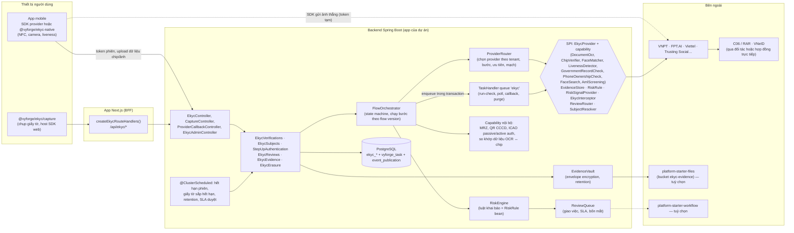
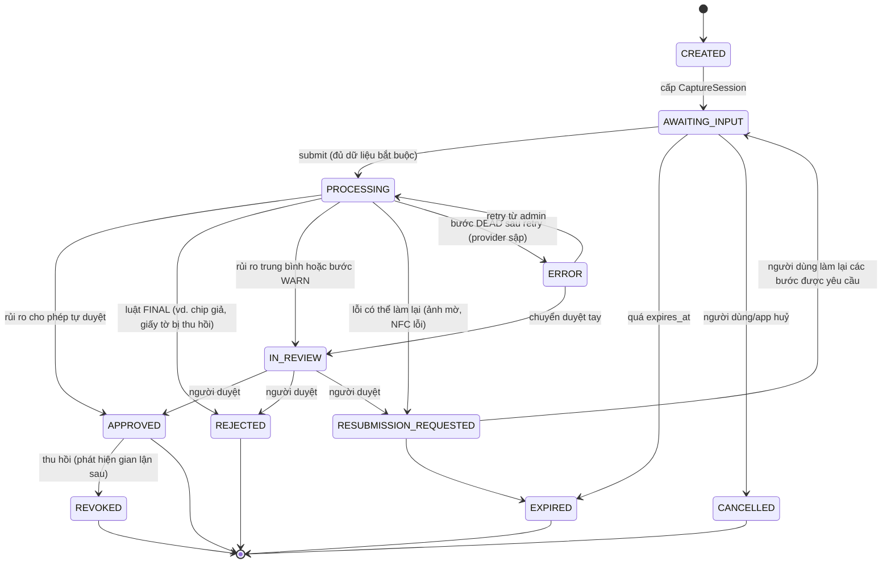
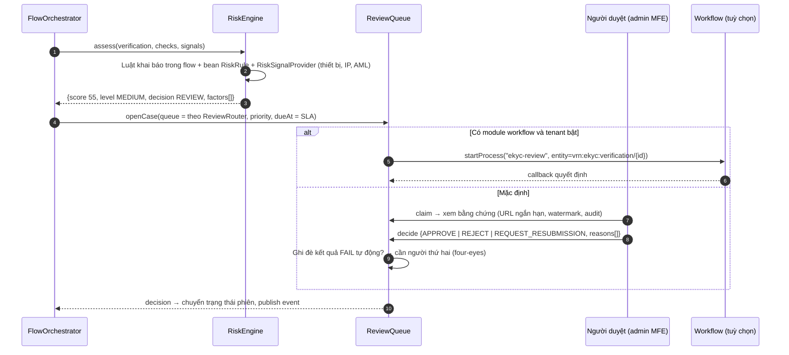
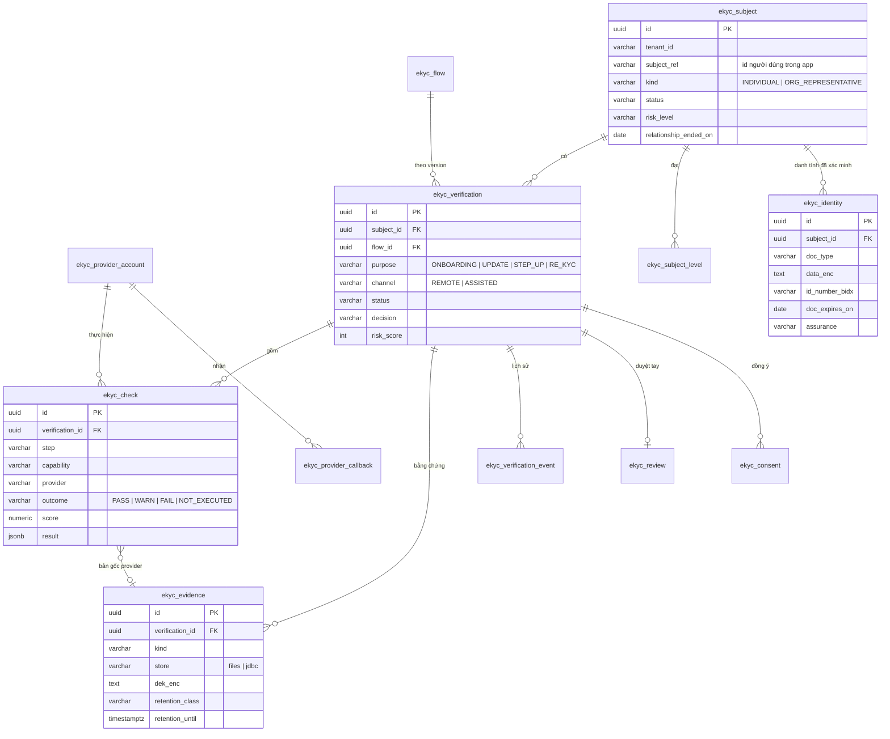

# Thiết kế module ekyc: `platform-starter-ekyc` + `@vyforge/ekyc`

> **Trạng thái:** bản thiết kế chờ duyệt (26/10/2026).
> **Phạm vi:** định danh khách hàng điện tử (eKYC) dùng chung cho mọi dự án Vyforge: giấy tờ (OCR, MRZ, QR, chip NFC
> theo ICAO 9303), khuôn mặt (so khớp, liveness), đối soát với nguồn của Bộ Công an (C06/RAR, VNeID) qua đối tác được
> phép, adapter cho FPT.AI, VNPT, Viettel, Trusting Social…, lưu bằng chứng, che PII, retention, đánh giá rủi ro, hàng đợi
> duyệt tay, xác thực sinh trắc học khi giao dịch (step-up).
> **Nền:** platform-java 0.12.1 (khối chung `SecretCipher`, `DurableTaskQueue`, `StarterSchemaMigrator`), platform-web
> 0.9.0. Theo quy ước chung của các module P1 (mục 1–6).
> **Ưu tiên trong MODULE_PLAN:** "adapter eKYC" đang ở P2. Theo nguyên tắc 5 (platform đi trước nhu cầu), bản này làm
> thành một module đầy đủ chứ không chỉ adapter mỏng. Lý do ở §1.1.

Mục lục:
1. [Bài toán và phạm vi](#1-bài-toán-và-phạm-vi)
2. [Nghiên cứu](#2-nghiên-cứu)
3. [Kiến trúc](#3-kiến-trúc)
4. [Mô hình dữ liệu](#4-mô-hình-dữ-liệu)
5. [API](#5-api)
6. [Mở rộng](#6-mở-rộng)
7. [Vận hành](#7-vận-hành)
8. [Bảo mật và tuân thủ](#8-bảo-mật-và-tuân-thủ)
9. [Kế hoạch triển khai](#9-kế-hoạch-triển-khai)
10. [Lệch quy ước và quyết định cần người dùng chọn](#10-lệch-quy-ước-và-quyết-định-cần-người-dùng-chọn)
11. [Đóng gói và triển khai độc lập](#11-đóng-gói-và-triển-khai-độc-lập)

---

## 1. Bài toán và phạm vi

### 1.1 Vì sao cần một module, không chỉ một adapter

Nhìn bề ngoài, eKYC là "gọi API của VNPT/FPT rồi lưu kết quả". Các dự án tự làm theo cách đó thường gặp lại cùng một
loạt lỗi:

- **Khoá cứng vào một nhà cung cấp.** Mã nghiệp vụ đọc thẳng JSON của VNPT. Khi đổi sang Viettel vì giá, hoặc phải
  chạy song song hai bên (một bên dự phòng), thì phải viết lại cả luồng.
- **Ảnh CCCD và ảnh chân dung nằm rải rác.** Có ảnh trong bucket chung, có ảnh trong cột `bytea`, có ảnh trong log của
  request. Đây là dữ liệu cá nhân nhạy cảm (sinh trắc học) theo Luật 91/2025/QH15 và NĐ 356/2025/NĐ-CP. Lộ dữ liệu này
  là sự cố nghiêm trọng nhất mà một app tài chính có thể gặp.
- **Không có retention.** Luật Phòng, chống rửa tiền buộc giữ hồ sơ nhận biết khách hàng trong một thời hạn sau khi kết
  thúc quan hệ. Luật Bảo vệ dữ liệu cá nhân lại buộc không giữ quá mức cần thiết. Thiếu một chính sách lưu và xoá có
  căn cứ thì app vi phạm theo một trong hai hướng.
- **Không có hàng đợi duyệt tay.** Kết quả "nghi ngờ" (điểm khớp mặt sát ngưỡng, giấy tờ mờ, chip đọc lỗi) bị xử lý
  bằng cách hạ ngưỡng, hoặc bằng một bảng Excel do nhân viên vận hành tự cập nhật.
- **Quy định thay đổi liên tục.** Chỉ trong 2024–2026 đã có Thông tư 17/2024 rồi 25/2025 (tài khoản thanh toán), Thông
  tư 40/2024 rồi 41/2025 (ví điện tử), Thông tư 50/2024 rồi 77/2025 (an toàn dịch vụ trực tuyến, chống giả mạo sinh trắc
  học), Thông tư 27/2025 (phòng, chống rửa tiền), Nghị định 320/2026 (sửa NĐ 69/2024 về định danh điện tử). Mỗi lần đổi,
  từng dự án phải tự đọc lại và tự sửa code.

Vì vậy module phải có: mô hình dữ liệu trung lập với nhà cung cấp, quy trình (flow) khai báo được và có version, kho
bằng chứng được mã hoá, retention có căn cứ pháp lý, đánh giá rủi ro, duyệt tay, và adapter cài thêm.

### 1.2 Phạm vi

| Nhóm | Trong phạm vi (bản 0.13.0) | Để bản sau |
|---|---|---|
| Giấy tờ | CCCD có chip, thẻ Căn cước (mẫu từ 01/7/2024), hộ chiếu (MRZ TD3), thẻ cư trú/thị thực của người nước ngoài (OCR qua provider); đọc MRZ TD1/TD3 và kiểm chữ số kiểm tra; đọc QR mặt trước CCCD; OCR qua provider; kiểm giả mạo ảnh giấy tờ qua provider | Giấy phép lái xe, giấy khai sinh (dưới 14 tuổi), giấy đăng ký doanh nghiệp (KYB) |
| Chip NFC | Nhận dữ liệu chip do mobile đọc (DG1, DG2, DG13, DG14, DG15, SOD); **passive authentication** ở server (kiểm hash từng DG với SOD, kiểm chữ ký SOD, chuỗi chứng thư DS → CSCA); **active authentication** bằng challenge do server cấp; xác thực chữ ký chip với C06/RAR qua provider | Chip authentication (EAC-CA) đầy đủ ở server; đọc vùng mã hoá (vân tay) — không được phép với bên thứ ba |
| Khuôn mặt | So khớp 1:1 (selfie ↔ ảnh chip DG2 hoặc ảnh giấy tờ); liveness thụ động và chủ động qua SDK của provider; ghi chứng nhận PAD (ISO/IEC 30107-3) của provider | Tìm 1:N trong tenant để phát hiện một người nhiều hồ sơ (chỉ qua provider có tính năng này, mặc định tắt) |
| Đối soát nhà nước | Xác thực chip với C06/RAR; xác thực qua VNeID (tài khoản định danh điện tử mức 2) qua đối tác hoặc qua hợp đồng trực tiếp với Trung tâm RAR; kiểm thuê bao di động chính chủ | Kết nối trực tiếp RAR do Vyforge tự viết (đặc tả không công khai; chỉ làm khi khách có hợp đồng và đặc tả) |
| Quy trình | Flow có version (bước, provider, ngưỡng, luật rủi ro, kênh); state machine của phiên xác minh; điểm rủi ro theo luật; quyết định tự động hoặc chuyển duyệt tay; yêu cầu nộp lại; hết hạn giấy tờ thì yêu cầu xác minh lại; step-up sinh trắc học khi giao dịch | KYB (doanh nghiệp, người đại diện, chủ sở hữu hưởng lợi); bảng câu hỏi tuỳ biến |
| Duyệt tay | Hàng đợi theo tenant, giao việc, SLA, lý do chuẩn hoá, bốn mắt (hai người duyệt) cho quyết định ghi đè, lịch sử đầy đủ; nối sang module workflow nếu có | |
| Lưu trữ | Bằng chứng mã hoá theo từng đối tượng (envelope, khoá dữ liệu bọc bằng `SecretCipher`), xoá bằng huỷ khoá (crypto-shredding), retention theo loại bằng chứng, legal hold; lưu qua module files hoặc kho nội bộ | |
| Sàng lọc | SPI `AmlScreening` (danh sách cấm vận, PEP) và tín hiệu rủi ro ngoài (thiết bị, IP) | Adapter sàng lọc cụ thể |
| Frontend | `@vyforge/ekyc`: client server-only, route handler BFF, component chụp giấy tờ/selfie trên web, host SDK web của provider, trang trạng thái; admin dưới `/admin` | `@vyforge/ekyc-native` (Expo module: NFC, camera) cùng `template-expo` (P2) |

Ngoài phạm vi: tự làm mô hình OCR hay nhận dạng khuôn mặt; tự cấp tài khoản định danh điện tử; chữ ký số (module
esign dùng kết quả eKYC làm căn cứ định danh người ký).

### 1.3 Kịch bản nghiệp vụ phải đáp ứng

| # | Kịch bản | Yêu cầu rút ra | Khối đáp ứng |
|---|---|---|---|
| K1 | **Mở tài khoản thanh toán online (ngân hàng)** theo TT 17/2024 sửa bởi TT 25/2025: CCCD gắn chip, đọc NFC, xác thực chip với C06, so khớp khuôn mặt với ảnh trong chip, liveness, kiểm số điện thoại đăng ký chính chủ | Flow nhiều bước bắt buộc; nguồn đáng tin nhất là chip đã xác thực; lưu hồ sơ gồm yếu tố sinh trắc học | Flow `sbv-payment-account` (§6.2), `ChipVerifier`, `GovernmentRecordCheck`, `PhoneOwnershipCheck` |
| K2 | **Mở ví điện tử** theo TT 40/2024 sửa bởi TT 41/2025 (đổi giấy tờ hợp lệ từ 05/11/2025, quy trình mới từ 01/01/2026): công dân dùng CCCD/thẻ Căn cước/căn cước điện tử; người nước ngoài dùng hộ chiếu + thị thực | Danh sách giấy tờ chấp nhận theo flow, có hiệu lực theo ngày; người nước ngoài một flow khác | `documents.accepted` + `effectiveFrom` của flow version |
| K3 | **Cập nhật sinh trắc học cho khách hàng hiện hữu** (yêu cầu từ 01/01/2025 với cá nhân, 01/07/2025 với tổ chức): hàng triệu khách cũ đối chiếu chip hoặc VNeID, chưa xong thì chặn giao dịch online | Mục đích `UPDATE` trên chủ thể đã có; trạng thái "đã đối chiếu sinh trắc" là thuộc tính app đọc được nhanh | `purpose = UPDATE`, `EkycSubjects.assurance(subjectRef)` |
| K4 | **Step-up khi chuyển tiền** (QĐ 2345/QĐ-NHNN: trên 10 triệu/giao dịch, trên 20 triệu/ngày, lần đầu trên thiết bị mới): selfie + liveness so với ảnh tham chiếu đã xác thực; yêu cầu PAD đạt ISO/IEC 30107-3 mức 2 theo TT 77/2025 | Phiên xác minh ngắn (≤ 2 phút), không lưu video; ngưỡng riêng; provider phải có chứng nhận PAD đủ mức | `purpose = STEP_UP`, `minPadLevel`, tham chiếu `reference_evidence_id` |
| K5 | **App cho vay tiêu dùng / BNPL**: eKYC + chấm điểm rủi ro; điểm khớp mặt sát ngưỡng thì chuyển chuyên viên thẩm định duyệt | Luật rủi ro, hàng đợi duyệt, SLA, lý do từ chối chuẩn hoá | `RiskEngine`, `ekyc_review`, §3.6 |
| K6 | **Công ty chứng khoán mở tài khoản online**: thông tin phải khớp CSDL quốc gia về dân cư; bản ghi định danh dùng làm căn cứ ký hợp đồng mở tài khoản điện tử | Đối soát nguồn nhà nước; kết quả eKYC chuyển sang module esign | `GovernmentRecordCheck`, event `KycVerificationApproved` → esign |
| K7 | **Đăng ký chứng thư số ký từ xa (SmartCA, MySign…)** cần eKYC trước khi CA cấp chứng thư | Gói bằng chứng (ảnh, kết quả, dấu thời gian) xuất được cho bên thứ ba có kiểm soát | `EvidencePackage` (§5.1), quyền `ekyc:evidence:Export` |
| K8 | **Sàn TMĐT xác minh người bán cá nhân**, mức đảm bảo thấp hơn: OCR + selfie, không NFC; người bán tự nộp lại khi ảnh mờ | Flow nhẹ; `RESUBMISSION_REQUESTED` với danh sách bước cần làm lại | Flow `basic-seller`, trạng thái nộp lại |
| K9 | **Khách nước ngoài** (hộ chiếu): đọc chip hộ chiếu, passive authentication bằng CSCA từ ICAO PKD/master list; không có C06 | Kho trust anchor (CSCA) theo quốc gia; flow theo quốc tịch | `ekyc_trust_anchor`, `IcaoPassiveAuthenticator` |
| K10 | **Đổi nhà cung cấp hoặc chạy dự phòng**: VNPT lỗi hoặc hết hạn mức thì chuyển sang FPT.AI cho bước OCR/khớp mặt; tenant A dùng Viettel, tenant B dùng VNPT | Chọn provider theo bước, theo tenant, có thứ tự ưu tiên và mạch ngắt | `ProviderRouter`, `ekyc_provider_account` |
| K11 | **Chống gian lận**: cùng một số CCCD mở 5 tài khoản ở 5 thiết bị; ảnh selfie dùng lại; ảnh CCCD chụp lại từ màn hình | Chỉ mục mù (blind index) số giấy tờ trong tenant; hash ảnh; tín hiệu từ provider (screen replay, deepfake, injection) | `id_number_bidx`, `RiskRule` mặc định, `FaceSearch` tuỳ chọn |
| K12 | **Giấy tờ hết hạn** (CCCD đổi khi đủ 25, 40, 60 tuổi): nhắc khách cập nhật trước khi hết hạn, hết hạn thì hạ mức | Job theo ngày hết hạn; event để notification gửi tin | Job `document-expiry`, `KycDocumentExpiring` |
| K13 | **Khách yêu cầu xoá dữ liệu** (Luật 91/2025) trong khi vẫn đang trong thời hạn lưu hồ sơ theo luật phòng, chống rửa tiền | Báo cáo phần giữ lại kèm căn cứ; xoá phần không có căn cứ giữ (vd. video liveness) | `retention_class`, `EkycErasure` |
| K14 | **Mở tài khoản tại quầy hoặc qua nhân viên lưu động** (kênh có hỗ trợ): nhân viên dùng tablet đọc chip, chụp mặt khách | Kênh `ASSISTED` có nhân viên thực hiện; audit theo nhân viên | `channel`, `operator_sub` |
| K15 | **Kiểm toán của NHNN hoặc đối tác**: xem lại hồ sơ một khách mở năm 2025 theo flow version cũ, với ngưỡng cũ | Flow có version bất biến; mỗi phiên trỏ đúng version đã chạy; kết quả lưu dạng chuẩn hoá + bản gốc của provider (mã hoá) | `ekyc_flow` version, `ekyc_check.result` + `raw_evidence_id` |

Kịch bản đặc thù Việt Nam: K1–K4 (quy định NHNN), K6–K7 (chứng khoán, CA trong nước), K12 (mốc đổi CCCD), K13 (Luật
91/2025 so với luật phòng, chống rửa tiền), cùng yêu cầu xuyên suốt: họ tên có dấu được chuẩn hoá NFC và so khớp không
dấu khi đối chiếu, địa chỉ theo đơn vị hành chính mới sau sắp xếp 2025 (chỉ lưu nguyên văn trên giấy tờ, không tự đổi).

---

## 2. Nghiên cứu

Nguồn kiểm bằng WebSearch/WebFetch ngày 26/10/2026. Tài liệu API của các nhà cung cấp VN phần lớn chỉ cấp khi có hợp
đồng, nên phần về họ dựa vào trang sản phẩm và tài liệu công khai; ghi rõ chỗ nào chưa kiểm được.

### 2.1 Hệ thống tham khảo

| Hệ thống | Loại · phiên bản · license | Mô hình dữ liệu và API | Điểm mạnh | Điểm yếu |
|---|---|---|---|---|
| [Onfido (nay thuộc Entrust)](https://documentation.identity.entrust.com/api/latest/) | SaaS · API v3.6 (GA 24/01/2023) · thương mại | `applicant` → `document`, `live_photo`/`live_video`/`motion_capture` (chỉ chụp qua SDK) → `workflow_run` (Studio) gồm `task`; `check` gồm nhiều `report`. Trạng thái workflow run: `awaiting_input`, `awaiting_client_input`, `processing`, `abandoned`, `error`, `approved`, `review`, `declined`. Report `clear`/`consider`, sub-result `clear`/`rejected`/`suspected`/`caution`. Webhook `workflow_run.completed`, `workflow_task.*`. Xoá applicant có độ trễ cấu hình được (khuyến nghị ≥ 30 ngày) và `restore` | Tách rõ "chụp" (SDK token ngắn hạn) và "quyết định" (workflow). Media sinh trắc chỉ đi qua SDK, chống tiêm ảnh. Xoá có thời gian ân hạn | Workflow chỉ cấu hình trên dashboard của họ; dữ liệu ở EU/US/CA |
| [Sumsub](https://docs.sumsub.com/docs/receive-and-interpret-results-via-api) | SaaS · API hiện hành · thương mại | `applicant` theo `levelName` (vd. `id-and-liveness`); `reviewStatus` (`init` → `pending` → `completed`, `onHold`); `reviewResult.reviewAnswer` `GREEN`/`RED`; `reviewRejectType` `RETRY` (cho nộp lại) hoặc `FINAL`; `rejectLabels` (vd. `BAD_PROOF_OF_IDENTITY`); webhook `applicantPending`, `applicantReviewed` | **Level** = gói yêu cầu đặt tên được, dùng cho nhiều sản phẩm; phân biệt từ chối cho làm lại và từ chối hẳn; nhãn lý do chuẩn hoá | `clientComment` có thể chứa thông tin riêng tư khi `FINAL`, phải lọc trước khi hiện cho khách |
| [Jumio Platform (KYX)](https://documentation.jumio.ai/docs/references/capabilities/) | SaaS · thương mại | `account` (người dùng) → `workflowExecution` → `credentials` (ID, SELFIE, FACEMAP, DATA) → **capability** (Usability, Extraction, Image Checks, Data Checks, Liveness, Similarity, Authentication, Watchlist/AML Screening, Classification, Cross Transaction Risk, Risk Signals). Mỗi capability trả `decision.type` `PASSED`/`REJECTED`/`WARNING`/`NOT_EXECUTED` kèm label (vd. `PRECONDITION_NOT_FULFILLED`, `TECHNICAL_ERROR`) | **Kết quả theo capability, đồng dạng**; `NOT_EXECUTED` khi bước trước hỏng; capability sau phụ thuộc capability trước | Mô hình phức tạp; nhiều capability gắn với dữ liệu nước ngoài |
| [Ballerine](https://github.com/ballerine-io/ballerine) | OSS · monorepo, đẩy code 09/10/2026, release gần nhất `workflow-service@v0.6.733` (07/2025) · **nhiều license: mặc định Elastic License 2.0**, một số thư mục MIT | Workflow engine (state machine JSON, dựa trên XState) + rule engine + back-office duyệt hồ sơ KYC/KYB; plugin gọi nhà cung cấp | Có sẵn mô hình "flow khai báo + back-office duyệt"; tách plugin nhà cung cấp | ELv2 không phải OSI; chạy thành service Node riêng; trọng tâm KYB/merchant onboarding |
| [JMRTD](https://jmrtd.org/) | OSS Java · 0.8.9 (Maven Central, 03/10/2026) · **LGPL** | Đọc MRTD theo ICAO Doc 9303: BAC, PACE (SAC), EAC; LDS (DG1, DG2, DG14, DG15, SOD) | Chuẩn mực trong Java, dùng được trên Android | LGPL (thư viện liên kết động thì dùng được, cần pháp chế duyệt như OpenHTMLtoPDF) |
| [NFCPassportReader (iOS)](https://github.com/AndyQ/NFCPassportReader) | OSS Swift · 2.3.3 · MIT | Đọc chip iOS (BAC/PACE), passive authentication với master list | MIT, phổ biến | Chỉ iOS |
| [flutter_cccd_vn](https://pub.dev/packages/flutter_cccd_vn) (fork ZeroPass/dmrtd) | OSS Dart · 2.0.2 · LGPL-3.0 hoặc thương mại | Adapter CCCD: `CccdMrz` (BAC từ số giấy tờ, ngày sinh, ngày hết hạn) và `CccdCan` (PACE với CAN 6 số); đọc DG1, DG2, DG13 tuỳ chọn | Cho thấy CCCD đọc được bằng cả BAC và PACE-CAN; DG13 chứa trường riêng của VN | Nhiều file chưa parse đủ; Flutter không phải stack của Vyforge |

Nhà cung cấp eKYC tại Việt Nam (đều thương mại; chỉ kiểm được tài liệu công khai):

| Nhà cung cấp | Năng lực công bố | Tích hợp | Ghi chú |
|---|---|---|---|
| [VNPT eKYC (IDCheck)](https://ekyc.vnpt.vn/en/idcheck) | OCR, đọc chip NFC, **xác thực chữ ký chip với RAR-C06**, so khớp khuôn mặt, liveness | SDK mobile (2 phiên bản theo sale kit) + API; tài liệu API khi có hợp đồng | VNPT eContract dùng IDCheck làm bước định danh trước khi ký |
| [FPT.AI eKYC](https://docs.fpt.ai/docs/en/vision/documentation/face-match) | OCR (kiểm mờ, chói, mất góc), chống gian lận giấy tờ, liveness (`POST {base}/face/liveness` với `session-id` từ init session; bản cũ `api.fpt.ai/dmp/liveness/v3`), face match 1:1, face search 1:N, **NFC đối chiếu chip với CSDL quốc gia** qua SDK | Mô hình **phiên** (init session → các module chạy độc lập hoặc song song) | Tài liệu công khai nhiều nhất, phù hợp làm adapter đầu tiên |
| [Viettel AI eKYC](https://viettelai.vn/en/tin-tuc/cong-nghe-ekyc-dinh-danh-khach-hang-thoi-dai-so) | OCR CCCD/hộ chiếu, NFC, công bố là đối tác chính thức của Bộ Công an về xác thực CCCD gắn chip; FAR ≤ 0,5 %, TAR ≥ 99 %; **ISO/IEC 30107-3 mức 2** | SDK mobile/web | Số liệu do nhà cung cấp tự công bố |
| [Trusting Social eKYC Core](https://ekyc.trustingsocial.com/ekyc-core/integration-scenarios/) | Đối tượng: Image/File, Face, ID Card, NFC, Transaction; so khớp, liveness chủ động/thụ động, kiểm "sanity" ảnh chân dung và giấy tờ, chỉ mục và tìm khuôn mặt, Face OTP | 4 kịch bản tích hợp; khuyến nghị **thông tin xác thực tạm thời** để app gửi ảnh thẳng lên TS còn server gọi dịch vụ chính. Header consent bắt buộc `X-UC-Consent-Obtained`, `X-UC-Consent-Obtained-At`, `X-UC-Location`; `X-Request-ID` để đối soát | Mô hình header consent đáng học |

Thư viện cho khuôn mặt (để quyết định có tự chạy mô hình hay không):

| Thư viện | Phiên bản · license | Nhận xét |
|---|---|---|
| [InsightFace](https://github.com/deepinsight/insightface) | đẩy code 10/2026 · code MIT, **mô hình huấn luyện sẵn chỉ cho nghiên cứu phi thương mại** (mô hình nhận dạng như `buffalo_l` phải mua license riêng) | Không dùng mặc định |
| [DeepFace](https://github.com/serengil/deepface) | v0.0.103 (20/10/2026) · MIT (wrapper; license mô hình bên dưới khác nhau) | Chỉ hợp cho thử nghiệm |
| [OpenCV Zoo](https://github.com/opencv/opencv_zoo) (YuNet, SFace) | 4.10.0 · Apache-2.0 | Đủ cho kiểm chất lượng ảnh, phát hiện mặt ở client; không đủ cho liveness chống deepfake |
| [Silent-Face-Anti-Spoofing](https://github.com/minivision-ai/Silent-Face-Anti-Spoofing) | không có release, cập nhật cuối 10/2023 · Apache-2.0 | Không có chứng nhận PAD, không dùng cho production |
| [PaddleOCR](https://github.com/PaddlePaddle/PaddleOCR), [VietOCR](https://github.com/pbcquoc/vietocr) | 3.7.0 (06/2026), v0.36 (2021) · Apache-2.0 | OCR tự host được nếu khách cấm gửi ảnh ra ngoài; làm adapter sau |

Tiêu chuẩn:

- **ICAO Doc 9303** (MRTD): MRZ TD1 (thẻ, 3 dòng × 30 ký tự) và TD3 (hộ chiếu, 2 dòng × 44); LDS 1.7 (DG1 MRZ, DG2 ảnh
  mặt, DG14 khoá cho chip authentication/PACE, DG15 khoá active authentication, SOD chứa hash từng DG ký bởi Document
  Signer). Passive authentication: kiểm hash DG ↔ SOD, kiểm chữ ký SOD, kiểm chuỗi DS → CSCA. PA không chống được việc
  sao chép nguyên chip; chống sao chép cần active authentication (AA) hoặc chip authentication (CA) ([Didit, 10/2026](https://didit.me/blog/vietnam-cccd-chip-nfc-verification/)).
- **CSCA của Việt Nam:** không tìm thấy nguồn xác nhận Việt Nam tham gia [ICAO PKD](https://en.wikipedia.org/wiki/International_Civil_Aviation_Organization_Public_Key_Directory)
  (95 thành viên ở 03/2024). Chứng thư CSCA của CCCD không công bố. Hệ quả: với CCCD, kiểm chữ ký chip phải đi qua
  C06/RAR (qua đối tác); passive authentication ở server chỉ kiểm được hash DG ↔ SOD và chữ ký SOD bằng chứng thư DS
  nhúng trong SOD, **không kết luận được chuỗi tin cậy** nếu tenant không nạp CSCA.
- **ISO/IEC 30107-3:2023** (PAD): phương pháp đánh giá và báo cáo (APCER, BPCER) cho tấn công **trình diện** trước
  thiết bị chụp; không bao trùm tấn công tiêm (injection) vào luồng camera ([IEC webstore](https://webstore.iec.ch/publication/81714)).
  "Mức 1/mức 2" là mức kiểm thử của phòng lab (vd. iBeta), không phải của chính tiêu chuẩn. Vì vậy module ghi chứng
  nhận PAD của provider như một thuộc tính có nguồn, và bắt các flow cần mức 2 chỉ dùng provider có chứng nhận đó.

### 2.2 Văn bản pháp lý hiện hành (kiểm ngày 26/10/2026)

| Văn bản | Hiệu lực | Nội dung liên quan | Nguồn |
|---|---|---|---|
| Luật Căn cước 26/2023/QH15 | 01/07/2024 | Đổi tên thành thẻ Căn cước; vân tay, quê quán không in trên thẻ mà lưu trong chip; CCCD cũ còn giá trị tới hết hạn | [PLO](https://plo.vn/4-luu-y-quan-trong-ve-luat-can-cuoc-post778084.html) |
| NĐ 69/2024/NĐ-CP về định danh và xác thực điện tử, **sửa bởi NĐ 320/2026/NĐ-CP** | 69/2024: 01/07/2024; 320/2026: ban hành 13/08/2026, hiệu lực **28/09/2026** | Tài khoản định danh điện tử mức 1/2 (mức 2 xác thực khuôn mặt + vân tay với CSDL căn cước); 320/2026: cấp cho người nước ngoài cư trú hợp pháp và cho tổ chức không phân biệt mức, **cấm yêu cầu nộp/xuất trình giấy tờ đã tích hợp trên VNeID**, bên khác khai thác thông tin phải có **sự đồng ý của chủ thể** | [Chính phủ](https://xaydungchinhsach.chinhphu.vn/nghi-dinh-so-320-2026-nd-cp-ve-dinh-danh-va-xac-thuc-dien-tu-119260815180442475.htm), [TVPL](https://thuvienphapluat.vn/van-ban/Cong-nghe-thong-tin/Nghi-dinh-320-2026-ND-CP-sua-doi-Nghi-dinh-69-2024-ND-CP-dinh-danh-va-xac-thuc-dien-tu-683794.aspx) |
| TT 17/2024/TT-NHNN mở và sử dụng tài khoản thanh toán, **sửa bởi TT 25/2025/TT-NHNN** (31/08/2025) | 17/2024: 01/07/2024; giao dịch điện tử chỉ sau khi đối chiếu sinh trắc: cá nhân 01/01/2025, tổ chức 01/07/2025; 25/2025: 31/08/2025, một số điều 01/12/2025 và 01/03/2026 (theo nguồn thứ cấp) | Điều 16 mở tài khoản bằng phương tiện điện tử; Điều 17 khoản 5 điểm c: rút tiền/giao dịch điện tử chỉ sau khi đối chiếu sinh trắc với **dữ liệu trong chip của thẻ căn cước** hoặc **tài khoản định danh điện tử**; 25/2025: bỏ CMND, phải **kiểm người dùng số điện thoại trùng với chủ tài khoản**, lưu hồ sơ gồm yếu tố sinh trắc học, không mở điện tử cho tài khoản chung | [Công báo](https://congbao.chinhphu.vn/van-ban/thong-tu-so-25-2025-tt-nhnn-46158.htm), [LSVN](https://lsvn.vn/bo-sung-quy-dinh-moi-ve-viec-mo-tai-khoan-thanh-toan-a163061.html), [LuatVietnam hợp nhất](https://luatvietnam.vn/linh-vuc-khac/ban-hop-nhat-dien-tu-thong-tu-17-2024-tt-nhnn-ve-tai-khoan-thanh-toan-883-104005-article.html) |
| TT 18/2024/TT-NHNN về thẻ ngân hàng | 01/07/2024 | Thẻ chỉ dùng giao dịch điện tử sau khi đối chiếu giấy tờ và sinh trắc với dữ liệu trong chip; phương án thay thế qua CSDL quốc gia về dân cư cho thẻ không chip | [VietnamFinance](https://vietnamfinance.vn/them-quy-dinh-ve-xac-thuc-sinh-trac-hoc-trong-giao-dich-ngan-hang-d112080.html) |
| TT 40/2024/TT-NHNN trung gian thanh toán, **sửa bởi TT 41/2025/TT-NHNN** (05/11/2025) | 40/2024: mở ví online phải xác thực sinh trắc từ 01/10/2024; 41/2025: 05/11/2025, quy trình mở ví mới từ **01/01/2026** | Giấy tờ: CCCD, thẻ Căn cước, căn cước điện tử (bỏ CMND, VNeID mức 2 cho công dân); người nước ngoài: hộ chiếu, thị thực hoặc danh tính điện tử; xác minh sinh trắc trước khi mở ví; hạn mức 100 triệu/tháng (+300 triệu cho một số khoản thanh toán công) | [LuatVietnam](https://luatvietnam.vn/linh-vuc-khac/tong-hop-diem-moi-thong-tu-41-2025-tt-nhnn-ve-vi-dien-tu-883-106022-article.html) |
| TT 50/2024/TT-NHNN an toàn dịch vụ trực tuyến, **sửa bởi TT 77/2025/TT-NHNN** | 77/2025: 01/03/2026; Điều 3, 10 áp dụng 01/07/2026 (khách cá nhân) và 01/10/2026 (chỉ khách tổ chức) | Theo một nguồn: giải pháp phát hiện giả mạo sinh trắc (PAD) phải đạt **ISO 30107 mức 2** hoặc tương đương, nhà cung cấp được tổ chức quốc tế (vd. FIDO) công nhận; đánh giá an toàn phiên bản app mỗi 3 tháng | [Thị trường Tài chính Tiền tệ](https://thitruongtaichinhtiente.vn/nganh-ngan-hang-siet-chat-an-ninh-bao-mat-dich-vu-truc-tuyen-77686.html), [VCCI](https://vcci.com.vn/tin-tuc/nhnn-ban-hanh-quy-dinh-moi-siet-chat-bao-mat-ung-dung-mobile-banking-tu-1-3) |
| QĐ 2345/QĐ-NHNN | 01/07/2024 | Sinh trắc học khuôn mặt khi chuyển tiền > 10 triệu/giao dịch, > 20 triệu/ngày, hoặc lần đầu trên thiết bị mới | [Vietcombank/RAR](https://vietnamfinance.vn/vietcombank-la-ngan-hang-dau-tien-khai-thac-dich-vu-xac-thuc-dien-tu-cua-bo-cong-an-d112793.html) |
| Luật Phòng, chống rửa tiền 14/2022/QH15; **TT 27/2025/TT-NHNN** thay TT 09/2023 | TT 27/2025: ban hành 15/09/2025, hiệu lực 01/11/2025, chuyển tiếp tới 31/12/2025 | Nhận biết khách hàng theo rủi ro, phân loại rủi ro khách hàng, lưu hồ sơ; giao dịch giá trị lớn | [Luật Việt An](https://luatvietan.vn/thong-tu-27-2025-tt-nhnn-thay-doi-lon-trong-phong-chong-rua-tien-tai-viet-nam.html), [Luật PCRT](https://caselaw.vn/van-ban-phap-luat/411476-luat-phong-chong-rua-tien-so-14-2022-qh15-ngay-15-11-2022-cua-quoc-hoi?en=true) |
| Luật BVDLCN 91/2025/QH15, NĐ 356/2025/NĐ-CP (thay NĐ 13/2023) | 01/01/2026 | Sinh trắc học là **dữ liệu cá nhân nhạy cảm**; đánh giá tác động xử lý (DPIA) theo mẫu mới; chuyển dữ liệu ra nước ngoài cần đánh giá; nhân sự bảo vệ dữ liệu chỉ định bằng văn bản | [EY 03/2026](https://www.ey.com/vi_vn/technical/tax/tax-and-law-updates/nghi-dinh-so-356-2025-nd-cp-quy-dinh-chi-tiet-mot-so-dieu-va-bien-phap-thi-hanh-luat-bao-ve-du-lieu-ca-nhan), [TVPL](https://thuvienphapluat.vn/van-ban/Quyen-dan-su/Nghi-dinh-356-2025-ND-CP-huong-dan-Luat-Bao-ve-du-lieu-ca-nhan-687428.aspx) |

**Cơ chế đối soát với C06 hiện nay** (từ tin chính thức của ngân hàng và nhà cung cấp):

1. **Xác thực chip qua C06/RAR.** App đọc chip qua NFC, gửi dữ liệu chip (SOD, DG) cho đối tác, đối tác kiểm chữ ký chip với
   Trung tâm RAR (Trung tâm nghiên cứu, ứng dụng dữ liệu dân cư và căn cước công dân, thuộc C06). VNPT IDCheck, FPT.AI,
   Viettel đều công bố năng lực này.
2. **Dịch vụ xác thực điện tử của Bộ Công an, qua VNeID.** Tổ chức ký hợp đồng với Trung tâm RAR (Vietcombank là ngân
   hàng đầu tiên, 01/07/2024; sau đó Agribank, TPBank). Khách xác thực trên app VNeID, tổ chức nhận dữ liệu từ CSDL quốc
   gia về dân cư ([VnEconomy](https://vneconomy.vn/ngan-hang-dau-tien-trien-khai-xac-thuc-sinh-trac-hoc-truc-tiep-tu-ung-dung-vneid.htm)).
3. **Đối chiếu sinh trắc với CSDL quốc gia về dân cư** cho giấy tờ không có chip (phương án thay thế trong TT 17/18/2024).

Cả ba đều cần **hợp đồng** (trực tiếp với RAR hoặc qua đối tác được phép) và đặc tả không công khai. Module chỉ định nghĩa
capability và kết quả chuẩn hoá; việc gọi C06 nằm trong adapter của đối tác.

**Chưa kiểm được** (pháp chế phải đối chiếu toàn văn trước khi cam kết): nguyên văn Điều 14–17 TT 17/2024 sau sửa đổi;
thời hạn lưu hồ sơ cụ thể theo Luật PCRT và TT 27/2025 (thiết kế dùng mặc định 5 năm kể từ khi kết thúc quan hệ, cấu
hình được); quy định eKYC của ngành chứng khoán (dự thảo sửa TT 134/2017 chưa xác nhận đã ban hành); chi tiết yêu cầu
PAD trong TT 77/2025 (mới có một nguồn thứ cấp).

### 2.3 Học theo và không làm

| Học theo | Từ đâu | Áp vào |
|---|---|---|
| **Flow có tên và version** gom các yêu cầu (Sumsub level, Onfido workflow) | Sumsub, Onfido | `ekyc_flow` (key + version bất biến), phiên trỏ đúng version |
| **Kết quả theo capability, đồng dạng** `PASS/WARN/FAIL/NOT_EXECUTED` + nhãn lý do | Jumio | `ekyc_check.outcome` + `reasons[]` mã chuẩn hoá (§6.3) |
| **Từ chối cho làm lại vs từ chối hẳn** | Sumsub `RETRY`/`FINAL` | `RESUBMISSION_REQUESTED` (kèm bước phải làm lại) và `REJECTED` |
| **Token chụp ngắn hạn**, media sinh trắc chỉ đi qua SDK | Onfido SDK token, Trusting Social temporary credential | `CaptureSession` cấp token theo phiên; server không nhận ảnh selfie từ upload tự do khi flow yêu cầu SDK |
| **Header consent và request id gửi tới provider** | Trusting Social | Mỗi lời gọi provider mang consent đã ghi nhận + `X-Request-ID` = id của check |
| **Xoá có thời gian ân hạn** | Onfido | Purge chạy sau `grace` (mặc định 7 ngày) qua `DurableTaskQueue`, huỷ được trong thời gian đó |
| **Back-office duyệt hồ sơ tách khỏi engine** | Ballerine | Hàng đợi duyệt trong starter + admin MFE; nối workflow tuỳ chọn |

| Không làm | Lý do |
|---|---|
| Tự chạy mô hình nhận dạng khuôn mặt, liveness | Mô hình tốt (InsightFace) không cho dùng thương mại; mô hình tự do không có chứng nhận PAD; TT 77/2025 đòi chứng nhận. Chỉ tích hợp provider |
| Tự viết kết nối RAR/C06 | Cần hợp đồng và đặc tả không công khai; đối tác đã có sẵn |
| Nhúng Ballerine | ELv2 + service Node riêng; mô hình của module này nhỏ hơn và cần chạy trong JVM cùng transaction nghiệp vụ |
| Lưu template khuôn mặt (vector) mặc định | Dữ liệu sinh trắc thêm, tăng rủi ro; 1:N chỉ qua provider khi tenant bật |
| Đọc chip ở server | Chip đọc bằng điện thoại (NFC). Server chỉ kiểm dữ liệu đã đọc |
| Một engine luật tổng quát (DSL) | Luật rủi ro eKYC hữu hạn; dùng luật khai báo dạng có kiểu + bean Java (§6.4) |

---

## 3. Kiến trúc

### 3.1 Thành phần



Nguyên tắc:

- **Thư viện, không phải service.** Starter nhúng vào app như các starter khác. Kết quả eKYC gắn chặt với transaction
  nghiệp vụ (mở tài khoản chỉ commit khi phiên được duyệt). Dự án nhiều app dùng chung một kho hồ sơ eKYC thì chạy
  starter trong `platform-services` hoặc thành server riêng (§11).
- **Hexagonal theo capability.** Lõi (`com.vyforge.platform.ekyc`) chỉ biết capability và kết quả chuẩn hoá. Một
  provider khai báo những capability nó có. Một flow có thể trộn provider: OCR của FPT.AI, chip + C06 của VNPT, liveness
  của Viettel.
- **Hai kiểu provider.** (a) *Theo capability*: server gọi từng API (OCR, so khớp…). (b) *Theo phiên của provider*: SDK
  của provider làm cả chuỗi trên điện thoại (VNPT IDCheck chạy OCR + NFC + C06 + liveness + so khớp), server nhận kết
  quả qua callback hoặc lấy về bằng mã phiên. Kiểu (b) ánh xạ một kết quả thành nhiều `ekyc_check`, nên lõi xử lý hai
  kiểu như nhau.
- **Mọi lời gọi ra ngoài đi qua `DurableTaskQueue`**, queue `ekyc`: `run-check` (gọi một capability), `poll-result`
  (provider bất đồng bộ không có callback), `process-callback`, `purge-evidence`. Lời gọi đồng bộ cho trải nghiệm nhanh
  (chờ tối đa `sync-wait`, mặc định 8 giây) vẫn tạo task trước, rồi chờ task xong; quá hạn thì trả `202` và client chờ
  event/polling. Không có lời gọi provider nào nằm ngoài task, nên app chết giữa chừng không mất trạng thái.
- **Bằng chứng không bao giờ ở dạng rõ trên storage.** `EvidenceVault` mã hoá từng đối tượng bằng khoá dữ liệu riêng
  (AES-256-GCM), khoá dữ liệu bọc bằng `SecretCipher`. Xoá bằng cách huỷ khoá, nên bản sao trong backup cũng không đọc
  được nữa.

### 3.2 Gói Java

```
com.vyforge.platform.ekyc                  API công khai: EkycVerifications, EkycSubjects, StepUpAuthentication,
                                           EkycReviews, EkycEvidence, EkycErasure, record/enum, event, EkycErrors,
                                           EkycActions
com.vyforge.platform.ekyc.spi              EkycProvider, Capability + các interface capability, CapabilityResult,
                                           EvidenceStore, RiskRule, RiskSignalProvider, EkycInterceptor, ReviewRouter,
                                           SubjectResolver, ProviderCallbackVerifier
com.vyforge.platform.ekyc.flow             FlowDefinition (record), FlowRegistry, FlowValidator, flow mặc định (YAML)
com.vyforge.platform.ekyc.icao             MRZ (TD1/TD3, chữ số kiểm tra), QR CCCD, LDS/SOD parser, passive auth,
                                           active auth (BouncyCastle, không dùng JMRTD ở server)
com.vyforge.platform.ekyc.internal         Entity JPA, repository, orchestrator, router, risk engine, review queue,
                                           evidence vault, TaskHandler, job
com.vyforge.platform.ekyc.web              Controller REST, DTO, che PII khi trả về
com.vyforge.platform.ekyc.adapter.mock     Provider giả có kịch bản (sandbox, test, demo)
com.vyforge.platform.ekyc.adapter.fptai    FPT.AI eKYC (tài liệu công khai)
com.vyforge.platform.ekyc.adapter.vnpt     VNPT eKYC IDCheck (khi có tài liệu từ hợp đồng; xem §10.2)
com.vyforge.platform.ekyc.adapter.files    EvidenceStore trên platform-starter-files (@ConditionalOnBean(FileService))
com.vyforge.platform.ekyc.adapter.workflow ReviewRouter sang module workflow (@ConditionalOnBean)
```

### 3.3 Luồng chính: mở tài khoản với CCCD gắn chip (K1)

```mermaid
sequenceDiagram
  autonumber
  participant M as App mobile
  participant B as Backend (ekyc)
  participant Q as DurableTaskQueue
  participant P as Provider (VNPT/FPT…)
  participant R as C06/RAR (qua provider)
  M->>B: POST /verifications {subjectRef, flow: sbv-payment-account, consent}
  B->>B: Tạo subject (nếu chưa có), verification CREATED → AWAITING_INPUT,<br/>ghi consent, cấp CaptureSession (token 15 phút, nonce AA)
  B-->>M: 201 {verificationId, steps[], captureToken, aaChallenge}
  M->>M: Chụp mặt trước/sau CCCD (hoặc SDK provider)
  M->>B: PUT /verifications/{id}/documents (ảnh, mã hoá vào vault)
  M->>M: Đọc chip qua NFC (BAC từ MRZ hoặc PACE-CAN),<br/>INTERNAL AUTHENTICATE với aaChallenge
  M->>B: PUT /verifications/{id}/chip {DG1, DG2, DG13, DG14, DG15, SOD, aaSignature}
  M->>M: Selfie + liveness (SDK provider)
  M->>B: PUT /verifications/{id}/face {providerSessionRef | ảnh}
  M->>B: POST /verifications/{id}/submit
  B->>B: AWAITING_INPUT → PROCESSING; enqueue các bước theo flow (cùng transaction)
  par Bước nội bộ
    B->>B: MRZ/QR, passive auth (hash DG ↔ SOD, chữ ký SOD), active auth (DG15 + challenge),<br/>so khớp dữ liệu OCR ↔ DG1/DG13
  and Bước provider
    Q->>P: run-check CHIP_GOV (SOD + DG) — X-Request-ID = checkId
    P->>R: Xác thực chữ ký chip
    R-->>P: hợp lệ
    P-->>Q: PASS
    Q->>P: run-check FACE_MATCH (selfie ↔ DG2), LIVENESS
    P-->>Q: score 0.97, liveness PASS
    Q->>P: run-check PHONE_OWNERSHIP (số đăng ký ↔ số giấy tờ)
    P-->>Q: PASS
  end
  B->>B: Mọi bước xong → RiskEngine: LOW → APPROVED (decided_by=AUTO)
  B->>B: Ghi ekyc_identity (nguồn NFC+C06, assurance HIGH), subject.level = sbv-payment-account
  B-->>M: event KycVerificationApproved (outbox) → realtime/notification
```

### 3.4 Luồng provider làm cả phiên (VNPT IDCheck, kiểu b)

```mermaid
sequenceDiagram
  autonumber
  participant M as App mobile (SDK VNPT)
  participant B as Backend (ekyc)
  participant P as VNPT eKYC
  M->>B: POST /verifications {flow: sbv-payment-account}
  B->>P: Tạo phiên provider (adapter.startSession) → token SDK
  B-->>M: 201 {captureToken, provider: {name: vnpt, sdkToken, sessionRef}}
  M->>P: SDK: OCR + NFC + C06 + liveness + so khớp (ảnh đi thẳng tới VNPT)
  P-->>B: Callback (ký) {sessionRef, kết quả}
  B->>B: ProviderCallbackVerifier kiểm chữ ký; lưu callback (idempotent theo dedupe key)
  B->>B: enqueue process-callback → adapter.fetchResult(sessionRef) (không tin payload callback)
  B->>B: Ánh xạ thành checks DOCUMENT_OCR, CHIP_GOV, LIVENESS, FACE_MATCH;<br/>tải ảnh/dữ liệu chip về vault (nếu flow yêu cầu lưu)
  B->>B: Bước nội bộ còn lại (passive auth lại ở server nếu provider trả SOD) → RiskEngine → quyết định
```

Nguyên tắc: callback chỉ là tín hiệu. Kết quả luôn lấy lại bằng API của provider (giống IPN của payment: không tin
redirect hay payload chưa đối chiếu).

### 3.5 State machine của phiên xác minh



- Trạng thái cuối bất biến, trừ `APPROVED → REVOKED` (cần quyền riêng và lý do, ghi audit).
- Mỗi chuyển trạng thái ghi một dòng `ekyc_verification_event` và publish event công khai tương ứng.
- Số lần nộp lại tối đa theo flow (`maxResubmissions`, mặc định 3), vượt thì `REJECTED` với lý do `too_many_attempts`.
- Trạng thái của **chủ thể** (`ekyc_subject`) tách khỏi phiên: `UNVERIFIED`, `VERIFIED`, `EXPIRED` (giấy tờ hết hạn
  hoặc mức hết hạn), `SUSPENDED`, `REVOKED`. Chủ thể giữ **mức đạt được** theo từng flow key (`ekyc_subject_level`), app
  hỏi "khách này đã đạt `sbv-payment-account` chưa" mà không phải đọc phiên.

### 3.6 Đánh giá rủi ro và duyệt tay



- Người duyệt không duyệt phiên của chính mình (`subjectRef` = `sub` của người duyệt) và không duyệt phiên mình đã tạo
  ở kênh `ASSISTED`.
- SLA: job nhắc khi còn 20 % thời gian, quá hạn thì nâng ưu tiên và publish `KycReviewOverdue`.
- Lý do quyết định là mã chuẩn hoá (§6.3), có nhãn vi/en; ghi chú tự do được mã hoá và không gửi cho khách.

### 3.7 Luồng lỗi

| Tình huống | Xử lý |
|---|---|
| Provider timeout/5xx | Task retry backoff (mặc định 5 lần, tối đa 2 phút cho bước đồng bộ); hết lượt thì `ProviderRouter` thử provider dự phòng của capability nếu flow cho phép (`fallback: true`); không còn thì check `FAILED` → phiên `ERROR` hoặc `IN_REVIEW` (cấu hình `onProviderFailure`) |
| Provider trả lỗi nghiệp vụ (ảnh mờ, không thấy mặt) | Không retry; check `COMPLETED` với `outcome=FAIL`, `reasons=[image_quality]`, luật mặc định → `RESUBMISSION_REQUESTED` cho bước đó |
| Mạch ngắt mở (circuit breaker) | Router bỏ qua provider đó; health indicator báo `DOWN`; metric `vyforge.ekyc.provider.unavailable` |
| Callback chữ ký sai | `401`, không lưu payload, metric + log cảnh báo (không log payload) |
| Callback trùng | Bỏ qua theo `dedupe_key` (unique) |
| Callback không đến | Task `poll-result` theo lịch backoff tới `providerTimeout` (mặc định 10 phút) |
| Hash DG không khớp SOD | Check `CHIP_PASSIVE_AUTH` `FAIL` + `reasons=[chip_data_tampered]`, luật mặc định `REJECTED` (FINAL) và gắn cờ rủi ro cho số giấy tờ |
| Chữ ký AA sai hoặc thiếu khi chip có DG15 | `FAIL`, `reasons=[chip_clone_suspected]` → `IN_REVIEW` |
| Không có CSCA để kiểm chuỗi | `WARN`, `reasons=[csca_unavailable]`; với CCCD, bước `CHIP_GOV` (C06) thay thế |
| Dữ liệu OCR khác dữ liệu chip | `WARN` nếu chỉ khác dấu/khoảng trắng của địa chỉ; `FAIL` nếu khác số giấy tờ, họ tên (sau chuẩn hoá), ngày sinh |
| App chết giữa lúc xử lý | Task đã commit, worker khác lấy tiếp (`locked_until`) |
| Người dùng bỏ dở | Job đánh `EXPIRED` sau `expires_at`; bằng chứng của phiên bỏ dở vào retention lớp `ABANDONED` (mặc định 30 ngày) |

---

## 4. Mô hình dữ liệu

### 4.1 ERD



### 4.2 DDL dự kiến

Migration có version trong `classpath:META-INF/vyforge/db/ekyc`, bảng lịch sử `flyway_schema_history_ekyc`, chạy bằng
`StarterSchemaMigrator` trước `EntityManagerFactory`; tắt bằng `vyforge.ekyc.schema.migrate=false`; bản gộp cho DBA ở
`META-INF/vyforge/sql/ekyc.sql`. Mọi bảng thuộc tenant có `tenant_id` + `@TenantId`. Trạng thái và loại lưu `varchar`,
kiểm ở code (không dùng enum của PostgreSQL).

```sql
-- V1__ekyc_core.sql

create table ekyc_provider_account (
  id               uuid primary key,
  tenant_id        varchar(100),                 -- null = tài khoản của platform, dùng chung khi tenant không có riêng
  provider         varchar(40)  not null,        -- 'vnpt', 'fptai', 'viettel', 'trustingsocial', 'mock'…
  name             varchar(120) not null,
  environment      varchar(16)  not null,        -- SANDBOX | PRODUCTION
  status           varchar(16)  not null,        -- ACTIVE | DISABLED
  capabilities     text[]       not null,        -- tập con capability provider hỗ trợ, tenant bật
  priority         int          not null default 100,
  credentials_enc  text         not null,        -- SecretCipher, context "ekyc:provider:<tenant>:<id>"
  config           jsonb        not null default '{}',   -- base URL, timeout, ngưỡng mặc định, region
  pad_certification jsonb,                       -- {"standard":"ISO/IEC 30107-3","level":2,"lab":"iBeta","expiresOn":"2027-05-01","evidenceUrl":"…"}
  data_location    varchar(8),                   -- 'VN' hoặc mã quốc gia nơi provider xử lý dữ liệu
  created_at       timestamptz  not null,
  updated_at       timestamptz  not null,
  version          bigint       not null default 0
);
create index ekyc_provider_account_tenant on ekyc_provider_account (tenant_id, provider);

create table ekyc_flow (
  id               uuid primary key,
  tenant_id        varchar(100),                 -- null = flow mẫu của platform (nạp từ YAML)
  flow_key         varchar(80)  not null,        -- 'sbv-payment-account', 'ewallet', 'step-up', 'basic-seller'
  flow_version     int          not null,
  status           varchar(16)  not null,        -- DRAFT | ACTIVE | RETIRED
  effective_from   timestamptz,                  -- version mới có hiệu lực từ ngày (vd. 01/01/2026 cho TT 41/2025)
  definition       jsonb        not null,        -- FlowDefinition (§6.2)
  schema_version   int          not null,
  checksum         varchar(64)  not null,        -- sha256 của definition chuẩn hoá; ACTIVE thì bất biến
  created_by       varchar(255),
  created_at       timestamptz  not null,
  unique nulls not distinct (tenant_id, flow_key, flow_version)
);

create table ekyc_subject (
  id                    uuid primary key,
  tenant_id             varchar(100) not null,
  subject_ref           varchar(255) not null,   -- sub hoặc id khách hàng trong app (không phải PII)
  kind                  varchar(24)  not null,
  status                varchar(16)  not null,   -- UNVERIFIED | VERIFIED | EXPIRED | SUSPENDED | REVOKED
  risk_level            varchar(16),             -- LOW | MEDIUM | HIGH (theo lần đánh giá gần nhất)
  reference_evidence_id uuid,                    -- ảnh mặt tham chiếu đã xác thực (DG2 hoặc selfie đã duyệt), dùng cho step-up
  relationship_ended_on date,                    -- app báo kết thúc quan hệ → bắt đầu tính retention
  attributes            jsonb not null default '{}',
  created_at            timestamptz not null,
  updated_at            timestamptz not null,
  version               bigint not null default 0,
  unique (tenant_id, subject_ref)
);

create table ekyc_subject_level (
  tenant_id        varchar(100) not null,
  subject_id       uuid not null references ekyc_subject(id),
  flow_key         varchar(80) not null,
  verification_id  uuid not null,
  assurance        varchar(16) not null,         -- LOW | SUBSTANTIAL | HIGH
  achieved_at      timestamptz not null,
  expires_at       timestamptz,                  -- min(ngày hết hạn giấy tờ, achieved_at + flow.validity)
  revoked_at       timestamptz,
  primary key (subject_id, flow_key)
);

create table ekyc_verification (
  id                 uuid primary key,
  tenant_id          varchar(100) not null,
  subject_id         uuid not null references ekyc_subject(id),
  flow_id            uuid not null references ekyc_flow(id),
  flow_key           varchar(80) not null,
  flow_version       int not null,
  purpose            varchar(16) not null,
  channel            varchar(16) not null,
  operator_sub       varchar(255),               -- nhân viên ở kênh ASSISTED
  status             varchar(32) not null,
  decision           varchar(16),                -- APPROVED | REJECTED | null
  decided_by         varchar(16),                -- AUTO | REVIEW
  risk_score         int,
  risk_level         varchar(16),
  reasons            text[] not null default '{}',
  resubmit_steps     text[] not null default '{}',
  attempt_no         int not null default 1,
  idempotency_key    varchar(120),
  external_ref       varchar(255),               -- mã hồ sơ của app (vd. số đơn mở tài khoản)
  context            jsonb not null default '{}',-- thiết bị, app version, ip_hash, locale (không có PII rõ)
  context_schema_version int not null default 1,
  expires_at         timestamptz not null,
  submitted_at       timestamptz,
  completed_at       timestamptz,
  created_at         timestamptz not null,
  updated_at         timestamptz not null,
  version            bigint not null default 0,
  unique (tenant_id, idempotency_key)
);
create index ekyc_verification_subject on ekyc_verification (tenant_id, subject_id, created_at desc);
create index ekyc_verification_status  on ekyc_verification (tenant_id, status, created_at)
  where status in ('AWAITING_INPUT', 'PROCESSING', 'IN_REVIEW', 'RESUBMISSION_REQUESTED', 'ERROR');

create table ekyc_check (
  id                    uuid primary key,
  tenant_id             varchar(100) not null,
  verification_id       uuid not null references ekyc_verification(id),
  step                  varchar(60) not null,     -- tên bước trong flow (một capability có thể xuất hiện nhiều bước)
  capability            varchar(40) not null,     -- DOCUMENT_OCR, CHIP_PASSIVE_AUTH, CHIP_GOV, FACE_MATCH, LIVENESS…
  provider              varchar(40) not null,     -- 'builtin' cho bước nội bộ
  provider_account_id   uuid references ekyc_provider_account(id),
  status                varchar(16) not null,     -- PENDING | RUNNING | COMPLETED | FAILED | SKIPPED
  outcome               varchar(16),              -- PASS | WARN | FAIL | NOT_EXECUTED
  score                 numeric(6,5),
  reasons               text[] not null default '{}',
  result                jsonb not null default '{}',  -- kết quả chuẩn hoá theo capability, KHÔNG chứa PII rõ
  result_schema_version int not null default 1,
  provider_ref          varchar(255),             -- mã giao dịch của provider để đối soát/khiếu nại
  raw_evidence_id       uuid,                     -- bản gốc response của provider (mã hoá trong vault)
  cost_units            int not null default 0,   -- số đơn vị tính phí (cho billing/đối soát hoá đơn provider)
  latency_ms            int,
  attempts              int not null default 0,
  started_at            timestamptz,
  completed_at          timestamptz,
  created_at            timestamptz not null
);
create index ekyc_check_verification on ekyc_check (verification_id);
create index ekyc_check_usage on ekyc_check (tenant_id, provider, completed_at);

create table ekyc_evidence (
  id                uuid primary key,
  tenant_id         varchar(100) not null,
  subject_id        uuid not null references ekyc_subject(id),
  verification_id   uuid references ekyc_verification(id),
  kind              varchar(32) not null,   -- DOC_FRONT, DOC_BACK, SELFIE, LIVENESS_VIDEO, LIVENESS_FRAMES,
                                            -- CHIP_DG1, CHIP_DG2, CHIP_DG13, CHIP_DG14, CHIP_DG15, CHIP_SOD,
                                            -- PROVIDER_RAW, REVIEW_NOTE, EXPORT_PACKAGE
  store             varchar(16) not null,   -- 'files' | 'jdbc'
  file_id           uuid,                   -- khi store = files
  content_enc       bytea,                  -- khi store = jdbc (≤ 2 MiB), đã mã hoá bằng DEK
  dek_enc           text,                   -- DEK bọc bằng SecretCipher, context "ekyc:evidence:<tenant>:<id>"; null = đã huỷ
  content_type      varchar(100) not null,
  size_bytes        bigint not null,
  sha256            bytea not null,         -- hash của bản rõ: chứng minh toàn vẹn, phát hiện ảnh dùng lại trong tenant
  source            varchar(16) not null,   -- UPLOAD | SDK | NFC | PROVIDER | REVIEWER
  captured_at       timestamptz not null,
  retention_class   varchar(24) not null,   -- KYC_RECORD | BIOMETRIC_RAW | ABANDONED | STEP_UP | PROVIDER_RAW
  retention_until   timestamptz,            -- null khi chưa bắt đầu tính (chờ kết thúc quan hệ)
  legal_hold        boolean not null default false,
  shredded_at       timestamptz,            -- DEK đã huỷ
  created_at        timestamptz not null
);
create index ekyc_evidence_verification on ekyc_evidence (verification_id);
create index ekyc_evidence_retention on ekyc_evidence (retention_until) where shredded_at is null and legal_hold = false;
create index ekyc_evidence_sha on ekyc_evidence (tenant_id, sha256);

create table ekyc_identity (
  id                uuid primary key,
  tenant_id         varchar(100) not null,
  subject_id        uuid not null references ekyc_subject(id),
  verification_id   uuid not null references ekyc_verification(id),
  doc_type          varchar(32) not null,   -- CCCD_CHIP, CAN_CUOC, CCCD, PASSPORT, RESIDENCE_CARD…
  issuing_country   varchar(3)  not null,   -- ISO 3166-1 alpha-3 ('VNM')
  data_enc          text not null,          -- JSON IdentityData (§5.1) mã hoá bằng SecretCipher
  data_schema_version int not null default 1,
  id_number_bidx    varchar(64) not null,   -- HMAC-SHA256(khoá blind index của tenant, số giấy tờ chuẩn hoá)
  doc_expires_on    date,                   -- cho job nhắc hết hạn
  sources           text[] not null,        -- OCR, MRZ, QR, NFC, GOV (nguồn đã xác nhận dữ liệu)
  assurance         varchar(16) not null,
  is_current        boolean not null default true,
  created_at        timestamptz not null
);
create index ekyc_identity_bidx on ekyc_identity (tenant_id, id_number_bidx);
create unique index ekyc_identity_current on ekyc_identity (subject_id) where is_current;
create index ekyc_identity_expiry on ekyc_identity (doc_expires_on) where is_current;

create table ekyc_consent (
  id               uuid primary key,
  tenant_id        varchar(100) not null,
  subject_id       uuid not null references ekyc_subject(id),
  verification_id  uuid references ekyc_verification(id),
  purpose          varchar(60)  not null,   -- 'ekyc.identity', 'ekyc.biometric', 'ekyc.gov_check', 'ekyc.provider_transfer'
  notice_version   varchar(40)  not null,   -- version văn bản thông báo đã hiện cho người dùng
  granted          boolean      not null,
  granted_at       timestamptz  not null,
  channel          varchar(16)  not null,
  privacy_consent_ref varchar(255)          -- id bản ghi consent của module privacy-dsr nếu có
);

create table ekyc_review (
  id                uuid primary key,
  tenant_id         varchar(100) not null,
  verification_id   uuid not null unique references ekyc_verification(id),
  queue             varchar(60) not null default 'default',
  status            varchar(16) not null,   -- OPEN | CLAIMED | PENDING_SECOND | DECIDED | CANCELLED
  priority          int not null default 50,
  reason_codes      text[] not null,        -- vì sao vào duyệt
  assignee_sub      varchar(255),
  claimed_at        timestamptz,
  due_at            timestamptz not null,
  decision          varchar(32),            -- APPROVE | REJECT | REQUEST_RESUBMISSION
  decision_reasons  text[] not null default '{}',
  note_enc          text,                   -- ghi chú nội bộ (SecretCipher)
  decided_by        varchar(255),
  second_decided_by varchar(255),           -- four-eyes
  decided_at        timestamptz,
  workflow_ref      varchar(255),           -- id instance của module workflow nếu dùng
  created_at        timestamptz not null,
  updated_at        timestamptz not null,
  version           bigint not null default 0
);
create index ekyc_review_queue on ekyc_review (tenant_id, queue, status, priority desc, due_at);

create table ekyc_verification_event (
  id               uuid not null,
  tenant_id        varchar(100) not null,
  verification_id  uuid not null,
  type             varchar(60) not null,    -- status_changed, check_completed, evidence_added, review_claimed…
  actor            varchar(255),            -- sub, 'system', 'provider:<name>'
  data             jsonb not null default '{}',
  occurred_at      timestamptz not null,
  primary key (id, occurred_at)
) partition by range (occurred_at);
create index ekyc_verification_event_v on ekyc_verification_event (verification_id, occurred_at);

create table ekyc_provider_callback (
  id                  uuid primary key,
  tenant_id           varchar(100),         -- suy ra từ provider account sau khi kiểm chữ ký
  provider            varchar(40) not null,
  provider_account_id uuid references ekyc_provider_account(id),
  dedupe_key          varchar(255) not null,
  session_ref         varchar(255),
  payload_enc         text not null,
  status              varchar(16) not null, -- RECEIVED | PROCESSED | IGNORED | FAILED
  received_at         timestamptz not null,
  processed_at        timestamptz,
  unique (provider, dedupe_key)
);

create table ekyc_trust_anchor (
  id               uuid primary key,
  tenant_id        varchar(100),            -- null = platform
  country          varchar(3) not null,
  kind             varchar(16) not null,    -- CSCA | DS | CRL
  subject_dn       text not null,
  serial_hex       varchar(80) not null,
  not_before       timestamptz not null,
  not_after        timestamptz not null,
  der              bytea not null,
  source           varchar(40) not null,    -- 'icao-master-list', 'bsi-master-list', 'tenant-upload'
  imported_at      timestamptz not null,
  unique nulls not distinct (tenant_id, kind, country, serial_hex)
);

create table ekyc_settings (
  tenant_id        varchar(100) primary key,
  settings         jsonb not null,          -- EkycTenantSettings (§6.5)
  schema_version   int not null,
  bidx_key_enc     text not null,           -- khoá HMAC blind index của tenant (SecretCipher); xoay có kế hoạch
  updated_at       timestamptz not null,
  version          bigint not null default 0
);
```

### 4.3 Retention, partition, dung lượng

- **Bằng chứng** theo `retention_class`, mặc định (tenant chỉnh được trong khung platform cho phép):

  | Lớp | Gồm | Mặc định | Tính từ | Căn cứ |
  |---|---|---|---|---|
  | `KYC_RECORD` | Ảnh giấy tờ, dữ liệu chip, ảnh mặt tham chiếu, kết quả | 5 năm | `relationship_ended_on` (app báo) | Luật PCRT 14/2022 (lưu hồ sơ nhận biết khách hàng; pháp chế xác nhận số năm và mốc tính); TT 25/2025 (lưu hồ sơ có yếu tố sinh trắc) |
  | `BIOMETRIC_RAW` | Video liveness, chuỗi khung hình | 30 ngày | Quyết định cuối của phiên | Nguyên tắc hạn chế lưu trữ (Luật 91/2025); chỉ để xử lý khiếu nại/duyệt |
  | `PROVIDER_RAW` | Response gốc của provider | bằng `KYC_RECORD` | như trên | Đối soát, kiểm toán |
  | `ABANDONED` | Bằng chứng của phiên `EXPIRED`/`CANCELLED` | 30 ngày | `completed_at` | Không có căn cứ giữ lâu |
  | `STEP_UP` | Selfie của step-up | 0 (không lưu) hoặc 90 ngày nếu tenant bật | `completed_at` | Tranh chấp giao dịch; tenant chọn |

- Chưa có `relationship_ended_on` thì `retention_until = null` (giữ). Job `retention` hằng ngày đặt hạn và enqueue
  `purge-evidence` khi tới hạn; purge = xoá object (files/jdbc) + đặt `dek_enc = null`, `shredded_at = now()`. Legal hold
  chặn purge.
- `ekyc_verification_event` partition theo tháng (tạo trước 3 tháng bằng job; xoá partition quá `event-retention`, mặc
  định 6 năm). Bảng khác không partition ở bản đầu: 1 triệu phiên/năm ≈ 6–8 triệu dòng `ekyc_check`, vẫn nhỏ với
  PostgreSQL.
- **Dung lượng bằng chứng:** mỗi phiên K1 ≈ 2 ảnh giấy tờ (2 × 400 KB) + DG2 (≈ 15–20 KB JPEG2000) + DG khác (≤ 5 KB) +
  selfie (≈ 200 KB) + video liveness tuỳ provider (1–3 MB, xoá sau 30 ngày) ≈ 1,1 MB lâu dài. 1 triệu khách ≈ 1,1 TB. Vì
  vậy `jdbc` store chỉ dành cho dev/test và dữ liệu chip (nhỏ), production dùng `files`.

### 4.4 Tiến hoá schema

- `FlowDefinition`, `result` của check, `context`, `IdentityData` đều có `schema_version`; code đọc được mọi version cũ
  (upcaster theo version), ghi version mới nhất.
- Thêm capability, lý do, loại giấy tờ, lớp retention là thêm giá trị `varchar` và mã trong code; không cần migration.
- `attributes` JSONB trên subject do app dùng, có `AttributesSchema` (JSON Schema) khai báo trong cấu hình để chặn rác.
- Flow `ACTIVE` bất biến (kiểm `checksum`); sửa flow = tạo version mới. Phiên đang chạy giữ version cũ tới khi xong.
- Xoay khoá blind index: thêm cột `id_number_bidx_next` trong migration riêng khi cần, job tính lại từ `data_enc`.

---

## 5. API

### 5.1 Java (API công khai)

```java
package com.vyforge.platform.ekyc;

/** Phiên xác minh trong tenant hiện tại. Mọi method kiểm quyền qua Authz. */
public interface EkycVerifications {
    /** Tạo (hoặc trả lại, theo idempotencyKey) phiên và CaptureSession. Tạo subject nếu chưa có. */
    StartedVerification start(StartVerification request);
    VerificationView get(UUID verificationId);
    PageResponse<VerificationView> list(VerificationQuery query, int page, int size);

    /** Nộp dữ liệu từng bước. Dữ liệu vào vault ngay, chưa chạy bước nào cho tới submit (trừ flow autoRun). */
    void putDocument(UUID verificationId, DocumentSide side, EvidenceContent content);
    void putChipData(UUID verificationId, ChipData chip);                // DG1, DG2, DG13, DG14, DG15, SOD, aaSignature
    void putFace(UUID verificationId, FaceInput face);                   // ảnh, hoặc providerSessionRef của SDK
    void putData(UUID verificationId, Map<String, Object> declared);     // số điện thoại, nghề nghiệp… theo flow

    /** Chuyển PROCESSING. waitFor > 0 thì chờ kết quả tối đa chừng đó (không quá vyforge.ekyc.sync-wait). */
    VerificationView submit(UUID verificationId, Duration waitFor);
    void cancel(UUID verificationId, String reason);
    /** Admin: chạy lại các check FAILED của phiên ERROR. */
    VerificationView retry(UUID verificationId);
    /** Thu hồi kết quả đã duyệt (gian lận phát hiện sau). Cần ekyc:verification:Revoke. */
    void revoke(UUID verificationId, String reasonCode, String note);
}

/** Câu hỏi nhanh của app nghiệp vụ: khách này đã xác minh tới đâu. */
public interface EkycSubjects {
    Optional<SubjectView> find(String subjectRef);
    /** Mức đạt được còn hiệu lực theo flow key; rỗng nếu chưa đạt, đã hết hạn hoặc bị thu hồi. */
    Optional<LevelView> level(String subjectRef, String flowKey);
    boolean hasLevel(String subjectRef, String flowKey);
    /** Danh tính đã xác minh, đã che PII (MaskedIdentity). Bản rõ cần reveal() + quyền + audit. */
    Optional<MaskedIdentity> identity(String subjectRef);
    IdentityData reveal(String subjectRef, String purpose);
    /** App báo kết thúc quan hệ (đóng tài khoản): bắt đầu tính retention KYC_RECORD. */
    void endRelationship(String subjectRef, LocalDate endedOn);
    void suspend(String subjectRef, String reasonCode);
}

/** Xác thực sinh trắc khi giao dịch (QĐ 2345): so selfie + liveness với ảnh tham chiếu đã xác thực. */
public interface StepUpAuthentication {
    StartedVerification start(String subjectRef, StepUpRequest request);   // flow mặc định 'step-up', ngữ cảnh giao dịch
    StepUpResult result(UUID verificationId);                               // PASSED | FAILED | PENDING, hết hạn sau 5 phút
}

public interface EkycReviews {
    PageResponse<ReviewView> queue(ReviewQuery query, int page, int size);
    ReviewView claim(UUID reviewId);
    void release(UUID reviewId);
    ReviewView decide(UUID reviewId, ReviewDecision decision);              // decision, reasons[], note; four-eyes tự xử lý
    void reassign(UUID reviewId, String assigneeSub);
}

public interface EkycEvidence {
    List<EvidenceView> list(UUID verificationId);
    /** URL xem ngắn hạn (mặc định 60 giây) hoặc stream đã giải mã; mỗi lần gọi ghi AuditLog. */
    EvidenceAccess open(UUID evidenceId, EvidenceAccessPurpose purpose);
    /** Gói bằng chứng cho bên thứ ba (CA, kiểm toán): ZIP mã hoá + manifest ký HMAC, có hạn. */
    EvidencePackage export(UUID verificationId, ExportRequest request);
    void setLegalHold(UUID subjectOrVerificationId, boolean hold, String reason);
}

/** Phục vụ yêu cầu của chủ thể dữ liệu. privacy-dsr gọi qua PersonalDataContributor (§9.4). */
public interface EkycErasure {
    SubjectDataReport describe(String subjectRef);                          // dữ liệu đang giữ, lớp, hạn, căn cứ
    ErasureReport erase(String subjectRef, ErasureOptions options);         // dryRun; xoá phần không có căn cứ giữ
}
```

Record chính (rút gọn):

```java
public record StartVerification(String subjectRef, String flowKey, Purpose purpose, Channel channel,
        @Nullable String externalRef, @Nullable String idempotencyKey, List<ConsentGrant> consents,
        @Nullable DeviceContext device, Map<String, Object> attributes) {}
public record StartedVerification(UUID verificationId, VerificationStatus status, List<StepView> steps,
        CaptureSession capture, Instant expiresAt) {}
public record CaptureSession(String token, Instant expiresAt, byte[] activeAuthChallenge,
        @Nullable ProviderSession provider) {}                       // provider: name, sdkToken, sessionRef, sdkConfig
public record ChipData(byte[] dg1, @Nullable byte[] dg2, @Nullable byte[] dg13, @Nullable byte[] dg14,
        @Nullable byte[] dg15, byte[] sod, @Nullable byte[] activeAuthSignature, AccessProtocol protocol) {}
public record VerificationView(UUID id, String subjectRef, String flowKey, int flowVersion, Purpose purpose,
        VerificationStatus status, @Nullable Decision decision, @Nullable RiskLevel riskLevel,
        List<CheckView> checks, List<String> reasons, List<String> resubmitSteps, Instant createdAt,
        @Nullable Instant completedAt) {}
public record CheckView(String step, Capability capability, String provider, CheckStatus status,
        @Nullable Outcome outcome, @Nullable Double score, List<String> reasons) {}
/** Bản rõ. Chỉ trả qua reveal(); các field đều @PersonalData. */
public record IdentityData(String docType, String idNumber, @Nullable String oldIdNumber, String fullName,
        LocalDate dateOfBirth, String sex, String nationality, @Nullable String placeOfOrigin,
        @Nullable String placeOfResidence, @Nullable LocalDate issuedOn, @Nullable LocalDate expiresOn,
        @Nullable String issuingAuthority, Map<String, String> extra) {}
public record MaskedIdentity(String docType, String idNumberMasked, String fullNameMasked, int birthYear,
        @Nullable LocalDate expiresOn, Set<IdentitySource> sources, Assurance assurance) {}
```

`VerificationStatus`, `Capability`, `Outcome`, `Purpose`… là enum Java (hợp đồng API), DB lưu chuỗi. Client đọc theo
quy tắc "giá trị không biết thì coi như khác" để thêm giá trị không phá client cũ.

### 5.2 REST (phác thảo OpenAPI)

Tiền tố `/api/v1/ekyc`. Lỗi là Problem Details có `code`. Phân trang `PageResponse`. Ghi có `Idempotency-Key`. API cho
người dùng cuối nhận **hoặc** token người dùng (`subjectRef` lấy từ `sub`, không cho truyền), **hoặc** `X-Ekyc-Capture`
(token của CaptureSession, chỉ dùng được cho đúng một phiên).

```yaml
openapi: 3.1.0
info: { title: platform-starter-ekyc, version: 0.13.0 }
paths:
  /api/v1/ekyc/verifications:
    post:   { summary: Bắt đầu phiên (ekyc:verification:Start); 201 StartedVerification }
    get:    { summary: Danh sách (admin), lọc status/flowKey/purpose/riskLevel/from/to/externalRef }
  /api/v1/ekyc/verifications/{id}:                 { get: {} }
  /api/v1/ekyc/verifications/{id}/documents/{side}: { put: { summary: "side = front|back|passport; multipart ảnh ≤ 5 MiB" } }
  /api/v1/ekyc/verifications/{id}/chip:            { put: { summary: "JSON base64 DG*, SOD, aaSignature" } }
  /api/v1/ekyc/verifications/{id}/face:            { put: { summary: "ảnh hoặc {providerSessionRef}" } }
  /api/v1/ekyc/verifications/{id}/data:            { put: { summary: Dữ liệu khai báo theo flow (số điện thoại…) } }
  /api/v1/ekyc/verifications/{id}/submit:          { post: { summary: "?wait=PT5S; 200 nếu xong, 202 nếu đang xử lý" } }
  /api/v1/ekyc/verifications/{id}/cancel:          { post: {} }
  /api/v1/ekyc/verifications/{id}/retry:           { post: { summary: Admin, phiên ERROR } }
  /api/v1/ekyc/verifications/{id}/revoke:          { post: { summary: "ekyc:verification:Revoke; body reasonCode, note" } }
  /api/v1/ekyc/verifications/{id}/events:          { get: { summary: Lịch sử (admin) } }
  /api/v1/ekyc/verifications/{id}/evidence:        { get: { summary: Danh sách bằng chứng (không có nội dung) } }
  /api/v1/ekyc/evidence/{evidenceId}/access:       { post: { summary: "URL xem 60 giây; body purpose; ghi audit" } }
  /api/v1/ekyc/verifications/{id}/export:          { post: { summary: Gói bằng chứng cho bên thứ ba } }

  /api/v1/ekyc/me:                                 { get: { summary: Trạng thái eKYC của chính người dùng (đã che) } }
  /api/v1/ekyc/step-up:                            { post: { summary: Bắt đầu step-up cho người dùng hiện tại } }
  /api/v1/ekyc/step-up/{id}:                       { get: {} }

  /api/v1/ekyc/subjects:                           { get: { summary: "Tìm theo subjectRef, hoặc idNumber (so blind index, cần ekyc:subject:Search)" } }
  /api/v1/ekyc/subjects/{subjectRef}:              { get: {} }
  /api/v1/ekyc/subjects/{subjectRef}/identity/reveal: { post: { summary: "ekyc:identity:Reveal; body purpose; audit" } }
  /api/v1/ekyc/subjects/{subjectRef}/end-relationship: { post: {} }
  /api/v1/ekyc/subjects/{subjectRef}/legal-hold:   { put: {}, delete: {} }

  /api/v1/ekyc/reviews:                            { get: { summary: Hàng đợi; lọc queue/status/assignee/overdue } }
  /api/v1/ekyc/reviews/{id}/claim:                 { post: {} }
  /api/v1/ekyc/reviews/{id}/release:               { post: {} }
  /api/v1/ekyc/reviews/{id}/decision:              { post: { summary: "decision, reasons[], note" } }
  /api/v1/ekyc/reviews/{id}/assignee:              { put: {} }

  /api/v1/ekyc/callbacks/{provider}/{accountId}:   { post: { summary: Public; kiểm chữ ký theo provider; rate limit } }

  # Quản trị theo tenant
  /api/v1/ekyc/admin/settings:                     { get: {}, put: {} }
  /api/v1/ekyc/admin/flows:                        { get: {}, post: { summary: Tạo DRAFT (từ flow mẫu hoặc rỗng) } }
  /api/v1/ekyc/admin/flows/{key}/versions/{v}:     { get: {}, put: { summary: Chỉ sửa DRAFT } }
  /api/v1/ekyc/admin/flows/{key}/versions/{v}/validate: { post: { summary: Kiểm provider/capability/PAD/ngưỡng } }
  /api/v1/ekyc/admin/flows/{key}/versions/{v}/activate: { post: { summary: "effectiveFrom tuỳ chọn" } }
  /api/v1/ekyc/admin/providers:                    { get: { summary: Provider cài trong app + capability } }
  /api/v1/ekyc/admin/provider-accounts:            { get: {}, post: { summary: Secret chỉ ghi, không đọc lại } }
  /api/v1/ekyc/admin/provider-accounts/{id}:       { put: {}, delete: {} }
  /api/v1/ekyc/admin/provider-accounts/{id}/test:  { post: { summary: Gọi thử bằng dữ liệu mẫu của provider (sandbox) } }
  /api/v1/ekyc/admin/trust-anchors:                { get: {}, post: { summary: "Nạp CSCA/master list (.ml, .pem)" } }
  /api/v1/ekyc/admin/usage:                        { get: { summary: Số check, cost_units theo provider/capability/tháng } }
  /api/v1/ekyc/admin/stats:                        { get: { summary: Tỉ lệ duyệt tự động, từ chối, lý do hàng đầu } }
  /api/v1/ekyc/admin/tasks:                        { get: {} }
  /api/v1/ekyc/admin/tasks/{id}/retry:             { post: {} }
  /api/v1/ekyc/admin/tasks/{id}/cancel:            { post: {} }
```

Mã lỗi (`EkycErrors`, bản dịch vi/en trong `i18n/platform-errors`):

| Code | HTTP | Khi nào |
|---|---|---|
| `ekyc.flow_not_found` | 404 | Flow key không có hoặc chưa ACTIVE |
| `ekyc.verification_not_found` | 404 | Không có, hoặc thuộc người khác (cùng mã để không lộ) |
| `ekyc.invalid_state` | 409 | Thao tác không hợp lệ với trạng thái hiện tại; `params.status` |
| `ekyc.step_not_in_flow` | 400 | Nộp dữ liệu cho bước flow không có |
| `ekyc.missing_input` | 422 | Submit thiếu bước bắt buộc; `params.steps` |
| `ekyc.document_not_accepted` | 422 | Loại giấy tờ không thuộc danh sách của flow version |
| `ekyc.chip_data_invalid` | 422 | DG/SOD không parse được |
| `ekyc.capture_token_invalid` | 401 | Token phiên sai/hết hạn/không khớp phiên |
| `ekyc.consent_required` | 422 | Thiếu consent bắt buộc của flow; `params.purposes` |
| `ekyc.too_many_attempts` | 429 | Vượt số lần nộp lại hoặc số phiên/ngày của subject |
| `ekyc.provider_unavailable` | 503 | Không còn provider nào cho capability |
| `ekyc.pad_requirement_unmet` | 422 | Kích hoạt flow có `minPadLevel` mà provider không đạt |
| `ekyc.residency_violation` | 422 | Provider xử lý dữ liệu ngoài vùng tenant cho phép |
| `ekyc.review_conflict` | 409 | Phiên đã có người nhận, hoặc người duyệt là chủ thể/người tạo |
| `ekyc.second_review_required` | 409 | Ghi đè cần người thứ hai |
| `ekyc.legal_hold`, `ekyc.retention_active` | 409 | Xoá bị chặn |
| `ekyc.callback_signature_invalid` | 401 | Callback sai chữ ký |

### 5.3 Event công khai

Record Java, `implements TenantAwareEvent`, có `schemaVersion`, publish qua outbox của Spring Modulith; ra Kafka khi
`vyforge.ekyc.events.externalize=true` (topic `vyforge.ekyc`, key `verificationId`, header `tenant_id`). **Không chứa
PII** (không số giấy tờ, họ tên, ảnh); consumer cần thì gọi API có quyền.

| Event | Khi nào | Trường chính |
|---|---|---|
| `KycVerificationStarted` | Tạo phiên | `verificationId`, `subjectRef`, `flowKey`, `flowVersion`, `purpose`, `channel` |
| `KycVerificationSubmitted` | Chuyển PROCESSING | `verificationId`, `attemptNo` |
| `KycCheckCompleted` | Một check xong | `verificationId`, `step`, `capability`, `provider`, `outcome` |
| `KycReviewRequired` | Vào IN_REVIEW | `verificationId`, `reviewId`, `queue`, `riskLevel`, `reasonCodes`, `dueAt` |
| `KycReviewOverdue` | Quá SLA | `reviewId`, `queue` |
| `KycResubmissionRequested` | Yêu cầu làm lại | `verificationId`, `subjectRef`, `steps`, `reasons` |
| `KycVerificationApproved` | Duyệt | `verificationId`, `subjectRef`, `flowKey`, `assurance`, `decidedBy` |
| `KycVerificationRejected` | Từ chối | `verificationId`, `subjectRef`, `flowKey`, `reasons`, `final` |
| `KycVerificationExpired`, `KycVerificationCancelled`, `KycVerificationRevoked` | Theo state machine | `verificationId`, `subjectRef` |
| `KycSubjectLevelChanged` | Mức của chủ thể đổi | `subjectRef`, `flowKey`, `assurance?`, `expiresAt?`, `active` |
| `KycDocumentExpiring` | Giấy tờ còn N ngày (mặc định 30, 7) | `subjectRef`, `expiresOn` |
| `KycStepUpCompleted` | Step-up xong | `verificationId`, `subjectRef`, `passed`, `transactionRef` |
| `KycEvidencePurged` | Purge xong | `subjectRef`, `count`, `retentionClass` |
| `KycTaskFailed` | Task sang DEAD | `taskId`, `kind`, `verificationId?` |

### 5.4 Action catalog (authz)

`EkycActions implements PermissionAction`, đăng ký bằng `ActionCatalog`:

| Action | Resource | Mô tả |
|---|---|---|
| `ekyc:verification:Start` | `vrn:ekyc:flow/{flowKey}` | Bắt đầu phiên (người dùng cuối cho chính mình; nhân viên kênh ASSISTED) |
| `ekyc:verification:Get` / `List` | `vrn:ekyc:verification/{id}` | Xem phiên (đã che PII) |
| `ekyc:verification:Retry` / `Cancel` | `vrn:ekyc:verification/{id}` | Vận hành |
| `ekyc:verification:Revoke` | `vrn:ekyc:verification/{id}` | Thu hồi kết quả đã duyệt |
| `ekyc:evidence:View` | `vrn:ekyc:verification/{id}` | Xem ảnh/dữ liệu chip (audit mỗi lần) |
| `ekyc:evidence:Export` | `vrn:ekyc:verification/{id}` | Xuất gói bằng chứng |
| `ekyc:evidence:PutLegalHold` | `vrn:ekyc:subject/{ref}` | Đặt/gỡ legal hold |
| `ekyc:identity:Reveal` | `vrn:ekyc:subject/{ref}` | Xem danh tính bản rõ |
| `ekyc:subject:Get` / `Search` / `Manage` | `vrn:ekyc:subject/{ref}` | Tra cứu (Search cho phép tìm theo số giấy tờ), kết thúc quan hệ, tạm khoá |
| `ekyc:review:List` / `Decide` / `Assign` | `vrn:ekyc:review-queue/{queue}` | Duyệt tay |
| `ekyc:review:Override` | `vrn:ekyc:review-queue/{queue}` | Duyệt ngược kết quả FAIL tự động (người thứ hai) |
| `ekyc:flow:List` / `Manage` / `Activate` | `vrn:ekyc:flow/{flowKey}` | Quản lý flow (Activate tách riêng để có bốn mắt) |
| `ekyc:provider:Manage` | `vrn:ekyc:provider-account/*` | Tài khoản provider |
| `ekyc:settings:Get` / `Update` | `vrn:ekyc:settings/*` | Cấu hình tenant, retention, trust anchor |
| `ekyc:usage:Get` | `vrn:ekyc:settings/*` | Số liệu sử dụng, chi phí |
| `ekyc:task:Manage` | `vrn:ekyc:task/*` | Task |

`ResourceAttributesResolver` cho `ekyc:verification` cung cấp `resource.flowKey`, `resource.purpose`,
`resource.channel`, `resource.riskLevel`, `resource.status`, `resource.queue`. Ví dụ "chuyên viên cấp 1 chỉ duyệt rủi ro
thấp và trung bình của hàng đợi `retail`":

```json
{
  "Statement": [{
    "Effect": "Allow",
    "Action": ["ekyc:review:List", "ekyc:review:Decide", "ekyc:evidence:View"],
    "Resource": ["vrn:ekyc:review-queue/retail", "vrn:ekyc:verification/*"],
    "Condition": { "StringEquals": { "resource.queue": "retail" }, "StringNotEquals": { "resource.riskLevel": "HIGH" } }
  }]
}
```

### 5.5 Frontend `@vyforge/ekyc`

| Entry | Chạy ở | Nội dung |
|---|---|---|
| `@vyforge/ekyc` | server-only | `createEkycClient(api)` cho mọi endpoint §5.2 (kiểu sinh từ OpenAPI); `createEkycRouteHandlers({ client, authorize })` → `app/api/ekyc/[...op]/route.ts` (start, upload, submit, trạng thái, step-up); Server Action `startVerificationAction`, `submitVerificationAction`; `ekycErrorMessages`, `ekycReasonMessages` (vi/en) |
| `@vyforge/ekyc/capture` | client | Không phụ thuộc React: `createCapture({ endpoint })` → `documentCamera()` (getUserMedia, khung căn thẻ theo tỉ lệ ID-1, kiểm mờ/chói/thiếu góc ở client bằng Laplacian + histogram trước khi gửi), `selfieCamera()`; `loadProviderSdk(session)` nạp SDK web của provider theo `ProviderSession` (adapter web đăng ký theo tên provider) |
| `@vyforge/ekyc/react` | client | `useVerification(id)` (SSE qua realtime nếu có, không thì polling), `useCapture()` |
| `@vyforge/ekyc/ui` | client + server | `VerificationWizard` (chạy theo `steps[]` server trả), `DocumentCapture`, `SelfieCapture`, `ConsentStep` (hiện văn bản thông báo theo version), `VerificationStatus`, `ResubmissionNotice`, `StepUpDialog`, `KycBadge` |
| `@vyforge/ekyc/admin` | client + server | Component admin (§11.3), sau bọc thành `@vyforge/ekyc-admin` |

Web không đọc được chip (Web NFC chỉ có trên Chrome Android và không hỗ trợ ISO-DEP/APDU). Flow có bước chip thì
`VerificationWizard` hiện QR/deeplink để chuyển sang app mobile (handoff theo `captureToken`), trang web theo dõi trạng thái.

**Mobile (để bản sau, cùng `template-expo` P2):** `@vyforge/ekyc-native`, Expo module: Android dùng JMRTD (LGPL, liên
kết động qua Gradle) hoặc SDK provider; iOS dùng NFCPassportReader (MIT). Bản 0.13 đã chốt hợp đồng REST cho dữ liệu chip
(§5.2), nên app mobile dùng SDK provider vẫn tích hợp được ngay.

---

## 6. Mở rộng

### 6.1 SPI provider theo capability

```java
package com.vyforge.platform.ekyc.spi;

/** Một nhà cung cấp. Cài bằng bean hoặc ServiceLoader; cấu hình theo ekyc_provider_account. */
public interface EkycProvider {
    String id();                                         // 'vnpt', 'fptai'…
    Set<Capability> capabilities();
    ProviderInfo info();                                 // tên hiển thị, data location, pad certification mặc định, link tài liệu
    /** Kiểm cấu hình + credentials (nút "Test" trong admin). */
    ProviderHealth test(ProviderContext ctx);
    /** Kiểu (b): provider chạy cả phiên trên SDK. Mặc định không hỗ trợ. */
    default Optional<ProviderSessionSupport> sessions() { return Optional.empty(); }
    default Optional<ProviderCallbackVerifier> callbacks() { return Optional.empty(); }
}

public interface DocumentOcr extends CapabilityHandler {           // DOCUMENT_OCR, DOCUMENT_AUTHENTICITY
    OcrResult read(ProviderContext ctx, DocumentImages images, DocumentHint hint);
}
public interface ChipVerifier extends CapabilityHandler {          // CHIP_GOV: kiểm chữ ký chip với C06/RAR
    ChipGovResult verify(ProviderContext ctx, ChipData chip);
}
public interface FaceMatcher extends CapabilityHandler {           // FACE_MATCH (1:1)
    FaceMatchResult match(ProviderContext ctx, FaceImage probe, FaceImage reference);
}
public interface LivenessDetector extends CapabilityHandler {      // LIVENESS
    LivenessResult check(ProviderContext ctx, LivenessInput input); // ảnh, video, hoặc providerSessionRef
}
public interface GovernmentRecordCheck extends CapabilityHandler { // GOV_RECORD: VNeID / CSDL dân cư
    GovRecordResult check(ProviderContext ctx, GovRecordRequest request);
}
public interface PhoneOwnershipCheck extends CapabilityHandler {   // PHONE_OWNERSHIP (TT 25/2025)
    PhoneOwnershipResult check(ProviderContext ctx, String msisdn, String idNumber);
}
public interface FaceSearch extends CapabilityHandler { … }        // FACE_SEARCH 1:N, tenant bật mới chạy
public interface AmlScreening extends CapabilityHandler { … }      // AML_SCREENING

/** Mọi kết quả: outcome + score + reasons chuẩn hoá + dữ liệu chuẩn hoá + bản gốc (đưa vào vault). */
public interface CapabilityResult {
    Outcome outcome();
    @Nullable Double score();
    List<String> reasons();
    Map<String, Object> normalized();                    // không chứa PII; PII đi qua extractedIdentity()
    Optional<IdentityData> extractedIdentity();
    Optional<RawPayload> raw();
    @Nullable String providerRef();
    int costUnits();
}
```

Capability nội bộ (provider `builtin`, luôn có): `MRZ_PARSE`, `QR_PARSE`, `CHIP_PASSIVE_AUTH`, `CHIP_ACTIVE_AUTH`,
`DATA_CONSISTENCY` (so dữ liệu OCR ↔ MRZ ↔ QR ↔ chip, có chuẩn hoá dấu tiếng Việt), `DOCUMENT_VALIDITY` (hết hạn, tuổi,
loại giấy tờ theo ngày hiệu lực của flow), `DUPLICATE_IDENTITY` (blind index trùng ở subject khác), `EVIDENCE_REUSE`
(sha256 ảnh trùng phiên khác).

### 6.2 Flow (khai báo, có version)

Flow mẫu nạp từ `classpath:META-INF/vyforge/ekyc/flows/*.yaml` (tenant `null`); tenant sao chép rồi chỉnh. Ví dụ flow
K1:

```yaml
key: sbv-payment-account
version: 3
effectiveFrom: 2026-03-01T00:00:00+07:00
schemaVersion: 1
purpose: [ONBOARDING, UPDATE]
channels: [REMOTE, ASSISTED]
validity: P5Y                          # mức đạt được hết hạn sau 5 năm hoặc khi giấy tờ hết hạn
documents:
  accepted: [CCCD_CHIP, CAN_CUOC]      # TT 25/2025: không nhận CMND
consents: [ekyc.identity, ekyc.biometric, ekyc.gov_check, ekyc.provider_transfer]
captureMode: SDK_OR_UPLOAD             # SDK_ONLY bắt buộc media qua SDK của provider
maxResubmissions: 3
expiresIn: PT30M
steps:
  - { id: doc,        capability: DOCUMENT_OCR,       required: true }
  - { id: chip,       capability: CHIP_PASSIVE_AUTH,  required: true }
  - { id: chip-aa,    capability: CHIP_ACTIVE_AUTH,   required: whenSupported }
  - { id: chip-gov,   capability: CHIP_GOV,           required: true, providers: [vnpt, viettel], fallback: true }
  - { id: liveness,   capability: LIVENESS,           required: true, minPadLevel: 2 }
  - { id: face,       capability: FACE_MATCH,         required: true, reference: CHIP_DG2,
      thresholds: { pass: 0.90, review: 0.80 } }
  - { id: consistency,capability: DATA_CONSISTENCY,   required: true }
  - { id: phone,      capability: PHONE_OWNERSHIP,    required: true, input: declared.phone }
  - { id: dup,        capability: DUPLICATE_IDENTITY, required: true }
risk:
  rules:
    - { when: { step: chip, outcome: FAIL },                     then: { reject: final, reason: chip_data_tampered } }
    - { when: { step: chip-gov, outcome: FAIL },                 then: { reject: final, reason: gov_verification_failed } }
    - { when: { step: face, outcome: WARN },                     then: { score: 30, review: true } }
    - { when: { step: dup, outcome: WARN },                      then: { score: 40, review: true, queue: fraud } }
    - { when: { signal: device.emulator, equals: true },         then: { score: 50 } }
    - { when: { identity.ageBelow: 15 },                         then: { reject: final, reason: age_not_eligible } }
  levels: { low: [0, 29], medium: [30, 59], high: [60, 1000] }
  decision: { low: APPROVE, medium: REVIEW, high: REVIEW }
review:
  queue: retail
  sla: PT4H
  fourEyesOnOverride: true
retention:
  KYC_RECORD: { period: P5Y, from: RELATIONSHIP_END, legalBasis: "Luật PCRT 14/2022/QH15; TT 27/2025/TT-NHNN" }
  BIOMETRIC_RAW: { period: P30D, from: DECISION }
```

`FlowValidator` chạy khi lưu và khi kích hoạt: capability có provider cài trong app và tenant có tài khoản; provider của
bước `minPadLevel` có `pad_certification.level ≥` mức đó và chưa hết hạn; provider có `data_location` hợp với
`dataResidency` của tenant; ngưỡng hợp lệ; luật trỏ đúng step; retention không ngắn hơn mức sàn platform (nếu platform
đặt).

Flow mẫu đi kèm: `sbv-payment-account` (K1/K3), `ewallet` (K2, theo TT 41/2025, có version hiệu lực 01/01/2026),
`foreigner-passport` (K9), `step-up` (K4: LIVENESS + FACE_MATCH với ảnh tham chiếu, không lưu bằng chứng),
`basic-seller` (K8: OCR + selfie + face match). Đây là mẫu kỹ thuật; pháp chế của dự án phải duyệt trước khi dùng.

### 6.3 Mã lý do chuẩn hoá

Adapter ánh xạ mã của provider sang mã của module; mã gốc vẫn giữ trong `result.providerCodes`. Một phần danh mục:

| Nhóm | Mã |
|---|---|
| Ảnh | `image_quality`, `image_glare`, `image_cropped`, `face_not_found`, `multiple_faces` |
| Giấy tờ | `document_expired`, `document_type_not_accepted`, `document_tampered`, `document_screen_replay`, `document_photocopy`, `mrz_checksum_invalid`, `qr_mismatch` |
| Chip | `chip_read_failed`, `chip_data_tampered`, `chip_signature_invalid`, `chip_clone_suspected`, `csca_unavailable` |
| Nhà nước | `gov_verification_failed`, `gov_record_not_found`, `gov_service_unavailable` |
| Khuôn mặt | `face_mismatch`, `face_match_low_confidence`, `liveness_failed`, `deepfake_suspected`, `injection_suspected` |
| Dữ liệu | `data_mismatch_name`, `data_mismatch_dob`, `data_mismatch_id_number`, `phone_not_owned`, `age_not_eligible` |
| Gian lận | `duplicate_identity`, `evidence_reused`, `device_risk`, `aml_hit` |
| Quy trình | `too_many_attempts`, `provider_error`, `reviewer_rejected` |

Mỗi mã có `severity` mặc định (`RETRY` hoặc `FINAL`) và bản dịch vi/en cho người dùng (`ekycReasonMessages`), tách khỏi
mô tả nội bộ cho người duyệt. Thêm mã mới là thêm vào catalog trong code; app thêm mã riêng qua `ReasonCatalogContributor`.

### 6.4 Hook và luật rủi ro

```java
/** Chặn hoặc bổ sung ở các mốc. Bean có @Order. */
public interface EkycInterceptor {
    default void beforeStart(StartVerification request, InterceptorContext ctx) {}   // vd. chặn subject bị khoá trong core banking
    default void beforeSubmit(VerificationView v, InterceptorContext ctx) {}
    default void afterCheck(VerificationView v, CheckView check, InterceptorContext ctx) {}
    default Optional<DecisionOverride> beforeDecision(VerificationView v, RiskAssessment risk, InterceptorContext ctx) {
        return Optional.empty();                                                   // vd. luôn REVIEW cho khách VIP
    }
    default void afterDecision(VerificationView v, InterceptorContext ctx) {}       // trong transaction; việc ngoài thì nghe event
}

/** Luật phức tạp viết bằng Java, cộng điểm hoặc ép quyết định. */
public interface RiskRule {
    String id();
    RiskContribution evaluate(RiskInput input);          // checks, identity (đã giải mã trong bộ nhớ), signals, lịch sử subject
}

/** Tín hiệu ngoài: thiết bị (root/emulator), IP, danh sách đen nội bộ của app. */
public interface RiskSignalProvider {
    Map<String, Object> signals(VerificationView v, DeviceContext device);
}

/** Chọn hàng đợi duyệt (theo sản phẩm, chi nhánh, mức rủi ro). Mặc định lấy review.queue của flow. */
public interface ReviewRouter { String queue(VerificationView v, RiskAssessment risk); }
```

Ví dụ: ngân hàng chặn mở tài khoản online cho người đã có tài khoản bị phong toả trong core banking:

```java
@Component @Order(10)
class CoreBankingBlocklist implements EkycInterceptor {
    private final CoreBankingClient core;
    @Override public void beforeStart(StartVerification r, InterceptorContext ctx) {
        if (core.isBlocked(r.subjectRef())) throw EkycErrors.rejected("subject_blocked");
    }
}
```

### 6.5 Cấu hình theo tenant

`ekyc_settings.settings` (JSON, có `schema_version`), mặc định từ `vyforge.ekyc.defaults.*`:

```json
{
  "schemaVersion": 1,
  "enabledFlows": ["sbv-payment-account", "step-up"],
  "dataResidency": "VN",
  "evidenceStore": "files",
  "retentionOverrides": { "BIOMETRIC_RAW": "P7D" },
  "limits": { "verificationsPerSubjectPerDay": 5, "stepUpsPerSubjectPerHour": 10 },
  "faceSearch": false,
  "review": { "defaultSla": "PT8H", "fourEyesOnOverride": true },
  "notices": { "consentNoticeVersion": "2026-09" }
}
```

Tài khoản provider của tenant nằm ở `ekyc_provider_account` (credentials mã hoá bằng `SecretCipher`). Tenant không có tài
khoản riêng thì dùng tài khoản của platform (`tenant_id null`) nếu platform cho phép (`vyforge.ekyc.platform-accounts.shared`).

### 6.6 Ví dụ: thêm provider mới (Viettel AI)

1. Module `platform-ekyc-adapter-viettel` (hoặc package `adapter.viettel` khi có tài liệu công khai), class
   `ViettelEkycProvider implements EkycProvider, DocumentOcr, FaceMatcher, LivenessDetector, ChipVerifier`, đăng ký
   bằng `META-INF/services/com.vyforge.platform.ekyc.spi.EkycProvider` hoặc `@AutoConfiguration` có
   `@ConditionalOnClass`.
2. Gọi HTTP bằng `RestClient` của `-web` (timeout, retry, circuit breaker theo `vyforge.ekyc.providers.viettel.*`).
3. Ánh xạ mã lỗi sang §6.3, trả `CapabilityResult`; điền `ProviderInfo.padCertification` theo chứng nhận được công bố.
4. Chạy bộ `EkycProviderContractTests` (trong `platform-test`): mỗi capability với dữ liệu mẫu (WireMock ghi lại từ
   sandbox), kiểm ánh xạ lý do, không rò PII vào `normalized()`, xử lý timeout.
5. Admin tạo tài khoản provider, bấm "Test", thêm `viettel` vào `providers` của bước trong flow mới.

Không phải sửa lõi.

### 6.7 Thêm loại giấy tờ mới (giấy phép lái xe)

Thêm `DRIVING_LICENSE` vào catalog `DocumentType` (mã + nhãn vi/en + các trường bắt buộc của `IdentityData`), provider
OCR nào hỗ trợ thì khai báo trong `ProviderInfo.documentTypes`. Flow nào muốn nhận thì thêm vào `documents.accepted`.

---

## 7. Vận hành

### 7.1 Cấu hình chính (giá trị mặc định)

```yaml
vyforge:
  ekyc:
    enabled: true
    mode: embedded                    # embedded | remote (§11.1)
    schema.migrate: true
    sync-wait: 8s                     # submit?wait tối đa
    verification-ttl: 30m             # mặc định nếu flow không đặt
    capture-token-ttl: 15m
    evidence:
      store: files                    # files | jdbc (jdbc chỉ cho dev/test và dữ liệu chip)
      files-bucket: ekyc-evidence     # bucket khai báo personal-data: sensitive, scan: required, sharing: false
      jdbc-max-size: 2MiB
      access-url-ttl: 60s
      purge-grace: 7d
    retention.defaults: { KYC_RECORD: P5Y, BIOMETRIC_RAW: P30D, ABANDONED: P30D, STEP_UP: P0D, PROVIDER_RAW: P5Y }
    retention.floor: {}               # platform đặt mức sàn tenant không được hạ (vd. KYC_RECORD: P5Y cho khách ngân hàng)
    review: { default-sla: 8h, reminder-at: 0.8 }
    tasks:                            # queue 'ekyc' của DurableTaskQueue
      concurrency: 16
      per-tenant-concurrency: 4
      max-attempts: 5
      backoff: { initial: 2s, max: 2m, jitter: 0.2 }
    providers:
      <id>: { connect-timeout: 2s, read-timeout: 15s, circuit-breaker: { failure-rate: 50, window: 20 } }
    platform-accounts.shared: false
    events.externalize: false
    jobs:
      expire-verifications: "PT1M"
      document-expiry: "0 0 8 * * *"  # 08:00 Asia/Ho_Chi_Minh, nhắc trước 30 và 7 ngày
      retention: "0 30 2 * * *"
      review-sla: "PT5M"
      event-partitions: "0 0 3 1 * *"
```

### 7.2 Metric, trace, log

| Metric | Loại | Tag |
|---|---|---|
| `vyforge.ekyc.verification.started` / `.completed` | counter | `tenant`, `flow`, `purpose`, `channel`, `status`, `decided_by` |
| `vyforge.ekyc.verification.duration` | timer | `flow`, `purpose` (từ submit tới quyết định) |
| `vyforge.ekyc.check.duration` | timer | `capability`, `provider`, `outcome` |
| `vyforge.ekyc.check.outcome` | counter | `capability`, `provider`, `outcome`, `reason` (chỉ mã trong catalog, chặn cardinality) |
| `vyforge.ekyc.provider.errors` | counter | `provider`, `capability`, `kind` (timeout, 5xx, auth, mapping) |
| `vyforge.ekyc.provider.cost_units` | counter | `tenant`, `provider`, `capability` |
| `vyforge.ekyc.review.backlog` / `.overdue` | gauge | `tenant`, `queue` |
| `vyforge.ekyc.review.decision.duration` | timer | `queue`, `decision` |
| `vyforge.ekyc.evidence.access` | counter | `kind`, `purpose` |
| `vyforge.ekyc.evidence.purged` | counter | `retention_class` |
| `vyforge.ekyc.callback.rejected` | counter | `provider`, `reason` |

Task dùng metric chung `vyforge.task.*` (queue `ekyc`). Span OTel: `ekyc.verification.submit`, `ekyc.check {capability,
provider}`, `ekyc.provider.http`; không đưa PII hay ảnh vào attribute. Log có `tenant`, `request_id`, `verification_id`,
`check_id`; body request/response của provider **không bao giờ** được log (logger của adapter tắt body ở mọi mức).
Health indicator `ekyc` theo từng provider account (trạng thái mạch, lần gọi thành công gần nhất), không gọi provider
thật trong health check.

### 7.3 Alert gợi ý (PrometheusRule trong chart `platform-observability`)

| Alert | Điều kiện | Mức |
|---|---|---|
| `EkycProviderErrorRateHigh` | lỗi > 10 % số check của một provider trong 10 phút | critical |
| `EkycProviderLatencyHigh` | p95 `check.duration` > 10 s trong 15 phút | warning |
| `EkycAutoApprovalDrop` | tỉ lệ tự duyệt giảm > 30 % so với 7 ngày trước (dấu hiệu provider đổi mô hình hoặc tấn công) | warning |
| `EkycRejectSpike` | `chip_data_tampered` hoặc `deepfake_suspected` > 5 lần/giờ trong một tenant | critical (gian lận có tổ chức) |
| `EkycReviewOverdue` | `review.overdue` > 0 trong 30 phút | warning |
| `EkycTaskDead` | `vyforge.task.dead{queue="ekyc"}` tăng | warning |
| `EkycPadCertificationExpiring` | chứng nhận PAD của provider đang dùng còn < 30 ngày | warning |
| `EkycRetentionBacklog` | bằng chứng quá `retention_until` chưa purge > 24 giờ | warning |

### 7.4 Chế độ lỗi

| Lỗi | Hành vi |
|---|---|
| PostgreSQL | API trả 503; không có trạng thái trong bộ nhớ |
| Module files không sẵn sàng | Upload bằng chứng trả 503 `ekyc.evidence_unavailable`; không có đường lưu tạm ngoài vault |
| Mất `SecretCipher` key hiện hành | App không khởi động (khối chung kiểm keyring); khoá cũ phải còn trong keyring để giải mã DEK cũ |
| Mọi provider của một capability sập | Theo `onProviderFailure` của flow: `ERROR` (mặc định với bước bắt buộc) hoặc `IN_REVIEW` |
| Valkey (rate limit) mất | Theo nguyên tắc 8: rate limit cục bộ, không mở quyền |
| Realtime không có | Frontend tự lùi về polling 2 giây |

### 7.5 Giới hạn tải và dung lượng

- Mục tiêu bản đầu: 50 phiên/giây khi submit (ngân hàng chạy chiến dịch), 2.000 phiên đồng thời đang chờ provider. Nút
  thắt là provider (thường 10–50 TPS theo hợp đồng), nên `per-tenant-concurrency` và rate limit theo provider account
  (`@RateLimited` key `ekyc:provider:<accountId>`) là bắt buộc.
- Rate limit phía người dùng: `POST /verifications` 5/giờ/người, `PUT …/documents|chip|face` 30/phút/phiên, `POST
  /step-up` 10/giờ/người, callback 600/phút/IP.
- Dung lượng: §4.3. 1 triệu khách ≈ 1,1 TB bằng chứng lâu dài + ≈ 3 GB dữ liệu bảng.

---

## 8. Bảo mật và tuân thủ

### 8.1 Mối đe doạ và biện pháp

| Đe doạ | Biện pháp |
|---|---|
| Ảnh giả, ảnh chụp lại màn hình, giấy tờ photo | Kiểm của provider (`document_screen_replay`, `document_photocopy`); chip NFC là nguồn chính khi flow yêu cầu |
| Chip giả hoặc dữ liệu chip bị sửa | Passive auth ở server (hash DG ↔ SOD, chữ ký SOD); xác thực chữ ký chip với C06 qua provider; dữ liệu OCR phải khớp DG1/DG13 |
| Sao chép chip (clone) | Active authentication với challenge 8 byte do **server** cấp, dùng một lần, gắn với phiên; thiếu AA khi chip có DG15 thì `IN_REVIEW` |
| Deepfake, mặt nạ, tiêm luồng camera | Liveness của provider có chứng nhận PAD; flow ngân hàng đặt `minPadLevel: 2`; `captureMode: SDK_ONLY` để media chỉ đi qua SDK (có chống injection, ràng thiết bị); ghi `deepfake_suspected`/`injection_suspected` |
| Replay ảnh selfie của người khác | `CaptureSession` token gắn phiên + nonce; `EVIDENCE_REUSE` (sha256 trùng); provider kiểm ảnh tĩnh |
| Một người nhiều hồ sơ, nhiều người một CCCD | `DUPLICATE_IDENTITY` theo blind index trong tenant; `FACE_SEARCH` nếu tenant bật |
| Đọc chéo tenant | Hibernate lọc `tenant_id`; context mã hoá có tenant (`ekyc:evidence:<tenant>:<id>`) nên bản mã của tenant này không giải mã được trong tenant khác; blind index dùng khoá riêng của từng tenant; `TenantIsolationTests` cho mọi bảng |
| Nhân viên nội bộ xem trộm ảnh khách | `ekyc:evidence:View` tách khỏi `review:List`; mỗi lần xem ghi `AuditLog` (ai, phiên, mục đích); URL 60 giây; viewer có watermark (người xem + thời điểm); không có tải hàng loạt ngoài `export` (quyền riêng, audit) |
| Lộ secret của provider | `SecretCipher` at-rest; không trả qua API; không log |
| Callback giả | Kiểm chữ ký theo provider; kết quả luôn lấy lại bằng API (không tin payload) |
| Lộ PII qua log, event, metric | Event không có PII; `@PersonalData(category = SENSITIVE)` trên mọi field danh tính; `LogSafeJson`; tag metric chỉ là mã |
| Lạm dụng API eKYC để tra cứu danh tính | Không có API "đưa số CCCD, trả họ tên"; tìm theo số giấy tờ chỉ trả `subjectRef` và cần `ekyc:subject:Search` |
| Người duyệt thông đồng | Không duyệt phiên của mình; ghi đè FAIL cần người thứ hai; thống kê quyết định theo người duyệt trong admin |

### 8.2 Luật Bảo vệ dữ liệu cá nhân 91/2025/QH15 và NĐ 356/2025/NĐ-CP

Hiệu lực 01/01/2026. Sinh trắc học (ảnh khuôn mặt dùng để nhận dạng, dữ liệu vân tay trong chip) là dữ liệu cá nhân nhạy
cảm. Điểm áp vào module (pháp chế đối chiếu toàn văn trước khi cam kết với khách):

- **Đồng ý.** Mỗi phiên ghi `ekyc_consent` theo mục đích (`ekyc.identity`, `ekyc.biometric`, `ekyc.gov_check`,
  `ekyc.provider_transfer`) kèm version văn bản thông báo. Flow liệt kê mục đích bắt buộc; thiếu thì không bắt đầu
  (`ekyc.consent_required`). NĐ 320/2026 cũng yêu cầu đồng ý của chủ thể khi bên khác khai thác thông tin trên hệ thống
  định danh điện tử, nên mục đích `ekyc.gov_check` tách riêng. Có module privacy-dsr thì ghi thêm bản ghi consent bên đó
  và lưu `privacy_consent_ref`.
- **Hạn chế lưu trữ.** Video liveness và khung hình thô xoá sau 30 ngày; step-up mặc định không lưu; chỉ giữ dài hạn
  phần là hồ sơ nhận biết khách hàng theo luật chuyên ngành.
- **Bên xử lý dữ liệu.** Provider eKYC là bên xử lý; tenant (bên kiểm soát) phải có hợp đồng xử lý dữ liệu với provider.
  Module ghi `data_location` của provider và chặn provider ngoài vùng khi tenant đặt `dataResidency: VN`
  (`ekyc.residency_violation`). Việc lập hồ sơ đánh giá tác động chuyển dữ liệu ra nước ngoài vẫn là của bên kiểm soát.
- **Đánh giá tác động (DPIA).** Admin xuất được "hồ sơ xử lý" của module cho tenant: mục đích, loại dữ liệu, provider và
  nơi xử lý, retention theo lớp, biện pháp bảo mật (§8.1). Đây là đầu vào cho DPIA, không thay DPIA.
- **Yêu cầu của chủ thể.** `EkycErasure.describe` liệt kê dữ liệu đang giữ; `erase` xoá phần không có căn cứ (phiên bỏ
  dở, video, step-up) và báo phần giữ lại kèm `legalBasis` của lớp retention. Sau khi hết thời hạn luật định, job tự xoá.
- **Xoá thật.** Crypto-shredding: huỷ DEK làm mọi bản sao (kể cả backup của storage và database) không còn đọc được;
  sau đó xoá object. `ekyc_identity.data_enc` của chủ thể bị xoá được ghi đè và bỏ blind index.

### 8.3 Quy định ngành ngân hàng và ví điện tử

| Yêu cầu (§2.2) | Cách đáp ứng |
|---|---|
| Đối chiếu sinh trắc với dữ liệu trong chip hoặc tài khoản định danh điện tử trước khi giao dịch điện tử (TT 17/2024 Điều 17, TT 18/2024) | Flow `sbv-payment-account` (bước `chip`, `chip-gov`, `face` với tham chiếu `CHIP_DG2`) hoặc bước `GOV_RECORD` (VNeID); `EkycSubjects.hasLevel(...)` để core chặn giao dịch khi chưa đạt |
| Lưu hồ sơ mở tài khoản gồm yếu tố sinh trắc (TT 25/2025) | Lớp `KYC_RECORD` gồm DG2, selfie đã duyệt, kết quả so khớp |
| Kiểm người dùng số điện thoại trùng chủ tài khoản (TT 25/2025) | Bước `PHONE_OWNERSHIP` |
| Giấy tờ hợp lệ thay đổi theo ngày (bỏ CMND; TT 41/2025 từ 05/11/2025 và 01/01/2026) | `documents.accepted` + `effectiveFrom` theo flow version |
| Sinh trắc khi chuyển tiền lớn hoặc thiết bị mới (QĐ 2345) | `StepUpAuthentication`, flow `step-up`; quyết định *khi nào* step-up là của core banking |
| PAD đạt ISO 30107 mức 2 (TT 77/2025, theo nguồn thứ cấp) | `minPadLevel` + `pad_certification` của provider, kiểm khi kích hoạt flow; alert chứng nhận sắp hết hạn |
| Nhận biết khách hàng theo rủi ro, phân loại rủi ro (Luật PCRT, TT 27/2025) | `risk_level` của phiên và của chủ thể; event để hệ thống AML của khách tiêu thụ; module không thay hệ thống AML |
| Kênh gặp mặt trực tiếp | Kênh `ASSISTED` với `operator_sub`; flow quy định kênh được phép |

Module là công cụ kỹ thuật. Sản phẩm nào cần flow nào, ngưỡng nào, giữ bao lâu là quyết định của pháp chế và quản lý rủi
ro của tenant; flow mẫu chỉ là điểm xuất phát.

### 8.4 Kiểm thử bảo mật bắt buộc

- `TenantIsolationTests` cho mọi bảng `ekyc_*` có tenant.
- Bản mã evidence của tenant A giải mã trong tenant B thì lỗi (AAD).
- Log, event, metric, response mặc định không chứa số giấy tờ, họ tên, ảnh (test quét chuỗi mẫu trong log capture).
- Callback chữ ký sai bị từ chối; callback trùng không xử lý lại.
- Challenge AA dùng lại lần hai thì `FAIL`.
- Người duyệt không quyết định được phiên của chính mình; ghi đè cần người thứ hai.
- Purge làm DEK `null` và nội dung không còn đọc được.

---

## 9. Kế hoạch triển khai

### 9.1 Phần code và thứ tự

| Bước | Nội dung | Test |
|---|---|---|
| 1 | Module `platform-starter-ekyc` (0.13.0-SNAPSHOT) vào `pom.xml` gốc và `platform-bom`; auto-config, properties (`enabled`, `mode`), Flyway riêng (`StarterSchemaMigrator`), entity + repository, `EkycErrors` + i18n vi/en, `EkycActions`, catalog lý do | `ErrorCatalogAssertions`, ArchUnit (`TENANT_ISOLATION`, `PERSONAL_DATA_ANNOTATED`), migration trên PostgreSQL Testcontainers |
| 2 | `icao`: MRZ TD1/TD3 (chữ số kiểm tra), QR CCCD, parser LDS/SOD bằng BouncyCastle, passive auth, active auth (RSA/ECDSA theo DG15) | Unit với vector chuẩn ICAO 9303 phần 11, SOD mẫu tự sinh (DS tự ký trong test), DG sửa 1 byte phải FAIL |
| 3 | `EvidenceVault` (envelope AES-256-GCM, DEK bọc `SecretCipher`), store `jdbc` và store `files` (`@ConditionalOnBean`) | Unit; integration với files trên SeaweedFS khi files đã merge, không thì store `jdbc` |
| 4 | Flow: `FlowDefinition`, YAML loader, `FlowValidator`, version bất biến, flow mẫu | Unit (validator từng luật) |
| 5 | Orchestrator + state machine + `TaskHandler` queue `ekyc` (`run-check`, `poll-result`, `process-callback`, `purge-evidence`), `ProviderRouter` (ưu tiên, fallback, circuit breaker) | Test state machine đầy đủ chuyển trạng thái; task idempotent; enqueue trong transaction submit |
| 6 | `RiskEngine` (luật khai báo + `RiskRule`), capability nội bộ (`DATA_CONSISTENCY` có chuẩn hoá tiếng Việt, `DOCUMENT_VALIDITY`, `DUPLICATE_IDENTITY`, `EVIDENCE_REUSE`) | Unit với bảng kịch bản K1–K15 |
| 7 | Adapter `mock` (kịch bản điều khiển bằng dữ liệu đầu vào: "mặt khớp 0.85", "chip giả"…) | `EkycProviderContractTests` chạy trên mock |
| 8 | Adapter `fptai` | Contract test với WireMock (fixture dựng từ tài liệu công khai); test sandbox thật gắn tag `provider-live`, không chạy trong `verify` |
| 9 | Review queue (claim, SLA, four-eyes), nối `workflow` tuỳ chọn | Integration + `TestAuthz` |
| 10 | REST (người dùng, admin, callback), `GET /api/v1/ekyc/admin/info`, che PII ở DTO, rate limit, `OperatorTenantSelection` ở `/admin/**` | MockMvc; test hợp đồng OpenAPI |
| 11 | Retention + erasure + job (`@ClusterScheduled`), partition event | Integration (đồng hồ giả) |
| 12 | Chế độ `remote` (`vyforge.ekyc.mode=remote`): client `@HttpExchange` cài `EkycVerifications`, `EkycSubjects`, `StepUpAuthentication`; event qua Kafka `vyforge.ekyc` | `EkycContractTests` chạy cùng kịch bản ở `embedded` và `remote` (Testcontainers) |
| 13 | Metric, health, README module, mục ADR | |
| 14 | `@vyforge/ekyc`: client server-only, route handlers, `/capture`, `/react`, `/ui`, `/admin`, i18n vi/en | Vitest + MSW; test component (Testing Library); kiểm chất lượng ảnh bằng ảnh mẫu |

Toàn repo: `./mvnw -s $MVN_SETTINGS clean install` xanh; web: lint, typecheck, test, build xanh.

### 9.2 Phụ thuộc Maven

Platform: `platform-core` (`TenantContext`, `SecretCipher`), `-web`, `-security`, `-jpa` (`StarterSchemaMigrator`),
`-messaging`, `-authz`, `-audit`, `-privacy`, `-scheduling` (`DurableTaskQueue`, `@ClusterScheduled`), `-ratelimit`
(optional). Ngoài: `org.bouncycastle:bcprov-jdk18on` + `bcpkix-jdk18on` (version theo `platform-bom`; bản hiện hành trên
Maven Central là 1.86, cần kiểm lại vấn đề đã chặn auth-server 0.1.0 với 1.84). **Không** dùng JMRTD ở server (LGPL;
phần cần là parse ASN.1 LDS/SOD, BouncyCastle đủ). Không có dependency ML.

### 9.3 Để bản sau

`@vyforge/ekyc-native` (Expo) cùng `template-expo`; adapter VNPT, Viettel, Trusting Social khi có tài liệu/sandbox từ hợp
đồng; adapter OCR tự host (PaddleOCR) cho khách cấm gửi ảnh ra ngoài; KYB (doanh nghiệp, chủ sở hữu hưởng lợi); chip
authentication đầy đủ; bảng câu hỏi tuỳ biến; adapter AML cụ thể; nạp ICAO master list tự động theo lịch.

### 9.4 Điểm nối với module khác (chốt hợp đồng)

| Module | Hợp đồng | Hướng phụ thuộc | Không có module đó thì |
|---|---|---|---|
| files | `FileService.store` / `FileContentReader.open` cho bucket `ekyc-evidence` (khai báo trong auto-config của ekyc khi files có mặt: `personal-data: sensitive`, `scan: required`, `sharing: false`); nội dung đã mã hoá bởi vault trước khi vào files | ekyc → files (`@ConditionalOnBean(FileService)`) | Store `jdbc` (chỉ nên dùng dev/test) |
| workflow | `ReviewRouter`/bridge mở process `ekyc-review` gắn `vrn:ekyc:verification/{id}`, nhận quyết định qua callback/event của workflow | ekyc → workflow (tuỳ chọn) | Hàng đợi duyệt nội bộ |
| notification | Nghe `KycResubmissionRequested`, `KycVerificationApproved/Rejected`, `KycDocumentExpiring`, `KycReviewRequired` | notification/app → event | Không gửi tin; event vẫn có |
| realtime | Nghe event phiên, đẩy tới `subjectRef` | realtime → event | Polling |
| webhooks | Chuyển tiếp event `ekyc.*` | webhooks → event | Không có webhook |
| features | Entitlement `module.ekyc`, `admin.ekyc`; hạn mức số phiên/tháng theo gói (`Entitlements.consume("ekyc.verifications")`) qua bean `EkycQuotaGuard` | ekyc → features (tuỳ chọn) | Không giới hạn theo gói |
| billing | `ekyc_check.cost_units` + `GET /admin/usage` để tính phí lại cho tenant | billing → API/event | — |
| privacy-dsr | ekyc cài `PersonalDataContributor` (SPI của privacy-dsr) bằng `EkycErasure`; consent ghi kèm vào privacy-dsr | ekyc → privacy-dsr (tuỳ chọn) | `EkycErasure` gọi trực tiếp |
| esign | Nghe `KycVerificationApproved`; gọi `EkycEvidence.export` để gửi gói định danh cho CA khi xin chứng thư ký từ xa | esign → ekyc | — |
| payment (ví) | App ví kiểm `EkycSubjects.hasLevel(sub, "ewallet")` trước khi cho giao dịch | app → ekyc | — |
| Khối chung 0.12.1 | `SecretCipher`, `DurableTaskQueue`, `StarterSchemaMigrator` | ekyc → platform-java 0.12.1 | — |

---

## 10. Lệch quy ước và quyết định cần người dùng chọn

### 10.1 Lệch quy ước

| Điểm | Lệch | Lý do |
|---|---|---|
| Ưu tiên | MODULE_PLAN ghi "adapter eKYC" ở P2; bản này thiết kế module đầy đủ | Nguyên tắc 5 và yêu cầu của người dùng (build platform ahead). Phần code bản 0.13 vẫn giữ nhỏ: lõi + mock + FPT.AI |
| Bằng chứng mã hoá hai lớp khi dùng files | Files đã mã hoá ở storage; ekyc mã hoá thêm từng đối tượng | Crypto-shredding cho backup và cho người có quyền đọc bucket; dữ liệu sinh trắc là loại rủi ro cao nhất |

### 10.2 Quyết định cần người dùng chọn

Đã tự quyết theo hướng an toàn và đơn giản (ghi lại để duyệt):

| # | Câu hỏi | Đã chọn | Phương án khác |
|---|---|---|---|
| Q1 | Adapter nhà cung cấp trong 0.13 | `mock` + `fptai` (có tài liệu công khai). VNPT/Viettel/Trusting Social khi có sandbox từ hợp đồng | Chờ hợp đồng mới viết adapter nào; hoặc viết VNPT trước nếu pilot dùng VNPT |
| Q2 | Passive auth ở server | Tự làm trên BouncyCastle | Dùng JMRTD (LGPL) ở server: ít code hơn, cần pháp chế duyệt |
| Q3 | Nơi lưu bằng chứng production | Qua module files (bắt buộc khi production); `jdbc` chỉ dev/test | Cho phép `jdbc` ở production với khách nhỏ |
| Q4 | Retention mặc định `KYC_RECORD` | 5 năm từ khi kết thúc quan hệ, tenant chỉnh được, platform đặt mức sàn | Không đặt mặc định, buộc tenant khai báo |
| Q5 | Tìm khuôn mặt 1:N | Tắt mặc định, chỉ qua provider | Bật mặc định cho khách ngân hàng |
| Q6 | Duyệt tay | Hàng đợi nội bộ trong starter; workflow là tuỳ chọn | Bắt buộc dùng module workflow (thêm phụ thuộc) |
| Q7 | Mobile | Bản 0.13 chỉ chốt REST cho dữ liệu chip; package Expo làm cùng `template-expo` | Làm `@vyforge/ekyc-native` ngay trong 0.13 |

---

## 11. Đóng gói và triển khai độc lập

Theo mục 6 của quy ước module và thiết kế `platform-services` (D1–D10, mục 4.11–4.12, 5.1–5.2). eKYC là một đơn vị triển
khai độc lập gồm ba phần, cài hoặc bỏ riêng được.

### 11.1 Backend

| Cách chạy | Nội dung | Ghi chú |
|---|---|---|
| Nhúng vào app (mặc định) | `platform-starter-ekyc`, `vyforge.ekyc.mode: embedded` | Một app (vd. core onboarding của ngân hàng) dùng eKYC; phiên duyệt commit cùng transaction với hồ sơ mở tài khoản |
| Trong `platform-services` | Bật bằng `SERVICES_MODULES=…,ekyc`; app nghiệp vụ đặt `vyforge.ekyc.mode: remote`, `vyforge.ekyc.remote.url` | Nhiều app (mobile banking, ví, cho vay) dùng chung một kho hồ sơ eKYC và một bộ hợp đồng provider |
| Deployment riêng | Cùng image `platform-services`, chỉ bật `ekyc`, database riêng | **Khuyến nghị cho khách ngân hàng/ví**: cách ly mạng (chỉ ra provider eKYC), secret riêng, database riêng giữ hồ sơ 5 năm, nhân sự truy cập riêng |

Chế độ `remote` (§3.5 của platform-services):

| Interface ở app | Đường gọi ở `remote` | Token |
|---|---|---|
| `EkycSubjects.find/level/hasLevel/identity` | REST nội bộ `/api/v1/ekyc/internal/subjects/**`, cache cục bộ 30 giây cho `hasLevel` (xoá cache khi nhận `KycSubjectLevelChanged` qua Kafka) | Client credentials + `X-Tenant-Id` |
| `EkycSubjects.reveal` | REST nội bộ, kèm `purpose` | Token exchange (giữ `sub` của người thao tác để audit) |
| `EkycVerifications.start/get`, `StepUpAuthentication` | REST nội bộ; luồng chụp/nộp dữ liệu của người dùng đi thẳng tới `platform-services` qua gateway bằng `captureToken` | Token exchange |
| Event | Kafka `vyforge.ekyc` (`events.externalize=true`) | Header `tenant_id` |

Route gateway: `/api/v1/ekyc/**` → `platform-services` (hoặc deployment riêng); `public-paths`: `/callbacks/**`; các
đường nộp dữ liệu nhận `X-Ekyc-Capture`. Rate limit theo §7.5. `/internal/**` bị gateway chặn.

**Phụ thuộc:** cứng chỉ tới khối nền platform (§9.2). Không phụ thuộc cứng module P1 nào; mọi điểm nối ở §9.4 đều tắt
được bằng `@ConditionalOnBean`/`@ConditionalOnClass`. Tôn trọng `vyforge.ekyc.enabled=false` (tắt toàn bộ auto-config:
không bean, không migration, không job).

**`GET /api/v1/ekyc/admin/info`** (mục 5.1 của platform-services):

```json
{
  "module": "ekyc",
  "version": "0.13.0",
  "apiVersion": 1,
  "mode": "services",
  "capabilities": ["provider.fptai", "provider.mock", "chip.passive-auth", "chip.active-auth",
                   "capability.CHIP_GOV", "capability.PHONE_OWNERSHIP", "face-search", "workflow-review",
                   "evidence.files"]
}
```

MFE dùng `capabilities` để ẩn màn hình không dùng được (vd. không có `workflow-review` thì ẩn cột "Process").

### 11.2 Package frontend `@vyforge/ekyc`

Cho app nghiệp vụ: client server-only, route handlers, Server Action, `/capture`, `/react`, `/ui` (§5.5). Không phụ
thuộc phần admin.

### 11.3 Admin: component `@vyforge/ekyc/admin` + zone `ekyc-admin`

Theo D5 và mục 4.12: component nằm ở `@vyforge/ekyc/admin` (platform-web), nhận dữ liệu và Server Action qua props, nhận
`can` để ẩn nút, không tự đọc cookie hay env. App zone `platform-admin/apps/ekyc-admin` (`basePath` `/m/ekyc`) dựng bằng
`pnpm create-admin-zone ekyc` khi forge-37 xong; zone chỉ ghép route, trang, Server Action và `admin.manifest.ts`. Một
image phục vụ cả người vận hành (O) và tenant admin (T) (D6).

| Màn hình | Route | Nhóm | Action | API | Component |
|---|---|---|---|---|---|
| Hàng đợi duyệt: lọc hàng đợi, rủi ro, quá hạn; nhận việc | `/reviews` | T (+O khi xem tenant) | `ekyc:review:List` | `GET /reviews`, `POST /reviews/{id}/claim` | `ReviewQueueTable` |
| Duyệt một phiên: bằng chứng (viewer có watermark), kết quả từng check, so sánh OCR ↔ chip, lịch sử, quyết định + lý do | `/reviews/:id` | T | `ekyc:review:Decide`, `ekyc:evidence:View`, `ekyc:review:Override` | `GET /verifications/{id}`, `/events`, `/evidence`, `POST /evidence/{id}/access`, `POST /reviews/{id}/decision` | `ReviewWorkbench`, `EvidenceViewer`, `CheckResultList`, `IdentityComparison`, `DecisionForm` |
| Phiên xác minh: tìm theo trạng thái, flow, thời gian, mã hồ sơ; retry/huỷ/thu hồi | `/verifications`, `/verifications/:id` | T | `ekyc:verification:List/Get/Retry/Cancel/Revoke` | `GET /verifications`, `POST …/retry`, `/cancel`, `/revoke` | `VerificationTable`, `VerificationDetail` |
| Chủ thể: tìm theo `subjectRef` hoặc số giấy tờ; mức đạt được; hiện danh tính bản rõ (lý do bắt buộc); legal hold; kết thúc quan hệ | `/subjects`, `/subjects/:ref` | T | `ekyc:subject:Get/Search/Manage`, `ekyc:identity:Reveal`, `ekyc:evidence:PutLegalHold` | `/subjects/**` | `SubjectSearch`, `SubjectDetail`, `RevealIdentityDialog` |
| Flow: danh sách, version, trình soạn (form từ JSON Schema của `FlowDefinition` + YAML), kiểm, kích hoạt có ngày hiệu lực | `/flows`, `/flows/:key` | T | `ekyc:flow:List/Manage/Activate` | `/admin/flows/**` | `FlowTable`, `FlowEditor`, `FlowValidationReport` |
| Nhà cung cấp: tài khoản, capability bật, ưu tiên, chứng nhận PAD, nút Test | `/providers` | O+T | `ekyc:provider:Manage` | `/admin/providers`, `/admin/provider-accounts/**` | `ProviderAccountForm` (form từ JSON Schema của adapter), `ProviderAccountTable` |
| Cài đặt: retention theo lớp, giới hạn, vùng dữ liệu, văn bản thông báo, trust anchor (CSCA) | `/settings` | T | `ekyc:settings:Get/Update` | `/admin/settings`, `/admin/trust-anchors` | `EkycSettingsForm`, `TrustAnchorTable` |
| Thống kê và chi phí: tỉ lệ tự duyệt, lý do từ chối, thời gian duyệt, số check và `cost_units` theo provider | `/stats` | O+T | `ekyc:usage:Get` | `/admin/stats`, `/admin/usage` | `EkycStatsBoard`, `ProviderUsageTable` |
| Task | `/tasks` | O+T | `ekyc:task:Manage` | `/admin/tasks/**` | `TaskTable` (dùng chung kiểu của khối `DurableTaskQueue`) |
| Tài khoản provider dùng chung của platform; tình trạng provider toàn hệ thống | `/platform` | O | `ekyc:provider:Manage` trên `vrn:ekyc:provider-account/platform` | `/admin/provider-accounts?scope=platform` | `PlatformProviderBoard` |

Thao tác nhạy cảm (hiện danh tính bản rõ, xem bằng chứng, ghi đè quyết định, thu hồi, xuất gói, kích hoạt flow) yêu cầu
MFA ở cả chế độ tenant (`requireStepUp()` của `@vyforge/admin-shell`). API quản trị tôn trọng `OperatorTenantSelection`
(`X-Vyforge-Tenant`) để người vận hành xử lý hộ tenant; audit ghi `actorTenant` và `actingTenant`.

Một trang điển hình của zone:

```tsx
// apps/ekyc-admin/src/app/[locale]/reviews/[id]/page.tsx
import { requireModuleAccess } from '@vyforge/admin-shell/server';
import { ReviewWorkbench } from '@vyforge/ekyc/admin';
import { ekycAdmin } from '@/shared/api';
import { decideReview, openEvidence } from './actions';      // Server Action, truyền qua props

export default async function ReviewPage({ params }: { params: Promise<{ id: string }> }) {
  const { id } = await params;
  const access = await requireModuleAccess('ekyc', '/reviews');
  const review = await ekycAdmin().getReview(id);
  return <ReviewWorkbench review={review} can={access.can} onDecide={decideReview} onOpenEvidence={openEvidence} />;
}
```

**Manifest** (`contract: 1`, mục 5.2 của platform-services):

```ts
// apps/ekyc-admin/admin.manifest.ts
import { defineAdminManifest } from '@vyforge/admin-shell/manifest';
import pkg from './package.json' with { type: 'json' };

export default defineAdminManifest({
  contract: 1,
  name: 'ekyc',
  version: pkg.version,
  title: { vi: 'Định danh điện tử', en: 'Identity verification' },
  icon: 'scan-face',
  order: 400,
  audiences: ['operator', 'tenant'],
  minPermission: { anyOf: [{ action: 'ekyc:review:List', resource: 'vrn:ekyc:review-queue/*' },
                           { action: 'ekyc:verification:List', resource: 'vrn:ekyc:verification/*' }] },
  entitlement: 'admin.ekyc',
  api: { base: '/api/v1/ekyc', requires: '>=0.13.0 <1.0.0' },
  menu: [
    { id: 'reviews', path: '/reviews', title: { vi: 'Hàng đợi duyệt', en: 'Review queue' },
      permission: { action: 'ekyc:review:List', resource: 'vrn:ekyc:review-queue/*' } },
    { id: 'verifications', path: '/verifications', title: { vi: 'Phiên xác minh', en: 'Verifications' },
      permission: { action: 'ekyc:verification:List', resource: 'vrn:ekyc:verification/*' } },
    { id: 'subjects', path: '/subjects', title: { vi: 'Khách hàng', en: 'Subjects' },
      permission: { action: 'ekyc:subject:Get', resource: 'vrn:ekyc:subject/*' } },
    { id: 'flows', path: '/flows', title: { vi: 'Quy trình', en: 'Flows' },
      permission: { action: 'ekyc:flow:List', resource: 'vrn:ekyc:flow/*' } },
    { id: 'providers', path: '/providers', title: { vi: 'Nhà cung cấp', en: 'Providers' },
      permission: { action: 'ekyc:provider:Manage', resource: 'vrn:ekyc:provider-account/*' } },
    { id: 'stats', path: '/stats', title: { vi: 'Thống kê', en: 'Statistics' },
      permission: { action: 'ekyc:usage:Get', resource: 'vrn:ekyc:settings/*' } },
    { id: 'settings', path: '/settings', title: { vi: 'Cài đặt', en: 'Settings' },
      permission: { action: 'ekyc:settings:Get', resource: 'vrn:ekyc:settings/*' } },
    { id: 'platform', path: '/platform', title: { vi: 'Nhà cung cấp của platform', en: 'Platform providers' },
      audience: 'operator' },
  ],
  health: '/api/health',
});
```

i18n vi/en nằm trong `@vyforge/ekyc` (component) và zone (tiêu đề trang). Module không làm đăng nhập, khung giao diện,
CSP, cấu hình zone hay registry; những thứ đó thuộc `@vyforge/admin-shell`.
