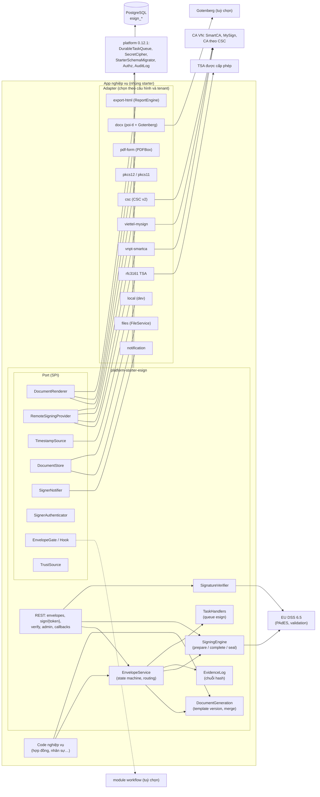
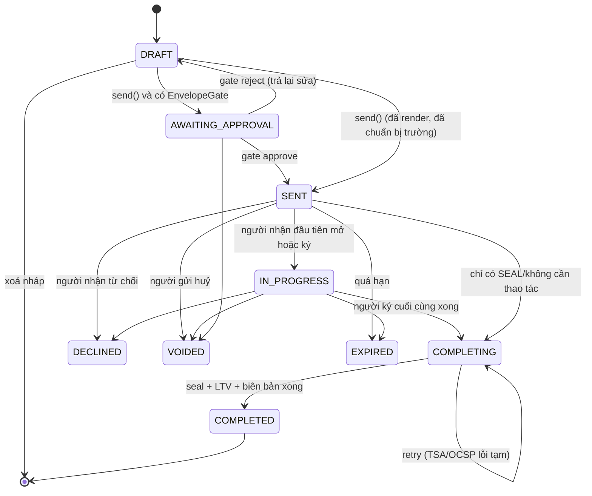
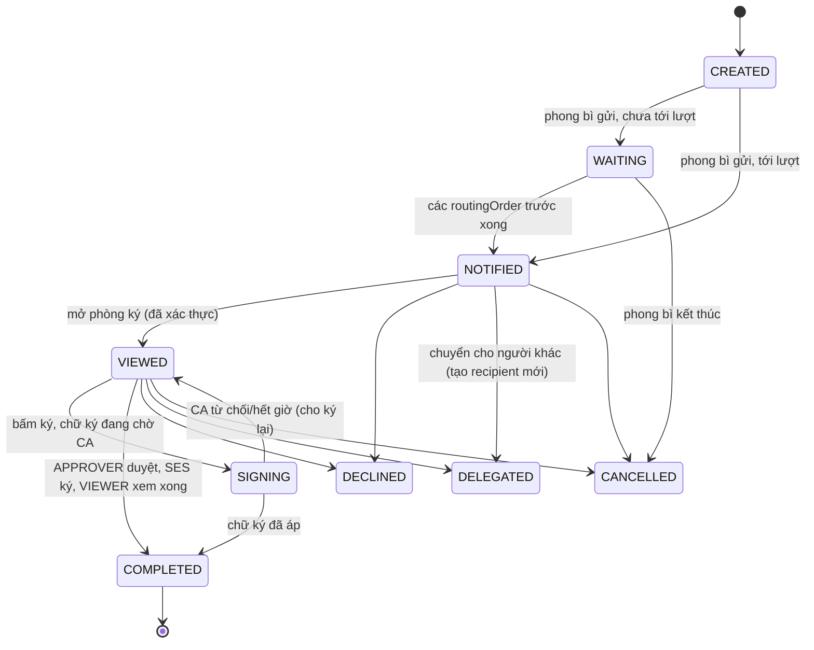
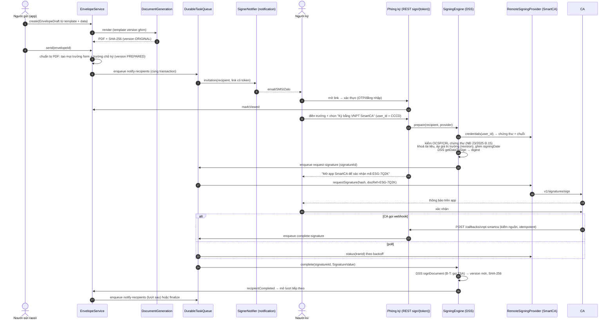
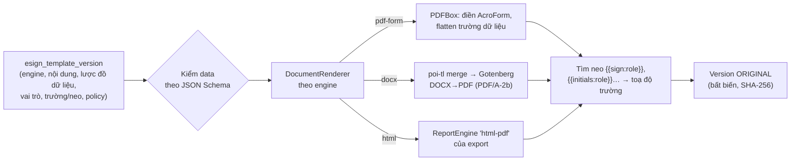
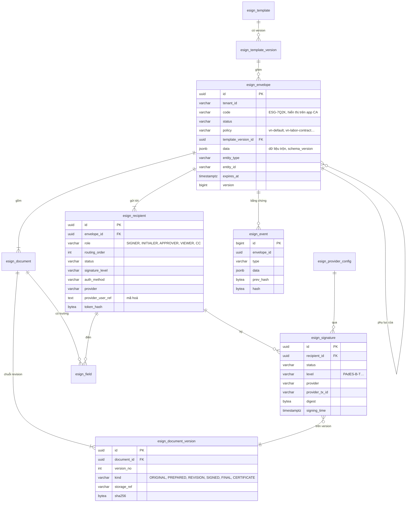

# Thiết kế module esign: sinh tài liệu, luồng ký và chữ ký số (`platform-starter-esign` + `@vyforge/esign`)

> **Trạng thái:** bản thiết kế chờ duyệt (26/10/2026), giai đoạn 1 của session forge-47. Theo
> [quy ước module](#phụ-lục-a-quy-ước-áp-dụng) (gồm mục 5: khối dùng chung của platform-java 0.12.1, và mục 6: đóng gói
> độc lập, admin microfrontend). Bản triển khai đầu đặt version `0.13.0-SNAPSHOT`.
>
> **Phạm vi:** sinh tài liệu từ template có version (PDF form, DOCX, HTML) và trộn dữ liệu; phong bì ký (envelope) gồm nhiều
> tài liệu, nhiều bên ký theo thứ tự hoặc song song, có ký nháy, duyệt, xem, nhận bản sao; ba mức chữ ký (chữ ký điện tử
> đơn giản, chữ ký số công cộng của cá nhân hoặc tổ chức, con dấu điện tử của tổ chức); ký số từ xa qua CA Việt Nam bằng
> adapter (VNPT SmartCA, Viettel MySign, chuẩn CSC cho FPT-CA, BKAV-CA và CA khác); PAdES (bản sau: XAdES, CAdES) có dấu
> thời gian TSA, LTV; kiểm tra chữ ký; lưu trữ chống sửa (hash, chuỗi bằng chứng), biên bản ký.
>
> **Không làm:** cấp chứng thư số, giữ khoá bí mật của người dùng cuối (khoá nằm ở CA hoặc HSM của khách hàng), làm "nhà
> cung cấp dịch vụ chứng thực hợp đồng điện tử" hay "nhà cung cấp eContract" (đây là dịch vụ tin cậy phải có giấy phép;
> module chỉ có cổng để nối tới nhà cung cấp đó), phát hành hoá đơn điện tử (thuộc `-einvoice`/billing).

Mục lục:
1. [Bài toán và phạm vi](#1-bài-toán-và-phạm-vi)
2. [Nghiên cứu](#2-nghiên-cứu)
3. [Kiến trúc](#3-kiến-trúc)
4. [Mô hình dữ liệu](#4-mô-hình-dữ-liệu)
5. [API](#5-api)
6. [Mở rộng](#6-mở-rộng)
7. [Vận hành](#7-vận-hành)
8. [Bảo mật và tuân thủ](#8-bảo-mật-và-tuân-thủ)
9. [Kế hoạch triển khai](#9-kế-hoạch-triển-khai)
10. [Lệch quy ước và quyết định cần người dùng chọn](#10-lệch-quy-ước-và-quyết-định-cần-người-dùng-chọn)
11. [Đóng gói và triển khai độc lập](#11-đóng-gói-và-triển-khai-độc-lập)

---

## 1. Bài toán và phạm vi

### 1.1 Vì sao cần một module riêng

Gần như mọi dự án nghiệp vụ ở Việt Nam đều có bước "lập văn bản rồi ký": hợp đồng mua bán, hợp đồng lao động, phụ lục,
biên bản nghiệm thu, đề nghị thanh toán, quyết định nội bộ. Từ khi Luật Giao dịch điện tử 20/2023/QH15 có hiệu lực
(01/07/2024) và Nghị định 23/2025/NĐ-CP thay Nghị định 130/2018 (10/04/2025), chữ ký số từ xa trên điện thoại (VNPT SmartCA,
Viettel MySign, Bkav Remote Signing trên VNeID…) thành phổ biến. Không có module chung thì mỗi dự án tự làm lại các phần khó
và dễ sai:

- tính hash đúng vùng `ByteRange` của PDF, chờ người dùng xác nhận trên app của CA (bất đồng bộ, có thể mất vài phút), rồi
  nhúng chữ ký CMS vào đúng chỗ đã chừa;
- nhiều người ký cùng một PDF: mỗi chữ ký là một bản cập nhật tăng dần (incremental update), không được làm hỏng chữ ký
  trước; các trường phải tạo sẵn trước chữ ký đầu tiên, nếu không chữ ký trước bị báo "tài liệu đã bị sửa";
- dấu thời gian, nhúng trạng thái thu hồi (OCSP/CRL) để chữ ký còn kiểm được khi chứng thư hết hạn (LTV);
- chống sửa, nhật ký bằng chứng, biên bản ký có giá trị khi tranh chấp;
- đúng luật: ai được ký thay, khi nào cần chữ ký số chứ không chỉ chữ ký điện tử, khi nào cần dấu thời gian.

Module `export` đã có engine sinh PDF tiếng Việt (`html-pdf`) và SPI `DocumentSigner` đồng bộ (ký PKCS#12 một lần, không
có luồng nhiều bên). esign không làm lại engine đó (mục 3.6) mà bổ sung phần còn thiếu: **luồng ký nhiều bên, ký từ xa
bất đồng bộ, PAdES mức LT/LTA, kiểm tra chữ ký, bằng chứng**.

### 1.2 Phạm vi

| Nhóm | Có trong module | Không làm, hoặc để bản sau |
|---|---|---|
| Sinh tài liệu | Template có version: **PDF có AcroForm** (điền trường bằng PDFBox, không cần service ngoài), **DOCX** (trộn bằng poi-tl, đổi sang PDF qua Gotenberg/LibreOffice), **HTML** (qua engine `html-pdf` của export khi có). Lược đồ dữ liệu (JSON Schema) cho từng version. Vai trò người ký và vị trí trường định nghĩa sẵn trong template (toạ độ hoặc **neo chữ** như `{{sign:ben_a}}`) | Trình soạn văn bản WYSIWYG trong trình duyệt; soạn thảo cộng tác (thuộc module collaboration) |
| Phong bì ký | Nhiều tài liệu; người nhận có vai trò **SIGNER, INITIALER (ký nháy), APPROVER (duyệt không ký), VIEWER, CC**; thứ tự ký (`routingOrder`, cùng số thì song song); hạn ký, nhắc ký, từ chối có lý do, uỷ quyền ký thay (nếu template cho phép), huỷ phong bì, sửa người nhận khi chưa tới lượt | Định tuyến có điều kiện phức tạp (dùng module workflow, 3.8) |
| Mức chữ ký | **SES**: chữ ký điện tử đơn giản (vẽ/gõ/ảnh + OTP), được niêm phong bằng con dấu điện tử của tenant; **DIGITAL**: chữ ký số công cộng của người ký (ký từ xa qua CA, hoặc PKCS#12/HSM của tổ chức); **SEAL**: chữ ký số của tổ chức tự động (không người thao tác). Mức tối thiểu đặt theo template và theo từng người nhận | Ký bằng USB token qua plugin trình duyệt (để bản sau, adapter `local-agent`) |
| Chuẩn | **PAdES baseline B-B, B-T, B-LT, B-LTA** (ETSI EN 319 142-1) bằng EU DSS; RFC 3161 TSA; kiểm tra chữ ký PDF (PAdES và chữ ký PDF kiểu cũ `adbe.pkcs7.detached`) | XAdES, CAdES, ASiC (DSS đã có, bật ở bản sau khi có dự án ký XML/tờ khai), JAdES |
| Ký từ xa | SPI `RemoteSigningProvider`; adapter **VNPT SmartCA** (API v1 xác nhận trên app, v2 TOTP), **Viettel MySign** (API bất đồng bộ), **CSC v2** (chuẩn Cloud Signature Consortium, cho CA nào hỗ trợ), **pkcs12** và **pkcs11** (khoá của tổ chức), **mock** cho test | Adapter riêng FPT-CA, BKAV-CA khi có tài liệu API và sandbox (chưa tìm thấy tài liệu công khai, mục 2.4) |
| Xác thực người ký | Link có token; OTP qua email/SMS (dùng notification); đăng nhập tài khoản (OIDC của platform); xác nhận trên app CA (kèm theo mức DIGITAL); eKYC (khi có module ekyc) | Gọi video chứng kiến (in-person signing) |
| Lưu trữ, bằng chứng | Mỗi version tài liệu có SHA-256; **chuỗi sự kiện có hash nối nhau** (tamper-evident); biên bản ký PDF (thời điểm, IP, người ký, chứng thư, hash) được niêm phong; legal hold và retention qua module files; gia hạn dấu thời gian lưu trữ (re-timestamp LTA) theo lịch | Lưu trữ lâu dài theo chuẩn evidence record (RFC 4998), để bản sau |
| Kiểm tra | API và màn hình kiểm tra PDF bất kỳ (tải lên), báo cáo kết quả bằng tiếng Việt/Anh; danh sách tin cậy gồm chứng thư gốc của NEAC (cả gốc cũ và gốc mới) cấu hình được | Trusted List EU tự động (DSS có, bật khi có dự án xuyên biên giới) |
| Tích hợp | Event công khai; nối workflow (duyệt trước khi gửi, bước ký trong quy trình), notification (mời ký, OTP, nhắc), files (lưu file), export (render HTML, ký PDF in ra), realtime (trạng thái), webhooks (gửi ra ngoài) | |
| Frontend | `@vyforge/esign`: phòng ký (xem PDF, điền trường, ký), soạn phong bì và đặt trường, theo dõi trạng thái, kiểm tra chữ ký; `@vyforge/esign-admin`: template, cấu hình CA, TSA, danh sách tin cậy, tra cứu phong bì | |

### 1.3 Kịch bản nghiệp vụ phải đáp ứng

| # | Kịch bản | Điểm khó | Cách module đáp ứng |
|---|---|---|---|
| K1 | **Hợp đồng mua bán B2B hai bên**: bên bán sinh hợp đồng từ template, giám đốc bên bán ký số bằng SmartCA, rồi gửi giám đốc bên mua (ngoài hệ thống) ký bằng MySign | Hai CA khác nhau; bên mua không có tài khoản; chờ xác nhận trên điện thoại | Phong bì `routingOrder` 1 → 2; mỗi người nhận chọn provider; người ngoài vào bằng link + OTP; ký từ xa bất đồng bộ (3.4) |
| K2 | **Ký nháy rồi mới ký chính**: chuyên viên soạn, trưởng phòng ký nháy từng trang, giám đốc ký số và đóng dấu (con dấu điện tử của công ty) | Ký nháy phải có trên mọi trang và phải xong trước giám đốc | Vai trò `INITIALER` với trường `INITIALS` lặp mỗi trang (`repeat: everyPage`), thứ tự 1; giám đốc `SIGNER` thứ tự 2; `SEAL` tự động sau cùng (3.3) |
| K3 | **Hợp đồng lao động điện tử hàng loạt** (Nghị định 337/2025/NĐ-CP, hiệu lực 01/01/2026): 300 nhân viên mới, mỗi người một hợp đồng; người sử dụng lao động ký trước bằng chữ ký số tổ chức, người lao động ký sau | Hợp đồng lao động điện tử phải có chữ ký số và dấu thời gian; phải gửi lên Nền tảng hợp đồng lao động điện tử qua nhà cung cấp eContract trong 24 giờ | Gửi hàng loạt (`bulkSend`) từ một template + danh sách dữ liệu; `SEAL` cho người sử dụng lao động; dấu thời gian bắt buộc theo policy `vn-labor-contract`; SPI `ContractRegistryPublisher` để nối nhà cung cấp eContract có giấy phép (6.7) |
| K4 | **Phụ lục hợp đồng** sinh từ template version 3, trong khi hợp đồng gốc đã ký bằng version 2 | Template đổi, tài liệu đã ký không được đổi theo | Phong bì ghim `template_version_id`; tài liệu đã render lưu bất biến; phong bì liên kết phong bì gốc (`relatedEnvelopeId`) |
| K5 | **Đề nghị thanh toán qua quy trình duyệt 3 cấp** (module workflow), cấp cuối ký số rồi hệ thống đóng dấu | Duyệt và ký là hai việc khác nhau; quy trình nằm ở module khác | Workflow gọi `EnvelopeService.send` ở bước "ký", nghe `EnvelopeCompleted` để đi tiếp; hoặc esign gọi `EnvelopeGate` (workflow cài) trước khi gửi (3.8) |
| K6 | **Biên bản nghiệm thu nhiều bên ký song song** (chủ đầu tư, tư vấn giám sát, nhà thầu), ai ký trước cũng được | Ba người ký từ xa gần như cùng lúc trên một PDF | Cùng `routingOrder`; áp chữ ký tuần tự bằng khoá theo tài liệu (3.5): chữ ký thứ hai chuẩn bị trên bản đã có chữ ký thứ nhất |
| K7 | **Khách hàng cá nhân ký đơn đăng ký dịch vụ trên app** (fintech, bảo hiểm) với chữ ký điện tử đơn giản + OTP SMS, có eKYC | Không phải ai cũng có chữ ký số; phải chứng minh được ý chí ký khi tranh chấp | Mức `SES` + xác thực `SMS_OTP` (+ `EKYC` khi có module ekyc); biên bản ký ghi đủ bằng chứng; tenant niêm phong bằng `SEAL` (3.3, 8.2) |
| K8 | **Người nhận từ chối ký** hoặc **phong bì hết hạn** | Phải dừng các người sau, báo người gửi, không để bản dở dang trông như bản hoàn tất | State machine (3.2): `DECLINED`/`EXPIRED`, khoá tài liệu, bản tải xuống có watermark "CHƯA HOÀN TẤT" |
| K9 | **Ký thay theo uỷ quyền**: phó giám đốc ký thay giám đốc đang đi công tác | Ký thay dựa trên chức danh ghi trên chứng thư (Nghị định 23/2025, Điều 13); phải có vết uỷ quyền | Người nhận `delegate` cho người khác nếu template cho phép (`allowDelegation`), ghi sự kiện `RECIPIENT_DELEGATED` kèm lý do; trường "ký thay"/"KT." điền tự động vào khối chữ ký |
| K10 | **Kiểm tra chữ ký một hợp đồng nhận từ đối tác** (PDF đã ký bằng USB token ở nơi khác) | Chứng thư VN chạy theo gốc NEAC (gốc cũ và gốc mới cùng còn hiệu lực); cần báo cáo dễ hiểu | `POST /verify`: DSS kiểm, danh sách tin cậy cấu hình (6.5); kết quả từng chữ ký: hợp lệ/không/không xác định, lý do tiếng Việt |
| K11 | **Hợp đồng khung lưu 10 năm**: sau 3 năm chứng thư người ký hết hạn, kiểm tra lại vẫn phải hợp lệ | Chứng thư hết hạn, OCSP không còn trả lời | PAdES B-LT lúc hoàn tất (nhúng OCSP/CRL), B-LTA (dấu thời gian tài liệu); job gia hạn dấu thời gian trước khi chứng thư TSA hết hạn (3.7) |
| K12 | **Sinh chứng từ hàng loạt có con dấu điện tử, không cần người ký**: thư xác nhận công nợ, giấy xác nhận | Không có người thao tác, phải nhanh | `SEAL` đồng bộ (pkcs12/pkcs11/HSM hoặc tài khoản ESEAL của SmartCA ở chế độ ký tự động) qua `DocumentSigning.seal`, hoặc qua SPI `DocumentSigner` của export (3.6) |
| K13 | **Đổi người nhận khi đã gửi** (gõ nhầm email người thứ 2, người 1 đã ký) | Không được làm mất chữ ký đã có | Sửa người nhận chưa tới lượt hoặc chưa mở: cho phép, ghi sự kiện; người đã ký: không sửa |
| K14 | **Gửi qua Zalo hoặc SMS thay email**, người dùng lớn tuổi | Kênh tuỳ vùng | Lời mời ký là notification type `esign.invitation`; kênh do notification định tuyến (email, SMS, Zalo ZNS) |
| K15 | **Tenant dùng CA riêng của mình** (một ngân hàng có HSM và CA nội bộ dùng chữ ký điện tử chuyên dùng) | Không phải chữ ký số công cộng; CA nội bộ phải nằm trong danh sách tin cậy của tenant | Provider `pkcs11` hoặc `csc` trỏ về hệ thống của tenant; danh sách tin cậy theo tenant (6.5) |

Kịch bản tương lai đã tính chỗ mở rộng: ký XML (tờ khai, hồ sơ dịch vụ công) bằng XAdES; nối nhà cung cấp eContract để gắn
mã hợp đồng lao động lên Nền tảng; ký tại quầy trên máy tính bảng; công chứng điện tử; gửi phong bì giữa hai hệ thống
Vyforge của hai doanh nghiệp.

---

## 2. Nghiên cứu

Kiểm ngày 26/10/2026 bằng GitHub API, Maven Central, npm và trang chính thức.

### 2.1 Hệ thống tham khảo

| Hệ thống | Phiên bản, license | Mô hình dữ liệu | API | Điểm mạnh | Điểm yếu, rủi ro |
|---|---|---|---|---|---|
| **DocuSign eSignature** (SaaS) | REST API v2.1; SDK Java [`docusign-esign-java-client`](https://github.com/docusign/docusign-esign-java-client) v6.9.0 (15/10/2026), MIT | `Envelope` (status `created → sent → delivered → completed`, nhánh `declined`, `voided`); `Recipients` chia theo loại: `signers`, `carbonCopies`, `certifiedDeliveries`, `inPersonSigners`, `agents`, `intermediaries`, `editors`, `witnesses`, `notaries`, `seals`; `routingOrder` (cùng số là song song); `tabs` (trường) gắn vào recipient và document; `recipientSignatureProviders` cho chữ ký theo chuẩn (digital) | REST, Connect (webhook có HMAC), template server-side, bulk send, embedded signing (URL ký trả cho app) | Mô hình người nhận và routing đã chín; embedded signing; trạng thái phong bì rõ ràng; seal tự động | SaaS, dữ liệu ra nước ngoài; chữ ký số VN không có sẵn; nhiều loại recipient hơn mức cần |
| **Documenso** ([GitHub](https://github.com/documenso/documenso)) | v2.21.1 (22/10/2026), **AGPL-3.0**, TypeScript/Prisma | `Envelope` (`DRAFT, PENDING, COMPLETED, REJECTED, CANCELLED`), `EnvelopeItem` (nhiều tài liệu), `DocumentData` (giữ `data` và `initialData`), `Recipient` (`role: SIGNER, APPROVER, VIEWER, CC, ASSISTANT`; `signingOrder`; `readStatus/sendStatus/signingStatus` tách ba cột; `token`; `authOptions` JSON; `expiresAt`, `nextReminderAt`), `Field` (page, x, y, w, h theo %; `fieldMeta` JSON), `DocumentAuditLog` (type + data JSON + IP, UA), `signatureLevel` theo phong bì; **`CscCredential` và `CscSession`** (ký từ xa theo chuẩn CSC: thời điểm ký ghim lúc chuẩn bị để hash khớp, SAD mã hoá) | tRPC + REST v2, webhook, template, direct link | Mô hình gọn, ba trạng thái tách riêng của recipient; tài liệu gốc và tài liệu hiện tại; **chia hai pha prepare/sign cho ký từ xa**, ghim `signingTime` và `documentDataId` để hash không lệch | AGPL: không nhúng hay copy code, chỉ học mô hình; ký số PAdES mức LT/LTA hạn chế; một tenant = team |
| **DocuSeal** ([GitHub](https://github.com/docusealco/docuseal)) | 3.3.4 (26/10/2026), **AGPL-3.0**, Ruby on Rails | Template (fields, submitters), Submission, Submitter | REST, webhook, embed (web component) | Trình đặt trường bằng kéo thả tốt; trường tạo từ PDF có sẵn; PDF form → template | AGPL; chữ ký số dựa vào chứng thư của máy chủ |
| **OpenSign** ([GitHub](https://github.com/OpenSignLabs/OpenSign)) | v3.0.1 (26/10/2026), AGPL-3.0 (trừ thư mục `customRoute`), Parse Server/MongoDB | Document có danh sách signer và placeholder; template; drive | REST API v1.1, webhook | Ký theo thứ tự, OTP email cho khách, hết hạn, từ chối có lý do, biên bản hoàn tất (completion certificate) có log IP và thời điểm | AGPL; MongoDB/Parse không khớp nền tảng; chữ ký số chỉ là chữ ký của máy chủ |
| **EU DSS** ([GitHub](https://github.com/esig/dss)) | **6.5.1** (14/10/2026), **LGPL-2.1**, Java 8+ (bản 6.x dùng `jakarta.*`); Maven `eu.europa.ec.joinup.sd-dss`, có `dss-bom`; kéo theo PDFBox 3.0.8, Bouncy Castle 1.86 | Thư viện, không có mô hình nghiệp vụ. Khái niệm: `DSSDocument`, `PAdESSignatureParameters` (level, `signingDate`, chuỗi chứng thư, trường ký, hình hiển thị), `ToBeSigned` → `SignatureValue` (ký ngoài), `CertificateVerifier` (nguồn tin cậy, OCSP, CRL, AIA), `TSPSource`, `SignedDocumentValidator` → simple/detailed/diagnostic report | `PAdESService.getDataToSign()` → ký ở đâu cũng được (HSM, CA từ xa) → `signDocument()`; `extendDocument()` lên LT/LTA; `timestamp()`; module `dss-pades-pdfbox`, `dss-xades`, `dss-cades`, `dss-tsl-validation`, `dss-crl-parser-x509crl` | Chuẩn ETSI đầy đủ (B-B → B-LTA), validation đầy đủ, được EC duy trì, tương thích PDFBox 3 mà export đã dùng | Lớn (chỉ lấy module cần); LGPL-2.1: dùng như thư viện qua Maven, không sửa mã nguồn là ổn; mặc định thiên về trusted list EU, phải tự cấu hình nguồn tin cậy VN |
| **CSC API** ([Cloud Signature Consortium](https://cloudsignatureconsortium.org/resources/download-api-specifications/)) | v2.2 (06/11/2025); bản [v2.0.0.2 PDF](https://cloudsignatureconsortium.org/wp-content/uploads/2023/04/csc-api-v2.0.0.2.pdf) | `credentials/list`, `credentials/info` (chuỗi chứng thư, thuật toán), `credentials/authorize` (trả **SAD**), `signatures/signHash`; OAuth2 với scope `service` và `credential` | REST/JSON | Chuẩn chung cho ký từ xa; Documenso và nhiều TSP châu Âu dùng; Viettel MySign có nhánh API theo kiểu CSC (`/ras/csc/v1/credentials/...`) | CA VN mới theo một phần, mỗi CA một biến thể |

### 2.2 Thư viện cho sinh tài liệu và giao diện

| Thư viện | Phiên bản, license | Dùng vào |
|---|---|---|
| Apache PDFBox | 3.0.8, Apache-2.0 (cùng bản với export và DSS 6.5.1) | Điền AcroForm, tạo trường chữ ký và trường form trước khi ký, tìm neo chữ để đặt trường, gộp PDF, đếm trang |
| [poi-tl](https://github.com/Sayi/poi-tl) `com.deepoove:poi-tl` | 1.12.2 (bản ổn định cuối, 01/2024; có 1.12.3-beta1), Apache-2.0 | Trộn dữ liệu vào DOCX (`{{field}}`, bảng lặp, ảnh). Dự án ít release; nếu ngừng hẳn thì thay bằng docx4j (Apache-2.0) sau cùng interface `DocxMerger` |
| [Gotenberg](https://github.com/gotenberg/gotenberg) | 8.38.1 (15/10/2026), MIT | DOCX → PDF (LibreOffice), có PDF/A. Đã là engine tuỳ chọn của export; dùng chung cấu hình URL |
| `html-pdf` của export (Thymeleaf + OpenHTMLtoPDF 1.1.x, LGPL-2.1+) | theo export | Template HTML: gọi qua SPI `ReportEngine` của export khi có (3.6) |
| [pdfjs-dist](https://www.npmjs.com/package/pdfjs-dist) | 6.4.299, Apache-2.0 | Hiển thị PDF trong phòng ký và trình đặt trường |
| [signature_pad](https://www.npmjs.com/package/signature_pad) | 5.1.4, MIT | Vẽ chữ ký tay (mức SES) |

### 2.3 Pháp lý Việt Nam (bản hiện hành, kiểm 26/10/2026)

| Văn bản | Hiệu lực | Điểm áp dụng vào thiết kế |
|---|---|---|
| **Luật Giao dịch điện tử 20/2023/QH15** ([toàn văn](https://caselaw.vn/van-ban-phap-luat/411469-luat-giao-dich-dien-tu-so-20-2023-qh15-ngay-22-06-2023-cua-quoc-hoi), [Bộ KH&CN](https://mst.gov.vn/van-ban-phap-luat/24987.htm)) | 01/07/2024; một điểm được sửa bởi Luật Dữ liệu 60/2024/QH15 (từ 01/07/2025) | **Điều 22**: ba loại chữ ký điện tử theo phạm vi: chuyên dùng của cơ quan tổ chức, **chữ ký số công cộng**, chữ ký số chuyên dùng công vụ; chữ ký số phải phát hiện được mọi thay đổi sau khi ký. **Điều 23**: chữ ký điện tử không bị phủ nhận giá trị chỉ vì ở dạng điện tử; chữ ký điện tử chuyên dùng bảo đảm an toàn hoặc chữ ký số **tương đương chữ ký tay**; văn bản cần cơ quan/tổ chức xác nhận thì ký bằng chữ ký số **của chính tổ chức đó** (căn cứ cho mức `SEAL`). **Điều 13**: điều kiện lưu trữ thông điệp dữ liệu (truy cập được, đúng định dạng, xác định được nguồn gốc, người gửi, người nhận, thời điểm). **Điều 15, 17**: thời điểm gửi/nhận. **Điều 28**: ba dịch vụ tin cậy (dấu thời gian, chứng thực thông điệp dữ liệu, chứng thực chữ ký số công cộng). **Điều 31**: dấu thời gian tạo dưới dạng chữ ký số. **Điều 34–38**: hợp đồng điện tử, kể cả giao kết qua hệ thống tự động. **Điều 26–27**: chữ ký và chứng thư nước ngoài |
| **Nghị định 23/2025/NĐ-CP** về chữ ký điện tử và dịch vụ tin cậy ([caselaw.vn](https://caselaw.vn/van-ban-phap-luat/411540-nghi-dinh-so-23-2025-nd-cp-ngay-21-02-2025-cua-chinh-phu-quy-dinh-ve-chu-ky-dien-tu-va-dich-vu-tin-cay), [Thư viện Pháp luật](https://thuvienphapluat.vn/van-ban/thue-phi-le-phi/decree-23-2025-nd-cp-digital-signatures-and-trust-services-649650.aspx)) | 10/04/2025; thay NĐ 130/2018 và NĐ 48/2024 | **Điều 13**: ký thay, ký thừa lệnh dựa trên chức danh ghi trên chứng thư. **Điều 15**: **trước khi ký**, người ký phải kiểm tra trạng thái chứng thư của mình và của CA cấp; một trong hai hết hiệu lực thì không được ký → module kiểm OCSP/CRL ở bước chuẩn bị. **Điều 16**: người nhận phải kiểm trạng thái, phạm vi, thông tin chứng thư và chữ ký → API kiểm tra. **Điều 17**: phần mềm ký số phải xác thực người ký, kiểm hiệu lực chứng thư, lưu thông tin kèm theo, thông báo kết quả. **Điều 26**: ba mô hình chứng thực chữ ký số công cộng: thiết bị phần cứng, thiết bị di động, **ký số từ xa** (CA giữ khoá trong thiết bị an toàn). Thời hạn tối đa chứng thư thuê bao 3 năm (nên LTV là bắt buộc cho hợp đồng dài hạn) |
| **Thông tư 15/2025/TT-BKHCN** yêu cầu kỹ thuật với phần mềm ký số, phần mềm kiểm tra chữ ký số và Cổng kết nối dịch vụ chứng thực chữ ký số công cộng ([LSVN](https://lsvn.vn/bo-kh-cn-huong-dan-yeu-cau-ky-thuat-doi-voi-phan-mem-ky-so-phan-mem-kiem-tra-chu-ky-so-a162288.html)) | 2025 (chưa xác minh ngày hiệu lực) | Kiểm thông tin và hiệu lực chứng thư trước khi ký; gắn chữ ký, chứng thư, thời điểm ký vào tài liệu; dấu thời gian khi luật yêu cầu; cài và cập nhật chứng thư của NEAC, CA công cộng và danh sách tin cậy nước ngoài được công nhận; **đường tin cậy phải về chứng thư gốc của NEAC**; **lưu chứng thư dùng lúc ký, danh sách thu hồi tại thời điểm ký và kết quả kiểm trạng thái** (khớp PAdES B-LT); **hiển thị kết quả bằng tiếng Việt**. Phụ lục I, II chưa đọc được toàn văn: phải đối chiếu trước khi khẳng định module "đáp ứng TT 15/2025" (Q5) |
| **Thông tư 28/2025/TT-BKHCN** định dạng thông tin chứng thư chữ ký số ([TVPL](https://thuvienphapluat.vn/ma-so-thue/phap-luat-thue/toan-van-thong-tu-282025ttbkhcn-ve-dinh-dang-thong-tin-chung-thu-chu-ky-so-214321.html)) | Ban hành 03/11/2025 | Đọc `UID` (CCCD, MST…) trong subject để đối chiếu người ký với hồ sơ (VNPT trả `UID=CCCD:…`) |
| **Chứng thư gốc quốc gia**: NEAC tạo khoá và cấp chứng thư gốc mới mang tên Bộ KH&CN; chứng thư cấp từ gốc cũ vẫn dùng đến khi hết hạn ([Báo Pháp luật](https://baophapluat.vn/chinh-thuc-chuyen-doi-ha-tang-root-ca-quoc-gia-nang-tam-dich-vu-tin-cay-viet-nam.html)) | Đang chuyển đổi | Danh sách tin cậy phải chứa **nhiều gốc** và cập nhật được không cần deploy (6.5) |
| **Nghị định 337/2025/NĐ-CP** về hợp đồng lao động điện tử ([MISA](https://amis.misa.vn/259491/nghi-dinh-337-2025-nd-cp/), [TVPL](https://thuvienphapluat.vn/lao-dong-tien-luong/hop-dong-lao-dong-dien-tu-co-hieu-luc-khi-nao-53352.html)) | 01/01/2026; Nền tảng HĐLĐ điện tử vận hành chậm nhất 01/07/2026 | Hai bên phải có **chữ ký số và dấu thời gian**; giao kết qua nhà cung cấp eContract có giấy phép dịch vụ tin cậy (chứng thực thông điệp dữ liệu); hợp đồng có hiệu lực từ khi bên sau cùng ký; nhà cung cấp gửi lên Nền tảng trong 24 giờ để gắn ID → K3, policy `vn-labor-contract`, SPI `ContractRegistryPublisher` |
| **Luật Thương mại điện tử 122/2025/QH15** ([LuatVietnam](https://luatvietnam.vn/tin-van-ban-moi/da-co-luat-thuong-mai-dien-tu-2025-so-122-2025-qh15-186-106402-article.html)) | 01/07/2026 | Định nghĩa "dịch vụ chứng thực hợp đồng điện tử trong thương mại" là dịch vụ của bên thứ ba lưu trữ và xác nhận toàn vẹn hợp đồng; tổ chức đăng ký trước được hoạt động đến 30/06/2027. Module **không** đóng vai trò này; chỉ có cổng `ContractRegistryPublisher` |
| Luật Bảo vệ dữ liệu cá nhân 91/2025/QH15, NĐ 356/2025/NĐ-CP | 01/01/2026 | Mục 8.2 |

Tài liệu của chính các văn bản trên ghi trách nhiệm cho "người ký", "người nhận" và "phần mềm ký số". Module là phần mềm ký
số và phần mềm kiểm tra chữ ký nhúng trong app của khách hàng; việc khách hàng có phải đăng ký, chứng nhận phần mềm với Bộ
KH&CN hay không phụ thuộc phụ lục của TT 15/2025: ghi thành Q5.

### 2.4 API của CA Việt Nam (đọc tài liệu thật)

| CA | Tài liệu | Luồng | Ghi chú cho adapter |
|---|---|---|---|
| **VNPT SmartCA** | [Tài liệu tích hợp SmartCA](https://doitac-smartca.vnpt.vn/help/document/Tai_lieu_tich_hop_smartca_v4.1.pdf), phiên bản tài liệu 4.0.0 (03/05/2024); [cổng đối tác](https://doitac-smartca.vnpt.vn/tich-hop-ky-so) | `POST {base}/v1/credentials/get_certificate` (`sp_id`, `sp_password`, `user_id` = số CCCD/hộ chiếu/MST, `serial_number?`, `transaction_id`) → danh sách chứng thư kèm `cert_data`, `chain_data`, `service_type` (`SMARTCA`, `ESEAL`). `POST {base}/v1/signatures/sign` với `sign_files[]` (`data_to_be_signed` = hash dạng hex, `doc_id` hiển thị trên app, `file_type`, `sign_type: hash`) → `sig_wait_for_user_confirm` + `tran_code`. Người dùng xác nhận trên app SmartCA. Kết quả qua **webhook** của SP (`signed_files[].signature_value`, `timestamp_signature`) hoặc **poll** `POST {base}/v1/signatures/sign/{tranId}/status`. Tài khoản "SmartCA TH": `v2/signatures/sign` + `v2/signatures/confirm` với TOTP, ký không cần bấm trên app | UAT `https://rmgateway.vnptit.vn/sca/sp769`, production `https://gwsca.vnpt.vn/sca/sp769`. **Chỉ ký hash.** Một lần gửi ký nhiều hash (lô). `doc_id` phải hiển thị ở cả hai phía → dùng mã phong bì ngắn. Chưa rõ `signature_value` là chữ ký thô (PKCS#1) hay CMS: adapter khai báo `SignatureFormat` và test trên sandbox (9.4). Tài liệu trên cổng là v4.x, có thể đã có bản mới |
| **Viettel-CA MySign** | [Hướng dẫn tích hợp API ký bất đồng bộ](https://viettel-ca.vn/ho-tro/viettelca/huong-dan-su-dung/huong-dan-tich-hop-api-ky-bat-dong-bo-asynchronize-dich-vu-mysign) (trang không ghi version); [trang tải tài liệu](https://viettel-ca.vn/tai-ve/viettel-ca-download) | `POST {base}/vtss/service/ras/v1/login` (`client_id`, `client_secret`, `user_id`, `profile_id?`) → Bearer token (ví dụ 3.600 giây). `POST {base}/adss/service/ras/csc/v1/credentials/list` → `credential_id`, `SCAL: "2"`, `authMode: implicit`. `POST {base}/vtss/service/signHash` (`credentialID`, `numSignatures`, `hash[]` base64, `hashAlgo` OID, `signAlgo` OID, `async: 1`) → `transactionId`. `POST {base}/vtss/service/requests/status` → `status` `1` thành công, `4000` chờ xác nhận, `4001` hết giờ, `4002` người dùng từ chối, `4004` lỗi ký | Không có webhook trong tài liệu → **poll** có backoff. Tên trường theo kiểu CSC nhưng không phải CSC chuẩn → adapter riêng. Tên tài liệu và mô tả phải base64, ≤ 100 ký tự, chỉ chữ, số, `_`, `-`, khoảng trắng |
| **Bkav-CA Remote Signing** | [remotesigning.bkavca.vn](https://remotesigning.bkavca.vn/), [quy chế chứng thực](https://remotesigning.bkavca.vn/documents/33134/52312/CPS.pdf) | Đã tích hợp vào VNeID; tích hợp với hoá đơn, thuế, BHXH, hợp đồng điện tử | **Không tìm thấy tài liệu API công khai.** Dùng adapter `csc` nếu Bkav cung cấp API CSC, nếu không thì viết adapter khi có hợp đồng và sandbox |
| **FPT-CA** | Không tìm thấy tài liệu API ký từ xa công khai | — | Như Bkav |

Kết luận: hai CA lớn có API công khai đều theo mô hình **gửi hash → người dùng xác nhận trên điện thoại → nhận chữ ký
bất đồng bộ**. SPI phải là bất đồng bộ (`Pending` + poll hoặc callback), hỗ trợ lô nhiều hash, và hash phải tính từ một
trạng thái tài liệu được ghim (giống `CscSession` của Documenso).

### 2.5 Học theo và không làm

**Học theo:**
- Mô hình **Envelope → Document → Recipient → Field** (DocuSign, Documenso), `routingOrder` cùng số là song song, vai trò
  người nhận gọn (Documenso: SIGNER, APPROVER, VIEWER, CC) cộng **INITIALER** cho ký nháy kiểu Việt Nam.
- Tách trạng thái của người nhận thành nhiều chiều (gửi, đọc, ký) như Documenso, nhưng gộp lại trong một state machine
  có kiểm soát (3.2) và giữ `sent_at`, `viewed_at`, `signed_at` để báo cáo.
- **Chia hai pha prepare/complete** cho ký từ xa và **ghim thời điểm ký + version tài liệu** lúc prepare (Documenso
  `CscSession`), để chữ ký trả về muộn vẫn ghép được vào đúng hash.
- Tài liệu gốc bất biến và chuỗi version tăng dần (Documenso `initialData`/`data`).
- Embedded signing (DocuSign): app nghiệp vụ tự mở phòng ký cho người dùng đã đăng nhập, không bắt buộc đi qua email.
- Biên bản hoàn tất (OpenSign, DocuSign "Certificate of Completion"), webhook có ký HMAC (qua module webhooks).
- EU DSS cho mọi thao tác chuẩn (tạo PAdES, mở rộng LT/LTA, kiểm tra) thay vì tự viết bằng PDFBox như bản PKCS#12 của
  export.

**Không làm:**
- Không copy code từ Documenso, DocuSeal, OpenSign (AGPL-3.0). Chỉ học mô hình từ tài liệu và schema công khai.
- Không giữ khoá riêng của người dùng cuối, không làm CA, không làm TSA.
- Không tự làm trình soạn văn bản; template soạn bằng Word, HTML hoặc PDF form.
- Không có hàng chục loại recipient như DocuSign (agent, intermediary, notary…): vai trò mới thêm bằng `varchar` + code khi
  có dự án.
- Không tự viết engine quy trình: duyệt nhiều cấp, điều kiện, SLA là việc của module workflow.
- Không render HTML lần thứ hai: dùng `ReportEngine` của export.

---

## 3. Kiến trúc

### 3.1 Thành phần



Nguyên tắc:
- **Lõi không biết CA nào.** Lõi làm việc với hash, chứng thư và `SignatureValue`; mọi khác biệt của CA nằm trong adapter.
- **Một tài liệu, một chuỗi revision tuyến tính.** Mỗi thao tác ký là một bản cập nhật tăng dần; ghi version mới
  (`esign_document_version`) với SHA-256, không bao giờ ghi đè.
- **Mọi việc chạy lâu hoặc gọi ra ngoài đi qua `DurableTaskQueue`** (queue `esign`). Request HTTP của người ký chỉ ghi
  trạng thái và enqueue; người ký thấy "đang chờ xác nhận trên app CA".
- **Không phụ thuộc cứng module khác.** files, notification, export, workflow, ekyc đều là điểm nối `@ConditionalOnBean`/
  `@ConditionalOnClass` (mục 11.1).

### 3.2 Gói Java

| Gói | Nội dung |
|---|---|
| `com.vyforge.platform.esign` | API công khai: `EnvelopeService`, `SigningSessions`, `DocumentGeneration`, `TemplateService`, `SignatureVerification`, `DocumentSigning` (seal đồng bộ), record, enum, event |
| `…esign.spi` | `DocumentRenderer`, `RemoteSigningProvider`, `TimestampSource`, `DocumentStore`, `SignerNotifier`, `SignerAuthenticator`, `EnvelopeGate`, `EnvelopeHook`, `TrustSource`, `ContractRegistryPublisher`, `SigningPolicyResolver` |
| `…esign.core` | State machine, routing, khoá tài liệu, chuỗi bằng chứng, biên bản ký |
| `…esign.pdf` | Chuẩn bị PDF (tạo trường, neo chữ, khối chữ ký hiển thị, font tiếng Việt), áp giá trị trường |
| `…esign.dss` | Bọc EU DSS: `PadesSigner` (prepare/complete/extend), `DssVerifier`, `CertificateVerifier` theo tenant |
| `…esign.render` | `pdf-form`, `docx`, `export-html` |
| `…esign.provider.*` | `vnpt`, `viettel`, `csc`, `pkcs12`, `pkcs11`, `mock` |
| `…esign.task` | `TaskHandler` của queue `esign` |
| `…esign.web` | Controller REST, Problem Details, controller callback của CA |
| `…esign.jpa` | Entity, repository |
| `…esign.autoconfigure` | Auto-config, `EsignProperties`, health indicator |

### 3.3 State machine

**Phong bì (`esign_envelope.status`)**



- `COMPLETING` lỗi quá số lần retry thì phong bì vẫn ở `COMPLETING` với cờ `needs_attention`, task sang `DEAD`, admin
  retry (không có trạng thái "hoàn tất một nửa" mà người dùng thấy là xong).
- Phong bì `DECLINED`, `VOIDED`, `EXPIRED`: tài liệu khoá, bản tải có watermark "KHÔNG CÓ HIỆU LỰC/CHƯA HOÀN TẤT"
  (lớp phủ lúc tải, không đổi file gốc), chữ ký đã có vẫn giữ để làm bằng chứng.
- Trạng thái lưu `varchar(32)`; giá trị mới thêm ở code, không có enum trong DB.

**Người nhận (`esign_recipient.status`)**



`CC` không có lượt: nhận bản sao khi phong bì `COMPLETED`. `VIEWER` có lượt nhưng chỉ cần mở (nếu `requireView`).

**Chữ ký (`esign_signature.status`)**: `PREPARED` (đã tính hash, đã ghim thời điểm ký và version tài liệu) → `PENDING`
(đã gửi CA, chờ xác nhận) → `APPLIED` (đã nhúng, có version tài liệu mới) | `REJECTED` (người dùng từ chối trên app) |
`EXPIRED` (CA hết giờ hoặc quá `signature-timeout`) | `STALE` (version tài liệu đã đổi trước khi áp, phải chuẩn bị lại) |
`FAILED` (lỗi kỹ thuật, kèm mã).

### 3.4 Luồng chính: gửi phong bì và ký số từ xa



**Luồng lỗi và cách xử lý**

| Tình huống | Xử lý |
|---|---|
| Chứng thư của người ký bị thu hồi hoặc hết hạn (bước prepare) | Không gửi CA; lỗi `esign.certificate_invalid` kèm lý do; ghi sự kiện. Đúng NĐ 23/2025 Điều 15 |
| OCSP/CRL không trả lời | Thử lại theo backoff trong lúc prepare (tối đa `revocation-timeout`); vẫn không được thì từ chối với `esign.revocation_unavailable` (không ký "mù"). Tenant có thể cho phép "soft-fail" chỉ với mức SES niêm phong (cấu hình, mặc định tắt) |
| Người dùng từ chối trên app CA (`4002` MySign) | Chữ ký `REJECTED`, người nhận về `VIEWED`, được ký lại hoặc từ chối phong bì |
| CA hết giờ (`4001`) hoặc quá `signature-timeout` (mặc định 5 phút) | Chữ ký `EXPIRED`, mở khoá tài liệu, báo người ký |
| Webhook đến trùng, đến sau khi đã poll xong | Idempotent theo `(provider, provider_tx_id)`; trạng thái cuối không đổi |
| Webhook giả | Callback chỉ là "tín hiệu": module luôn gọi lại `status` của CA để lấy chữ ký (không tin dữ liệu trong body), cộng allowlist IP/HMAC nếu CA hỗ trợ |
| Chữ ký trả về không khớp hash (sai thuật toán, sai khoá) | Kiểm chữ ký bằng public key trong chứng thư trước khi nhúng; sai thì `FAILED` `esign.signature_mismatch`, không áp |
| TSA lỗi lúc complete | Task retry theo backoff; chữ ký giữ `PENDING_TIMESTAMP` nội bộ; quá số lần thì `DEAD` và admin retry. Chữ ký thô đã có không mất (lưu mã hoá trong `esign_signature.signature_value`) |
| App chết giữa chừng | Mọi bước là task bền vững; `complete` idempotent theo `signatureId` (đã `APPLIED` thì bỏ qua) |
| Version tài liệu đổi giữa prepare và complete | Không xảy ra vì khoá tài liệu (3.5); nếu khoá hết hạn và người khác đã ký, chữ ký thành `STALE` và người ký được mời ký lại |

### 3.5 Ký song song trên cùng một PDF

PAdES thêm chữ ký bằng bản cập nhật tăng dần. Hash của người thứ hai phải tính trên bản đã có chữ ký thứ nhất; hai người
không thể cùng ký trên cùng một bản gốc rồi ghép lại. Vì vậy:

- Mỗi tài liệu có **khoá ký** (`esign_document.signing_lock_*`): `recipientId`, `signatureId`, `expires_at` =
  `signature-timeout` + 30 giây. Lấy bằng `UPDATE … WHERE signing_lock_until < now()` (một câu SQL, không race).
- Người ký song song khi tài liệu đang khoá: phòng ký hiện "Đang có người ký, bạn sẽ được ký trong giây lát" và tự thử lại
  (hoặc nhận thông báo realtime). Ký SES không cần khoá lâu: chỉ khoá trong lúc ghi revision (mili giây).
- Một phong bì nhiều tài liệu: một yêu cầu tới CA gửi **lô nhiều hash** (SmartCA `sign_files[]`, MySign `numSignatures`),
  người ký chỉ xác nhận một lần cho cả phong bì; khoá lấy theo thứ tự `document.ordinal` để không deadlock.
- Chữ ký cần sẵn trường: mọi trường form và trường chữ ký được tạo ở bước `send` (version `PREPARED`) trước chữ ký số
  đầu tiên. Điền trường sau đó là "thay đổi được phép" (DocMDP P2: điền form và ký), nên chữ ký trước vẫn hợp lệ.
- Thêm trường hoặc người nhận sau khi đã có chữ ký số đầu tiên: không cho phép (`esign.envelope_locked`). Muốn sửa thì
  huỷ phong bì và tạo phụ lục.

### 3.6 Sinh tài liệu từ template



- **Template có version.** `esign_template` là định danh ổn định (`key`, ví dụ `hdld-xac-dinh-thoi-han`);
  `esign_template_version` bất biến khi `PUBLISHED`. Phong bì ghim version. Sửa template = tạo version mới (`DRAFT` →
  `PUBLISHED`; version cũ `RETIRED` nhưng phong bì cũ vẫn trỏ được). Template mặc định có thể nằm trong classpath
  (`META-INF/vyforge/esign/templates/<key>/`) như export, tenant ghi đè bằng version của mình.
- **Lược đồ dữ liệu.** Mỗi version có `data_schema` (JSON Schema 2020-12). App gửi `data`; sai thì `esign.data_invalid`
  kèm đường dẫn trường. Lược đồ cũng sinh form nhập dữ liệu ở admin (gửi tay).
- **Vai trò và trường.** Template khai báo vai trò (`ben_a`, `ben_b`, `nguoi_lao_dong`, `truong_phong`) với loại người nhận,
  `routingOrder` mặc định, mức chữ ký tối thiểu, xác thực tối thiểu; và trường theo **neo chữ** (văn bản ẩn trong tài liệu,
  ví dụ `{{sign:ben_a}}`, chữ trắng cỡ 1) hoặc **toạ độ** (trang, x, y, w, h theo điểm PDF). Neo bền khi nội dung dài/ngắn
  thay đổi, nên là cách mặc định cho DOCX/HTML. Ký nháy dùng `repeat: everyPage` (góc dưới phải mỗi trang, chỉnh được).
- **Engine HTML dùng export.** Khi app có `platform-starter-export`, adapter `export-html` gọi bean `ReportEngine`
  (`engine() == "html-pdf"`) với `ReportTemplate` dựng từ version của esign. Không có export thì engine `html` không bật;
  template HTML bị từ chối lúc publish (`esign.engine_unavailable`). Font tiếng Việt, helper `#vn` (số tiền bằng chữ, ngày
  tháng) đến từ export. Đề xuất tách phần render của export thành thư viện chung ở Q1 (mục 10.2).
- **Nhập tài liệu có sẵn.** Phong bì không bắt buộc dùng template: upload PDF (qua files hoặc multipart nhỏ) rồi đặt
  trường bằng trình đặt trường. DOCX upload được đổi sang PDF qua Gotenberg.
- **PDF/A.** Mặc định xuất PDF/A-2b khi engine hỗ trợ (Gotenberg, OpenHTMLtoPDF) cho lưu trữ lâu dài; ký PAdES trên PDF/A
  vẫn giữ PDF/A (chữ ký không phá chuẩn).

### 3.7 Hoàn tất, LTV và lưu trữ lâu dài

Khi người nhận cuối cùng xong, task `finalize`:

1. Áp các trường SES còn lại (nếu có) thành revision.
2. **Niêm phong** (nếu policy có `seal`): chữ ký số của tenant (provider `pkcs12`/`pkcs11`/`csc`/tài khoản ESEAL của SmartCA)
   dạng **chữ ký chứng nhận** cuối cùng hoặc chữ ký thường, mức B-T.
3. **Mở rộng LTV**: DSS `extendDocument` lên **B-LT** (nhúng chứng thư, OCSP/CRL vào DSS dictionary) rồi **B-LTA** (dấu
   thời gian tài liệu). Mức đích theo policy (mặc định `B-LTA` cho DIGITAL, `B-T` cho SES niêm phong).
4. Sinh **biên bản ký** (PDF riêng, tiếng Việt/Anh theo locale phong bì): mã phong bì, hash từng tài liệu gốc và bản cuối,
   từng người nhận (tên, email/điện thoại che một phần, phương thức xác thực, IP, user agent, thời điểm mở/ký, chứng thư:
   số serial, chủ thể, CA phát hành), chuỗi sự kiện rút gọn và hash đầu chuỗi; biên bản được niêm phong và gắn dấu thời gian.
5. Lưu bản cuối và biên bản qua `DocumentStore` (files: bucket `esign`, `legalHold` theo policy, `retention` theo template);
   tính lại hash; phát `EnvelopeCompleted`; gửi bản sao cho người nhận (link tải có hạn, không đính kèm mặc định vì PII).

**Gia hạn dấu thời gian lưu trữ**: job `@ClusterScheduled` theo tenant (`perTenant`) tìm tài liệu đã hoàn tất có dấu thời
gian cuối sẽ hết hiệu lực (chứng thư TSA hết hạn hoặc thuật toán sắp yếu) trong `archive-renew-before` (mặc định 180 ngày),
enqueue `archive-timestamp` để thêm dấu thời gian mới (B-LTA lặp). Trạng thái lưu ở `esign_document.ltv_valid_until`.

### 3.8 Nối với workflow, notification, files, export, ekyc

| Module | Cách nối | Khi vắng module |
|---|---|---|
| **workflow** (đang thiết kế ở forge-39) | (a) Workflow là bên điều phối: bước kiểu `esign.sign` gọi `EnvelopeService.createFromTemplate` + `send`, rồi chờ event `EnvelopeCompleted`/`EnvelopeDeclined` (correlation = `envelope.correlationKey`). (b) esign là bên điều phối: template đặt `approval.processKey`; khi `send`, esign gọi SPI `EnvelopeGate.requestApproval(envelope)`; workflow cài `EnvelopeGate` bằng bean, phát lại `gate.approve/reject` → phong bì sang `SENT` hoặc về `DRAFT`. Ký nháy vẫn là vai trò trong phong bì (cần ở trên tài liệu); "duyệt" không cần vết trên tài liệu thì để workflow | Không có gate: `send` đi thẳng; routing có sẵn của esign đủ cho tuần tự/song song |
| **notification** | `SignerNotifier` mặc định `NotificationsSignerNotifier` (bật khi có bean `Notifications`): type `esign.invitation`, `esign.reminder`, `esign.otp`, `esign.completed`, `esign.declined`, `esign.voided`, `esign.expiring`; `Recipient.email(...)`/`phone(...)`/`user(sub)`; `data` chứa link ký (đường dẫn có token, không chứa nội dung tài liệu); `correlationKey = esign:<envelopeId>:<recipientId>` để huỷ nhắc khi đã ký (`cancelByCorrelation`) | `LoggingSignerNotifier`; app tự gửi link lấy từ `SigningSessions.issueLink` (embedded signing) |
| **files** | `DocumentStore` mặc định `FilesDocumentStore` (bật khi có `FileService`): bucket `esign` (`scan: required` cho file upload, không quét file do module sinh), `store(...)` stream; `FileRetention.setLegalHold` khi hoàn tất nếu policy yêu cầu; attach vào bản ghi nghiệp vụ (`EntityRef`) nếu phong bì có `entityRef` | `LocalDocumentStore` (thư mục, chỉ cho dev/tier 0, cảnh báo lúc khởi động ở profile `prod`) |
| **export** | (1) `export-html` dùng `ReportEngine` (3.6). (2) Ngược lại: esign cung cấp bean `EsignDocumentSigner implements com.vyforge.platform.export.spi.DocumentSigner` (bật khi có class đó) với `provider() = "esign"`: template báo cáo của export đặt `signingProfile` = tên **seal profile** của esign → in PDF có con dấu điện tử của tenant mức B-T/B-LT bằng DSS | Không có gì |
| **ekyc** (đang thiết kế ở forge-46) | `SignerAuthenticator` loại `EKYC` bật khi có bean của ekyc: phòng ký chuyển sang luồng eKYC, nhận kết quả (mã phiên, mức đảm bảo) ghi vào bằng chứng | Phương thức `EKYC` không có trong danh sách |
| **realtime** | Event `SigningProgressed` (không qua outbox) → đẩy tới người gửi và người ký đang chờ | Phòng ký poll 2 giây khi đang chờ CA |
| **webhooks** | Chuyển tiếp event công khai | — |
| **privacy (DSR)** | `EsignErasure.findForSubject/eraseForSubject` (8.2) | — |

---

## 4. Mô hình dữ liệu

### 4.1 ERD



### 4.2 DDL dự kiến

Migration chạy bằng `StarterSchemaMigrator` (platform-starter-jpa 0.12.1): location `classpath:META-INF/vyforge/db/esign`,
bảng lịch sử `flyway_schema_history_esign`, tắt bằng `vyforge.esign.schema.migrate=false`, file gộp cho DBA ở
`META-INF/vyforge/sql/esign.sql`. Mọi bảng có `tenant_id` + `@TenantId`; RLS tuỳ chọn như các module khác.

```sql
-- V1__esign_core.sql
create table esign_template
(
    id              uuid primary key,
    tenant_id       varchar(100) not null,
    template_key    varchar(100) not null,                 -- 'hdld-xac-dinh-thoi-han'
    name            varchar(300) not null,
    description     text,
    category        varchar(100),                          -- nhóm hiển thị, không ràng buộc
    current_version int,                                   -- version PUBLISHED mới nhất
    status          varchar(32)  not null default 'ACTIVE', -- ACTIVE | ARCHIVED
    attributes      jsonb        not null default '{}',
    created_by      varchar(200),
    created_at      timestamptz  not null default now(),
    updated_at      timestamptz  not null default now(),
    version         bigint       not null default 0,
    unique (tenant_id, template_key)
);

create table esign_template_version
(
    id             uuid primary key,
    tenant_id      varchar(100) not null,
    template_id    uuid         not null references esign_template (id),
    version_no     int          not null,
    status         varchar(32)  not null,                  -- DRAFT | PUBLISHED | RETIRED
    engine         varchar(32)  not null,                  -- pdf-form | docx | html | ... (kiểm ở code)
    content_ref    varchar(500),                           -- file nguồn (DOCX/PDF) qua DocumentStore
    content_inline text,                                   -- HTML nhỏ
    content_sha256 bytea        not null,
    data_schema    jsonb        not null default '{}',     -- JSON Schema 2020-12 của data
    definition     jsonb        not null,                  -- vai trò, trường, neo, policy, nhắc, hạn (4.3)
    schema_version int          not null default 1,        -- version của cấu trúc 'definition'
    published_at   timestamptz,
    published_by   varchar(200),
    created_at     timestamptz  not null default now(),
    unique (template_id, version_no)
);
create index esign_template_version_tenant_idx on esign_template_version (tenant_id, template_id, status);

create table esign_envelope
(
    id                  uuid primary key,
    tenant_id           varchar(100) not null,
    code                varchar(16)  not null,              -- mã ngắn cho app CA và tra cứu; unique theo tenant
    title               varchar(500) not null,
    status              varchar(32)  not null,
    policy              varchar(64)  not null,              -- policy ký (6.4)
    template_version_id uuid references esign_template_version (id),
    related_envelope_id uuid references esign_envelope (id), -- phụ lục, bản thay thế
    data                jsonb,                              -- dữ liệu trộn (PII: xem 8.2)
    data_schema_version int,
    entity_type         varchar(100),                       -- bản ghi nghiệp vụ, vd. 'hr:employee-contract'
    entity_id           varchar(200),
    correlation_key     varchar(200),                       -- cho workflow, idempotency phía app
    idempotency_key     varchar(200),
    locale              varchar(10)  not null default 'vi',
    sender_sub          varchar(200) not null,
    message             text,                               -- lời nhắn kèm lời mời
    expires_at          timestamptz,
    reminder            jsonb        not null default '{}', -- { "firstAfter": "P2D", "every": "P2D", "max": 3 }
    sent_at             timestamptz,
    completed_at        timestamptz,
    ended_reason        text,                               -- lý do huỷ/từ chối (đã che PII)
    needs_attention     boolean      not null default false,
    attributes          jsonb        not null default '{}',
    schema_version      int          not null default 1,
    created_at          timestamptz  not null default now(),
    updated_at          timestamptz  not null default now(),
    version             bigint       not null default 0,
    unique (tenant_id, code),
    unique (tenant_id, idempotency_key)
);
create index esign_envelope_status_idx on esign_envelope (tenant_id, status, updated_at desc);
create index esign_envelope_entity_idx on esign_envelope (tenant_id, entity_type, entity_id);
create index esign_envelope_sender_idx on esign_envelope (tenant_id, sender_sub, created_at desc);
create index esign_envelope_expiry_idx on esign_envelope (expires_at) where status in ('SENT', 'IN_PROGRESS');

create table esign_document
(
    id                  uuid primary key,
    tenant_id           varchar(100) not null,
    envelope_id         uuid         not null references esign_envelope (id),
    ordinal             int          not null,
    name                varchar(300) not null,
    page_count          int,
    current_version_id  uuid,                               -- FK thêm sau khi có bảng version
    signing_lock_sig    uuid,                               -- khoá ký (3.5)
    signing_lock_until  timestamptz,
    ltv_valid_until     timestamptz,                        -- dấu thời gian lưu trữ cuối còn hiệu lực đến
    unique (envelope_id, ordinal)
);

create table esign_document_version
(
    id                uuid primary key,
    tenant_id         varchar(100) not null,
    document_id       uuid         not null references esign_document (id),
    version_no        int          not null,
    kind              varchar(32)  not null,                -- ORIGINAL | PREPARED | REVISION | SIGNED | EXTENDED | FINAL | CERTIFICATE
    storage_ref       varchar(500) not null,                -- fileId của files hoặc key của local store
    sha256            bytea        not null,
    size_bytes        bigint       not null,
    produced_by       uuid,                                 -- signature_id hoặc recipient_id đã tạo revision
    created_at        timestamptz  not null default now(),
    unique (document_id, version_no)
);
alter table esign_document add constraint esign_document_current_fk
    foreign key (current_version_id) references esign_document_version (id);

create table esign_recipient
(
    id                 uuid primary key,
    tenant_id          varchar(100) not null,
    envelope_id        uuid         not null references esign_envelope (id),
    role_key           varchar(100),                        -- vai trò trong template, vd. 'ben_a'
    type               varchar(32)  not null,               -- SIGNER | INITIALER | APPROVER | VIEWER | CC
    routing_order      int          not null default 1,
    status             varchar(32)  not null,
    name               varchar(300) not null,
    email              varchar(320),
    phone              varchar(32),                         -- E.164
    user_sub           varchar(200),                        -- người dùng trong hệ thống (nếu có)
    title              varchar(200),                        -- chức danh, dùng cho "KT." / "TL."
    organization       varchar(300),
    signature_level    varchar(32)  not null,               -- SES | DIGITAL (tối thiểu)
    auth_method        varchar(32)  not null,               -- LINK | EMAIL_OTP | SMS_OTP | ACCOUNT | EKYC
    provider           varchar(64),                         -- vnpt-smartca | viettel-mysign | csc:<id> | pkcs12:<profile>; null = người ký chọn
    provider_user_ref  text,                                -- CCCD/MST/username ở CA, mã hoá SecretCipher
    token_hash         bytea,                               -- SHA-256 của token link ký
    token_expires_at   timestamptz,
    allow_delegation   boolean      not null default false,
    delegated_from     uuid references esign_recipient (id),
    notified_at        timestamptz,
    viewed_at          timestamptz,
    completed_at       timestamptz,
    declined_reason    text,
    reminder_count     int          not null default 0,
    next_reminder_at   timestamptz,
    attributes         jsonb        not null default '{}',
    version            bigint       not null default 0
);
create index esign_recipient_envelope_idx on esign_recipient (envelope_id, routing_order);
create unique index esign_recipient_token_idx on esign_recipient (token_hash) where token_hash is not null;
create index esign_recipient_user_idx on esign_recipient (tenant_id, user_sub, status) where user_sub is not null;
create index esign_recipient_email_idx on esign_recipient (tenant_id, lower(email), status);
create index esign_recipient_reminder_idx on esign_recipient (next_reminder_at) where status = 'NOTIFIED';

create table esign_field
(
    id            uuid primary key,
    tenant_id     varchar(100) not null,
    document_id   uuid         not null references esign_document (id),
    recipient_id  uuid references esign_recipient (id),    -- null = trường dữ liệu do người gửi điền
    field_key     varchar(100) not null,                   -- tên trường PDF, ổn định
    type          varchar(32)  not null,                   -- SIGNATURE | INITIALS | DATE_SIGNED | NAME | TEXT | NUMBER | CHECKBOX | RADIO | DROPDOWN | SEAL
    page          int          not null,                   -- 1-based
    x             numeric(9,2) not null,                   -- điểm PDF, gốc dưới-trái
    y             numeric(9,2) not null,
    width         numeric(9,2) not null,
    height        numeric(9,2) not null,
    required      boolean      not null default true,
    value         text,                                    -- giá trị đã điền (không dùng cho chữ ký)
    meta          jsonb        not null default '{}',      -- lựa chọn, định dạng, validate, nhãn vi/en
    filled_at     timestamptz,
    unique (document_id, field_key)
);
create index esign_field_recipient_idx on esign_field (recipient_id);

create table esign_signature
(
    id                    uuid primary key,
    tenant_id             varchar(100) not null,
    envelope_id           uuid         not null references esign_envelope (id),
    recipient_id          uuid references esign_recipient (id), -- null với SEAL
    batch_id              uuid         not null,              -- một lần xác nhận trên app CA cho nhiều tài liệu
    document_id           uuid         not null references esign_document (id),
    field_key             varchar(100) not null,
    base_version_id       uuid         not null references esign_document_version (id), -- version dùng tính hash
    result_version_id     uuid references esign_document_version (id),
    status                varchar(32)  not null,             -- PREPARED | PENDING | APPLIED | REJECTED | EXPIRED | STALE | FAILED
    kind                  varchar(32)  not null,             -- APPROVAL | CERTIFICATION | SEAL | DOC_TIMESTAMP
    level                 varchar(32)  not null,             -- PAdES-B-B | -B-T | -B-LT | -B-LTA
    provider              varchar(64)  not null,
    provider_tx_id        varchar(200),
    signing_time          timestamptz  not null,             -- ghim lúc prepare
    digest_algorithm      varchar(32)  not null,             -- SHA256
    digest                bytea        not null,             -- hash gửi CA
    prepared_params       jsonb        not null,             -- tham số DSS cần để complete (không có secret)
    signature_value       text,                              -- chữ ký thô/CMS trả về, mã hoá SecretCipher
    cert_serial           varchar(100),
    cert_subject          text,
    cert_issuer           text,
    cert_not_after        timestamptz,
    cert_sha256           bytea,
    tsa_time              timestamptz,
    error_code            varchar(100),
    expires_at            timestamptz,
    created_at            timestamptz  not null default now(),
    updated_at            timestamptz  not null default now(),
    unique (provider, provider_tx_id)
);
create index esign_signature_envelope_idx on esign_signature (envelope_id, status);
create index esign_signature_pending_idx on esign_signature (expires_at) where status = 'PENDING';

-- Chuỗi bằng chứng: append-only (trigger chặn update/delete), partition theo tháng.
create table esign_event
(
    id           bigint generated always as identity,
    tenant_id    varchar(100) not null,
    envelope_id  uuid         not null,
    seq          int          not null,                    -- thứ tự trong phong bì
    type         varchar(64)  not null,                    -- ENVELOPE_SENT, RECIPIENT_VIEWED, OTP_VERIFIED, SIGNATURE_APPLIED…
    actor        varchar(200),                             -- sub, 'recipient:<id>', 'system'
    occurred_at  timestamptz  not null default now(),
    ip           inet,
    user_agent   varchar(500),
    data         jsonb        not null default '{}',       -- không chứa PII dạng rõ (LogSafeJson)
    prev_hash    bytea,
    hash         bytea        not null,                    -- SHA-256(prev_hash || canonical(row))
    primary key (id, occurred_at),
    unique (envelope_id, seq, occurred_at)
) partition by range (occurred_at);

create table esign_provider_config
(
    id            uuid primary key,
    tenant_id     varchar(100) not null,                   -- '*' = cấp platform
    name          varchar(100) not null,                   -- 'smartca-prod', 'seal-congty'
    type          varchar(64)  not null,                   -- vnpt-smartca | viettel-mysign | csc | pkcs12 | pkcs11 | rfc3161 | ...
    purpose       varchar(32)  not null,                   -- SIGNER | SEAL | TSA
    enabled       boolean      not null default true,
    settings      jsonb        not null default '{}',      -- URL, sp_id, client_id… (không secret)
    secrets       text,                                    -- JSON mã hoá SecretCipher, context 'esign:provider:<tenant>:<id>'
    created_at    timestamptz  not null default now(),
    updated_at    timestamptz  not null default now(),
    version       bigint       not null default 0,
    unique (tenant_id, name)
);

create table esign_trust_anchor
(
    id           uuid primary key,
    tenant_id    varchar(100) not null,                   -- '*' = cấp platform (gốc NEAC)
    label        varchar(200) not null,
    cert_der     bytea        not null,
    cert_sha256  bytea        not null,
    not_after    timestamptz  not null,
    source       varchar(32)  not null,                   -- BUILTIN | ADMIN | TRUSTED_LIST
    enabled      boolean      not null default true,
    created_at   timestamptz  not null default now(),
    unique (tenant_id, cert_sha256)
);

create table esign_settings
(
    tenant_id      varchar(100) primary key,
    settings       jsonb        not null default '{}',    -- policy mặc định, hạn, nhắc, branding biên bản…
    schema_version int          not null default 1,
    updated_at     timestamptz  not null default now(),
    version        bigint       not null default 0
);
```

Không có bảng "job": việc nền nằm trong `vyforge_task` (queue `esign`). Không có bảng OTP: OTP là trạng thái ngắn hạn lưu
trong cache (Redis nếu có, TTL 5 phút, key có tiền tố tenant) kèm đếm lần sai; sự kiện `OTP_SENT`/`OTP_VERIFIED` vào chuỗi
bằng chứng.

### 4.3 Payload có version

`esign_template_version.definition` (`schema_version = 1`):

```json
{
  "roles": [
    { "key": "nguoi_su_dung_ld", "type": "SIGNER", "routingOrder": 1, "label": { "vi": "Người sử dụng lao động", "en": "Employer" },
      "signatureLevel": "DIGITAL", "seal": true, "provider": "seal-congty" },
    { "key": "nguoi_lao_dong", "type": "SIGNER", "routingOrder": 2, "label": { "vi": "Người lao động", "en": "Employee" },
      "signatureLevel": "DIGITAL", "auth": "SMS_OTP", "allowDelegation": false }
  ],
  "fields": [
    { "key": "sig_nsdld", "role": "nguoi_su_dung_ld", "type": "SIGNATURE", "anchor": "{{sign:nguoi_su_dung_ld}}", "size": [180, 70] },
    { "key": "sig_nld", "role": "nguoi_lao_dong", "type": "SIGNATURE", "anchor": "{{sign:nguoi_lao_dong}}", "size": [180, 70] },
    { "key": "nhay", "role": "truong_phong", "type": "INITIALS", "repeat": "everyPage", "position": "bottom-right" },
    { "key": "so_tk", "role": "nguoi_lao_dong", "type": "TEXT", "anchor": "{{field:so_tai_khoan}}", "required": false,
      "meta": { "label": { "vi": "Số tài khoản nhận lương" }, "pattern": "^[0-9]{6,20}$" } }
  ],
  "policy": "vn-labor-contract",
  "expiresIn": "P14D",
  "reminder": { "firstAfter": "P2D", "every": "P2D", "max": 3 },
  "retention": { "years": 10, "legalHold": false },
  "approval": { "processKey": null }
}
```

`esign_envelope.data` giữ dữ liệu trộn kèm `data_schema_version` (bằng version template). Cấu trúc `definition` đổi thì tăng
`schema_version`, code đọc được mọi version cũ (upcaster nhỏ trong `TemplateDefinitionReader`), không migrate dữ liệu JSON
hàng loạt.

### 4.4 Partition, retention, dung lượng, tiến hoá schema

- **`esign_event`** partition theo tháng (`occurred_at`), tạo trước 3 tháng bằng job `@ClusterScheduled`; **không xoá** khi
  phong bì còn trong thời hạn lưu (bằng chứng). Partition chỉ được drop khi mọi phong bì trong đó đã quá retention và đã
  purge (job kiểm trước khi drop).
- **Phong bì `DRAFT`** không gửi sau `draft-ttl` (mặc định 30 ngày): xoá cùng file. **Phong bì kết thúc không hoàn tất**
  (`DECLINED`, `VOIDED`, `EXPIRED`): giữ `ended-retention` (mặc định 1 năm) rồi purge tài liệu, giữ hàng `esign_envelope`
  + chuỗi bằng chứng rút gọn.
- **Phong bì `COMPLETED`**: giữ theo `retention.years` của template (mặc định 10 năm, theo thời hạn lưu chứng từ kế toán
  phổ biến; tenant đặt lại theo luật ngành). Hết hạn thì `EnvelopeRetentionExpired` → purge hoặc chờ duyệt (`onExpiry:
  REVIEW`), giống files.
- File nằm ở files/S3, DB chỉ giữ metadata. Ước lượng: 1 phong bì 2 tài liệu × 4 revision × 300 KB ≈ 2,4 MB file; DB
  ≈ 15 KB/phong bì (chưa tính event). 100.000 phong bì/năm ≈ 240 GB file, 1,5 GB DB + event ≈ 2 GB.
- Thêm cột: migration `V<n>__…` mới; cột enum nghiệp vụ luôn là `varchar` + kiểm ở code; mở rộng ở `attributes`/`meta`
  trước khi thành cột thật.

---

## 5. API

### 5.1 Java (API công khai)

```java
package com.vyforge.platform.esign;

/** Phong bì: tạo, gửi, theo dõi, huỷ. Mọi method chạy trong TenantContext hiện tại và kiểm quyền qua Authz. */
public interface EnvelopeService {

    /** Tạo nháp từ template (render ngay, đồng bộ nếu ≤ sync-max-pages; lớn hơn thì render bằng task). */
    EnvelopeView createFromTemplate(CreateFromTemplate request);

    /** Tạo nháp từ tài liệu có sẵn (fileId của files hoặc nội dung), trường đặt sau bằng setFields. */
    EnvelopeView createFromDocuments(CreateFromDocuments request);

    EnvelopeView updateDraft(UUID envelopeId, UpdateDraft request);          // tiêu đề, hạn, nhắc, lời nhắn (If-Match)
    EnvelopeView setRecipients(UUID envelopeId, List<RecipientSpec> recipients);
    EnvelopeView setFields(UUID envelopeId, List<FieldSpec> fields);

    /** Chuẩn bị PDF (tạo trường), qua EnvelopeGate nếu có, mở lượt đầu. Idempotent theo envelope. */
    EnvelopeView send(UUID envelopeId);

    /** Gửi hàng loạt: mỗi dòng dữ liệu một phong bì; chạy bằng task, trả id lô. */
    BulkSendView bulkSend(BulkSend request);

    EnvelopeView correctRecipient(UUID envelopeId, UUID recipientId, RecipientSpec change); // chỉ người chưa tới lượt/chưa mở
    EnvelopeView resend(UUID envelopeId, UUID recipientId);                  // gửi lại lời mời, cấp token mới
    EnvelopeView voidEnvelope(UUID envelopeId, String reason);
    void deleteDraft(UUID envelopeId);

    Optional<EnvelopeView> find(UUID envelopeId);
    Optional<EnvelopeView> findByCorrelation(String correlationKey);
    PageResponse<EnvelopeSummary> list(EnvelopeQuery query, int page, int size);
    List<EvidenceEventView> history(UUID envelopeId);

    /** Link tải có hạn: bản hiện tại, bản cuối, biên bản ký, hoặc gói ZIP. Phong bì chưa xong thì có watermark. */
    DownloadLink download(UUID envelopeId, DownloadKind kind);
}

/** Phiên ký của người nhận (phòng ký). Gọi từ controller công khai (token link) hoặc từ app đã đăng nhập (embedded). */
public interface SigningSessions {
    /** Embedded signing: app đã xác thực người dùng, xin URL ký ngắn hạn cho recipient của chính họ. */
    SigningLink issueLink(UUID envelopeId, UUID recipientId, Duration ttl);

    SigningSession open(String token, ClientInfo client);                    // kiểm token, bắt xác thực nếu cần
    AuthChallenge startAuthentication(String sessionId, AuthMethod method);  // gửi OTP, chuyển eKYC
    SigningSession verifyAuthentication(String sessionId, AuthResponse response);
    SigningSession fillFields(String sessionId, Map<String, String> values);
    /** SES: áp ngay. DIGITAL: prepare + gửi CA, trả trạng thái chờ xác nhận và mã hiển thị trên app CA. */
    SignAttempt sign(String sessionId, SignChoice choice);                   // provider, credential, ảnh chữ ký (SES)
    SignAttempt attempt(String sessionId, UUID attemptId);                   // poll trạng thái
    SigningSession decline(String sessionId, String reason);
    SigningSession delegate(String sessionId, RecipientSpec to, String reason);
    List<CredentialView> credentials(String sessionId, String provider, String providerUserRef); // chứng thư của người ký ở CA
}

/** Template sinh tài liệu và định nghĩa ký. */
public interface TemplateService {
    TemplateView create(CreateTemplate request);
    TemplateVersionView createVersion(String templateKey, NewTemplateVersion request);   // DRAFT
    TemplateVersionView updateVersion(String templateKey, int versionNo, NewTemplateVersion request); // chỉ DRAFT
    TemplateCheck check(String templateKey, int versionNo);                  // neo thiếu, trường trùng, schema, engine
    RenderedPreview preview(String templateKey, int versionNo, Map<String, Object> data); // PDF có watermark "XEM TRƯỚC"
    TemplateVersionView publish(String templateKey, int versionNo);
    void retire(String templateKey, int versionNo);
    Optional<TemplateView> find(String templateKey);
    PageResponse<TemplateView> list(TemplateQuery query, int page, int size);
}

/** Sinh PDF từ template mà không cần phong bì (in, đính kèm, đưa vào export). */
public interface DocumentGeneration {
    GeneratedDocument generate(String templateKey, @Nullable Integer versionNo, Map<String, Object> data, String locale);
}

/** Ký tự động bằng con dấu điện tử/chữ ký số của tổ chức (K12). Đồng bộ với provider SEAL ký ngay (pkcs12, pkcs11, HSM). */
public interface DocumentSigning {
    SealResult seal(SealRequest request);    // pdf hoặc fileId, sealProfile, level, field/hiển thị, reason, location
}

/** Kiểm tra chữ ký (K10). Không lưu tài liệu trừ khi caller yêu cầu. */
public interface SignatureVerification {
    VerificationReport verify(ContentSource pdf, VerifyOptions options);    // locale, policy, validationTime
    VerificationReport verify(UUID envelopeId);                             // bản cuối của phong bì
}
```

Record chính (rút gọn):

```java
public record CreateFromTemplate(String templateKey, @Nullable Integer versionNo, String title,
        Map<String, Object> data, Map<String, RecipientSpec> recipientsByRole, @Nullable EntityRef entity,
        @Nullable String correlationKey, @Nullable String idempotencyKey, @Nullable Instant expiresAt,
        @Nullable UUID relatedEnvelopeId, String locale, Map<String, Object> attributes) {}
public record RecipientSpec(RecipientType type, String name, @Nullable String email, @Nullable String phone,
        @Nullable String userSub, @Nullable String title, @Nullable String organization, int routingOrder,
        SignatureLevel minLevel, AuthMethod auth, @Nullable String provider, @Nullable String providerUserRef,
        boolean allowDelegation, Map<String, Object> attributes) {}
public record EnvelopeView(UUID id, String code, String title, EnvelopeStatus status, String policy,
        List<DocumentView> documents, List<RecipientView> recipients, @Nullable EntityRef entity,
        @Nullable String correlationKey, Instant createdAt, @Nullable Instant sentAt, @Nullable Instant completedAt,
        @Nullable Instant expiresAt, Map<String, Object> attributes, long version) {}
public record SignAttempt(UUID attemptId, SignAttemptStatus status /* APPLIED | AWAITING_CONFIRMATION | REJECTED | EXPIRED | FAILED */,
        @Nullable String confirmationCode, @Nullable Instant expiresAt, @Nullable String errorCode) {}
public record VerificationReport(Indication overall /* TOTAL_PASSED | TOTAL_FAILED | INDETERMINATE */,
        List<SignatureCheck> signatures, boolean documentModifiedAfterLastSignature, Instant validationTime,
        String locale) {}
public record SignatureCheck(String fieldName, Indication indication, @Nullable String subIndication,
        String signerName, @Nullable String signerUid, String issuer, String serial, Instant claimedSigningTime,
        @Nullable Instant timestampTime, String level /* PAdES-BASELINE-LT */, boolean trustedChain,
        boolean revocationChecked, List<String> messages /* đã dịch theo locale */) {}
```

`EnvelopeStatus`, `RecipientType`, `SignatureLevel`, `AuthMethod` là enum Java (hợp đồng API). DB lưu chuỗi. Client gặp giá
trị lạ thì coi như "khác".

### 5.2 REST (phác thảo OpenAPI)

Tiền tố `/api/v1/esign`. Lỗi là Problem Details có `code`. Phân trang `PageResponse`. Ghi có `Idempotency-Key`. Sửa có
`If-Match`.

```yaml
openapi: 3.1.0
info: { title: platform-starter-esign, version: 0.13.0 }
paths:
  # Người gửi (BFF, token người dùng)
  /api/v1/esign/envelopes:
    get:  { summary: Danh sách; lọc status, sender=me, recipient=me, entityType+entityId, q (tiêu đề, mã), từ ngày }
    post: { summary: Tạo nháp (từ template hoặc fileId) }
  /api/v1/esign/envelopes/bulk: { post: { summary: Gửi hàng loạt; body templateKey + rows[] (≤ 1.000) hoặc fileId CSV/XLSX qua export } }
  /api/v1/esign/envelopes/{id}:
    get: {}
    patch: { summary: Sửa nháp }
    delete: { summary: Xoá nháp }
  /api/v1/esign/envelopes/{id}/recipients: { put: { summary: Đặt người nhận (nháp) } }
  /api/v1/esign/envelopes/{id}/recipients/{rid}: { patch: { summary: Sửa người chưa tới lượt/chưa mở } }
  /api/v1/esign/envelopes/{id}/recipients/{rid}/resend: { post: {} }
  /api/v1/esign/envelopes/{id}/recipients/{rid}/signing-link: { post: { summary: Embedded signing, chỉ cho chính người nhận (userSub khớp) hoặc người gửi có quyền esign:envelope:IssueLink } }
  /api/v1/esign/envelopes/{id}/fields: { put: { summary: Đặt trường (nháp) } }
  /api/v1/esign/envelopes/{id}/send: { post: {} }
  /api/v1/esign/envelopes/{id}/void: { post: { summary: body reason } }
  /api/v1/esign/envelopes/{id}/history: { get: { summary: Chuỗi bằng chứng (đã che PII theo quyền) } }
  /api/v1/esign/envelopes/{id}/documents/{docId}/pages/{n}: { get: { summary: Ảnh trang (PNG) cho trình đặt trường, cache theo version } }
  /api/v1/esign/envelopes/{id}/download:
    post: { summary: Link tải; body kind = CURRENT | FINAL | CERTIFICATE | PACKAGE }
  /api/v1/esign/templates/{key}/generate: { post: { summary: Sinh PDF không qua phong bì (DocumentGeneration) } }

  # Phòng ký (không cần đăng nhập; token trong path, rate limit theo IP và theo token)
  /api/v1/esign/sign/{token}:
    get: { summary: Mở phiên; trả session (cookie HttpOnly ngắn hạn), yêu cầu xác thực nếu có }
  /api/v1/esign/sign/{token}/auth: { post: { summary: Bắt đầu xác thực (gửi OTP) } }
  /api/v1/esign/sign/{token}/auth/verify: { post: { summary: Nhập OTP; sai 5 lần thì khoá 15 phút } }
  /api/v1/esign/sign/{token}/documents/{docId}: { get: { summary: Sau xác thực, 302 tới URL tải ngắn hạn của files (version đang ký, kiểm SHA-256 ở client); chỉ store local mới stream (B23) } }
  /api/v1/esign/sign/{token}/fields: { put: { summary: Điền trường } }
  /api/v1/esign/sign/{token}/credentials: { post: { summary: body provider + providerUserRef → chứng thư ở CA } }
  /api/v1/esign/sign/{token}/sign: { post: { summary: Ký → SignAttempt (202 khi chờ CA) } }
  /api/v1/esign/sign/{token}/attempts/{attemptId}: { get: { summary: Poll trạng thái chữ ký } }
  /api/v1/esign/sign/{token}/decline: { post: {} }
  /api/v1/esign/sign/{token}/delegate: { post: {} }

  # Callback của CA (không cần token; chỉ là tín hiệu, module luôn gọi lại CA)
  /api/v1/esign/callbacks/{provider}/{configId}: { post: {} }

  # Kiểm tra chữ ký
  /api/v1/esign/verify:
    post: { summary: multipart PDF ≤ verify-max-size (mặc định 20 MiB) hoặc fileId; trả VerificationReport; cần đăng nhập }

  # Quản trị (admin MFE, mục 11.3)
  /api/v1/esign/admin/info: { get: { summary: Version, capability (provider, engine, tsa), mode } }
  /api/v1/esign/admin/settings: { get: {}, put: {} }
  /api/v1/esign/admin/templates: { get: {}, post: {} }
  /api/v1/esign/admin/templates/{key}: { get: {}, patch: {} }
  /api/v1/esign/admin/templates/{key}/versions: { get: {}, post: {} }
  /api/v1/esign/admin/templates/{key}/versions/{n}: { get: {}, put: { summary: Chỉ DRAFT } }
  /api/v1/esign/admin/templates/{key}/versions/{n}/check: { post: {} }
  /api/v1/esign/admin/templates/{key}/versions/{n}/preview: { post: { summary: body data mẫu → PDF } }
  /api/v1/esign/admin/templates/{key}/versions/{n}/publish: { post: {} }
  /api/v1/esign/admin/templates/{key}/versions/{n}/retire: { post: {} }
  /api/v1/esign/admin/provider-types: { get: { summary: Loại provider + JSON Schema của settings/secrets } }
  /api/v1/esign/admin/providers: { get: {}, post: { summary: Secret chỉ ghi, không bao giờ đọc lại } }
  /api/v1/esign/admin/providers/{id}: { put: {}, delete: {} }
  /api/v1/esign/admin/providers/{id}/test: { post: { summary: Đăng nhập/lấy chứng thư/ký thử hash với mock hoặc TSA thử } }
  /api/v1/esign/admin/trust-anchors: { get: {}, post: { summary: Tải chứng thư gốc/trung gian (DER/PEM) } }
  /api/v1/esign/admin/trust-anchors/{id}: { delete: {}, patch: { summary: enabled } }
  /api/v1/esign/admin/envelopes: { get: { summary: Tra cứu mọi phong bì của tenant (esign:envelope:ListAll) } }
  /api/v1/esign/admin/envelopes/{id}/retry-completion: { post: { summary: Khi needs_attention } }
  /api/v1/esign/admin/tasks: { get: { summary: Task queue esign, lọc DEAD/FAILED } }
  /api/v1/esign/admin/tasks/{id}/retry: { post: {} }
  /api/v1/esign/admin/tasks/{id}/cancel: { post: {} }
  /api/v1/esign/admin/stats: { get: { summary: Số phong bì theo trạng thái, thời gian ký trung vị, tỷ lệ lỗi theo provider } }
  /api/v1/esign/admin/subjects/{subjectRef}/envelopes: { get: { summary: Tra cứu theo chủ thể dữ liệu (DSR) } }

  # Nội bộ (chế độ remote, mục 11.1; gateway chặn)
  /api/v1/esign/internal/**: {}
```

Mã lỗi (`EsignErrors`, bản dịch vi/en trong `i18n/platform-errors`):

| Code | HTTP | Khi nào |
|---|---|---|
| `esign.template_not_found`, `esign.envelope_not_found` | 404 | |
| `esign.template_not_published` | 409 | Tạo phong bì từ version chưa publish |
| `esign.data_invalid` | 400 | `data` sai lược đồ; `params.errors[]` (đường dẫn, lý do) |
| `esign.engine_unavailable` | 422 | Engine của template không bật (vd. HTML khi không có export, DOCX khi không có Gotenberg) |
| `esign.anchor_missing` | 422 | Neo của vai trò không tìm thấy trong tài liệu |
| `esign.invalid_state` | 409 | Thao tác không hợp lệ với trạng thái; `params.status` |
| `esign.envelope_locked` | 409 | Sửa trường/người nhận sau chữ ký số đầu tiên |
| `esign.not_your_turn` | 409 | Người nhận chưa tới lượt |
| `esign.link_invalid` | 404 | Token sai, hết hạn, đã dùng xong (một mã để không lộ trạng thái) |
| `esign.auth_required`, `esign.otp_invalid`, `esign.otp_locked` | 401/401/429 | Xác thực người ký |
| `esign.field_required` | 422 | Thiếu trường bắt buộc khi ký |
| `esign.level_not_allowed` | 422 | Mức chữ ký chọn thấp hơn mức tối thiểu của người nhận/policy |
| `esign.provider_unavailable` | 503 | CA lỗi, circuit breaker mở |
| `esign.provider_rejected` | 422 | CA từ chối yêu cầu (tài khoản SP sai, người dùng không có chứng thư…); `params.providerCode` |
| `esign.certificate_invalid` | 422 | Chứng thư hết hạn, thu hồi, tạm dừng, sai mục đích sử dụng, không về được gốc tin cậy |
| `esign.certificate_mismatch` | 422 | Chứng thư không khớp người nhận (UID trong chứng thư khác `providerUserRef` khi policy yêu cầu khớp) |
| `esign.revocation_unavailable` | 503 | Không kiểm được OCSP/CRL |
| `esign.document_busy` | 409 | Tài liệu đang khoá cho người khác ký (3.5); client thử lại sau `Retry-After` |
| `esign.signature_mismatch` | 502 | Chữ ký CA trả về không khớp hash/chứng thư |
| `esign.timestamp_unavailable` | 503 | TSA lỗi (chỉ hiện ở admin, người ký thấy "đang hoàn tất") |
| `esign.delegation_not_allowed` | 403 | |
| `esign.verify_too_large`, `esign.verify_not_pdf` | 413/415 | |

### 5.3 Event công khai

Mọi event là record Java `implements TenantAwareEvent`, có `schemaVersion`, publish qua outbox của Spring Modulith (app
nghe bằng `@ApplicationModuleListener`). Ra Kafka khi `vyforge.esign.events.externalize=true` (topic `vyforge.esign`, key
`envelopeId`, header `tenant_id`). **Không chứa nội dung tài liệu, email, số điện thoại, CCCD**; có `recipientId`,
`userSub` (nếu là người dùng hệ thống), `entityType/entityId`, `correlationKey`.

| Event | Khi nào | Trường chính |
|---|---|---|
| `EnvelopeCreated` | Tạo nháp | `envelopeId`, `templateKey?`, `templateVersion?`, `entity?`, `correlationKey?` |
| `EnvelopeSent` | Gửi xong (sau gate) | `envelopeId`, `recipientCount`, `expiresAt` |
| `EnvelopeApprovalRequested` | Có gate | `envelopeId`, `processKey` |
| `RecipientNotified` | Tới lượt, đã gửi lời mời | `envelopeId`, `recipientId`, `type`, `userSub?`, `routingOrder` |
| `RecipientViewed` | Mở phòng ký lần đầu | `envelopeId`, `recipientId` |
| `RecipientCompleted` | Ký/duyệt/xem xong | `envelopeId`, `recipientId`, `type`, `signatureLevel`, `provider?` |
| `RecipientDeclined` | Từ chối | `envelopeId`, `recipientId` (lý do không đưa vào event) |
| `RecipientDelegated` | Uỷ quyền | `envelopeId`, `fromRecipientId`, `toRecipientId` |
| `EnvelopeCompleted` | Hoàn tất (sau LTV, biên bản) | `envelopeId`, `documents[] {documentId, sha256, storageRef}`, `certificateRef`, `completedAt`, `entity?`, `correlationKey?` |
| `EnvelopeDeclined`, `EnvelopeVoided`, `EnvelopeExpired` | Kết thúc không hoàn tất | `envelopeId`, `byRecipientId?` |
| `SignatureFailed` | Chữ ký lỗi kỹ thuật (không tính từ chối) | `envelopeId`, `recipientId?`, `provider`, `errorCode` |
| `TemplatePublished` | Publish version | `templateKey`, `versionNo` |
| `EnvelopeRetentionExpired` | Hết thời hạn lưu với `onExpiry: REVIEW` | `envelopeId` |
| `EsignTaskFailed` | Task sang `DEAD` | `taskId`, `kind`, `envelopeId?` |
| `SigningProgressed` | Đổi trạng thái chữ ký/khoá (không qua outbox, cho realtime) | `envelopeId`, `recipientId`, `attemptId`, `status`, `audience[]` |

### 5.4 Action catalog (authz)

`EsignActions implements PermissionAction`, đăng ký bằng `ActionCatalog`:

| Action | Resource | Mô tả |
|---|---|---|
| `esign:envelope:Create` | `vrn:esign:template/{key}` hoặc `vrn:esign:template/*` (tài liệu upload) | Tạo phong bì |
| `esign:envelope:Get` | `vrn:esign:envelope/{id}` | Xem (người gửi, người nhận là người dùng hệ thống được xem phong bì có mình) |
| `esign:envelope:List` | `vrn:esign:envelope/*` | Danh sách phong bì của mình (gửi hoặc nhận) |
| `esign:envelope:ListAll` | `vrn:esign:envelope/*` | Mọi phong bì của tenant (admin, kiểm soát) |
| `esign:envelope:Update` | `vrn:esign:envelope/{id}` | Sửa nháp, sửa người nhận, gửi lại |
| `esign:envelope:Send` | `vrn:esign:envelope/{id}` | Gửi |
| `esign:envelope:Void` | `vrn:esign:envelope/{id}` | Huỷ |
| `esign:envelope:Download` | `vrn:esign:envelope/{id}` | Tải bản cuối, biên bản |
| `esign:envelope:GetHistory` | `vrn:esign:envelope/{id}` | Xem chuỗi bằng chứng đầy đủ (IP, UA) |
| `esign:envelope:IssueLink` | `vrn:esign:envelope/{id}` | Xin link ký cho người khác (ký tại quầy) |
| `esign:envelope:BulkSend` | `vrn:esign:template/{key}` | Gửi hàng loạt |
| `esign:document:Generate` | `vrn:esign:template/{key}` | Sinh PDF không qua phong bì |
| `esign:document:Seal` | `vrn:esign:seal/{profile}` | Đóng dấu điện tử tổ chức (quyền nhạy cảm) |
| `esign:signature:Verify` | `vrn:esign:verify/*` | Kiểm tra chữ ký |
| `esign:template:List`, `:Get`, `:Create`, `:Update`, `:Publish`, `:Retire` | `vrn:esign:template/{key}` | Template |
| `esign:provider:List`, `:Manage`, `:Test` | `vrn:esign:provider/*` | Cấu hình CA, TSA, seal |
| `esign:trust:List`, `:Manage` | `vrn:esign:trust/*` | Danh sách tin cậy |
| `esign:settings:Get`, `:Update` | `vrn:esign:settings/*` | Cấu hình tenant |
| `esign:task:Manage` | `vrn:esign:task/*` | Xem, retry, cancel task |
| `esign:stats:Get` | `vrn:esign:stats/*` | Thống kê |
| `esign:subject:Get` | `vrn:esign:subject/*` | Tra cứu theo chủ thể dữ liệu |

`ResourceAttributesResolver` cho `esign:envelope` cung cấp `resource.senderSub`, `resource.recipientSubs`,
`resource.templateKey`, `resource.entityType`, `resource.status`, `resource.policy`. Ví dụ policy "nhân viên phòng nhân sự
chỉ gửi hợp đồng lao động và xem phong bì mình gửi":

```json
{
  "Statement": [
    { "Effect": "Allow", "Action": ["esign:envelope:Create", "esign:envelope:BulkSend"],
      "Resource": ["vrn:esign:template/hdld-*"] },
    { "Effect": "Allow", "Action": ["esign:envelope:Get", "esign:envelope:Update", "esign:envelope:Send",
        "esign:envelope:Void", "esign:envelope:Download"],
      "Resource": "vrn:esign:envelope/*",
      "Condition": { "StringEquals": { "resource.senderSub": "${principal.sub}" } } }
  ]
}
```

Người nhận ngoài hệ thống không có principal: quyền của họ là **token link** (gắn đúng một recipient) + xác thực theo
`auth_method`, kiểm trong `SigningSessions`, không qua Authz.

### 5.5 Frontend `@vyforge/esign`

| Entry | Chạy ở | Nội dung |
|---|---|---|
| `@vyforge/esign` | server-only | `createEsignClient(api)` (kiểu sinh từ OpenAPI); `createSigningRouteHandlers({ client })` → route `app/api/esign/sign/[...op]/route.ts` chuyển tiếp phòng ký (token trong path, không cần phiên đăng nhập); Server Action `createEnvelopeAction`, `sendEnvelopeAction`, `voidEnvelopeAction`, `issueSigningLinkAction`; `esignErrorMessages` (vi/en) |
| `@vyforge/esign/signing` | client | `SigningRoom`: xem PDF (pdfjs-dist), điều hướng trường bắt buộc, điền trường, chọn cách ký (SES: vẽ/gõ/ảnh bằng `signature_pad`; DIGITAL: chọn CA, nhập CCCD/MST hoặc chọn chứng thư), màn hình "Mở app SmartCA/MySign để xác nhận mã **ESG-7Q2K**" có đếm ngược, từ chối, uỷ quyền; `OtpPrompt`; hook `useSignAttempt` (poll 2 giây hoặc `subscribe` realtime do app truyền) |
| `@vyforge/esign/compose` | client | `EnvelopeComposer` (chọn template, nhập dữ liệu từ JSON Schema, người nhận theo vai trò, thứ tự kéo thả), `FieldPlacer` (đặt trường lên ảnh trang, kéo thả, gán người nhận, ký nháy mọi trang), `RecipientsEditor` |
| `@vyforge/esign/ui` | client + server | `EnvelopeList`, `EnvelopeStatusBadge`, `EnvelopeTimeline` (chuỗi sự kiện), `RecipientProgress`, `VerifyDropzone` + `VerificationResult`, `CertificateSummary` |
| `@vyforge/esign/admin` | client + server | Component quản trị (mục 11.3), nhận dữ liệu và Server Action qua props, nhận `can` |

Phụ thuộc: `@vyforge/api-client`, `@vyforge/ui`, `@vyforge/i18n`. `pdfjs-dist` là peer dependency tải động (worker riêng),
chỉ ở entry `signing`/`compose`.

---

## 6. Mở rộng

### 6.1 Bản đồ điểm mở rộng

| Điểm | Kiểu | Có sẵn | Ví dụ mở rộng |
|---|---|---|---|
| `RemoteSigningProvider` | SPI (bean, chọn theo `type` của `esign_provider_config`) | `vnpt-smartca`, `viettel-mysign`, `csc`, `pkcs12`, `pkcs11`, `mock` | `fpt-ca`, `bkav-remote`, `misa-esign`, HSM đám mây |
| `DocumentRenderer` | SPI (bean, theo `engine`) | `pdf-form`, `docx`, `html` (qua export) | `carbone`, `markdown` |
| `TimestampSource` | SPI | `rfc3161` (URL + xác thực tuỳ chọn, mỗi tenant một hoặc nhiều TSA, failover) | TSA qua API riêng của CA |
| `TrustSource` | SPI | `database` (bảng `esign_trust_anchor`), `classpath` (gốc NEAC đóng gói kèm khi đã xác minh) | Trusted List EU (DSS `TLValidationJob`), danh sách nội bộ ngân hàng |
| `DocumentStore` | SPI | `files`, `local` | Kho lưu trữ điện tử chuyên dụng |
| `SignerNotifier` | SPI | `notification`, `logging` | Gửi qua hệ thống tin nhắn nội bộ |
| `SignerAuthenticator` | SPI (theo `AuthMethod`) | `LINK`, `EMAIL_OTP`, `SMS_OTP`, `ACCOUNT`, `EKYC` (khi có ekyc) | VNeID, sinh trắc học |
| `EnvelopeGate` | SPI (một bean) | không (đi thẳng) | Bridge của workflow |
| `EnvelopeHook` | Interceptor (`Ordered`) | — | Chặn gửi ngoài giờ, gắn số hợp đồng tự tăng, kiểm hạn mức |
| `SigningPolicyResolver` | SPI | policy khai báo YAML (6.4) | Policy theo hạn mức giá trị hợp đồng |
| `ContractRegistryPublisher` | SPI | không | Gửi HĐLĐ điện tử lên Nền tảng qua nhà cung cấp eContract (6.7) |
| `SignatureAppearanceRenderer` | SPI | Khối chữ ký mặc định tiếng Việt (tên, chức danh, "Ký bởi", thời điểm, CA, logo tenant) | Mẫu khối chữ ký theo văn thư nhà nước |

### 6.2 SPI ký từ xa

```java
package com.vyforge.platform.esign.spi;

public interface RemoteSigningProvider {
    /** Khớp esign_provider_config.type, vd. "vnpt-smartca". */
    String type();

    ProviderCapabilities capabilities();     // batch tối đa, thuật toán, SignatureFormat (RAW | CMS), callback/poll, TOTP, seal tự động

    /** Chứng thư của người dùng ở CA (theo CCCD/MST/username). */
    List<Credential> credentials(ProviderContext ctx, String userRef);

    /**
     * Gửi một lô hash cho người dùng xác nhận. Trả Signed ngay (pkcs12, SmartCA TH có TOTP) hoặc Pending(txId, expiresAt).
     * Không giữ trạng thái trong bộ nhớ: mọi thứ cần để hỏi lại nằm trong txId và ctx.
     */
    SignOutcome requestSignature(ProviderContext ctx, SignHashRequest request);

    /** Hỏi lại trạng thái (poll). */
    SignOutcome status(ProviderContext ctx, String transactionId);

    /** Nhận callback: kiểm nguồn, trả transactionId để lõi gọi status(). Không tin dữ liệu chữ ký trong body. */
    default Optional<String> callbackTransaction(ProviderContext ctx, CallbackRequest request) { return Optional.empty(); }

    /** Health: đăng nhập/gọi endpoint nhẹ. */
    default Health health(ProviderContext ctx) { return Health.unknown().build(); }
}

public record SignHashRequest(String userRef, String credentialId, List<HashToSign> hashes,
        String digestAlgorithm, String displayCode, String description) {}
public record HashToSign(String documentRef, byte[] digest, String fileType) {}
public sealed interface SignOutcome {
    record Signed(List<SignatureBytes> signatures) implements SignOutcome {}
    record Pending(String transactionId, Instant expiresAt) implements SignOutcome {}
    record Rejected(String providerCode) implements SignOutcome {}
    record Expired() implements SignOutcome {}
    record Failed(String providerCode, boolean retryable) implements SignOutcome {}
}
public record SignatureBytes(String documentRef, byte[] value, SignatureFormat format) {}
```

`ProviderContext` mang `tenantId`, cấu hình (đã giải mã secret bằng `SecretCipher` với context
`esign:provider:<tenant>:<id>`), `RestClient` đã cấu hình timeout/retry/circuit breaker của `-web`, và `Clock`. Lõi gọi
provider trong task (không trong request HTTP), nên timeout của CA không giữ thread web.

**Chữ ký thô và CMS.** DSS ký ngoài theo hai cách: (a) provider trả chữ ký thô (`RAW`) trên digest của `SignedAttributes`;
lõi đưa vào `SignatureValue` và DSS dựng CMS; (b) provider trả CMS hoàn chỉnh (`CMS`); lõi nhúng CMS vào `/Contents` bằng
`PdfSignatureService` rồi dùng DSS để mở rộng LT/LTA. Mỗi adapter khai báo định dạng của mình và được kiểm bằng test hợp
đồng trên sandbox.

### 6.3 Ví dụ: thêm CA mới (FPT-CA)

1. Nếu FPT-CA có API theo CSC v2: không viết code. Admin tạo provider `type: csc`, `settings.baseUrl`,
   `settings.authMode: oauth2code|implicit`, `secrets.clientSecret`. Phòng ký hiện "FPT-CA" với tên do admin đặt.
2. Nếu API riêng: tạo module (hoặc package trong app) có class:

```java
@Component
class FptCaSigningProvider implements RemoteSigningProvider {
    public String type() { return "fpt-ca"; }
    public ProviderCapabilities capabilities() {
        return ProviderCapabilities.async(SignatureFormat.RAW).maxBatch(20).callback(false);
    }
    public SignOutcome requestSignature(ProviderContext ctx, SignHashRequest req) {
        var tx = ctx.rest().post().uri("/sign/hash").body(toFptBody(req)).retrieve().body(FptTx.class);
        return new SignOutcome.Pending(tx.id(), Instant.now(ctx.clock()).plusSeconds(tx.ttl()));
    }
    // credentials(), status() …
}
```

3. Khai báo JSON Schema của `settings`/`secrets` trong `META-INF/vyforge/esign/providers/fpt-ca.schema.json` để form admin
   tự sinh. 4. Thêm test hợp đồng kế thừa `RemoteSigningProviderContract` (WireMock + kịch bản: thành công, chờ, từ chối,
   hết giờ, lỗi 5xx). Lõi, bảng, API không đổi.

### 6.4 Policy ký

Policy là tập quy tắc có tên, khai báo YAML trong code của app hoặc trong `esign_settings` của tenant (ghi đè). Template và
phong bì chọn policy theo tên.

```yaml
vyforge:
  esign:
    policies:
      vn-default:
        min-level: SES                 # mức tối thiểu cho mọi người nhận
        seal: optional                 # tenant có seal profile thì niêm phong
        pades-level: B-LTA             # mức đích của bản cuối
        timestamp: required            # dấu thời gian cho mỗi chữ ký số
        revocation-check: hard         # hard | soft (soft chỉ cho SES niêm phong)
        cert-uid-match: false          # bắt UID (CCCD/MST) trong chứng thư khớp providerUserRef
      vn-digital:
        min-level: DIGITAL
        seal: required
        pades-level: B-LTA
        timestamp: required
        revocation-check: hard
        cert-uid-match: true
      vn-labor-contract:               # NĐ 337/2025: hai bên chữ ký số + dấu thời gian; đẩy lên Nền tảng
        extends: vn-digital
        registry-publisher: econtract  # ContractRegistryPublisher (6.7); không có bean thì cảnh báo, phong bì vẫn hoàn tất
```

### 6.5 Danh sách tin cậy

- Nguồn mặc định: bảng `esign_trust_anchor` (`tenant_id = '*'` cho gốc dùng chung, cộng thêm gốc riêng của tenant, ví dụ CA
  nội bộ ở K15). Gốc NEAC (gốc cũ và gốc mới mang tên Bộ KH&CN) **không đóng gói sẵn** cho tới khi xác minh vân tay từ
  nguồn chính thức (neac.gov.vn) trong giai đoạn 2; admin người vận hành nạp bằng API, có cảnh báo khi danh sách trống.
- Chứng thư trung gian của CA (VNPT, Viettel…) lấy từ chính chữ ký (DSS `AIA` + chuỗi trong CMS) hoặc từ `credentials` của
  provider (SmartCA trả `chain_data`).
- DSS `CommonTrustedCertificateSource` dựng theo tenant, cache 10 phút, làm mới khi admin đổi (event nội bộ).
- Trusted List EU: `TrustSource` `eu-lotl` (DSS `TLValidationJob`) tắt mặc định; bật khi có dự án nhận chữ ký từ EU.

### 6.6 Hook

```java
public interface EnvelopeHook extends Ordered {
    default void beforeSend(EnvelopeContext ctx) {}                          // ném EsignHookException để chặn, có code
    default void afterRecipientCompleted(EnvelopeContext ctx, RecipientView r) {}
    default void beforeFinalize(EnvelopeContext ctx) {}                      // vd. điền số hợp đồng vào trường dữ liệu cuối
    default void afterCompleted(EnvelopeContext ctx) {}
}

public interface EnvelopeGate {                                              // duyệt trước khi gửi (workflow cài)
    GateDecision requestApproval(EnvelopeView envelope);                     // APPROVED ngay | PENDING(reference)
}
// Workflow gọi lại: EnvelopeService.resolveGate(envelopeId, approved, comment) — chỉ bean nội bộ, không có REST công khai.
```

Hook chạy trong transaction của thao tác (trước) hoặc sau commit (sau, qua event). Lỗi của hook "after" không làm hỏng
thao tác chính, được log và đếm metric.

### 6.7 Nối nhà cung cấp eContract và Nền tảng hợp đồng lao động điện tử

```java
public interface ContractRegistryPublisher {
    String name();                                            // 'econtract'
    PublishOutcome publish(CompletedEnvelope envelope);      // gửi bản cuối + metadata; trả mã định danh (ID) nếu có
}
```

Gọi trong task `registry-publish` sau `EnvelopeCompleted` khi policy có `registry-publisher`. Retry theo backoff, giới hạn
24 giờ (NĐ 337/2025), quá hạn thì `needs_attention` + alert. Mã trả về lưu vào `esign_envelope.attributes.registryId` và
chuỗi bằng chứng. Adapter cụ thể làm khi khách hàng chọn nhà cung cấp eContract (thường cũng là CA: VNPT, Viettel, MISA…).

### 6.8 Cấu hình theo tenant

| Khoá (`esign_settings.settings`) | Mặc định platform | Ý nghĩa |
|---|---|---|
| `defaultPolicy` | `vn-default` | |
| `providers.allowed` | mọi provider `SIGNER` đã cấu hình | CA người ký được chọn |
| `seal.profile` | — | Provider `SEAL` dùng niêm phong |
| `tsa.providers` | TSA cấp platform | Một hoặc nhiều TSA, failover theo thứ tự |
| `envelope.defaultExpiry` | `P30D` | |
| `reminder` | `{firstAfter: P2D, every: P3D, max: 3}` | |
| `auth.defaultExternal` | `EMAIL_OTP` | Người nhận ngoài hệ thống |
| `otp.length`, `otp.ttl`, `otp.maxAttempts` | 6, `PT5M`, 5 | |
| `branding` | tên, MST, logo (fileId) | Biên bản ký, khối chữ ký, email |
| `retention.completedYears`, `retention.endedDays` | 10, 365 | |
| `signing.allowDelegationDefault` | false | |
| `download.attachToCompletionNotice` | false | Đính kèm PDF vào thư hoàn tất (mặc định gửi link vì PII) |

Cấu hình platform ở `application.yml` (`vyforge.esign.*`), tenant ghi đè qua API admin; secret không bao giờ trả ra API.

---

## 7. Vận hành

### 7.1 Cấu hình chính (`application.yml`)

```yaml
vyforge:
  esign:
    enabled: true
    mode: embedded                    # embedded | remote (mục 11.1)
    schema.migrate: true
    public-base-url: https://app.example.vn   # dựng link ký; bắt buộc ở prod
    signing-path: /esign/sign          # trang phòng ký của app (Next.js), link = public-base-url + signing-path + /{token}
    link-ttl: P30D                     # token link (không quá hạn phong bì)
    signature-timeout: PT5M            # chờ xác nhận trên app CA
    revocation-timeout: PT10S
    sync-max-pages: 30                 # render đồng bộ khi tạo phong bì
    verify-max-size: 20MB
    archive-renew-before: P180D
    draft-ttl: P30D
    store: files                       # files | local
    local-store-path: ./data/esign     # chỉ dev
    gotenberg-url:                     # bật engine docx (dùng chung với export nếu có)
    events.externalize: false
    tasks:                             # queue 'esign' của DurableTaskQueue
      concurrency: 8
      per-tenant-concurrency: 4
      poll-backoff: [PT3S, PT5S, PT10S, PT15S, PT30S]   # poll CA
    providers:                         # provider cấp platform (tenant thêm qua admin)
      tsa-default: { type: rfc3161, url: ${ESIGN_TSA_URL:}, purpose: TSA }
```

Task của queue `esign`: `render`, `prepare-documents`, `notify`, `request-signature`, `poll-signature`,
`complete-signature`, `finalize`, `registry-publish`, `remind`, `expire`, `archive-timestamp`, `bulk-send`, `purge`.
Idempotency key: `<kind>:<entityId>[:<attempt>]`. Job định kỳ (`@ClusterScheduled`, `perTenant`): nhắc ký (mỗi 15 phút),
hết hạn phong bì (mỗi 5 phút), gia hạn dấu thời gian (hằng ngày), tạo partition `esign_event` (hằng tháng), purge (hằng
ngày).

### 7.2 Metric, trace, log

| Metric | Loại | Tag |
|---|---|---|
| `vyforge.esign.envelopes` | counter | `status` (sent, completed, declined, voided, expired), `policy` |
| `vyforge.esign.envelope.duration` | timer (gửi → hoàn tất) | `policy` |
| `vyforge.esign.signatures` | counter | `provider`, `level`, `outcome` (applied, rejected, expired, failed, stale) |
| `vyforge.esign.signature.confirmation` | timer (gửi CA → có chữ ký) | `provider` |
| `vyforge.esign.provider.calls` | timer | `provider`, `operation`, `outcome` |
| `vyforge.esign.tsa.calls` | timer | `tsa`, `outcome` |
| `vyforge.esign.revocation.checks` | timer | `method` (ocsp, crl), `outcome` |
| `vyforge.esign.render` | timer | `engine`, `outcome` |
| `vyforge.esign.document.lock.wait` | timer | — |
| `vyforge.esign.verify` | counter | `indication` |
| `vyforge.esign.ltv.expiring` | gauge | — (số tài liệu cần gia hạn trong 30 ngày) |
| `vyforge.esign.otp` | counter | `channel`, `outcome` |

Tag không có `tenant` (cardinality); log có `tenant_id`, `request_id`, `envelope_id`, `recipient_id`, không có email, số
điện thoại, CCCD. Span OTel cho gọi CA, TSA, OCSP, render, DSS sign/extend. Health indicator: `esignProviders` (mỗi
provider cấp platform), `esignTsa`, `gotenberg` (dùng chung của export nếu có).

### 7.3 Alert gợi ý (PrometheusRule trong `platform-observability`)

| Alert | Điều kiện | Mức |
|---|---|---|
| `EsignProviderErrorRate` | tỷ lệ `failed` của một provider > 10% trong 15 phút | warning |
| `EsignTsaDown` | TSA lỗi liên tục 5 phút | critical (chữ ký không hoàn tất được) |
| `EsignCompletionStuck` | có phong bì `COMPLETING` > 30 phút | warning |
| `EsignTaskDead` | `vyforge_task` queue `esign` có `DEAD` mới | warning |
| `EsignLtvExpiring` | `vyforge.esign.ltv.expiring` > 0 mà job gia hạn lỗi | critical |
| `EsignTrustListEmpty` | tenant có chữ ký số nhưng danh sách tin cậy trống | warning |
| `EsignOtpAbuse` | OTP sai > 100/5 phút cho một tenant | warning |

### 7.4 Chế độ lỗi

| Lỗi | Ảnh hưởng | Hành vi |
|---|---|---|
| CA (SmartCA/MySign) sập | Người ký không ký số được | Circuit breaker theo provider; phòng ký báo "nhà cung cấp tạm lỗi", gợi ý CA khác nếu policy cho phép; phong bì không hỏng |
| TSA sập | Không hoàn tất chữ ký mức B-T | Failover TSA thứ hai; không có thì task retry; chữ ký thô đã lưu |
| OCSP/CRL không trả lời | Không ký được (hard) | 3.4; alert |
| Gotenberg sập | Không render DOCX | Tạo phong bì báo `esign.engine_unavailable` (503 khi tạm lỗi); render bằng task thì retry |
| files sập | Không lưu revision | Thao tác ký thất bại sạch (transaction DB rollback, task retry); chữ ký đã nhận từ CA lưu trong DB nên không phải xin lại |
| DB chậm/khoá | Khoá tài liệu chờ | Timeout khoá 5 giây, `esign.document_busy` |
| App chết giữa chừng | — | Task bền vững, idempotent |

### 7.5 Giới hạn tải và dung lượng

- Ký PAdES bằng DSS: chuẩn bị + hoàn tất một tài liệu 2 MB ≈ 100–300 ms CPU (chưa tính CA/TSA/OCSP); giữ cả tài liệu
  trong bộ nhớ (PDFBox), nên giới hạn `max-document-size` 50 MB và `max-documents-per-envelope` 20.
- Gửi hàng loạt: ≤ 1.000 dòng mỗi lô, render qua task với `per-tenant-concurrency`; 300 HĐLĐ ≈ vài phút.
- Rate limit (rule của `-ratelimit`): `/sign/**` 60/phút/IP và 30/phút/token; OTP 3 lần gửi/10 phút/recipient; `/verify`
  20/phút/người; callback 600/phút/IP.
- CA có giới hạn riêng (VNPT, Viettel không công bố trong tài liệu): `per-provider-concurrency` cấu hình được (mặc định 10).

---

## 8. Bảo mật và tuân thủ

### 8.1 Mối đe doạ và biện pháp

| Mối đe doạ | Biện pháp |
|---|---|
| Lộ link ký → người khác ký thay | Token 256 bit, chỉ lưu SHA-256; xác thực thêm theo `auth_method` (mặc định `EMAIL_OTP` cho người ngoài); phiên phòng ký là cookie HttpOnly `SameSite=Strict` ngắn hạn sau xác thực; token hết hạn theo phong bì; đổi người nhận thì thu hồi token |
| Sửa tài liệu sau khi ký | PAdES phát hiện mọi thay đổi ngoài DocMDP; SHA-256 mọi version lưu DB; chuỗi bằng chứng hash nối nhau, bảng append-only (trigger chặn `UPDATE/DELETE`, quyền DB của app chỉ `INSERT/SELECT`); hash đầu chuỗi in vào biên bản ký đã niêm phong và gắn dấu thời gian |
| Ký vào nội dung khác với nội dung người ký thấy | Phòng ký hiển thị đúng byte của version sẽ ký (cùng SHA-256), mã phong bì hiển thị cả ở phòng ký và trên app CA (`doc_id`/`description`) để người dùng đối chiếu |
| Webhook CA giả | Callback chỉ là tín hiệu; luôn gọi `status` của CA bằng thông tin xác thực của SP; idempotent |
| Lạm dụng OTP | Rate limit, khoá sau 5 lần sai, OTP hash trong cache, không log |
| Lộ secret CA (`sp_password`, `client_secret`, PKCS#12) | `SecretCipher` (AES-256-GCM, context theo tenant + provider), chỉ ghi qua API, xoay khoá (`needsRotation`); khuyến nghị seal bằng HSM/pkcs11 hoặc ESEAL của CA thay vì PKCS#12 |
| Tài liệu độc hại (PDF có JavaScript, DOCX macro) | Upload qua files (quét virus); PDF đưa vào ký được "làm sạch": bỏ JavaScript, `OpenAction`, file nhúng (trừ PDF/A-3 có chủ ý), cảnh báo nếu có; DOCX chỉ đọc nội dung, không chạy macro (LibreOffice trong Gotenberg đã tắt macro) |
| SSRF qua template HTML/URL TSA | Engine HTML của export đã tắt tài nguyên ngoài; URL provider/TSA chỉ admin cấu hình, kiểm scheme `https` (trừ dev), chặn địa chỉ nội bộ theo cấu hình egress |
| Đọc chéo tenant | `@TenantId`, ArchUnit `TENANT_ISOLATION`, key storage có tiền tố tenant, `code` unique theo tenant, token link tra theo hash rồi kiểm tenant của phong bì |
| Người gửi xem chuỗi bằng chứng có IP của người ký | Chỉ `esign:envelope:GetHistory` mới thấy IP/UA; mặc định che |

### 8.2 Luật Bảo vệ dữ liệu cá nhân 91/2025/QH15 và NĐ 356/2025/NĐ-CP

Dữ liệu cá nhân module xử lý: họ tên, email, số điện thoại, chức danh của người nhận; **số CCCD/MST** (`provider_user_ref`,
UID trong chứng thư); IP, user agent, thời điểm thao tác; ảnh chữ ký tay (SES); nội dung tài liệu (có thể chứa dữ liệu
nhạy cảm: lương, tài khoản ngân hàng, sức khoẻ); dữ liệu trộn `data`.

- **Đánh dấu và che:** field entity có `@PersonalData`; `provider_user_ref` mã hoá `SecretCipher`; log và event dùng
  `LogSafeJson`, không chứa PII dạng rõ; biên bản ký che một phần email/điện thoại (`n***@khachhang.vn`, `09****678`).
- **Cơ sở xử lý:** thực hiện hợp đồng giữa các bên (người ký là bên hợp đồng) và nghĩa vụ lưu trữ theo luật (chứng từ,
  hợp đồng lao động). Thông báo xử lý dữ liệu hiện ở phòng ký trước khi xác thực (nội dung do tenant cấu hình, có mẫu
  vi/en); ghi sự kiện `PRIVACY_NOTICE_SHOWN`.
- **Tối thiểu hoá:** CCCD chỉ hỏi khi người ký chọn ký số từ xa (CA cần `user_id`); không lưu ảnh CCCD (thuộc ekyc).
  Không đưa dữ liệu `data` vào event, chỉ vào tài liệu.
- **Quyền của chủ thể dữ liệu:** `EsignErasure.findForSubject(subjectRef)` (theo email/điện thoại/sub/CCCD băm) trả danh
  sách phong bì; `eraseForSubject` với phong bì **chưa hoàn tất** thì huỷ và xoá; với phong bì **đã hoàn tất** thì
  **từ chối xoá trong thời hạn lưu** (nghĩa vụ pháp lý, bằng chứng giao dịch), ghi căn cứ vào `ErasureReport`, chỉ
  ẩn danh hoá các trường ngoài tài liệu (IP, UA trong chuỗi bằng chứng sau khi hết thời hạn tranh chấp do tenant đặt). Nội
  dung PDF đã ký không sửa được (sẽ phá chữ ký): ghi rõ trong thông báo xử lý dữ liệu.
- **Chuyển dữ liệu ra ngoài:** gọi CA gửi hash và `user_id` (CCCD) tới CA trong nước; không gửi nội dung tài liệu (SmartCA
  chỉ ký hash). Gotenberg, TSA chạy trong hạ tầng hoặc nhà cung cấp trong nước theo cấu hình. Không dùng dịch vụ ký nước
  ngoài mặc định.
- **Lưu vết truy cập dữ liệu:** tải tài liệu, xem lịch sử đầy đủ, tra cứu theo chủ thể đều ghi `AuditLog` của platform.

### 8.3 Quy định về chữ ký điện tử và giao dịch điện tử

| Yêu cầu | Căn cứ | Module làm |
|---|---|---|
| Kiểm trạng thái chứng thư người ký và CA cấp trước khi ký | NĐ 23/2025 Điều 15 | Bước prepare kiểm OCSP/CRL qua DSS, hard-fail mặc định |
| Người nhận kiểm chữ ký, phạm vi, trạng thái chứng thư | NĐ 23/2025 Điều 16 | `SignatureVerification`, màn hình kiểm tra; kiểm `keyUsage`/`extendedKeyUsage` |
| Phần mềm ký: xác thực người ký, kiểm hiệu lực chứng thư, lưu thông tin kèm theo, thông báo kết quả | NĐ 23/2025 Điều 17; TT 15/2025 | Xác thực theo `auth_method` + xác nhận trên app CA; lưu chứng thư, OCSP/CRL lúc ký (B-LT), thời điểm; thông báo kết quả cho người ký và người gửi |
| Đường tin cậy về gốc NEAC; hiển thị kết quả tiếng Việt | TT 15/2025 | Danh sách tin cậy (6.5); `VerificationReport` dịch vi/en |
| Văn bản cần tổ chức xác nhận phải ký bằng chữ ký số của tổ chức | Luật GDĐT 2023 Điều 23 | Mức `SEAL` bằng chứng thư của tổ chức (ESEAL/pkcs11) |
| Ký thay, ký thừa lệnh theo chức danh trên chứng thư | NĐ 23/2025 Điều 13 | Uỷ quyền có vết; khối chữ ký hiện chức danh lấy từ chứng thư; cảnh báo khi chứng thư không có chức danh/tổ chức mà người nhận là "ký thay" |
| Lưu trữ thông điệp dữ liệu: truy cập được, đúng định dạng, xác định nguồn gốc và thời điểm | Luật GDĐT 2023 Điều 13 | PDF/A + PAdES LTA, chuỗi bằng chứng (người gửi, người nhận, thời điểm), retention |
| Dấu thời gian do tổ chức được cấp phép | Luật GDĐT 2023 Điều 31; NĐ 23/2025 | Module chỉ dùng TSA tenant cấu hình; admin phải chọn TSA được cấp phép (cảnh báo nếu TSA không thuộc danh sách tin cậy) |
| HĐLĐ điện tử: chữ ký số hai bên + dấu thời gian, qua eContract có giấy phép, gửi Nền tảng trong 24 giờ | NĐ 337/2025 | Policy `vn-labor-contract`, `ContractRegistryPublisher`; module không thay vai trò nhà cung cấp eContract |
| Chữ ký điện tử đơn giản (SES) | Luật GDĐT 2023 Điều 23 khoản 1 | Dùng được khi các bên thoả thuận và luật không bắt buộc chữ ký số; template có thể đặt `min-level: DIGITAL` để cấm SES. Admin thấy cảnh báo khi dùng SES cho loại văn bản luật yêu cầu chữ ký số (danh sách do tenant khai báo) |

### 8.4 Kiểm thử bảo mật bắt buộc

- Token link: không đoán được, so sánh thời gian hằng, hết hạn, thu hồi khi sửa người nhận.
- Mọi endpoint `/sign/**` từ chối khi chưa xác thực theo `auth_method`, kể cả tải PDF.
- Tài liệu sửa ngoài luồng (thay 1 byte ở file trên storage) → kiểm tra phát hiện, tải xuống báo lỗi toàn vẹn.
- Chuỗi bằng chứng: sửa một dòng bằng SQL quyền cao → job kiểm chuỗi (`verify-evidence`) báo sai.
- Callback giả không làm đổi trạng thái.
- Chữ ký CA trả về sai (khác khoá) bị từ chối.
- Tenant A không đọc/không ký được phong bì tenant B (test ArchUnit + Testcontainers).

---

## 9. Kế hoạch triển khai

### 9.1 Phần code và thứ tự (giai đoạn 2, sau "TRIỂN KHAI")

| Bước | Nội dung | Test |
|---|---|---|
| 1 | Khung starter `platform-starter-esign` (0.13.0-SNAPSHOT), thêm vào `pom.xml` gốc và `platform-bom`; `EsignProperties`; migration V1 bằng `StarterSchemaMigrator`; entity, repository; ArchUnit | Testcontainers PostgreSQL: migration, `@TenantId`, trigger append-only của `esign_event` |
| 2 | Template + `DocumentRenderer`: `pdf-form` (PDFBox), `docx` (poi-tl + Gotenberg), `html` (bridge `ReportEngine` của export, `@ConditionalOnClass`); neo chữ → toạ độ; JSON Schema của `data` | Unit: neo, repeat mỗi trang; Testcontainers Gotenberg 8.38.1: DOCX tiếng Việt → PDF, kiểm text có dấu |
| 3 | Phong bì, người nhận, trường, state machine, routing tuần tự/song song, hết hạn, nhắc, chuỗi bằng chứng | Unit state machine (bảng chuyển trạng thái đầy đủ); test chuỗi hash |
| 4 | `SigningEngine` với DSS 6.5.1 (`dss-pades-pdfbox`, `dss-cades`, `dss-service`, `dss-validation`, `dss-crl-parser-x509crl`, `dss-utils-apache-commons`): prepare/complete, B-B → B-LTA, khoá tài liệu, tạo trường trước chữ ký đầu | PKI giả bằng `dss-pki-factory` (CA gốc, trung gian, OCSP, CRL, TSA tạo trong test): ký 3 bên tuần tự và song song, LTA, kiểm lại bằng DSS validator; chữ ký trước vẫn hợp lệ sau khi điền trường |
| 5 | Provider `pkcs12`, `mock` (bất đồng bộ, có hết giờ, từ chối), `rfc3161`; queue `esign` trên `DurableTaskQueue`; finalize, biên bản ký, seal | Testcontainers: luồng đầy đủ K1/K2/K6 với `mock` |
| 6 | Adapter `vnpt-smartca`, `viettel-mysign`, `csc` | WireMock theo tài liệu thật (mục 2.4): thành công, chờ, từ chối, hết giờ, callback trùng; test hợp đồng chung `RemoteSigningProviderContract`. Sandbox thật khi có tài khoản (9.4) |
| 7 | Phòng ký, xác thực (`LINK`, `EMAIL_OTP`, `SMS_OTP`, `ACCOUNT`), `SignerNotifier` qua notification (`@ConditionalOnBean`), `DocumentStore` qua files | Testcontainers + MockMvc; contract test với `Notifications` và `FileService` khi có trên classpath |
| 8 | Kiểm tra chữ ký (`SignatureVerification`), danh sách tin cậy | PDF mẫu: hợp lệ, bị sửa, chứng thư thu hồi, không có dấu thời gian, chữ ký `adbe.pkcs7.detached` cũ |
| 9 | REST, Problem Details, i18n vi/en, Authz catalog, `admin/info`, rate limit rule, metric, health | MockMvc, test quyền từng action |
| 10 | Bridge export (`EsignDocumentSigner`), `EnvelopeGate` cho workflow (interface, chưa có cài đặt), `EsignErasure`, chế độ `remote` (11.1) | Test hợp đồng `EsignContractTests` chạy cả `embedded` và `remote` |
| 11 | Web `@vyforge/esign` (client, `signing`, `compose`, `ui`, `admin`) | Vitest + Testing Library; lint, typecheck, build |
| 12 | README module, mục ADR (theo hướng dẫn của phiên điều phối) | `./mvnw -s $MVN_SETTINGS clean install` toàn repo xanh |

### 9.2 Phụ thuộc Maven

| Artifact | Version | License | Phạm vi |
|---|---|---|---|
| `eu.europa.ec.joinup.sd-dss:dss-bom` + module ở bước 4 | 6.5.1 | LGPL-2.1 | compile (thư viện, không sửa) |
| `org.apache.pdfbox:pdfbox` | 3.0.8 (theo DSS, cùng export) | Apache-2.0 | compile |
| `org.bouncycastle:bcprov-jdk18on`, `bcpkix-jdk18on` | 1.86 (theo DSS) | MIT | compile |
| `com.deepoove:poi-tl` | 1.12.2 | Apache-2.0 | optional |
| `com.networknt:json-schema-validator` (hoặc thư viện JSON Schema đang dùng trong platform) | theo platform | Apache-2.0 | compile |
| `platform-starter-export` | 0.13.0-SNAPSHOT | — | optional (bridge `html`, `DocumentSigner`) |
| `platform-starter-files`, `-notification` | 0.13.0-SNAPSHOT | — | optional |
| `platform-core`, `-web`, `-jpa`, `-scheduling`, `-authz`, `-audit`, `-privacy`, `-messaging`, `-ratelimit` | 0.12.1 | — | compile (authz, audit, ratelimit optional như notification) |

Kiểm xung đột: export đang ghim PDFBox 3.0.8 và Bouncy Castle; DSS 6.5.1 cùng bản, quản lý version ở `platform-bom`.

### 9.3 Điểm nối với module khác (chốt hợp đồng)

| Module | Hợp đồng | Hướng phụ thuộc |
|---|---|---|
| export | (a) esign gọi bean `ReportEngine` (`engine() = "html-pdf"`) với `ReportTemplate`; (b) esign cung cấp `DocumentSigner` `provider() = "esign"` | esign → export (optional, `@ConditionalOnClass`) |
| files | `FileService.store`, `FileContentReader.open`, `FileRetention.setLegalHold/startRetention`, `Attachments.attach`; bucket `esign` khai báo bằng YAML của files | esign → files (optional) |
| notification | `Notifications.send` với type `esign.*` (khai báo trong `META-INF/vyforge/notification/types/esign.yml`), `cancelByCorrelation` | esign → notification (optional) |
| workflow | esign định nghĩa `EnvelopeGate`; workflow cài và gọi `resolveGate`; workflow dùng `EnvelopeService` + event `EnvelopeCompleted/Declined/Voided/Expired` | workflow → esign (optional phía workflow) |
| ekyc | esign định nghĩa `SignerAuthenticator`; ekyc cài loại `EKYC` (hoặc esign viết bridge khi API ekyc chốt) | ekyc → esign SPI |
| realtime | Event `SigningProgressed` | realtime → event |
| webhooks | Event công khai | webhooks → event |
| privacy (DSR) | `EsignErasure` | privacy → esign |
| Khối chung 0.12.1 | `SecretCipher`, `DurableTaskQueue` (queue `esign`), `StarterSchemaMigrator` (module `esign`) | esign → platform-java 0.12.1 |

Tên và chữ ký các hợp đồng trên ghi vào `done-47.md` để tab workflow (forge-39), ekyc (forge-46) đối chiếu.

### 9.4 Để bản sau

- Sandbox thật VNPT SmartCA, Viettel MySign: cần tài khoản SP (`sp_id`/`client_id`) do khách hàng hoặc Vyforge đăng ký.
  Bản đầu kiểm bằng WireMock theo tài liệu; trước khi dùng production phải chạy test hợp đồng trên sandbox (đặc biệt
  định dạng `signature_value` của SmartCA).
- Adapter FPT-CA, Bkav (khi có tài liệu), `local-agent` cho USB token.
- XAdES/CAdES/ASiC (ký XML, tờ khai); evidence record RFC 4998; Trusted List EU.
- Ký tại quầy (in-person), ký nhóm (bất kỳ một người trong nhóm), điều kiện hiển thị trường.
- Trình soạn template trực quan; Carbone.
- Adapter `ContractRegistryPublisher` cho nhà cung cấp eContract cụ thể.

---

## 10. Lệch quy ước và quyết định cần người dùng chọn

### 10.1 Lệch quy ước

| Điểm | Lệch | Lý do |
|---|---|---|
| OTP không lưu DB | Lưu cache (Redis nếu có, bộ nhớ nếu không) | Dữ liệu sống 5 phút, không cần bền; sự kiện gửi/kiểm OTP vẫn vào chuỗi bằng chứng |
| Ảnh trang PNG do server render (`/documents/{docId}/pages/{n}`) | Byte đi qua app server, khác B23 | Ảnh nhỏ (≈ 50–150 KB), sinh từ file do module tạo, có cache theo version; byte PDF gốc vẫn tải qua presigned URL của files. Trình đặt trường cũng có thể dùng pdfjs ở client và bỏ endpoint này |
| `esign_event` riêng ngoài `AuditLog` | Module có nhật ký bằng chứng riêng | Cần hash nối chuỗi, append-only, thứ tự theo phong bì và in được vào biên bản; `AuditLog` của platform vẫn ghi thao tác quản trị và truy cập dữ liệu |

Ngoài các điểm trên, module theo đúng quy ước mục 1–6 (khối chung 0.12.1, Flyway riêng, MFE theo `platform-services.md`).

### 10.2 Quyết định cần người dùng chọn

Đã tự quyết theo hướng an toàn và đơn giản (ghi lại để duyệt):

| # | Câu hỏi | Đã chọn | Phương án khác |
|---|---|---|---|
| Q1 | Engine HTML → PDF dùng chung với export thế nào | esign gọi `ReportEngine` của export khi có (optional); không có export thì chỉ có `pdf-form` và `docx`. **Đề xuất cho quy hoạch module:** tách `report` của export (SPI `ReportEngine`, `html-pdf`, font, `#vn`) thành thư viện `platform-docgen` (không có bảng) để export và esign cùng phụ thuộc, việc này thuộc session export | Esign tự nhúng OpenHTMLtoPDF (trùng code, hai bộ font/helper phải giữ đồng bộ) |
| Q2 | Thư viện ký số | EU DSS 6.5.1 (LGPL-2.1) cho PAdES, LTV, kiểm tra | Tự viết trên PDFBox + Bouncy Castle như `Pkcs12PadesSigner` của export (nhẹ hơn nhưng phải tự làm LT/LTA và validation: nhiều rủi ro); iText 9 (AGPL hoặc thương mại: loại) |
| Q3 | Ký song song | Khoá theo tài liệu, áp chữ ký tuần tự, người sau chờ ≤ `signature-timeout` | Mỗi người ký trên một bản sao riêng rồi gộp (không đúng PAdES, phải gửi nhiều file) |
| Q4 | Mức PAdES mặc định của bản cuối | `B-LTA` cho DIGITAL, `B-T` cho SES niêm phong | `B-LT` (rẻ hơn một lần gọi TSA, nhưng không gia hạn lưu trữ được) |
| Q5 | Chứng nhận phần mềm theo TT 15/2025 | Thiết kế bám các yêu cầu đã đọc được; **chưa** tuyên bố "đáp ứng TT 15/2025" cho đến khi đối chiếu phụ lục I, II và quy định về Cổng kết nối | Đăng ký kiểm định phần mềm với Bộ KH&CN (việc của chủ sở hữu, có chi phí và thời gian) |
| Q6 | Gốc NEAC trong danh sách tin cậy | Không đóng gói sẵn; người vận hành nạp sau khi xác minh vân tay từ nguồn chính thức | Đóng gói trong jar (tiện nhưng phải release khi NEAC đổi gốc) |
| Q7 | Mức chữ ký mặc định cho người ngoài hệ thống | `SES` + `EMAIL_OTP` (policy `vn-default`), template hợp đồng quan trọng dùng `vn-digital` | Bắt buộc DIGITAL mọi nơi (an toàn pháp lý hơn, nhưng người nhận không có chữ ký số thì không ký được) |
| Q8 | Duyệt nhiều cấp | Để module workflow (gate + event); esign chỉ có routing tuần tự/song song và vai trò APPROVER đơn giản | Tự làm duyệt có điều kiện trong esign (trùng workflow) |
| Q9 | Chạy ở `platform-services` | Cho phép (như files): esign có `mode: remote`; nhưng mặc định **nhúng** vì tài liệu sinh từ dữ liệu của app | Chỉ nhúng (như export) |

---

## 11. Đóng gói và triển khai độc lập

Theo module-conventions mục 6 và kiến trúc đã chốt trong `docs/design/platform-services.md` (D1–D10, 4.11–4.12, 5.1–5.2):
esign là một đơn vị triển khai độc lập gồm ba phần, cài hay bỏ riêng được. Khách hàng không mua esign thì không có phần nào.

### 11.1 Backend

| Cách chạy | Cách làm | Khi nào |
|---|---|---|
| **Nhúng** (mặc định, `vyforge.esign.mode: embedded`) | Thêm `platform-starter-esign` vào app nghiệp vụ; bảng trong DB của app; API dưới `/api/v1/esign` của app | Một app; tài liệu sinh từ dữ liệu của app; cần chung transaction (tạo phong bì cùng lúc lưu hợp đồng) |
| **Trong `platform-services`** | Bật module esign trong image `platform-services`; app đặt starter ở `mode: remote` | Nhiều app dùng chung một bộ cấu hình CA, seal, TSA, template và một kho phong bì |
| **Deployment riêng** | Cùng image `platform-services`, chỉ bật esign (D7), DB riêng | Cách ly secret seal/CA, lưu trữ dài hạn riêng, kiểm toán |

Chế độ `remote`: không chạy migration, controller, task; đăng ký bean `EnvelopeService`, `TemplateService`,
`DocumentGeneration`, `SignatureVerification`, `DocumentSigning` bằng client `@HttpExchange` tới
`vyforge.esign.remote.url`; thao tác thay người dùng dùng token exchange (`aud: platform-services`), việc hệ thống (bulk
send, seal của job) dùng client credentials + `X-Tenant-Id` qua `/api/v1/esign/internal/**`. `SigningSessions` không có
bản remote: phòng ký gọi thẳng `/api/v1/esign/sign/**` qua gateway. Event về app qua Kafka `vyforge.esign` (bật
`events.externalize`). `DocumentRenderer` `html` (cần export) chỉ có ở chế độ nhúng; ở server dùng `pdf-form`/`docx`, hoặc
app tự render bằng export rồi gọi `createFromDocuments`.

Route gateway (bổ sung vào bảng 5.1 của `platform-services.md`): `/api/v1/esign/**` → app nhúng hoặc `platform-services`;
`public-paths`: `/sign/**`, `/callbacks/**`; rate limit theo 7.5; `/internal/**` bị chặn như mọi module.

**Không phụ thuộc cứng vào module khác.** Phụ thuộc bắt buộc chỉ là khối nền của platform (`platform-core`, `-web`, `-jpa`,
`-scheduling`, `-privacy`, `-messaging`). Mọi điểm nối khác đi qua interface hoặc event, bật bằng `@ConditionalOnBean`/
`@ConditionalOnClass`:

| Module khác | Điểm nối | Vắng thì |
|---|---|---|
| files | `FilesDocumentStore` | `LocalDocumentStore` (dev); prod cảnh báo |
| notification | `NotificationsSignerNotifier` | App tự gửi link (`issueLink`); OTP SMS/email không có → chỉ `LINK`/`ACCOUNT` |
| export | `export-html` renderer; `EsignDocumentSigner` | Không có engine HTML |
| workflow | `EnvelopeGate` | Gửi thẳng |
| ekyc | `SignerAuthenticator` `EKYC` | Không có phương thức eKYC |
| realtime | `SigningProgressed` | Poll |
| authz, audit, ratelimit | Như notification: API admin chỉ bật khi có `Authz`; audit khi có `AuditLog`; rate limit trong bộ nhớ nếu không có `-ratelimit` | |

### 11.2 Package frontend `@vyforge/esign`

Cho app nghiệp vụ (mục 5.5): client server-only, route handler phòng ký, `SigningRoom`, `EnvelopeComposer`, `FieldPlacer`,
`EnvelopeList`, `VerifyDropzone`, hook. Không chứa màn hình quản trị ngoài subpath `/admin`.

### 11.3 Admin microfrontend `esign-admin`

- **Component** ở `@vyforge/esign/admin` (D5): nhận dữ liệu và Server Action qua props, nhận `can` để ẩn nút, không tự đọc
  cookie hay env. Dùng `@vyforge/ui`, i18n vi/en.
- **App zone** `platform-admin/apps/esign-admin` (Next.js Multi-Zones, `basePath: /m/esign`, D1), dựng bằng
  `pnpm create-admin-zone esign` khi forge-37 xong; khung giao diện, đăng nhập, CSP từ `@vyforge/admin-shell` (module không
  làm phần này).
- **Backend** có `GET /api/v1/esign/admin/info` (5.1 của `platform-services.md`): `module: esign`, `version`,
  `apiVersion: 1`, `mode: embedded | services`, `capabilities` gồm provider đang bật (`vnpt-smartca`, `viettel-mysign`,
  `csc`, `pkcs12`, `pkcs11`), engine (`pdf-form`, `docx`, `html`), `tsa`, `ekyc`, `workflow-gate`, `econtract`. MFE ẩn màn
  hình theo capability (vd. không có `docx` thì không cho upload template Word).
- Một image phục vụ hai nhóm (D6): **người vận hành** (tenant vận hành, role `admin` + MFA) quản lý provider và TSA cấp
  platform, gốc tin cậy dùng chung, xem mọi tenant theo "tenant đang xem"; **tenant admin** quản lý template, provider và
  seal của tenant mình, phong bì của tenant.

Màn hình, quyền và API:

| Màn hình | Component (`@vyforge/esign/admin`) | Action IAM tối thiểu | API | Tenant admin | Người vận hành |
|---|---|---|---|---|---|
| Tổng quan (phong bì theo trạng thái, thời gian ký trung vị, lỗi theo CA, tài liệu sắp hết hạn LTV) | `EsignOverview` | `esign:stats:Get` | `GET /admin/stats` | Có | Có, chọn tenant |
| Phong bì: tra cứu, chi tiết, timeline bằng chứng, huỷ, gửi lại, hoàn tất lại khi kẹt | `EnvelopeAdminTable`, `EnvelopeAdminDetail` | `esign:envelope:ListAll`; `:GetHistory`, `:Void`, `:Update` | `GET /admin/envelopes`, `GET /envelopes/{id}`, `/history`, `/void`, `/recipients/{rid}/resend`, `POST /admin/envelopes/{id}/retry-completion` | Có | Có |
| Template: danh sách, version, soạn (upload DOCX/PDF/HTML, lược đồ dữ liệu, vai trò, trường bằng `FieldPlacer`), kiểm, xem trước, publish, retire | `TemplateList`, `TemplateVersionEditor`, `TemplatePreview` | `esign:template:List`, `:Create`, `:Update`, `:Publish`, `:Retire` | `/admin/templates/**` | Có | Có |
| Nhà cung cấp: CA ký từ xa, seal, TSA (form sinh từ JSON Schema, secret chỉ ghi, kiểm kết nối) | `ProviderList`, `ProviderForm` | `esign:provider:List`, `:Manage`, `:Test` | `GET /admin/provider-types`, `/admin/providers[/{id}[/test]]` | Có (provider của tenant) | Có; provider cấp platform |
| Danh sách tin cậy | `TrustAnchorList` | `esign:trust:List`, `:Manage` | `/admin/trust-anchors` | Có (gốc riêng của tenant) | Có (gốc dùng chung) |
| Kiểm tra chữ ký | `VerifyPanel` | `esign:signature:Verify` | `POST /verify` | Có | Có |
| Cấu hình tenant (policy mặc định, hạn, nhắc, OTP, branding biên bản, retention) | `EsignSettingsForm` | `esign:settings:Get`, `:Update` | `GET/PUT /admin/settings` | Có | Có |
| Việc nền (DEAD/FAILED, retry, cancel) | `EsignTaskTable` | `esign:task:Manage` | `/admin/tasks/**` | Có | Có |
| Tra cứu theo chủ thể dữ liệu | `SubjectLookup` | `esign:subject:Get` | `GET /admin/subjects/{subjectRef}/envelopes` | Có | Có |

Manifest (hợp đồng với shell, `contract: 1`, mục 5.2 của `platform-services.md`):

```ts
// platform-admin/apps/esign-admin/admin.manifest.ts
import { defineAdminManifest } from '@vyforge/admin-shell/manifest';
import pkg from './package.json' with { type: 'json' };

export default defineAdminManifest({
  contract: 1,
  name: 'esign',
  version: pkg.version,
  title: { vi: 'Ký số', en: 'E-signature' },
  icon: 'file-signature',
  order: 300,
  audiences: ['operator', 'tenant'],
  minPermission: { anyOf: [
    { action: 'esign:envelope:ListAll', resource: 'vrn:esign:envelope/*' },
    { action: 'esign:template:List', resource: 'vrn:esign:template/*' },
  ] },
  entitlement: 'admin.esign',
  api: { base: '/api/v1/esign', requires: '>=0.13.0 <1.0.0' },
  menu: [
    { id: 'overview', path: '/', title: { vi: 'Tổng quan', en: 'Overview' },
      permission: { action: 'esign:stats:Get', resource: 'vrn:esign:stats/*' } },
    { id: 'envelopes', path: '/envelopes', title: { vi: 'Phong bì ký', en: 'Envelopes' },
      permission: { action: 'esign:envelope:ListAll', resource: 'vrn:esign:envelope/*' } },
    { id: 'templates', path: '/templates', title: { vi: 'Mẫu tài liệu', en: 'Templates' },
      permission: { action: 'esign:template:List', resource: 'vrn:esign:template/*' } },
    { id: 'providers', path: '/providers', title: { vi: 'Nhà cung cấp ký số', en: 'Signing providers' },
      permission: { action: 'esign:provider:List', resource: 'vrn:esign:provider/*' } },
    { id: 'trust', path: '/trust', title: { vi: 'Chứng thư tin cậy', en: 'Trust anchors' },
      permission: { action: 'esign:trust:List', resource: 'vrn:esign:trust/*' } },
    { id: 'verify', path: '/verify', title: { vi: 'Kiểm tra chữ ký', en: 'Verify signatures' },
      permission: { action: 'esign:signature:Verify', resource: 'vrn:esign:verify/*' } },
    { id: 'settings', path: '/settings', title: { vi: 'Cấu hình', en: 'Settings' },
      permission: { action: 'esign:settings:Get', resource: 'vrn:esign:settings/*' } },
    { id: 'tasks', path: '/tasks', title: { vi: 'Việc nền', en: 'Background tasks' },
      permission: { action: 'esign:task:Manage', resource: 'vrn:esign:task/*' } },
  ],
  health: '/api/health',
});
```

Trong giai đoạn 2: làm component ở `@vyforge/esign/admin` và endpoint `admin/info`; app zone dựng bằng
`pnpm create-admin-zone esign` khi forge-37 xong (ghi vào `done-47.md` nếu chưa làm được).

---

## Phụ lục A: quy ước áp dụng

- Quy ước module P1 (`module-conventions.md`), mục 1–6; khối chung platform-java 0.12.1: `SecretCipher`,
  `DurableTaskQueue`, `StarterSchemaMigrator`.
- Kiến trúc admin MFE: `docs/design/platform-services.md` (Next.js Multi-Zones, `/m/esign`, `@vyforge/admin-shell`,
  `@vyforge/esign/admin`, `GET /api/v1/esign/admin/info`, manifest `contract: 1`).
- Thiết kế đã duyệt dùng để nối: files, export, notification (mục 3.8, 9.3).
- Quy tắc nền tảng MODULE_PLAN: B21 (dữ liệu cá nhân), B22 (`@ClusterScheduled`), B23 (file qua presigned URL, quét
  virus với file người dùng upload).
