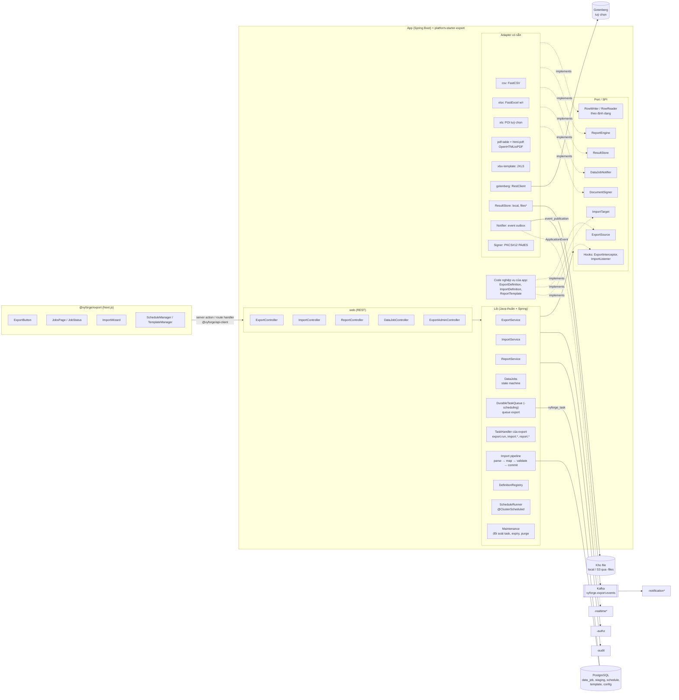
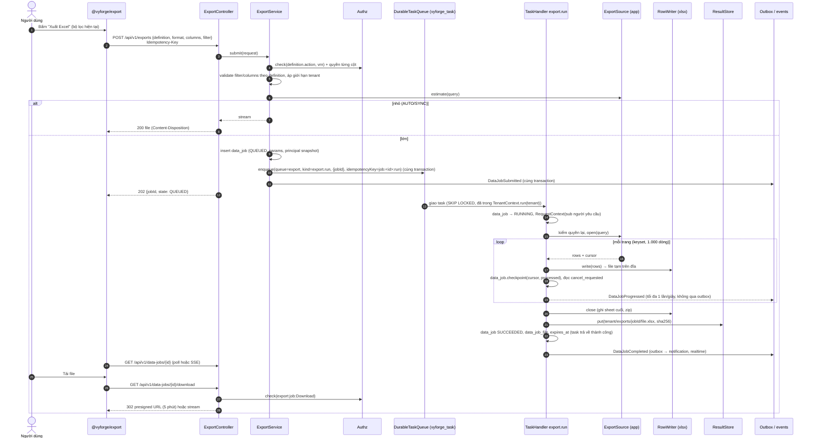
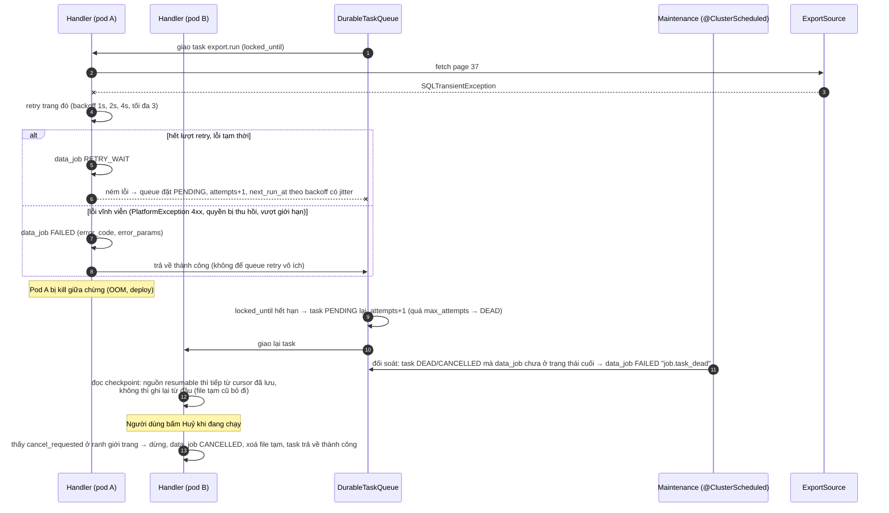
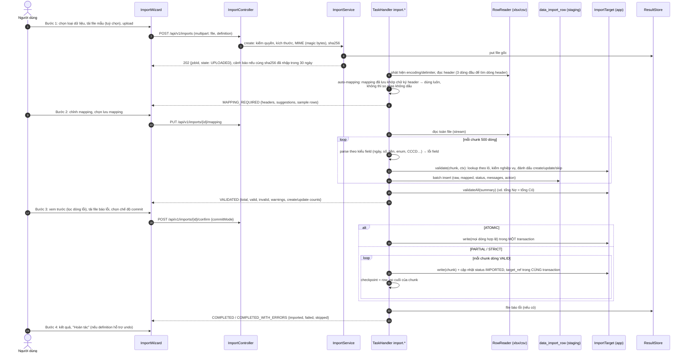
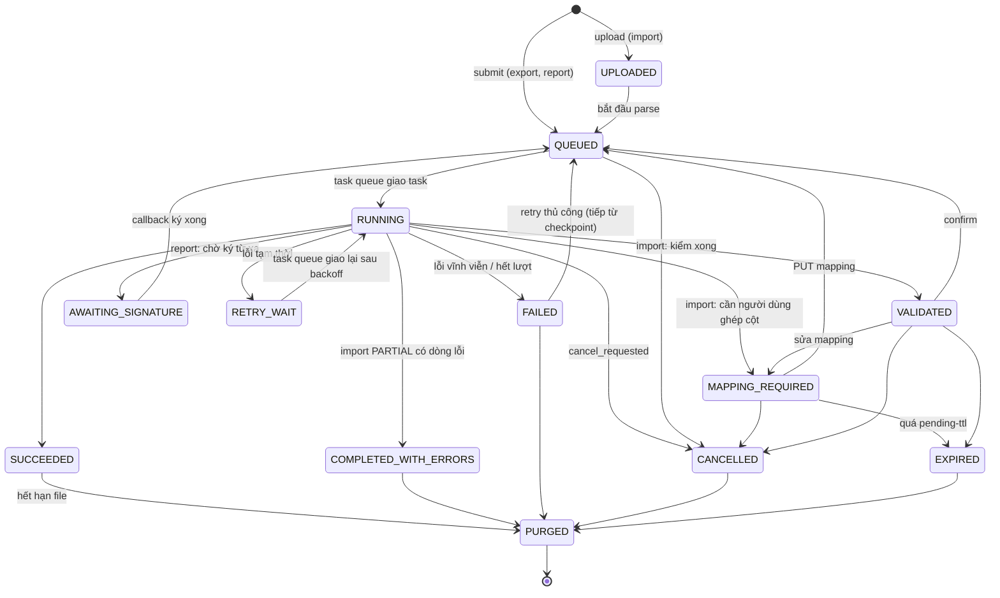
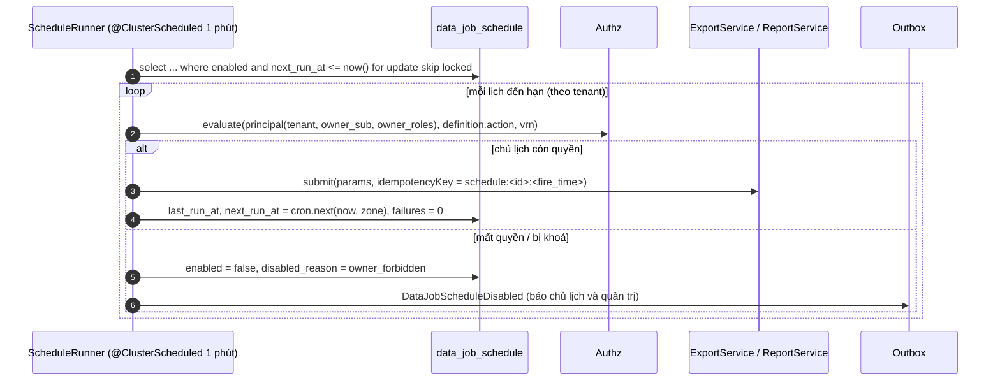
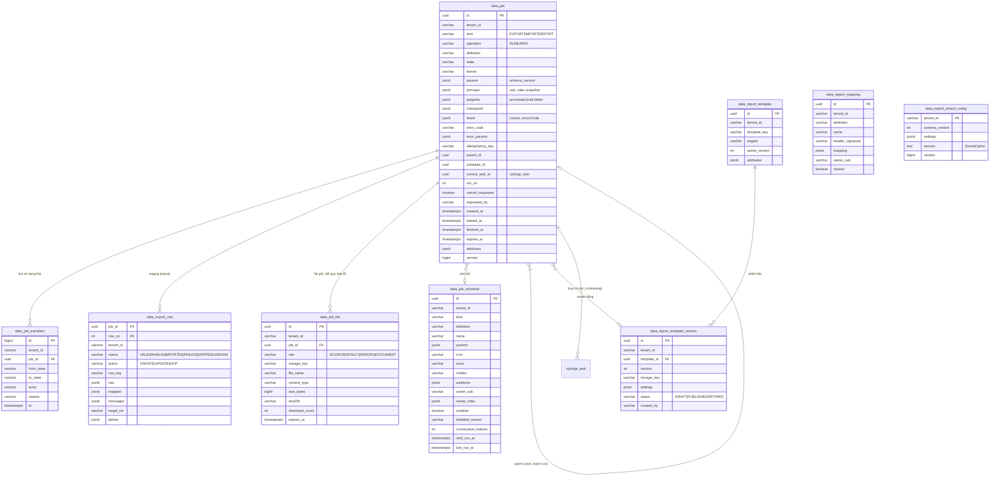

# Thiết kế module export: xuất, nhập dữ liệu và báo cáo

> **Trạng thái:** bản thiết kế chờ duyệt (26/10/2026). Thuộc nhóm module P1 (MODULE_PLAN mục 4). Theo
> [quy ước module P1](#phụ-lục-a-quy-ước-áp-dụng) và nối với `platform-java` 0.12.0, `platform-web` 0.9.0. Bản triển khai
> đầu đặt version `0.13.0-SNAPSHOT`.
>
> **Sửa 26/10 theo quy ước mục 5 (khối dùng chung, platform-java 0.12.1):** module **không** tự làm hàng đợi job, mã hoá
> secret và khung Flyway. Job chạy trên `DurableTaskQueue` của `-scheduling` (queue `export`); secret của tenant mã hoá bằng
> `SecretCipher` của `platform-core`; migration chạy bằng `StarterSchemaMigrator` của `-jpa` với bảng lịch sử
> `flyway_schema_history_export`. Bảng `data_job` chỉ còn giữ trạng thái **nghiệp vụ** mà người dùng thấy (tiến độ,
> checkpoint, file, bước chờ người dùng); việc lấy việc, khoá, retry, backoff, giới hạn đồng thời là của task queue.
>
> Artifact: `platform-starter-export` (Java) và `@vyforge/export` (web). Một starter phủ cả ba việc: **xuất**, **nhập** và
> **báo cáo**. Lý do không tách ba starter: cả ba dùng chung một job engine, một kho file kết quả, một mô hình quyền và
> một màn hình "Việc của tôi". MODULE_PLAN cũng chốt "Batch không tách; khi có pilot cần thì đặt trong `-export`".

## Mục lục

1. [Bài toán và phạm vi](#1-bài-toán-và-phạm-vi)
2. [Nghiên cứu](#2-nghiên-cứu)
3. [Kiến trúc](#3-kiến-trúc)
4. [Mô hình dữ liệu](#4-mô-hình-dữ-liệu)
5. [API](#5-api)
6. [Mở rộng](#6-mở-rộng)
7. [Vận hành](#7-vận-hành)
8. [Bảo mật và tuân thủ](#8-bảo-mật-và-tuân-thủ)
9. [Kế hoạch triển khai](#9-kế-hoạch-triển-khai)
10. [Lệch quy ước và quyết định cần người dùng chọn](#10-lệch-quy-ước-và-quyết-định-cần-người-dùng-chọn)
11. [Đóng gói và triển khai độc lập](#11-đóng-gói-và-triển-khai-độc-lập)

---

## 1. Bài toán và phạm vi

### 1.1 Vì sao cần

Ở dự án Việt Nam, gần như màn hình danh sách nào cũng có nút "Xuất Excel" và gần như module nghiệp vụ nào cũng có "Nhập
từ Excel". Hoá đơn, phiếu thu, hợp đồng, biên bản cần in PDF tiếng Việt đúng font, có header/footer, đôi khi có chữ ký số.
Không nền tảng tham chiếu nào (ABP, JHipster, Supabase…) có sẵn khối này
([báo cáo module thông dụng](../research/2026-10-module-thong-dung.md), mục 2 và 3.10). Mỗi dự án tự viết lại thì lặp lại
cùng một nhóm lỗi:

- tải cả bảng vào RAM rồi ghi Excel, nên OOM khi dữ liệu lớn;
- request xuất chạy đồng bộ, quá timeout của gateway (30–60 giây) thì người dùng bấm lại, server chạy chồng;
- file kết quả để public hoặc link không hết hạn, lộ dữ liệu cá nhân;
- nhập Excel thì lỗi ở dòng 3.000 làm hỏng cả lô, không có file báo lỗi, nhập lại thì sinh bản ghi trùng;
- PDF mất dấu tiếng Việt, ngắt dòng sai;
- ô CSV bắt đầu bằng `=` thành công thức khi mở bằng Excel (CSV injection).

### 1.2 Phạm vi

| Nhóm | Trong phạm vi | Ngoài phạm vi (lý do) |
|---|---|---|
| Xuất | CSV, XLSX, PDF dạng bảng, JSON Lines; đồng bộ cho file nhỏ, bất đồng bộ cho file lớn; streaming theo trang, RAM không phụ thuộc số dòng; chọn cột; định dạng theo locale và múi giờ; nhiều sheet; nén ZIP | BI, pivot, biểu đồ tương tác (thuộc công cụ BI như Metabase/Superset) |
| Báo cáo | Template HTML → PDF (Thymeleaf + OpenHTMLtoPDF), template Excel (JXLS); font tiếng Việt; header/footer, số trang, watermark; template theo tenant có version; render đơn lẻ và render hàng loạt; chữ ký số PDF (PAdES) qua SPI | Trình thiết kế report kéo thả (dùng Excel/HTML làm "designer") |
| Nhập | CSV, XLSX, XLS; tải file mẫu; nhận dạng và ghép cột (mapping) có lưu lại; kiểm tra từng dòng; xem trước; xác nhận; chạy theo chunk; idempotent; ba chế độ commit; file báo lỗi; hoàn tác (rollback) có điều kiện | ETL nhiều bước giữa các hệ thống (dùng Spring Batch hoặc công cụ ETL riêng); nhập nhiều entity có quan hệ trong một file (để bản sau, xem 9.4) |
| Job | Hàng đợi trong PostgreSQL, trạng thái và tiến độ, huỷ, chạy lại, hết hạn file kết quả, báo xong qua event, báo cáo định kỳ | Workflow tổng quát (Flowable/Temporal theo MODULE_PLAN) |
| Quản trị | Cấu hình theo tenant (giới hạn, định dạng, branding, retention, ký số), quản lý template, lịch | |
| Frontend | Nút xuất, trang "Việc của tôi", wizard nhập 4 bước, quản lý lịch và template | |

### 1.3 Kịch bản nghiệp vụ phải đáp ứng

Mỗi kịch bản ghi rõ khối nào của thiết kế đáp ứng nó, để review kiểm được.

| # | Kịch bản | Đặc điểm khó | Đáp ứng bằng |
|---|---|---|---|
| K1 | **Xuất danh sách khách hàng ra Excel** theo bộ lọc đang xem trên màn hình (CRM, 2 triệu dòng) | Không giữ cả bảng trong RAM; lọc phải giống hệt API danh sách; cột theo quyền | `ExportSource` keyset, writer streaming FastExcel, `ExportDefinition.columns` có `requiredAction` (5.1) |
| K2 | **Xuất sổ chi tiết bán hàng/sổ nhật ký chung** cho kế toán, số tiền định dạng `1.234.567 ₫`, ngày `dd/MM/yyyy`, múi giờ `Asia/Ho_Chi_Minh` | Định dạng VN; tiền tệ không có phần lẻ; dữ liệu lưu UTC | `ColumnType.MONEY_VND`, `ExportLocale` của tenant (4.4, 6.4) |
| K3 | **In hoá đơn bán hàng/phiếu thu PDF** có logo, tên công ty, mã số thuế, số tiền bằng chữ tiếng Việt, header/footer, "Trang 1/3" | Font Unicode tiếng Việt; số tiền bằng chữ; phân trang | `html-pdf` engine, font nhúng Be Vietnam Pro/Noto, helper `#vn.amountInWords` (6.5) |
| K4 | **In hàng loạt 5.000 phiếu lương** cuối tháng, mỗi nhân viên một PDF, gom thành ZIP; hoặc gửi từng người qua email | Chạy lâu; mỗi file một quyền xem; không lộ lương người khác | Report job dạng batch, `ReportBatchSource`, event `DataJobCompleted` cho notification (5.3) |
| K5 | **Nhập danh mục sản phẩm** từ file Excel của nhà cung cấp, cột đặt tên tuỳ ý ("Tên hàng", "Mã SP", "ĐVT") | Ghép cột tự động theo alias tiếng Việt không dấu; lưu mapping cho lần sau | Auto-mapping + `data_import_mapping` (4.3) |
| K6 | **Nhập 50.000 học sinh đầu năm học**, có dòng sai ngày sinh, sai số CCCD; nhà trường muốn nhập phần đúng trước, sửa phần sai sau | Kiểm từng dòng; file báo lỗi giữ nguyên định dạng gốc + cột lỗi; nhập lại phần lỗi không trùng | Chế độ `PARTIAL`, file báo lỗi, khoá tự nhiên + upsert (3.4) |
| K7 | **Nhập số dư đầu kỳ kế toán**: phải đủ và cân (tổng Nợ = tổng Có), sai một dòng là không nhập gì | Ràng buộc trên toàn file; tất cả hoặc không | Chế độ `ATOMIC`, `ImportTarget.validateAll` (kiểm toàn file) (3.4) |
| K8 | **Cập nhật giá bán hàng loạt** từ Excel (update, không tạo mới), lỡ nhập nhầm thì hoàn tác | Upsert theo mã; hoàn tác cần giá trị cũ | `UpsertMode.UPDATE_ONLY`, `ImportTarget.undo` với snapshot trước khi ghi (3.4) |
| K9 | **Báo cáo doanh thu tuần gửi tự động** 7 giờ sáng thứ Hai cho ban giám đốc | Lịch theo múi giờ; chạy với quyền của người tạo lịch; người tạo nghỉ việc thì lịch phải dừng | `data_job_schedule`, kiểm quyền lại lúc chạy qua `Authz.evaluate(principal…)` (3.6) |
| K10 | **Xuất dữ liệu cá nhân theo yêu cầu của chủ thể** (Luật 91/2025, NĐ 356/2025): một người dùng yêu cầu bản sao dữ liệu của mình | Gom từ nhiều module; hạn 10 ngày; file phải bảo vệ | Kind `EXPORT` với definition do `-privacy` đăng ký, ZIP JSON/CSV; điểm nối `PersonalDataExporter` (8.2) |
| K11 | **Xuất báo cáo nộp cơ quan nhà nước** theo mẫu cố định (vd. mẫu báo cáo BHXH D02-LT, mẫu thống kê của Sở GD) | Bố cục Excel có sẵn, ô gộp, công thức | `xlsx-template` engine (JXLS) trên file mẫu của tenant (6.5) |
| K12 | **Hợp đồng điện tử PDF có chữ ký số** của doanh nghiệp (USB token, HSM, hoặc ký số từ xa VNPT SmartCA, Viettel MySign) | Ký có thể cần người duyệt trên điện thoại (bất đồng bộ); chuẩn PAdES | `DocumentSigner` SPI, trạng thái `AWAITING_SIGNATURE` (6.6) |
| K13 | **Đồng bộ đơn hàng từ sàn TMĐT** (Shopee, TikTok Shop xuất CSV) mỗi ngày: file CSV dấu `;`, mã hoá UTF-8 có BOM hoặc UTF-16 | Nhận dạng dấu phân cách, encoding; nhập lại cùng file không nhân đôi | Phát hiện encoding/delimiter, idempotency theo `sha256(file)` + khoá tự nhiên (3.4) |
| K14 | **Nhập kết quả chấm công từ máy chấm công** (file XLS đời cũ, BIFF8) | Định dạng XLS cũ; ngày giờ kiểu số serial Excel | Reader `xls` qua POI (tuỳ chọn), parser `DATE_TIME` hiểu serial (6.3) |
| K15 | **Tenant lớn và tenant nhỏ dùng chung cụm**: tenant A xuất 5 triệu dòng không được làm chậm việc xuất 100 dòng của tenant B | Công bằng giữa tenant; giới hạn đồng thời | Giới hạn `maxRunningPerTenant`, chọn job theo vòng tenant, hàng đợi ưu tiên nhỏ (3.5) |
| K16 | **Xuất danh sách cho đối tác ngoài** cần file có mật khẩu hoặc link tải chỉ dùng một lần | Bảo vệ file khi chia sẻ ra ngoài | Link tải ngắn hạn, đếm lượt tải; mã hoá file để bản sau (8.1, 9.4) |

Kịch bản tương lai mà mô hình dữ liệu và SPI đã chừa chỗ, không cần đổi schema: xuất sang Google Sheets/OneDrive (adapter
`ResultSink`), nhập từ API ngoài thay vì file (`ImportSourceReader` khác), nhập nhiều sheet liên kết (đơn hàng + chi tiết),
báo cáo DOCX qua Gotenberg/Carbone, render qua LLM ("tóm tắt báo cáo"), gửi báo cáo định kỳ qua Zalo ZNS (kênh của
notification).

---

## 2. Nghiên cứu

Mọi phiên bản dưới đây kiểm ngày 26/10/2026 qua `repo1.maven.org` (`maven-metadata.xml`), GitHub API và trang tài liệu.

### 2.1 Thư viện định dạng file (Java)

| Thư viện | Phiên bản | License | Vai trò | Nhận xét |
|---|---|---|---|---|
| [FastExcel](https://github.com/dhatim/fastexcel) `org.dhatim:fastexcel` | 0.20.2 (06/2026) | Apache-2.0 | **Ghi XLSX streaming** | Ghi XML thẳng ra stream, ít heap; README đo POI không streaming chậm hơn ~10 lần và tốn heap ~12 lần với 100.000×4; mỗi sheet ghi được trên một thread; có style, merge, freeze pane, table, conditional format, data validation. **Không** có chart, không mã hoá file, công thức không có giá trị tính sẵn. Shared strings giữ trong RAM, có chế độ inline string |
| `org.dhatim:fastexcel-reader` | 0.20.2 | Apache-2.0 | **Đọc XLSX streaming** | `ReadableWorkbook` → `Stream<Row>`, getter có kiểu, tuỳ chọn đọc format ô; README: nhanh hơn POI streaming ~2 lần |
| [Apache POI](https://poi.apache.org/) `poi-ooxml` | 6.0.0 (22/10/2026, major mới; JDK build mặc định 17 theo `build.gradle`) | Apache-2.0 | Đọc XLS (BIFF8), nền của JXLS, mã hoá file | Đủ tính năng nhưng nặng (~15 MB phụ thuộc). SXSSF streaming ghi được nhưng dùng file tạm và không đọc ngược. Có `ZipSecureFile` chống zip bomb |
| [excel-streaming-reader](https://github.com/pjfanning/excel-streaming-reader) | 6.0.0 (25/10/2026) | Apache-2.0 | Phương án đọc XLSX streaming trên POI | Giữ API `Workbook` của POI; dùng nếu đã kéo POI. Chọn fastexcel-reader vì nhẹ hơn |
| [FastCSV](https://github.com/osiegmar/FastCSV) `de.siegmar:fastcsv` | 4.4.0 (07/2026) | MIT | Đọc/ghi CSV | RFC 4180, nhanh, không phụ thuộc. Commons CSV 1.14.1 (Apache-2.0) là phương án thay |
| [OpenHTMLtoPDF](https://github.com/openhtmltopdf/openhtmltopdf) `io.github.openhtmltopdf` | 1.1.100 (22/10/2026) | LGPL-2.1+ | **HTML/CSS → PDF** | Fork cộng đồng còn duy trì (group cũ `com.openhtmltopdf` dừng 2021); PDFBox 3; PDF/A, PDF/UA; SVG; footnote. Hạn chế: CSS 2.1 + một phần CSS3, **không flexbox/grid**, không JavaScript, không alpha; không hỗ trợ font OpenType (dùng TTF) |
| [Apache PDFBox](https://pdfbox.apache.org/) | 3.0.8 (07/2026) | Apache-2.0 | Ký PDF, gộp PDF | Nền của OpenHTMLtoPDF; API ký `PDSignature` + `SignatureInterface` (external signing) |
| [Bouncy Castle](https://www.bouncycastle.org/) `bcpkix-jdk18on` | 1.86 (09/2026) | MIT | CMS/PKCS#7 cho chữ ký PAdES | |
| [EU DSS](https://github.com/esig/dss) `dss-pades` | 6.5.1 (10/2026) | LGPL-2.1 | PAdES B-T/B-LT/B-LTA, kiểm chữ ký | Nặng; chỉ cần khi yêu cầu lưu trữ dài hạn (LTV). Để bản sau |
| [Thymeleaf](https://www.thymeleaf.org/) | 3.1.5 (04/2026) | Apache-2.0 | Template HTML | Có sẵn trong hệ Spring; chế độ XHTML hợp với OpenHTMLtoPDF |
| [JXLS](https://jxls.sourceforge.net/) `org.jxls:jxls-poi` | 3.2.0 (08/2026) | Apache-2.0 | **Template Excel** | Lệnh `jx:each`, `jx:if`, `jx:grid`, `jx:image` viết trong comment ô; Java 17; có chế độ streaming (SXSSF). Người nghiệp vụ tự sửa mẫu trong Excel |
| [JasperReports](https://github.com/Jaspersoft/jasperreports) | 7.1.0 (10/2026) | **LGPL-3.0** | Báo cáo kiểu "banded" | Mạnh (subreport, crosstab, virtualizer cho báo cáo lớn) nhưng nặng, template JRXML khó review, Jaspersoft Studio là Eclipse, Web Studio thương mại |
| [Spring Batch](https://docs.spring.io/spring-batch/reference/whatsnew.html) | 6.0.6 GA; 6.1.0-RC1 | Apache-2.0 | Khung batch | Xem 2.2 |
| [JobRunr](https://www.jobrunr.io/) | 9.0.2 (20/10/2026) | **LGPL-3.0** (OSS), Pro thương mại | Hàng đợi job + dashboard | Xem 2.2 |
| Be Vietnam Pro, Noto Sans/Serif ([google/fonts](https://github.com/google/fonts/tree/main/ofl)) | — | **SIL OFL 1.1** | Font nhúng PDF | OFL cho phép nhúng và phân phối kèm phần mềm |

### 2.2 Engine chạy job và batch

| Hệ thống | Mô hình dữ liệu | API | Điểm mạnh | Điểm yếu với bài toán của ta |
|---|---|---|---|---|
| **Spring Batch 6.0** ([what's new](https://docs.spring.io/spring-batch/reference/whatsnew.html), [chunk](https://docs.spring.io/spring-batch/reference/step/chunk-oriented-processing.html)) | `JobInstance` (job + tham số định danh), `JobExecution`, `StepExecution`, `ExecutionContext` lưu checkpoint; khoảng 9 bảng `BATCH_*` | `ItemReader` → `ItemProcessor` → `ItemWriter`, commit theo `chunk`; `SkipPolicy`; retry của Spring Framework 7; `JobOperator` (start, stop, restart, **recover** mới ở 6.0) | Chuẩn de-facto: checkpoint và restart đúng nghĩa, skip/retry, partition, remote chunking; 6.0 bỏ bắt buộc DB metadata (`ResourcelessJobRepository`), `ChunkOrientedStep` mới, dừng êm (graceful) | Metadata không có tenant, không có người yêu cầu, không có tiến độ cho người dùng, không có hạn file kết quả: vẫn phải có bảng job riêng cho UI. Khái niệm `JobInstance` theo tham số định danh khó khớp với "mỗi lần bấm là một job". Thêm 9 bảng và cấu hình cho mỗi app |
| **JobRunr 9** | Bảng `jobrunr_jobs`, `jobrunr_recurring_jobs`, background server | `BackgroundJob.enqueue(() -> svc.run(id))`, lambda được serialize | Hàng đợi bền, retry backoff, dashboard, recurring job, Modulith 2.1 hỗ trợ làm outbox | LGPL-3.0 cần pháp chế duyệt (MODULE_PLAN đã ghi); các tính năng ta cần nhất (giới hạn đồng thời theo nhóm, ưu tiên, batch) nằm ở bản Pro; dashboard không theo tenant |
| **Salesforce Bulk API 2.0** ([walkthrough](https://developer.salesforce.com/docs/platform/api-asynch/guide/walkthrough-upload-data.html), [xử lý request](https://developer.salesforce.com/docs/atlas.en-us.238.0.api_asynch.meta/api_asynch/how_requests_are_processed.htm)) | Ingest job: `Open` → `UploadComplete` → `InProgress` → `JobComplete`/`Failed`/`Aborted`; kết quả tách ba tập `successfulResults`, `failedResults`, `unprocessedRecords` | REST: tạo job, PUT CSV, PATCH trạng thái, GET kết quả | Máy trạng thái rõ; tách upload khỏi xử lý; tự chia chunk; **file kết quả lỗi** dạng CSV gốc + cột lỗi; `upsert` theo external id cho idempotent; lô lỗi tự retry tối đa 10 lần | SaaS đóng; không có bước xem trước/mapping cho người dùng cuối (thuộc Data Import Wizard) |

**Học theo:** khái niệm chunk + checkpoint + skip policy của Spring Batch; máy trạng thái và ba tập kết quả của Bulk API
2.0; upsert theo khoá ngoài.

**Không làm:** không nhúng Spring Batch làm engine mặc định (thêm 9 bảng không có tenant mà vẫn phải có bảng job riêng);
không dùng JobRunr (license + tính năng cần nằm ở bản Pro). Thay vào đó: hàng đợi `DurableTaskQueue` dùng chung của
`platform-starter-scheduling` (PostgreSQL, `FOR UPDATE SKIP LOCKED`, backoff, giới hạn đồng thời theo queue và tenant;
quy ước mục 5.2), cộng vòng chunk có checkpoint của module. Dự án đã dùng Spring Batch cho ETL vẫn gọi được module qua SPI (ghi file bằng `RowWriter` của module, đăng ký
kết quả bằng `DataJobs.attachResult`).

### 2.3 Luồng nhập của ERP và SaaS nhập liệu

| Hệ thống | Mô hình dữ liệu | Luồng | Điểm mạnh | Điểm yếu |
|---|---|---|---|---|
| **Odoo 18** `base_import` ([tài liệu](https://www.odoo.com/documentation/18.0/applications/essentials/export_import_data.html)) | Bản ghi tạm `base_import.import` (file, options); **External ID** (`ir.model.data`) là khoá ổn định của mỗi dòng | Tải file mẫu → upload → tuỳ chọn định dạng (CSV) → ghép cột (đoán từ 10 dòng đầu) → **Test** → **Import**. Export có "I want to update data" (chỉ xuất cột nhập lại được) và lưu export template | External ID làm import lặp lại thành update, không nhân đôi; quan hệ ghép theo tên, ID hoặc External ID (`/ID` ở header); xuất ra được nhập lại | Chạy đồng bộ trong request, file lớn bị timeout (tài liệu khuyên chia nhỏ); import là vĩnh viễn, không hoàn tác; đoán ngày dễ đảo ngày/tháng |
| **Dynamics 365 / Dataverse** ([import data](https://learn.microsoft.com/en-us/dynamics365/customerengagement/on-premises/developer/import-data)) | `Import`, `ImportFile`, `ImportMap` + `ColumnMapping`/`LookupMap`/`TransformationMapping`, **bảng parse tạm**, `ImportLog` (lỗi theo dòng) | Ba pha bất đồng bộ: **parse** → **transform** (theo data map) → **import**; khuyến nghị ≤ 20.000 dòng/lần | Data map tái sử dụng và xuất/nhập được; transformation (tách, ghép, thay thế); **bảng staging** cho xem trước và báo lỗi; lookup theo khoá nghiệp vụ | Mô hình nặng, nhiều entity; giới hạn số dòng thấp |
| **Flatfile** ([record hooks](https://flatfile.com/docs/guides/using-record-hooks)) | Workbook → Sheet → Record; mỗi field có message `info`/`warning`/`error` | Upload → mapping (gợi ý tự động) → review/sửa trực tiếp trên lưới → submit | Hook theo field (chạy trước) và theo record (kiểm chéo field, gọi API ngoài); người dùng **sửa lỗi ngay trên lưới** thay vì sửa file; `error` chặn submit, `warning` thì không | SaaS, dữ liệu đi qua bên thứ ba (vướng Luật 91/2025 khi có dữ liệu cá nhân); trả phí |

**Học theo:**
- **Staging** (Dynamics, Flatfile): dòng đã parse nằm trong bảng tạm, có trạng thái và lỗi theo field. Nhờ vậy có xem
  trước, file báo lỗi, chạy tiếp sau khi crash và nhập lại phần lỗi.
- **Ba mức thông điệp** `error`/`warning`/`info` theo field (Flatfile): `warning` không chặn nhập (vd. "SĐT không đúng đầu
  số nhà mạng").
- **Khoá ổn định** của dòng (External ID của Odoo, upsert theo external id của Salesforce) cho idempotency.
- **Mapping lưu lại và tái dùng** (Dynamics data map): nhận theo "chữ ký header" của file.
- **Tải file mẫu** và **xuất để nhập lại** (Odoo).
- **File kết quả lỗi** = dòng gốc + cột lỗi (Salesforce `failedResults`).

**Không làm:**
- Không chạy nhập đồng bộ trong request (Odoo).
- Không cho người dùng sửa dữ liệu trên lưới ở bản đầu (Flatfile): sửa trong file rồi nhập lại phần lỗi đơn giản hơn và
  đủ cho K6; mô hình staging đã chừa chỗ (cột `mapped`, `status`) để thêm sau.
- Không có transformation DSL chung (Dynamics): biến đổi viết bằng Java trong `ImportDefinition` (có test, có kiểu).

### 2.4 Engine báo cáo và chuyển đổi tài liệu

| Hệ thống | Mô hình | API | Điểm mạnh | Điểm yếu |
|---|---|---|---|---|
| **JasperReports 7.1** | Template JRXML (XML, banded: title, page header, detail, summary), datasource | Thư viện Java; exporter PDF/XLSX/CSV/DOCX | Đủ mọi thứ cho báo cáo in: subreport, crosstab, virtualizer cho báo cáo lớn | LGPL-3.0; nặng; designer Eclipse, Web Studio thương mại; template khó review trong Git; font tiếng Việt phải đóng gói font extension |
| **Carbone** ([README](https://github.com/carboneio/carbone)) | Template là file **DOCX/XLSX/ODT** có marker `{d.field}`; dữ liệu JSON | Node.js hoặc Docker REST (bản v5+ ở Docker, bản OSS "luôn chậm một major") | Người nghiệp vụ tự làm mẫu trong Word/Excel; ra PDF/DOCX/XLSX qua LibreOffice | **Carbone Community License**: miễn phí trừ khi cung cấp như dịch vụ sinh tài liệu; tính năng nâng cao cần license. Thêm runtime Node/LibreOffice |
| **Gotenberg 8.38.1** ([README](https://github.com/gotenberg/gotenberg), MIT) | Service stateless, Docker | REST multipart: HTML/URL/Markdown → PDF (Chromium), Office → PDF (LibreOffice), merge/split/watermark/encrypt, PDF/A, PDF/UA, metadata | CSS hiện đại đầy đủ (flexbox, grid) vì là Chromium; chuyển DOCX/XLSX sang PDF; MIT | Thêm một service phải vận hành; image lớn (~1,5 GB); Chromium tốn RAM |
| **OpenHTMLtoPDF** (2.1) | HTML (XHTML) + CSS paged media | Thư viện Java | Chạy trong JVM, không thêm service; PDF/A; nhanh cho tài liệu vài trang | CSS 2.1, không flexbox/grid; template phải viết theo kiểu bảng |

**Học theo:**
- Template là file người nghiệp vụ sửa được: HTML cho chứng từ, Excel cho báo cáo mẫu cố định (JXLS, tương tự Carbone
  nhưng chạy trong JVM, Apache-2.0).
- Engine là **adapter**: `html-pdf` (OpenHTMLtoPDF, mặc định), `xlsx-template` (JXLS), `gotenberg` (tuỳ chọn, cho DOCX → PDF
  hoặc CSS hiện đại). Carbone chỉ là adapter tuỳ chọn để bản sau, vì vướng license dịch vụ.

**Không làm:** không dùng JasperReports làm mặc định (license, độ nặng, khó review).

### 2.5 Pháp lý liên quan (chi tiết ở mục 8)

- Luật Bảo vệ dữ liệu cá nhân 91/2025/QH15 và Nghị định 356/2025/NĐ-CP, hiệu lực 01/01/2026 (đã dẫn nguồn trong
  [báo cáo module thông dụng](../research/2026-10-module-thong-dung.md), mục 3.14).
- Luật Giao dịch điện tử 20/2023/QH15 và **Nghị định 23/2025/NĐ-CP** về chữ ký điện tử và dịch vụ tin cậy, ban hành
  21/02/2025, có hiệu lực từ 10/04/2025 theo [báo Lào Cai](https://baolaocai.vn/quy-dinh-moi-ve-chu-ky-dien-tu-co-hieu-luc-tu-1042025-post397943.html);
  văn bản: [Thư viện Pháp luật](https://thuvienphapluat.vn/van-ban/thue-phi-le-phi/decree-23-2025-nd-cp-digital-signatures-and-trust-services-649650.aspx),
  [caselaw.vn](https://caselaw.vn/van-ban-phap-luat/411540-nghi-dinh-so-23-2025-nd-cp-ngay-21-02-2025-cua-chinh-phu-quy-dinh-ve-chu-ky-dien-tu-va-dich-vu-tin-cay).
  Nghị định này thay Nghị định 130/2018/NĐ-CP và mở rộng sang chữ ký điện tử nói chung
  ([Luật Việt An](https://luatvietan.vn/chu-ky-dien-tu-va-dich-vu-tin-cay-theo-nghi-dinh-23-2025.html)).
- Ký số từ xa: VNPT SmartCA có tài liệu tích hợp cho tổ chức, dùng `client_id`/`client_secret`
  ([tài liệu VNPT](https://doitac-smartca.vnpt.vn/help/document/TL_tich_hop_ban_hang_SmartCA_v1.0.pdf)). Chưa xác minh
  chi tiết API ký hash: adapter cụ thể để bản sau, khi có dự án và tài khoản sandbox.
- CSV/formula injection: [OWASP](https://community.owasp.org/attacks/CSV_Injection). Ký tự nguy hiểm ở đầu ô: `=`, `+`,
  `-`, `@`, tab (`0x09`), CR (`0x0D`), LF (`0x0A`), cả bản full-width `＝ ＋ － ＠`.

---

## 3. Kiến trúc

### 3.1 Nguyên tắc

1. **Thư viện nhúng vào app**, không phải service: nguồn dữ liệu xuất và đích nhập là repository/service của chính app,
   cần chung transaction và chung quyền. Một service export riêng sẽ phải đọc chéo database của mọi service (vi phạm B6).
2. **Hexagonal**: lõi (job engine, pipeline nhập, định dạng) không biết S3, Kafka hay SMTP. Mọi thứ bên ngoài là port.
3. **Streaming từ đầu tới cuối**: nguồn trả từng trang, writer ghi thẳng ra file tạm trên đĩa, file tạm đẩy lên kho.
   Heap dùng tỉ lệ với kích thước chunk, không tỉ lệ với số dòng.
4. **Một job engine cho cả ba loại việc**: `EXPORT`, `IMPORT`, `REPORT`. Cùng trạng thái, cùng tiến độ, cùng API huỷ/chạy
   lại, cùng trang "Việc của tôi".
5. **Không phụ thuộc code chưa merge**: kho file, thông báo và realtime là port của module này; bản đầu có adapter tối
   thiểu, adapter nối sang `-files`/`-notification`/`-realtime` thêm vào khi các module đó merge (3.8).

### 3.2 Sơ đồ thành phần



`*` adapter nối sang module chưa merge, xem 3.8.

Package Java (`com.vyforge.platform.export`):

| Package | Nội dung | Phụ thuộc framework |
|---|---|---|
| `…export` | API công khai: `ExportService`, `ImportService`, `ReportService`, `DataJobs`, record yêu cầu/kết quả, event | Không (Java thuần) |
| `…export.spi` | `ExportSource`, `ExportDefinition`, `ImportDefinition`, `ImportTarget`, `RowWriter`, `RowReader`, `ReportEngine`, `ResultStore`, `DataJobNotifier`, `DocumentSigner`, hook | Không |
| `…export.format` | Adapter CSV, XLSX, XLS, PDF bảng, JSONL; `CellFormatter`, chống formula injection | FastCSV, FastExcel, POI (optional) |
| `…export.report` | `html-pdf`, `xlsx-template`, `gotenberg`; font; helper Thymeleaf (`#vn`) | Thymeleaf, OpenHTMLtoPDF, JXLS (optional) |
| `…export.job` | State machine `data_job`, `JdbcDataJobRepository`, `TaskHandler` của queue `export`, `JobRunContext` (checkpoint, tiến độ, huỷ), đối soát với `vyforge_task`, maintenance | Spring JDBC, `-scheduling` (`DurableTaskQueue`) |
| `…export.imports` | Pipeline nhập, staging, auto-mapping, file báo lỗi | Spring JDBC |
| `…export.sign` | `Pkcs12PadesSigner` | PDFBox, Bouncy Castle (optional) |
| `…export.web` | Controller, DTO, `ExportErrors` | `-web`, `-authz` |
| `…export.autoconfigure` | Auto-config, `PlatformExportProperties`, đăng ký migration với `StarterSchemaMigrator` | Spring Boot, `-jpa` |

### 3.3 Luồng xuất

**Quyết định đồng bộ hay bất đồng bộ.** Request mang `mode`: `SYNC`, `ASYNC` hoặc `AUTO` (mặc định). Với `AUTO`, module hỏi
`ExportSource.estimate(query)`: nếu ước lượng ≤ `sync-max-rows` (mặc định 5.000) và định dạng không phải PDF lớn thì stream
thẳng về response (`StreamingResponseBody`, không qua kho file, không tạo job). Ngược lại tạo job và trả `202`. Nguồn không
ước lượng được thì luôn chạy bất đồng bộ.



**Luồng lỗi của xuất.**



### 3.4 Luồng nhập

Nhập chia hai pha bất đồng bộ, giữa hai pha là bước người dùng xác nhận (giống Dynamics: parse → transform → import, và
Salesforce: upload → xử lý).



**Ba chế độ commit.**

| Chế độ | Khi nào bắt đầu ghi | Transaction | Khi một dòng lỗi lúc ghi | Hợp với |
|---|---|---|---|---|
| `ATOMIC` | Chỉ khi 0 dòng `INVALID` | Một transaction cho cả file; giới hạn `atomic-max-rows` (mặc định 10.000) | Rollback hết, job `FAILED` | K7 số dư đầu kỳ, cấu hình |
| `STRICT` | Chỉ khi 0 dòng `INVALID` | Một transaction mỗi chunk | Dừng, các chunk đã commit giữ nguyên; job `FAILED` với `committed_rows`; cho phép **hoàn tác** (nếu có `undo`) hoặc **chạy tiếp** từ checkpoint | File lớn cần sạch 100% (K8) |
| `PARTIAL` | Luôn (bỏ qua dòng `INVALID`) | Một transaction mỗi chunk; lỗi trong chunk thì chạy lại chunk đó **từng dòng** (savepoint) để cô lập dòng hỏng | Dòng đó `FAILED`, các dòng khác vẫn ghi | K6, K13 |

`ImportDefinition.allowedCommitModes()` giới hạn chế độ được chọn (vd. số dư đầu kỳ chỉ cho `ATOMIC`).

**Idempotency của nhập** có ba tầng:

1. **Job**: `Idempotency-Key` của `-web` cho request tạo job; và cảnh báo (không chặn) khi cùng `sha256` + definition đã nhập
   thành công trong `duplicate-window` (mặc định 30 ngày).
2. **Chunk**: trạng thái `IMPORTED` của dòng staging được ghi **cùng transaction** với dữ liệu nghiệp vụ, nên worker chết
   giữa chừng và chạy lại thì bỏ qua dòng đã `IMPORTED`. Điều kiện: `ImportTarget` ghi qua cùng `DataSource` với module
   (trường hợp thường gặp). Đích ghi ra hệ thống khác phải tự idempotent theo `rowKey` (kiểm ở `ImportTarget.write`).
3. **Dòng**: `ImportDefinition.naturalKey(row)` (vd. mã sản phẩm, số CCCD) → `UpsertMode` `CREATE_ONLY`, `UPDATE_ONLY`,
   `UPSERT`. Nhập lại cùng file với `UPSERT` không sinh bản ghi trùng. Trùng khoá **trong cùng file** bị đánh `INVALID`
   (`import.duplicate_key_in_file`) ngay ở bước kiểm tra.

**Hoàn tác.** Chỉ có khi definition cài `ImportTarget.undo(List<ImportedRow>)`. Lúc ghi, target trả `target_ref` và tuỳ chọn
`before` (snapshot JSON của bản ghi trước khi update). Hoàn tác chạy như một job con (`kind=IMPORT`, `operation=UNDO`), theo
chunk, ngược thứ tự; dòng đã bị sửa tiếp sau lần nhập (target kiểm `version`) thì không hoàn tác và báo `CONFLICT`. Hoàn tác
có hạn (`undo-window`, mặc định 7 ngày) vì staging bị dọn sau đó.

**Luồng lỗi của nhập.**

| Lỗi | Phát hiện ở | Xử lý | Mã lỗi |
|---|---|---|---|
| File quá lớn, sai định dạng, MIME giả (đuôi `.xlsx` nhưng không phải ZIP OOXML) | Upload | 413/415, không tạo job | `import.file_too_large`, `import.unsupported_format` |
| Zip bomb, XML entity, quá số dòng/cột | Parse | `FAILED` | `import.file_unsafe`, `import.too_many_rows` |
| Không tìm thấy dòng header, thiếu cột bắt buộc | Mapping | `MAPPING_REQUIRED` với danh sách field bắt buộc chưa ghép | `import.required_field_unmapped` |
| Giá trị sai kiểu, sai quy tắc, trùng trong file, không tìm thấy bản ghi tham chiếu | Validate | Dòng `INVALID`, message theo field | mã của field/definition |
| Ràng buộc toàn file sai | `validateAll` | `VALIDATED` nhưng chặn confirm (`blocking=true`) | do definition đặt |
| DB lỗi tạm thời khi ghi | Commit | Retry chunk tại chỗ (3 lần); hết lượt thì ném lỗi cho task queue retry theo backoff (`RETRY_WAIT`), lần sau chạy tiếp từ checkpoint | `job.transient_failure` |
| Lỗi ràng buộc DB khi ghi một dòng (unique, FK) | Commit | `PARTIAL`: dòng `FAILED`; `STRICT`/`ATOMIC`: dừng | `import.row_write_failed` |
| Người dùng bỏ dở ở bước mapping/preview | Maintenance | Sau `pending-ttl` (mặc định 24 giờ) → `EXPIRED`, xoá staging và file | `job.expired` |

### 3.5 Job engine

**Máy trạng thái chung.** Trạng thái lưu dạng `varchar`, kiểm ở code (`DataJobState` enum + bảng chuyển hợp lệ), không dùng
enum của PostgreSQL. Mọi chuyển trạng thái ghi một dòng vào `data_job_transition` (ai, lúc nào, từ, đến, lý do).



Trạng thái cuối nghiệp vụ: `SUCCEEDED`, `COMPLETED_WITH_ERRORS`, `FAILED`, `CANCELLED`, `EXPIRED`. `PURGED` nghĩa là file và
staging đã xoá, dòng job còn giữ cho lịch sử tới hết `job-retention`.

**Thực thi trên `DurableTaskQueue`** (quy ước mục 5.2, `-scheduling` 0.12.1). Module không có hàng đợi, lease hay reaper
riêng. Phân vai:

| Việc | Ai làm |
|---|---|
| Lấy việc (`FOR UPDATE SKIP LOCKED`), khoá (`locked_by`/`locked_until`), trả lại việc khi pod chết | `DurableTaskQueue` |
| Retry có backoff exponential + jitter, `max_attempts`, trạng thái `DEAD` | `DurableTaskQueue` (cấu hình queue `export`) |
| Giới hạn đồng thời theo queue và theo tenant (K15) | `DurableTaskQueue` |
| Idempotency khi tạo việc (unique `tenant + queue + idempotency_key`) | `DurableTaskQueue` |
| API quản trị cho vận hành (backlog, retry, cancel), metric `vyforge.task.*` | `DurableTaskQueue` |
| Trạng thái nghiệp vụ người dùng thấy (`MAPPING_REQUIRED`, `VALIDATED`, tiến độ, file, hạn tải) | `data_job` của module |
| Checkpoint, huỷ ở ranh giới chunk, chạy tiếp | Handler của module |
| Giới hạn số job đang chạy **mỗi người dùng** | Module (kiểm lúc submit, đếm `data_job` theo `requested_by`) |

Queue và kind của module (đăng ký `TaskHandler<P>` theo `queue` + `kind`, payload chỉ có `{jobId}` + `schemaVersion`; mọi
tham số nằm trong `data_job.params`):

| Kind | Việc | Ghi chú |
|---|---|---|
| `export.run` | Đọc nguồn, ghi file, lưu kho | Một task cho cả job (file tạm phải nằm trên một pod) |
| `import.parse` | Đọc header, auto-mapping | Kết thúc ở `MAPPING_REQUIRED` hoặc tự sang `import.validate` khi mapping đã lưu khớp |
| `import.validate` | Parse + validate theo chunk vào staging | Chạy theo **lát** (slice) |
| `import.commit` | Ghi dòng hợp lệ theo chế độ commit | Chạy theo lát; `ATOMIC` là một lát duy nhất |
| `import.undo` | Hoàn tác | Chạy theo lát |
| `report.render` | Render một hoặc nhiều tài liệu | Batch chạy theo lát (mỗi lát N tài liệu, gom ZIP ở lát cuối) |
| `report.sign-poll` | Hỏi kết quả ký từ xa | Hẹn giờ bằng `next_run_at` của task |

- **Tạo việc trong transaction nghiệp vụ.** `submit`/`confirm` ghi `data_job` và gọi `enqueue(...)` trong cùng transaction,
  `idempotencyKey = job:<id>:<kind>:<n>`; rollback thì không có task nào.
- **Chạy theo lát.** Việc chia được (import, report batch) xử lý tối đa `slice-max-chunks` chunk hoặc `slice-max-duration`
  (mặc định 2 phút) rồi ghi checkpoint và `enqueue` task kế tiếp cho cùng job **trong cùng transaction của chunk cuối**. Nhờ
  vậy task không bao giờ giữ khoá lâu, job lớn của tenant A nhường chỗ cho job nhỏ của tenant B giữa các lát, và deploy giữa
  chừng chỉ mất tối đa một lát.
- **Task dài `export.run`.** Không chia lát được vì file tạm nằm trên đĩa của một pod. Queue `export` đặt `lock-duration`
  ngắn (2 phút) và handler gọi `TaskContext.extendLock(...)` ở mỗi checkpoint (đã chốt với forge-35, Q6): pod chết thì việc
  được giao lại sau tối đa 2 phút, job dài vẫn giữ được khoá. Giới hạn `max-export-duration` (mặc định 2 giờ; vượt thì
  `FAILED export.too_slow` và gợi ý thu hẹp bộ lọc) chặn job chạy vô hạn.
- **Lỗi.** Handler tự phân loại: lỗi vĩnh viễn (4xx, mất quyền, vượt giới hạn) → ghi `data_job FAILED` và trả về thành công
  để queue không retry vô ích; lỗi tạm thời → nếu `TaskContext.attempt() >= maxAttempts()` (Q7) thì ghi `FAILED` ngay, không
  thì ghi `RETRY_WAIT` rồi ném lỗi để queue retry theo backoff.
- **Đối soát** (`@ClusterScheduled(name = "export-reconcile", fixedDelay = "1m")`, lưới an toàn cho trường hợp pod chết đúng
  lần thử cuối hoặc vận hành huỷ việc qua API của queue): `data_job` chưa ở trạng thái cuối mà task
  tương ứng đã `DEAD`/`CANCELLED` (vd. pod chết đủ `max_attempts` lần, hoặc vận hành huỷ qua API quản trị của queue) →
  `FAILED job.task_dead`. Nhờ vậy trạng thái người dùng thấy không bao giờ treo.
- **Huỷ.** `QUEUED`: huỷ task qua `DurableTaskQueue.cancel` và đặt `CANCELLED` ngay. Đang chạy: đặt `cancel_requested`,
  handler dừng ở ranh giới chunk.
- **Retry thủ công** (`POST /data-jobs/{id}/retry`): job `FAILED` → `QUEUED` + `enqueue` task mới (`<n>` tăng), chạy tiếp từ
  checkpoint.
- **Ưu tiên.** Job ước lượng nhỏ được `enqueue` với `priority` cao hơn để không xếp sau job 5 triệu dòng.
- **Ngữ cảnh.** Queue đã chạy handler trong `TenantContext.run(tenant)`; handler đặt thêm `RequestContext` với `sub` của
  người yêu cầu và MDC `job_id`.
- **Dừng êm.** Khi shutdown, handler thấy tín hiệu dừng ở ranh giới chunk: việc chia lát thì ghi checkpoint và enqueue lát
  tiếp; `export.run` thì ném lỗi tạm thời để queue giao lại.

**Checkpoint và chạy tiếp.** Checkpoint lưu trong `data_job.checkpoint` (JSONB): với export là cursor keyset + số dòng đã
ghi + đường dẫn file tạm; với import là `row_no` cuối đã commit. File tạm nằm trên đĩa local nên chỉ chạy tiếp được trên cùng
pod; pod khác nhận job thì: export ghi lại từ đầu (nguồn `Stream` không resumable vốn đã vậy); import tiếp từ `row_no`
(dữ liệu nằm trong staging, không cần file tạm). Đánh đổi này chấp nhận được: export là đọc, chạy lại chỉ tốn thời gian.
Checkpoint ghi cùng transaction với dữ liệu của chunk (import) hoặc sau mỗi trang (export), độc lập với trạng thái task.

### 3.6 Báo cáo theo lịch



- `next_run_at` tính bằng `CronExpression` của Spring theo `zone` của lịch (mặc định múi giờ tenant).
- Bỏ lỡ nhiều lượt (app dừng 3 ngày) thì chỉ chạy **một** lượt bù (`misfire = RUN_ONCE`), hoặc bỏ qua (`SKIP`).
- Lỗi liên tiếp `max-consecutive-failures` (5) thì tự tắt và phát event.
- Người nhận: danh sách `sub` hoặc group trong tenant, **không** nhận email tự do (chống rò dữ liệu ra ngoài); gửi qua
  notification bằng event `DataJobCompleted` có `audience`. Gửi ra địa chỉ ngoài tenant là quyền riêng
  `export:schedule:ShareExternal` và để bản sau.

### 3.7 Luồng báo cáo (render)

- **Đơn lẻ, đồng bộ** (K3): `POST /api/v1/reports/{template}/render` → app cung cấp dữ liệu qua `ReportDataProvider`
  (theo `subjectId`, vd. id hoá đơn), engine render, trả PDF. Giới hạn `sync-max-pages`/thời gian (mặc định 20 trang, 10 giây),
  vượt thì gợi ý chạy job.
- **Hàng loạt, bất đồng bộ** (K4): job `REPORT` lặp danh sách `subjectId` từ `ReportBatchSource`, render từng tài liệu, gom
  ZIP hoặc gộp một PDF (`merge=true`), hoặc lưu từng file riêng và phát `DataJobCompleted` có danh sách `documents[]` để
  notification gửi cho từng người (mỗi người chỉ nhận file của mình).
- **Có ký số**: sau render, nếu template có `signing.profile`, gọi `DocumentSigner`. Signer đồng bộ (PKCS#12/HSM) ký ngay;
  signer từ xa trả `PendingSignature` → job `AWAITING_SIGNATURE`, callback hoặc poll của adapter đưa job về `QUEUED` để hoàn
  tất.

### 3.8 Điểm nối với module khác

Các module `-files`, `-notification`, `-realtime` đang làm song song trên branch khác. Module export **không** import class
của chúng. Hợp đồng chốt như sau:

| Nối với | Hướng | Hợp đồng chốt trong thiết kế này | Bản đầu (khi module kia chưa merge) | Khi module kia đã merge |
|---|---|---|---|---|
| `-files` | export → files | Port `ResultStore` của export: `put(key, InputStream, size, contentType, sha256, expiresAt)`, `open(key)`, `downloadUrl(key, ttl, fileName)`, `delete(key)`. Key có tiền tố tenant: `<tenant>/export/<jobId>/<file>` | `LocalResultStore` (thư mục trên đĩa/volume dùng chung; tải bằng stream qua controller), đủ cho dev và tier 0 một instance | Adapter `FilesResultStore` (đặt trong export, `@ConditionalOnClass` API của files) lưu bằng storage của files, link tải dùng presigned của files. Upload file nhập cũng nhận `fileId` của files thay vì multipart |
| `-notification` | export → notification | Event công khai `DataJobCompleted`/`DataJobFailed`/`DataJobScheduleDisabled` (record Java + JSON trên Kafka, `schemaVersion`), có `audience` (danh sách `sub`), `templateKey` gợi ý (`export.job.completed`), `downloadPath` (không phải URL ký sẵn) | Event đi qua outbox Modulith; app chưa có notification thì chỉ có trang "Việc của tôi" | Notification lắng nghe event (in-process `@ApplicationModuleListener` hoặc Kafka) và gửi theo tuỳ chọn của người nhận |
| `-realtime` | export → realtime | Event `DataJobProgressed` (`jobId`, `state`, `processed`, `total`, `percent`, `audience`) là `ApplicationEvent` thường, không qua outbox, phát tối đa 1 lần/giây/job | Web poll `GET /data-jobs/{id}` (TanStack Query, 2 giây, dừng khi trạng thái cuối) | Realtime relay event ra SSE theo `audience`; web chuyển sang SSE, poll làm dự phòng |
| `-privacy` | privacy → export | Privacy (bản đủ) đăng ký `ExportDefinition` `privacy.subject-data` để gom dữ liệu chủ thể qua SPI `PersonalDataExporter` | Không có | Như cột trái |
| `-authz` | export → authz | Dùng `Authz` có sẵn; `ActionCatalog` của export | Có sẵn | |
| `-audit` | export → audit | `AuditLog.success/failure` cho tải file, nhập, hoàn tác | Có sẵn (optional) | |

Tên trường của event và chữ ký `ResultStore` sẽ ghi vào `done-30.md` để tab files/notification/realtime đối chiếu.

---

## 4. Mô hình dữ liệu

### 4.1 ERD



### 4.2 DDL dự kiến

Tiền tố bảng `data_` (data exchange), tránh trùng tên với bảng nghiệp vụ "export"/"import" của dự án. Mọi bảng thuộc tenant
có `tenant_id varchar(63) not null` và index bắt đầu bằng `tenant_id` (ADR-0015, `TENANT_ISOLATION`). Module truy cập bằng
`JdbcClient` (không JPA entity) để không ép dự án dùng JPA; mọi method truy vấn nhận `tenantId` theo luật ArchUnit, riêng
truy vấn đối soát/maintenance chạy xuyên tenant được đánh dấu `@TenantExempt("export maintenance")`.

```sql
-- V1__export.sql (classpath:META-INF/vyforge/db/export, bảng lịch sử flyway_schema_history_export, xem 4.5)
-- Không có cột hàng đợi (lock, attempts, next_run_at): phần thực thi nằm ở vyforge_task của -scheduling.
create table data_job
(
    id               uuid         primary key,              -- UUID v7, sắp theo thời gian
    tenant_id        varchar(63)  not null,
    kind             varchar(16)  not null,                 -- EXPORT | IMPORT | REPORT (kiểm ở code)
    operation        varchar(16)  not null default 'RUN',   -- RUN | UNDO
    definition       varchar(100) not null,                 -- vd. crm.customers
    state            varchar(32)  not null,
    format           varchar(32),                           -- csv | xlsx | pdf | jsonl | zip ...
    params           jsonb        not null,                 -- {"schemaVersion":1, "filter":{}, "columns":[], "locale":"vi", ...}
    principal        jsonb        not null,                 -- {"sub":"…","roles":[…]} lúc tạo, để kiểm lại quyền
    progress         jsonb        not null default '{}',    -- {"processed":0,"total":null,"failed":0,"phase":"VALIDATE"}
    checkpoint       jsonb,
    result           jsonb,                                 -- {"rows":…, "imported":…, "failed":…, "warnings":…}
    error_code       varchar(100),
    error_params     jsonb,
    idempotency_key  varchar(200),
    parent_id        uuid references data_job (id),
    schedule_id      uuid,
    current_task_id  uuid,                                  -- id trong vyforge_task của lát đang chờ/chạy (đối soát, huỷ)
    run_no           int          not null default 0,       -- số lần chạy (retry thủ công tăng 1), dùng trong idempotency key
    cancel_requested boolean      not null default false,
    requested_by     varchar(255) not null,                 -- sub hoặc 'system' / 'schedule:<id>'
    created_at       timestamptz  not null default now(),
    started_at       timestamptz,
    finished_at      timestamptz,
    expires_at       timestamptz,                           -- hạn của file kết quả / staging
    attributes       jsonb        not null default '{}',    -- mở rộng có kiểm soát (khoá đăng ký trong code)
    version          bigint       not null default 0,
    constraint data_job_kind_chk check (kind in ('EXPORT', 'IMPORT', 'REPORT'))  -- kind là loại kỹ thuật, không phải enum nghiệp vụ
);

-- Đối soát với vyforge_task: chỉ index job chưa ở trạng thái cuối
create index data_job_active_idx on data_job (current_task_id) where state in ('QUEUED','RUNNING','RETRY_WAIT');
-- "Việc của tôi" và trang quản trị
create index data_job_owner_idx on data_job (tenant_id, requested_by, created_at desc);
create index data_job_tenant_state_idx on data_job (tenant_id, state, created_at desc);
create unique index data_job_idem_uq on data_job (tenant_id, idempotency_key) where idempotency_key is not null;
-- Dọn file hết hạn
create index data_job_expiry_idx on data_job (expires_at) where state in ('SUCCEEDED','COMPLETED_WITH_ERRORS','FAILED','CANCELLED','EXPIRED');

create table data_job_transition
(
    id         bigint generated always as identity primary key,
    tenant_id  varchar(63)  not null,
    job_id     uuid         not null references data_job (id) on delete cascade,
    from_state varchar(32),
    to_state   varchar(32)  not null,
    actor      varchar(255) not null,
    reason     varchar(200),
    at         timestamptz  not null default now()
);
create index data_job_transition_job_idx on data_job_transition (tenant_id, job_id, id);

create table data_job_file
(
    id             uuid         primary key,
    tenant_id      varchar(63)  not null,
    job_id         uuid         not null references data_job (id) on delete cascade,
    role           varchar(16)  not null,                   -- SOURCE | RESULT | ERRORS | DOCUMENT
    storage_key    varchar(500) not null,                   -- <tenant>/export/<jobId>/<name>
    file_name      varchar(255) not null,
    content_type   varchar(100) not null,
    size_bytes     bigint       not null,
    sha256         char(64)     not null,
    subject_ref    varchar(200),                            -- report hàng loạt: tài liệu của ai (K4)
    download_count int          not null default 0,
    created_at     timestamptz  not null default now(),
    expires_at     timestamptz
);
create index data_job_file_job_idx on data_job_file (tenant_id, job_id, role);
create index data_job_file_sha_idx on data_job_file (tenant_id, sha256) where role = 'SOURCE';  -- cảnh báo nhập trùng file

create table data_import_row
(
    job_id     uuid         not null references data_job (id) on delete cascade,
    row_no     int          not null,                       -- số dòng trong file (1-based, như Excel hiển thị)
    tenant_id  varchar(63)  not null,
    sheet      varchar(100),
    status     varchar(16)  not null,                       -- VALID | INVALID | IMPORTED | FAILED | SKIPPED | UNDONE
    action     varchar(16),                                 -- CREATE | UPDATE | SKIP (target quyết định lúc validate)
    row_key    varchar(500),                                -- khoá tự nhiên (đã chuẩn hoá)
    raw        jsonb        not null,                       -- {"A":"…","B":"…"} giá trị gốc dạng chuỗi theo cột file
    mapped     jsonb,                                       -- {"code":"SP01","price":120000} sau parse
    messages   jsonb,                                       -- [{"field":"price","level":"ERROR","code":"import.not_a_number","params":{}}]
    target_ref varchar(200),
    before     jsonb,                                       -- snapshot cho undo (chỉ khi definition bật)
    primary key (job_id, row_no)
);
create index data_import_row_status_idx on data_import_row (job_id, status, row_no);
create index data_import_row_key_idx on data_import_row (job_id, row_key);

create table data_import_mapping
(
    id               uuid         primary key,
    tenant_id        varchar(63)  not null,
    definition       varchar(100) not null,
    name             varchar(200) not null,
    header_signature char(64)     not null,                 -- sha256 của header đã chuẩn hoá (lower, bỏ dấu, trim)
    mapping          jsonb        not null,                 -- {"schemaVersion":1,"headerRow":1,"columns":{"Mã SP":"code"},"options":{...}}
    owner_sub        varchar(255) not null,
    shared           boolean      not null default false,   -- dùng chung trong tenant
    created_at       timestamptz  not null default now(),
    updated_at       timestamptz  not null default now(),
    version          bigint       not null default 0
);
create index data_import_mapping_lookup_idx on data_import_mapping (tenant_id, definition, header_signature);

create table data_job_schedule
(
    id                   uuid         primary key,
    tenant_id            varchar(63)  not null,
    kind                 varchar(16)  not null,
    definition           varchar(100) not null,
    name                 varchar(200) not null,
    params               jsonb        not null,
    cron                 varchar(100) not null,
    zone                 varchar(64)  not null,
    misfire              varchar(16)  not null default 'RUN_ONCE',
    audience             jsonb        not null default '{}', -- {"subs":[…],"groups":[…]}
    owner_sub            varchar(255) not null,
    owner_roles          jsonb        not null default '[]',
    enabled              boolean      not null default true,
    disabled_reason      varchar(100),
    consecutive_failures int          not null default 0,
    next_run_at          timestamptz,
    last_run_at          timestamptz,
    last_job_id          uuid,
    attributes           jsonb        not null default '{}',
    created_at           timestamptz  not null default now(),
    version              bigint       not null default 0
);
create index data_job_schedule_due_idx on data_job_schedule (next_run_at) where enabled;
create index data_job_schedule_tenant_idx on data_job_schedule (tenant_id, owner_sub);

create table data_report_template
(
    id             uuid         primary key,
    tenant_id      varchar(63)  not null,
    template_key   varchar(100) not null,                   -- trùng key với template classpath thì ghi đè cho tenant này
    engine         varchar(32)  not null,                   -- html-pdf | xlsx-template | gotenberg | ...
    name           varchar(200) not null,
    active_version int,
    attributes     jsonb        not null default '{}',
    created_at     timestamptz  not null default now(),
    version        bigint       not null default 0,
    unique (tenant_id, template_key)
);

create table data_report_template_version
(
    id          uuid         primary key,
    tenant_id   varchar(63)  not null,
    template_id uuid         not null references data_report_template (id) on delete cascade,
    version     int          not null,
    storage_key varchar(500) not null,                      -- nội dung (HTML/ZIP tài nguyên/XLSX) nằm trong ResultStore
    sha256      char(64)     not null,
    settings    jsonb        not null default '{}',         -- {"schemaVersion":1,"page":"A4","orientation":"portrait","signing":{"profile":"company"}}
    status      varchar(16)  not null,                      -- DRAFT | PUBLISHED | RETIRED
    created_by  varchar(255) not null,
    created_at  timestamptz  not null default now(),
    unique (template_id, version)
);
create index data_report_template_version_tenant_idx on data_report_template_version (tenant_id, template_id);

create table data_export_tenant_config
(
    tenant_id      varchar(63) primary key,
    schema_version int         not null,
    settings       jsonb       not null,                    -- giới hạn, locale, branding, retention (4.4)
    secrets        jsonb,                                   -- {"signing.company.password":"v1:<kid>:…"} bản mã SecretCipher, context export:config:<tenant>:<khoá>
    updated_by     varchar(255) not null,
    updated_at     timestamptz not null default now(),
    version        bigint      not null default 0
);
```

### 4.3 Payload có version

`params`, `checkpoint`, `mapping`, `settings` đều có `schemaVersion`. Mỗi loại có một `PayloadUpgrader` chuyển bản cũ lên
bản mới khi đọc (không migrate SQL hàng loạt), test bằng fixture JSON của từng version. Ví dụ `params` của export v1:

```json
{
  "schemaVersion": 1,
  "filter": { "status": "ACTIVE", "createdFrom": "2026-01-01" },
  "sort": [{ "field": "createdAt", "dir": "DESC" }],
  "columns": ["code", "name", "phone", "createdAt", "debt"],
  "locale": "vi",
  "zone": "Asia/Ho_Chi_Minh",
  "fileName": "khach-hang-2026-10-26",
  "options": { "csvDelimiter": ";", "csvBom": true, "sheetRows": 1000000 }
}
```

`filter` là JSON do definition tự định nghĩa và tự kiểm (`ExportDefinition.filterType()` là record Java; module deserialize
và chạy Bean Validation), nên mỗi definition tiến hoá bộ lọc của mình độc lập.

### 4.4 Cấu hình theo tenant

`settings` (v1), mọi khoá có mặc định ở `vyforge.export.defaults.*`; tenant chỉ ghi khoá muốn đổi:

| Khoá | Mặc định | Ý nghĩa |
|---|---|---|
| `limits.maxExportRows` | 2.000.000 | Vượt thì từ chối ngay (`export.too_many_rows`) |
| `limits.maxImportRows` | 200.000 | |
| `limits.maxUploadBytes` | 50 MB | |
| `limits.maxRunningJobs` | 2 | Mỗi tenant |
| `limits.maxRunningJobsPerUser` | 2 | |
| `limits.syncMaxRows` | 5.000 | Ngưỡng `AUTO` |
| `retention.resultTtl` | `P7D` | Hạn file kết quả |
| `retention.stagingTtl` | `P7D` | Đồng thời là `undo-window` |
| `retention.jobTtl` | `P90D` | Giữ dòng job (lịch sử) |
| `locale.default` / `locale.zone` | `vi` / `Asia/Ho_Chi_Minh` | |
| `format.csvDelimiter` / `format.csvBom` / `format.csvEncoding` | `,` / `true` / `UTF-8` | BOM giúp Excel trên Windows mở đúng tiếng Việt |
| `format.dateFormat` / `format.dateTimeFormat` | `dd/MM/yyyy` / `dd/MM/yyyy HH:mm` | |
| `format.currency` | `VND` | `#,##0 "₫"`, không phần lẻ |
| `branding.companyName`, `branding.taxCode`, `branding.address`, `branding.logoKey`, `branding.footerText` | — | Biến có sẵn trong mọi template (`#branding`) |
| `pdf.watermark` | — | vd. "BẢN SAO", tên người tải (`${user}`) |
| `signing.profiles.<tên>` | — | Provider (`pkcs12`, `remote:<adapter>`), chứng thư, lý do, vị trí; secret trong `secrets` (bản mã `SecretCipher`) |
| `report.gotenbergUrl` | — | Bật engine gotenberg cho tenant |
| `definitions.<tên>.enabled` | `true` | Tắt một definition cho một tenant |

Cấu hình đọc qua `ExportTenantSettings` có cache theo tenant (TTL 5 phút, theo quy ước cache của `platform-core`) và xoá cache
khi admin sửa.

Secret (mật khẩu PKCS#12, token Gotenberg, client secret ký từ xa) mã hoá bằng `SecretCipher` của `platform-core`
(AES-256-GCM, bản mã `v1:<kid>:…`), `context = "export:config:<tenant>:<khoá>"` gắn vào AAD nên không chép bản mã của tenant
này sang tenant khác được. Không cache bản rõ quá thời gian của một lần dùng. Job `export-maintenance` gọi
`needsRotation` và mã hoá lại secret dùng khoá cũ (xoay khoá không cần downtime).

### 4.5 Migration, partition, retention, tiến hoá schema

- **Migration** theo quy ước mục 5.3: migration có version trong `classpath:META-INF/vyforge/db/export`, bảng lịch sử riêng
  `flyway_schema_history_export`, chạy bằng `StarterSchemaMigrator` của `platform-starter-jpa` trước `EntityManagerFactory`.
  Tắt bằng `vyforge.export.schema.migrate=false`; khi đó DBA chạy file gộp `META-INF/vyforge/sql/export.sql`. Bảng
  `vyforge_task` thuộc migration của `-scheduling`, module không tạo.
- **Retention** (job `export-maintenance`, `@ClusterScheduled`, mỗi 10 phút, xoá theo lô 1.000 dòng để không khoá lâu):
  1. file hết hạn → `ResultStore.delete` → `data_job_file` xoá → job `PURGED`;
  2. staging của job đã qua `stagingTtl` → xoá `data_import_row` theo `job_id`;
  3. job (và transition) qua `jobTtl` → xoá;
  4. job treo ở `MAPPING_REQUIRED`/`VALIDATED` quá `pending-ttl` → `EXPIRED`.
- **Partition**: bản đầu không partition. Ước lượng: 200.000 dòng nhập × 1 KB JSONB = 200 MB staging mỗi lần nhập lớn, sống
  7 ngày. Khi một app vượt khoảng 50 triệu dòng staging/tháng thì chuyển `data_import_row` sang partition theo
  `HASH(job_id)` hoặc theo ngày tạo (xoá staging bằng `DROP PARTITION` thay vì `DELETE`); khoá chính `(job_id, row_no)` đã
  hợp với partition theo `job_id`. Ghi vào "để bản sau".
- **Tiến hoá**: migration chỉ thêm (cột nullable, bảng mới); đổi nghĩa thì đổi `schemaVersion` của payload; thêm trạng thái hay
  kind mới không cần migration vì là `varchar` kiểm ở code (riêng `kind` có CHECK vì engine phải biết cách chạy).

---

## 5. API

### 5.1 Java: API cho code nghiệp vụ

**Khai báo một loại xuất** (K1, K2):

```java
@Bean
ExportDefinition<CustomerRow> customerExport(CustomerQueries queries) {
    return ExportDefinition.<CustomerRow>builder("crm.customers")
            .title("export.crm.customers")                       // khoá i18n
            .action(CrmActions.CUSTOMER_EXPORT)                  // crm:customer:Export (bắt buộc)
            .filter(CustomerFilter.class)                        // record + Bean Validation, giống query của API danh sách
            .column(Column.text("code", "customer.code", CustomerRow::code))
            .column(Column.text("name", "customer.name", CustomerRow::name).width(30))
            .column(Column.text("phone", "customer.phone", CustomerRow::phone)
                    .personalData()                              // ghi audit cột PII, che khi tenant bật
                    .requiredAction(CrmActions.CUSTOMER_VIEW_CONTACT))
            .column(Column.dateTime("createdAt", "common.created_at", CustomerRow::createdAt))
            .column(Column.money("debt", "customer.debt", CustomerRow::debt))      // VND: #,##0 "₫"
            .formats(Format.XLSX, Format.CSV, Format.PDF)
            .source(KeysetSource.of(                             // nguồn resumable, RAM theo trang
                    (filter, after, limit) -> queries.page(filter, after, limit),  // where (created_at, id) < (:c, :id)
                    row -> Cursor.of(row.createdAt(), row.id()),
                    filter -> queries.count(filter)))            // estimate cho AUTO
            .build();
}
```

**SPI chính:**

```java
/** Nguồn dữ liệu xuất. Chạy trong TenantContext + RequestContext của người yêu cầu. */
public interface ExportSource<T, F> {
    /** Ước lượng số dòng; empty = không biết (luôn chạy job). */
    default OptionalLong estimate(F filter) { return OptionalLong.empty(); }

    /** Mở con trỏ đọc, tiếp từ checkpoint nếu có. Phải đóng được (try-with-resources). */
    ExportCursor<T> open(F filter, @Nullable Checkpoint from);
}

public interface ExportCursor<T> extends AutoCloseable {
    /** Trang kế tiếp (tối đa limit dòng); rỗng = hết. */
    List<T> next(int limit);
    /** Checkpoint sau trang vừa đọc; null nếu nguồn không resumable. */
    @Nullable Checkpoint checkpoint();
}
// Có sẵn: KeysetSource (resumable), StreamSource (Stream<T> từ JPA/JdbcClient, không resumable),
// JdbcCursorSource (JdbcClient + fetchSize, không resumable)

/** Ghi một định dạng; module có csv, xlsx, pdf, jsonl; dự án thêm bằng bean. */
public interface RowWriter extends AutoCloseable {
    void start(WriteContext ctx, List<ColumnSpec> columns);   // header theo locale
    void write(List<Object[]> rows);                         // giá trị đã qua CellFormatter
    WrittenFile finish();                                    // đường dẫn file tạm, size, sha256
}
public interface RowWriterFactory { String format(); RowWriter create(WriteContext ctx); }
```

**Khai báo một loại nhập** (K5–K8, K13):

```java
@Bean
ImportDefinition<ProductImport> productImport(ProductImporter importer) {
    return ImportDefinition.<ProductImport>builder("catalog.products")
            .title("import.catalog.products")
            .action(CatalogActions.PRODUCT_IMPORT)              // catalog:product:Import
            .field(Field.text("code", "product.code").required().max(50).aliases("ma sp", "ma hang", "sku"))
            .field(Field.text("name", "product.name").required().max(255).aliases("ten hang", "ten san pham"))
            .field(Field.ref("unit", "product.unit").aliases("dvt", "don vi tinh"))     // tra theo mã/tên ở validate
            .field(Field.money("price", "product.price").min(0))
            .field(Field.oneOf("status", "product.status", ProductStatus.class).defaultValue("ACTIVE"))
            .naturalKey(row -> row.text("code").toUpperCase())
            .upsert(UpsertMode.UPSERT)
            .commitModes(CommitMode.PARTIAL, CommitMode.STRICT)
            .mapTo(ProductImport::from)                          // Map<String,Object> đã parse → record có kiểu
            .target(importer)
            .templateExample(Map.of("code", "SP001", "name", "Bút bi Thiên Long", "unit", "Cây", "price", 5000))
            .build();
}

public interface ImportTarget<T> {
    /** Kiểm nghiệp vụ theo lô (tra cứu một lần cho cả chunk); gắn message và chọn CREATE/UPDATE/SKIP. */
    void validate(List<ImportRow<T>> chunk, ImportContext ctx);

    /** Kiểm trên toàn file sau khi mọi chunk đã validate (vd. tổng Nợ = tổng Có). Mặc định không làm gì. */
    default List<ImportMessage> validateAll(ImportSummary summary, ImportContext ctx) { return List.of(); }

    /** Ghi một chunk dòng hợp lệ, trong transaction module mở. Trả target_ref (+ before nếu hỗ trợ undo). */
    List<WriteResult> write(List<ImportRow<T>> chunk, ImportContext ctx);

    /** Hoàn tác (tuỳ chọn). Không cài = không có nút "Hoàn tác". */
    default Optional<UndoSupport<T>> undo() { return Optional.empty(); }
}
```

Kiểu field có sẵn (parser + kiểm + gợi ý định dạng cho file mẫu): `text`, `integer`, `decimal`, `money` (hiểu `1.234.567`,
`1,234,567`, `1234567 đ`, `₫`), `percent`, `date` (`dd/MM/yyyy`, `d/M/yyyy`, ISO, serial Excel; không đoán `MM/dd`), `dateTime`,
`bool` (`có/không`, `x`, `1/0`, `yes/no`), `oneOf` (enum hoặc danh mục động, so khớp không dấu), `ref` (tra cứu bản ghi khác
qua `ReferenceResolver` theo lô), `email`, `phoneVn` (chuẩn hoá `+84`/`0`, kiểm đầu số), `cccd` (12 số), `taxCodeVn` (MST 10
hoặc 13 số `-xxx`), `list` (nhiều giá trị cách bởi `;`). Mỗi parser trả message `ERROR`/`WARNING`/`INFO`.

**Dịch vụ cho code nghiệp vụ** (ngoài REST, vd. xuất từ một service khác hay từ job của app):

```java
public interface ExportService {
    DataJobRef submit(ExportRequest request);                  // kiểm quyền như REST
    void streamTo(ExportRequest request, OutputStream out);    // đồng bộ, cho controller tuỳ biến
}
public interface ImportService {
    DataJobRef upload(ImportUpload upload);                    // InputStream hoặc fileId (sau khi có -files)
    DataJobRef submitMapping(UUID jobId, ColumnMapping mapping);
    DataJobRef confirm(UUID jobId, CommitMode mode);
    DataJobRef undo(UUID jobId);
    Page<ImportRowView> rows(UUID jobId, RowStatusFilter filter, Pageable page);
}
public interface ReportService {
    RenderedDocument render(String templateKey, ReportRequest request);  // đồng bộ, có giới hạn
    DataJobRef submitBatch(String templateKey, ReportBatchRequest request);
}
public interface DataJobs {
    Optional<DataJobView> find(UUID id);
    Page<DataJobView> list(DataJobQuery query, Pageable page);
    void cancel(UUID id);
    DataJobRef retry(UUID id);
    DownloadLink download(UUID id, FileRole role);
    /** Cho việc chạy ngoài engine (vd. Spring Batch của dự án): tạo job, báo tiến độ, gắn file kết quả. */
    ExternalJobHandle startExternal(String definition, DataJobKind kind);
}
```

### 5.2 REST (OpenAPI phác thảo)

Mọi endpoint cần JWT, tenant lấy từ token; lỗi là Problem Details có `code`; danh sách trả `PageResponse`; request ghi nhận
`Idempotency-Key` (`-web`). Prefix `/api/v1`.

```yaml
openapi: 3.1.0
info: { title: platform-starter-export, version: 0.13.0 }
paths:
  /api/v1/exports/definitions:
    get: { summary: Loại xuất người dùng được phép, kèm cột (đã lọc theo quyền cột) và định dạng }
  /api/v1/exports:
    post:
      summary: Xuất. 200 + file nếu chạy đồng bộ; 202 + DataJob nếu chạy nền
      parameters: [{ name: Idempotency-Key, in: header }]
      requestBody:
        content:
          application/json:
            schema:
              type: object
              required: [definition, format]
              properties:
                definition: { type: string, example: crm.customers }
                format: { type: string, enum: [xlsx, csv, pdf, jsonl] }
                mode: { type: string, enum: [AUTO, SYNC, ASYNC], default: AUTO }
                columns: { type: array, items: { type: string } }
                filter: { type: object }
                sort: { type: array, items: { type: object } }
                fileName: { type: string }
                options: { type: object }
      responses:
        '200': { description: File (Content-Disposition attachment; filename*=UTF-8''…) }
        '202': { description: DataJob, headers: { Location: { description: /api/v1/data-jobs/{id} } } }
        '403': { description: export.forbidden / export.column_forbidden }
        '422': { description: export.too_many_rows, export.invalid_filter }
        '429': { description: export.too_many_running_jobs, ratelimit.exceeded }

  /api/v1/data-jobs:
    get:
      summary: Job của tôi (mặc định) hoặc của cả tenant (cần export:job:ListAll)
      parameters:
        - { name: scope, in: query, schema: { enum: [mine, tenant], default: mine } }
        - { name: kind, in: query }
        - { name: state, in: query }
        - { name: definition, in: query }
        - { name: page, in: query }
        - { name: size, in: query }
  /api/v1/data-jobs/{id}:
    get: { summary: Trạng thái, tiến độ, kết quả, file; có ETag để poll rẻ (304) }
  /api/v1/data-jobs/{id}/cancel: { post: { summary: Huỷ (QUEUED → CANCELLED ngay; RUNNING → cancel_requested) } }
  /api/v1/data-jobs/{id}/retry: { post: { summary: Chạy lại job FAILED từ checkpoint } }
  /api/v1/data-jobs/{id}/files/{role}:
    get: { summary: Tải file (RESULT | ERRORS | SOURCE); 302 tới link ký ngắn hạn hoặc stream; ghi audit }
  /api/v1/data-jobs/{id}/documents:
    get: { summary: Report hàng loạt - danh sách tài liệu con (chỉ thấy tài liệu được phép) }

  /api/v1/imports/definitions:
    get: { summary: Loại nhập được phép, field, kiểu, ràng buộc, chế độ commit }
  /api/v1/imports/definitions/{definition}/template:
    get: { summary: File mẫu XLSX/CSV (header theo locale, dòng ví dụ, dropdown cho oneOf, sheet hướng dẫn) }
  /api/v1/imports:
    post:
      summary: Upload file → job UPLOADED
      requestBody:
        content:
          multipart/form-data:
            schema:
              properties:
                definition: { type: string }
                file: { type: string, format: binary }
                mappingId: { type: string, format: uuid }
                options: { type: object, description: "sheet, headerRow, encoding, delimiter" }
          application/json:
            schema: { properties: { definition: {}, fileId: { description: "file của -files (sau khi merge)" } } }
  /api/v1/imports/{id}/mapping:
    get: { summary: Header phát hiện, gợi ý ghép, 5 dòng mẫu, field bắt buộc chưa ghép }
    put: { summary: Lưu mapping, tuỳ chọn saveAs (name, shared) → chạy validate }
  /api/v1/imports/{id}/rows:
    get: { summary: Xem trước; lọc status=INVALID|VALID|...; trả raw, mapped, messages theo field }
  /api/v1/imports/{id}/confirm:
    post: { summary: "{ commitMode } → QUEUED (pha ghi)" }
  /api/v1/imports/{id}/undo:
    post: { summary: Hoàn tác (nếu definition hỗ trợ, trong undo-window) → job con }
  /api/v1/imports/mappings:
    get: { summary: Mapping đã lưu (của tôi + dùng chung) theo definition }
  /api/v1/imports/mappings/{id}:
    delete: {}

  /api/v1/reports/templates:
    get: { summary: Template được phép (classpath + của tenant) }
  /api/v1/reports/{templateKey}/render:
    post: { summary: "Render đồng bộ { subjectId | data, format, locale } → application/pdf" }
  /api/v1/reports/{templateKey}/jobs:
    post: { summary: "Render hàng loạt { subjects | batchFilter, output: ZIP|MERGED|INDIVIDUAL } → 202" }

  /api/v1/export/admin/templates:
    get: {}
    post: { summary: Tạo template của tenant (ghi đè template classpath cùng key) }
  /api/v1/export/admin/templates/{key}/versions:
    post: { summary: Upload phiên bản mới (DRAFT) }
  /api/v1/export/admin/templates/{key}/versions/{v}/preview:
    post: { summary: Render thử với dữ liệu mẫu của definition }
  /api/v1/export/admin/templates/{key}/versions/{v}/publish: { post: {} }
  /api/v1/export-schedules:
    get: {}
    post: { summary: "{ kind, definition, params, cron, zone, audience }" }
  /api/v1/export-schedules/{id}:
    get: {}
    put: {}
    delete: {}
  /api/v1/export-schedules/{id}/run-now: { post: {} }
  /api/v1/export/admin/config:
    get: { summary: Cấu hình tenant (secret không bao giờ trả về; chỉ trả cờ "đã đặt") }
    put: {}
```

**Mã lỗi** (`ExportErrors implements ErrorCode`, bản vi/en trong `i18n/platform-errors` của starter): `export.forbidden`,
`export.column_forbidden`, `export.definition_not_found`, `export.format_not_supported`, `export.invalid_filter`,
`export.too_many_rows`, `export.too_many_running_jobs`, `job.not_found`, `job.invalid_state`, `job.expired`,
`job.task_dead`, `job.transient_failure`, `job.file_not_available`, `import.file_too_large`, `import.unsupported_format`,
`import.file_unsafe`, `import.too_many_rows`, `import.header_not_found`, `import.required_field_unmapped`,
`import.has_invalid_rows`, `import.atomic_limit_exceeded`, `import.undo_not_supported`, `import.undo_window_passed`,
`import.row_write_failed`, và mã cấp field: `import.required`, `import.not_a_number`, `import.invalid_date`,
`import.too_long`, `import.not_in_list`, `import.reference_not_found`, `import.duplicate_key_in_file`,
`import.invalid_phone_vn`, `import.invalid_cccd`, `import.invalid_tax_code`, `report.template_not_found`,
`report.render_failed`, `report.too_large_for_sync`, `report.signing_failed`.

### 5.3 Event công khai

Mọi event là record Java trong package `com.vyforge.platform.export.events`, implement `TenantAwareEvent`, có
`schemaVersion`. Event bền đi qua outbox Modulith; `vyforge.export.events.externalize=true` thì `@Externalized` sang topic
`vyforge.export.events` (key `jobId`).

| Event | Khi | Bền (outbox) | Trường chính |
|---|---|---|---|
| `DataJobSubmitted` | Tạo job | Có | `eventId`, `tenantId`, `jobId`, `kind`, `definition`, `requestedBy`, `scheduleId` |
| `DataJobProgressed` | Mỗi checkpoint, tối đa 1/giây | **Không** (ApplicationEvent thường) | `jobId`, `state`, `phase`, `processed`, `total`, `failed`, `audience` |
| `DataJobStateChanged` | Mọi chuyển trạng thái chờ người dùng (`MAPPING_REQUIRED`, `VALIDATED`, `AWAITING_SIGNATURE`) | Có | `jobId`, `from`, `to`, `audience` |
| `DataJobCompleted` | `SUCCEEDED`, `COMPLETED_WITH_ERRORS` | Có | `jobId`, `kind`, `definition`, `state`, `counts`, `files[] {role, fileName, size, downloadPath}`, `expiresAt`, `audience`, `templateKey="export.job.completed"`, `documents[] {subjectRef, recipientSub, downloadPath}` |
| `DataJobFailed` | `FAILED` | Có | `jobId`, `errorCode`, `errorParams`, `audience` |
| `ImportCommitted` | Mỗi job nhập ghi xong (kể cả một phần) | Có | `jobId`, `definition`, `created`, `updated`, `failed`, `undo=false/true` (cho search index, cache, báo cáo) |
| `ExportFileDownloaded` | Mỗi lần tải | Có | `jobId`, `role`, `by`, `personalDataColumns[]` |
| `DataJobScheduleDisabled` | Lịch tự tắt | Có | `scheduleId`, `reason`, `ownerSub` |

`downloadPath` là đường dẫn API (`/api/v1/data-jobs/{id}/files/RESULT`), **không** là URL ký sẵn: link trong email phải
qua đăng nhập và kiểm quyền lúc bấm, không sống quá hạn ký.

### 5.4 Package frontend `@vyforge/export`

| Export | Loại | Mô tả |
|---|---|---|
| `createExportClient({ api })` | server-only | `definitions()`, `submit()`, `jobs()`, `job()`, `cancel()`, `retry()`, `downloadUrl()`, import (`upload`, `mapping`, `saveMapping`, `rows`, `confirm`, `undo`), schedules, templates |
| `createExportAction()`, `createImportActions()` | Server Action | Gọi backend với token của user; trả `{ jobId }` hoặc lỗi theo `code` |
| `createDownloadRoute()` | Route handler | `GET /api/export/jobs/[id]/files/[role]`: gọi backend, chuyển tiếp 302 hoặc stream (token không lộ ra trình duyệt) |
| `<ExportButton definition filter formats />` | client | Dropdown định dạng; chọn cột (tuỳ chọn); file nhỏ tải ngay, lớn thì toast "Đang xử lý" + link tới trang job |
| `<JobStatus jobId />`, `useDataJob(id)` | client | Thanh tiến độ, trạng thái, nút huỷ/tải; TanStack Query poll 2 giây, tự dừng ở trạng thái cuối; nhận `subscribe` (SSE của realtime) khi có |
| `<JobsTable />` | server + client | Trang "Việc của tôi": lọc kind/state, tải lại, hết hạn |
| `<ImportWizard definition />` | client | 4 bước: **Tải lên** (kéo thả, tải file mẫu, chọn sheet) → **Ghép cột** (gợi ý, mapping đã lưu, field bắt buộc) → **Xem trước** (đếm hợp lệ/lỗi/cảnh báo, bảng dòng lỗi tô ô lỗi, tải file báo lỗi, chọn chế độ commit) → **Kết quả** (tiến độ, số đã nhập, hoàn tác) |
| `<ScheduleForm />`, `<SchedulesTable />` | client | Cron dạng thân thiện ("Mỗi thứ Hai 7:00"), múi giờ, người nhận trong tenant |
| `<TemplateManager />` | client | Danh sách template, upload phiên bản, xem trước PDF, publish |
| `exportMessages` (vi/en) | i18n | Nhãn UI + dịch mã lỗi `export.*`, `import.*`, `job.*` cho `errorTranslator` |

Component dựng trên `@vyforge/ui` (`Table`, `Progress`, `Dialog`, `Tabs`, `Badge`, `Alert`, `toast`), dữ liệu qua
`@vyforge/api-client` và `@vyforge/query`.

---

## 6. Mở rộng

### 6.1 Bản đồ điểm mở rộng

| Muốn | Cài | Ví dụ |
|---|---|---|
| Thêm loại xuất | Bean `ExportDefinition` | 5.1 |
| Thêm loại nhập | Bean `ImportDefinition` + `ImportTarget` | 5.1 |
| Thêm định dạng ghi | Bean `RowWriterFactory` (`format()` mới) | 6.2 |
| Thêm định dạng đọc | Bean `RowReaderFactory` (theo MIME + magic bytes) | ODS, XML Spreadsheet 2003 |
| Thêm kiểu field nhập | `FieldType<T>` (parse, validate, ví dụ cho file mẫu) | `Field.custom("bhxh", BhxhCodeType.INSTANCE)` |
| Thêm engine báo cáo | Bean `ReportEngine` (`engine()` mới) | 6.5 |
| Thêm nơi lưu file | Bean `ResultStore` | `FilesResultStore`, `SharePointResultStore` |
| Gửi kết quả đi nơi khác | Bean `ResultSink` (sau khi lưu) | Đẩy sang SFTP của ngân hàng, Google Drive |
| Ký số | Bean `DocumentSigner` | 6.6 |
| Can thiệp xuất | `ExportInterceptor` | 6.3 |
| Can thiệp nhập | `ImportListener` | 6.3 |
| Phản ứng với job | Lắng nghe event (5.3) | Notification, search index |
| Đổi tên file | `FileNameStrategy` | `<definition>-<yyyyMMdd-HHmm>.<ext>` theo giờ tenant |

### 6.2 Ví dụ: thêm định dạng ghi

```java
@Component
class OdsWriterFactory implements RowWriterFactory {
    public String format() { return "ods"; }
    public MediaType mediaType() { return MediaType.parseMediaType("application/vnd.oasis.opendocument.spreadsheet"); }
    public RowWriter create(WriteContext ctx) { return new OdsRowWriter(ctx.tempFile("ods"), ctx.locale()); }
}
```

Định dạng mới tự có trong `GET /exports/definitions` cho definition khai báo `formats("ods")` hoặc `formats(Format.ALL)`.

### 6.3 Hook

```java
public interface ExportInterceptor {
    /** Trước khi tạo job hoặc stream: thêm điều kiện lọc, bớt cột, từ chối (ném PlatformException). */
    default ExportRequest beforeSubmit(ExportRequest request, ExportContext ctx) { return request; }
    /** Mỗi dòng trước khi ghi (vd. che 4 số giữa SĐT nếu người xuất không có quyền xem đủ). */
    default Object[] beforeWriteRow(Object[] row, ExportContext ctx) { return row; }
    /** Sau khi file đã lưu (vd. ghi sổ theo dõi xuất dữ liệu cá nhân). */
    default void afterCompleted(DataJobView job, ExportContext ctx) {}
    default boolean supports(String definition) { return true; }
}

public interface ImportListener {
    default void beforeChunk(List<? extends ImportRow<?>> chunk, ImportContext ctx) {}
    default void afterChunkCommitted(List<WriteResult> results, ImportContext ctx) {}   // trong transaction chunk
    default void afterCompleted(ImportSummary summary, ImportContext ctx) {}           // sau commit cuối
    default boolean supports(String definition) { return true; }
}
```

Ví dụ thật: dự án y tế không cho xuất cột chẩn đoán ra CSV (chỉ PDF có watermark):

```java
@Component
class NoSensitiveCsv implements ExportInterceptor {
    public ExportRequest beforeSubmit(ExportRequest r, ExportContext ctx) {
        if (r.format().equals("csv") && ctx.definition().hasSensitiveColumns(r.columns())) {
            throw new PlatformException(HisErrors.SENSITIVE_CSV_FORBIDDEN);
        }
        return r;
    }
}
```

### 6.4 Định dạng theo locale

`CellFormatter` chọn theo `ColumnType` × `Format`: XLSX ghi **giá trị gốc có kiểu** (số, ngày) kèm number format để người
dùng còn tính toán được; CSV/PDF ghi chuỗi đã định dạng theo locale. Ngày giờ lưu UTC được đổi sang `zone` của request/tenant
trước khi ghi. `MONEY_VND` dùng `#,##0 "₫"`; `MONEY` có cột tiền tệ đi kèm. Header lấy từ `MessageSource` theo locale
(`messages_vi`, `messages_en` của dự án).

### 6.5 Báo cáo: engine và template

```java
public interface ReportEngine {
    String engine();                                            // html-pdf | xlsx-template | gotenberg
    Set<String> outputFormats();
    RenderedDocument render(TemplateSource template, ReportModel model, RenderOptions options);
}

/** Dữ liệu của một tài liệu; app cài cho mỗi template key. */
public interface ReportDataProvider {
    String templateKey();
    String action();                                            // vd. sales:invoice:Print
    String resource(String subjectId);                          // vrn để kiểm quyền từng tài liệu
    Object load(String subjectId, ReportContext ctx);           // record/Map, đưa vào template làm biến "data"
}
```

- **Tìm template**: `data_report_template` của tenant (bản `PUBLISHED`) → nếu không có, classpath
  `META-INF/vyforge/reports/<key>/` (`template.html` + `assets/`, hoặc `template.xlsx`). Dự án cài mẫu mặc định trong code;
  tenant ghi đè mà không cần deploy.
- **`html-pdf`**: Thymeleaf (chế độ HTML, xuất XHTML hợp lệ qua jsoup W3CDom) → OpenHTMLtoPDF. Có sẵn:
  - font nhúng **Be Vietnam Pro** và **Noto Sans/Noto Serif** (OFL), đăng ký với `useFont(...)`, kèm fallback; cảnh báo
    lúc publish template nếu dùng font không có;
  - CSS paged media: `@page { size: A4; margin: … }`, header/footer bằng phần tử chạy (`position: running(header)`,
    `@top-center { content: element(header) }`), số trang `counter(page)`/`counter(pages)`;
  - biến `#branding` (tên, MST, địa chỉ, logo), `#vn` (`#vn.amountInWords(1250000)` → "Một triệu hai trăm năm mươi nghìn
    đồng", `#vn.date(d, 'full')` → "ngày 26 tháng 10 năm 2026", `#vn.money`), `#qr` (VietQR/QR mã tra cứu dạng SVG);
  - watermark theo cấu hình tenant; tuỳ chọn PDF/A-3b cho lưu trữ;
  - an toàn: tắt tải tài nguyên ngoài (chỉ `assets/` của template và `logoKey`), không chạy JavaScript (OpenHTMLtoPDF vốn
    không chạy), giới hạn thời gian render.
- **`xlsx-template`** (JXLS 3 trên POI, optional): mẫu Excel do nghiệp vụ tự làm (K11), lệnh `jx:area`, `jx:each`, `jx:if`
  trong comment ô; chế độ streaming cho danh sách dài. Dữ liệu danh sách vẫn đến từ `ExportSource` để không giữ cả bảng.
- **`gotenberg`** (tuỳ chọn): gửi HTML (Chromium, có flexbox/grid) hoặc DOCX/XLSX (LibreOffice) tới Gotenberg qua
  `RestClient` của `-web` (timeout, retry, circuit breaker); health indicator `gotenberg`. Dùng khi tenant cần mẫu Word.
- **Thêm engine** (vd. Carbone khi pháp chế duyệt CCL): cài `ReportEngine` với `engine() = "carbone"`, gọi Carbone On-Premise
  qua REST; template của tenant chọn `engine = carbone`. Lõi không đổi.

### 6.6 Ký số

```java
public interface DocumentSigner {
    String provider();                                          // pkcs12 | pkcs11 | remote:vnpt-smartca | remote:viettel-mysign
    SignOutcome sign(SignRequest request);                      // Signed(bytes) hoặc Pending(reference, expiresAt)
    default Optional<SignOutcome> poll(String reference) { return Optional.empty(); }
}
```

- Có sẵn `Pkcs12PadesSigner` (PDFBox `SignatureInterface` + Bouncy Castle CMS, PAdES-B-B, `SubFilter ETSI.CAdES.detached`,
  tuỳ chọn timestamp RFC 3161 từ TSA cấu hình → B-T). Chứng thư số và mật khẩu theo `signing.profiles` của tenant, mật khẩu
  mã hoá bằng `SecretCipher` trong `secrets` hoặc tham chiếu secret của ESO/OpenBao.
- Ký từ xa (VNPT SmartCA, Viettel MySign, FPT CA…): adapter tính hash phần cần ký, gửi hash, nhận chữ ký CMS (có thể phải
  chờ người duyệt trên app di động) → `Pending`, job `AWAITING_SIGNATURE`, worker `poll` theo backoff hoặc nhận callback ký
  HMAC. Bản đầu chỉ định nghĩa SPI và adapter PKCS#12; adapter nhà cung cấp làm khi có dự án và tài khoản sandbox.
- B-LT/B-LTA (lưu trữ dài hạn, nhúng OCSP/CRL) dùng EU DSS: để bản sau.

### 6.7 Cấu hình ứng dụng (`application.yml`)

```yaml
vyforge:
  export:
    enabled: true
    schema.migrate: true             # StarterSchemaMigrator (quy ước 5.3)
    worker:
      chunk-size: 1000               # export: dòng mỗi trang; import: 500
      slice-max-chunks: 50           # import/report batch: số chunk mỗi lát task
      slice-max-duration: 2m
      max-export-duration: 2h        # export.run là một task dài, gia hạn khoá ở mỗi checkpoint
      max-running-per-user: 2
      temp-dir: ${java.io.tmpdir}/vyforge-export
      temp-dir-max-bytes: 10GB       # vượt thì job mới chờ
    sync:
      max-rows: 5000
      timeout: 25s
    store:
      type: local                    # local | files (khi có -files) | bean tự cài
      local.root: /var/lib/app/exports
      download-link-ttl: 5m
    events:
      externalize: false             # true: @Externalized ra topic vyforge.export.events
      progress-interval: 1s
    report:
      fonts: [classpath:META-INF/vyforge/fonts/BeVietnamPro-*.ttf]
      gotenberg.url:                 # bật engine gotenberg
    defaults:                        # mặc định cấp platform cho cấu hình tenant (4.4)
      limits.max-export-rows: 2000000
      retention.result-ttl: P7D
  scheduling:
    tasks:                           # khoá cấu hình thật theo -scheduling 0.12.1 (forge-35); ý nghĩa như dưới
      queues:
        export:
          concurrency: 4             # việc đồng thời mỗi instance
          max-per-tenant: 2          # K15
          max-attempts: 3
          backoff: { initial: 10s, multiplier: 2, max: 10m, jitter: 0.2 }
          lock-duration: 2m          # export.run gọi extendLock ở mỗi checkpoint
```

---

## 7. Vận hành

### 7.1 Metric (Micrometer, tiền tố `vyforge.export`)

| Metric | Loại | Tag | Dùng để |
|---|---|---|---|
| `vyforge.export.jobs.submitted` | counter | `kind`, `definition`, `format`, `mode` | Lưu lượng |
| `vyforge.export.jobs.completed` | counter | `kind`, `definition`, `outcome` (`succeeded`, `with_errors`, `failed`, `cancelled`, `expired`) | Tỉ lệ lỗi |
| `vyforge.export.jobs.duration` | timer | `kind`, `definition`, `outcome` | Thời gian chạy (p95) |
| `vyforge.task.*{queue="export"}` | (của `-scheduling`) | `queue`, `kind` | Độ sâu hàng đợi, thời gian chờ, retry, `DEAD`; module không đo lại |
| `vyforge.export.jobs.reconciled` | counter | `reason` (`task_dead`, `task_cancelled`, `task_missing`) | Job bị đối soát sang `FAILED` |
| `vyforge.export.rows` | counter | `kind`, `direction` (`read`/`written`) | Thông lượng |
| `vyforge.export.import.rows` | counter | `definition`, `status` | Chất lượng dữ liệu nhập |
| `vyforge.export.bytes` | distribution summary | `kind`, `format` | Kích thước file |
| `vyforge.export.report.render` | timer | `engine`, `template`, `outcome` | Hiệu năng render |
| `vyforge.export.sign` | timer | `provider`, `outcome` | Ký số |
| `vyforge.export.store.operations` | timer | `op`, `outcome` | Kho file |
| `vyforge.export.tempdir.used` | gauge | — | Đĩa tạm |

Span OTel: `export.job` (gốc, link về trace của request tạo job), con `export.fetch`, `export.write`, `export.store`,
`import.validate`, `import.commit`, `report.render`, `report.sign`. Log có `tenant_id`, `job_id`, `request_id`, `job_kind`.

**Health indicator**: `exportStore` (ghi/đọc/xoá thử một object nhỏ, cache 30 giây), `gotenberg` (khi bật), `exportQueue`
(đọc backlog của queue `export` qua API của `DurableTaskQueue`; DOWN nếu việc chờ lâu nhất > 30 phút; chỉ báo, không đưa
vào readiness để không làm pod bị loại khỏi service).

### 7.2 Alert gợi ý (đưa vào `platform-observability`)

| Alert | Điều kiện | Mức |
|---|---|---|
| ExportQueueBacklog | việc chờ lâu nhất của queue `export` (metric `vyforge.task.*`) > 15 phút trong 10 phút | warning |
| ExportFailureRate | `failed / completed` > 10% trong 30 phút (bỏ qua `cancelled`) | warning |
| ExportTaskDead | `vyforge.export.jobs.reconciled{reason=task_dead}` > 3 lần/giờ | warning (pod OOM/restart lặp lại) |
| ExportTempDirFull | `tempdir.used` > 80% `temp-dir-max-bytes` | critical |
| ExportStoreDown | health `exportStore` DOWN 5 phút | critical |
| ExportScheduleDisabled | event `DataJobScheduleDisabled` | info (gửi admin tenant) |

### 7.3 Chế độ lỗi

| Sự cố | Hành vi |
|---|---|
| Pod chết giữa job | Hết `locked_until`, `DurableTaskQueue` giao lại task; import tiếp từ checkpoint; export chạy lại (hoặc tiếp từ cursor nếu cùng pod); quá `max_attempts` thì đối soát đặt `FAILED` |
| PostgreSQL mất kết nối | Queue ngừng giao việc; handler đang chạy retry trang/chunk rồi ném lỗi (`RETRY_WAIT`); request tạo job trả 503 |
| Kho file lỗi | Retry 3 lần tại chỗ; hết lượt → ném lỗi để queue retry theo backoff (`RETRY_WAIT`); download trả `job.file_not_available` |
| Gotenberg chết | Circuit breaker mở; render bằng gotenberg lỗi `report.render_failed`; engine khác không ảnh hưởng |
| Kafka chết | Event nằm trong outbox, gửi lại khi Kafka sống (`-messaging`) |
| Đĩa tạm đầy | Handler `export.run` kiểm `temp-dir-max-bytes` trước khi bắt đầu; thiếu chỗ thì ném lỗi tạm thời để queue hoãn theo backoff; job đang ghi lỗi → `RETRY_WAIT` |
| Nguồn quá chậm (truy vấn thiếu index) | Statement timeout của trang (`query-timeout` 30 giây) → lỗi tạm thời, retry; cảnh báo log kèm definition |
| Tenant spam xuất | `@RateLimited` trên `POST /exports` và `POST /imports` (mặc định 10/phút/user) + giới hạn job đồng thời |

### 7.4 Giới hạn tải và dung lượng

Ước lượng để chốt mặc định, sẽ đo lại bằng test hiệu năng ở giai đoạn 2 (JMH không cần; test tích hợp có `@Tag("perf")`):

| Việc | Ước lượng | Tài nguyên |
|---|---|---|
| XLSX 1 triệu dòng × 20 cột | 1–3 phút, file ~60–90 MB | Heap ~50 MB (chunk 1.000 dòng + buffer của FastExcel); **dùng inline string** khi > 100.000 dòng để shared strings không phình heap |
| CSV 1 triệu dòng × 20 cột | < 1 phút, ~150 MB | Heap không đáng kể |
| XLSX vượt 1.048.576 dòng | Tự sang sheet mới (`Sheet 2`…) | |
| PDF bảng | Giới hạn mặc định 20.000 dòng (OpenHTMLtoPDF dựng cả layout trong RAM); vượt thì đề nghị XLSX | Heap ~200–400 MB cho 20.000 dòng |
| Nhập XLSX 200.000 dòng × 15 cột | Parse + validate 1–2 phút; ghi tuỳ target | Staging ~200 MB, sống 7 ngày |
| Render PDF chứng từ 2 trang | 100–300 ms | |

Cấu hình đề xuất cho pod chạy worker: `-XX:MaxRAMPercentage=75`, `emptyDir` (hoặc PVC) cho `temp-dir` ≥ 2 × file lớn nhất
× `concurrency`. Dự án tải lớn có thể chạy worker trên một Deployment riêng cùng image (`vyforge.export.worker.enabled=true`
chỉ ở Deployment đó, API vẫn tạo job ở Deployment chính): tách tải mà không tách service.

---

## 8. Bảo mật và tuân thủ

### 8.1 Phân quyền

Action catalog của module (`ExportActions`), contract dạng `<service>:<resource>:<Verb>`:

| Action | Resource (VRN) | Ý nghĩa |
|---|---|---|
| `export:job:List` | `vrn:export:job/*` | Xem job của mình (mặc định cấp cho mọi user qua policy mẫu) |
| `export:job:ListAll` | `vrn:export:job/*` | Xem job của mọi người trong tenant (quản trị) |
| `export:job:Get` / `Cancel` / `Retry` | `vrn:export:job/<id>` | Kèm điều kiện `resource.requestedBy == ${principal.sub}` trong policy mẫu |
| `export:job:Download` | `vrn:export:job/<id>` | Tải file; kiểm cả lúc tải, không chỉ lúc tạo |
| `export:schedule:Create` / `List` / `Update` / `Delete` | `vrn:export:schedule/<id>` | |
| `export:template:List` / `Manage` / `Publish` | `vrn:export:template/<key>` | Tách sửa và publish (bốn mắt) |
| `export:config:Get` / `Update` | `vrn:export:config/tenant` | |

Ngoài ra **mỗi definition bắt buộc có action nghiệp vụ** do dự án khai báo (`crm:customer:Export`,
`catalog:product:Import`, `sales:invoice:Print`) và cột có thể có `requiredAction` riêng. `ResourceAttributesResolver` của
module cung cấp `resource.requestedBy`, `resource.kind`, `resource.definition` cho `Condition`.

**Quyền trên dữ liệu.** `ExportSource` chạy trong `TenantContext` và `RequestContext` của người yêu cầu, nên Hibernate lọc
tenant như request thường và nguồn tự áp lọc theo quyền như API danh sách. Job chạy sau đó vài giây đến vài giờ: worker
**kiểm lại** `definition.action` bằng `Authz.evaluate(principal(tenant, sub, roles), …)` trước khi chạy (quyền bị thu hồi
thì `FAILED export.forbidden`). Lịch định kỳ kiểm như 3.6.

**Tải file.** Không có link public. `GET /data-jobs/{id}/files/{role}` kiểm quyền, ghi audit, trả 302 tới link ký sống
`download-link-ttl` (5 phút) với `Content-Disposition` cố định, hoặc stream qua app (store `local`). Đếm lượt tải; tenant
cấu hình được `maxDownloads` (K16).

### 8.2 Dữ liệu cá nhân (Luật 91/2025/QH15, NĐ 356/2025/NĐ-CP)

Xuất dữ liệu ra file là **xử lý dữ liệu cá nhân** và làm dữ liệu rời khỏi hệ thống có kiểm soát. Thiết kế đáp ứng:

| Yêu cầu | Cách làm |
|---|---|
| Biết ai xuất dữ liệu cá nhân của ai, khi nào | Cột đánh dấu `.personalData()` / `.sensitive()` (đồng bộ với `@PersonalData` của `-privacy`). Job xuất có cột này ghi `AuditLog` (`export:job:Download`, danh sách cột PII, số dòng, bộ lọc đã che), giữ theo retention của audit |
| Tối thiểu hoá | Chọn cột; cột PII ẩn mặc định trong `ExportButton` (người dùng phải chủ động chọn); `requiredAction` riêng cho cột nhạy cảm; `ExportInterceptor` che một phần |
| Dữ liệu nhạy cảm (sức khoẻ, tài chính, sinh trắc, vị trí) | Tenant cấu hình được: cấm định dạng CSV/JSONL cho definition có cột `SENSITIVE`, bắt buộc watermark tên người tải trên PDF |
| Giới hạn thời gian lưu | File kết quả hết hạn (mặc định 7 ngày), staging nhập 7 ngày, file nhập gốc xoá cùng staging; job giữ metadata 90 ngày, không giữ dữ liệu |
| Bảo mật khi lưu | File trong kho có prefix tenant, mã hoá at-rest do kho đảm nhận (SSE của S3/SeaweedFS); `staging.raw`/`mapped` trong PostgreSQL theo mã hoá của DB; log không bao giờ ghi giá trị ô (chỉ số dòng, mã lỗi) |
| Yêu cầu của chủ thể dữ liệu: bản sao dữ liệu (hạn 10 ngày) | Definition `privacy.subject-data` do `-privacy` đăng ký, gom qua `PersonalDataExporter` của từng module, ra ZIP JSON + CSV; giao qua link tải có hạn |
| Yêu cầu xoá | Module cài `PersonalDataEraser` (khi `-privacy` có SPI): ẩn danh `requested_by`/`owner_sub` của chủ thể, xoá staging và file của job có dữ liệu của họ là không khả thi theo từng người → giải pháp là **retention ngắn** (≤ 7 ngày) và ghi rõ trong hồ sơ xử lý |
| Chuyển dữ liệu ra nước ngoài | Kho file và Gotenberg/ký từ xa là bên xử lý: ghi trong danh sách bên xử lý của dự án. Mặc định chạy on-prem/trong nước (ADR-0014) |
| Nhập dữ liệu cá nhân từ file | File nhập có thể chứa CCCD, SĐT: staging xoá theo `stagingTtl`; preview chỉ người tải lên và người có `ListAll` xem được |

### 8.3 Các mối đe doạ khác

| Đe doạ | Biện pháp |
|---|---|
| CSV/formula injection (OWASP) | Writer CSV và XLSX: ô chuỗi bắt đầu bằng `=`, `+`, `-`, `@`, tab, CR, LF (và bản full-width) được thêm tiền tố `'`; XLSX ghi kiểu chuỗi, không bao giờ ghi công thức từ dữ liệu. Số âm hợp lệ ghi kiểu số nên không bị ảnh hưởng. Tắt được theo definition (`rawCsv`) cho file máy đọc |
| Zip bomb, XXE trong XLSX | Giới hạn kích thước giải nén, số entry, tỉ lệ nén (mặc định 100); parser XML tắt DTD/entity; POI dùng `ZipSecureFile.setMinInflateRatio` |
| MIME giả | Kiểm magic bytes (ZIP OOXML có `[Content_Types].xml`, OLE2 cho XLS, CSV phải là text hợp lệ) |
| Template độc (SSTI, đọc file) | Template của tenant chỉ được dùng biến `data`, `#branding`, `#vn`, `#qr`; Thymeleaf chế độ hạn chế (không gọi static method, không `T(...)`); OpenHTMLtoPDF chặn URI ngoài `assets/`; publish template cần quyền riêng và có version, audit |
| SSRF qua ảnh trong template | `ResourceResolver` chỉ cho phép `assets/` và kho file của tenant |
| Đọc chéo tenant | Mọi bảng có `tenant_id`; key kho file có prefix tenant, adapter kiểm prefix trước khi ký link; test `TenantIsolationTests` cho repository và download |
| Lộ secret | `SecretCipher` của `platform-core` (AES-256-GCM, keyring `vyforge.crypto.keys.*`, xoay khoá), context theo tenant; API chỉ trả cờ "đã đặt" |
| DoS bằng file/xuất lớn | Giới hạn upload, số dòng, job đồng thời, rate limit, timeout render, chặn đĩa tạm |

### 8.4 Chữ ký số

- Chữ ký số trên PDF có giá trị pháp lý khi dùng chứng thư số do tổ chức cung cấp dịch vụ chứng thực chữ ký số công cộng
  được cấp phép cấp (Luật Giao dịch điện tử 20/2023/QH15, NĐ 23/2025/NĐ-CP). Module chỉ **thực hiện thao tác ký** bằng khoá
  của khách hàng; không cấp chứng thư, không lưu khoá riêng ngoài cấu hình khách hàng cung cấp. Khuyến nghị lưu PKCS#12
  trong secret store, hoặc dùng HSM/ký từ xa để khoá không nằm trong app.
- Hoá đơn điện tử **không** thuộc module này (theo quy định hoá đơn điện tử, phải qua nhà cung cấp hoá đơn): module chỉ in
  bản thể hiện. Phát hành hoá đơn thuộc `platform-starter-einvoice` (P2).

---

## 9. Kế hoạch triển khai

### 9.1 Thứ tự (giai đoạn 2, sau "TRIỂN KHAI")

| Bước | Nội dung | Test |
|---|---|---|
| 1 | Khung module: `pom.xml` (version `0.13.0-SNAPSHOT`, thêm vào reactor và `platform-bom`; phụ thuộc platform 0.12.1 hoặc 0.12.1-SNAPSHOT của forge-35), auto-config, properties, migration qua `StarterSchemaMigrator` + `export.sql` gộp, `ExportErrors` + i18n vi/en, `ExportActions` | `ErrorCatalogAssertions`, migration chạy trên PostgreSQL Testcontainers (bảng `flyway_schema_history_export`), ArchUnit `TENANT_ISOLATION` |
| 2 | Lớp job trên `DurableTaskQueue`: repository JDBC `data_job`, state machine, `TaskHandler` cho các kind của queue `export`, chạy theo lát, checkpoint, huỷ, retry thủ công, đối soát với `vyforge_task`, maintenance (expiry, purge, xoay khoá secret) | Unit test state machine (mọi chuyển hợp lệ/không hợp lệ); Testcontainers với `DurableTaskQueue` thật: rollback transaction thì không có task, lát nối lát, task `DEAD` → job `FAILED`, huỷ giữa chừng, lỗi vĩnh viễn không bị retry |
| 3 | Định dạng: CSV (FastCSV, BOM, delimiter, chống injection), XLSX writer (FastExcel, kiểu, format VN, tách sheet, inline string), JSONL, PDF bảng; reader CSV (encoding/delimiter detect) + XLSX (fastexcel-reader) + XLS (POI, optional) | Unit test từng writer/reader; mở lại file bằng POI để kiểm kiểu ô và format; fixture CSV UTF-8/UTF-16/`;`; file zip bomb, XXE |
| 4 | Xuất: `ExportDefinition`, sources (keyset, stream, jdbc cursor), `ExportService` (AUTO/SYNC/ASYNC), quyền cột, interceptor, `ResultStore` local, REST, event | `@SpringBootTest` + Testcontainers: xuất 200.000 dòng với heap giới hạn (`-Xmx256m` trong test riêng), resume từ checkpoint, tenant A không tải được file tenant B, CSV injection |
| 5 | Nhập: upload, phát hiện header, auto-mapping (alias không dấu) + mapping lưu, field types VN, staging, validate/validateAll, 3 chế độ commit, file báo lỗi, undo, REST | Testcontainers: K6 (PARTIAL), K7 (ATOMIC rollback), K8 (undo + conflict), worker chết giữa commit → không ghi trùng, nhập lại cùng file UPSERT không trùng |
| 6 | Báo cáo: `html-pdf` (font, header/footer, `#vn`, watermark), `xlsx-template` (JXLS), render đồng bộ + batch (ZIP/merge), template tenant (version, publish), `Pkcs12PadesSigner` | Render PDF tiếng Việt, kiểm text trích bằng PDFBox (đủ dấu), kiểm chữ ký bằng PDFBox; Gotenberg adapter test bằng Testcontainers `gotenberg/gotenberg:8.38.1` (tag `@Tag("gotenberg")`) |
| 7 | Lịch: CRUD, `ScheduleRunner`, misfire, tự tắt khi mất quyền | Testcontainers + `TestAuthz` |
| 8 | Quan sát: metric, span, health; README module; ADR | Test metric có mặt; README ví dụ chạy được |
| 9 | Web `@vyforge/export`: client, actions, download route, `ExportButton`, `JobStatus`/`JobsTable`, `ImportWizard`, `ScheduleForm`, i18n | Vitest + MSW (`setupApiMock`), Storybook story cho wizard; lint, typecheck, build |
| 10 | `./mvnw -s $MVN_SETTINGS clean install` toàn repo; `pnpm lint typecheck test build` | Xanh |

### 9.2 Phụ thuộc Maven

| Phụ thuộc | Scope | Ghi chú |
|---|---|---|
| `platform-core` (`SecretCipher`), `platform-starter-web`, `spring-boot-starter-jdbc`, `platform-starter-scheduling` (`DurableTaskQueue`, `@ClusterScheduled`), `platform-starter-jpa` (`StarterSchemaMigrator`) | compile | Nền; bản 0.12.1 |
| `platform-starter-authz`, `platform-starter-audit`, `platform-starter-messaging` | optional | Thiếu authz thì chỉ kiểm role cấu hình; thiếu messaging thì event chỉ in-process |
| `org.dhatim:fastexcel`, `fastexcel-reader` 0.20.2; `de.siegmar:fastcsv` 4.4.0 | compile | Nhẹ |
| `io.github.openhtmltopdf:openhtmltopdf-pdfbox` 1.1.100, `org.thymeleaf:thymeleaf` 3.1.x, `org.jsoup:jsoup` | compile | LGPL: dùng như thư viện, không sửa (cần pháp chế xác nhận, mục 10.2) |
| `org.apache.poi:poi-ooxml` 6.0.0, `org.jxls:jxls-poi` 3.2.0 | optional | Cho `.xls` và `xlsx-template` |
| `org.bouncycastle:bcpkix-jdk18on` 1.86 | optional | Ký số |
| Font Be Vietnam Pro, Noto Sans/Serif (TTF) | resource | ~3 MB; OFL, kèm file `OFL.txt` |
| `testcontainers-postgresql`, `testcontainers-kafka`, Gotenberg image | test | |

### 9.3 Test hợp đồng với module khác

- JSON schema của event (`DataJobCompleted`, `DataJobProgressed`) lưu trong `src/test/resources/contracts/` và test
  serialize khớp schema, để notification/realtime viết consumer theo đó.
- Interface `ResultStore` có bộ test trừu tượng `ResultStoreContract` (put, open, link, delete, prefix tenant) để adapter
  `FilesResultStore` chạy lại khi files merge.

### 9.4 Để bản sau

- Adapter `FilesResultStore` và nhận `fileId` (sau khi `-files` merge); SSE qua `-realtime`; gửi qua `-notification` (chỉ
  cần module kia lắng nghe event).
- Adapter ký từ xa VNPT SmartCA, Viettel MySign; PAdES B-LT/B-LTA bằng EU DSS.
- Sửa dữ liệu trực tiếp trên lưới xem trước (kiểu Flatfile).
- Nhập nhiều sheet có quan hệ (đơn hàng + chi tiết) trong một file.
- Mã hoá file XLSX/ZIP bằng mật khẩu (K16), link tải dùng một lần.
- Engine Carbone (sau khi pháp chế duyệt CCL), DOCX template qua Gotenberg có ví dụ mẫu.
- Partition `data_import_row`.
- Gửi báo cáo định kỳ ra email ngoài tenant (`export:schedule:ShareExternal`).

---

## 10. Lệch quy ước và quyết định cần người dùng chọn

### 10.1 Lệch quy ước

| Quy ước | Thiết kế làm khác | Lý do |
|---|---|---|
| Mọi việc bất đồng bộ qua outbox hoặc job | `DataJobProgressed` không qua outbox | Tiến độ là thông tin tạm, mất một lần cập nhật không sao; đưa vào outbox sẽ ghi hàng nghìn dòng `event_publication` cho mỗi job |
| Phụ thuộc `-files`, `-notification`, `-realtime` | Không phụ thuộc code; dùng port `ResultStore` + event | Các module đó chưa merge (brief yêu cầu); adapter nối thêm sau |
| JPA entity + `TenantEntity` | `JdbcClient` với `tenantId` tường minh | Không ép dự án dùng JPA (giống `-audit`, `-scheduling`); đọc staging theo lô và batch insert cần SQL riêng |
| Việc dài chạy qua `DurableTaskQueue` | `export.run` là một task dài (tới 2 giờ, gia hạn khoá bằng `extendLock`), không chia lát | File tạm của writer nằm trên một pod; chia lát phải ghi file nhiều phần lên kho rồi ghép (để bản sau nếu cần). Các việc khác đều chia lát |

Ba khối dùng chung của quy ước mục 5 (`SecretCipher`, `DurableTaskQueue`, `StarterSchemaMigrator`) được dùng đúng như quy ước,
không lệch.

### 10.2 Quyết định cần người dùng chọn

**Đã chốt (27/10):** Q1–Q5 giữ phương án mặc định; Q1 ghi vào ADR là cần pháp chế xác nhận. Q6, Q7: forge-35 thêm
`lock-duration` theo queue, `TaskContext.extendLock` và `attempt`/`maxAttempts` vào `DurableTaskQueue`; `export.run` dùng
cả ba (3.5).

| # | Câu hỏi | Phương án mặc định | Phương án khác |
|---|---|---|---|
| Q1 | OpenHTMLtoPDF là **LGPL-2.1** (MODULE_PLAN đã ghi "cần pháp chế duyệt") | Dùng như thư viện không sửa, là phụ thuộc compile của starter | Đưa `html-pdf` thành optional và mặc định dùng Gotenberg (MIT, nhưng thêm một service) |
| Q2 | Có đóng gói POI (~15 MB) vào starter không | Optional: chỉ dự án cần `.xls` hoặc template Excel mới thêm | Kéo sẵn để "chạy ngay" |
| Q3 | Retention mặc định của file kết quả | 7 ngày | 24 giờ (an toàn PII hơn, người dùng dễ mất file) |
| Q4 | Nhập chạy `PARTIAL` hay `STRICT` khi definition không nói rõ | `STRICT` (không nhập gì nếu còn dòng lỗi) | `PARTIAL` (thuận tiện, dễ nhập dữ liệu dở dang) |
| Q5 | Người nhận báo cáo định kỳ | Chỉ user/group trong tenant | Cho phép email ngoài (cần quyền riêng, bản sau) |
| Q6 | (Cho forge-35) `DurableTaskQueue` có cho handler **gia hạn khoá** khi đang chạy, và có cho đặt `lock-duration` theo queue không | Thiết kế chỉ cần `lock-duration` theo queue (30 phút cho `export`); nếu có gia hạn khoá thì `export.run` gia hạn ở mỗi checkpoint và hạ `lock-duration` xuống 2 phút | Không có cả hai: `export.run` buộc phải chia lát (ghi nhiều phần rồi ghép) |
| Q7 | (Cho forge-35) `TaskContext` có cho biết lần thử hiện tại/`max_attempts` không | Không cần: đối soát `DEAD` → `FAILED` chạy mỗi phút | Có thì handler ghi `FAILED` ngay ở lần thử cuối, không chờ đối soát |

---

## 11. Đóng gói và triển khai độc lập

> Thêm 26/10 theo quy ước mục 6 (yêu cầu của người dùng: mỗi module triển khai độc lập, khu quản trị là admin
> microfrontend riêng). Kỹ thuật microfrontend do forge-37 chốt trong `docs/design/platform-services.md`; module này chỉ
> mô tả hợp đồng.

Module export có ba phần, mỗi phần cài hay bỏ riêng được:

| Phần | Artifact | Khi nào cài |
|---|---|---|
| Backend | `platform-starter-export` (Maven) | App có màn hình xuất/nhập/in chứng từ |
| Frontend nghiệp vụ | `@vyforge/export` (npm): client, `ExportButton`, `JobsTable`/`JobStatus`, `ImportWizard` | App Next.js có các màn hình đó |
| Admin MFE | Component `@vyforge/export/admin` + app zone `platform-admin/apps/export-admin` (`/m/export`, build và deploy riêng, gắn vào shell lúc chạy) | Khách hàng cần quản trị cấu hình, mẫu báo cáo, lịch, việc của mọi người |

### 11.1 Backend: ba cách chạy

| Cách | Hợp với | Ghi chú |
|---|---|---|
| **Starter nhúng vào app** (mặc định) | Mọi app có dữ liệu cần xuất/nhập | `ExportDefinition`, `ImportDefinition`, `ReportDataProvider` là code của app và đọc/ghi dữ liệu của app trong cùng transaction, nên module **phải** chạy trong app sở hữu dữ liệu (B6: không service nào đọc chéo database của service khác) |
| **Trong `platform-services`** | Phần dùng chung không gắn dữ liệu nghiệp vụ: API quản trị mẫu báo cáo, cấu hình tenant, xem job của tenant | Chỉ khi nhiều app cùng một database của platform; còn lại mỗi app tự phục vụ API quản trị của mình. Quyết định cuối theo thiết kế `platform-services` của forge-37 |
| **Server riêng của module** | Không đề xuất | Xem lý do ở dòng đầu. Tách tải nặng thì dùng Deployment worker riêng của cùng image (`vyforge.task.enabled=true` chỉ ở Deployment worker, mục 7.4), không cần server riêng |

**Không phụ thuộc cứng vào module P1 khác.** Phụ thuộc compile chỉ gồm khối nền của platform (`platform-core`, `-web`,
`-authz`, `-jpa`, `-scheduling`, `-messaging`); `-audit`, POI, Bouncy Castle là tuỳ chọn. Điểm nối với module khác đều là
interface hoặc event, bật bằng `@ConditionalOnBean`/`@ConditionalOnClass`:

| Module | Điểm nối | Không có module đó thì |
|---|---|---|
| `-files` | `ResultStore` (adapter `FilesResultStore` thêm sau, `@ConditionalOnBean` API của files) | `LocalResultStore` |
| `-notification` | Event `DataJobCompleted`, `DataJobFailed`, `DataJobScheduleDisabled` | Chỉ có trang "Việc của tôi" |
| `-realtime` | Event `DataJobProgressed` | Web hỏi trạng thái định kỳ (ETag) |
| `-privacy` | Definition `privacy.subject-data` do privacy đăng ký | Không có xuất dữ liệu chủ thể |
| `-audit` | `ExportAuditor` (bọc `AuditLog` khi có bean) | Không ghi audit (ghi log) |

Tắt cả module bằng `vyforge.export.enabled=false`; tắt API quản trị riêng bằng `vyforge.export.admin-api.enabled=false`
(app chỉ cần xuất/nhập, quản trị đặt ở nơi khác).

### 11.2 Admin microfrontend (kiến trúc đã chốt ở `docs/design/platform-services.md`)

Theo platform-services D1–D10, mục 4.11–4.12, 5.1–5.2, 6.3:

- **Next.js Multi-Zones**: app `platform-admin/apps/export-admin`, `basePath` `/m/export`, khung giao diện từ
  `@vyforge/admin-shell`. App zone dựng bằng `pnpm create-admin-zone export` khi forge-37 xong; trang chỉ ghép component.
- **Component quản trị** nằm ở `@vyforge/export/admin` (platform-web): nhận dữ liệu và Server Action qua props, nhận
  `can` để ẩn nút, không tự đọc cookie hay env. Cùng bộ component dùng cho trang `/admin` dựng sẵn trong app nghiệp vụ.
- **Export luôn nhúng** trong app (D10): API quản trị nằm ở app, dưới tiền tố `vyforge.export.api.base-path` (mặc định
  `/api/v1`, vd. `/api/v1/crm`). Manifest đặt `api.base` từ `EXPORT_API_BASE`; nhiều app dùng export thì
  `EXPORT_BACKENDS` liệt kê các app.
- **`GET <base>/export/admin/info`** (đã làm): `{ module: "export", version, apiVersion: 1, capabilities, mode: "embedded" }`;
  `capabilities` gồm `format.*`, `import.*`, `engine.*`, `sign.*`, `store.*`, `schedules`, để MFE ẩn màn hình không dùng
  được (vd. không có `sign.pkcs12` thì ẩn hồ sơ ký).
- API quản trị: `<base>/export/admin/**` (`info`, `definitions`, `config`, `templates/...`), tắt bằng
  `vyforge.export.admin-api.enabled=false`. Việc của tenant và lịch dùng API chung `<base>/data-jobs?scope=tenant`,
  `<base>/export-schedules?scope=tenant` với action `ListAll`.

**Màn hình**

| Màn hình | Người vận hành (platform) | Tenant admin | Quyền (action IAM) | API |
|---|---|---|---|---|
| Việc của tenant: lọc, xem chi tiết, huỷ, chạy lại, tải file | Có (chọn tenant) | Có | `export:job:ListAll`, `export:job:ManageAll`, `export:job:DownloadAll` | `GET /api/v1/data-jobs?scope=tenant`, `POST …/{id}/cancel`, `…/retry`, `GET …/files/{role}` |
| Cấu hình xuất/nhập: giới hạn, định dạng, locale, múi giờ, branding, định dạng bị chặn với dữ liệu nhạy cảm, definition tắt | Có (giá trị mặc định cấp platform chỉ xem) | Có | `export:config:Get`, `export:config:Update` | `GET/PUT /api/v1/export/admin/config` |
| Hồ sơ ký số: tải PKCS#12, mật khẩu (chỉ ghi, không hiển thị lại), lý do, nơi ký | Không | Có | `export:config:Update` | `PUT /api/v1/export/admin/config` (`secrets`) |
| Mẫu báo cáo: danh sách phiên bản, tải lên bản nháp, xem trước với dữ liệu thật, phát hành | Có | Có | `export:template:Manage`, `export:template:Publish` | `GET/POST /api/v1/export/admin/templates/{key}/versions`, `POST …/{v}/preview`, `POST …/{v}/publish` |
| Lịch của tenant: xem, tắt/bật, chạy ngay, xoá | Có | Có | `export:schedule:ListAll` | `GET /api/v1/export-schedules?scope=tenant`, `PUT/DELETE …/{id}`, `POST …/{id}/run-now` |
| Hàng đợi (backlog, việc `DEAD`) | Có | Không | quyền quản trị task của `-scheduling` | API `TaskAdmin` của `-scheduling` (forge-35) |

**Manifest** (`contract: 1`, `defineAdminManifest` của `@vyforge/admin-shell/manifest`; khai báo ở app zone):

```ts
export default defineAdminManifest({
  contract: 1,
  name: 'export',
  version: pkg.version,
  title: { vi: 'Xuất, nhập và báo cáo', en: 'Export, import and reports' },
  icon: 'file-spreadsheet',
  order: 300,
  audiences: ['tenant', 'operator'],
  minPermission: { anyOf: [{ action: 'export:job:ListAll', resource: 'vrn:export:job/*' },
                           { action: 'export:config:Get', resource: 'vrn:export:config/tenant' }] },
  entitlement: 'admin.export',
  api: { base: process.env.EXPORT_API_BASE ?? '/api/v1', requires: '>=0.13.0 <1.0.0' },
  menu: [
    { id: 'jobs', path: '/jobs', title: { vi: 'Việc xuất/nhập', en: 'Data jobs' },
      permission: { action: 'export:job:ListAll', resource: 'vrn:export:job/*' } },
    { id: 'definitions', path: '/definitions', title: { vi: 'Định nghĩa', en: 'Definitions' },
      permission: { action: 'export:job:ListAll', resource: 'vrn:export:job/*' } },
    { id: 'schedules', path: '/schedules', title: { vi: 'Lịch báo cáo', en: 'Schedules' },
      permission: { action: 'export:schedule:ListAll', resource: 'vrn:export:schedule/*' } },
    { id: 'templates', path: '/templates', title: { vi: 'Mẫu báo cáo', en: 'Report templates' },
      permission: { action: 'export:template:Manage', resource: 'vrn:export:template/*' } },
    { id: 'settings', path: '/settings', title: { vi: 'Cấu hình', en: 'Settings' },
      permission: { action: 'export:config:Get', resource: 'vrn:export:config/tenant' } },
  ],
});
```

Giao diện dùng `@vyforge/ui`, i18n vi/en (`exportMessages`), gọi API qua `@vyforge/api-client` bằng token của người dùng
(không có quyền xuyên tenant trong bản cho tenant admin).

---

## Phụ lục A: quy ước áp dụng

| Quy ước (module-conventions mục 1–2) | Ở đâu trong thiết kế |
|---|---|
| `TenantContext`, `tenant_id`, prefix tenant ở kho file, header Kafka | 3.5 (worker), 4.2, 3.8, 8.3 |
| Outbox Modulith, `TenantAwareEvent`, consumer idempotent | 5.3 |
| `@ClusterScheduled` | 3.5 (đối soát), 3.6 (lịch), 4.5 (maintenance) |
| `DurableTaskQueue` (mục 5.2) | 3.5 (queue `export`, các kind), 6.7, 7 |
| `SecretCipher` (mục 5.1) | 4.4, 8.3 |
| `RestClient` có timeout/retry/circuit breaker | 6.5 (gotenberg) |
| `@RateLimited` | 7.3 |
| `@PersonalData`, `LogSafeJson` | 8.2 |
| `Authz`, action catalog | 8.1 |
| `AuditLog` | 8.1, 8.2 |
| Problem Details + `ErrorCode` vi/en | 5.2 |
| Cache có TTL theo tenant | 4.4 |
| Flyway riêng, bảng lịch sử `flyway_schema_history_export`, `StarterSchemaMigrator` (mục 5.3) | 4.2, 4.5 |
| `@vyforge/export` qua `@vyforge/api-client`, `@vyforge/ui`, i18n | 5.4 |
| Hexagonal, SPI, cấu hình tenant, schema version, hook, state machine, idempotency, dead-letter (`DEAD` của task → `FAILED` + retry tay), metric `vyforge.export.*`, span, health | 3, 4.3, 4.4, 6, 3.5, 7 |
