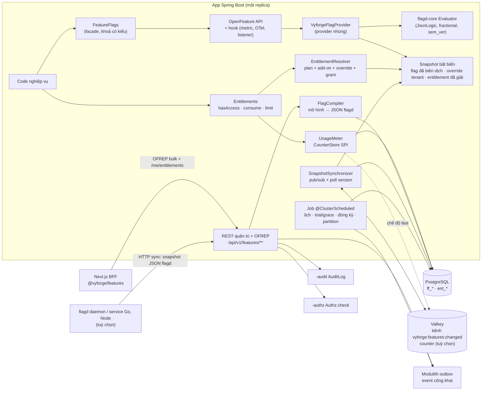
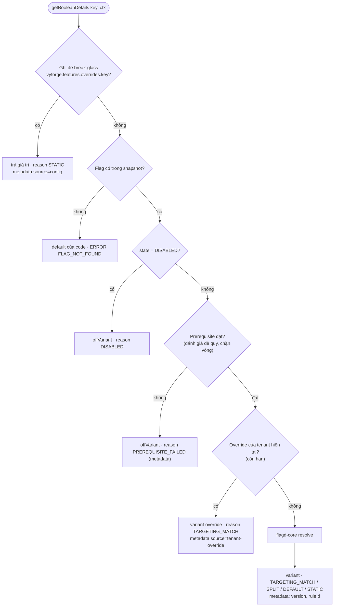
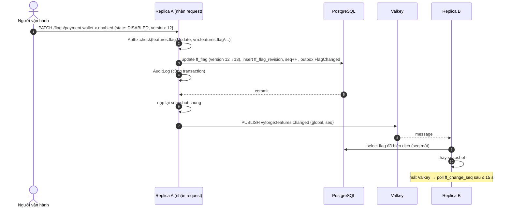
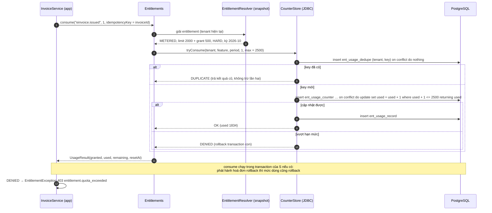
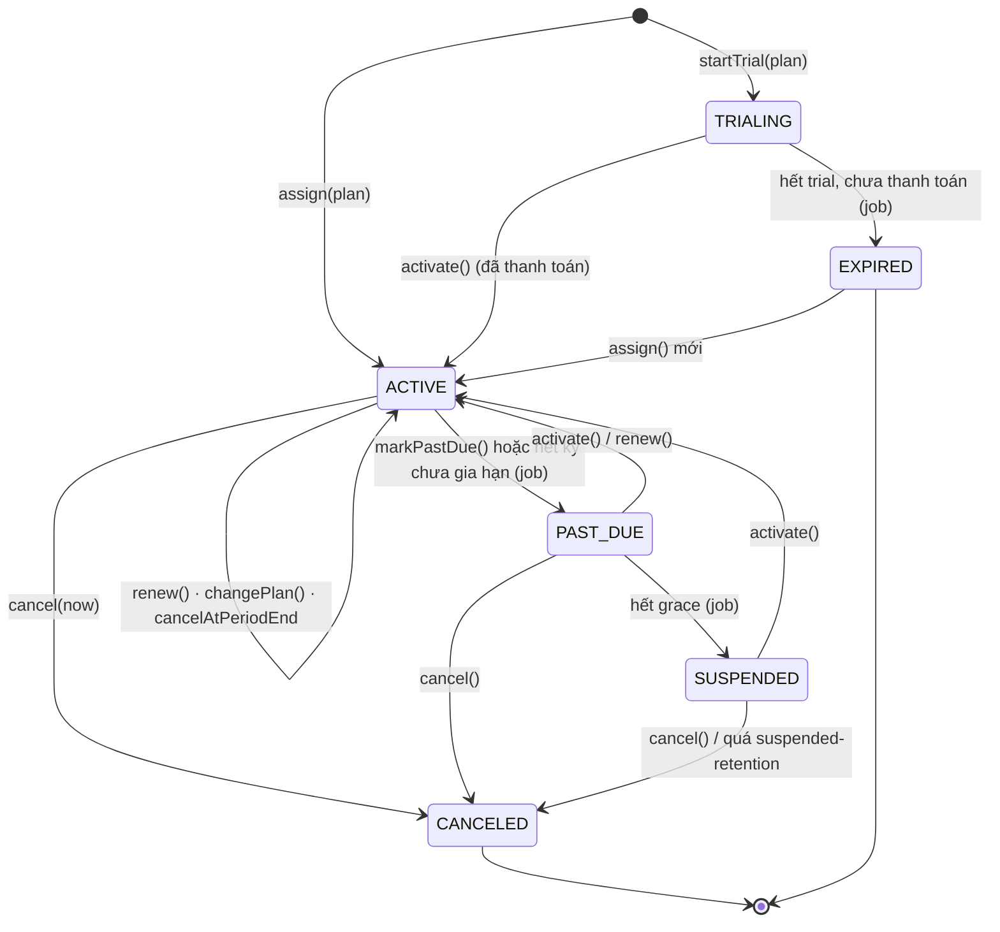
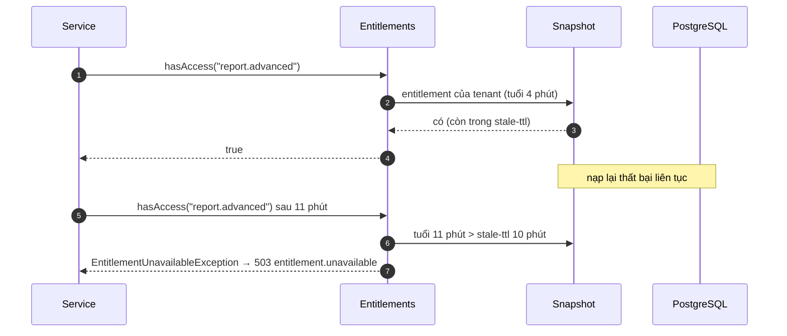
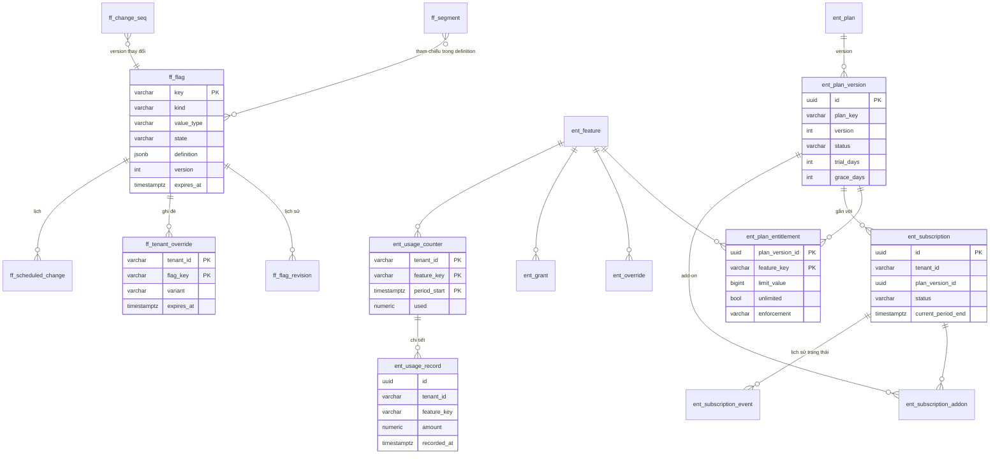

# Thiết kế: `platform-starter-features` và `@vyforge/features`

- **Trạng thái:** Bản thiết kế, chờ duyệt (26/10/2026). Chưa có code.
- **Phạm vi:** feature flag (chuẩn OpenFeature) và entitlement (gói dịch vụ, giới hạn, quota, đo mức dùng, trial, grace
  period) cho app Spring Boot và Next.js của Vyforge.
- **Nền:** platform-java 0.12.0 (`platform-core`, `-web`, `-security`, `-jpa`, `-messaging`, `-authz`, `-audit`,
  `-scheduling`, `-ratelimit`, `-privacy`), platform-web 0.9.0. Bản phát hành đích: platform-java `0.13.0`.
- **Liên quan:** [MODULE_PLAN.md](../MODULE_PLAN.md) mục 4, 5; [báo cáo module thông dụng](../research/2026-10-module-thong-dung.md)
  mục 3.4; ADR-0009 (IAM), ADR-0010 (chế độ remote), ADR-0015 (tenant ở tầng dữ liệu).

Một câu: module có **hai nửa dùng chung một hạ tầng**. *Flag* trả lời "tính năng này có đang bật cho request này không"
(phát hành, vận hành, thử nghiệm). *Entitlement* trả lời "tenant này đã mua quyền dùng tính năng này chưa, còn bao
nhiêu" (thương mại). Hai nửa có vòng đời, người quản lý và mức chặt khác nhau, nên tách API, nhưng dùng chung snapshot
trong bộ nhớ, cơ chế đồng bộ giữa replica, audit, quản trị và package frontend.

---

## 1. Bài toán và phạm vi

### 1.1 Use case

| Nhóm | Hiện tại (pilot 2027) | Tương lai |
|---|---|---|
| Phát hành | Dark launch, bật dần theo % người dùng hoặc tenant, tắt ngay khi lỗi | Phát hành tự động tăng % theo lịch, dừng khi metric xấu (guarded rollout) |
| Vận hành | Kill switch cho tích hợp ngoài (cổng thanh toán, ZNS), chế độ bảo trì, ngưỡng cấu hình lúc chạy | Bật/tắt theo tải (giờ cao điểm) qua API từ hệ thống cảnh báo |
| Theo khách hàng | Bật tính năng riêng cho một tenant (hợp đồng đặc thù), beta theo danh sách tenant | Tenant admin tự bật tính năng thử nghiệm (opt-in) |
| Gói dịch vụ | Free / Pro / Enterprise; giới hạn số user, chi nhánh, dung lượng; quota hoá đơn, tin nhắn | Add-on mua thêm, gói tuỳ chỉnh cho từng hợp đồng, credit trả trước |
| Thu tiền | Dùng thử 14 ngày, gia hạn qua chuyển khoản/VietQR, grace khi chậm thanh toán | Tính phí theo mức dùng (overage), xuất số liệu cho `-payment` lập hoá đơn |
| Thử nghiệm | Biến thể A/B đơn giản (giá trị string/JSON) | Gửi exposure sang hệ thống analytics qua OpenFeature `track` |

### 1.2 Kịch bản nghiệp vụ phải đáp ứng

Mỗi kịch bản ghi cách module giải quyết, để review biết thiết kế có đủ hay không. Các kịch bản 3, 5, 6, 8, 9, 10, 12 và 14
là đặc thù Việt Nam.

| # | Kịch bản | Cách giải |
|---|---|---|
| 1 | Màn hình thanh toán mới: bật cho nhân viên nội bộ, rồi 5% → 25% → 100% người dùng trong 2 tuần | Flag `release`. Rule 1 nhắm segment `staff`, rule mặc định rollout theo `sub`. Ba *scheduled change* đổi trọng số (mục 3.6). Hash ổn định nên người đã thấy giao diện mới không bị đổi qua lại |
| 2 | Cổng ví điện tử X lỗi lúc 21h: tắt riêng phương thức đó trong 1 phút, không deploy | Flag `kill_switch` `payment.wallet-x.enabled`. Đổi `state` qua API/console, lan tới mọi replica qua pub/sub trong vài giây. Có thêm đường *break-glass* bằng biến môi trường khi DB cũng hỏng (mục 3.5) |
| 3 | Chuỗi bán lẻ ở Hà Nội và TP.HCM được bật tính năng tồn kho liên chi nhánh trước, các tỉnh khác sau | Thuộc tính tenant `tenant.province` (mã tỉnh mới sau sắp xếp đơn vị hành chính 2025) do `TenantAttributesProvider` của app cung cấp. Rule `tenant.province in [01, 79]` |
| 4 | Khách hàng Enterprise ký hợp đồng có tính năng SSO SAML, không có trong gói chuẩn | Override entitlement theo tenant (`ent_override`, có hạn, có lý do, có audit). Không cần tạo gói mới |
| 5 | Gói Free cho hộ kinh doanh: tối đa 1 chi nhánh, 3 người dùng, 100 hoá đơn điện tử/tháng; gói Pro: 5 chi nhánh, 20 người dùng, 2.000 hoá đơn/tháng | Feature `LIMIT` (`branches`, `users`) và `METERED` (`einvoice.issued`, reset hằng tháng theo giờ Việt Nam). App gọi `entitlements.consume("einvoice.issued", 1, invoiceId)` trước khi phát hành hoá đơn |
| 6 | Dùng thử Pro 14 ngày. Hết hạn mà chưa chuyển khoản thì giữ dữ liệu, chỉ khoá tạo mới (về Free) | Subscription `TRIALING` → hết hạn → `EXPIRED` + chuyển về `default-plan` (Free). Event `TrialEnding` trước 3 ngày cho `-notification` gửi email/ZNS |
| 7 | Hết quota tin nhắn: gói Pro chặn cứng; gói Business cho vượt tối đa 20% rồi tính phí | `enforcement=HARD` cho Pro, `SOFT` + `overage_limit` cho Business. Cuối kỳ phát `UsagePeriodClosed(included, used, overage)` cho `-payment` |
| 8 | Khách chuyển khoản ngân hàng chậm 3–5 ngày (đối soát tay): không khoá ngay khi hết kỳ | Trạng thái `PAST_DUE` với `grace_days` theo gói (mặc định 7). Trong grace vẫn đủ quyền, có banner nhắc. Hết grace → `SUSPENDED` (gói `suspended-plan`: chỉ đọc) |
| 9 | Khuyến mãi Tết: tặng thêm 500 hoá đơn cho mọi tenant đang trả phí, hết hạn 15/3 | Grant (`ent_grant`) cộng vào quota, có `expires_at` và `priority`. Tạo hàng loạt bằng API theo danh sách tenant hoặc theo gói |
| 10 | Triển khai on-prem cho cơ quan nhà nước, không có Internet, không có Valkey | Provider nhúng, chỉ cần PostgreSQL. Hoặc flag đọc từ file JSON (định dạng flagd) trong ConfigMap. Không gọi dịch vụ SaaS nào |
| 11 | Đổi giá gói Pro (thêm quyền) nhưng khách cũ giữ nguyên điều kiện cho tới khi gia hạn | Gói có version. Subscription gắn với `plan_version`. Khách mới dùng version mới; khách cũ chuyển bằng lệnh `migrate` có lịch |
| 12 | Mùa cao điểm (11.11, Tết): tạm tắt báo cáo nặng cho tenant Free trong khung 19h–23h | Rule có điều kiện thời gian theo giờ `Asia/Ho_Chi_Minh` (`$flagd.timestamp`) kết hợp `tenant.plan == free`, hoặc hai scheduled change bật/tắt |
| 13 | Tenant admin tự bật "giao diện mới (beta)" cho tổ chức của mình | Flag có `tenantOptIn=true`. API `/me/opt-ins` cho tenant admin ghi override của chính tenant (chỉ với flag cho phép) |
| 14 | Ngân hàng yêu cầu mọi thay đổi cấu hình production phải có người thứ hai duyệt và lưu vết | Audit mọi thay đổi + revision đầy đủ để khôi phục. SPI `ChangeApprovalPolicy` bật luồng 4 mắt (bản sau, mục 9.4) |
| 15 | Số người dùng tối đa: mời thành viên thứ 21 trên gói 20 người phải bị chặn, kể cả khi hai admin mời cùng lúc | `LIMIT` kiểm theo số thật do app đếm (`UsageGaugeProvider`) trong cùng transaction với thao tác ghi, hoặc dùng `consume`/`release` để giữ chỗ nguyên tử (mục 3.8) |
| 16 | Nhiều backend (CRM, kho, kế toán) dùng chung flag và gói của một khách hàng | Chế độ `remote`: service đồng bộ snapshot từ service sở hữu dữ liệu, đánh giá trong app (giống `-authz` remote). Service viết bằng Go/Node dùng flagd đọc cùng snapshot qua HTTP |

### 1.3 Không thuộc phạm vi

- Phân tích kết quả A/B (thống kê, metric chuyển đổi). Module chỉ phát dữ liệu exposure qua hook/`track`.
- Lập hoá đơn, tính tiền, thu tiền. Thuộc `-payment`. Module này chỉ cung cấp số liệu mức dùng và nhận lệnh đổi trạng thái.
- Rate limit theo giây để bảo vệ hệ thống. Thuộc `-ratelimit`. Quota ở đây là hạn mức thương mại theo kỳ (ngày, tháng).
  Bảng ở mục 7.5 phân biệt hai loại.
- Phân quyền theo người dùng. Thuộc `-authz`. Entitlement là quyền của *tenant* theo hợp đồng; IAM là quyền của *người*
  trong tenant. Request phải qua cả hai.
- Remote config tuỳ ý thay cho file cấu hình. Flag kiểu `object` có, nhưng không thay `application.yml` hay secret.

---

## 2. Nghiên cứu

Phiên bản và license kiểm ngày 26/10/2026 từ Maven Central, npm registry và GitHub API. Mô hình dữ liệu lấy từ tài liệu
chính thức (link ở từng dòng).

### 2.1 Feature flag

| Hệ thống | Phiên bản, license | Mô hình dữ liệu | API | Điểm mạnh | Điểm yếu với Vyforge |
|---|---|---|---|---|---|
| [OpenFeature](https://openfeature.dev/specification/) (CNCF) | Java `dev.openfeature:sdk` 1.23.0 (Java 11+); JS `@openfeature/server-sdk` 1.23.0, `web-sdk` 1.10.0, `react-sdk` 1.4.1; Apache-2.0 | Không có mô hình lưu trữ. Chuẩn hoá *evaluation context* (targeting key + thuộc tính), merge theo thứ tự API → transaction → client → invocation → before hook ([spec §3](https://openfeature.dev/specification/sections/evaluation-context)) | `client.getBooleanValue/Details(...)`, hook 4 pha `before/after/error/finally` ([spec §4](https://openfeature.dev/specification/sections/hooks)), event provider, `track()` (thử nghiệm, [spec §6](https://openfeature.dev/specification/sections/tracking)), `MultiProvider`, `ThreadLocalTransactionContextPropagator` ([java-sdk](https://github.com/open-feature/java-sdk)) | Trung lập nhà cung cấp; đổi backend chỉ đổi provider; có hook để gắn metric, OTel, audit | Không có quản trị, lưu trữ, entitlement |
| [OFREP](https://github.com/open-feature/protocol) | OpenAPI v0.4.0, Apache-2.0; provider `@openfeature/ofrep-provider` 0.2.5, `ofrep-web-provider` 0.4.3 | Kết quả đánh giá: `key, value, variant, reason (STATIC/TARGETING_MATCH/SPLIT/DISABLED/UNKNOWN), metadata`, lỗi `errorCode` | `POST /ofrep/v1/evaluate/flags/{key}` (server, context mỗi lần), `POST /ofrep/v1/evaluate/flags` (bulk, `ETag`/`If-None-Match` → 304, 429 + `Retry-After`) ([openapi.yaml](https://raw.githubusercontent.com/open-feature/protocol/main/service/openapi.yaml)) | Giao thức HTTP chuẩn để frontend và service khác ngôn ngữ đánh giá flag mà không cần SDK riêng | Còn 0.x, có thể đổi |
| [flagd](https://flagd.dev/reference/flag-definitions/) | core v0.19.1 (26/10/2026); Java provider `dev.openfeature.contrib.providers:flagd` 0.15.0; **bộ đánh giá nhúng `dev.openfeature.contrib.tools:flagd-core` 3.0.0** (15/10/2026); Apache-2.0 | JSON: `flags.{key}.{state, variants, defaultVariant, targeting (JsonLogic), metadata}`, `$evaluators` dùng chung qua `$ref`. Toán tử thêm `fractional` (murmur3, trọng số nguyên, mặc định hash `[flagKey, targetingKey]`), `sem_ver`, `starts_with`, `ends_with`; biến `$flagd.flagKey`, `$flagd.timestamp` ([fractional](https://flagd.dev/reference/custom-operations/fractional-operation/)) | Provider 3 chế độ: RPC tới daemon, IN_PROCESS (sync gRPC/file/connector tuỳ biến), FILE (đọc file, poll 5 s) ([provider](https://github.com/open-feature/java-sdk-contrib/tree/main/providers/flagd)). `flagd-core` là interface `Evaluator.setFlags(json)` + `resolveXxxValue(key, default, ctx)` thuần, không gRPC | Định dạng mở, có đặc tả và bộ test chung; cùng thuật toán bucketing ở Go/Java/JS; daemon đọc được file, HTTP, Kubernetes CRD | Không có UI, không lưu trữ, không audit, không override theo tenant, không prerequisite, không lịch |
| [Unleash](https://docs.getunleash.io/reference/activation-strategies) | server v8.2.1 (**AGPL-3.0**), client Java `io.getunleash:unleash-client-java` 12.3.1 (Apache-2.0) | Flag theo project × environment; mỗi environment có nhiều *strategy* (OR), strategy có *constraint* (AND, toán tử `IN, NUM_*, DATE_*, STR_*, SEMVER_*`, phủ định), *segment* dùng lại, strategy variant. Gradual rollout: MurmurHash chuẩn hoá về 0–100, stickiness `userId` → `sessionId` → random, `groupId` mặc định là tên flag ([stickiness](https://docs.getunleash.io/reference/stickiness)) | REST admin + client API, SDK tải toàn bộ cấu hình rồi đánh giá cục bộ | **Loại flag có tuổi thọ dự kiến**: release 40 ngày, experiment 40, operational 7, kill switch và permission vĩnh viễn; tự đánh dấu *potentially stale*; vòng đời define → develop → production → cleanup → archived ([flag types](https://docs.getunleash.io/reference/feature-toggles)) | AGPL khi đóng gói on-prem; thêm một service; dependent flag và lịch là bản Enterprise |
| [GrowthBook](https://docs.growthbook.io/lib/build-your-own) | v5.1.0; SDK JS `@growthbook/growthbook` 1.8.0 (MIT); server **FCL-1.0-MIT** + thư mục enterprise | Feature = `defaultValue` + danh sách rule theo thứ tự, rule đầu khớp thắng: `force`, rollout (`coverage`, `hashAttribute`, `fallbackAttribute`), experiment (`variations`, `weights`, `seed`), `parentConditions` (prerequisite, có `gate`), điều kiện kiểu MongoDB (`$eq, $in, $gt, $regex, $elemMatch, $inGroup`...), saved group. Hash FNV-1a v2 `fnv32a(fnv32a(seed+value)) % 10000 / 10000` ([rules](https://docs.growthbook.io/features/rules)) | SDK spec 0.11.2 có bộ test JSON chung > 400 case | Prerequisite và rule đầu-khớp-thắng dễ hiểu; trang *simulation* thử rule với bộ thuộc tính; lịch bật/tắt rule | License server không phải OSI; trọng tâm là A/B và kho dữ liệu analytics |
| [Flagsmith](https://docs.flagsmith.com/basic-features/managing-identities) | v2.287.0, BSD-3-Clause | Environment → feature (flag + remote config value) → *identity* (người dùng) có *trait* lưu ở server → segment override → identity override (ưu tiên cao nhất) | REST + SDK, chế độ local evaluation | Override theo từng đối tượng rõ ràng; trait tạm thời để không lưu PII | Lưu trait người dùng ở server là gánh nặng PII; thêm một service |
| [LaunchDarkly](https://launchdarkly.com/docs/home/flags/target-rules) (SaaS, tham khảo mô hình) | — | *Context* có `kind` (user, organization, device) + key + thuộc tính; flag: off variation → prerequisite → individual target → rule (clause: context kind, attribute, operator, values; segment) → default rule (fallthrough), rule có rollout %. Lý do đánh giá: `OFF, FALLTHROUGH, TARGET_MATCH, RULE_MATCH (ruleId ổn định), PREREQUISITE_FAILED, ERROR (errorKind)` ([evaluation reasons](https://launchdarkly.com/docs/sdk/concepts/evaluation-reasons)) | REST, streaming SDK | Thứ tự đánh giá và "reason" là chuẩn ngành; `ruleId` ổn định khi sắp lại rule; scheduled change, approval | SaaS, giá theo MAU, dữ liệu ra nước ngoài |
| [ABP Feature Management](https://abp.io/docs/latest/framework/infrastructure/features) | ABP 10.7.0 | Feature định nghĩa trong code (`FeatureDefinitionProvider`): kiểu toggle/free text có validator/selection, group, feature con. Chuỗi provider: **Tenant → Edition → Configuration → Default**, giá trị đầu khác null thắng | `IFeatureChecker.IsEnabledAsync/GetAsync<T>`, `[RequiresFeature]` | Gần nhất với nhu cầu "flag theo gói của tenant"; định nghĩa trong code, giá trị trong DB | Không có rollout %, không đo mức dùng; gói (edition) là bản Pro |

### 2.2 Entitlement và đo mức dùng

| Hệ thống | Phiên bản, license | Mô hình dữ liệu | API | Điểm mạnh | Điểm yếu với Vyforge |
|---|---|---|---|---|---|
| [Stigg](https://docs.stigg.io/docs/features) (SaaS) | — | Feature 3 loại: **boolean**, **configuration** (giá trị, vd. số ngày lưu trữ), **metered** (seat, API call, MAU; app tự báo số đã tính, hoặc Stigg tổng hợp từ event thô). Plan, add-on, trial theo ngày/tháng trên plan; hết trial: thu hồi hoặc về gói free (reverse trial) ([trial](https://docs.stigg.io/guides/i-want-to/add-free-trials.md)) | Mẫu **check → act → track**: `getMeteredEntitlement(customerId, featureId, requestedUsage)` → `hasAccess`; `reportUsage(value, idempotencyKey)` hoặc `reportEvent(eventName, dimensions, idempotencyKey)` ([enforce limits](https://docs.stigg.io/guides/i-want-to/enforce-metered-feature-limits.md)) | Tách feature khỏi plan: code chỉ hỏi feature, không hỏi tên gói; `requestedUsage` kiểm trước khi làm | SaaS; dữ liệu khách hàng ra ngoài |
| [OpenMeter](https://openmeter.io/docs/billing/entitlements/overview) | v1.0.0-beta.236, Apache-2.0 | Entitlement 3 loại: **boolean**, **static** (JSON cấu hình), **metered** (có balance). Metered: `usagePeriod`, reset tự động/tay, `isSoftLimit`, `preserveOverageAtReset`. **Grant**: `amount`, `priority` 0–255, `effectiveAt`, `expiration`, `min/maxRolloverAmount`, `recurrence`; thứ tự tiêu: priority → gần hết hạn → tạo trước; void grant ([grant](https://openmeter.io/docs/billing/entitlements/grant)) | `value` → `hasAccess, balance, usage, overage`; lịch sử burn-down; ingest event CloudEvents qua `/api/v1/events` | Mô hình grant và soft limit rõ ràng, đã dùng cho tính phí AI token | Cần Kafka + ClickHouse + PostgreSQL ([README](https://raw.githubusercontent.com/openmeterio/openmeter/main/README.md)): quá nặng cho tier 0–1 |
| [Lago](https://getlago.com/docs/guide/billable-metrics/aggregation-types/overview) | v1.55.0, **AGPL-3.0** | Billable metric với kiểu gộp `COUNT`, `COUNT UNIQUE`, `SUM`, `MAX`, `LATEST`, `WEIGHTED SUM` (chia theo thời gian dùng trong kỳ) | Ingest event có `transaction_id` chống trùng | Danh sách kiểu gộp đủ cho phần lớn mô hình giá | AGPL; là hệ thống billing, không phải entitlement |
| [Schematic](https://docs.schematichq.com/) (SaaS) | — | Company/user, feature gắn với flag, plan entitlement + company override, event-based limit theo kỳ | `checkFlag` trả cả quyền gói | Gộp flag và entitlement vào một lời gọi | SaaS; tài liệu ERD chỉ có hình, không kiểm được chi tiết (ghi nhận, không dựa vào) |

### 2.3 Học theo và không làm

**Học theo:**

1. **OpenFeature là API công khai cho flag** ở Java và web. Code nghiệp vụ có thể gọi thẳng `dev.openfeature.sdk.Client`;
   facade của Vyforge chỉ thêm khoá có kiểu và ngữ cảnh tự điền. Đổi sang flagd daemon, Unleash hay GO Feature Flag là đổi
   provider.
2. **Định dạng và bộ đánh giá của flagd.** Dùng `flagd-core` 3.0.0 làm *engine* đánh giá trong app: không tự viết JsonLogic,
   không tự viết bucketing. Định nghĩa trong DB được *biên dịch* sang JSON flagd. Nhờ đó cùng một snapshot chạy được trong
   flagd daemon (Go, sidecar), trong app Java và qua OFREP, cho cùng kết quả bucketing.
3. **Thứ tự đánh giá và reason của LaunchDarkly**, ánh xạ sang reason chuẩn của OpenFeature: off → prerequisite → override
   (tenant, người dùng) → rule theo thứ tự → rollout mặc định. Mỗi rule có `id` ổn định.
4. **Loại flag và tuổi thọ dự kiến của Unleash**, cảnh báo flag quá hạn. Đây là cách chống "flag rác", rủi ro mà báo
   cáo module thông dụng đã nêu.
5. **Prerequisite và trang mô phỏng của GrowthBook.**
6. **Định nghĩa trong code, giá trị trong DB, chuỗi ưu tiên Tenant → Gói → Mặc định của ABP.**
7. **Feature tách khỏi plan, mẫu check → act → track và `requestedUsage` của Stigg.** Code hỏi `einvoice.issued`, không bao
   giờ hỏi `plan == "pro"`.
8. **Ba loại entitlement, grant có priority/hạn dùng, soft limit của OpenMeter.** Kiểu gộp `COUNT/SUM/MAX/LATEST` của Lago.
9. **OFREP** cho endpoint đánh giá hàng loạt của frontend (có `ETag`).

**Không làm:**

1. Không chạy flag server riêng (Unleash, Flagsmith, GrowthBook): thêm service phải trực, vướng AGPL/FCL. Đúng mục 5 của
   MODULE_PLAN.
2. Không tự viết engine JsonLogic hay thuật toán hash. Lớp Vyforge chỉ là lưu trữ, biên dịch, quản trị và đồng bộ.
3. Không bắt buộc flagd daemon. Mặc định nhúng `flagd-core`, chỉ cần PostgreSQL. flagd daemon là lựa chọn khi có service
   ngoài JVM.
4. Không lưu trait/thuộc tính người dùng ở server như Flagsmith. Ngữ cảnh chỉ sống trong request.
5. Không dựng pipeline metering kiểu OpenMeter (Kafka + ClickHouse). PostgreSQL đủ cho tier 0–2, Valkey làm lớp tăng tốc
   tuỳ chọn. Tenant cần hàng triệu event/giờ thì đổi adapter sang OpenMeter (mục 6.3).
6. Không làm phân tích A/B, không làm billing.
7. Không cho trình duyệt gọi provider trực tiếp. Mọi đánh giá ở server (BFF), kết quả hydrate xuống client.

---

## 3. Kiến trúc

### 3.1 Thành phần



Gói Java (một artifact, hai nửa tách package; nửa entitlement tắt được bằng `vyforge.features.entitlements.enabled=false`):

| Package | Nội dung |
|---|---|
| `com.vyforge.platform.features` | API công khai: `FeatureFlags`, `FlagKey`, `FlagEvaluation`, `Entitlements`, `Entitlement`, `UsageResult`, annotation, event, mã lỗi, `FlagCatalog`, `FeatureCatalog` |
| `…features.flag` | Mô hình flag, `FlagCompiler`, `VyforgeFlagProvider`, `FlagService` (quản trị), revision, scheduled change, segment |
| `…features.entitlement` | Feature, plan, subscription, override, grant, `EntitlementResolver`, `SubscriptionService`, `UsageMeter` |
| `…features.snapshot` | `FeatureSnapshot`, `SnapshotLoader`, `SnapshotSynchronizer`, `ChangeNotifier` (Valkey, poll) |
| `…features.spi` | SPI cho app và adapter: `EvaluationContextContributor`, `TenantAttributesProvider`, `FlagDefinitionSource`, `CounterStore`, `UsageGaugeProvider`, `EntitlementCustomizer`, `FlagChangeInterceptor`, `ChangeApprovalPolicy` |
| `…features.web` | Controller quản trị, OFREP, `/me`; `@RequiresFlag`, `@RequiresEntitlement` interceptor |
| `…features.jdbc` | Repository `JdbcClient` (không bắt buộc JPA) |
| `…features.testing` | `InMemoryFeatures` cho test của app |

### 3.2 Port và adapter

| Port (lõi định nghĩa) | Adapter có sẵn | Adapter thêm sau / app tự viết |
|---|---|---|
| OpenFeature `FeatureProvider` (chọn bằng `vyforge.features.provider`) | `embedded` (`VyforgeFlagProvider`: DB + `flagd-core`), `file` (JSON flagd, đọc lại khi file đổi), `remote` (snapshot từ service khác) | `flagd` (provider contrib, RPC hoặc in-process tới daemon), bất kỳ provider OpenFeature nào khai báo làm bean (`custom`) |
| `FlagDefinitionSource` (nguồn định nghĩa cho provider nhúng) | `JdbcFlagDefinitionSource`, `CatalogFlagDefinitionSource` (code), `FileFlagDefinitionSource` | Git/ConfigMap qua file |
| `ChangeNotifier` (báo thay đổi giữa replica) | `RedisChangeNotifier` (pub/sub), `PollingChangeNotifier` (luôn chạy, đọc `ff_change_seq`) | Kafka (khi nhiều service) |
| `CounterStore` (bộ đếm mức dùng) | `JdbcCounterStore` (nguyên tử bằng `update … where used + n <= limit`), `RedisCounterStore` (Lua, ghi bù về DB) | `OpenMeterCounterStore` |
| `TenantAttributesProvider` | `SubscriptionTenantAttributes` (plan, trạng thái subscription) | App: tỉnh, ngành, quy mô… |
| `EvaluationContextContributor` | `SecurityContextContributor` (`sub`, roles, groups), `RequestContributor` (locale, `X-App-Version`) | App: thiết bị, kênh bán |
| `UsageGaugeProvider` (số hiện tại của feature `LIMIT`) | — | App: `select count(*) from users` |
| `EntitlementCustomizer` | — | App: điều kiện hợp đồng từ CRM |
| Event công khai (Modulith) | `ApplicationEventPublisher` + outbox | `@Externalized` ra Kafka khi app bật |

### 3.3 Ngữ cảnh đánh giá

Ngữ cảnh do platform dựng, app chỉ thêm. Thuộc tính lấy từ token **không bao giờ** bị client ghi đè (kể cả qua OFREP).

| Thuộc tính | Nguồn | Ghi chú |
|---|---|---|
| `targetingKey` | `sub` của token; job/consumer không có người dùng thì `tenantId` | Theo spec OpenFeature |
| `tenantId` | `TenantContext` | Bắt buộc theo ADR-0015 (MODULE_PLAN: "`tenant_id` là thuộc tính mặc định") |
| `user.sub`, `user.roles`, `user.groups` | `-security`, `-authz` (nếu có) | Không đưa email, tên, số điện thoại vào ngữ cảnh |
| `tenant.plan`, `tenant.subscriptionStatus`, `tenant.trial` | `SubscriptionTenantAttributes` | Rule flag nhắm được theo gói mà không gọi DB |
| `tenant.*` khác | `TenantAttributesProvider` của app | Cache theo TTL `vyforge.features.context.tenant-attributes-ttl` (5 phút) |
| `app.version`, `locale`, `channel` | `RequestContributor` | `app.version` dùng với `sem_ver` cho mobile |
| tuỳ ý | `EvaluationContextContributor`, tham số `evaluate(key, Map)`, client OFREP (chỉ khoá trong `vyforge.features.client-context.allowed`) | |

Ngữ cảnh được đặt qua `TransactionContextPropagator` dựa trên `TenantContext`/`RequestContext` (không dùng ThreadLocal riêng),
nên đi theo sang `@Async`, virtual thread và job như các starter khác.

### 3.4 Mô hình flag và cách biên dịch

Một flag trong DB (cột `definition` JSONB, `schema_version = 1`):

```json
{
  "valueType": "boolean",
  "variants": { "on": true, "off": false },
  "offVariant": "off",
  "prerequisites": [{ "flag": "checkout.v2-api", "variants": ["on"] }],
  "rules": [
    { "id": "r-staff", "name": "Nhân viên nội bộ",
      "when": [{ "segment": "staff" }],
      "serve": { "variant": "on" } },
    { "id": "r-hn-hcm", "name": "Hà Nội, TP.HCM",
      "when": [{ "attr": "tenant.province", "op": "in", "values": ["01", "79"] }],
      "serve": { "rollout": { "bucketBy": "tenantId", "weights": { "on": 5000, "off": 5000 } } } },
    { "id": "r-raw", "name": "Nâng cao", "jsonLogic": { "sem_ver": [{ "var": "app.version" }, ">=", "3.2.0" ] },
      "serve": { "variant": "on" } }
  ],
  "defaultServe": { "rollout": { "bucketBy": "user.sub", "weights": { "on": 500, "off": 9500 } } }
}
```

- Trọng số theo phần vạn (0,01%), tổng 10.000. `bucketBy` là đường dẫn thuộc tính; mặc định `targetingKey`. Hash là
  `fractional` của flagd trên `[flagKey, giá trị bucketBy]`, nên cùng người dùng có cùng kết quả ở mọi replica, mọi ngôn
  ngữ, và hai flag khác nhau không cùng nhóm 5% đầu.
- Toán tử điều kiện: `eq, neq, in, not_in, contains, starts_with, ends_with, gt, gte, lt, lte, semver_eq|gt|gte|lt|lte,
  before, after` (thời điểm, so với `$flagd.timestamp`), `exists`, `segment`. Các điều kiện trong một rule là AND; rule
  đầu tiên khớp thắng (như GrowthBook). Muốn OR thì thêm rule hoặc dùng segment.
- `jsonLogic` là lối thoát cho trường hợp đặc biệt. API kiểm cú pháp bằng chính `flagd-core` trước khi lưu.
- Segment (`ff_segment`) là danh sách điều kiện có tên, biên dịch thành `$evaluators` của flagd và tham chiếu bằng `$ref`.

`FlagCompiler` dựng JSON flagd cho phần *chung* (không phụ thuộc tenant):

```json
{ "flags": { "checkout.new-ui": {
    "state": "ENABLED",
    "variants": { "on": true, "off": false },
    "defaultVariant": "off",
    "targeting": { "if": [
      { "$ref": "seg_staff" }, "on",
      { "in": [{ "var": "tenant.province" }, ["01", "79"]] },
        { "fractional": [{ "cat": [{ "var": "$flagd.flagKey" }, { "var": "tenantId" }] }, ["on", 5000], ["off", 5000]] },
      { "fractional": [{ "cat": [{ "var": "$flagd.flagKey" }, { "var": "user.sub" }] }, ["on", 500], ["off", 9500]] }
    ]},
    "metadata": { "version": 7, "kind": "release", "ruleIds": ["r-staff", "r-hn-hcm", "r-raw"] } } },
  "$evaluators": { "seg_staff": { "in": [{ "var": "user.groups" }, ["staff"]] } } }
```

Phần flagd không có được xử lý bởi `VyforgeFlagProvider` *trước* khi gọi `flagd-core`:



- Override theo tenant không nằm trong JSON chung: số tenant có thể lên hàng nghìn, nhét vào `targeting` làm mỗi lần đánh
  giá phải duyệt danh sách. Override nằm trong map `tenant → (flag → variant)` của snapshot, tra O(1).
- Khi xuất cho flagd daemon (`GET /api/v1/features/flagd/flags.json`), override được biên dịch thành nhánh `if` đầu tiên
  (`{"in": [{"var": "tenantId"}, [...]]}`), để daemon cho cùng kết quả.
- Không có override theo từng người dùng trong DB (tránh lưu danh sách `sub`). Cần nhắm vài người dùng thì dùng segment theo
  group IAM (`user.groups`), như nhóm `staff` ở trên.

### 3.5 Snapshot và nhất quán giữa replica

- **Snapshot bất biến.** Mỗi replica giữ một `FeatureSnapshot` gồm: `Evaluator` của flagd-core đã nạp JSON chung, map override
  theo tenant (nạp lười, LRU theo tenant), catalog plan/feature đã giải. Đánh giá flag không có I/O.
- **Version.** Mọi thay đổi tăng `ff_change_seq.value` (một dòng cho phạm vi `global`, một dòng cho mỗi tenant có thay đổi)
  trong cùng transaction.
- **Báo thay đổi.** Sau commit, publish `{"scope":"global"|"tenant","tenantId":…,"seq":…}` lên kênh Valkey
  `vyforge:features:changed`. Replica nhận → nạp lại phần bị đổi (cả snapshot chung, hoặc chỉ tenant đó).
- **Poll dự phòng.** Mỗi `vyforge.features.sync.poll-interval` (15 s) replica đọc `max(value)` của `ff_change_seq`. Mất
  Valkey thì thay đổi đến chậm tối đa 15 s, không mất (nguyên tắc 8 của MODULE_PLAN). Nghe lại được kênh thì nạp lại toàn bộ.
- **Không nạp lại song song.** Một lượt nạp tại một thời điểm; snapshot mới thay snapshot cũ bằng một phép gán nguyên tử.
  Nạp lỗi thì giữ snapshot cũ, metric `vyforge.features.snapshot.age` tăng dần, health báo `OUT_OF_SERVICE` khi quá
  `max-staleness` (mặc định 10 phút) nhưng app vẫn phục vụ.
- **Break-glass.** `vyforge.features.overrides.<flag>=<variant>` (biến môi trường) thắng mọi thứ. Dùng khi DB hỏng, hoặc
  để ghim giá trị trong test.



### 3.6 Lịch bật/tắt và rollout theo lịch

`ff_scheduled_change` chứa một *patch* có thứ tự (`setState`, `setDefaultServe`, `setRuleServe`, `setTenantOverride`,
`removeTenantOverride`) cùng `run_at`. Job `@ClusterScheduled(name = "features-scheduled-changes", fixedDelay = "30s")` áp
các patch đến hạn qua đúng `FlagService` mà API dùng, nên có version, revision, audit (actor là người tạo lịch,
`via=schedule`) và event như thay đổi tay. Patch lỗi (flag đã xoá, version lệch theo `expectedVersion`) → `FAILED` + event
`FlagScheduledChangeFailed`, không thử lại. Rollout theo lịch (kịch bản 1) là chuỗi patch `setDefaultServe` với trọng số
tăng dần.

Điều kiện theo khung giờ trong ngày (kịch bản 12) dùng rule `before/after` biên dịch sang `$flagd.timestamp`, vì không cần
ghi DB mỗi ngày. Giờ địa phương tính theo `vyforge.features.zone` (mặc định `Asia/Ho_Chi_Minh`) lúc biên dịch.

### 3.7 Entitlement

Thứ tự giải giá trị của một feature cho tenant (giá trị đầu tiên có định nghĩa thắng, như chuỗi provider của ABP):

1. `ent_override` còn hiệu lực (hợp đồng riêng, khuyến mãi), chế độ `SET` (thay) hoặc `ADD` (cộng thêm vào hạn mức).
2. Gói của subscription đang hiệu lực (`plan_version`, gồm gói cha qua `parent_plan_key`), cộng add-on: `limit = plan +
   Σ add-on × quantity`; `unlimited` nếu một nguồn bất kỳ là unlimited; boolean là OR; `CONFIG` thì add-on thắng plan.
3. Gói theo trạng thái: không có subscription → `default-plan`; `SUSPENDED` → `suspended-plan`; `EXPIRED`/`CANCELED` →
   `default-plan`.
4. Giá trị mặc định trong `FeatureCatalog` của code.
5. `EntitlementCustomizer` của app chạy cuối, có thể sửa kết quả (vd. điều kiện từ CRM).

Bốn loại feature:

| Loại | Ví dụ | Giá trị | Kiểm |
|---|---|---|---|
| `BOOLEAN` | `sso.saml`, `report.advanced` | có/không | `hasAccess`, `require`, `@RequiresEntitlement` |
| `LIMIT` | `users`, `branches`, `storage.bytes` | số tối đa (hoặc unlimited) so với **số thật** hiện có | `checkLimit(feature, newTotal)` hoặc `UsageGaugeProvider`; hoặc giữ chỗ `consume`/`release` |
| `METERED` | `einvoice.issued`, `zns.sent`, `ai.tokens` | hạn mức theo kỳ + grant; gộp `COUNT`/`SUM`/`MAX`/`LATEST` | `consume(feature, n, idempotencyKey)` nguyên tử; `record` (chỉ ghi, tính phí sau) |
| `CONFIG` | `retention.days`, `export.formats` | JSON có schema trong catalog | `config(feature, Type.class)` |

Kỳ đo (`reset_period`): `NONE`, `DAY`, `MONTH`, `YEAR`, `BILLING` (theo `current_period_start` của subscription). Kỳ theo
lịch tính ở múi giờ `vyforge.features.zone` (00:00 giờ Việt Nam, không phải UTC).

Hạn mức của kỳ = `limit` của kỳ + tổng `ent_grant` còn hiệu lực. Mức dùng tiêu hạn mức của kỳ trước, rồi grant theo
`priority` tăng dần → `expires_at` gần nhất → tạo trước (thứ tự của OpenMeter). Grant có `rollover` thì phần còn lại sang
kỳ sau, tối đa `max_rollover`.

Cưỡng chế: `HARD` (vượt thì từ chối), `SOFT` (cho vượt tới `overage_limit`, ghi overage, phát `QuotaExceeded` một lần mỗi
kỳ), `NONE` (chỉ đo, để tính phí). Ngưỡng cảnh báo `vyforge.features.entitlements.thresholds` (mặc định 80, 100%): phát
`QuotaThresholdReached` một lần mỗi ngưỡng mỗi kỳ.

### 3.8 Luồng consume (kiểm tra và ghi nguyên tử)



- **Chạy trong transaction của người gọi** (`Propagation.REQUIRED`). Nghiệp vụ lỗi thì mức dùng không bị tính. Không có
  transaction thì tự mở.
- Ngưỡng 80/100% được kiểm khi `used` đi qua ngưỡng; event qua outbox nên chỉ phát khi commit.
- `release(feature, n, idempotencyKey)` trả lại phần đã giữ (huỷ hoá đơn trong ngày, xoá thành viên).
- `requestedUsage` (Stigg): `canConsume(feature, n)` kiểm không ghi, cho UI và kiểm sớm.
- **Chế độ `fast`** (theo feature, `meter.mode=FAST`, cần Valkey): script Lua `INCRBY` có kiểm hạn mức trên key
  `t:<tenant>:features:usage:<feature>:<period>`, ghi bản ghi vào stream `t:<tenant>:features:usage-log`; job đẩy về
  `ent_usage_record`/`ent_usage_counter` mỗi 10 s. Key trống thì nạp từ DB. Mất Valkey → lùi về JDBC; Valkey mất dữ liệu
  chưa đẩy → đếm thiếu tối đa một chu kỳ đẩy (ghi rõ trong tài liệu). Dùng cho feature tần suất cao, chấp nhận sai lệch nhỏ
  (API call, token AI). Không dùng cho thứ có hậu quả pháp lý (số hoá đơn).

### 3.9 Subscription và state machine



- Mỗi tenant có tối đa một subscription "sống" (`TRIALING, ACTIVE, PAST_DUE, SUSPENDED`), bảo đảm bằng partial unique
  index. Subscription cũ giữ lại làm lịch sử.
- Chuyển trạng thái chỉ qua `SubscriptionService`; chuyển không hợp lệ → `409 entitlement.invalid_transition`. Mỗi lần
  chuyển ghi `ent_subscription_event` (from, to, lý do, actor, `external_ref`), audit và event `SubscriptionChanged`.
- `changePlan` có `effective = NOW | PERIOD_END`. Nâng gói thường `NOW`, hạ gói `PERIOD_END` (lưu `pending_plan_version_id`).
  Hạ gói làm `LIMIT` thấp hơn số hiện có (đang 15 user, gói mới 10): không xoá gì, chỉ chặn tạo mới; event có
  `overLimitFeatures` để app hiển thị.
- Job `features-subscription-lifecycle` (`@ClusterScheduled`, 5 phút) xử lý hết trial, hết kỳ, hết grace, `TrialEnding`
  (trước `trial-ending-notice`, mặc định 3 ngày), áp `pending_plan_version_id`.
- **Không phụ thuộc `-payment`.** Payment (hoặc code của app) gọi `activate/renew/markPastDue` khi nhận IPN. Mục 5.3 có
  hợp đồng.

### 3.10 Luồng lỗi

| Tình huống | Flag | Entitlement |
|---|---|---|
| DB không truy cập được lúc chạy | Dùng snapshot cũ, không giới hạn thời gian (đây là cấu hình); health `OUT_OF_SERVICE` sau `max-staleness` | Đọc (`hasAccess`, `get`): snapshot cũ tới `stale-ttl` (10 phút), quá thì **503 `entitlement.unavailable`** (không mở quyền, giống `-authz` remote). `consume` JDBC: lỗi ngay, 503 |
| DB lỗi lúc khởi động | Không có snapshot: dùng `FlagCatalog` (default của code) + `vyforge.features.bootstrap-file` nếu có; reason `ERROR`/`STALE`; app vẫn khởi động (cấu hình `fail-on-startup=false`) | Như trên, 503 cho tới khi nạp được |
| Mất Valkey | Poll 15 s thay pub/sub | Chế độ `fast` lùi về JDBC; health `featuresInvalidation` `UNKNOWN` |
| Targeting lỗi lúc chạy (JsonLogic trả giá trị lạ) | flagd-core trả lỗi → default của code, reason `ERROR`, metric `vyforge.features.evaluation.errors{flag}`, log cảnh báo một lần mỗi phút | — |
| Sai kiểu (`getStringValue` trên flag boolean) | `TYPE_MISMATCH` → default của code | — |
| Gọi ngoài phạm vi tenant | Đánh giá với ngữ cảnh không có `tenantId` (rule theo tenant không khớp) | `MissingTenantException` |
| Prerequisite vòng | Phát hiện lúc lưu (API trả 422 `features.prerequisite_cycle`); lúc chạy giới hạn độ sâu 5 → `ERROR` | — |



---

## 4. Mô hình dữ liệu

### 4.1 ERD



### 4.2 DDL dự kiến

Bảng `ff_flag`, `ff_segment`, `ent_feature`, `ent_plan*` là **danh mục dùng chung** của platform (không có `tenant_id`, truy
vấn đánh dấu `@TenantExempt`). Các bảng còn lại thuộc tenant: cột `tenant_id varchar(63) not null`, index bắt đầu bằng
`tenant_id` (ADR-0015). Không có enum nghiệp vụ trong DB: `varchar` + kiểm ở code; chỉ trạng thái state machine có `check`.

```sql
-- V1__features.sql (Flyway riêng của starter, mục 4.4)

create table ff_flag (
    key            varchar(128) primary key check (key ~ '^[a-z0-9][a-z0-9._-]{0,127}$'),
    name           varchar(200)  not null,
    description    varchar(2000),
    kind           varchar(32)   not null,              -- release | experiment | ops | kill_switch | permission (code kiểm)
    value_type     varchar(16)   not null,              -- boolean | string | integer | double | object
    state          varchar(16)   not null check (state in ('ENABLED', 'DISABLED')),
    definition     jsonb         not null,              -- variants, rules, prerequisites, defaultServe (mục 3.4)
    schema_version smallint      not null default 1,
    compiled       jsonb         not null,              -- JSON flagd đã biên dịch (cache, dựng lại được)
    client_visible boolean       not null default false, -- trả về qua OFREP cho frontend
    tenant_opt_in  boolean       not null default false, -- tenant admin tự bật được (kịch bản 13)
    source         varchar(16)   not null,              -- CODE | ADMIN
    owner          varchar(128),
    tags           text[]        not null default '{}',
    expires_at     date,                                -- hạn dự kiến gỡ flag
    archived_at    timestamptz,
    last_evaluated_at timestamptz,                      -- ghi gộp mỗi phút, để phát hiện flag không dùng
    attributes     jsonb         not null default '{}',
    version        integer       not null,
    created_at     timestamptz   not null,
    created_by     varchar(255)  not null,
    updated_at     timestamptz   not null,
    updated_by     varchar(255)  not null
);
create index ff_flag_active_idx on ff_flag (key) where archived_at is null;

create table ff_flag_revision (
    flag_key    varchar(128) not null references ff_flag (key),
    version     integer      not null,
    snapshot    jsonb        not null,                  -- toàn bộ dòng ff_flag tại version này (khôi phục, diff)
    comment     varchar(1000),
    changed_at  timestamptz  not null,
    changed_by  varchar(255) not null,
    via         varchar(16)  not null,                  -- api | schedule | catalog | rollback
    primary key (flag_key, version)
);

create table ff_segment (
    key         varchar(128) primary key,
    name        varchar(200) not null,
    description varchar(2000),
    conditions  jsonb        not null,
    schema_version smallint  not null default 1,
    version     integer      not null,
    created_at  timestamptz  not null, created_by varchar(255) not null,
    updated_at  timestamptz  not null, updated_by varchar(255) not null
);

create table ff_tenant_override (
    tenant_id   varchar(63)  not null,
    flag_key    varchar(128) not null references ff_flag (key),
    variant     varchar(64)  not null,
    reason      varchar(500),
    origin      varchar(16)  not null,                  -- operator | tenant_opt_in | schedule
    expires_at  timestamptz,
    created_at  timestamptz  not null, created_by varchar(255) not null,
    primary key (tenant_id, flag_key)
);
create index ff_tenant_override_flag_idx on ff_tenant_override (flag_key);

create table ff_scheduled_change (
    id               uuid primary key,                  -- UUID v7
    flag_key         varchar(128) not null references ff_flag (key),
    tenant_id        varchar(63),                       -- null: thay đổi chung
    run_at           timestamptz  not null,
    patch            jsonb        not null,
    expected_version integer,
    status           varchar(16)  not null check (status in ('PENDING', 'APPLIED', 'FAILED', 'CANCELED')),
    error            varchar(1000),
    applied_at       timestamptz,
    comment          varchar(1000),
    created_at       timestamptz  not null, created_by varchar(255) not null
);
create index ff_scheduled_change_due_idx on ff_scheduled_change (run_at) where status = 'PENDING';

create table ff_change_seq (
    scope  varchar(63) primary key,                      -- 'global' hoặc 't:<tenant>'
    value  bigint      not null,
    changed_at timestamptz not null
);

create table ent_feature (
    key           varchar(128) primary key check (key ~ '^[a-z0-9][a-z0-9._-]{0,127}$'),
    name          varchar(200) not null,
    type          varchar(16)  not null,                -- BOOLEAN | LIMIT | METERED | CONFIG
    unit          varchar(32),                          -- invoice, message, byte, user…
    aggregation   varchar(16),                          -- COUNT | SUM | MAX | LATEST (METERED)
    config_schema jsonb,                                -- JSON Schema cho CONFIG
    default_value jsonb,                                -- giá trị khi không gói nào định nghĩa
    source        varchar(16)  not null,                -- CODE | ADMIN
    archived_at   timestamptz,
    attributes    jsonb        not null default '{}',
    version       integer      not null,
    created_at timestamptz not null, created_by varchar(255) not null,
    updated_at timestamptz not null, updated_by varchar(255) not null
);

create table ent_plan (
    key         varchar(64)  primary key,
    name        varchar(200) not null,                  -- tên hiển thị mặc định; bản dịch trong attributes.i18n
    kind        varchar(16)  not null,                  -- BASE | ADDON
    description varchar(2000),
    sort_order  integer      not null default 0,
    archived_at timestamptz,
    attributes  jsonb        not null default '{}',     -- giá niêm yết để hiển thị, nhãn, i18n
    version     integer      not null,
    created_at timestamptz not null, created_by varchar(255) not null,
    updated_at timestamptz not null, updated_by varchar(255) not null
);

create table ent_plan_version (
    id              uuid primary key,
    plan_key        varchar(64)  not null references ent_plan (key),
    version         integer      not null,
    status          varchar(16)  not null check (status in ('DRAFT', 'PUBLISHED', 'RETIRED')),
    parent_plan_key varchar(64)  references ent_plan (key), -- kế thừa entitlement từ version PUBLISHED mới nhất của gói cha
    trial_days      integer      not null default 0,
    grace_days      integer      not null default 7,
    billing_period  varchar(16)  not null default 'MONTH', -- MONTH | QUARTER | YEAR
    published_at    timestamptz,
    attributes      jsonb        not null default '{}',
    created_at timestamptz not null, created_by varchar(255) not null,
    unique (plan_key, version)
);

create table ent_plan_entitlement (
    plan_version_id uuid         not null references ent_plan_version (id),
    feature_key     varchar(128) not null references ent_feature (key),
    enabled         boolean      not null default true,
    limit_value     numeric(20, 4),                      -- null + unlimited=false: không áp dụng
    unlimited       boolean      not null default false,
    reset_period    varchar(16),                        -- NONE | DAY | MONTH | YEAR | BILLING
    enforcement     varchar(8)   not null default 'HARD', -- HARD | SOFT | NONE
    overage_limit   numeric(20, 4),
    config          jsonb,
    primary key (plan_version_id, feature_key)
);

create table ent_subscription (
    id                      uuid primary key,
    tenant_id               varchar(63)  not null,
    plan_version_id         uuid         not null references ent_plan_version (id),
    pending_plan_version_id uuid         references ent_plan_version (id),
    status                  varchar(16)  not null
        check (status in ('TRIALING', 'ACTIVE', 'PAST_DUE', 'SUSPENDED', 'CANCELED', 'EXPIRED')),
    started_at              timestamptz  not null,
    current_period_start    timestamptz  not null,
    current_period_end      timestamptz,             -- null: không hết hạn (gói nội bộ, on-prem)
    trial_ends_at           timestamptz,
    grace_ends_at           timestamptz,
    cancel_at_period_end    boolean      not null default false,
    ended_at                timestamptz,
    external_ref            varchar(255),           -- mã hợp đồng / subscription bên -payment
    attributes              jsonb        not null default '{}',
    version                 integer      not null,
    created_at timestamptz not null, created_by varchar(255) not null,
    updated_at timestamptz not null, updated_by varchar(255) not null
);
create unique index ent_subscription_live_uq on ent_subscription (tenant_id)
    where status in ('TRIALING', 'ACTIVE', 'PAST_DUE', 'SUSPENDED');
create index ent_subscription_due_idx on ent_subscription (status, current_period_end);
create index ent_subscription_trial_idx on ent_subscription (trial_ends_at) where status = 'TRIALING';

create table ent_subscription_addon (
    subscription_id uuid        not null references ent_subscription (id),
    tenant_id       varchar(63) not null,
    plan_version_id uuid        not null references ent_plan_version (id),
    quantity        integer     not null check (quantity > 0),
    started_at      timestamptz not null,
    ended_at        timestamptz,
    primary key (subscription_id, plan_version_id, started_at)
);
create index ent_subscription_addon_tenant_idx on ent_subscription_addon (tenant_id) where ended_at is null;

create table ent_subscription_event (
    id              uuid primary key,
    tenant_id       varchar(63)  not null,
    subscription_id uuid         not null references ent_subscription (id),
    from_status     varchar(16),
    to_status       varchar(16)  not null,
    plan_version_id uuid         not null,
    reason          varchar(64)  not null,               -- trial_started, payment_received, grace_expired…
    external_ref    varchar(255),
    occurred_at     timestamptz  not null,
    actor           varchar(255) not null
);
create index ent_subscription_event_tenant_idx on ent_subscription_event (tenant_id, occurred_at desc);

create table ent_override (
    id           uuid primary key,
    tenant_id    varchar(63)  not null,
    feature_key  varchar(128) not null references ent_feature (key),
    mode         varchar(8)   not null,                 -- SET | ADD
    enabled      boolean,
    limit_value  numeric(20, 4),
    unlimited    boolean,
    config       jsonb,
    valid_from   timestamptz  not null,
    valid_until  timestamptz,
    reason       varchar(500) not null,
    created_at timestamptz not null, created_by varchar(255) not null,
    revoked_at   timestamptz, revoked_by varchar(255)
);
create index ent_override_tenant_idx on ent_override (tenant_id, feature_key) where revoked_at is null;

create table ent_grant (
    id           uuid primary key,
    tenant_id    varchar(63)    not null,
    feature_key  varchar(128)   not null references ent_feature (key),
    amount       numeric(20, 4) not null check (amount > 0),
    consumed     numeric(20, 4) not null default 0,     -- cập nhật khi đóng kỳ
    priority     smallint       not null default 10 check (priority between 0 and 255),
    effective_at timestamptz    not null,
    expires_at   timestamptz,
    rollover     boolean        not null default false,
    max_rollover numeric(20, 4),
    source       varchar(32)    not null,               -- promotion | purchase | support | migration
    external_ref varchar(255),
    reason       varchar(500),
    voided_at    timestamptz,
    created_at timestamptz not null, created_by varchar(255) not null
);
create index ent_grant_active_idx on ent_grant (tenant_id, feature_key, priority, expires_at) where voided_at is null;

create table ent_usage_counter (
    tenant_id     varchar(63)    not null,
    feature_key   varchar(128)   not null,
    period_start  timestamptz    not null,              -- 'epoch' cho NONE
    period_end    timestamptz,
    used          numeric(20, 4) not null default 0,
    overage       numeric(20, 4) not null default 0,
    thresholds_fired smallint[]  not null default '{}',  -- 80, 100… đã phát trong kỳ
    closed_at     timestamptz,
    updated_at    timestamptz    not null,
    primary key (tenant_id, feature_key, period_start)
);
create index ent_usage_counter_open_idx on ent_usage_counter (period_end) where closed_at is null;

create table ent_usage_record (
    id              uuid           not null,            -- UUID v7
    tenant_id       varchar(63)    not null,
    feature_key     varchar(128)   not null,
    period_start    timestamptz    not null,
    amount          numeric(20, 4) not null,            -- âm khi release
    idempotency_key varchar(255),
    actor           varchar(255),                       -- sub hoặc 'system' (dữ liệu cá nhân, mục 8)
    source          varchar(32)    not null,            -- api | fast-flush | adjustment | release
    attributes      jsonb          not null default '{}', -- kích thước tuỳ chọn (model AI, kênh)
    schema_version  smallint       not null default 1,
    recorded_at     timestamptz    not null,
    primary key (id, recorded_at)
) partition by range (recorded_at);
create index ent_usage_record_tenant_idx on ent_usage_record (tenant_id, feature_key, recorded_at);

create table ent_usage_dedupe (
    tenant_id       varchar(63)  not null,
    idempotency_key varchar(255) not null,
    feature_key     varchar(128) not null,
    result          jsonb        not null,               -- UsageResult của lần đầu
    created_at      timestamptz  not null,
    primary key (tenant_id, idempotency_key)
);
create index ent_usage_dedupe_created_idx on ent_usage_dedupe (created_at);
```

### 4.3 Partition và retention

| Bảng | Chiến lược | Mặc định |
|---|---|---|
| `ent_usage_record` | Partition theo tháng của `recorded_at`. Job `features-usage-partitions` (hằng ngày) tạo trước 2 tháng tới và `detach` + `drop` partition quá hạn. Không cần `pg_partman` | Giữ 13 tháng (`vyforge.features.usage.record-retention`). Dự án dùng số liệu để lập hoá đơn thì đặt theo yêu cầu lưu chứng từ kế toán của dự án (pháp chế quyết định) |
| `ent_usage_counter` | Không partition (mỗi tenant × feature × kỳ một dòng) | Giữ vĩnh viễn: đây là số tổng hợp để đối soát |
| `ent_usage_dedupe` | Xoá theo `created_at` | 7 ngày (`dedupe-retention`); retry sau 7 ngày bị tính lần nữa |
| `ff_flag_revision` | Không partition | Giữ 200 revision gần nhất mỗi flag và mọi revision trong 1 năm |
| `ent_subscription_event`, audit | Giữ vĩnh viễn (ít dòng) | |
| `ff_scheduled_change` | Xoá dòng `APPLIED/CANCELED/FAILED` sau 90 ngày | |

### 4.4 Migration và tiến hoá schema

- Location `classpath:META-INF/vyforge/db/features`, migration có version `V1__features.sql`, `V2__…`.
- **Lịch sử Flyway riêng**: starter chạy một `Flyway` riêng với `table = vyforge_features_schema_history`, `baselineOnMigrate`,
  trước Flyway của app. Số version của starter không đụng số của app hay của starter khác, nên không cần `R__` hay dải số.
  Tắt bằng `vyforge.features.schema.migrate=false` (app tự chép SQL vào migration của mình). Đây là lệch quy ước nhỏ
  (mục 10).
- Payload JSONB (`definition`, `conditions`, `patch`, `attributes` của usage) có `schema_version`. Code đọc được mọi version cũ
  và nâng lên version hiện tại khi đọc (upcaster); ghi luôn version mới. Không viết migration dữ liệu JSONB trừ khi bắt buộc.
- `attributes` JSONB là chỗ mở rộng có kiểm soát: khoá phải khai báo trong `vyforge.features.attributes.allowed` hoặc có tiền
  tố `x-`; API từ chối khoá lạ để tránh thành bãi rác.
- Loại flag, loại feature, kiểu gộp, nguồn grant: `varchar` + kiểm ở code (thêm giá trị không cần migration).

---

## 5. API

### 5.1 Java

```java
// Flag: khoá có kiểu khai báo một lần, default nằm trong code (khi không đánh giá được thì dùng giá trị này)
public final class CheckoutFlags {
    public static final FlagKey<Boolean> NEW_UI = FlagKey.bool("checkout.new-ui", false);
    public static final FlagKey<String> PSP_ORDER = FlagKey.string("checkout.psp-order", "vnpay,momo");
}

@Bean
FlagCatalog checkoutFlags() {
    return FlagCatalog.builder()
            .flag(CheckoutFlags.NEW_UI, f -> f.kind(FlagKind.RELEASE).owner("team-checkout")
                    .expiresAt(LocalDate.parse("2027-03-31")).clientVisible(true)
                    .description("Màn hình thanh toán mới"))
            .flag(CheckoutFlags.PSP_ORDER, f -> f.kind(FlagKind.OPS))
            .build();
}

public interface FeatureFlags {
    boolean isEnabled(FlagKey<Boolean> flag);
    <T> T value(FlagKey<T> flag);
    <T> FlagEvaluation<T> evaluate(FlagKey<T> flag, Map<String, ?> extraContext);
    Map<String, FlagEvaluation<?>> evaluateAll(FlagFilter filter);     // OFREP bulk, frontend
    void track(String event, Map<String, ?> details);                  // OpenFeature track
}

public record FlagEvaluation<T>(String key, T value, String variant, String reason,
                                Optional<String> errorCode, Map<String, Object> metadata) {}

// Entitlement
@Bean
FeatureCatalog billingFeatures() {
    return FeatureCatalog.builder()
            .metered("einvoice.issued", m -> m.unit("invoice").aggregation(Aggregation.COUNT))
            .limit("users", l -> l.unit("user").gauge(tenant -> userRepository.countActive()))
            .bool("sso.saml")
            .config("retention.days", Integer.class, 30)
            .build();
}

public interface Entitlements {
    boolean hasAccess(String feature);
    Entitlement get(String feature);                  // type, enabled, limit, unlimited, used, remaining, resetAt, source
    EntitlementSet all();
    void require(String feature);                     // EntitlementException 403 entitlement.not_entitled
    void checkLimit(String feature, long newTotal);   // 403 entitlement.limit_reached
    boolean canConsume(String feature, long amount);
    UsageResult consume(String feature, long amount, String idempotencyKey);   // 403 entitlement.quota_exceeded
    UsageResult release(String feature, long amount, String idempotencyKey);
    void record(String feature, long amount, String idempotencyKey);          // chỉ đo (enforcement NONE)
    void setGauge(String feature, long value);                                 // MAX/LATEST
    <T> T config(String feature, Class<T> type);
}

public interface SubscriptionService {
    Optional<Subscription> current(String tenantId);
    Subscription startTrial(String tenantId, String planKey, TrialOptions options);
    Subscription assign(String tenantId, String planKey, AssignOptions options);
    Subscription changePlan(String tenantId, String planKey, ChangeEffective effective);
    Subscription activate(String tenantId, PaymentReference ref);    // từ TRIALING / PAST_DUE / SUSPENDED
    Subscription renew(String tenantId, Instant newPeriodEnd, PaymentReference ref);
    Subscription markPastDue(String tenantId, String reason);
    Subscription suspend(String tenantId, String reason);
    Subscription cancel(String tenantId, CancelOptions options);     // NOW | PERIOD_END
    Subscription setAddon(String tenantId, String addonKey, int quantity);
}

public interface EntitlementAdmin {        // override, grant, điều chỉnh usage (đều có audit)
    Override putOverride(String tenantId, OverrideRequest request);
    void revokeOverride(String tenantId, UUID overrideId);
    Grant grant(String tenantId, GrantRequest request);
    void voidGrant(String tenantId, UUID grantId);
    UsageResult adjustUsage(String tenantId, String feature, long delta, String reason);
}
```

Annotation (interceptor của `-web`, chạy sau `@RequiresPermission`):

```java
@RequiresFlag(value = "checkout.new-ui", whenDisabled = WhenDisabled.NOT_FOUND)     // 404 feature.not_available
@RequiresEntitlement(feature = "einvoice.issued", consume = 1, idempotencyKey = "#request.invoiceNo")
public Invoice issue(IssueRequest request) { ... }
```

### 5.2 REST

Tất cả dưới `/api/v1/features` (khớp route `/api/v<n>/<service>/**` của gateway), lỗi Problem Details có `code`.

| Method | Path | Quyền (`features:*`) | Ghi chú |
|---|---|---|---|
| `POST` | `/ofrep/v1/evaluate/flags` | đăng nhập | OFREP bulk: chỉ flag `client_visible`; `ETag` = seq; context của client chỉ nhận khoá được phép |
| `POST` | `/ofrep/v1/evaluate/flags/{key}` | đăng nhập | OFREP một flag |
| `GET` | `/me/entitlements` | đăng nhập | Entitlement + mức dùng của tenant hiện tại (cho UI) |
| `GET` | `/me/subscription` | `features:subscription:GetOwn` | Tenant admin xem gói của mình |
| `GET/PUT/DELETE` | `/me/opt-ins/{flag}` | `features:optin:Put` | Tenant tự bật flag có `tenant_opt_in` |
| `GET/POST` | `/flags`, `GET/PATCH/DELETE /flags/{key}` | `flag:List/Get/Create/Update/Archive` | `PATCH` cần `version`; `DELETE` là archive |
| `POST` | `/flags/validate` | `flag:Get` | Kiểm định nghĩa, trả JSON flagd đã biên dịch |
| `GET` | `/flags/{key}/revisions`, `/flags/{key}/revisions/{v}` | `flag:Get` | Diff giữa 2 revision |
| `POST` | `/flags/{key}/rollback` | `flag:Update` | Về revision `v` (tạo revision mới) |
| `GET/PUT/DELETE` | `/flags/{key}/tenants/{tenantId}` | `override:Put/Delete` | Override theo tenant |
| `GET/POST/DELETE` | `/flags/{key}/schedules`, `/schedules/{id}` | `schedule:Create/Cancel` | |
| `POST` | `/simulate` | `flag:Simulate` | Đánh giá với context giả + định nghĩa chưa lưu; trả reason, ruleId, các bước |
| `GET/POST/PATCH` | `/segments`, `/segments/{key}` | `segment:*` | |
| `GET` | `/flagd/flags.json` | scope `features.sync` | Snapshot định dạng flagd cho flagd daemon (HTTP sync) và chế độ `remote` |
| `GET` | `/reports/stale-flags` | `flag:List` | Quá `expires_at`, quá tuổi thọ theo loại, không được đánh giá 30 ngày |
| `GET/POST/PATCH` | `/catalog/features`, `/catalog/features/{key}` | `catalog:*` | |
| `GET/POST/PATCH` | `/plans`, `/plans/{key}`, `/plans/{key}/versions`, `POST /plans/{key}/versions/{v}/publish` | `plan:*` | Version đã publish không sửa được |
| `POST` | `/plans/{key}/versions/{v}/migrate` | `plan:Migrate` | Chuyển subscriber từ version cũ, có lịch |
| `GET` | `/tenants/{tenantId}/subscription`, `/subscription/events` | `subscription:Get` | |
| `POST` | `/tenants/{tenantId}/subscription:{trial,assign,change-plan,activate,renew,past-due,suspend,cancel}` | `subscription:Change` | Cần `Idempotency-Key` |
| `GET/POST/DELETE` | `/tenants/{tenantId}/overrides`, `/grants` | `override:*`, `grant:*` | |
| `GET` | `/tenants/{tenantId}/usage?feature=&from=&to=` | `usage:Get` | Theo kỳ; chi tiết từ `ent_usage_record` |
| `POST` | `/tenants/{tenantId}/usage/{feature}:adjust` | `usage:Adjust` | Điều chỉnh tay, bắt buộc lý do |

API theo `{tenantId}` là API của **người vận hành platform**: token phải thuộc tenant vận hành
(`vyforge.features.admin.operator-tenant`, mặc định `default`) và có quyền trên `vrn:features:tenant/<tenantId>`. Sau khi
kiểm quyền, controller chạy thao tác trong `TenantContext.run(tenantId, …)`. Tenant admin của khách hàng chỉ dùng `/me/*`.

OpenAPI phác thảo (một endpoint tiêu biểu):

```yaml
/api/v1/features/flags/{key}:
  patch:
    operationId: updateFlag
    parameters: [{ name: key, in: path, required: true, schema: { type: string } }]
    requestBody:
      content:
        application/json:
          schema:
            type: object
            required: [version]
            properties:
              version: { type: integer }
              state: { type: string, enum: [ENABLED, DISABLED] }
              definition: { $ref: '#/components/schemas/FlagDefinition' }
              comment: { type: string, maxLength: 1000 }
    responses:
      '200': { content: { application/json: { schema: { $ref: '#/components/schemas/Flag' } } } }
      '409': { description: 'features.flag_version_conflict' }
      '422': { description: 'features.definition_invalid | features.prerequisite_cycle | features.variant_unknown' }
```

Mã lỗi (`FeaturesErrors`, vi/en trong `i18n/platform-features-errors`): `features.flag_not_found`, `features.flag_exists`,
`features.flag_version_conflict`, `features.definition_invalid`, `features.variant_unknown`, `features.prerequisite_cycle`,
`features.flag_archived`, `features.opt_in_not_allowed`, `feature.not_available` (404), `entitlement.not_entitled` (403),
`entitlement.limit_reached` (403, params `limit`, `current`), `entitlement.quota_exceeded` (403, params `limit`, `used`,
`resetAt`), `entitlement.subscription_inactive` (403), `entitlement.unavailable` (503), `entitlement.plan_not_found`,
`entitlement.plan_not_published`, `entitlement.plan_version_immutable`, `entitlement.invalid_transition` (409),
`entitlement.feature_type_mismatch`.

Catalog action (`FeaturesActions`, theo dạng `<service>:<resource>:<Verb>` của ADR-0009): `features:flag:{List,Get,Create,
Update,Archive,Simulate}`, `features:override:{Put,Delete}`, `features:schedule:{Create,Cancel}`,
`features:segment:{List,Get,Create,Update}`, `features:catalog:{List,Update}`, `features:plan:{List,Get,Create,Update,
Publish,Migrate}`, `features:subscription:{Get,GetOwn,Change}`, `features:grant:{Create,Void}`, `features:usage:{Get,Adjust}`,
`features:optin:Put`.

### 5.3 Event công khai

Mọi event là record Java thuần trong `com.vyforge.platform.features.event`, implement `TenantAwareEvent` (trừ event chung
của flag), đi qua outbox của Spring Modulith. App bật `@Externalized` bằng `vyforge.features.events.topic` (mặc định tắt).
Payload có `schemaVersion`.

| Event | Khi nào | Ai thường nghe |
|---|---|---|
| `FlagChanged(flagKey, version, changeType, actor, via)` | Tạo, sửa, archive, rollback, áp lịch | realtime (đẩy lại flag cho client), audit ngoài |
| `TenantFlagOverrideChanged(tenantId, flagKey, variant?, actor)` | Đặt/gỡ override, opt-in | realtime |
| `FlagScheduledChangeFailed(flagKey, scheduleId, error)` | Lịch áp lỗi | notification (báo owner) |
| `SubscriptionChanged(tenantId, subscriptionId, fromStatus, toStatus, fromPlan, toPlan, reason, overLimitFeatures)` | Mọi chuyển trạng thái/đổi gói | notification, payment, app |
| `TrialEnding(tenantId, planKey, endsAt, daysLeft)` | Trước `trial-ending-notice` | notification |
| `QuotaThresholdReached(tenantId, feature, thresholdPercent, used, limit, periodEnd)` | `used` qua ngưỡng | notification, app |
| `QuotaExceeded(tenantId, feature, enforcement, used, limit, overage)` | Lần đầu vượt trong kỳ | notification, app |
| `UsagePeriodClosed(tenantId, feature, periodStart, periodEnd, included, used, overage, grantsConsumed)` | Đóng kỳ (job) | payment (lập hoá đơn overage) |

**Điểm nối với `-payment` (làm song song).** `-features` không phụ thuộc code của `-payment`. Hợp đồng:

- Payment → features: gọi `SubscriptionService.activate/renew/markPastDue/cancel(tenantId, PaymentReference(provider,
  transactionId))`. Đặt listener ở app hoặc ở module tích hợp tuỳ chọn khi cả hai đã merge. `PaymentReference` là record
  của `-features`, idempotent theo `transactionId`.
- Features → payment: `UsagePeriodClosed` (tính overage), `SubscriptionChanged` (tạo/huỷ lịch thu tiền).

**Điểm nối với `-notification`:** nghe `TrialEnding`, `QuotaThresholdReached`, `QuotaExceeded`, `SubscriptionChanged`,
`FlagScheduledChangeFailed`. Không gọi trực tiếp.

**Điểm nối với `-realtime`:** nghe `FlagChanged`, `TenantFlagOverrideChanged` để báo client tải lại snapshot.

**Điểm nối với `-authz`:** `features.authz.principal-attributes=true` đăng ký `PrincipalAttributesProvider` thêm
`principal.plan` và `principal.entitlements` (danh sách feature boolean được phép) cho `Condition` của policy (đúng đề xuất
của báo cáo module thông dụng mục 3.4).

### 5.4 Frontend `@vyforge/features`

```ts
// src/shared/features.ts (server-only)
import 'server-only';
import { createFeaturesClient, createFeatureHelpers } from '@vyforge/features';
export const features = () => createFeaturesClient({ baseUrl: env().API_BASE_URL, getAccessToken });
export const { getFlags, isEnabled, flagValue, getEntitlements, hasEntitlement, requireFlag, requireEntitlement } =
  createFeatureHelpers(features);   // gom mọi lần hỏi trong một request thành một lời gọi OFREP bulk (React cache)

// Server Component
{(await isEnabled('checkout.new-ui')) ? <NewCheckout /> : <OldCheckout />}
await requireEntitlement('report.advanced');        // notFound()/forbidden() theo tuỳ chọn
<FeatureGate flag="checkout.new-ui" fallback={<OldCheckout />}><NewCheckout /></FeatureGate>
<EntitlementGate feature="report.advanced" fallback={<UpgradePrompt feature="report.advanced" />}>…</EntitlementGate>

// Hydrate xuống client (không gọi backend từ trình duyệt)
<FeaturesProvider snapshot={await getFlags()} entitlements={await getEntitlements()}>{children}</FeaturesProvider>
// component client: const enabled = useFlag('checkout.new-ui'); const quota = useEntitlement('einvoice.issued');
```

| Entry | Nội dung |
|---|---|
| `@vyforge/features` | `createFeaturesClient()` (OFREP bulk, `/me/*`, toàn bộ API quản trị), `createFeatureHelpers()`, Server Action: `createFlagFormAction`, `createOverrideAction`, `createScheduleAction`, `createSimulateAction`, `createPlanFormAction`, `createSubscriptionAction`, `createGrantAction`; `featuresErrorMessages` (vi/en) |
| `@vyforge/features/react` | `FeaturesProvider`, `useFlag`, `useFlagValue`, `useEntitlement`, `ClientFeatureGate` |
| `@vyforge/features/ui` | Dùng cho app: `FeatureGate`, `EntitlementGate`, `UpgradePrompt`, `UsageMeter`, `QuotaBanner` (trial/grace/quota). Quản trị: `FlagTable`, `FlagEditor` (biến thể, rule, rollout dạng thanh trượt, prerequisite), `RuleBuilder`, `TenantOverrideManager`, `ScheduleEditor`, `FlagHistory` (diff, rollback), `FlagSimulator`, `StaleFlagReport`, `SegmentEditor`, `PlanTable`, `PlanEditor` (ma trận feature × gói), `SubscriptionPanel`, `UsageTable`, `GrantManager` |
| `@vyforge/features/openfeature` | Tuỳ chọn: `createOfrepProvider()` dựng `@openfeature/ofrep-provider` (peer dependency) với token của BFF, cho team muốn dùng API OpenFeature ở server Next.js |

Nhãn vi/en có sẵn (`featuresLabels.vi/en`), component dùng `@vyforge/ui`.

---

## 6. Mở rộng

### 6.1 SPI

| SPI | Khi nào dùng | Ví dụ |
|---|---|---|
| `EvaluationContextContributor` | Thêm thuộc tính vào ngữ cảnh | Kênh bán (POS/web), thiết bị |
| `TenantAttributesProvider` | Thuộc tính của tenant cho rule (cache có TTL) | Tỉnh, ngành, quy mô |
| `FlagDefinitionSource` | Nguồn định nghĩa khác cho provider nhúng | Git |
| `FlagChangeInterceptor` | Trước/sau khi lưu flag: kiểm thêm, từ chối, ghi chú | Bắt buộc `owner`, cấm `rollout > 50%` cho flag `kill_switch` |
| `ChangeApprovalPolicy` | Đòi duyệt trước khi áp thay đổi (để bản sau, mục 9.4) | Ngân hàng: flag `tags` có `prod-critical` cần người thứ hai |
| OpenFeature `Hook` (bean) | Mọi lần đánh giá | Hook OTel `dev.openfeature.contrib.hooks:otel` 3.3.1; hook gửi exposure sang analytics |
| `UsageGaugeProvider` | Số hiện có của feature `LIMIT` | Đếm user, chi nhánh |
| `CounterStore` | Nơi đếm mức dùng | OpenMeter cho tenant rất lớn |
| `EntitlementCustomizer` | Sửa entitlement đã giải | Hợp đồng lấy từ CRM |
| `SubscriptionLifecycleListener` | Đồng bộ trong transaction khi đổi trạng thái (khác event: chạy trước commit, có thể chặn) | Chặn huỷ gói khi còn công nợ |
| `BillingPeriodCalculator` | Cách tính kỳ | Kỳ theo ngày ký hợp đồng thay vì ngày 1 |

### 6.2 Cấu hình theo tenant

Không có "cấu hình provider theo tenant" như notification hay payment, vì module không gọi ra ngoài. Phần theo tenant là
dữ liệu: override flag, opt-in, subscription, add-on, override entitlement, grant. Mặc định cấp platform:
`vyforge.features.entitlements.default-plan`, `suspended-plan`, `thresholds`, `zone`.

### 6.3 Ví dụ: thêm provider và kênh mới

**Dùng flagd daemon cho cả hệ thống (service Go, Node đọc chung).** Không đổi code app:

```yaml
vyforge.features:
  provider: embedded            # app Java vẫn đánh giá nhúng
  sync:
    flagd-export: true          # bật GET /api/v1/features/flagd/flags.json
```

```bash
# sidecar cho service Go; http sync poll mặc định 5 s (https://flagd.dev/reference/sync-configuration/)
flagd start --sources "[{\"uri\":\"https://crm.example.com/api/v1/features/flagd/flags.json\",\"provider\":\"http\",\"authHeader\":\"Bearer ${FLAGD_TOKEN}\",\"interval\":10}]"
```

Token là client credentials có scope `features.sync`, cấp bằng job ngoài (ESO/CronJob làm mới). Bản sau có thể cho endpoint
nhận mTLS nội bộ thay token.

**Đổi hẳn sang provider khác** (vd. GO Feature Flag do khách hàng đã có): khai báo bean `FeatureProvider` và
`vyforge.features.provider: custom`. `FeatureFlags`, annotation, OFREP, frontend chạy như cũ; API quản trị flag tắt (khách
quản trị ở hệ thống của họ). Entitlement không bị ảnh hưởng.

**Metering bằng OpenMeter** (tenant rất lớn): viết `OpenMeterCounterStore implements CounterStore` gọi API OpenMeter qua
`@HttpExchange` của `-web` (timeout, retry có sẵn), khai báo bean và `vyforge.features.usage.store: custom`. `Entitlements`
và frontend không đổi.

---

## 7. Vận hành

### 7.1 Cấu hình

```yaml
vyforge:
  features:
    enabled: true
    provider: embedded               # embedded | file | remote | flagd | custom
    zone: Asia/Ho_Chi_Minh
    file: classpath:flags.json       # provider=file hoặc bootstrap
    bootstrap-file:                  # dùng khi DB chưa sẵn sàng lúc khởi động
    overrides: {}                    # break-glass: <flag>: <variant>
    fail-on-startup: false
    sync:
      poll-interval: 15s
      max-staleness: 10m
      channel: vyforge:features:changed
      flagd-export: false
    remote:                          # provider=remote (giống -authz remote)
      url: http://crm-backend:8080
      registration: vyforge-features # client_credentials, scope features.sync
    context:
      tenant-attributes-ttl: 5m
    client-context:
      allowed: [locale, app.version, channel]
    admin:
      operator-tenant: default
    schema:
      migrate: true
    entitlements:
      enabled: true
      default-plan: free
      suspended-plan: suspended
      stale-ttl: 10m
      thresholds: [80, 100]
      trial-ending-notice: 3d
    usage:
      store: jdbc                    # jdbc | custom; FAST theo feature cần Valkey
      fast-flush-interval: 10s
      record-retention: 13M
      dedupe-retention: 7d
    events:
      topic:                         # bật @Externalized khi có giá trị
```

### 7.2 Metric (Micrometer)

| Metric | Tag | Ý nghĩa |
|---|---|---|
| `vyforge.features.evaluations` (counter) | `flag`, `reason`, `variant` | Có thể tắt tag `flag` (`metrics.flag-tag=false`) nếu số flag lớn |
| `vyforge.features.evaluation.errors` | `flag`, `error` | |
| `vyforge.features.snapshot.age` (gauge, giây) | `scope` | Tuổi của snapshot |
| `vyforge.features.snapshot.reloads` | `scope`, `outcome` | |
| `vyforge.features.flags` (gauge) | `kind`, `status=active|stale|expired|unused` | Flag rác |
| `vyforge.features.entitlement.checks` | `feature`, `outcome=granted|denied|unavailable` | |
| `vyforge.features.usage.consumed` (counter, đơn vị của feature) | `feature`, `mode` | |
| `vyforge.features.usage.denied` | `feature`, `enforcement` | |
| `vyforge.features.usage.fast.pending` (gauge) | | Bản ghi chưa đẩy về DB |
| `vyforge.features.subscriptions` (gauge) | `status`, `plan` | |
| `vyforge.features.jobs.*` | | Do `-scheduling` (`job` = tên job) |

Span OTel: hook OTel của OpenFeature tạo span event `feature_flag.evaluation` theo semantic convention; `consume` có span
`features.consume` (thuộc tính `feature`, `outcome`). Log có `tenant_id`, `request_id` từ MDC của `platform-core`.

Health: `featuresSnapshot` (`UP`; `OUT_OF_SERVICE` khi quá `max-staleness`; không `DOWN` để không bị Kubernetes khởi động
lại vì DB chậm), `featuresInvalidation` (`UP` khi đang nghe Valkey, `UNKNOWN` khi chưa).

### 7.3 Alert gợi ý

| Alert | Điều kiện |
|---|---|
| Snapshot cũ | `vyforge.features.snapshot.age > 300` trong 5 phút |
| Lỗi đánh giá | `rate(vyforge.features.evaluation.errors[5m]) > 0` |
| Entitlement không dùng được | `outcome=unavailable` > 0 |
| Fast meter dồn | `usage.fast.pending > 10000` trong 5 phút |
| Job lịch lỗi | `FlagScheduledChangeFailed`, hoặc `vyforge.scheduling.*` failures của job `features-*` |
| Flag rác | `vyforge.features.flags{status="expired"} > 0` (cảnh báo mức thấp, gửi owner) |

### 7.4 Tải và dung lượng

- **Đánh giá flag:** trong bộ nhớ, không I/O, vài micro giây mỗi lần (JsonLogic thông dịch; bật `compile-targeting` của
  flagd-core khi image có `jdk.compiler`). Benchmark JMH là một phần của giai đoạn 2; mục tiêu p99 < 50 µs cho flag có 10 rule.
- **Snapshot:** 500 flag × ~5 KB ≈ 2,5 MB mỗi replica; override tenant nạp lười, LRU 10.000 tenant.
- **Entitlement:** giải sẵn theo tenant, cache LRU (mặc định 10.000 tenant, TTL = `stale-ttl`), bị xoá khi có thay đổi.
- **`consume` JDBC:** 2–3 câu lệnh trong transaction; một dòng counter mỗi tenant × feature × kỳ nên tenant rất bận sẽ tranh
  khoá dòng. Ước lượng an toàn ~200 consume/giây cho một tenant × feature, vài nghìn/giây toàn hệ thống trên PostgreSQL tier
  1. Vượt mức đó: chế độ `FAST`, gộp ở phía app (`consume(feature, batchSize)`), hoặc `CounterStore` khác.
- **`ent_usage_record`:** 1.000 tenant × 10.000 bản ghi/ngày ≈ 10 triệu dòng/ngày ≈ 2 GB/tháng: partition tháng và retention
  là bắt buộc. Feature chỉ cần tổng thì đặt `record-detail=false` (chỉ cập nhật counter).

### 7.5 Quota khác rate limit

| | `-ratelimit` | Quota của `-features` |
|---|---|---|
| Mục đích | Bảo vệ hệ thống khỏi quá tải | Hạn mức thương mại theo gói |
| Cửa sổ | Giây, phút | Ngày, tháng, kỳ thanh toán |
| Lưu ở | Valkey (mất thì reset được) | PostgreSQL (dữ liệu gốc, có thể dùng để tính tiền) |
| Khi vượt | 429 + `Retry-After` | 403 `entitlement.quota_exceeded` + gợi ý nâng gói |
| Có thể cấu hình theo gói | Có: rule dùng `tenant.plan` qua `-features` (bản sau) | Có |

### 7.6 Chế độ lỗi đã ghi ở mục 3.10. Ngoài ra

- Job (`features-scheduled-changes`, `features-subscription-lifecycle`, `features-usage-period-close`,
  `features-usage-partitions`, `features-usage-fast-flush`, `features-cleanup`) đều dùng `@ClusterScheduled`; lượt lỗi chạy
  lại ở lượt sau, xử lý theo từng dòng nên một tenant lỗi không chặn tenant khác.
- Đóng kỳ trễ (app tắt qua đêm): job xử lý mọi counter có `period_end < now()` chưa `closed_at`, theo thứ tự thời gian.
  `consume` sau `period_end` luôn ghi vào kỳ mới, không phụ thuộc job.
- Đồng hồ: kỳ và hạn dùng tính theo giờ của DB (`now()`), giống `-scheduling`.

---

## 8. Bảo mật và tuân thủ

**Phân quyền.** Mọi API quản trị qua `Authz.check` với catalog `features:*`. API theo tenant khác chỉ cho token của tenant
vận hành. OFREP và `/me/*` chỉ thấy tenant của token; context từ client không ghi đè được `tenantId`, `user.*`, `tenant.*`.
Flag không `client_visible` không bao giờ trả cho frontend (tên flag cũng có thể lộ kế hoạch sản phẩm).

**Audit.** Mọi thay đổi flag, segment, override, lịch, catalog, gói, subscription, grant, điều chỉnh usage ghi `AuditLog`
(action `features:*`, resource `vrn:features:flag/<key>` hoặc `vrn:features:tenant/<id>/…`) cùng transaction; thay đổi flag
có thêm revision đầy đủ để khôi phục.

**Dữ liệu cá nhân (Luật 91/2025/QH15, NĐ 356/2025/NĐ-CP).**

- Ngữ cảnh đánh giá chỉ chứa định danh giả danh (`sub`), role, group và thuộc tính của tenant. Platform không đưa email, tên,
  số điện thoại vào ngữ cảnh. Thuộc tính app thêm qua contributor không được ghi log hay lưu: module không lưu ngữ cảnh.
- Định nghĩa flag không chứa danh sách người dùng (không có individual target theo `sub` trong DB, mục 3.4). Rule `jsonLogic`
  có thể chứa giá trị tuỳ ý: API cảnh báo (`warnings`) khi phát hiện email/số điện thoại/CCCD bằng bộ nhận dạng của
  `-privacy`.
- `ent_usage_record.actor` là `sub` (dữ liệu cá nhân cơ bản, đánh dấu `@PersonalData` trong record). Có retention (mục 4.3),
  và có thể tắt hẳn (`usage.record-actor=false`). Yêu cầu xoá của chủ thể dữ liệu: hàm `UsageRecords.anonymizeActor(sub)` thay
  `actor` bằng HMAC (`-privacy`), số liệu tính tiền giữ nguyên.
- Log và audit ghi qua `LogSafeJson`.
- Dữ liệu ở lại hạ tầng của khách hàng: không gọi SaaS, không gửi telemetry ra ngoài.

**Thương mại, tính tiền.** Số liệu dùng để lập hoá đơn (`ent_usage_counter`, `UsagePeriodClosed`) phải đối soát được: counter
không sửa trực tiếp, chỉ qua `adjust` có lý do và audit; `ent_usage_record` lưu từng thay đổi. Thời hạn lưu chứng từ do pháp
chế của dự án quyết định theo Luật Kế toán; hoá đơn điện tử thuộc `-payment`/`-einvoice`.

**Khác.** Không có secret trong module. `external_ref` không chứa số thẻ hay tài khoản. Endpoint `/flagd/flags.json` cần scope
`features.sync`, không công khai. Chặn tấn công đoán flag qua OFREP bằng `-ratelimit` (rule mẫu trong README).

---

## 9. Kế hoạch triển khai

### 9.1 Thứ tự (platform-java, `platform-starter-features`, `0.13.0-SNAPSHOT`)

1. Khung starter, properties, mã lỗi vi/en, catalog action, Flyway riêng + `V1__features.sql`, partition job.
2. Flag: mô hình + `FlagCompiler` + `VyforgeFlagProvider` trên `flagd-core` 3.0.0; `FlagCatalog` đồng bộ vào DB lúc khởi
   động (code tạo flag mới, không ghi đè thay đổi của admin); `FeatureFlags`; ngữ cảnh (contributor, propagator).
3. Snapshot, `PollingChangeNotifier`, `RedisChangeNotifier`, health, metric.
4. API quản trị flag: CRUD, revision, rollback, override tenant, opt-in, simulate, validate, segment, stale report, OFREP,
   `flagd/flags.json`; audit; event.
5. Scheduled change + job.
6. Entitlement: catalog feature, plan + version + kế thừa, `EntitlementResolver`, `Entitlements` (boolean, limit, config).
7. Subscription + state machine + job lifecycle + event; `PaymentReference`.
8. Metering: `JdbcCounterStore`, dedupe, record, ngưỡng, đóng kỳ, grant; `RedisCounterStore` (FAST) + flush.
9. `@RequiresFlag`, `@RequiresEntitlement`; bridge `principal.plan` cho `-authz`; provider `file` và `remote`.
10. README module, mục trong README gốc, `platform-bom`, pom gốc.

platform-web, `packages/features` (`@vyforge/features` 0.1.0): client + helper + Server Action → `react` → `ui` (gate,
banner, meter) → `ui` quản trị → `openfeature` → trang ví dụ trong `examples/next-app` (`/admin/features`).

### 9.2 Test

| Loại | Nội dung |
|---|---|
| Unit | Biên dịch rule → JSON flagd (snapshot test), thứ tự đánh giá (off, prerequisite, override, rule, default), phân bố rollout (100.000 key, sai số < 0,5%), ổn định hash qua lần biên dịch, giải entitlement (plan + cha + add-on + override + grant), tính kỳ theo múi giờ Việt Nam (ranh giới tháng, năm nhuận), state machine (mọi chuyển hợp lệ và không hợp lệ) |
| Tương thích flagd | Chạy bộ test JSON của flagd (`flagd-testbed`) trên `FlagdCore` qua lớp provider để bảo đảm không làm lệch hành vi; so kết quả bucketing của JSON xuất ra với flagd daemon (Testcontainers `ghcr.io/open-feature/flagd`) |
| Testcontainers PostgreSQL | Repository, migration riêng, `consume` song song (50 thread, không vượt hạn mức, không đếm trùng với cùng idempotency key), rollback cùng transaction nghiệp vụ, partition job, đóng kỳ, `TenantIsolationTests` cho mọi bảng thuộc tenant |
| Testcontainers Valkey | Lan truyền thay đổi giữa 2 context Spring; **mất Valkey giữa chừng** (bắt buộc theo MODULE_PLAN): poll vẫn đưa thay đổi tới; FAST lùi về JDBC; flush sau khi Valkey trở lại |
| Web MVC | Quyền mọi endpoint, Problem Details + mã lỗi, OFREP (ETag/304, lọc `client_visible`, client không ghi đè được `tenantId`), API theo tenant chỉ cho tenant vận hành |
| Contract | `ErrorCatalogAssertions`, ArchUnit (`TENANT_ISOLATION`, `PERSONAL_DATA_ANNOTATED`, `NO_PLAIN_SCHEDULED`), ModularityAssertions; schema OFREP so với `openapi.yaml` của OFREP 0.4.0 |
| Web (Vitest) | Client, gom lời gọi trong request, Server Action, component (gate, meter, editor), MSW giả backend |

### 9.3 Phụ thuộc mới (platform-bom)

| Artifact | Version | License |
|---|---|---|
| `dev.openfeature:sdk` | 1.23.0 | Apache-2.0 |
| `dev.openfeature.contrib.tools:flagd-core` (kéo `flagd-api` 1.0.0, `json-logic-java` 1.1.6, `semver4j`, `commons-codec`, Jackson 2.22, Gson) | 3.0.0 | Apache-2.0 |
| `dev.openfeature.contrib.hooks:otel` (tuỳ chọn) | 3.3.1 | Apache-2.0 |
| `dev.openfeature.contrib.providers:flagd` (tuỳ chọn, `provider=flagd`) | 0.15.0 | Apache-2.0 |
| npm: `@openfeature/ofrep-provider` (peer, tuỳ chọn) | 0.2.5 | Apache-2.0 |

`flagd-core` dùng Jackson 2 (`com.fasterxml`) trong khi Spring Boot 4 dùng Jackson 3 (`tools.jackson`): hai package khác nhau,
chạy song song được; Jackson 2 vẫn có trong BOM của Boot 4. Cần kiểm lại khi nâng flagd-core.

### 9.4 Để bản sau

- Luồng duyệt 4 mắt (`ChangeApprovalPolicy` có sẵn SPI, chưa có bảng `ff_change_request` và UI).
- Guarded rollout (tự dừng khi metric xấu), A/B có thống kê.
- Provider `remote` cho entitlement (bản 0.13 chỉ có `remote` cho flag; entitlement ở service khác gọi API `/me/entitlements`
  hoặc dùng chung DB).
- Kiểu gộp `UNIQUE_COUNT` (MAU) và `WEIGHTED_SUM`.
- Rule rate limit theo gói trong `-ratelimit`.
- Trang công khai so sánh gói (pricing page) — thuộc app.

---

## 10. Lệch quy ước và quyết định

### 10.1 Lệch quy ước

| Lệch | Lý do |
|---|---|
| Có hệ thống gói (entitlement) riêng, trái với báo cáo module thông dụng mục 3.4 ("không làm hệ thống edition riêng, dùng `principal.plan` của IAM") | Brief của module yêu cầu plan, quota, metering, trial, grace. `principal.plan` chỉ trả lời có/không, không có hạn mức, kỳ, mức dùng. Giữ cầu nối `principal.plan` cho policy IAM (mục 5.3) |
| Bảng `ff_flag`, `ff_segment`, `ent_feature`, `ent_plan*` không có `tenant_id` | Là danh mục của platform, như bảng dùng chung trong ADR-0015; truy vấn đánh dấu `@TenantExempt` |
| API quản trị nhận `{tenantId}` trên path | Người vận hành platform cần quản lý gói của mọi tenant. Chỉ token thuộc tenant vận hành được dùng; tenant thật sự chạy qua `TenantContext.run` sau khi kiểm quyền. ADR-0015 cấm *lấy tenant* từ path cho dữ liệu của chính người gọi; ở đây tenant của người gọi vẫn là claim, path là *đối tượng* thao tác |
| Flyway có bảng lịch sử riêng thay vì `R__` hoặc dải số | Module có nhiều bảng và sẽ còn tiến hoá; migration có version dễ review hơn `R__` idempotent; bảng lịch sử riêng tránh trùng số mà không làm app phải `outOfOrder` |
| "Provider" của flag là provider OpenFeature (bean), không phải `ServiceLoader` | OpenFeature đã có chuẩn provider; bọc thêm không có ích |
| Không có cấu hình provider theo tenant | Module không gọi ra ngoài; phần theo tenant là dữ liệu (mục 6.2) |
| Quota vượt trả 403 (không 402, không 429) | 402 chưa được chuẩn hoá cho mục đích này; 429 dành cho `-ratelimit` và client sẽ tự retry. Mã `entitlement.quota_exceeded` + `resetAt` đủ để client xử lý |

### 10.2 Quyết định đã tự chốt (có thể đổi khi duyệt)

1. **Engine:** nhúng `flagd-core` 3.0.0 (không viết engine, không bắt buộc daemon). Rủi ro: artifact còn mới (3.0.0 ra
   15/10/2026). Giảm rủi ro: bọc sau `VyforgeFlagProvider`, test tương thích với flagd-testbed; nếu phải bỏ thì thay bằng
   `json-logic-java` + `Fractional` của provider flagd 0.15.0.
2. **Override theo người dùng:** không lưu trong DB; dùng segment theo group IAM.
3. **Metering mặc định trên PostgreSQL**, Valkey chỉ tăng tốc cho feature chọn `FAST`.
4. **Một artifact** cho cả flag và entitlement (cùng phụ thuộc, cùng nhịp release, nguyên tắc 1 của MODULE_PLAN); nửa
   entitlement tắt được.
5. **Múi giờ mặc định** `Asia/Ho_Chi_Minh` cho kỳ và lịch.

### 10.3 Cần người dùng chọn

Không có câu hỏi chặn triển khai. Hai điểm nên xác nhận khi duyệt:

- Ai quản lý gói và subscription trong platform-admin: chỉ người vận hành platform (thiết kế hiện tại), hay thêm vai trò
  "sales" chỉ được `subscription:Change` + `grant:Create`. Thiết kế hỗ trợ cả hai qua policy IAM, chỉ khác policy dựng sẵn.
- Có cần `ChangeApprovalPolicy` (duyệt 4 mắt) ngay ở 0.13 cho pilot ngành ngân hàng hay không.
