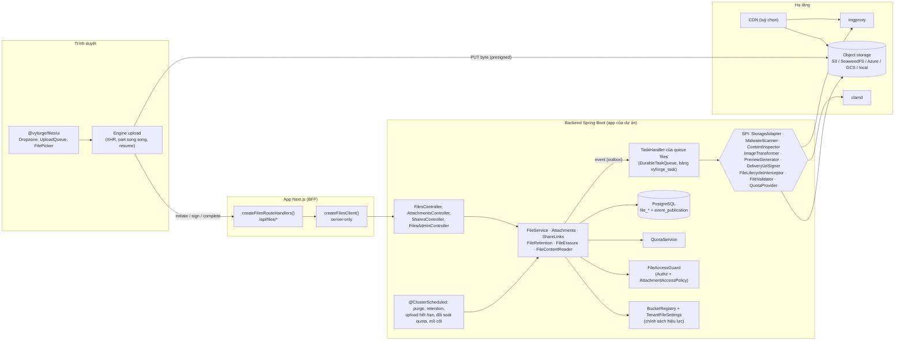
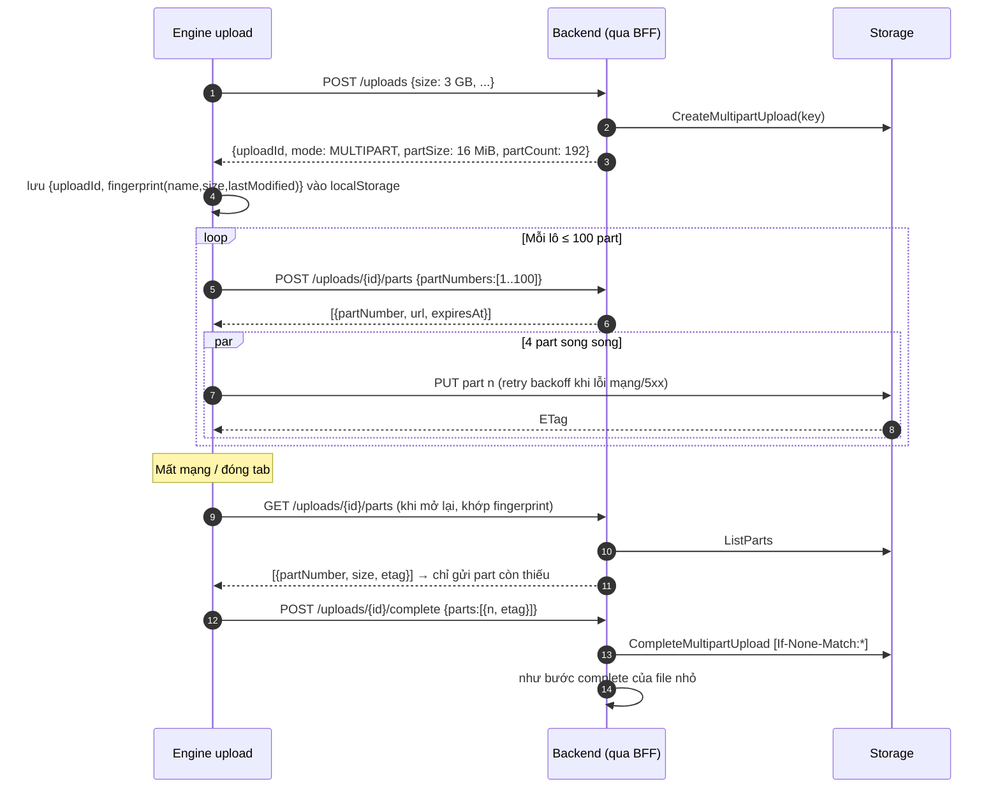
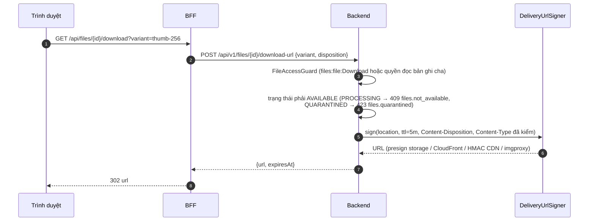
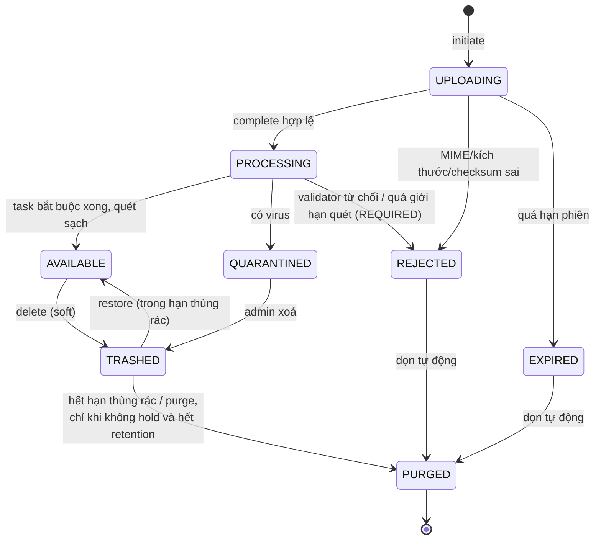
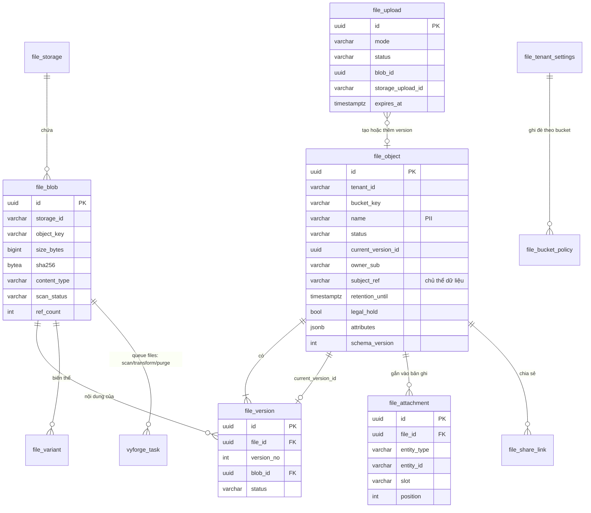

# Thiết kế module files: `platform-starter-files` + `@vyforge/files`

> **Trạng thái:** đã duyệt (26/10/2026), Q1–Q6 giữ như đề xuất. Chỉnh sau duyệt: dùng khối chung `SecretCipher`,
> `DurableTaskQueue` (queue `files`: scan, transform, purge) và `StarterSchemaMigrator` của platform-java 0.12.1.
> **Phạm vi:** lưu trữ file dùng chung cho mọi dự án Vyforge: upload, metadata, gắn file vào bản ghi nghiệp vụ, xử lý
> (quét virus, kiểm MIME thật, ảnh, preview), quyền truy cập, quota, retention, legal hold, xoá theo yêu cầu chủ thể dữ liệu.
> **Nền:** platform-java 0.12.0 (sẽ ra 0.13.0), platform-web 0.9.0. Theo quy ước chung của các module P1.

Mục lục:
1. [Bài toán và phạm vi](#1-bài-toán-và-phạm-vi)
2. [Nghiên cứu](#2-nghiên-cứu)
3. [Kiến trúc](#3-kiến-trúc)
4. [Mô hình dữ liệu](#4-mô-hình-dữ-liệu)
5. [API](#5-api)
6. [Mở rộng](#6-mở-rộng)
7. [Vận hành](#7-vận-hành)
8. [Bảo mật và tuân thủ](#8-bảo-mật-và-tuân-thủ)
9. [Kế hoạch triển khai](#9-kế-hoạch-triển-khai)
10. [Lệch quy ước và quyết định cần người dùng chọn](#10-lệch-quy-ước-và-quyết-định-cần-người-dùng-chọn)
11. [Đóng gói và triển khai độc lập](#11-đóng-gói-và-triển-khai-độc-lập)

---

## 1. Bài toán và phạm vi

### 1.1 Vì sao cần một module riêng

Dự án nào cũng có file: avatar, chứng từ, hợp đồng, ảnh sản phẩm, file nhập Excel, báo cáo xuất ra. Nếu mỗi dự án tự làm,
các lỗi sau lặp lại:

- File đi qua app server: tốn RAM, timeout ở gateway, giới hạn body của Next.js.
- Bucket public, hoặc presigned URL sống quá lâu và lọt ra ngoài.
- Tin `Content-Type` do trình duyệt gửi: file `.html` đổi đuôi thành `.jpg` vẫn được trả về với `text/html` (XSS).
- Không quét virus, hoặc quét nhưng vẫn cho tải trong lúc chưa quét xong.
- Không biết file nào thuộc bản ghi nào. Xoá đơn hàng thì file mồ côi nằm mãi trên storage, tốn tiền và vi phạm nguyên
  tắc hạn chế lưu trữ của Luật 91/2025.
- Không xoá được dữ liệu của một người khi họ yêu cầu, vì không biết file nào chứa dữ liệu của họ.
- Không có quota: một tenant upload vô hạn.

### 1.2 Phạm vi

| Nhóm | Trong phạm vi (bản 0.13.0) | Để bản sau |
|---|---|---|
| Upload | Presigned PUT (file nhỏ), S3 multipart có presigned từng part (file lớn, resume được), upload phía server (stream), idempotent | Sidecar `tusd` cho môi trường mà trình duyệt không tới được storage; nhập file từ URL (SSRF) |
| Dữ liệu | Metadata, bucket logic, version, attachment (file ↔ bản ghi nghiệp vụ), dedup theo SHA-256 trong tenant | Thư mục ảo cho người dùng cuối, tìm kiếm toàn văn nội dung |
| Xử lý | Kiểm MIME thật (Tika, magic bytes), quét ClamAV bất đồng bộ, metadata ảnh/PDF, biến thể ảnh (imgproxy hoặc trong JVM), preview trang đầu PDF | Preview Office qua Gotenberg, thumbnail video, quét qua ICAP, quét lại khi có chữ ký mới |
| Truy cập | Authz theo `files:*`, quyền suy ra từ bản ghi cha (attachment), link chia sẻ có hạn, public/private, URL ký qua storage hoặc CDN | Watermark khi tải, DRM |
| Vận hành | Quota theo tenant và bucket, retention, thùng rác, legal hold, xoá/tra cứu theo chủ thể dữ liệu, dọn upload dở và object mồ côi | Chuyển tầng lưu trữ (hot/cold) |
| Adapter | S3-compatible (AWS S3, SeaweedFS, RustFS, Ceph RGW, Cloudflare R2, VNG vStorage…), Azure Blob, GCS, local filesystem | |
| Frontend | `@vyforge/files`: client server-only, route handler BFF, engine upload (resume, tiến độ, song song), Dropzone, hàng đợi upload, danh sách, preview, picker, panel attachment, chia sẻ | Trình chỉnh ảnh (crop) |

### 1.3 Kịch bản nghiệp vụ phải đáp ứng

Thiết kế được kiểm bằng các kịch bản dưới đây. Cột cuối chỉ ra khối nào của thiết kế xử lý kịch bản đó.

| # | Kịch bản | Yêu cầu rút ra | Khối đáp ứng |
|---|---|---|---|
| K1 | **Avatar người dùng.** Ảnh ≤ 5 MB, chỉ JPEG/PNG/WebP/HEIC; hiện ở nhiều cỡ (32, 128, 512 px); public qua CDN; bỏ EXIF (GPS) | Bucket public, biến thể ảnh, bỏ metadata, chỉ công khai sau khi quét sạch | Bucket `avatars`, `ImageTransformer`, luồng publish §3.6 |
| K2 | **Hồ sơ eKYC:** ảnh CCCD hai mặt, ảnh chân dung. Dữ liệu cá nhân nhạy cảm theo Luật 91/2025 | Private tuyệt đối, URL tải sống ngắn, ghi audit mỗi lần xem, xoá được theo yêu cầu chủ thể, không dedup lộ thông tin | Bucket `personalData: SENSITIVE`, `auditDownloads`, `FileErasure` |
| K3 | **Đính kèm đơn hàng / hồ sơ khách hàng (CRM).** Ai xem được đơn hàng thì xem được file đính kèm; xoá đơn thì file đi theo | Quyền suy ra từ bản ghi cha, attachment có `slot` và thứ tự, dọn theo bản ghi | `file_attachment`, `AttachmentAccessPolicy` cấu hình bằng YAML |
| K4 | **Hoá đơn điện tử, chứng từ kế toán (PDF/XML).** Lưu tối thiểu 10 năm theo NĐ 174/2016; không ai xoá được trong thời hạn, kể cả khi chủ thể yêu cầu xoá | Retention bắt buộc, chặn xoá, ghi lý do pháp lý khi từ chối yêu cầu xoá; tuỳ chọn Object Lock ở storage | `RetentionPolicy` của bucket, §3.8, §8 |
| K5 | **Hợp đồng có version.** Sửa hợp đồng tạo bản mới; xem và khôi phục bản cũ; bản đã ký thì khoá | Version, khoá version (hold), audit | `file_version`, legal hold theo file |
| K6 | **Video đào tạo 2–5 GB** upload qua mạng 4G chập chờn, đóng tab rồi mở lại vẫn upload tiếp | Multipart, resume sau khi tải lại trang, part song song, retry | Luồng multipart §3.4, engine upload của `@vyforge/files` |
| K7 | **Nhập Excel (module export/import).** File `.xlsx` ≤ 20 MB; phải đúng là OOXML, không phải file thực thi đổi tên; xoá sau 7 ngày | Kiểm MIME thật, validator nghiệp vụ, retention ngắn | `ContentInspector`, `FileValidator`, bucket `imports` |
| K8 | **Báo cáo xuất ra (module export).** Backend sinh file 500 MB, gửi link tải qua email/thông báo, link hết hạn sau 24 giờ | Upload phía server dạng stream, link chia sẻ có hạn, event để notification phản ứng | `FileService.store`, `ShareLinks`, event `FileAvailable` |
| K9 | **Ảnh sản phẩm thương mại điện tử.** Nhiều ảnh mỗi sản phẩm, sắp xếp, ảnh đại diện; nhiều cỡ, WebP/AVIF; CDN | Attachment có `position` và `slot`, biến thể theo preset, CDN | `file_attachment`, preset ảnh, `DeliveryUrlSigner` |
| K10 | **Tenant ngân hàng/bệnh viện yêu cầu dữ liệu nằm ở trung tâm dữ liệu trong nước và storage riêng của họ** (on-prem, Ceph/SeaweedFS hoặc VNG vStorage) | Storage theo tenant (BYO), khoá truy cập mã hoá at-rest, chặn storage ngoài VN khi tenant đặt `dataResidency=VN` | `file_storage` theo tenant, §6.3, §8.4 |
| K11 | **Người dùng yêu cầu xoá dữ liệu cá nhân** (Luật 91/2025, NĐ 356/2025). Phải xoá trong thời hạn luật định, báo lại phần nào không xoá được và vì sao | Tra cứu file theo chủ thể, xoá cứng cả blob, báo cáo ngoại lệ (retention/hold) | `FileErasure`, `ErasureReport` |
| K12 | **Hồ sơ dịch vụ công / hồ sơ bệnh án đính kèm**: người nộp upload giấy tờ, cán bộ xem; file phải còn nguyên vẹn, chứng minh được không bị sửa | Hash SHA-256 lưu kèm, version bất biến, audit truy cập | `file_blob.sha256`, version bất biến, audit |
| K13 | **Gói dịch vụ SaaS:** gói Free 1 GB, gói Pro 100 GB; vượt quota thì chặn upload và báo rõ | Quota theo tenant lấy từ gói (module features), giữ chỗ khi upload đang chạy | `QuotaProvider`, `file_usage` |
| K14 | **Chia sẻ tài liệu cho đối tác bên ngoài** không có tài khoản: link 7 ngày, tối đa 20 lượt tải, có mật khẩu, thu hồi được | Share link có hạn, đếm lượt, mật khẩu, thu hồi tức thì | `file_share_link` |
| K15 | **Đính kèm email/Zalo** (module notification): lấy nội dung file để gửi kèm | Đọc nội dung phía server, không qua presigned URL | `FileContentReader` |

Kịch bản đặc thù Việt Nam: K2 (CCCD, eKYC), K4 (hoá đơn điện tử, chứng từ kế toán theo NĐ 174/2016), K10 (dữ liệu
trong nước, storage của nhà cung cấp VN), K11 (Luật 91/2025), K12 (dịch vụ công, bệnh án). Tên file tiếng Việt có dấu
cũng là một yêu cầu xuyên suốt: header `Content-Disposition` phải dùng `filename*=UTF-8''…` (RFC 6266/8187), và key trên
storage không bao giờ chứa tên file.

---

## 2. Nghiên cứu

Phiên bản và license kiểm qua GitHub API, Maven Central và npm ngày 26/10/2026. Tính năng kiểm bằng tài liệu chính thức
(link ở từng dòng).

### 2.1 Hệ thống tham khảo

| Hệ thống | Phiên bản, license | Mô hình dữ liệu | Upload | Xử lý, truy cập |
|---|---|---|---|---|
| **Supabase Storage** | `supabase/storage` v1.84.23, Apache-2.0 | Bảng `storage.buckets` (`public`, `file_size_limit`, `allowed_mime_types`, `owner_id`) và `storage.objects` (`bucket_id`, `name`, `path_tokens`, `metadata` JSONB, `version`, `owner_id`); quyền bằng RLS của Postgres ([schema](https://supabase.com/docs/guides/storage/schema/design)) | tus, chunk cố định 6 MB, upload URL sống tối đa 24 giờ; mặc định không ghi đè (`400 Asset Already Exists`), `x-upsert` để ghi đè; tài liệu khuyên không ghi đè vì CDN giữ bản cũ ([resumable](https://supabase.com/docs/guides/storage/uploads/resumable-uploads)) | Biến đổi ảnh bằng imgproxy khi tự host; width/height 1–2500, ảnh nguồn ≤ 25 MB, ≤ 50 MP; tham số transform nằm trong token của signed URL nên không đổi được sau khi ký ([image transformations](https://supabase.com/docs/guides/storage/serving/image-transformations)) |
| **Appwrite Storage** | `appwrite/appwrite` 2.6.2, BSD-3-Clause | Bucket có cấu hình: permission (mặc định không ai có quyền), mã hoá at-rest, nén gzip/zstd, bỏ EXIF/XMP/IPTC, kích thước tối đa, tối đa 100 phần mở rộng được phép ([buckets](https://appwrite.io/docs/products/storage/buckets)) | Chunk khi file > 5 MB, SDK tự lo ([upload](https://appwrite.io/docs/products/storage/upload-download)) | Mã hoá và nén bỏ qua file > 20 MB; bật bỏ metadata ảnh thì bucket không dùng được qua API S3 |
| **Directus Files** | `directus/directus` v12.5.1, license BSL 1.1 (GitHub ghi `NOASSERTION`) | Bảng `directus_files`, thư mục, nhiều storage location (`STORAGE_LOCATIONS`) ([upload](https://directus.com/docs/guides/files/upload)) | `POST /files` multipart/form-data, nhập từ URL | Transform qua endpoint `assets` bằng sharp; **preset** có `key`, cấu hình "Allowed Transformations" để chặn tham số tự do; giới hạn kích thước nguồn và đích; biến thể sinh lần đầu rồi lưu lại ([transform](https://directus.com/docs/guides/files/transform)) |
| **Spring Content** | `paulcwarren/spring-content` 3.0.17 (02/2025), Apache-2.0, **repo archive 26/02/2026** | Gắn content vào entity Spring Data (`@ContentId`), store cho JPA, GridFS, S3, filesystem, Azure, GCS; renditions cắm được ([GitHub](https://github.com/paulcwarren/spring-content)) | Qua REST của Spring Data REST, byte đi qua app | Renditions; không còn bảo trì |
| **tus + Uppy** | `tus/tusd` v2.10.1, `tus-js-client` 4.3.1, `@uppy/core` 6.3.0, `@uppy/aws-s3` 6.3.0, đều MIT | Giao thức, không có mô hình dữ liệu | tus 1.0: `HEAD` lấy `Upload-Offset`, `PATCH` gửi tiếp, extension creation, expiration, checksum, termination, concatenation ([tus 1.0](https://tus.io/protocols/resumable-upload)). `@uppy/aws-s3`: mặc định multipart khi file > 100 MiB; một endpoint `signRequest` ký mọi thao tác S3; resume bằng `ListParts`; part ≥ 5 MiB, ≤ 10.000 part ([aws-s3](https://uppy.io/docs/aws-s3/)) | |
| **imgproxy** | v4.0.19, Apache-2.0 (có bản Pro trả phí) | | | URL ký HMAC-SHA256 (key + salt), tắt mặc định ([signing](https://docs.imgproxy.net/usage/signing_url)); `IMGPROXY_ONLY_PRESETS`, `IMGPROXY_ALLOWED_SOURCES`, `IMGPROXY_MAX_SRC_RESOLUTION` (mặc định 50 MP), đọc nguồn thẳng từ S3 (`IMGPROXY_USE_S3`, endpoint tuỳ chỉnh) ([options](https://docs.imgproxy.net/configuration/options)); `expires` và `strip_metadata` có ở bản OSS, chọn trang PDF và thumbnail video là Pro ([processing](https://docs.imgproxy.net/usage/processing)) |
| **AWS S3** (chuẩn de facto) | SDK `software.amazon.awssdk:s3` 2.57.3, Apache-2.0 | Bucket/key, version, tag, Object Lock (governance/compliance, legal hold không thời hạn, chỉ khi bật versioning) ([Object Lock](https://docs.aws.amazon.com/AmazonS3/latest/userguide/object-lock.html)) | Presigned PUT; multipart (part ≥ 5 MiB, ≤ 10.000 part); ghi có điều kiện `If-None-Match: *` trên PutObject và CompleteMultipartUpload, trả 412 khi key đã có ([conditional writes](https://docs.aws.amazon.com/AmazonS3/latest/userguide/conditional-writes.html)) | **SDK Java v2 không có presigned POST** (issue [#1493](https://github.com/aws/aws-sdk-java-v2/issues/1493) mở từ 2019, [#6577](https://github.com/aws/aws-sdk-java-v2/issues/6577) vẫn mở) |

Storage S3-compatible tự host và adapter khác:

| Thành phần | Phiên bản, license | Ghi chú cho thiết kế |
|---|---|---|
| SeaweedFS | 4.51, Apache-2.0 | Hỗ trợ presigned URL, multipart đủ (gồm `ListParts`), versioning, Object Lock + retention + legal hold, conditional header, tagging, lifecycle (không có transition), CORS, SSE. Chỉ nhận `/` làm delimiter; một path không thể vừa là file vừa là thư mục ([S3 API](https://github.com/seaweedfs/seaweedfs/wiki/Amazon-S3-API)). Dùng cho local, CI, on-prem |
| RustFS | 1.0.4, Apache-2.0 | Thay thế MinIO, mới; chỉ test khi khách hàng chọn |
| MinIO bản cộng đồng | archive | Không dùng (đã chốt trong báo cáo module thông dụng) |
| Azure Blob (`com.azure:azure-storage-blob`) | 12.36.0, MIT | Upload theo block: `Put Block` + `Put Block List`; ≤ 50.000 block, block ≤ 4.000 MiB; block chưa commit tự xoá sau 7 ngày; SAS (user delegation, service, account) cấp quyền cho từng thao tác; có legal hold và immutability policy ở mức blob ([Put Block List](https://learn.microsoft.com/en-us/rest/api/storageservices/put-block-list)) |
| Google Cloud Storage (`com.google.cloud:google-cloud-storage`) | 2.75.0, Apache-2.0 (repo `googleapis/java-storage` đã archive, thư viện vẫn phát hành) | XML API multipart **tương thích S3 multipart**, part ≥ 5 MiB ([multipart](https://docs.cloud.google.com/storage/docs/multipart-uploads)); V4 signed URL |
| VNG Cloud vStorage | dịch vụ | Tương thích S3, dùng SDK S3 của AWS ([vStorage](https://docs.vngcloud.vn/vng-cloud-document/vn/vstorage/object-storage/vstorage-hcm03/vstorage-la-gi)). Viettel IDC, FPT Cloud: chưa kiểm chứng được tài liệu API S3 công khai, phải test trước khi cam kết |

Thư viện xử lý:

| Thư viện | Phiên bản, license | Dùng cho |
|---|---|---|
| ClamAV | 1.5.4, GPL-2.0 (chạy như daemon riêng, không nhúng nên không lây license) | Quét virus qua `clamd` TCP 3310, lệnh `INSTREAM`. `StreamMaxLength` mặc định 100M, `MaxFileSize` mặc định 100M, `MaxScanSize` mặc định 400M; **không quét được file > 2 GB** ([clamd.conf.sample](https://github.com/Cisco-Talos/clamav/blob/main/etc/clamd.conf.sample)). RAM tối thiểu 3 GiB, nên 4 GiB; nạp chữ ký > 1,2 GiB, lúc reload hằng ngày lên khoảng 2,4 GiB (`ConcurrentDatabaseReload no` để giảm) ([Docker](https://docs.clamav.net/manual/Installing/Docker.html)). TCP không có xác thực: chỉ mở trong mạng nội bộ |
| Client `clamd` cho Java | `xyz.capybara:clamav-client` 2.1.2 (02/2022) | Bỏ lâu, không dùng; tự viết client `INSTREAM` |
| Apache Tika (`tika-core`) | 4.1.0, Apache-2.0 | Nhận dạng MIME bằng magic bytes + tên file, chỉ cần `tika-core` (không kéo parser) |
| Apache PDFBox | 3.0.8, Apache-2.0 | Đếm trang, render trang đầu PDF làm preview |
| Thumbnailator + TwelveMonkeys ImageIO | 0.4.21 (MIT) + 3.15.3 (BSD-3) | Biến thể ảnh trong JVM khi không có imgproxy; đọc WebP |
| libvips | 8.18.7, LGPL-2.1 | Lõi của imgproxy; không nhúng vào JVM |
| Gotenberg | v8.38.1, MIT | Preview Office (bản sau) |

### 2.2 Học theo và không làm

**Học theo:**

1. **Bucket logic có cấu hình chính sách** (Supabase, Appwrite): giới hạn kích thước, loại file, public/private, quét,
   biến thể nằm ở bucket, không rải trong code nghiệp vụ. Vyforge thêm retention, dữ liệu cá nhân, quyền theo bản ghi cha.
2. **Không ghi đè object** (Supabase khuyên tránh upsert vì CDN giữ bản cũ). Vyforge đi xa hơn: key bất biến theo
   `blobId`, mỗi lần sửa là version mới; ghi bằng `If-None-Match: *` khi storage hỗ trợ.
3. **Biến đổi ảnh chỉ theo preset** (Directus "Allowed Transformations", `IMGPROXY_ONLY_PRESETS`): chặn DoS bằng URL tự
   do. Tham số biến thể nằm trong chữ ký (Supabase), không đổi được sau khi ký.
4. **Một endpoint ký cho multipart** (Uppy `signRequest`): trình duyệt gửi byte thẳng lên storage; server chỉ ký. Resume
   bằng `ListParts`.
5. **Metadata ở Postgres, byte ở object storage** (cả bốn hệ thống), có `metadata` JSONB và cột `version`.
6. **Bỏ EXIF/GPS** cho ảnh (Appwrite), bật theo bucket.
7. **Gắn content vào entity** (Spring Content), nhưng qua bảng attachment thay vì cột trong entity, để module nào cũng gắn
   được mà không sửa schema của nhau.

**Không làm:**

1. **Không dùng tus làm giao thức chính.** tus cần server nhận byte (`PATCH`). Ở Vyforge, trình duyệt gọi backend qua BFF
   Next.js (ADR-0006, token nằm ở server), nên byte phải đi qua cả Next.js lẫn backend. S3 multipart với presigned part
   cho trình duyệt gửi thẳng lên storage và vẫn resume được. tus (qua sidecar `tusd` có hook về API của module) để dành
   cho môi trường mà trình duyệt không tới được storage.
2. **Không quyền bằng RLS như Supabase.** Vyforge dùng authz kiểu IAM (ADR-0009). RLS chỉ là lớp tenant tuỳ chọn (tier 2).
3. **Không dùng Spring Content.** Repo đã archive, byte đi qua app, mô hình gắn cột vào entity không hợp modular monolith.
4. **Không dùng presigned POST** để giới hạn kích thước. SDK Java v2 không hỗ trợ; tự ký policy POST thì mất tương thích
   với Azure/GCS. Thay bằng ký header `Content-Length` vào presigned PUT, rồi kiểm lại bằng `HEAD` lúc complete.
5. **Không dedup giữa các tenant, không dedup trước upload.** Dedup trước upload (client gửi hash, server trả "đã có")
   cho phép dò xem người khác có file đó không. Dedup chéo tenant phá cách ly và làm xoá theo chủ thể dữ liệu không xoá
   được thật.
6. **Không mã hoá/nén trong app như Appwrite** (bỏ qua file > 20 MB, phá API S3). Dùng SSE của storage.
7. **Không cho transform tự do qua query** (`transforms=[["rotate",90]]` của Directus).

---

## 3. Kiến trúc

### 3.1 Thành phần



Nguyên tắc:

- **Thư viện, không phải service.** Starter nhúng vào app như các starter khác. Không có lý do để tách service: file
  gắn chặt với transaction nghiệp vụ (attachment, retention của bản ghi), và byte không đi qua app. Dự án nhiều backend
  có thể dựng một app "files" dùng chính starter này; xem §10.
- **Byte không đi qua app** trong luồng chuẩn. App chỉ ký, kiểm và ghi metadata. Ngoại lệ có chủ đích: upload phía
  server (`store`), đọc nội dung cho quét virus/preview, adapter `local`, và endpoint proxy `/content` cho storage mà
  trình duyệt không tới được.
- **Hexagonal.** Lõi (`com.vyforge.platform.files`) chỉ biết port. Adapter cài qua bean hoặc `ServiceLoader`, chọn theo
  cấu hình và theo tenant.
- **Mọi việc chạy lâu đi qua `DurableTaskQueue`** của platform-starter-scheduling (khối chung, mục 5.2 của quy ước
  module), queue `files`, ba kind: `scan` (đọc stream một lần: tính SHA-256, metadata, quét virus), `transform` (biến thể
  ảnh, preview PDF, bỏ EXIF, publish sang vùng public) và `purge` (xoá object và biến thể của blob). Retry backoff, `DEAD`,
  API retry/cancel và backlog do khối chung lo. Việc được `enqueue` trong cùng transaction với complete, nên chỉ tồn tại
  khi transaction commit và không mất khi app chết giữa chừng.

### 3.2 Gói Java

```
com.vyforge.platform.files                 API công khai: FileService, Attachments, ShareLinks, FileRetention,
                                           FileErasure, FileContentReader, record/enum, event, FilesErrors, FilesActions
com.vyforge.platform.files.spi             StorageAdapter, StorageAdapterFactory, MalwareScanner, ContentInspector,
                                           ImageTransformer, PreviewGenerator, DeliveryUrlSigner, FileLifecycleInterceptor,
                                           FileValidator, AttachmentAccessPolicy, ObjectKeyStrategy, QuotaProvider
com.vyforge.platform.files.internal        Entity JPA, repository, chính sách, state machine, quota, TaskHandler, job
com.vyforge.platform.files.web             Controller REST, DTO
com.vyforge.platform.files.adapter.s3      AWS SDK v2 (S3, SeaweedFS, RustFS, R2, Ceph, vStorage…)
com.vyforge.platform.files.adapter.azure   azure-storage-blob (optional dependency, @ConditionalOnClass)
com.vyforge.platform.files.adapter.gcs     google-cloud-storage (optional dependency, @ConditionalOnClass)
com.vyforge.platform.files.adapter.local   Filesystem + URL ký HMAC tới endpoint của app
com.vyforge.platform.files.adapter.clamav  Client INSTREAM tự viết
com.vyforge.platform.files.adapter.imgproxy, .jvmimage, .pdfbox, .tika, .cloudfront, .hmaccdn
```

### 3.3 Upload file nhỏ (presigned PUT)

```mermaid
sequenceDiagram
  autonumber
  participant B as Trình duyệt (engine)
  participant N as Next.js BFF
  participant A as Backend (files)
  participant S as Storage
  participant D as PostgreSQL
  B->>N: POST /api/files/uploads {bucket, name, size, type, sha256?, attachTo?}
  N->>A: POST /api/v1/files/uploads (Bearer, Idempotency-Key)
  A->>A: authz files:file:Upload trên vrn:files:bucket/{key}<br/>(+ quyền ghi bản ghi cha nếu attachTo)
  A->>A: chính sách bucket: kích thước, đuôi + MIME khai báo, quota (giữ chỗ)
  A->>A: interceptor.beforeInitiate()
  A->>D: insert file_upload (INITIATED, blobId cấp sẵn, expires_at)
  A->>S: presign PUT key=t/{tenant}/{bucket}/{yyyy}/{MM}/{blobId}<br/>ký Content-Length, Content-Type, [x-amz-checksum-sha256], [If-None-Match:*]
  A-->>B: {uploadId, mode: SINGLE, url, headers, expiresAt}
  B->>S: PUT byte (XHR, có tiến độ)
  S-->>B: 200 ETag
  B->>N: POST /api/files/uploads/{id}/complete
  N->>A: POST /api/v1/files/uploads/{id}/complete
  A->>S: HEAD (size, etag, checksum) + GET Range 0-65535
  A->>A: Tika: MIME thật; so với allowlist và MIME khai báo; FileValidator
  A->>D: tx: file_object + file_version + file_blob<br/>file_usage (giữ chỗ → đã dùng), file_attachment, event FileUploaded (outbox),<br/>enqueue vyforge_task (queue files, kind scan)
  A-->>B: 201 {file, status: PROCESSING|AVAILABLE}
  Note over A,D: Handler scan xong thì enqueue transform cho từng biến thể/preview/publish
```

Chi tiết quan trọng:

- **Kích thước:** presigned PUT ký header `Content-Length` nên client không gửi được số byte khác số đã khai báo; lúc
  complete vẫn `HEAD` lại vì không phải storage nào cũng kiểm header đã ký.
- **Checksum:** client có thể gửi SHA-256 (base64) lúc initiate. Khi storage có capability `checksumSha256`, URL ký kèm
  `x-amz-checksum-sha256` và storage tự từ chối byte sai. Nếu không, việc `scan` tính SHA-256 khi đọc stream để quét và
  so sánh. Không gửi hash thì server tự tính ở task `scan`; dedup chạy ngay sau khi có hash: blob trùng
  `(tenant, storage, sha256)` thì version trỏ sang blob cũ và blob vừa upload được enqueue `purge`.
- **Key bất biến:** `blobId` (UUID v7) cấp lúc initiate. Key không chứa tên file (PII, ký tự tiếng Việt, ký tự đặc biệt).
- **Idempotency:** `Idempotency-Key` của platform-starter-web cho initiate và complete. Complete gọi lại sau khi đã xong
  trả lại đúng kết quả cũ (theo `uploadId`), không tạo file thứ hai.

### 3.4 Upload file lớn (multipart, resume)



- `partSize` do server chọn: `max(8 MiB, ceil(size / 10.000))`, làm tròn lên bội 1 MiB, tối đa 512 MiB. Azure dùng tối đa
  50.000 block, nhưng giữ cùng công thức cho đơn giản.
- Ngưỡng chuyển sang multipart: `vyforge.files.upload.multipart-threshold` (mặc định 64 MiB). Uppy dùng 100 MiB; chọn
  thấp hơn vì mạng di động ở VN hay rớt.
- URL của part sống ngắn (mặc định 15 phút) nhưng ký lại được bất cứ lúc nào trước `expires_at` của phiên (mặc định 24
  giờ, giống Supabase).
- Upload hết hạn: job `files-expire-uploads` gọi `AbortMultipartUpload`, xoá object dở, trả quota giữ chỗ, chuyển phiên
  sang `EXPIRED`. Khuyên đặt thêm lifecycle `AbortIncompleteMultipartUpload` ở bucket làm lưới an toàn.

### 3.5 Xử lý sau upload và luồng lỗi

```mermaid
sequenceDiagram
  autonumber
  participant Q as DurableTaskQueue (vyforge_task)
  participant W as ScanTaskHandler (queue files, kind scan)
  participant S as Storage
  participant C as clamd
  participant D as PostgreSQL
  participant O as Outbox (event_publication)
  Q->>W: việc scan đến hạn (SKIP LOCKED, TenantContext.run)
  W->>S: GET stream
  W->>W: tee: SHA-256 + metadata (ảnh/PDF)
  W->>C: INSTREAM (chunk 64 KiB)
  alt Sạch
    C-->>W: stream: OK
    W->>D: blob.scan_status=CLEAN, sha256, metadata; dedup; version → AVAILABLE
    W->>Q: enqueue transform (biến thể, preview, publish) nếu bucket cần
    W->>O: FileAvailable
  else Có virus
    C-->>W: stream: Eicar-Signature FOUND
    W->>S: tag quarantine=true (hoặc chuyển sang prefix quarantine/)
    W->>D: blob.scan_status=INFECTED; version → QUARANTINED; audit
    W->>O: FileQuarantined
  else clamd lỗi / timeout
    W-->>Q: ném lỗi → queue tự retry (backoff exponential + jitter)
    Note over Q,D: Quá max_attempts (queue files: 8) → DEAD, metric vyforge.task.* + alert,<br/>file vẫn PROCESSING (fail-closed), admin retry qua API của DurableTaskQueue
  else File > giới hạn quét
    W->>D: scan_status=SKIPPED_TOO_LARGE → bucket quyết định:<br/>REQUIRED → REJECTED, OPTIONAL → AVAILABLE kèm cờ
  end
```

Lỗi khi complete (đồng bộ, trả cho client):

| Tình huống | Xử lý | Mã lỗi |
|---|---|---|
| Object không có trên storage (client chưa PUT xong) | 409, phiên giữ nguyên để client thử lại | `files.upload_incomplete` |
| Kích thước thật khác khai báo | Xoá object, phiên `FAILED`, trả quota | `files.size_mismatch` |
| MIME thật không thuộc allowlist, hoặc khác hẳn MIME khai báo (vd. khai `image/png`, thật là `application/x-msdownload`) | Xoá object, phiên `REJECTED`, audit | `files.content_type_mismatch` |
| Checksum sai | Xoá object, phiên `FAILED` | `files.checksum_mismatch` |
| Phiên đã hết hạn | 410 | `files.upload_expired` |
| Storage lỗi (5xx, timeout) | 503, phiên giữ nguyên, client thử lại | `files.storage_unavailable` |
| Key đã có object (412 từ `If-None-Match`) | Không thể xảy ra với `blobId` mới; nếu có thì là lỗi nghiêm trọng: log, 500 | `internal_error` |

### 3.6 Tải về và public



- `Content-Type` của response lấy theo MIME đã kiểm, không theo giá trị client gửi. HTML, SVG, XML và loại không nằm
  trong danh sách "hiển thị inline an toàn" luôn trả `attachment`, kèm `X-Content-Type-Options: nosniff` khi signer hỗ trợ
  header response.
- **Public** (bucket `visibility: PUBLIC`): byte được upload vào prefix private như mọi file. Sau khi quét sạch, việc
  `transform` (thao tác `publish`) copy sang prefix `public/` (hoặc bucket public riêng), nơi CDN đọc được không cần ký. Nhờ vậy file chưa quét
  không bao giờ public. Chi phí copy chấp nhận được vì file public thường nhỏ (avatar, ảnh sản phẩm). URL public ổn định:
  `{cdnBase}/public/{tenant}/{bucket}/{blobId}[/{variant}]`.
- **Adapter local**: không có presign của storage, nên ký URL HMAC tới endpoint của app `GET /api/v1/files/blobs/{token}`
  (public path, token chứa key, hạn, header response). Hành vi giống presign.
- **Proxy** `GET /api/v1/files/{id}/content` (có `Range`) cho storage mà trình duyệt không tới được. Tắt mặc định
  (`vyforge.files.delivery.proxy-enabled`).

### 3.7 Link chia sẻ

`POST /files/{id}/shares {expiresIn, maxDownloads?, password?, audience: ANYONE|TENANT}` trả `token` một lần (chỉ lưu
SHA-256 của token). Người nhận mở `{app}/s/{token}` → BFF gọi `GET /api/v1/files/shares/{token}` (public path, có rate
limit) → kiểm hạn, thu hồi, số lượt (cập nhật nguyên tử `download_count < max_downloads`), mật khẩu (Argon2/BCrypt qua
`PasswordEncoder` của Spring Security, gửi qua header) → 302 tới URL ký sống 1 phút. Mỗi lượt ghi audit (IP đã che theo
privacy). Thu hồi có hiệu lực ngay cho lượt sau; URL đã cấp hết hạn trong tối đa 1 phút. Không tạo được link cho file
không `AVAILABLE` hoặc thuộc bucket cấm chia sẻ (`sharing: DISABLED`, mặc định cho bucket `SENSITIVE`).

### 3.8 Xoá, retention, legal hold



- Trạng thái là của **file** (lấy theo version hiện tại khi đang xử lý). Mỗi version có trạng thái riêng
  (`PROCESSING|AVAILABLE|QUARANTINED|REJECTED`); thêm version mới mà version đó chưa `AVAILABLE` thì file vẫn trỏ version
  cũ cho tới khi version mới sẵn sàng (không làm "mất" file trong lúc quét).
- **Retention** đặt `retention_until` khi file `AVAILABLE`: `from: CREATED` (cố định) hoặc `from: EVENT` (chờ app gọi
  `startRetention(fileId, eventTime)`, vd. ngày kết thúc hợp đồng, ngày kết thúc kỳ kế toán năm). Trước hạn: `TRASHED`
  được (ẩn khỏi người dùng nếu bucket cho phép), nhưng `PURGED` thì không. `onExpiry: PURGE | REVIEW` (REVIEW phát event
  `FileRetentionExpired` để người duyệt quyết định).
- **Legal hold**: cờ trên file, có lý do và người đặt; chặn `TRASHED → PURGED` và chặn xoá theo chủ thể dữ liệu. Khi
  storage hỗ trợ Object Lock và bucket bật `mirrorToStorage`, đặt thêm `PutObjectLegalHold`/retention ở storage (lớp WORM
  thật, chống cả admin của app).
- **Purge** = xoá metadata cá nhân (tên file, metadata trích xuất) + giảm `ref_count` của blob; blob về 0 thì việc
  `purge` (queue `files`) xoá object và mọi biến thể. Dòng `file_object` giữ lại dạng tombstone (id, tenant, bucket, thời điểm) trong
  `vyforge.files.tombstone-retention` (mặc định 90 ngày) để audit và để event cũ còn tham chiếu được.

### 3.9 Đa tenant

- Bảng có `tenant_id`, entity kế thừa `TenantEntity`; truy vấn JDBC của worker nhận `tenantId` tường minh.
- Key storage có prefix `t/{tenant}/`. Adapter kiểm key bắt đầu bằng prefix của `TenantContext` trước mọi thao tác ký
  hoặc đọc (phòng thủ lớp hai; vi phạm thì `IllegalStateException`).
- Worker lấy task của mọi tenant (`@TenantExempt` cho câu claim), rồi chạy từng task trong `TenantContext.run(task.tenant)`.
- Job định kỳ dùng `@ClusterScheduled(perTenant = true)`.
- Dedup chỉ trong cùng `(tenant, storage)`.
- Storage có thể khác nhau theo tenant (§6.3).

---

## 4. Mô hình dữ liệu

### 4.1 ERD



### 4.2 DDL dự kiến

Kiểu chung: `tenant_id varchar(63) not null` (khớp README của platform-java), id UUID v7 do `BaseEntity` sinh, cột audit
của `BaseEntity` (`created_at`, `created_by`, `updated_at`, `updated_by`, `version`). Trạng thái là `varchar` kiểm ở code,
không dùng enum của Postgres (quy ước "không khoá cứng enum nghiệp vụ trong DB").

```sql
-- Storage do tenant tự mang (BYO). Storage cấp platform khai báo trong application.yml, không nằm ở đây.
create table file_storage (
    id               uuid primary key,
    tenant_id        varchar(63)  not null,
    storage_key      varchar(63)  not null,               -- tên tenant đặt, vd. "onprem-ceph"
    type             varchar(32)  not null,               -- s3 | azure | gcs | local (kiểm ở code)
    config           jsonb        not null,               -- endpoint, bucket, region, path-style… (không có secret)
    secret_ciphertext text,                               -- access key/secret/SAS key, bản mã của SecretCipher (platform-core), context files:storage:<tenant>:<id>
    country          varchar(2),                          -- nơi đặt dữ liệu (ISO 3166), phục vụ dataResidency
    status           varchar(16)  not null,               -- ACTIVE | DISABLED
    schema_version   int          not null default 1,
    created_at timestamptz not null, created_by varchar(255) not null,
    updated_at timestamptz not null, updated_by varchar(255) not null,
    version bigint not null,
    unique (tenant_id, storage_key)
);

-- Nội dung vật lý. Một blob có thể được nhiều version dùng chung (dedup trong tenant).
create table file_blob (
    id               uuid primary key,
    tenant_id        varchar(63)  not null,
    storage_id       varchar(80)  not null,               -- "platform:<key>" hoặc "tenant:<storage_key>"
    object_key       varchar(1024) not null,
    size_bytes       bigint       not null,
    sha256           bytea,                               -- null tới khi việc scan tính xong
    content_type     varchar(255) not null,               -- MIME thật (Tika)
    etag             varchar(255),
    storage_version  varchar(255),                        -- version id của storage nếu có
    scan_status      varchar(24)  not null,               -- PENDING | CLEAN | INFECTED | SKIPPED | SKIPPED_TOO_LARGE | ERROR
    scan_engine      varchar(64),                         -- "clamav 1.5.4 / daily 27812"
    scanned_at       timestamptz,
    published        boolean      not null default false, -- đã copy sang vùng public
    ref_count        int          not null default 0,
    state            varchar(16)  not null,               -- STORED | DELETING | DELETED
    metadata         jsonb        not null default '{}',  -- width, height, pages, duration, exif_stripped…
    created_at       timestamptz  not null,
    deleted_at       timestamptz
);
create unique index file_blob_dedup_uq on file_blob (tenant_id, storage_id, sha256)
    where sha256 is not null and state = 'STORED';
create index file_blob_tenant_state_idx on file_blob (tenant_id, state, created_at);

-- File logic mà người dùng thấy.
create table file_object (
    id                 uuid primary key,
    tenant_id          varchar(63)  not null,
    bucket_key         varchar(63)  not null,
    name               varchar(512) not null,             -- tên hiển thị, @PersonalData
    extension          varchar(32),
    status             varchar(16)  not null,             -- PROCESSING | AVAILABLE | QUARANTINED | REJECTED | TRASHED | PURGED
    current_version_id uuid,
    owner_sub          varchar(255),                      -- người upload (có thể null khi hệ thống sinh)
    subject_ref        varchar(255),                      -- chủ thể dữ liệu mà file nói về (vd. sub của khách hàng); dùng cho FileErasure
    personal_data      varchar(16)  not null,             -- NONE | BASIC | SENSITIVE (từ bucket, ghi đè được khi upload)
    size_bytes         bigint       not null,             -- của version hiện tại (đọc nhanh cho danh sách)
    content_type       varchar(255) not null,
    retention_until    timestamptz,
    retention_pending  boolean      not null default false, -- retention theo EVENT chưa bắt đầu
    legal_hold         boolean      not null default false,
    legal_hold_reason  varchar(500),
    trashed_at         timestamptz,
    purged_at          timestamptz,
    attributes         jsonb        not null default '{}', -- trường mở rộng do app định nghĩa, có schema theo bucket
    schema_version     int          not null default 1,
    created_at timestamptz not null, created_by varchar(255) not null,
    updated_at timestamptz not null, updated_by varchar(255) not null,
    version bigint not null
);
create index file_object_list_idx    on file_object (tenant_id, bucket_key, status, created_at desc);
create index file_object_owner_idx   on file_object (tenant_id, owner_sub);
create index file_object_subject_idx on file_object (tenant_id, subject_ref) where subject_ref is not null;
create index file_object_trash_idx   on file_object (tenant_id, trashed_at) where status = 'TRASHED';
create index file_object_retention_idx on file_object (tenant_id, retention_until) where retention_until is not null;

create table file_version (
    id           uuid primary key,
    tenant_id    varchar(63) not null,
    file_id      uuid        not null references file_object (id),
    version_no   int         not null,
    blob_id      uuid        not null references file_blob (id),
    status       varchar(16) not null,                    -- PROCESSING | AVAILABLE | QUARANTINED | REJECTED
    comment      varchar(500),
    created_at   timestamptz not null,
    created_by   varchar(255) not null,
    unique (file_id, version_no)
);
create index file_version_blob_idx on file_version (tenant_id, blob_id);

-- Gắn file vào bản ghi nghiệp vụ của module khác. Không có FK sang bảng của module kia (modular monolith).
create table file_attachment (
    id           uuid primary key,
    tenant_id    varchar(63)  not null,
    file_id      uuid         not null references file_object (id),
    entity_type  varchar(100) not null,                   -- "crm:order" (cùng dạng service:resource của authz)
    entity_id    varchar(255) not null,
    slot         varchar(63)  not null default 'default', -- "invoice-pdf", "gallery", "cover"
    position     int          not null default 0,
    attributes   jsonb        not null default '{}',
    created_at timestamptz not null, created_by varchar(255) not null,
    unique (tenant_id, entity_type, entity_id, slot, file_id)
);
create index file_attachment_entity_idx on file_attachment (tenant_id, entity_type, entity_id, slot, position);
create index file_attachment_file_idx   on file_attachment (tenant_id, file_id);

create table file_upload (
    id                uuid primary key,
    tenant_id         varchar(63)  not null,
    bucket_key        varchar(63)  not null,
    target_file_id    uuid,                                -- null = file mới; có = thêm version
    blob_id           uuid         not null,               -- cấp sẵn, quyết định object key
    storage_id        varchar(80)  not null,
    object_key        varchar(1024) not null,
    mode              varchar(16)  not null,               -- SINGLE | MULTIPART
    storage_upload_id varchar(1024),                       -- UploadId của S3/GCS; block-list id của Azure
    part_size         bigint,
    declared_name     varchar(512) not null,
    declared_size     bigint       not null,
    declared_type     varchar(255),
    declared_sha256   bytea,
    attach_to         jsonb,                               -- {entityType, entityId, slot, position}
    request           jsonb        not null default '{}',  -- attributes, subjectRef, personalData… (schema_version bên trong)
    status            varchar(16)  not null,               -- INITIATED | COMPLETING | COMPLETED | ABORTED | EXPIRED | FAILED | REJECTED
    result_file_id    uuid,
    failure_code      varchar(100),
    reserved_bytes    bigint       not null,
    expires_at        timestamptz  not null,
    created_at timestamptz not null, created_by varchar(255) not null,
    updated_at timestamptz not null, version bigint not null
);
create index file_upload_expiry_idx on file_upload (tenant_id, expires_at) where status in ('INITIATED', 'COMPLETING');

-- Biến thể lưu sẵn (adapter JVM, preview PDF). Biến thể của imgproxy sinh theo yêu cầu, không có dòng ở đây.
create table file_variant (
    id           uuid primary key,
    tenant_id    varchar(63)  not null,
    source_blob_id uuid       not null references file_blob (id),
    variant_key  varchar(63)  not null,                   -- "thumb-256", "preview"
    object_key   varchar(1024) not null,
    content_type varchar(255) not null,
    size_bytes   bigint       not null,
    width int, height int,
    created_at   timestamptz  not null,
    unique (source_blob_id, variant_key)
);

create table file_share_link (
    id              uuid primary key,
    tenant_id       varchar(63)  not null,
    file_id         uuid         not null references file_object (id),
    token_hash      bytea        not null unique,          -- SHA-256 của token
    audience        varchar(16)  not null,                 -- ANYONE | TENANT
    password_hash   varchar(255),
    expires_at      timestamptz  not null,
    max_downloads   int,
    download_count  int          not null default 0,
    revoked_at      timestamptz,
    created_at timestamptz not null, created_by varchar(255) not null
);
create index file_share_file_idx on file_share_link (tenant_id, file_id);

-- Không có bảng việc nền riêng: việc của files nằm trong vyforge_task (DurableTaskQueue của platform-starter-scheduling),
-- queue 'files', kind scan | transform | purge, payload JSONB có schema_version, idempotency_key theo blob/thao tác.

-- Dung lượng đã dùng và đang giữ chỗ. bucket_key = '*' là tổng của tenant.
create table file_usage (
    tenant_id      varchar(63) not null,
    bucket_key     varchar(63) not null,
    used_bytes     bigint      not null default 0,
    reserved_bytes bigint      not null default 0,
    file_count     bigint      not null default 0,
    reconciled_at  timestamptz,
    primary key (tenant_id, bucket_key)
);

-- Cấu hình theo tenant (ghi đè mặc định của platform).
create table file_tenant_settings (
    tenant_id      varchar(63) primary key,
    settings       jsonb       not null,                   -- quota, storage mặc định, dataResidency, giới hạn share link…
    schema_version int         not null default 1,
    updated_at timestamptz not null, updated_by varchar(255) not null, version bigint not null
);
create table file_bucket_policy (
    tenant_id      varchar(63) not null,
    bucket_key     varchar(63) not null,
    overrides      jsonb       not null,                   -- chỉ những khoá được phép ghi đè (§6.2)
    schema_version int         not null default 1,
    updated_at timestamptz not null, updated_by varchar(255) not null, version bigint not null,
    primary key (tenant_id, bucket_key)
);
```

Ghi chú:

- `file_usage` cập nhật bằng `update … set used_bytes = used_bytes + ?` trong cùng transaction với thay đổi file; kiểm
  quota bằng `update … where used_bytes + reserved_bytes + ? <= :limit` (nguyên tử, không cần khoá bi quan). Job đối soát
  hằng đêm tính lại từ `file_blob`/`file_object` và ghi metric độ lệch.
- Dedup: blob dùng chung tính quota **theo file** (mỗi file tính đủ kích thước). Người dùng không nhận ra được dedup qua
  quota, và quota không phụ thuộc file của người khác.
- Việc trong queue `files` có `idempotency_key` (`scan:<blobId>`, `transform:<blobId>:<op>:<variant>`, `purge:<blobId>`),
  nên complete gọi lại hoặc handler chạy lại không tạo việc trùng.

### 4.3 Partition, retention của dữ liệu metadata

- Không partition ở bản đầu. Ước tính một file ≈ 1 dòng `file_object` + 1 `file_version` + 1 `file_blob` + 0–1
  `file_attachment`, tổng khoảng 1,5 KB kể cả index. 10 triệu file ≈ 15 GB: Postgres xử lý tốt với các index trên.
- Dọn việc `SUCCEEDED`/`CANCELLED` trong `vyforge_task` theo cấu hình của DurableTaskQueue; `DEAD` giữ tới khi admin xử lý.
- `file_upload` kết thúc xoá sau 30 ngày.
- Tombstone `file_object` `PURGED` xoá sau 90 ngày (cấu hình được).
- Khi một tenant vượt khoảng 50 triệu file, cân nhắc partition `file_object`/`file_blob` theo hash `tenant_id` (ghi lại ở
  đây, không làm trước).

### 4.4 Tiến hoá schema

- **Migration riêng của starter**, location `classpath:META-INF/vyforge/db/files`, chạy bằng một instance Flyway riêng
  với bảng lịch sử `flyway_schema_history_files`, qua `StarterSchemaMigrator` của platform-starter-jpa (quy ước mục 5.3). Version `V1__files.sql`, `V2__…`; không
  sửa migration đã phát hành.
- **JSONB có `schema_version`**: `settings`, `overrides`, `request`, `attributes`, `metadata`. Code đọc nâng cấp bản cũ
  lúc đọc (upcaster), ghi luôn bản mới.
- **`attributes` có kiểm soát**: bucket khai báo JSON Schema (tuỳ chọn) cho `attributes`; ghi `attributes` sai schema thì
  `files.attributes_invalid`. Bucket không khai báo thì chỉ nhận object phẳng, khoá `[a-zA-Z0-9_.-]{1,64}`, tối đa 4 KB.
- **Trạng thái và loại** là `varchar` kiểm ở code: thêm trạng thái hoặc loại task mới không cần migration.
- **Event** có `schemaVersion` trong payload; thêm field là tương thích, đổi nghĩa thì ra event mới.

---

## 5. API

### 5.1 Java (API công khai)

```java
package com.vyforge.platform.files;

/** Upload, đọc, sửa, xoá file trong tenant hiện tại. Mọi method kiểm quyền qua Authz. */
public interface FileService {
    UploadTicket initiateUpload(InitiateUpload request);                 // presigned PUT hoặc multipart
    List<PartUrl> signParts(UUID uploadId, List<Integer> partNumbers);   // ≤ 100 part mỗi lần
    List<UploadedPart> listParts(UUID uploadId);                         // resume
    FileView completeUpload(UUID uploadId, CompleteUpload request);
    void abortUpload(UUID uploadId);

    /** Upload phía server (export, import, file sinh ra). Stream, không giữ cả file trong RAM. */
    FileView store(StoreFile request, ContentSource content);

    Optional<FileView> find(UUID fileId);
    PageResponse<FileView> list(FileQuery query, int page, int size);
    List<FileVersionView> versions(UUID fileId);
    FileView update(UUID fileId, UpdateFile request);                    // tên, attributes; cần version (optimistic lock)
    FileView makeCurrent(UUID fileId, UUID versionId);                   // khôi phục version cũ = tạo version mới trỏ blob cũ

    DownloadLink downloadLink(UUID fileId, DownloadOptions options);     // variant, disposition, versionId, ttl
    void trash(UUID fileId);
    FileView restore(UUID fileId);
    void purge(UUID fileId);                                             // kiểm hold/retention
}

/** Đọc nội dung phía server (đính kèm email, import, preview). Kiểm quyền như download; file phải AVAILABLE. */
public interface FileContentReader {
    FileContent open(UUID fileId);                                       // InputStream + metadata, nhớ đóng
    FileContent open(UUID fileId, ByteRange range);
}

public interface Attachments {
    AttachmentView attach(UUID fileId, EntityRef entity, AttachOptions options);   // slot, position, attributes
    void detach(UUID attachmentId);
    List<AttachmentView> list(EntityRef entity, @Nullable String slot);
    void reorder(EntityRef entity, String slot, List<UUID> attachmentIds);
    /** Bản ghi cha bị xoá: gỡ hết, file không còn attachment nào thì vào thùng rác (theo onEntityDeleted của bucket). */
    void detachAll(EntityRef entity);
    /** Nhân bản bản ghi (vd. copy đơn hàng): gắn cùng file (không copy byte). */
    void copy(EntityRef from, EntityRef to);
}

public interface ShareLinks {
    CreatedShareLink create(UUID fileId, ShareOptions options);          // token trả về một lần
    List<ShareLinkView> list(UUID fileId);
    void revoke(UUID shareLinkId);
}

public interface FileRetention {
    void setLegalHold(UUID fileId, String reason);
    void releaseLegalHold(UUID fileId, String reason);
    void startRetention(UUID fileId, Instant eventTime);                 // retention theo EVENT
}

/** Phục vụ yêu cầu của chủ thể dữ liệu (Luật 91/2025). Gọi từ luồng DSR của platform-starter-privacy hoặc của app. */
public interface FileErasure {
    List<FileView> findForSubject(String subjectRef);                    // để xuất/cung cấp dữ liệu
    ErasureReport eraseForSubject(String subjectRef, ErasureOptions options);  // dryRun, lý do; trả file đã xoá + file giữ lại kèm căn cứ
}
```

Record chính (rút gọn):

```java
public record InitiateUpload(String bucket, String name, long size, @Nullable String contentType,
        @Nullable byte[] sha256, @Nullable UUID targetFileId, @Nullable AttachTarget attachTo,
        @Nullable String subjectRef, Map<String, Object> attributes) {}
public record UploadTicket(UUID uploadId, UploadMode mode, @Nullable PresignedRequest single,
        @Nullable Long partSize, @Nullable Integer partCount, Instant expiresAt) {}
public record PresignedRequest(String method, URI url, Map<String, String> headers, Instant expiresAt) {}
public record FileView(UUID id, String bucket, String name, String contentType, long size, FileStatus status,
        int versionNo, @Nullable String ownerSub, boolean legalHold, @Nullable Instant retentionUntil,
        Map<String, Object> attributes, Map<String, Object> metadata, List<String> variants,
        Instant createdAt, long version) {}
public record EntityRef(String type, String id) {}            // type dạng "crm:order"
public sealed interface ContentSource permits ContentSource.OfStream, ContentSource.OfPath, ContentSource.OfBytes {}
```

`FileStatus`, `UploadMode`… là enum Java (contract API), còn DB lưu chuỗi. Thêm giá trị mới là thay đổi tương thích với
client đọc theo kiểu "không biết thì coi như khác".

### 5.2 REST (phác thảo OpenAPI)

Tiền tố `/api/v1/files`. Lỗi là Problem Details có `code`. Phân trang `PageResponse`. Ghi có `Idempotency-Key`.

```yaml
openapi: 3.1.0
info: { title: platform-starter-files, version: 0.13.0 }
paths:
  /api/v1/files/uploads:
    post:
      summary: Bắt đầu upload (files:file:Upload trên vrn:files:bucket/{bucket})
      requestBody: { content: { application/json: { schema: { $ref: '#/components/schemas/InitiateUpload' } } } }
      responses: { '201': { $ref: '#/components/responses/UploadTicket' }, '413': {}, '415': {}, '422': {} }
  /api/v1/files/uploads/{uploadId}/parts:
    post: { summary: Ký URL cho các part (body partNumbers ≤ 100) }
    get:  { summary: Liệt kê part đã lên storage (resume) }
  /api/v1/files/uploads/{uploadId}/complete:
    post: { summary: Hoàn tất; body parts[] với multipart; trả FileView 201 }
  /api/v1/files/uploads/{uploadId}:
    delete: { summary: Huỷ upload, trả quota giữ chỗ }

  /api/v1/files:
    get: { summary: Danh sách, lọc bucket/status/q/ownerSub/entityType+entityId, page/size }
  /api/v1/files/{fileId}:
    get: {}
    patch: { summary: Đổi tên, attributes (If-Match / version) }
    delete: { summary: Vào thùng rác }
  /api/v1/files/{fileId}/restore: { post: {} }
  /api/v1/files/{fileId}/purge:   { post: { summary: Xoá vĩnh viễn (files:file:Purge) } }
  /api/v1/files/{fileId}/versions: { get: {} }
  /api/v1/files/{fileId}/versions/{versionId}/make-current: { post: {} }
  /api/v1/files/{fileId}/download-url:
    post:
      summary: URL tải có hạn
      requestBody: { content: { application/json: { schema: { properties: {
        variant: { type: string }, versionId: { type: string, format: uuid },
        disposition: { enum: [inline, attachment] } } } } } }
      responses: { '200': { description: '{url, expiresAt}' }, '409': { description: files.not_available }, '423': { description: files.quarantined } }
  /api/v1/files/{fileId}/content: { get: { summary: Proxy byte (Range), tắt mặc định } }
  /api/v1/files/{fileId}/legal-hold: { put: {}, delete: {} }
  /api/v1/files/{fileId}/shares: { get: {}, post: {} }
  /api/v1/files/shares/{shareId}: { delete: {} }
  /api/v1/files/s/{token}: { get: { summary: Public, rate limit; 302 tới URL ký 1 phút; header X-Share-Password } }
  /api/v1/files/blobs/{token}: { get: { summary: Public, chỉ cho adapter local (URL ký HMAC) } }

  /api/v1/files/attachments:
    get:  { summary: entityType + entityId (+slot) bắt buộc }
    post: { summary: Gắn file có sẵn vào bản ghi }
  /api/v1/files/attachments/{attachmentId}: { delete: {} }
  /api/v1/files/attachments/order: { put: { summary: Sắp xếp lại trong slot } }

  # Quản trị theo tenant
  /api/v1/files/admin/settings: { get: {}, put: {} }
  /api/v1/files/admin/buckets: { get: { summary: Chính sách hiệu lực của mọi bucket } }
  /api/v1/files/admin/buckets/{bucket}/policy: { get: {}, put: {}, delete: {} }
  /api/v1/files/admin/usage: { get: { summary: Dung lượng theo bucket, quota } }
  /api/v1/files/admin/storages: { get: {}, post: { summary: Storage riêng của tenant; secret chỉ ghi, không bao giờ đọc lại } }
  /api/v1/files/admin/storages/{id}: { put: {}, delete: {} }
  /api/v1/files/admin/storages/{id}/test: { post: { summary: Thử ghi/đọc/xoá một object nhỏ, kiểm CORS } }
  /api/v1/files/admin/tasks: { get: { summary: Lọc status=DEAD|FAILED, kind } }
  /api/v1/files/admin/tasks/{id}/retry: { post: {} }
  /api/v1/files/admin/tasks/{id}/cancel: { post: {} }
  /api/v1/files/admin/subjects/{subjectRef}/files: { get: { summary: Tra cứu theo chủ thể dữ liệu } }
```

Mã lỗi (`FilesErrors`, bản dịch vi/en trong `i18n/platform-errors`):

| Code | HTTP | Khi nào |
|---|---|---|
| `files.bucket_not_found` | 404 | Bucket không khai báo |
| `files.size_exceeded` | 413 | Quá giới hạn của bucket |
| `files.type_not_allowed` | 415 | Đuôi hoặc MIME khai báo không được phép |
| `files.content_type_mismatch` | 415 | MIME thật khác khai báo hoặc ngoài allowlist |
| `files.size_mismatch`, `files.checksum_mismatch` | 422 | Byte lên storage không khớp khai báo |
| `files.quota_exceeded` | 422 | Vượt quota; `params`: `limit`, `used` |
| `files.upload_incomplete` | 409 | Complete khi object/part chưa đủ |
| `files.upload_expired` | 410 | Phiên upload hết hạn |
| `files.not_available` | 409 | File đang xử lý |
| `files.quarantined` | 423 | File bị cách ly |
| `files.legal_hold`, `files.retention_active` | 409 | Xoá/purge bị chặn |
| `files.share_not_found` | 404 | Token sai, hết hạn, thu hồi, hết lượt (cùng một mã để không lộ trạng thái) |
| `files.share_password_required` | 401 | |
| `files.sharing_disabled` | 403 | Bucket cấm chia sẻ |
| `files.attributes_invalid` | 400 | `attributes` sai schema |
| `files.storage_unavailable` | 503 | Storage lỗi/timeout |
| `files.scan_unavailable` | 503 | Bucket `scan: required` nhưng app không cấu hình máy quét |
| `files.residency_violation` | 422 | Storage nằm ngoài vùng dữ liệu tenant yêu cầu |
| `files.too_many_parts` | 400 | Quá 100 part mỗi lần ký hoặc quá số part của phiên |

### 5.3 Event công khai

Mọi event là record Java, `implements TenantAwareEvent`, có `schemaVersion`, publish qua outbox của Spring Modulith (app
nghe bằng `@ApplicationModuleListener`). Ra Kafka khi bật `vyforge.files.events.externalize=true` (topic mặc định
`vyforge.files`, key `fileId`, header `tenant_id`). **Không chứa tên file hay PII**; consumer cần thì gọi API.

| Event | Khi nào | Trường chính |
|---|---|---|
| `FileUploaded` | Complete hợp lệ, version mới tạo | `fileId`, `versionId`, `blobId`, `bucket`, `contentType`, `size`, `ownerSub`, `attachTo?` |
| `FileAvailable` | Version sẵn sàng tải | `fileId`, `versionId`, `bucket`, `attachTo?` |
| `FileQuarantined` | Quét ra virus | `fileId`, `versionId`, `bucket`, `signature` |
| `FileRejected` | Validator/MIME/giới hạn quét từ chối | `fileId?`, `uploadId`, `code` |
| `FileTrashed`, `FileRestored`, `FilePurged` | Theo state machine | `fileId`, `bucket` |
| `FileAttached`, `FileDetached` | Thay đổi attachment | `fileId`, `entityType`, `entityId`, `slot` |
| `FileLegalHoldChanged` | Đặt/gỡ hold | `fileId`, `held` |
| `FileRetentionExpired` | Hết retention với `onExpiry: REVIEW` | `fileId`, `bucket` |
| `FileTaskFailed` | Task sang `DEAD` | `taskId`, `kind`, `fileId?` |

Module realtime đẩy `FileAvailable`/`FileQuarantined` về trình duyệt (tiến độ xử lý); notification báo admin khi
`FileQuarantined`; webhooks chuyển tiếp ra ngoài. Không module nào trong số đó cần phụ thuộc code của files ngoài các
record event này.

### 5.4 Action catalog (authz)

`FilesActions implements PermissionAction`, đăng ký bằng `ActionCatalog`:

| Action | Resource | Mô tả |
|---|---|---|
| `files:file:Upload` | `vrn:files:bucket/{bucket}` | Upload file mới vào bucket |
| `files:file:List` | `vrn:files:bucket/{bucket}` | Liệt kê file của bucket |
| `files:file:Get` | `vrn:files:file/{id}` | Xem metadata |
| `files:file:Download` | `vrn:files:file/{id}` | Lấy URL tải |
| `files:file:Update` | `vrn:files:file/{id}` | Đổi tên, attributes, thêm version |
| `files:file:Delete` | `vrn:files:file/{id}` | Vào thùng rác, khôi phục |
| `files:file:Purge` | `vrn:files:file/{id}` | Xoá vĩnh viễn |
| `files:file:PutLegalHold` | `vrn:files:file/{id}` | Đặt/gỡ legal hold |
| `files:share:Create` / `List` / `Revoke` | `vrn:files:file/{id}` | Link chia sẻ |
| `files:attachment:Manage` | `vrn:files:file/{id}` | Gắn/gỡ (thêm quyền ghi bản ghi cha, §6.4) |
| `files:settings:Get` / `Update` | `vrn:files:settings/*` | Cấu hình tenant, chính sách bucket, quota |
| `files:storage:Manage` | `vrn:files:storage/*` | Storage riêng của tenant |
| `files:task:Manage` | `vrn:files:task/*` | Xem, retry, cancel task |
| `files:subject:Get` | `vrn:files:subject/*` | Tra cứu file theo chủ thể dữ liệu |

`ResourceAttributesResolver` cho `files:file` cung cấp `resource.bucket`, `resource.ownerSub`, `resource.subjectRef`,
`resource.personalData`, `resource.status`, `resource.entityType`. Ví dụ policy "người dùng chỉ quản lý file mình upload
trong bucket `documents`":

```json
{
  "Statement": [{
    "Effect": "Allow",
    "Action": ["files:file:Get", "files:file:Download", "files:file:Update", "files:file:Delete"],
    "Resource": "vrn:files:file/*",
    "Condition": { "StringEquals": { "resource.bucket": "documents", "resource.ownerSub": "${principal.sub}" } }
  }]
}
```

### 5.5 Frontend `@vyforge/files`

| Entry | Chạy ở | Nội dung |
|---|---|---|
| `@vyforge/files` | server-only | `createFilesClient(api)`: mọi endpoint ở §5.2 (kiểu sinh từ OpenAPI); `createFilesRouteHandlers({ client, authorize })` → route `app/api/files/[...op]/route.ts` cho trình duyệt (initiate, parts, complete, abort, download redirect, share redirect); Server Action `createDeleteFileAction`, `createShareLinkAction`, `createAttachmentAction`; `filesErrorMessages` (vi/en) |
| `@vyforge/files/upload` | client | Engine không phụ thuộc React: `createUploader({ endpoint: '/api/files' })` → `add(file, {bucket, attachTo})`, `pause`, `resume`, `cancel`, `retry`; tự chọn SINGLE/MULTIPART theo server; part song song (mặc định 4), retry backoff (5 lần), tiến độ qua `XMLHttpRequest.upload.onprogress` (fetch không có tiến độ upload); resume sau khi tải lại trang (localStorage, khoá theo `name+size+lastModified+bucket`); SHA-256 chỉ khi bucket yêu cầu (`crypto.subtle` cho file ≤ 64 MiB, lớn hơn thì bỏ, server tự tính) |
| `@vyforge/files/react` | client | `useUploader()`, `useUploadQueue()` |
| `@vyforge/files/ui` | client + server | `Dropzone` (kéo thả, dán, bàn phím, kiểm `accept`/`maxSize` phía client), `UploadQueue` (tiến độ, tạm dừng, thử lại), `FileList`/`FileTable` (dùng `Table`, `Pagination` của `@vyforge/ui`), `FilePreview` (ảnh, PDF nhúng hoặc ảnh preview, video/audio native, còn lại là icon + tải về), `FilePicker` (dialog: chọn file có sẵn hoặc upload mới), `AttachmentPanel` (list + upload + gỡ + kéo sắp xếp cho một bản ghi), `ShareLinkDialog`, `QuotaMeter`, `FileStatusBadge` |

Phụ thuộc: `@vyforge/api-client`, `@vyforge/ui`, `@vyforge/i18n` (message vi/en). Không dùng Uppy: Uppy 6 mang UI và state
riêng không khớp `@vyforge/ui`, và engine cần cho luồng của Vyforge (BFF ký, complete ở server) nhỏ hơn nhiều. Giao thức
ký tương thích tinh thần `signRequest` của Uppy, nên dự án muốn dùng Uppy vẫn viết được adapter mỏng.

---

## 6. Mở rộng

### 6.1 Khai báo bucket (code/YAML của app)

Bucket là khái niệm của app, vì code nghiệp vụ tham chiếu tới nó. Khai báo trong `application.yml` hoặc bean
`FileBucketDefinition`:

```yaml
vyforge:
  files:
    default-storage: main
    storages:
      main:
        type: s3
        endpoint: http://seaweedfs:8333          # nội bộ, app gọi
        public-endpoint: https://files.example.vn  # host dùng để ký URL cho trình duyệt
        bucket: vyforge-files
        region: us-east-1
        path-style: true
        access-key: ${S3_ACCESS_KEY}
        secret-key: ${S3_SECRET_KEY}
        checksum: when-required                  # mặc định với endpoint không phải AWS (§7.4)
    buckets:
      avatars:
        visibility: public
        max-size: 5MB
        allowed-types: [image/jpeg, image/png, image/webp, image/heic]
        scan: required
        image: { strip-metadata: true, presets: [avatar-32, avatar-128, avatar-512] }
        personal-data: basic
      kyc:
        visibility: private
        max-size: 10MB
        allowed-types: [image/jpeg, image/png, application/pdf]
        scan: required
        personal-data: sensitive
        sharing: disabled
        audit-downloads: true
        dedup: false
        download-ttl: 2m
      invoices:
        max-size: 20MB
        allowed-types: [application/pdf, application/xml, text/xml]
        retention: { period: P10Y, from: event, on-expiry: review }
        object-lock: { mirror-to-storage: true, mode: governance }
        delete: { trash: false }                 # chứng từ không vào thùng rác của người dùng
      order-attachments:
        access: entity                           # quyền theo bản ghi cha (§6.4)
        max-size: 50MB
        allowed-types: [application/pdf, image/*, application/vnd.openxmlformats-officedocument.*]
        on-entity-deleted: trash
      imports:
        max-size: 20MB
        allowed-types: [text/csv, application/vnd.openxmlformats-officedocument.spreadsheetml.sheet]
        validators: [xlsx-structure]
        retention: { period: P7D, from: created, on-expiry: purge }
      exports:
        max-size: 2GB
        retention: { period: P7D, from: created, on-expiry: purge }
        scan: none                               # do hệ thống sinh
    image:
      transformer: imgproxy                      # imgproxy | jvm | none
      presets:
        avatar-128: { width: 128, height: 128, fit: cover, format: webp }
        thumb-256:  { width: 256, fit: inside, format: webp }
    entity-types:
      crm:order:
        read-action: crm:order:Get
        write-action: crm:order:Update
        resource: "vrn:crm:order/{id}"
```

### 6.2 Cấu hình theo tenant

Chính sách hiệu lực = mặc định của bucket ⊕ `file_tenant_settings` ⊕ `file_bucket_policy` của tenant. Quy tắc ghép:
**tenant chỉ được thu hẹp những gì liên quan tới an toàn, nới rộng được những gì liên quan tới dung lượng trong giới hạn
platform.**

| Khoá | Tenant ghi đè được? |
|---|---|
| `max-size` | Có, không vượt `vyforge.files.limits.max-file-size` của platform |
| `allowed-types` | Chỉ thu hẹp (giao với danh sách của bucket) |
| `scan` | Chỉ nâng (none → optional → required), không hạ |
| `retention.period` | Chỉ kéo dài |
| `sharing`, `share-max-ttl` | Chỉ thu hẹp |
| `download-ttl` | Chỉ rút ngắn |
| `quota` (tenant/bucket) | Có, trong trần của `QuotaProvider` |
| `storage` | Có: chọn storage riêng của tenant (§6.3) |
| `data-residency` | Có (vd. `VN`): storage có `country` khác thì bị từ chối |

### 6.3 Storage và thêm provider

SPI:

```java
public interface StorageAdapter {
    StorageCapabilities capabilities();     // presignPut, multipart, checksumSha256, conditionalWrite, objectLock, tagging, publicRead…
    PresignedRequest presignPut(ObjectLocation loc, PutConstraints constraints, Duration ttl);
    MultipartSession createMultipart(ObjectLocation loc, PutConstraints constraints);
    PresignedRequest presignPart(MultipartSession session, int partNumber, Duration ttl);
    List<UploadedPart> listParts(MultipartSession session);
    StoredObject completeMultipart(MultipartSession session, List<UploadedPart> parts);
    void abortMultipart(MultipartSession session);
    StoredObject put(ObjectLocation loc, ContentSource content, PutConstraints constraints);   // phía server, stream
    Optional<StoredObject> head(ObjectLocation loc);
    InputStream get(ObjectLocation loc, @Nullable ByteRange range);
    PresignedRequest presignGet(ObjectLocation loc, GetOptions options, Duration ttl);
    void copy(ObjectLocation from, ObjectLocation to);
    void delete(ObjectLocation loc);        // xoá cả version nếu storage có versioning và được phép
    default void setLegalHold(ObjectLocation loc, boolean on) { throw new UnsupportedOperationException(); }
    default void setRetention(ObjectLocation loc, Instant until, LockMode mode) { throw new UnsupportedOperationException(); }
    Health health();
}

public interface StorageAdapterFactory {     // ServiceLoader hoặc bean
    String type();                           // "s3", "azure", "gcs", "local"
    StorageAdapter create(StorageConfig config, SecretResolver secrets);
}
```

Ánh xạ multipart:

| Bước | S3 / SeaweedFS / R2 / vStorage | GCS | Azure Blob |
|---|---|---|---|
| Tạo | `CreateMultipartUpload` | XML API multipart (tương thích S3) | Không cần; id phiên = blob name + tiền tố block id |
| Part | presigned `UploadPart` | V4 signed URL cho part | SAS `Put Block` (`blockid` = base64 của số part, cùng độ dài) |
| Liệt kê | `ListParts` | `ListParts` | `Get Block List` (uncommitted) |
| Hoàn tất | `CompleteMultipartUpload` + `If-None-Match` | Complete | `Put Block List` + `If-None-Match: *` |
| Huỷ | `AbortMultipartUpload` | Abort | Bỏ mặc; block chưa commit tự xoá sau 7 ngày |

**Thêm provider mới** (vd. storage nội bộ của một ngân hàng có API riêng): viết `StorageAdapterFactory` với `type()` mới,
khai báo trong `META-INF/services/com.vyforge.platform.files.spi.StorageAdapterFactory` (hoặc là bean), cấu hình
`type: bankstore`. Không sửa lõi. Test hợp đồng có sẵn: lớp trừu tượng `StorageAdapterContractTests` trong test-jar của
starter (ghi, đọc, range, multipart, list part, abort, presign put/get, copy, xoá, health); adapter mới chỉ cần lớp con.

**Storage riêng của tenant (BYO):** admin tenant khai báo qua `/admin/storages`; secret mã hoá bằng `SecretCipher`
của platform-core (AES-256-GCM, keyring `vyforge.crypto.keys.<kid>`, context `files:storage:<tenant>:<id>` làm AAD);
job định kỳ mã hoá lại khi `needsRotation`. API không bao giờ trả secret.
`/test` thử ghi/đọc/xoá và kiểm CORS cho `public-endpoint`.

### 6.4 Quyền theo bản ghi cha

Bucket `access: entity` nghĩa là quyền trên file suy ra từ quyền trên bản ghi mà file gắn vào. Hai cách khai báo:

1. **Cấu hình** (`vyforge.files.entity-types`, ví dụ §6.1): đọc file cần `read-action` trên `resource` của bản ghi;
   gắn/gỡ/upload cần `write-action`. Không cần code.
2. **Bean** khi luật phức tạp hơn (vd. chỉ xem file của đơn hàng khi đơn chưa huỷ):

   ```java
   @Component
   class OrderAttachmentPolicy implements AttachmentAccessPolicy {
       public String entityType() { return "crm:order"; }
       public boolean canRead(String orderId, FileView file)  { return orders.visibleToCurrentUser(orderId); }
       public boolean canWrite(String orderId, FileView file) { return orders.editable(orderId); }
   }
   ```

File gắn vào nhiều bản ghi: đọc được nếu đọc được **một** bản ghi bất kỳ; xoá file cần quyền ghi trên **mọi** bản ghi
(hoặc `files:file:Purge`). Bucket `access: policy` (mặc định) chỉ dùng `files:*`.

### 6.5 Hook và SPI xử lý

| SPI | Mặc định | Ví dụ mở rộng |
|---|---|---|
| `FileLifecycleInterceptor` (`beforeInitiate`, `afterComplete`, `beforeDownload`, `beforeDelete`, `afterAvailable`) | không có | Giới hạn 10 ảnh mỗi sản phẩm; chặn xoá file của hồ sơ đã nộp; gắn `subjectRef` theo nghiệp vụ |
| `FileValidator` (theo tên, chọn trong `validators` của bucket; chạy trong việc `scan`, trước `AVAILABLE`) | không có | `xlsx-structure`: mở bằng FastExcel, kiểm sheet/cột; `pdf-not-encrypted` |
| `MalwareScanner` | `clamav`, `noop` (chỉ khi `scan: none` hoặc profile dev) | ICAP (RFC 3507) cho phần mềm diệt virus doanh nghiệp, dịch vụ quét của cloud |
| `ContentInspector` | Tika (`tika-core`) | Bộ nhận dạng riêng cho định dạng ngành (DICOM y tế) |
| `ImageTransformer` | `imgproxy` (URL ký, `expires`, chỉ preset) hoặc `jvm` (Thumbnailator, sinh sẵn vào `file_variant`) | Dịch vụ ảnh của CDN |
| `PreviewGenerator` | PDFBox (trang 1, 150 dpi, WebP) | Gotenberg cho Office (bản sau) |
| `DeliveryUrlSigner` | presign của storage | `cloudfront` (signed URL/cookie, `CloudFrontUtilities` của SDK v2), `hmac` (nginx `secure_link`, Bunny token…) |
| `ObjectKeyStrategy` | `t/{tenant}/{bucket}/{yyyy}/{MM}/{blobId}` | Theo yêu cầu lưu trữ của khách (tách theo năm tài chính) |
| `QuotaProvider` | lấy từ `file_tenant_settings` | Module features trả quota theo gói dịch vụ |
| `SubjectResolver` | `subjectRef` truyền khi upload, mặc định = `ownerSub` với bucket có `personal-data` | Suy chủ thể từ bản ghi cha (hồ sơ khách hàng) |

Ví dụ interceptor:

```java
@Component
class ProductImageLimit implements FileLifecycleInterceptor {
    public void beforeInitiate(InitiateContext ctx) {
        if (ctx.attachTo().filter(a -> a.type().equals("shop:product")).isPresent()
                && attachments.count(ctx.attachTo().get(), "gallery") >= 10) {
            throw new BusinessRuleException("shop.product_image_limit", "At most 10 images per product");
        }
    }
}
```

---

## 7. Vận hành

### 7.1 Cấu hình chính (giá trị mặc định)

| Khoá | Mặc định | |
|---|---|---|
| `vyforge.files.enabled` | `true` | |
| `vyforge.files.api.enabled` | `true` | Tắt REST, chỉ dùng Java API |
| `vyforge.files.limits.max-file-size` | `5GB` | Trần của platform |
| `vyforge.files.upload.multipart-threshold` | `64MB` | |
| `vyforge.files.upload.session-ttl` | `24h` | |
| `vyforge.files.upload.part-url-ttl` | `15m` | |
| `vyforge.files.upload.single-url-ttl` | `15m` | |
| `vyforge.files.delivery.download-ttl` | `5m` | |
| `vyforge.files.delivery.proxy-enabled` | `false` | |
| `vyforge.files.trash.retention` | `30d` | |
| `vyforge.files.share.max-ttl` | `30d` | |
| `vyforge.files.scan.clamav.host` / `port` / `timeout` | `localhost` / `3310` / `60s` | |
| `vyforge.files.scan.max-size` | `100MB` | Phải ≤ `StreamMaxLength` của clamd |
| Queue `files` của DurableTaskQueue | đồng thời 4 mỗi replica, `max_attempts` 8 | Cấu hình theo queue của platform-starter-scheduling |
| `vyforge.files.events.externalize` | `false` | |
| `vyforge.files.schema.migrate` | `true` | Chạy Flyway riêng của starter |

### 7.2 Metric, trace, log

Việc nền có metric `vyforge.task.*` của DurableTaskQueue (tag `queue=files`, `kind`). Metric Micrometer riêng (không gắn tag `tenant` để tránh bùng cardinality; số theo tenant xem qua `/admin/usage`):

| Metric | Loại | Tag |
|---|---|---|
| `vyforge.files.uploads` | counter | `bucket`, `mode`, `outcome` (completed, rejected, expired, aborted, failed) |
| `vyforge.files.upload.bytes` | distribution summary | `bucket` |
| `vyforge.files.scan` | timer | `result` (clean, infected, skipped, error) |
| `vyforge.files.storage.requests` | timer | `storage`, `operation`, `outcome` |
| `vyforge.files.downloads` | counter | `bucket`, `via` (presign, cdn, proxy, share) |
| `vyforge.files.quota.rejections` | counter | `bucket` |
| `vyforge.files.usage.drift.bytes` | gauge | sau mỗi lần đối soát |

Span OTel: `files.initiate`, `files.complete`, `files.task {kind}`, và span của AWS SDK (instrumentation sẵn có). Log có
`tenant_id`, `request_id` (MDC của platform-core), thêm `file_id`, `upload_id`, `task_id`. Không log tên file và URL đã
ký (URL ký là bearer token).

Health indicator: `filesStorage` (`HeadBucket` hoặc tương đương cho storage platform; storage của tenant không làm app
DOWN), `clamav` (`PING` → `PONG`), `imgproxy` (`/health`). ClamAV down không làm readiness DOWN (upload vẫn nhận, file chờ
quét), chỉ báo `OUT_OF_SERVICE` ở indicator riêng để alert.

### 7.3 Alert gợi ý (PrometheusRule trong chart `platform-observability`)

| Alert | Điều kiện | Mức |
|---|---|---|
| `FilesTaskBacklogHigh` | `pending` > 1000 trong 15 phút | warning |
| `FilesDeadTasks` | `dead` > 0 | warning |
| `FilesScanErrors` | tỉ lệ `scan{result=error}` > 5% trong 10 phút | critical (file bị kẹt ở PROCESSING) |
| `FilesMalwareDetected` | `scan{result=infected}` tăng | info → kênh bảo mật |
| `FilesStorageErrors` | `storage.requests{outcome=error}` > 2% trong 5 phút | critical |
| `FilesUsageDrift` | `usage.drift.bytes` > 1% tổng | warning |

### 7.4 Chế độ lỗi

| Sự cố | Hành vi |
|---|---|
| Storage platform down | Initiate vẫn ký được (ký là tính toán cục bộ) nhưng client PUT lỗi; complete trả 503 `files.storage_unavailable`, phiên giữ nguyên tới hết hạn. Task retry backoff |
| clamd down | File ở `PROCESSING` (fail-closed với `scan: required`); task retry tới `DEAD`; admin retry hàng loạt qua API sau khi clamd lên |
| imgproxy down | Biến thể lỗi khi tải; client hiện ảnh gốc hoặc icon. Không ảnh hưởng upload |
| App chết giữa complete | Transaction chưa commit → phiên vẫn `INITIATED`/`COMPLETING`; client gọi complete lại (idempotent) |
| App chết giữa task | `locked_until` hết hạn → replica khác lấy lại task |
| Object mồ côi (PUT xong nhưng không complete) | Job hết hạn upload xoá theo `file_upload`; job quét mồ côi hằng tuần so `list(prefix)` với `file_blob` (chỉ xoá object cũ hơn 2 ngày, có `dry-run`) |
| SDK v2 ≥ 2.30 với storage không phải AWS | SDK mặc định thêm checksum CRC32 cho mọi PUT; một số storage tương thích S3 từ chối ([thông báo của AWS](https://github.com/aws/aws-sdk-java-v2/discussions/5802)). Adapter đặt `requestChecksumCalculation=WHEN_REQUIRED`, `responseChecksumValidation=WHEN_REQUIRED` khi `endpoint` không phải AWS (cấu hình `checksum` ghi đè được). Testcontainers chạy trên đúng SeaweedFS |
| Lệch giờ giữa app và storage | Presign sai hạn; health indicator so `Date` của storage với giờ app, cảnh báo khi lệch > 1 phút |

### 7.5 Giới hạn tải và dung lượng

- Initiate/sign: tính toán cục bộ + 1–2 câu SQL, không gọi mạng (trừ `CreateMultipartUpload`). Rate limit mặc định:
  `@RateLimited` 120 initiate/phút mỗi `sub`, 600 sign/phút mỗi `sub`, share link công khai 30/phút mỗi IP.
- Complete: 1 `HEAD` + 1 `GET` 64 KiB + 1 transaction.
- Quét: ClamAV quét tuần tự theo luồng của `clamd` (`MaxThreads` mặc định 10). Mỗi GB cần đọc lại từ storage một lần.
  Ước lượng thô 50–100 MB/s mỗi instance **(chưa đo; đo ở giai đoạn 2 bằng k6 + Testcontainers)**.
- RAM ClamAV 3–4 GiB mỗi instance (tài liệu ClamAV). Một instance dùng chung cho cả cụm là đủ ở tier 0–1.
- File > 2 GB không quét được bằng ClamAV: bucket `scan: required` đặt `max-size` ≤ 2 GB, hoặc chấp nhận
  `SKIPPED_TOO_LARGE` với `scan: optional`.
- Metadata: §4.3.

### 7.6 Hạ tầng đi kèm

- `template-spring-boot/compose.yaml`: `chrislusf/seaweedfs:4.51 server -s3` (đã có trong quy hoạch), thêm
  `clamav/clamav:1.5_base` + volume chữ ký (profile `files`), `ghcr.io/imgproxy/imgproxy:v4.0.19` (profile `files`).
- CORS của bucket: cho `PUT`, `GET`, `HEAD` từ origin của app, expose header `ETag` (multipart cần đọc ETag của part).
  Lệnh mẫu trong README; `/admin/storages/{id}/test` kiểm.
- Lifecycle của bucket: `AbortIncompleteMultipartUpload` 2 ngày.
- Chart: không thêm (object storage, ClamAV, imgproxy là hạ tầng của khách hoặc chart cộng đồng). `template-infra` có
  values mẫu.

---

## 8. Bảo mật và tuân thủ

### 8.1 Mối đe doạ và biện pháp

| Đe doạ | Biện pháp |
|---|---|
| Upload file độc (mã độc, file thực thi đổi tên) | Kiểm MIME thật bằng magic bytes; allowlist theo bucket; ClamAV; chỉ `AVAILABLE` mới tải được |
| XSS qua file HTML/SVG | `Content-Type` theo MIME đã kiểm; HTML/SVG/XML luôn `attachment`; nên dùng domain riêng cho storage/CDN (không chia cookie với app) |
| Image bomb / decompression bomb | Đọc kích thước ảnh từ header trước khi decode; giới hạn 50 MP (giống imgproxy/Supabase); `MaxScanSize`, `MaxRecursion` của clamd |
| DoS bằng biến đổi ảnh | Chỉ preset; URL imgproxy ký HMAC và có `expires` |
| URL ký bị lộ | TTL ngắn (5 phút tải, 2 phút với bucket nhạy cảm); không log URL; share link 1 lượt redirect = URL 1 phút |
| Đọc chéo tenant | Hibernate lọc `tenant_id`; key prefix `t/{tenant}/` và kiểm prefix trong adapter; dedup chỉ trong tenant; `TenantIsolationTests` cho mọi repository |
| Dò file của người khác bằng hash | Không có dedup trước upload; quota tính theo file |
| SSRF | Không có nhập từ URL ở bản đầu; endpoint storage của tenant (BYO) kiểm không trỏ vào dải IP nội bộ trừ khi platform cho phép (`vyforge.files.storages.allow-private-endpoints`, mặc định chỉ bật cho storage platform) |
| Secret của storage tenant | AES-GCM at-rest, không trả qua API, không log |
| clamd TCP không xác thực | Chỉ mở trong mạng nội bộ (NetworkPolicy); ghi rõ trong README |
| Path traversal ở adapter local | Key chỉ do server sinh; adapter chuẩn hoá đường dẫn và kiểm nằm trong thư mục gốc |
| Tên file độc (`../`, ký tự điều khiển, RTL override) | Tên chỉ là metadata; chuẩn hoá NFC, bỏ ký tự điều khiển, giới hạn 255 ký tự khi đưa vào `Content-Disposition` |

### 8.2 Luật Bảo vệ dữ liệu cá nhân 91/2025/QH15 và NĐ 356/2025/NĐ-CP

Hiệu lực từ 01/01/2026. Các điểm áp vào module files (thời hạn lấy từ nguồn thứ cấp, **pháp chế phải đối chiếu toàn
văn** trước khi cam kết với khách):

- **Xoá theo yêu cầu.** Theo [thuvienphapluat.vn](https://thuvienphapluat.vn/van-ban/Quyen-dan-su/Nghi-dinh-356-2025-ND-CP-huong-dan-Luat-Bao-ve-du-lieu-ca-nhan-687428.aspx)
  và [Luật Việt An](https://luatvietan.vn/diem-moi-cua-nghi-dinh-356-2025-so-voi-nghi-dinh-13-2023-ve-huong-dan-bao-ve-du-lieu-ca-nhan.html):
  phản hồi đã nhận yêu cầu trong 2 ngày làm việc; xoá trong 20 ngày; khi phải yêu cầu bên xử lý/bên thứ ba xoá thì 30 ngày;
  được gia hạn một lần (các nguồn ghi khác nhau về số ngày gia hạn). `FileErasure.eraseForSubject` chạy trong vài phút nên
  không phải nút thắt; cái cần là **biết file nào thuộc chủ thể nào**, vì vậy có `subject_ref` và `SubjectResolver`.
- **Ngoại lệ.** Luật cho phép không xoá khi luật khác buộc lưu (vd. chứng từ kế toán). `ErasureReport` liệt kê file giữ
  lại kèm căn cứ (`retention` của bucket ghi `legal-basis`, vd. "NĐ 174/2016 Điều 12"), để bên kiểm soát trả lời chủ thể.
- **Xoá thật.** Purge xoá object và mọi biến thể, xoá tên file và metadata trích xuất (EXIF có thể chứa GPS, tên thiết
  bị). Storage có versioning thì xoá cả các version cũ của object. Backup của storage ngoài phạm vi module: ghi vào README
  rằng chính sách backup phải có hạn.
- **Dữ liệu nhạy cảm** (CCCD, sức khoẻ, tài chính…): bucket `personal-data: sensitive` → bắt buộc private, tắt chia sẻ,
  tắt dedup, URL 2 phút, ghi audit mỗi lần tải (`AuditLog` với resource `vrn:files:file/{id}`).
- **Tên file là dữ liệu cá nhân** (thường chứa họ tên, số CCCD): `name` đánh dấu `@PersonalData`; event không mang tên;
  log không ghi tên.
- **Chuyển dữ liệu ra nước ngoài.** Storage có `country`; tenant đặt `data-residency: VN` thì storage ngoài VN bị từ chối.
  Đây là công cụ kỹ thuật; việc lập hồ sơ đánh giá tác động chuyển dữ liệu ra nước ngoài vẫn là việc của bên kiểm soát.
- **Cung cấp dữ liệu cho chủ thể.** `findForSubject` trả danh sách để module export đóng gói (điểm nối §9.4).

### 8.3 Quy định ngành

| Quy định | Ảnh hưởng | Cách đáp ứng |
|---|---|---|
| NĐ 174/2016/NĐ-CP (hướng dẫn Luật Kế toán): chứng từ kế toán lưu tối thiểu 5 năm, 10 năm hoặc vĩnh viễn tuỳ loại; lưu điện tử được nếu bảo đảm an toàn, bảo mật và tra cứu được suốt thời hạn ([MoF hỏi đáp](https://portal.mof.gov.vn/hoidapcstc/home/cthoidap/162984)) | Bucket chứng từ/hoá đơn | `retention: { period: P10Y, from: event }` (tính từ ngày kết thúc kỳ kế toán năm), chặn xoá, Object Lock tuỳ chọn, `sha256` chứng minh toàn vẹn |
| Hồ sơ dịch vụ công, bệnh án điện tử | Thời hạn lưu theo văn bản chuyên ngành **(chưa kiểm chứng, dự án tự xác định)** | Retention theo bucket, legal hold, audit truy cập |
| Ngân hàng, bảo hiểm (yêu cầu lưu trữ trong nước, kiểm soát truy cập) | Storage on-prem của khách | BYO storage theo tenant, `data-residency`, ICAP scanner (bản sau) |

### 8.4 Kiểm thử bảo mật bắt buộc

- `TenantIsolationTests` cho `file_object`, `file_attachment`, `file_share_link`, `file_upload`.
- Test: không ký được URL cho key ngoài prefix tenant; file `PROCESSING`/`QUARANTINED` không tải được; HTML trả
  `attachment`; tên file tiếng Việt đúng `filename*`; share link hết lượt trả cùng mã với token sai; token chia sẻ chỉ lưu
  hash; secret storage không xuất hiện trong response/log.

---

## 9. Kế hoạch triển khai

### 9.1 Phần code và thứ tự

| Bước | Nội dung | Test |
|---|---|---|
| 1 | Module `platform-starter-files` (0.13.0-SNAPSHOT), thêm vào `pom.xml` gốc và `platform-bom`; auto-config, properties, Flyway riêng, entity + repository, `FilesErrors` + i18n, `FilesActions` | `ErrorCatalogAssertions`, ArchUnit (`TENANT_ISOLATION`, `PERSONAL_DATA_ANNOTATED`), migration chạy trên Postgres Testcontainers |
| 2 | SPI + adapter `local` + adapter `s3`; `StorageAdapterContractTests` | Contract test trên local và **SeaweedFS 4.51** (Testcontainers, `server -s3`) |
| 3 | Chính sách bucket, ghép theo tenant, quota (giữ chỗ/commit/trả), `ObjectKeyStrategy` | Unit (luật ghép, chỉ thu hẹp), test đồng thời cho quota |
| 4 | Luồng upload SINGLE + MULTIPART, complete (HEAD, Tika, validator), idempotency, hết hạn | Testcontainers end-to-end: PUT thật lên SeaweedFS qua URL ký; multipart 3 part + resume; size/MIME sai |
| 5 | `TaskHandler` cho queue `files` (scan, transform, purge) trên DurableTaskQueue, event outbox | Test handler idempotent, enqueue trong transaction complete |
| 6 | ClamAV client `INSTREAM` + scanner | Unit với clamd giả (server TCP nhỏ trong test); một test tích hợp với `clamav/clamav:1.5` và chuỗi EICAR (tag `slow`, chạy trong `verify`) |
| 7 | Download (presign, `Content-Disposition` RFC 6266), public publish, proxy, share link, legal hold, retention, thùng rác, purge, `FileErasure` | Integration + `TenantIsolationTests` |
| 8 | Attachment + `AttachmentAccessPolicy` (cấu hình và bean) + authz | `TestAuthz` với policy theo bản ghi cha |
| 9 | Ảnh: imgproxy URL signer, JVM transformer, PDFBox preview, strip EXIF | Unit (chữ ký imgproxy khớp vector của tài liệu); integration với container imgproxy v4.0.19 |
| 10 | Adapter Azure (Azurite) và GCS (fake-gcs-server) | Contract test |
| 11 | Job `@ClusterScheduled`: purge, retention, hết hạn upload, đối soát quota, quét mồ côi | Integration |
| 12 | Metric, health, README module, mục ADR | |
| 13 | `@vyforge/files`: client server-only, route handlers, engine upload, React hooks, UI, i18n | Vitest + MSW (route handler, client), test engine với XHR giả (part lỗi, resume, huỷ), test component (Testing Library); `examples/next-app` có trang upload |

Toàn repo: `./mvnw -s $MVN_SETTINGS clean install` xanh; web: lint, typecheck, test, build xanh.

### 9.2 Phụ thuộc Maven

`platform-starter-web`, `-security`, `-jpa`, `-messaging` (outbox, `TenantAwareEvent`), `-authz`, `-audit`, `-privacy`,
`-scheduling`, `-ratelimit` (optional). Ngoài: `software.amazon.awssdk:s3` 2.57.3 (bắt buộc), `org.apache.tika:tika-core`
4.1.0, `org.apache.pdfbox:pdfbox` 3.0.8 (optional), `net.coobird:thumbnailator` 0.4.21 + `com.twelvemonkeys.imageio:imageio-webp`
3.15.3 (optional), `com.azure:azure-storage-blob` 12.36.0 (optional), `com.google.cloud:google-cloud-storage` 2.75.0
(optional), `software.amazon.awssdk:cloudfront` 2.57.3 (optional). Version quản lý trong `platform-bom`.

### 9.3 Để bản sau

Sidecar `tusd` (hook về API của module); nhập file từ URL (cần chặn SSRF đầy đủ); ICAP scanner; quét lại khi chữ ký
ClamAV cập nhật; preview Office (Gotenberg), thumbnail video; thư mục ảo cho người dùng cuối; chuyển tầng lưu trữ; mã hoá
phía client; partition theo tenant.

### 9.4 Điểm nối với module khác (chốt hợp đồng)

| Module | Hợp đồng | Hướng phụ thuộc |
|---|---|---|
| export | Gọi `FileService.store(StoreFile(bucket="exports", …), ContentSource.ofStream(…))`, rồi `ShareLinks.create` hoặc `downloadLink`; nghe `FileAvailable` | export → files (Java API). Trong lúc files chưa merge, export dùng interface của chính nó, adapter sang files viết sau |
| notification | `FileContentReader.open(fileId)` để đính kèm; nghe `FileQuarantined` để báo admin | notification → files (tuỳ chọn, `@ConditionalOnBean`) |
| realtime | Nghe `FileAvailable`, `FileQuarantined`, `FileRejected` để đẩy trạng thái tới người upload (`ownerSub`) | realtime → event của files |
| features | Bean `QuotaProvider` trả quota theo gói | features cung cấp bean, files không phụ thuộc features |
| privacy (DSR, bản sau) | Gọi `FileErasure.findForSubject` / `eraseForSubject`; `ErasureReport` có danh sách giữ lại kèm căn cứ | privacy → files |
| webhooks | Chuyển tiếp event công khai của files | webhooks → event |
| Khối chung 0.12.1 | `SecretCipher` (platform-core), `DurableTaskQueue` (platform-starter-scheduling), `StarterSchemaMigrator` (platform-starter-jpa) | files → platform-java 0.12.1 |

---

## 10. Lệch quy ước và quyết định cần người dùng chọn

### 10.1 Lệch quy ước

Không còn lệch quy ước. Ba điểm ở bản thiết kế đầu (Flyway riêng, hàng đợi việc nền, mã hoá secret) đã được phiên
điều phối đưa thành khối dùng chung (quy ước mục 5) và files dùng các khối đó.

### 10.2 Quyết định cần người dùng chọn

Đã tự quyết theo hướng an toàn và đơn giản (ghi lại để duyệt):

| # | Câu hỏi | Đã chọn | Phương án khác |
|---|---|---|---|
| Q1 | Giao thức resume chính | S3 multipart presigned (byte đi thẳng lên storage) | tus qua `tusd`: chuẩn mở, nhưng byte đi qua hạ tầng của mình; để bản sau làm phương án phụ |
| Q2 | Engine upload phía web | Tự viết, nhỏ, khớp `@vyforge/ui` | Dùng Uppy 6 (MIT): nhiều tính năng (nguồn từ Google Drive…) nhưng nặng, UI riêng |
| Q3 | Biến đổi ảnh mặc định | `imgproxy` khi có, `jvm` khi không | Chỉ `jvm` (không thêm container), chậm hơn và tốn RAM của app |
| Q4 | Azure, GCS trong bản đầu | Có, là optional dependency trong cùng starter | Tách thành module `platform-files-azure`/`-gcs` nếu muốn starter gọn |
| Q5 | Một app "files" dùng chung cho nhiều backend | Không làm ở bản đầu; starter nhúng vào từng app | Dựng `platform-files-server` như iam-server khi có dự án nhiều backend cần chung kho file |
| Q6 | ClamAV bắt buộc ở production | Bucket mặc định `scan: required` khi có cấu hình clamd; không có clamd thì app khởi động với cảnh báo và bucket `required` từ chối upload (`files.scan_unavailable`) | Mặc định `optional` cho dễ chạy, kém an toàn hơn |

## 11. Đóng gói và triển khai độc lập

Theo mục 6 của quy ước module (yêu cầu ngày 26/10/2026): files là một đơn vị triển khai độc lập, gồm ba phần, mỗi phần
cài hoặc bỏ riêng được.

### 11.1 Backend

| Cách chạy | Khi nào | Ghi chú |
|---|---|---|
| Starter `platform-starter-files` nhúng vào app nghiệp vụ | Mặc định; một backend có file | Bảng `file_*` nằm trong database của app (starter schema `files`) |
| Trong server dùng chung `platform-services` | Nhiều backend nhỏ dùng chung một kho file | Server đó thêm starter như mọi app; REST `/api/v1/files/**` qua gateway |
| Server riêng của module (`platform-files-server`) | Khách hàng cần cô lập hoặc scale riêng phần file | Cùng starter, chỉ là app riêng; không thêm code (Q5 ở §10.2) |

Phụ thuộc của starter chỉ là các starter nền của platform (`-web`, `-security`, `-jpa`, `-authz`, `-audit`, `-privacy`,
`-scheduling`, `-messaging`). **Không phụ thuộc module P1 nào khác.** Mọi điểm nối ở §9.4 đi một chiều và là tuỳ chọn:

- Module khác dùng files qua Java API (`FileService`, `FileContentReader`, `ShareLinks`) với `@ConditionalOnBean`, hoặc
  qua REST khi chạy ở service khác.
- files phát event công khai (§5.3); realtime, notification, webhooks tự nghe nếu được cài. Không cài thì không sao.
- files nhận bean tuỳ chọn từ module khác: `QuotaProvider` (features), `MalwareScanner`, `ImageTransformer`. Không có
  bean thì dùng mặc định.

### 11.2 Package frontend `@vyforge/files`

Cho app nghiệp vụ: client server-only, route handler BFF, engine upload, React hook, component `Dropzone`,
`UploadQueue`, `FileList`, `FilePreview`, `FilePicker`, `AttachmentPanel`, `ShareLinkDialog` (§5.5). Phụ thuộc
`@vyforge/ui`, `@vyforge/api-client`, `@vyforge/i18n`; không phụ thuộc package của module khác.

### 11.3 Admin microfrontend `@vyforge/files-admin`

Kỹ thuật microfrontend do forge-37 chốt trong `docs/design/platform-services.md`. Trong lúc chờ, component quản trị nằm
ở `@vyforge/files` subpath `/admin`, sau chỉ bọc lại thành MFE.

Màn hình:

| Màn hình | Người vận hành (toàn platform) | Tenant admin | Quyền | API |
|---|---|---|---|---|
| Tổng quan dung lượng | Theo tenant (qua chọn tenant của shell) | Của tenant mình | `files:settings:Get` | `GET /admin/usage` |
| Cấu hình tenant (quota, storage mặc định, data residency, TTL) | Có | Có, trong trần của gói | `files:settings:Update` | `GET/PUT /admin/settings` |
| Chính sách bucket (xem hiệu lực, thu hẹp) | Có | Có | `files:settings:Get`/`Update` | `GET /admin/buckets`, `GET/PUT/DELETE /admin/buckets/{b}/policy` |
| Storage riêng của tenant (BYO) | Có | Có | `files:storage:Manage` | `GET/POST/PUT/DELETE /admin/storages`, `POST /admin/storages/{id}/test` |
| Trình duyệt file (lọc bucket/trạng thái, thùng rác, khôi phục, xoá vĩnh viễn, legal hold) | Có | Có | `files:file:*` | `GET /files`, `POST /files/{id}/restore`, `/purge`, `PUT/DELETE /files/{id}/legal-hold` |
| Việc nền lỗi (retry, cancel) | Có | Có | `files:settings:Update` | `GET /admin/tasks`, `POST /admin/tasks/{id}/retry`, `/cancel` |
| Yêu cầu của chủ thể dữ liệu (tra cứu, xoá thử, xoá) | Có | Có | `files:subject:Get`, `files:file:Purge` | `GET /admin/subjects/{ref}/files`, `POST /admin/subjects/{ref}/erasure` |

Mọi API có tiền tố `/api/v1/files`. Bản cho tenant admin chỉ thấy tenant của token (tenant lấy từ claim, không có tham
số chọn tenant). Bản cho người vận hành dùng cùng API với token của tenant được chọn (cơ chế chọn tenant do shell lo).
i18n vi/en, giao diện dùng `@vyforge/ui`.

Manifest (hợp đồng với shell `platform-admin`, định dạng cuối cùng theo forge-37):

```json
{
  "module": "files",
  "version": "0.13.0",
  "route": "/files",
  "apiBase": "/api/v1/files",
  "menu": [
    { "id": "files-browser", "label": { "vi": "Tệp", "en": "Files" }, "path": "/files", "permission": "files:file:List" },
    { "id": "files-settings", "label": { "vi": "Cấu hình lưu trữ", "en": "Storage settings" }, "path": "/files/settings", "permission": "files:settings:Get" },
    { "id": "files-privacy", "label": { "vi": "Yêu cầu dữ liệu cá nhân", "en": "Data subject requests" }, "path": "/files/subjects", "permission": "files:subject:Get" }
  ],
  "minPermission": "files:settings:Get"
}
```

