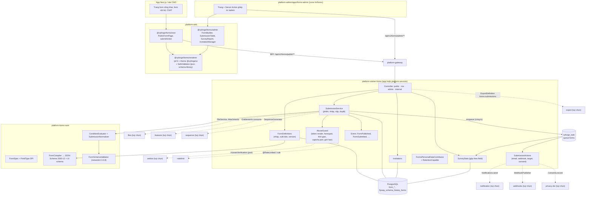
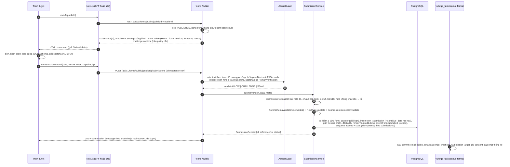
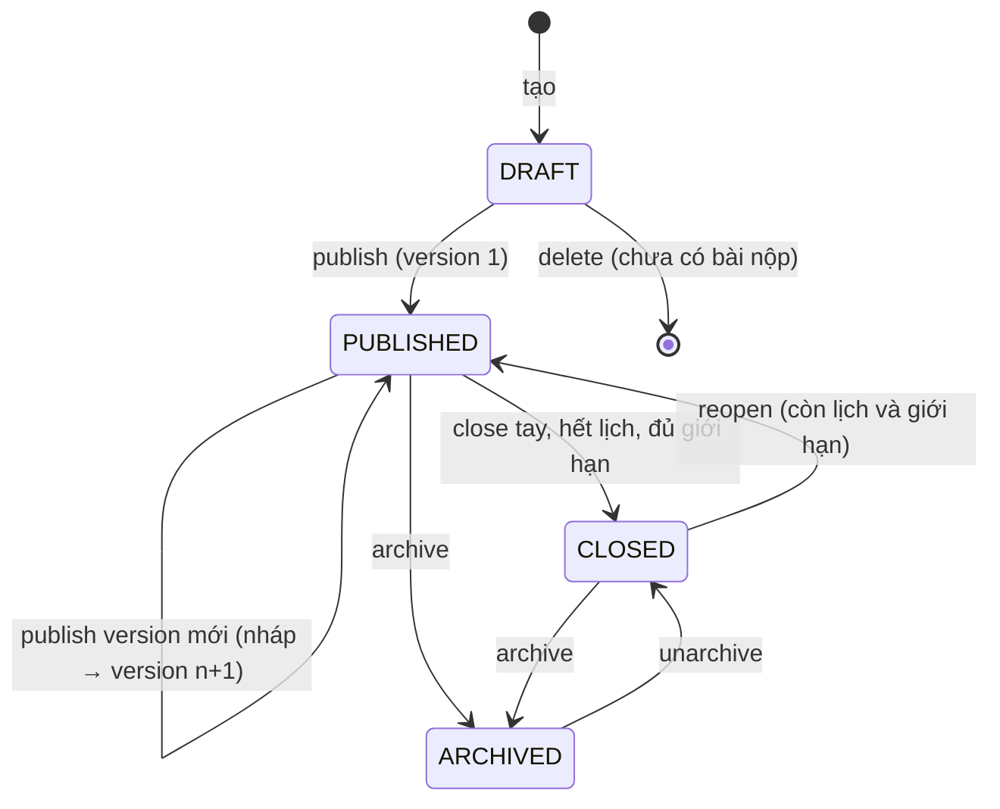
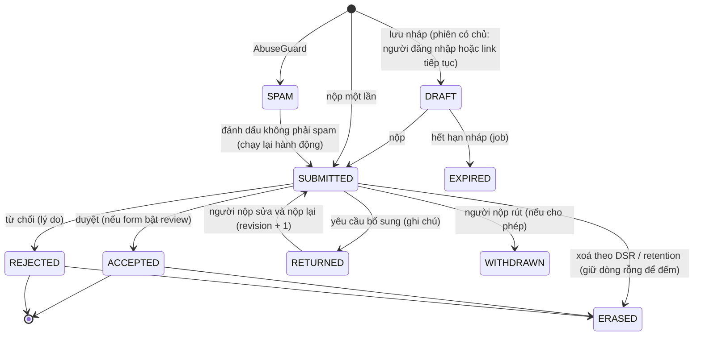
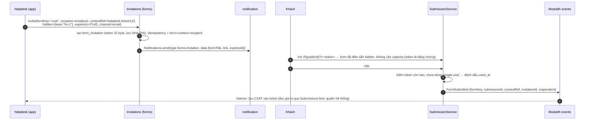
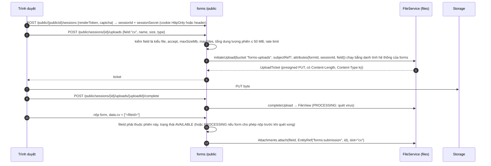
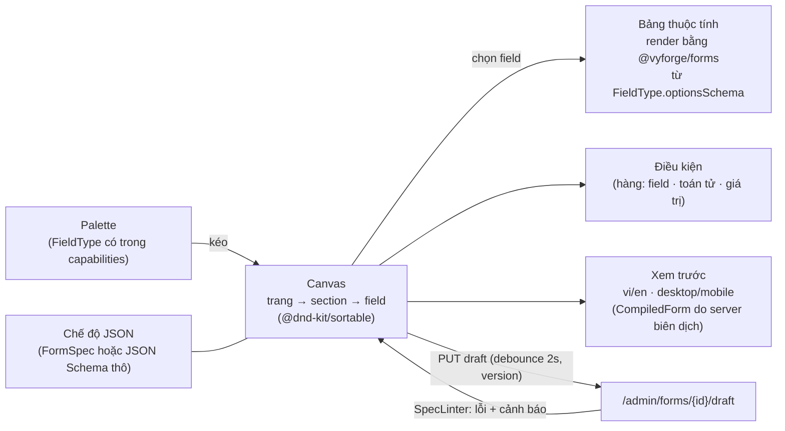
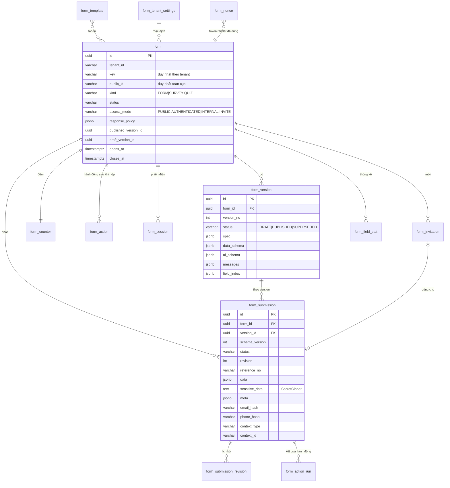

# Thiết kế module forms: `platform-forms-core` + `platform-starter-forms` + `@vyforge/forms` + zone `forms-admin`

> **Trạng thái:** đề xuất, chờ duyệt (27/10/2026), phiên forge-56. Đã đối chiếu với các thiết kế đã merge: workflow, collaboration, master-data, search, api-access, cms-content, privacy-dsr, billing, ekyc, esign (§6.7, §9.4).
> **Phạm vi:** form builder, form động và khảo sát dùng chung cho mọi dự án Vyforge. Định nghĩa form có version, mô tả
> bằng JSON Schema 2020-12 + UI schema, logic hiện/ẩn, nhiều trang, i18n vi/en; kiểm phía server bằng networknt
> json-schema-validator; renderer web dùng chung với `admin-kit` và `custom-fields`; builder kéo thả mức vừa phải; form
> công khai (captcha qua `antibot`, rate limit), form nội bộ, khảo sát CSAT/NPS; bài nộp JSONB kèm `schema_version`, file
> qua `-files`, field có dữ liệu cá nhân, retention, xuất Excel; event `FormSubmitted` và hook nghiệp vụ.
> **Nền:** platform-java 0.12.1 (`SecretCipher`, `DurableTaskQueue`, `StarterSchemaMigrator`), platform-web 0.9.0. Theo
> quy ước chung của các module P1 (mục 1–6 của `module-conventions.md`) và kiến trúc admin microfrontend của
> `platform-services.md` (forge-37: D1–D10, mục 4.11–4.12, 5).
> **Quyết định lớn:**
> 1. **Tự xây** trên Java/PostgreSQL, không nhúng Form.io, SurveyJS Creator hay Formbricks (license, tenant, IAM; mục 2.3).
> 2. **Hai lớp mô tả:** người dùng soạn `FormSpec` (mô hình của builder, gọn, có kiểu), server **biên dịch** ra JSON Schema
>    2020-12 + UI schema. JSON Schema là hợp đồng kiểm dữ liệu ở cả hai phía; `FormSpec` là nguồn để soạn và để phân tích.
> 3. **Renderer web: react-jsonschema-form (rjsf) 6.11**, theme riêng trên `@vyforge/ui`, **validator riêng không dùng
>    `eval`** (CSP của admin và app cấm `unsafe-eval`, mục 2.4). Không chọn JSON Forms.
> 4. **Tách lõi không có database** (`platform-forms-core`: `FormSpec`, compiler, `FieldType`, validator) khỏi starter có
>    dữ liệu, để `custom-fields`, `workflow`, `admin-kit`, `settings` dùng chung bộ field và bộ kiểm mà không kéo bảng.

Mục lục:
1. [Bài toán và phạm vi](#1-bài-toán-và-phạm-vi)
2. [Nghiên cứu](#2-nghiên-cứu)
3. [Kiến trúc](#3-kiến-trúc)
4. [Mô hình dữ liệu](#4-mô-hình-dữ-liệu)
5. [API](#5-api)
6. [Mở rộng](#6-mở-rộng)
7. [Vận hành](#7-vận-hành)
8. [Bảo mật và tuân thủ](#8-bảo-mật-và-tuân-thủ)
9. [Kế hoạch triển khai](#9-kế-hoạch-triển-khai)
10. [Đóng gói và triển khai độc lập](#10-đóng-gói-và-triển-khai-độc-lập)
11. [Lệch quy ước và quyết định](#11-lệch-quy-ước-và-quyết-định)
12. [Nguồn đã kiểm](#12-nguồn-đã-kiểm)

---

## 1. Bài toán và phạm vi

### 1.1 Vì sao cần một module riêng

Ít nhất tám module đang thiết kế cần "một form do người dùng định nghĩa lúc chạy" và đang định tự làm một bản:

| Module | Cần gì | Nếu không có forms |
|---|---|---|
| cms-content (forge-43) | Block `form` trên trang (liên hệ, ứng tuyển) gửi thẳng tới API công khai của forms (cms-content.md §6.7) | Không có block `form` |
| workflow (forge-39) | Form nhập liệu của từng bước, khác nhau theo loại đề nghị, không sửa code (gap analysis §3) | Mỗi bước một form code cứng |
| helpdesk (đợt C) | Form tiếp nhận yêu cầu, khảo sát CSAT sau khi đóng ticket | Tự làm form và khảo sát |
| custom-fields (đợt C) | Cùng bộ render và bộ kiểm cho field tuỳ biến | Bộ render thứ hai |
| admin-kit (forge-49) | `ResourceForm` theo JSON Schema "chung engine với forms" | Engine thứ hai |
| notification, payment, billing, ekyc, webhooks | Form cấu hình provider dựng từ JSON Schema (`settingsSchema`, `ProviderDescriptor`) | Mỗi module tự dựng form từ JSON Schema |
| engagement (P2) | NPS định kỳ, góp ý | Tự làm khảo sát |
| privacy-dsr (forge-44) | Form yêu cầu công khai của chủ thể, ghi nhận đồng ý từ "collection point" | Form riêng |

ABP có module Forms (bản Pro), Frappe có Web Form, Payload có Form Builder, Odoo có Survey. vyforge chưa có gì.

### 1.2 Phạm vi

| Nhóm | Trong phạm vi |
|---|---|
| Định nghĩa | Form có version bất biến sau khi xuất bản; trạng thái nháp, xuất bản, đóng, lưu trữ; nhiều trang và section; 25 kiểu field có sẵn, thêm kiểu mới qua SPI; logic hiện/ẩn/bắt buộc theo điều kiện, nhảy trang; i18n vi/en (thêm locale bằng cấu hình); mẫu form (template) dựng sẵn |
| Ba cách tạo form | (a) builder kéo thả trong admin; (b) app khai báo trong code (`META-INF/vyforge/forms/*.form.json` hoặc bean `FormDeclaration`); (c) chế độ nhà phát triển: dán JSON Schema + UI schema trực tiếp |
| Kiểm dữ liệu | Server: networknt json-schema-validator 3.0.8 (draft 2020-12, bật kiểm `format`) + kiểm theo `FieldType` (CCCD, MST, số di động VN) + hook nghiệp vụ. Client: cùng JSON Schema, validator không dùng `eval` |
| Phân phối | Form công khai (link công khai, nhúng vào app Next.js, block CMS, gọi API từ site tĩnh có CORS), form nội bộ (người dùng đăng nhập, có quyền IAM), form theo lời mời (link một lần), form gắn ngữ cảnh (CSAT của ticket, form của bước workflow) |
| Bài nộp | JSONB + `schema_version`, trạng thái, lưu nháp và tiếp tục sau, sửa sau khi nộp (tuỳ form), file qua `-files`, field nhạy cảm mã hoá riêng, số tham chiếu, retention, xoá/ẩn danh theo yêu cầu của chủ thể |
| Chống lạm dụng | Captcha (antibot, ALTCHA), honeypot, thời gian điền tối thiểu, rate limit theo form và IP, giới hạn số bài nộp (tổng, mỗi người, mỗi email, mỗi lời mời), chặn nội dung trùng, hàng đợi spam |
| Khảo sát | Rating, NPS 0–10, CSAT 1–5, CES, Likert, ma trận; báo cáo tổng hợp theo field và theo thời gian; NPS = %promoter − %detractor; lọc theo ngữ cảnh |
| Sau khi nộp | Event `FormSubmitted` (outbox), hook đồng bộ, hành động cấu hình được: email cho người nhận nội bộ, email xác nhận cho người nộp, webhook (module webhooks), đẩy vào bản ghi của app (`SubmissionTarget`), ghi đồng ý (privacy-dsr) |
| Xuất | Excel/CSV qua module export (cột sinh theo version form), CSV dự phòng khi không có export |
| Quản trị | Zone `forms-admin`: danh sách form, builder, xem trước, version và so sánh, bài nộp, thống kê, lời mời, cài đặt; bản người vận hành và bản tenant admin |

### 1.3 Kịch bản nghiệp vụ phải đáp ứng

| # | Kịch bản | Đòi hỏi | Ở đâu trong thiết kế |
|---|---|---|---|
| K1 | **Form liên hệ trên website doanh nghiệp** (block `form` của CMS): họ tên, email, số điện thoại, nội dung, ô đồng ý xử lý dữ liệu; gửi email cho phòng kinh doanh | Form công khai, captcha, đồng ý theo Luật 91/2025, email thông báo | §3.4, §6.3, §8.2 |
| K2 | **Đăng ký sự kiện** giới hạn 300 chỗ, đóng lúc 17:00 ngày 30/11 giờ Việt Nam; người đăng ký nhận email xác nhận có mã `SK-000123` | Giới hạn tổng nguyên tử, lịch đóng, số tham chiếu, email xác nhận | §3.5, §4.3 `form_counter`, §6.3 |
| K3 | **Khảo sát CSAT sau khi đóng ticket**: helpdesk gửi link một lần qua email/ZNS, khách chấm 1–5 và góp ý; kết quả gắn về ticket | Lời mời một lần, `contextRef`, event về helpdesk, thống kê CSAT theo nhóm hỗ trợ | §3.6, §5.1 `Invitations`, §5.4 |
| K4 | **NPS hằng quý** cho khách hàng của SaaS, lọc theo gói dịch vụ, so sánh quý trước | Field `nps`, biến ẩn (gói, kênh), thống kê theo khoảng thời gian | §3.8, §6.1 |
| K5 | **Hồ sơ ứng tuyển** (tuyển dụng trên site): CV PDF ≤ 10 MB, ảnh chân dung, câu hỏi khác nhau theo vị trí (logic theo lựa chọn "Vị trí") | Upload ẩn danh có quét virus, logic hiện/ẩn, đẩy sang module tuyển dụng của app | §3.7, §6.4 `SubmissionTarget` |
| K6 | **Đề nghị thanh toán trong workflow**: loại "Công tác phí" có form khác loại "Mua sắm"; trên 50 triệu bắt buộc thêm báo giá; workflow quyết định người duyệt từ số tiền | Form nội bộ gắn bước workflow, `Forms.validate` không lưu, field `money-vnd` | §5.1, §6.7 |
| K7 | **Phiếu khai báo y tế / đăng ký khám** của phòng khám: có câu hỏi sức khoẻ (dữ liệu nhạy cảm), CCCD, ngày sinh; chỉ bác sĩ xem được phần sức khoẻ | Field `SENSITIVE` mã hoá riêng, quyền xem riêng, thông báo dữ liệu nhạy cảm (NĐ 356 Điều 6 khoản 4), retention | §4.3, §8.2 |
| K8 | **Một cửa hành chính**: công dân nộp đơn đề nghị theo mẫu của cơ quan (đúng tên trường của mẫu), kèm bản scan giấy tờ; tra cứu trạng thái bằng mã hồ sơ | Mẫu form theo văn bản, số hồ sơ theo `sequence`, trang tra cứu công khai theo mã + OTP | §6.6, §5.2 `/public/receipts` |
| K9 | **Tenant tự dựng form** "Phiếu góp ý cửa hàng" bằng builder, in mã QR dán ở quầy; khách quét và trả lời trên điện thoại | Builder, xem trước mobile, link ngắn, QR | §10.3 |
| K10 | **Form lưu nháp nhiều ngày** (hồ sơ vay vốn 5 trang): người dùng đăng nhập điền dở, quay lại tiếp; cán bộ yêu cầu bổ sung thì người nộp sửa và nộp lại | Draft, resume, `RETURNED` → sửa → nộp lại, lịch sử bản nộp | §3.5 state machine |
| K11 | **Trường tuỳ biến trên màn hình khách hàng CRM** (custom-fields) và **form cấu hình provider** của notification/payment: cùng renderer, cùng kiểm | `platform-forms-core` + `@vyforge/forms/renderer` không cần starter | §3.1, §6.7 |
| K12 | **Khách yêu cầu xoá dữ liệu** (DSR): xoá hoặc ẩn danh mọi bài nộp có email/số điện thoại của họ, giữ lại phần thống kê | `PersonalDataContributor`, tra theo identifier đã hash, ẩn danh field PII | §8.2, §6.8 |
| K13 | **Đổi form sau khi đã có 5.000 bài nộp** (thêm câu, đổi lựa chọn): bài cũ vẫn xem và xuất đúng theo version cũ; thống kê gộp các version theo `fieldKey` | Version bất biến, `fieldKey` ổn định, so sánh version, cảnh báo thay đổi phá vỡ | §4.5 |
| K14 | **Chiến dịch marketing bị bot spam** 20.000 bài/giờ từ nhiều IP | Captcha thích ứng, rate limit theo form, honeypot, hàng đợi spam, cảnh báo | §3.4, §7.3 |
| K15 | **Khách dùng Google Forms chuyển sang**: muốn nhận bài nộp vào Google Sheet / n8n | Webhook `forms.submission.created` có nhãn field (kiểu Tally), xuất CSV | §5.4 |

### 1.4 Ngoài phạm vi

- **Không làm nền tảng low-code** (trang ứng dụng, bảng dữ liệu tuỳ ý): gap analysis §2.20. Form không tạo bảng mới cho app;
  muốn bài nộp thành bản ghi nghiệp vụ thì app cài `SubmissionTarget`.
- **Không có trình soạn quy trình:** form không có bước duyệt nhiều cấp. Duyệt bài nộp nhiều cấp dùng workflow; luật "khi
  nộp thì làm X" phức tạp dùng `automation`. Forms chỉ có trạng thái duyệt một bước (§3.5).
- **Không chạy script tuỳ ý** (kiểu Client Script của Frappe Web Form) và **không có công thức tính toán tuỳ ý** ở bản
  0.13.0. Điểm khảo sát và field tính toán đơn giản để bản sau (§9.3).
- **Không làm thi trắc nghiệm có chấm điểm, chứng chỉ** (Odoo Certification, Google Forms quiz) ở 0.13.0; mô hình để chỗ
  (`kind = QUIZ`, `grading` trong `FieldSpec`), làm ở bản sau.
- **Không tự làm captcha:** thuộc `antibot`. Forms gọi qua port (§6.2).
- **Không tự làm sinh PDF của bài nộp:** dùng renderer của export/esign khi cần (§6.7).
- **Không lưu bài nộp ở storage ngoài** (Google Sheet, Airtable): đi qua webhook hoặc automation.

---

## 2. Nghiên cứu

Version và license kiểm ngày 27/10/2026: GitHub Releases API và file `LICENSE` (`gh api repos/<repo>/releases/latest`,
`.../contents/LICENSE`), npm registry (`npm view <pkg> version license`), Maven Central (`maven-metadata.xml`). Tài liệu
đọc trực tiếp bằng WebFetch; link ở từng dòng và ở mục 12.

### 2.1 Hệ thống tham khảo

| Hệ thống | Version, license | Mô hình dữ liệu | API, phân phối | Điểm mạnh | Điểm yếu |
|---|---|---|---|---|---|
| **ABP Forms** ([docs](https://abp.io/docs/latest/modules/forms)) | Volo.Forms, cần **license ABP Team trở lên** (thương mại) | `Form` (aggregate: tiêu đề, mô tả, cài đặt nhận bài), `QuestionBase` + `Choice`, `FormResponse` sở hữu `Answer` (bảng `FrmAnswers`) | Link `/Forms/{formId}/ViewForm`, mời qua email; feature `Volo.Forms.Enable`; quyền `Forms.Form`, `Forms.Response`, `.Delete` | Cài đặt kiểu Google Forms rõ ràng: `IsCollectingEmail`, `HasLimitOneResponsePerUser`, `RequiresLogin`, `CanEditResponse`, `IsAcceptingResponses`, `IsQuiz` | Chỉ 4 kiểu câu hỏi (text ngắn, chọn một, chọn nhiều, dropdown); xuất CSV mặc định 10 bài; không có event riêng; `IsQuiz` có cờ nhưng không chấm điểm |
| **Payload Form Builder** ([docs](https://payloadcms.com/docs/plugins/form-builder)) | `@payloadcms/plugin-form-builder` 3.92.0, MIT | Collection `forms` (field là block: `text`, `textarea`, `email`, `number`, `checkbox`, `date`, `select`, `radio`, `state`, `country`, `message`, `payment`, `upload`); `form-submissions` với `submissionData: [{field, value}]` | REST/GraphQL của Payload; ai cũng tạo được submission, đọc bị chặn theo access control | Xác nhận bằng thông điệp hoặc redirect (`redirectRelationships`); email có template `{{field}}`, `{{*:table}}`; hook `beforeEmail`; field `payment` với `priceConditions` | Không có logic hiện/ẩn, không version form, không chống spam (tài liệu không nhắc), submission là mảng cặp field/value không có kiểu |
| **Frappe Web Form** ([settings](https://docs.frappe.io/framework/user/en/web-form/settings)) | Frappe v16.53.0, MIT | Web Form **gắn với một DocType**: bài nộp là bản ghi DocType thật | Route công khai; List View cho người nộp | Ánh xạ thẳng sang bản ghi nghiệp vụ; `Login Required`, `Allow Multiple`, `Allow Editing After Submit`, `Allow Delete`, `Show List`, `Anonymous`, `Key Required` (link riêng qua Web Form Request), `Allow Incomplete Forms`, `Max Attachment Size`, `Apply Document Permission` | Cần DocType có sẵn; Client Script chạy JS tuỳ ý; gắn chặt vào Frappe |
| **Google Forms API** ([Form](https://developers.google.com/workspace/forms/api/reference/rest/v1/forms), [FormResponse](https://developers.google.com/workspace/forms/api/reference/rest/v1/forms.responses)) | SaaS | `Form{formId, info, settings, items[], revisionId, responderUri, linkedSheetId, publishSettings}`; `Item` một trong `questionItem`, `questionGroupItem` (lưới), `pageBreakItem`, `textItem`, `imageItem`, `videoItem`; `Question` một trong `choiceQuestion` (RADIO/CHECKBOX/DROP_DOWN), `textQuestion`, `scaleQuestion`, `dateQuestion`, `timeQuestion`, `fileUploadQuestion`, `rowQuestion`, `ratingQuestion`; `FormResponse{responseId, createTime, lastSubmittedTime, respondentEmail, answers: map<questionId, Answer>, totalScore}` | REST; `revisionId` cho ghi có kiểm xung đột; `publishSettings.publishState{isPublished, isAcceptingResponses}`; form tạo qua API sau 30/06/2026 mặc định chưa xuất bản; watch (push) | `questionId` ổn định tách khỏi vị trí; điều hướng theo lựa chọn (`goToAction`, `goToSectionId`); chấm điểm (`grading`, `correctAnswers`); trả lời là map theo `questionId` | Logic chỉ ở mức nhảy section; không có quyền chi tiết; dữ liệu ở Google (xuyên biên giới) |
| **Tally** ([webhooks](https://tally.so/help/webhooks)) | SaaS | Block; bài nộp gửi ra ngoài dạng `data.fields[{key, label, type, value, options?}]` | Webhook có `Tally-Signature` (HMAC-SHA256), timeout 10 giây, retry 5 lần (5 phút → 1 ngày), email báo chủ form khi hỏng | **Payload tự mô tả** (có nhãn, kiểu, lựa chọn) nên công cụ no-code dùng được ngay; field ẩn (`HIDDEN_FIELDS`, UTM), field tính toán (`CALCULATED_FIELDS`) | Không tự host |
| **SurveyJS Form Library** ([logic](https://surveyjs.io/form-library/documentation/design-survey/conditional-logic)) | `survey-core`/`survey-react-ui` 3.2.2, **MIT**; **Survey Creator 3.2.2 là license thương mại** của Devsoft Baltic (file `LICENSE` của repo `survey-creator`) | JSON `pages[].elements[]` (question hoặc panel); rating, matrix, dynamic panel, ranking, signature, expression | Chỉ là thư viện client; lưu ở đâu do app quyết | Logic mạnh nhất trong nhóm: `visibleIf`, `enableIf`, `requiredIf`, `choicesVisibleIf`, trigger (`complete`, `setvalue`, `skip`…), calculated values, text piping, `validateExpressions()` | Ngôn ngữ biểu thức riêng (phải viết lại ở server để kiểm); không phải JSON Schema; trình thiết kế tốt là bản thương mại |
| **Form.io** | Server `formio/formio` **OSL-3.0** (copyleft); renderer `@formio/js` 5.7.0 MIT | JSON component tree; submission `data` | Server REST đầy đủ, PDF, action | Builder mạnh, nhiều component | Server copyleft; renderer không dùng React/Tailwind; mô hình không phải JSON Schema |
| **Odoo Surveys** ([docs](https://www.odoo.com/documentation/19.0/applications/marketing/surveys/create.html)) | Odoo 19, LGPL-3.0 (Community) | `survey.survey`, `survey.question`, `survey.user_input` | Live session, chứng chỉ | Phân trang "One page per question / per section / all", "Allow Roaming", giới hạn thời gian, chấm điểm và ngưỡng đạt | Gắn chặt Odoo |
| **Formbricks** | 6.1.1; lõi **AGPL-3.0**, `apps/web/modules/ee` license riêng, một số package (`packages/surveys`, `survey-ui`, SDK) MIT (file `LICENSE`) | Survey, Response (có trạng thái hoàn tất) | Link, website, in-app survey | Khảo sát trong app, partial response | AGPL cho phần server; open core |
| **HeyForm / OpnForm** | HeyForm v3.0.5 AGPL-3.0; OpnForm v2.6.1 AGPL-3.0 + `api/app/Enterprise` riêng | Form builder kiểu Typeform/Notion | SaaS + self-host | Giao diện builder hiện đại | AGPL, ứng dụng riêng có user và tenant riêng |

### 2.2 Học theo và không làm

**Học theo:**

1. **Google Forms:** khoá câu hỏi ổn định (`questionId`) tách khỏi thứ tự và nhãn → `fieldKey` bất biến trong mọi version
   (§4.5); `revisionId` → `version` optimistic lock khi lưu nháp; `publishSettings` tách "đã xuất bản" và "đang nhận bài";
   trả lời là map theo khoá. Mặc định chưa xuất bản khi tạo.
2. **ABP Forms + Frappe:** bộ cài đặt nhận bài là cột có kiểu, không phải JSON tuỳ ý: yêu cầu đăng nhập, một bài mỗi người,
   sửa sau khi nộp, đang nhận bài, nhận email, `Key Required` (link riêng) → `access_mode`, `response_policy` (§4.3).
3. **Frappe Web Form:** cho phép đẩy bài nộp thành bản ghi nghiệp vụ, nhưng qua SPI có kiểu (`SubmissionTarget`) thay vì
   gắn form vào bảng của app. `Allow Incomplete Forms` → lưu nháp.
4. **Payload:** xác nhận bằng thông điệp hoặc redirect; email dùng template có biến field và bảng toàn bộ câu trả lời;
   hook trước khi gửi email.
5. **Tally:** payload webhook **tự mô tả** (`key`, `label`, `type`, `value`, `options`) để n8n/Make dùng không cần tra
   schema (K15); field ẩn lấy từ query string (UTM). Ký HMAC và retry có lịch rõ: đã có trong module webhooks.
6. **SurveyJS:** tập toán tử điều kiện (`empty`, `notempty`, `contains`, `anyof`, `noneof`, so sánh) và hiện/ẩn ở cấp
   field, section, trang, **cả từng lựa chọn**. Ta lấy tập toán tử này nhưng diễn đạt bằng dữ liệu có cấu trúc, không bằng
   chuỗi biểu thức, để kiểm được ở server (§3.3).
7. **Odoo:** ba kiểu phân trang (tất cả, theo section, từng câu) và "cho quay lại trang trước".

**Không làm:**

1. Không dùng ngôn ngữ biểu thức dạng chuỗi (SurveyJS, Form.io) ở 0.13.0: phải viết parser ở hai phía, khó giới hạn chi
   phí. Khi cần công thức (bản sau) thì dùng CEL (`dev.cel:cel` 0.14.0, Apache-2.0, đã được automation đề xuất) chạy ở
   server, client chỉ hiển thị kết quả.
2. Không lưu bài nộp thành bảng `Answer` một dòng mỗi câu (ABP): một form 40 câu × 1 triệu bài là 40 triệu dòng, truy vấn
   và xoá theo chủ thể nặng. Dùng một dòng JSONB mỗi bài + bảng thống kê gộp (§4.1).
3. Không cho chạy JS tuỳ ý trong form (Frappe Client Script): rủi ro XSS, phá CSP.
4. Không gắn form vào một bảng của app (Frappe): form phải sống được khi app không có bảng tương ứng (form công khai, khảo
   sát).
5. Không nhúng Survey Creator (thương mại), Form.io server (OSL-3.0), Formbricks/HeyForm/OpnForm (AGPL, ứng dụng riêng có
   user và tenant riêng; gap analysis §2.20).

### 2.3 Tích hợp sản phẩm có sẵn hay tự xây

| Tiêu chí | Formbricks/OpnForm (tự host) | SurveyJS (library MIT) + tự làm builder | **Tự xây trên JSON Schema + rjsf (chọn)** |
|---|---|---|---|
| License | AGPL lõi + EE | MIT cho renderer; Creator thương mại | Apache-2.0/MIT toàn bộ phụ thuộc |
| Tenant, IAM, audit | Phải ánh xạ user/tenant/team riêng sang vyforge | Tự làm (chỉ là renderer) | Có sẵn từ platform |
| Kiểm phía server | Ở app riêng (Node/PHP) | Phải viết lại bộ đánh giá biểu thức SurveyJS bằng Java | networknt kiểm cùng JSON Schema mà client dùng |
| Dùng chung với custom-fields, admin-kit, form cấu hình provider | Không | Được, nhưng mô hình SurveyJS lạ với các module dùng JSON Schema | Được: mọi module đã mô tả cấu hình bằng JSON Schema |
| Cài độc lập theo mục 6 | Thêm một ứng dụng phải vận hành | Được | Được |
| Công sức | Thấp ban đầu, cao khi ghép | Trung bình | Trung bình–cao (builder) |

Kết luận: **tự xây**. Phần đắt nhất là builder; giữ ở mức vừa phải (§3.9, §10.3), dùng chính renderer để hiển thị bảng
thuộc tính field (dogfooding).

### 2.4 Renderer web: rjsf 6.x hay JSON Forms 3.x

| Tiêu chí | **rjsf 6.11.0** ([repo](https://github.com/rjsf-team/react-jsonschema-form)) | JSON Forms 3.8.0 ([repo](https://github.com/eclipsesource/jsonforms)) |
|---|---|---|
| License | `@rjsf/core`, `utils`, `validator-ajv8`: Apache-2.0; `@rjsf/shadcn`: MIT | MIT |
| Hoạt động | 15,9k sao, release 28/09/2026, commit hằng ngày | 2,7k sao, release 16/06/2026 |
| React | `react >= 18` | `@jsonforms/react` |
| Theme gần `@vyforge/ui` | Có `@rjsf/shadcn` (Radix + Tailwind, cùng họ với `@vyforge/ui`) làm điểm xuất phát | Renderer set material, vanilla; phải viết bộ renderer riêng |
| Logic hiện/ẩn | Theo **chính JSON Schema**: `if/then/else`, `dependencies`; nhánh `then` được gộp vào schema khi dữ liệu khớp `if` | **Rule** trong UI schema: `SHOW/HIDE/ENABLE/DISABLE` với `SchemaBasedCondition{scope, schema}` (dùng AJV để đánh giá) |
| Layout | `LayoutGridField` (lưới trong UI schema), template object/array tuỳ biến | `VerticalLayout`, `HorizontalLayout`, `Group`, `Categorization` (stepper) có sẵn |
| Mở rộng | `widgets`, `fields`, `templates`, `registry` (`translateString`, `schemaUtils`) | renderer + tester xếp hạng |
| **Validator và CSP** | Validator là interface `ValidatorType` (3 hàm: `validateFormData`, `isValid`, `rawValidation`) → **thay được bằng validator không `eval`**. AJV mặc định cần `unsafe-eval`; rjsf có precompile nhưng chỉ cho schema biết lúc build | AJV dùng ở **lõi** (validate và đánh giá rule). Người dùng báo AJV "relies on eval and limits usage of jsonforms"; precompile không hợp schema sinh lúc chạy ([thảo luận](https://jsonforms.discourse.group/t/ajv-relies-on-eval-and-limits-usage-of-jsonforms/2196)) |

**Vì sao CSP là tiêu chí quyết định.** CSP của mọi zone admin là `script-src 'self' 'nonce-…' 'strict-dynamic'`, không
có `unsafe-eval`, và "không zone nào được nới CSP" (platform-services §4.9). AJV biên dịch schema bằng `new Function`, nên
tài liệu bảo mật của AJV yêu cầu `unsafe-eval` khi chạy trên trang có CSP
([ajv security](https://github.com/ajv-validator/ajv/blob/master/docs/security.md)). Form của tenant sinh lúc chạy nên không
precompile được. Với rjsf, chỉ cần cài `ValidatorType` trên một thư viện kiểm JSON Schema kiểu thông dịch:

| Thư viện kiểm phía client | Version, license | Đồng bộ | Draft 2020-12 | `eval`/`new Function` | Nhận xét |
|---|---|---|---|---|---|
| **json-schema-library** ([repo](https://github.com/sagold/json-schema-library)) | 11.6.16 (23/10/2026), MIT | Có | Có (mặc định khi thiếu `$schema`), qua JSON-Schema-Test-Suite | Không (grep gói npm ngày 27/10/2026) | Lỗi có `code`, `data.pointer`; thêm format/keyword bằng `extendDraft`. **Chọn** |
| @cfworker/json-schema | 4.1.1 (01/2025), MIT | Có | Có | Không | Gọn (356 KB), nhưng nhịp phát hành chậm; dự phòng |
| @hyperjump/json-schema | 1.18.0, MIT | **Không** (API Promise) | Có | — | Không hợp `ValidatorType` đồng bộ |
| ajv | 8.20.0, MIT | Có | Có | **Có** | Chỉ dùng ở server Node hoặc test |

Kết luận: **rjsf 6.11** + theme `@vyforge/forms/theme` (xuất phát từ `@rjsf/shadcn`, đổi sang component của `@vyforge/ui`)
+ `createSafeValidator()` trên json-schema-library. Bộ test hợp đồng chạy cùng một bộ ca kiểm (JSON) trên networknt
(server) và validator client, để hai phía không lệch (§9.1).

Điểm yếu của rjsf và cách bù:
- Không có stepper nhiều trang → `PagedForm` của `@vyforge/forms` tự chia theo trang của `FormSpec` (§3.3).
- Issue #5349 (09/2026): khi nhánh `if/then` đổi, giá trị mặc định của nhánh cũ có thể còn lại → server luôn **cắt dữ liệu
  của field bị ẩn** theo logic của `FormSpec` trước khi kiểm (§3.3), không tin client.

### 2.5 Kiểm phía server: networknt json-schema-validator 3.x

- `com.networknt:json-schema-validator` **3.0.8** (Maven Central, 02/10/2026), Apache-2.0. Dòng 3.x cần Java 17+ và
  **Jackson 3**, khớp Spring Boot 4.1 của platform-java. Dòng 2.x (2.0.8) dành cho Jackson 2.
- API: `SchemaRegistry.withDialect(Dialects.getDraft202012())`, `SchemaRegistryConfig.builder()`, `registry.getSchema(...)`,
  `schema.validate(input, InputFormat.JSON, …)` trả `List<Error>`; output `HIERARCHICAL`/`FLAG`/`BOOLEAN`.
- Bộ test chính thức draft 2020-12: 1261/1261 bắt buộc, 651/651 tuỳ chọn (README).
- **Từ draft 2019-09, `format` chỉ là annotation**: phải bật `formatAssertionsEnabled=true`, nếu không `email` sai vẫn qua.
- README cảnh báo "có thể có thay đổi phá vỡ ở bản minor": ghim version trong `platform-bom`, bọc trong
  `FormSchemaValidator` của ta để đổi version chỉ sửa một lớp.
- Cùng thư viện mà notification, cms-content, ai đã chọn (3.0.8), nên không thêm phụ thuộc mới vào BOM.

### 2.6 Builder kéo thả

- `@dnd-kit/core` 6.3.1 + `@dnd-kit/sortable` 10.0.0 (MIT): bản ổn định, có cảm biến bàn phím và thông báo cho trình đọc
  màn hình. `@dnd-kit/react` 0.5.1 là API mới chưa tới 1.0, chưa dùng.
- Mức "vừa phải" theo gap analysis: palette kiểu field, danh sách field theo trang/section kéo để đổi thứ tự, bảng thuộc
  tính (render bằng chính `@vyforge/forms` từ `optionsSchema` của `FieldType`), trình soạn điều kiện dạng hàng, xem trước
  vi/en và desktop/mobile, chế độ JSON cho nhà phát triển. Không có canvas tự do, không kéo thả layout nhiều cột tuỳ ý
  (chỉ chọn độ rộng `full | half | third` cho field).

### 2.7 Chuẩn đo khảo sát

| Thang | Định nghĩa dùng trong module | Ghi chú |
|---|---|---|
| NPS | Câu "Khả năng bạn giới thiệu … (0–10)". Promoter 9–10, passive 7–8, detractor 0–6. NPS = %promoter − %detractor, từ −100 tới 100 | Định nghĩa của Bain & Company ([netpromotersystem.com](https://www.netpromotersystem.com/about/measuring-your-net-promoter-score/)) |
| CSAT | Thang 1–5 (hoặc 1–7 cấu hình được). CSAT = % câu trả lời ở hai mức cao nhất | Ngưỡng "hài lòng" cấu hình theo field |
| CES | Thang 1–7 "Dễ dàng giải quyết…"; báo cáo trung bình | |
| Likert | 5 hoặc 7 mức, nhãn hai đầu theo locale | |

Công thức nằm trong `FieldType` tương ứng (`nps`, `csat`, `ces`, `likert`), không viết cứng ở lớp thống kê (§6.1).

---

## 3. Kiến trúc

### 3.1 Hai artifact Java, một package web

| Artifact | Nội dung | Phụ thuộc | Ai dùng |
|---|---|---|---|
| `platform-forms-core` (thư viện, không có bean tự động có database) | `FormSpec` và các record, `FormCompiler` (FormSpec → JSON Schema + UI schema theo locale), `FieldType` SPI và 25 kiểu có sẵn, `ConditionEvaluator`, `SubmissionNormalizer` (cắt field ẩn, chuẩn hoá giá trị), `FormSchemaValidator` (bọc networknt), `SpecDiff` (so sánh version) | `platform-core`, networknt 3.0.8, Jackson 3 | starter forms; custom-fields; workflow; admin-kit (server); module có form cấu hình provider |
| `platform-starter-forms` | Bảng, REST công khai/quản trị/nội bộ, xuất bản, bài nộp, lời mời, chống spam, thống kê, hành động sau khi nộp, event, contributor privacy, auto-config, chế độ `remote` | `platform-forms-core`, `-jpa`, `-web`, `-security`, `-authz`, `-audit`, `-privacy`, `-scheduling`, `-ratelimit`; tuỳ chọn: files, export, notification, webhooks, features, privacy-dsr, sequence, antibot | App nghiệp vụ hoặc `platform-services` |
| `@vyforge/forms` (platform-web) | `/renderer` (rjsf + theme + validator an toàn, dùng ở client), `/spec` (kiểu TS của `FormSpec`, `evaluateConditions` dùng chung ca test với Java), server-only client, `/next` (trang form công khai, Server Action), `/admin` (builder, bảng bài nộp, thống kê) | `@vyforge/ui`, `@vyforge/api-client`, `@vyforge/i18n`, `@rjsf/core`, `@rjsf/utils`, `json-schema-library`, `@dnd-kit/*` (chỉ `/admin`) | App, site, zone `forms-admin`, admin-kit, custom-fields |

Tách `platform-forms-core` giống cách privacy-dsr tách SPI nhẹ khỏi engine có dữ liệu: custom-fields chỉ cần bộ field và bộ
kiểm, không cần bảng `form_*`.

### 3.2 Sơ đồ thành phần



Package Java (`com.vyforge.platform.forms`):

| Package | Nội dung | Phụ thuộc framework |
|---|---|---|
| `…forms.spec` (core) | `FormSpec`, `PageSpec`, `FieldSpec`, `Condition`, `LocalizedString`, `Choice`, `ResponsePolicy` (record) | Không |
| `…forms.field` (core) | `FieldType` SPI, `FieldTypes` registry, 25 kiểu có sẵn | Jackson |
| `…forms.compile` (core) | `FormCompiler`, `CompiledForm`, `UiSchemaBuilder`, `SpecDiff`, `SpecLinter` | Jackson |
| `…forms.validate` (core) | `ConditionEvaluator`, `SubmissionNormalizer`, `FormSchemaValidator`, `FieldError` | networknt |
| `…forms` (starter, API công khai) | `Forms`, `FormDefinitions`, `Submissions`, `Invitations`, `SurveyReports`, view record, `FormsErrors` | Không |
| `…forms.spi` | `SubmissionInterceptor`, `SubmissionTarget`, `SubmissionAction`, `HumanVerification`, `RespondentResolver`, `ReferenceNumberGenerator`, `FormDeclaration` | Không |
| `…forms.internal` | service, repository, entity, task handler, job | Spring, JPA |
| `…forms.web` | controller public/me/admin/internal, DTO, mapper | Spring MVC |
| `…forms.integration.*` | files, export, notification, webhooks, privacy, features, sequence, antibot, workflow; mỗi package bật bằng `@ConditionalOnClass` + `@ConditionalOnBean` | Spring |
| `…forms.remote` | client `@HttpExchange` cài `Forms`, `Submissions`, `Invitations` cho `mode: remote` | Spring |

### 3.3 `FormSpec`, biên dịch và logic

**Hai lớp mô tả.** Builder và nhà phát triển soạn `FormSpec`. Lúc lưu, `FormCompiler` sinh ra `CompiledForm`:

```
FormSpec (nguồn, có kiểu)                        CompiledForm (lưu cùng version, bất biến)
├─ pages[]                                        ├─ dataSchema: JSON Schema 2020-12, không phụ thuộc locale
│   └─ elements[]: field | section | content     │      (kiểu, ràng buộc, required, if/then theo điều kiện)
├─ fields: key, type, label{vi,en}, required,    ├─ uiSchema: thứ tự, widget, độ rộng, trang, placeholder key
│   options (theo FieldType), visibleWhen,        ├─ messages: {vi: {...}, en: {...}} nhãn, mô tả, lựa chọn, lỗi
│   requiredWhen, personalData, analytics         ├─ fieldIndex: key → {type, personalData, pointer, pageIndex}
├─ logic: page rules (goTo khi điều kiện)         └─ specHash (SHA-256 của FormSpec đã chuẩn hoá)
└─ settings tham chiếu (không chứa policy nhận bài)
```

Ví dụ `FormSpec` rút gọn (K5):

```json
{
  "specVersion": 1,
  "title": { "vi": "Ứng tuyển", "en": "Job application" },
  "pages": [
    { "key": "p1", "title": { "vi": "Thông tin", "en": "About you" }, "elements": [
      { "field": { "key": "full_name", "type": "text", "label": { "vi": "Họ và tên", "en": "Full name" },
                   "required": true, "options": { "maxLength": 120 }, "personalData": "BASIC",
                   "dataType": "identity.name" } },
      { "field": { "key": "email", "type": "email", "label": { "vi": "Email", "en": "Email" }, "required": true,
                   "personalData": "BASIC", "dataType": "contact.email", "identifier": "email" } },
      { "field": { "key": "position", "type": "select", "label": { "vi": "Vị trí", "en": "Position" }, "required": true,
                   "options": { "choices": [ { "value": "dev", "label": { "vi": "Lập trình viên", "en": "Developer" } },
                                             { "value": "sales", "label": { "vi": "Kinh doanh", "en": "Sales" } } ] } } },
      { "field": { "key": "github", "type": "url", "label": { "vi": "GitHub", "en": "GitHub" },
                   "visibleWhen": { "all": [ { "field": "position", "op": "eq", "value": "dev" } ] },
                   "requiredWhen": { "all": [ { "field": "position", "op": "eq", "value": "dev" } ] } } },
      { "field": { "key": "cv", "type": "file", "label": { "vi": "CV (PDF)", "en": "CV (PDF)" }, "required": true,
                   "options": { "accept": ["application/pdf"], "maxSizeMb": 10, "maxFiles": 1 },
                   "personalData": "BASIC" } },
      { "field": { "key": "consent_recruit", "type": "consent", "required": true,
                   "options": { "purpose": "recruitment.application", "noticeKey": "recruitment-notice" } } }
    ] }
  ]
}
```

**Điều kiện là dữ liệu có cấu trúc, không phải chuỗi biểu thức:**

```
Condition := { all: [Condition | Clause] } | { any: [Condition | Clause] } | { not: Condition | Clause }
Clause    := { field: <fieldKey>, op: <op>, value?: <json> }
op        := eq | neq | in | notIn | gt | gte | lt | lte | empty | notEmpty | contains | notContains
             | anyOf | allOf | noneOf          (cho field nhiều lựa chọn)
             | hiddenValue                      (so với field ẩn: UTM, ngữ cảnh)
```

Giới hạn: độ sâu lồng ≤ 4, ≤ 20 mệnh đề mỗi điều kiện, chỉ tham chiếu field **ở trang trước hoặc cùng trang** (không vòng
lặp; `SpecLinter` kiểm và báo lỗi khi lưu). Áp được cho field, section, trang và từng lựa chọn (`choice.visibleWhen`).

**Biên dịch logic vào JSON Schema.** Field có `requiredWhen` sinh `allOf: [{ if: {…}, then: { required: [key] } }]`. Field
có `visibleWhen` chỉ được khai báo trong `properties` của nhánh `then` (rjsf hiện field khi dữ liệu khớp `if`, mục 2.4).
Toán tử dịch được sang JSON Schema (`eq` → `const`, `in` → `enum`, `gt` → `exclusiveMinimum`, `empty` → không có trong
`required` hoặc `maxLength: 0`, `contains` → `contains`/`pattern`…) nên client không cần bộ đánh giá riêng để ẩn/hiện.

**Vì sao vẫn có `ConditionEvaluator` riêng ở hai phía:**
1. Server phải **cắt dữ liệu của field đang ẩn** trước khi kiểm và lưu (client có thể gửi dư, hoặc rjsf còn giữ giá trị mặc
   định của nhánh cũ, mục 2.4). Cắt dựa trên `FormSpec`, không dựa trên kết quả annotation của validator.
2. Điều kiện của **trang** (nhảy trang) và của **lựa chọn** không biểu diễn gọn bằng JSON Schema.
3. Thống kê cần biết "câu này có được hỏi người này không" để tính tỷ lệ bỏ trống đúng.

Bộ đánh giá viết hai lần (Java trong `platform-forms-core`, TS trong `@vyforge/forms/spec`), cùng chạy một file ca kiểm
`conditions.cases.json` (≥ 200 ca, sinh thêm bằng property-based test ở Java). Lệch một ca là build đỏ.

**Nhiều trang.** `uiSchema` ghi `ui:page` cho mỗi field. `PagedForm` render từng trang bằng `CompiledForm.pageSchema(i)`
(schema con chỉ gồm field của trang, kèm dữ liệu các trang trước để điều kiện tham chiếu được), kiểm từng trang ở client,
gọi `POST …/sessions/{id}/pages/{i}` để lưu nháp (nếu form cho phép), kiểm toàn bộ ở server khi nộp. Ba kiểu phân trang
như Odoo: `ALL`, `PER_PAGE`, `PER_FIELD` (mỗi câu một màn, cho khảo sát trên điện thoại); cờ `allowBack`.

**i18n.** Nhãn trong `FormSpec` là `LocalizedString` (`{vi, en, …}`). `dataSchema` không chứa câu chữ; `messages` chứa câu
chữ theo locale; khi render, server trả `schemaFor(locale)` = `dataSchema` + `title`/`description`/`enumNames` đã điền theo
locale (cache theo `versionId:locale`). Thiếu bản dịch thì lùi về `defaultLocale` của form, rồi `vi`. Lỗi kiểm có `code`
ổn định (`forms.field.required`, `forms.field.pattern`, `forms.field.cccd_invalid`…), dịch theo `Accept-Language` như mọi
Problem Details (`-web`). Locale thêm bằng cấu hình `vyforge.forms.locales` (mặc định `[vi, en]`).

### 3.4 Luồng chính: nộp form công khai



Luồng lỗi:

| Lỗi | Mã (`ErrorCode`) | HTTP | Xử lý |
|---|---|---|---|
| Form không tồn tại, chưa xuất bản, tenant tắt module | `forms.form.not_found` | 404 | Không lộ form nháp có tồn tại |
| Form đã đóng (quá hạn, đủ số bài, tắt nhận bài) | `forms.form.closed` (`params.reason`: `schedule`, `limit`, `manual`) | 409 | Hiện thông điệp đóng form của tenant |
| Version đã cũ (form xuất bản bản mới khi người dùng đang điền) | `forms.version.superseded` | 409 | Mặc định **vẫn nhận** theo version cũ nếu `acceptPreviousVersionFor` (mặc định 24 giờ) chưa hết; quá hạn thì báo tải lại |
| Dữ liệu sai schema hoặc luật nghiệp vụ | `validation_failed` + `errors[]` (`field` = JSON pointer, `code`) | 422 | Renderer đẩy lỗi vào field qua `extraErrors` |
| Captcha thiếu hoặc sai | `forms.captcha.required` / `forms.captcha.invalid` | 400 | Renderer hiện captcha, giữ dữ liệu |
| Token render sai, hết hạn (mặc định 24 giờ) hoặc đã dùng | `forms.token.invalid` | 400 | Tải lại form |
| Điền quá nhanh, honeypot có giá trị | — | 201 giả | Lưu `status = SPAM` (không gửi hành động), trả như thành công để bot không học được |
| Quá rate limit | `ratelimit.exceeded` | 429 | `Retry-After` |
| Đã nộp rồi (một bài mỗi người/email/lời mời) | `forms.submission.duplicate` | 409 | Nếu form cho sửa: trả link sửa (người đăng nhập) |
| Vượt hạn mức gói (features) | `entitlement.quota_exceeded` | 403 | Form công khai hiện "tạm ngừng nhận"; admin nhận cảnh báo |
| Hook nghiệp vụ từ chối | mã do hook đặt (`<app>.<rule>`) | 422 | |

### 3.5 State machine

**Form** (theo `form`, không theo version):



- Mỗi form có **tối đa một version nháp** (`form_version.status = DRAFT`) song song với version đang xuất bản. Lưu nháp có
  optimistic lock (`version` của dòng), hai người sửa cùng lúc thì người sau nhận `409 forms.draft.conflict`.
- `PUBLISHED` → nhận bài theo `response_policy` và lịch (`opens_at`, `closes_at`). Đóng tự động do job
  `forms-schedule` (`@ClusterScheduled`, mỗi phút) và do `form_counter` khi đủ giới hạn (trong cùng transaction nộp).
- "Đang nhận bài" tách khỏi "đã xuất bản" (Google Forms `isAcceptingResponses`): `CLOSED` vẫn xem được trang form với thông
  điệp đóng, vẫn xem thống kê.

**Bài nộp:**



- Trạng thái lưu `varchar` + kiểm ở code (quy ước 2). Bước duyệt chỉ có khi `response_policy.review = true`; quy trình nhiều
  cấp thì app dùng workflow, workflow gọi `Submissions.transition(...)`.
- Mỗi lần nộp lại tạo `form_submission_revision` (dữ liệu cũ), `form_submission.revision` tăng. Sửa sau khi nộp
  (`allowEditAfterSubmit`) cũng tạo revision.
- `ERASED`: xoá `data`, `sensitive_data`, `meta` có PII, gỡ file; giữ `id`, `form_id`, `version_id`, `submitted_at`,
  `status` để số đếm và thống kê đã gộp còn đúng (§8.2).

### 3.6 Lời mời và form gắn ngữ cảnh (CSAT của ticket)



Không có notification thì `invite` trả link (`InvitationView.url`) để app tự gửi (ZNS, SMS, QR in trên hoá đơn).

### 3.7 Upload file trong form công khai

Người nộp chưa đăng nhập không gọi được API của files (files cần JWT). Forms làm trung gian, gắn upload vào **phiên điền
form**:



- Bucket `forms-uploads` do starter khai báo (files.md §6.1): `access: entity` với entity type `forms:submission`, quét virus
  bắt buộc, `personal-data: true`, `onEntityDeleted: trash`, giữ file chưa gắn tối đa 24 giờ (files dọn upload mồ côi).
- Quyền đọc file của bài nộp suy ra từ quyền `forms:submission:Get` qua `AttachmentAccessPolicy` mà forms cài cho entity type
  `forms:submission`.
- Không có module files thì kiểu field `file` không có trong builder (capability `files` vắng, §10.1).
- File quét ra virus: files đặt `QUARANTINED`; bài nộp vẫn lưu nhưng field có cờ `fileRejected`, admin thấy cảnh báo.

### 3.8 Thống kê khảo sát

- **Gộp sẵn, cập nhật bất đồng bộ.** Sau mỗi bài nộp, việc `forms/stats` (idempotency `stats:<submissionId>:<revision>`) cập
  nhật `form_field_stat` theo `(form_id, field_key, bucket_date (ngày VN), dim_key, dim_value, value_key)` bằng
  `INSERT … ON CONFLICT DO UPDATE SET count = count + 1`. Nộp lại hoặc xoá thì việc chạy với `delta = -1` cho giá trị cũ.
- `FieldType.statBuckets(value)` quyết định bucket: lựa chọn → mỗi lựa chọn một bucket; rating/NPS/CSAT → mỗi điểm; số →
  khoảng (do field cấu hình); text tự do → chỉ đếm có/không trả lời.
- **Chiều lọc** (`dim`): tối đa 3 field ẩn hoặc lựa chọn được đánh dấu `analytics.dimension = true` (vd. `plan`, `team`,
  `channel`) cộng `version_no`. Không lọc theo chiều khác ở bảng gộp; cần phân tích tự do thì xuất dữ liệu hoặc dùng
  `analytics` (Superset đọc view `rpt_forms_submission`, §6.7).
- Báo cáo đọc bảng gộp: phân bố theo lựa chọn, trung bình, NPS/CSAT theo ngày/tuần/tháng, tỷ lệ bỏ trống (mẫu số là số bài
  mà câu hỏi **được hiện**, nhờ `ConditionEvaluator`). Text tự do: danh sách câu trả lời mới nhất (có quyền xem bài nộp).
- Tính lại toàn bộ (`POST /admin/forms/{id}/stats/rebuild`) chạy thành việc nền theo lô, dùng khi đổi định nghĩa bucket.
- Khi số bài trong một ô thống kê < `minCellSize` (mặc định 5) và form là khảo sát ẩn danh, báo cáo gộp ô đó vào "Khác" để
  không suy ngược người trả lời.

### 3.9 Builder



- Builder chỉ sửa `FormSpec`; xem trước luôn dùng `CompiledForm` mà server trả về (một bộ biên dịch duy nhất, ở Java).
- `SpecLinter` trả lỗi chặn xuất bản (khoá trùng, điều kiện tham chiếu field sau, lựa chọn trùng `value`, thiếu nhãn `vi`)
  và cảnh báo (thiếu bản `en`, field PII không có `consent`, field `SENSITIVE` trên form công khai không có thông báo nhạy
  cảm).
- Xuất bản hiện **bản so sánh** với version đang chạy (`SpecDiff`, §4.5): field thêm/bỏ, đổi kiểu (phá vỡ), bỏ lựa chọn đã
  có bài nộp (phá vỡ thống kê), đổi PII. Thay đổi phá vỡ cần tick xác nhận.

---

## 4. Mô hình dữ liệu

### 4.1 Ý tưởng chính

- **Định nghĩa tách khỏi version.** `form` giữ danh tính, trạng thái, chính sách nhận bài; `form_version` giữ `FormSpec` và
  `CompiledForm`, **bất biến sau khi xuất bản**. Bài nộp trỏ tới version, nên luôn xem và xuất đúng theo câu hỏi lúc nộp.
- **Một dòng JSONB mỗi bài nộp** (`data`), khoá là `fieldKey`. Không có bảng câu trả lời theo dòng (§2.2). Field
  `SENSITIVE` tách sang `sensitive_data` (mã hoá `SecretCipher`), không nằm trong `data`.
- **Định danh của người nộp lưu dạng HMAC** (`email_hash`, `phone_hash`) để tra theo yêu cầu của chủ thể và chặn trùng mà
  không cần đọc `data`.
- **Thống kê là bảng gộp** cập nhật bất đồng bộ, không quét `data` khi xem báo cáo.
- **Chính sách nhận bài là cột và record có kiểu** (`response_policy` JSONB kiểm bằng record Java + JSON Schema), không có
  enum nghiệp vụ khoá cứng trong DB (`varchar` + kiểm ở code, quy ước 2).

### 4.2 ERD



### 4.3 DDL dự kiến

Migration ở `META-INF/vyforge/db/forms/V1__forms.sql`, lịch sử `flyway_schema_history_forms`, file gộp cho DBA
`META-INF/vyforge/sql/forms.sql` (quy ước 5.3). Mọi bảng có `tenant_id` (`TenantEntity`), id là UUID v7 (`BaseEntity`).

```sql
create table form (
    id                    uuid         primary key,
    tenant_id             varchar(100) not null,
    key                   varchar(80)  not null,                -- 'contact', 'csat-ticket'; [a-z0-9][a-z0-9-]{1,79}
    public_id             varchar(16)  not null,                -- base58, 12 ký tự, sinh ngẫu nhiên; URL công khai /f/{public_id}
    kind                  varchar(16)  not null default 'FORM', -- FORM | SURVEY | QUIZ (kiểm ở code)
    title                 jsonb        not null,                -- {"vi": "...", "en": "..."} (LocalizedText khi -jpa có)
    description           jsonb,
    status                varchar(16)  not null default 'DRAFT',-- DRAFT | PUBLISHED | CLOSED | ARCHIVED
    closed_reason         varchar(16),                          -- schedule | limit | manual
    access_mode           varchar(16)  not null default 'PUBLIC',
    response_policy       jsonb        not null default '{}',   -- ResponsePolicy (§5.1), kiểm bằng record + JSON Schema
    published_version_id  uuid,
    draft_version_id      uuid,
    opens_at              timestamptz,
    closes_at             timestamptz,
    default_locale        varchar(10)  not null default 'vi',
    retention             varchar(20),                          -- ISO-8601 (P1Y); null = mặc định của tenant
    source                varchar(16)  not null default 'BUILDER', -- BUILDER | CODE | RAW_SCHEMA
    owner_sub             varchar(255),
    tags                  text[]       not null default '{}',
    attributes            jsonb        not null default '{}',   -- mở rộng có kiểm (FormAttributesSchema)
    created_at            timestamptz  not null,
    created_by            varchar(255) not null,
    updated_at            timestamptz  not null,
    updated_by            varchar(255) not null,
    version               bigint       not null default 0,
    constraint uq_form_key unique (tenant_id, key),
    constraint uq_form_public_id unique (public_id)
);
create index ix_form_tenant_status on form (tenant_id, status, updated_at desc);
create index ix_form_closes_at on form (closes_at) where status = 'PUBLISHED' and closes_at is not null;
create index ix_form_opens_at on form (opens_at) where status = 'PUBLISHED' and opens_at is not null;

create table form_version (
    id                uuid         primary key,
    tenant_id         varchar(100) not null,
    form_id           uuid         not null references form (id),
    version_no        int          not null,                    -- 1, 2, … ; nháp có số kế tiếp
    status            varchar(16)  not null,                    -- DRAFT | PUBLISHED | SUPERSEDED
    spec_version      int          not null,                    -- version của DSL FormSpec (upcaster, §4.5)
    spec              jsonb        not null,
    data_schema       jsonb        not null,                    -- JSON Schema 2020-12, không có câu chữ
    ui_schema         jsonb        not null,
    messages          jsonb        not null,                    -- {locale: {key: text}}
    field_index       jsonb        not null,                    -- key → {type, pointer, page, personalData, dataType, identifier, dimension}
    spec_hash         varchar(64)  not null,
    compiler_version  varchar(20)  not null,                    -- version của platform-forms-core đã biên dịch
    breaking          boolean      not null default false,      -- SpecDiff so với version trước có thay đổi phá vỡ
    change_note       varchar(500),
    published_at      timestamptz,
    published_by      varchar(255),
    created_at        timestamptz  not null,
    created_by        varchar(255) not null,
    updated_at        timestamptz  not null,
    updated_by        varchar(255) not null,
    version           bigint       not null default 0,
    constraint uq_form_version unique (form_id, version_no)
);
create unique index uq_form_version_one_draft on form_version (form_id) where status = 'DRAFT';
-- Trigger chặn UPDATE spec/data_schema/ui_schema/messages khi status <> 'DRAFT' (bất biến sau khi xuất bản).

create table form_counter (
    form_id           uuid         primary key references form (id),
    tenant_id         varchar(100) not null,
    submitted         bigint       not null default 0,          -- SUBMITTED + ACCEPTED + REJECTED + RETURNED (không gồm SPAM, ERASED vẫn đếm)
    accepted          bigint       not null default 0,
    spam              bigint       not null default 0,
    last_submitted_at timestamptz
);
-- Giới hạn tổng: UPDATE form_counter SET submitted = submitted + 1 WHERE form_id = ? AND (:limit IS NULL OR submitted < :limit)
-- 0 dòng → đủ giới hạn → đóng form (closed_reason = 'limit') trong cùng transaction. Khoá một dòng, không đọc-rồi-ghi.

create table form_action (
    id            uuid         primary key,
    tenant_id     varchar(100) not null,
    form_id       uuid         not null references form (id),
    kind          varchar(40)  not null,                        -- email.internal | email.confirmation | webhook | target:<name> | consent | <SPI>
    position      int          not null default 0,
    enabled       boolean      not null default true,
    when_status   varchar(16)  not null default 'SUBMITTED',    -- chạy khi vào trạng thái nào (SUBMITTED | ACCEPTED)
    condition     jsonb,                                        -- Condition của FormSpec (chỉ chạy khi khớp)
    config        jsonb        not null default '{}',           -- kiểm theo SubmissionAction.configSchema()
    secret        text,                                         -- SecretCipher, context forms:action:<tenant>:<id>
    created_at timestamptz not null, created_by varchar(255) not null,
    updated_at timestamptz not null, updated_by varchar(255) not null,
    version bigint not null default 0
);
create index ix_form_action_form on form_action (form_id, position);

create table form_session (
    id               uuid         primary key,
    tenant_id        varchar(100) not null,
    form_id          uuid         not null references form (id),
    version_id       uuid         not null references form_version (id),
    respondent_sub   varchar(255),                              -- null với form công khai không đăng nhập
    secret_hash      varchar(64),                               -- SHA-256 của sessionSecret (link tiếp tục, upload ẩn danh)
    invitation_id    uuid,
    page_index       int          not null default 0,
    data             jsonb        not null default '{}',        -- nháp; field SENSITIVE không lưu nháp ở đây (§8.2)
    status           varchar(16)  not null default 'OPEN',      -- OPEN | SUBMITTED | EXPIRED | ABANDONED
    upload_bytes     bigint       not null default 0,
    ip_hash          varchar(64),
    started_at       timestamptz  not null,
    last_seen_at     timestamptz  not null,
    expires_at       timestamptz  not null,
    version          bigint       not null default 0
);
create index ix_form_session_expiry on form_session (expires_at) where status = 'OPEN';
create index ix_form_session_owner on form_session (tenant_id, form_id, respondent_sub) where status = 'OPEN';

create table form_submission (
    id               uuid         primary key,                  -- UUID v7 (theo thời gian)
    tenant_id        varchar(100) not null,
    form_id          uuid         not null references form (id),
    version_id       uuid         not null references form_version (id),
    schema_version   int          not null,                     -- = form_version.version_no (quy ước JSONB + schema_version)
    status           varchar(16)  not null,
    revision         int          not null default 1,
    reference_no     varchar(40),                               -- SK-000123 (ReferenceNumberGenerator / sequence)
    respondent_sub   varchar(255),
    subject_ref      varchar(300),                              -- SubjectRef "<type>:<id>" của privacy (user:sub, contact:…)
    email_hash       varchar(64),                               -- HMAC-SHA256(vyforge.privacy.hash-key, email chuẩn hoá)
    phone_hash       varchar(64),                               -- HMAC của E.164
    dedupe_key       varchar(100),                              -- chặn trùng theo policy: 'sub:<x>' | 'email:<hash>' | 'inv:<id>'
    invitation_id    uuid,
    context_type     varchar(80),                               -- 'helpdesk:ticket', 'workflow:task'
    context_id       varchar(200),
    locale           varchar(10)  not null,
    channel          varchar(20)  not null,                     -- web | embed | api | invite | internal | import
    data             jsonb        not null,                     -- {fieldKey: value}; file = ["<fileId>"]
    sensitive_data   text,                                      -- SecretCipher(JSON các field SENSITIVE), context forms:submission:<tenant>:<id>
    hidden           jsonb        not null default '{}',        -- field ẩn: utm, ngữ cảnh, prefill đã ký
    meta             jsonb        not null default '{}',        -- ip_hash, ua_hash, referrer origin, time_to_complete_ms, captcha, page_path
    spam_score       smallint,
    submitted_at     timestamptz,
    reviewed_at      timestamptz,
    reviewed_by      varchar(255),
    review_note      varchar(2000),
    retention_until  timestamptz,
    erased_at        timestamptz,
    attributes       jsonb        not null default '{}',
    created_at timestamptz not null, created_by varchar(255) not null,
    updated_at timestamptz not null, updated_by varchar(255) not null,
    version bigint not null default 0
);
create index ix_form_sub_list on form_submission (tenant_id, form_id, submitted_at desc, id desc);
create index ix_form_sub_status on form_submission (tenant_id, form_id, status, submitted_at desc);
create index ix_form_sub_context on form_submission (tenant_id, context_type, context_id) where context_id is not null;
create index ix_form_sub_sub on form_submission (tenant_id, respondent_sub) where respondent_sub is not null;
create index ix_form_sub_email on form_submission (tenant_id, email_hash) where email_hash is not null;
create index ix_form_sub_phone on form_submission (tenant_id, phone_hash) where phone_hash is not null;
create index ix_form_sub_subject on form_submission (tenant_id, subject_ref) where subject_ref is not null;
create index ix_form_sub_retention on form_submission (retention_until) where erased_at is null and retention_until is not null;
create unique index uq_form_sub_ref on form_submission (tenant_id, reference_no) where reference_no is not null;
create unique index uq_form_sub_dedupe on form_submission (tenant_id, form_id, dedupe_key)
    where dedupe_key is not null and status not in ('SPAM', 'WITHDRAWN', 'ERASED', 'DRAFT');
create index brin_form_sub_submitted on form_submission using brin (submitted_at);
-- Tuỳ chọn theo tenant/form (bật bằng cấu hình, không mặc định): GIN (data jsonb_path_ops) cho lọc theo giá trị field.

create table form_submission_revision (
    submission_id    uuid         not null references form_submission (id),
    revision         int          not null,
    tenant_id        varchar(100) not null,
    version_id       uuid         not null,
    data             jsonb        not null,
    sensitive_data   text,
    status_before    varchar(16)  not null,
    created_at       timestamptz  not null,
    created_by       varchar(255) not null,
    primary key (submission_id, revision)
);

create table form_action_run (
    submission_id    uuid         not null,
    action_id        uuid         not null,
    tenant_id        varchar(100) not null,
    revision         int          not null,
    status           varchar(16)  not null,                     -- PENDING | SUCCEEDED | FAILED | DEAD | SKIPPED
    attempts         int          not null default 0,
    task_id          uuid,                                      -- vyforge_task tương ứng
    result_ref       varchar(300),                              -- id bản ghi do SubmissionTarget tạo, messageId…
    last_error       varchar(1000),                             -- đã che PII
    updated_at       timestamptz  not null,
    primary key (submission_id, action_id, revision)
);

create table form_invitation (
    id               uuid         primary key,
    tenant_id        varchar(100) not null,
    form_id          uuid         not null references form (id),
    token_hash       varchar(64)  not null,                     -- SHA-256 của token 32 byte (base64url); token chỉ trả một lần
    recipient_kind   varchar(16)  not null,                     -- user | email | phone | anonymous
    recipient_hash   varchar(64),                               -- HMAC email/phone; sub lưu thẳng ở recipient_sub
    recipient_sub    varchar(255),
    recipient_hint   varchar(100),                              -- dạng đã che: a***@vyforge.vn
    context_type     varchar(80),
    context_id       varchar(200),
    hidden           jsonb        not null default '{}',
    max_uses         int          not null default 1,
    uses             int          not null default 0,
    status           varchar(16)  not null default 'ACTIVE',    -- ACTIVE | USED | EXPIRED | REVOKED
    expires_at       timestamptz  not null,
    last_used_at     timestamptz,
    idempotency_key  varchar(200),
    created_at timestamptz not null, created_by varchar(255) not null,
    constraint uq_form_invitation_token unique (token_hash),
    constraint uq_form_invitation_idem unique (tenant_id, form_id, idempotency_key)
);
create index ix_form_invitation_context on form_invitation (tenant_id, context_type, context_id);
create index ix_form_invitation_expiry on form_invitation (expires_at) where status = 'ACTIVE';

create table form_field_stat (
    tenant_id        varchar(100) not null,
    form_id          uuid         not null,
    field_key        varchar(80)  not null,
    bucket_date      date         not null,                     -- ngày theo Asia/Ho_Chi_Minh (cấu hình theo tenant)
    dim_key          varchar(80)  not null default '',          -- '' = không chia chiều; 'version' | fieldKey dimension
    dim_value        varchar(200) not null default '',
    value_key        varchar(200) not null,                     -- giá trị lựa chọn, điểm, khoảng; '__answered' | '__shown'
    count            bigint       not null default 0,
    sum_value        numeric(20,4) not null default 0,          -- cho trung bình
    primary key (tenant_id, form_id, field_key, bucket_date, dim_key, dim_value, value_key)
);

create table form_nonce (                                       -- token render một lần (chống replay, đo thời gian điền)
    nonce            varchar(32)  primary key,
    tenant_id        varchar(100) not null,
    form_id          uuid         not null,
    used_at          timestamptz  not null,
    expires_at       timestamptz  not null
);
create index ix_form_nonce_expiry on form_nonce (expires_at);

create table form_template (
    id               uuid         primary key,
    tenant_id        varchar(100) not null,
    key              varchar(80)  not null,
    category         varchar(40)  not null,                     -- contact | event | survey | hr | public-service | …
    title            jsonb        not null,
    description      jsonb,
    spec             jsonb        not null,
    spec_version     int          not null,
    created_at timestamptz not null, created_by varchar(255) not null,
    updated_at timestamptz not null, updated_by varchar(255) not null,
    version bigint not null default 0,
    constraint uq_form_template unique (tenant_id, key)
);
-- Mẫu của platform nằm trong classpath META-INF/vyforge/forms/templates/*.template.json (không phải dòng DB),
-- nên không cần tenant_id null; tenant chép ra form_template khi muốn sửa.

create table form_tenant_settings (
    tenant_id        varchar(100) primary key,
    settings         jsonb        not null,                     -- FormsTenantSettings: retention mặc định, spam, CORS, redirect, email người nhận
    secret           text,                                      -- SecretCipher (khoá ký prefill), context forms:settings:<tenant>
    updated_at timestamptz not null, updated_by varchar(255) not null,
    version bigint not null default 0
);
```

`ResponsePolicy` (record Java, lưu trong `form.response_policy`):

```json
{
  "requireLogin": false,
  "limitTotal": 300,
  "limitPer": "EMAIL",                 // NONE | USER | EMAIL | PHONE | INVITATION | DEVICE
  "allowDraft": false, "draftTtl": "P30D",
  "allowEditAfterSubmit": false, "editWindow": "PT24H",
  "allowWithdraw": false,
  "review": false,                     // có bước duyệt ACCEPTED/REJECTED/RETURNED
  "acceptPreviousVersionFor": "PT24H",
  "pagination": "PER_PAGE", "allowBack": true,
  "captcha": "ADAPTIVE",               // OFF | ALWAYS | ADAPTIVE
  "minFillSeconds": 3,
  "confirmation": { "type": "MESSAGE", "message": { "vi": "Cảm ơn bạn", "en": "Thank you" } },
  "referenceNo": { "generator": "sequence", "pattern": "SK-{seq:6}" },
  "anonymous": false,                  // khảo sát ẩn danh: không lưu sub, không lưu hash định danh, ip_hash bỏ
  "receipt": { "lookup": "REFERENCE_AND_OTP" },  // tra cứu trạng thái công khai (K8); NONE mặc định
  "startsWorkflow": null                 // { "definitionKey": "leave-request" }: workflow nghe FormSubmitted và mở hồ sơ (§6.7)
}
```

### 4.4 Partition, retention, dung lượng

| Dữ liệu | Retention mặc định | Cách thực thi |
|---|---|---|
| `form_submission` (+ revision, file đính kèm) | Theo `form.retention`, không có thì `FormsTenantSettings.defaultRetention` (mặc định `P2Y`); form `kind = SURVEY` ẩn danh: `P5Y` cho dòng đã ẩn danh | `retention_until` tính lúc nộp (từ `submitted_at`, hoặc từ mốc nghiệp vụ khi app gọi `Submissions.startRetention`). Việc `forms/retention` (`@ClusterScheduled` 02:30, `perTenant`) xoá theo lô 1.000 dòng → `ERASED`; gỡ attachment (files đưa file vào thùng rác theo `onEntityDeleted`). Có legal hold (privacy-dsr) thì bỏ qua. Cài `RetentionCapable` để privacy-dsr điều khiển được (§8.2) |
| `form_session` (nháp) | `draftTtl` của form (mặc định 30 ngày), phiên không nháp 24 giờ | Job `forms-expire` mỗi giờ: `EXPIRED`, xoá `data` |
| `status = SPAM` | 30 ngày | Job xoá hẳn (không giữ dòng) |
| `form_nonce` | 48 giờ | Job xoá theo `expires_at` |
| `form_invitation` | 180 ngày sau `expires_at` | Job |
| `form_field_stat` | Vô thời hạn (không có PII; ô nhỏ được gộp khi hiển thị) | Xoá khi xoá form |
| `form_action_run` | Theo bài nộp | Xoá cùng |

**Partition.** Không partition ở 0.13.0. Ước lượng: bài nộp trung bình 2–4 KB (JSONB nén TOAST) + chỉ mục ≈ 1 KB → 10 triệu
bài ≈ 30–50 GB. Truy vấn chính luôn theo `(tenant_id, form_id, submitted_at)` nên chỉ mục đủ; xoá theo retention chạy lô
nhỏ. Khi một bản triển khai vượt khoảng 50 triệu dòng, chuyển sang partition theo tháng của `submitted_at` (PK đổi thành
`(id, submitted_at)`; id là UUID v7 nên vẫn theo thời gian). Việc này là migration riêng có hướng dẫn, ghi ở §9.3.

### 4.5 Tiến hoá schema

Ba thứ tiến hoá, mỗi thứ một cơ chế:

| Thứ | Cơ chế |
|---|---|
| **Câu hỏi của một form** (tenant sửa form) | Version mới; bài cũ giữ `version_id`. `fieldKey` bất biến: builder sinh khoá từ nhãn lúc tạo field (`ho_va_ten`), sau đó không đổi khi đổi nhãn. Đổi kiểu field = thay đổi phá vỡ: `SpecLinter` đề nghị tạo field mới với khoá mới. Xoá lựa chọn đã có bài nộp: cảnh báo; thống kê vẫn giữ bucket cũ với nhãn lấy từ version cũ |
| **DSL `FormSpec`** (vyforge nâng cấp mô hình) | `spec_version` (bắt đầu 1). Mỗi bản tăng có `FormSpecUpcaster` (Java, có test) chuyển bản cũ lên khi đọc; không sửa dòng đã xuất bản. `CompiledForm` của version đã xuất bản **không biên dịch lại** (bất biến); chỉ biên dịch lại nháp |
| **Bảng của module** | Migration `V2__…` có version với bảng lịch sử riêng; không sửa migration đã phát hành |

**Đọc xuyên version.** Xuất và báo cáo gộp nhiều version theo `fieldKey`: cột là hợp các field của mọi version trong khoảng
lọc, theo thứ tự của version mới nhất; field không có ở version của bài thì để trống. `SpecDiff` phân loại thay đổi:

| Loại | Ví dụ | Ảnh hưởng |
|---|---|---|
| `COMPATIBLE` | Thêm field không bắt buộc, sửa nhãn, thêm lựa chọn, thêm bản dịch | Không |
| `TIGHTENED` | Thêm field bắt buộc, giảm `maxLength` | Bài nháp theo version cũ phải điền thêm khi nộp |
| `BREAKING` | Đổi kiểu field, xoá lựa chọn đã có bài, đổi `personalData` | Cần xác nhận khi xuất bản, `form_version.breaking = true`, ghi audit |

`attributes` JSONB trên `form` và `form_submission` cho app gắn dữ liệu riêng, kiểm bằng `FormAttributesSchema` khai báo
trong cấu hình (cùng cách files, ekyc làm).

---

## 5. API

### 5.1 Java

**Lõi (`platform-forms-core`, không cần database):**

```java
package com.vyforge.platform.forms.compile;

/** Biên dịch FormSpec → JSON Schema 2020-12 + UI schema + messages. Thuần, không I/O, an toàn đa luồng. */
public interface FormCompiler {
    CompiledForm compile(FormSpec spec);                       // ném FormSpecException kèm danh sách lỗi của SpecLinter
    LintReport lint(FormSpec spec);                            // lỗi chặn + cảnh báo
    SpecDiff diff(FormSpec previous, FormSpec next);
}

public record CompiledForm(JsonNode dataSchema, JsonNode uiSchema, Map<String, Map<String, String>> messages,
        Map<String, FieldInfo> fieldIndex, String specHash, String compilerVersion) {
    public JsonNode schemaFor(Locale locale) { ... }           // dataSchema + câu chữ theo locale (cache được)
    public JsonNode pageSchema(int pageIndex, Locale locale) { ... }
}

package com.vyforge.platform.forms.validate;

/** Chuẩn hoá + kiểm dữ liệu theo một version. Dùng ở starter, custom-fields, workflow. */
public interface FormValidator {
    /**
     * Cắt field ẩn theo điều kiện, bỏ field lạ (hoặc báo lỗi nếu strict), chuẩn hoá giá trị theo FieldType,
     * kiểm JSON Schema (networknt, bật format) rồi FieldType.validate. Không gọi hook nghiệp vụ (đó là việc của starter).
     */
    ValidationResult validate(CompiledForm form, FormSpec spec, JsonNode data, ValidationOptions options);
}
public record ValidationResult(boolean valid, JsonNode normalized, List<FieldError> errors,
        Set<String> shownFields, Map<String, JsonNode> sensitive) {}
public record FieldError(String pointer, String code, Map<String, Object> params) {}   // pointer "/github", code "forms.field.format"
```

**Starter (`platform-starter-forms`):**

```java
package com.vyforge.platform.forms;

/** Điểm vào cho code nghiệp vụ. Mọi method chạy trong TenantContext hiện tại và kiểm Authz như REST. */
public interface Forms {
    Optional<FormView> find(FormRef ref);                      // FormRef.key("csat") | .id(uuid) | .version(key, n)
    RenderableForm render(FormRef ref, Locale locale, RenderContext ctx);   // schema theo locale + token render
    /** Kiểm dữ liệu theo form mà không lưu (bước workflow, preview, import). Có chạy SubmissionInterceptor.validate. */
    ValidationResult validate(FormRef ref, JsonNode data, ValidateContext ctx);
}

public interface FormDefinitions {
    FormView create(CreateForm command);                       // từ trống, từ template, hoặc từ FormSpec
    FormView update(UUID formId, UpdateForm command);          // tiêu đề, policy, lịch, retention, tags (optimistic lock)
    DraftView saveDraft(UUID formId, FormSpec spec, long expectedVersion);
    PublishPreview previewPublish(UUID formId);                // SpecDiff + LintReport
    FormVersionView publish(UUID formId, PublishOptions options);   // confirmBreaking, changeNote
    FormView close(UUID formId, String reason);
    FormView reopen(UUID formId);
    FormView archive(UUID formId);
    FormView duplicate(UUID formId, String newKey);
    void delete(UUID formId);                                  // chỉ khi chưa có bài nộp
    List<FormVersionView> versions(UUID formId);
    PageResponse<FormView> list(FormQuery query, int page, int size);
}

public interface Submissions {
    SubmissionReceipt submit(SubmitCommand command);           // dùng cho channel internal/api/import; public đi qua REST
    SessionView startSession(UUID formId, StartSession command);
    SessionView saveProgress(UUID sessionId, int pageIndex, JsonNode data, long expectedVersion);
    SubmissionReceipt submitSession(UUID sessionId, JsonNode data);
    Optional<SubmissionView> find(UUID submissionId, ReadOptions options);   // options.includeSensitive cần quyền riêng
    PageResponse<SubmissionSummary> list(SubmissionQuery query, int page, int size);
    SubmissionView transition(UUID submissionId, SubmissionTransition transition);  // ACCEPT | REJECT | RETURN | MARK_SPAM | NOT_SPAM | WITHDRAW
    SubmissionView edit(UUID submissionId, JsonNode data, long expectedVersion);    // người nộp (trong editWindow) hoặc admin có quyền
    void erase(UUID submissionId, String reason);
    void startRetention(UUID submissionId, Instant eventTime);
    List<SubmissionRevisionView> revisions(UUID submissionId);
    PageResponse<SubmissionSummary> forContext(String contextType, String contextId, int page, int size);
}

public interface Invitations {
    CreatedInvitation invite(InviteCommand command);           // token trả một lần trong CreatedInvitation.url
    List<CreatedInvitation> inviteAll(List<InviteCommand> commands);   // ≤ 1.000 mỗi lần
    void revoke(UUID invitationId);
    PageResponse<InvitationView> list(InvitationQuery query, int page, int size);
}

public interface SurveyReports {
    FormReport report(UUID formId, ReportQuery query);         // khoảng ngày, version, dimension filter, granularity
    NpsSeries nps(UUID formId, String fieldKey, ReportQuery query);
    void rebuild(UUID formId);                                 // việc nền
}

public record SubmitCommand(FormRef form, JsonNode data, @Nullable Map<String, String> hidden,
        @Nullable String contextType, @Nullable String contextId, @Nullable SubjectRef subject,
        SubmissionChannel channel, @Nullable Locale locale, @Nullable String idempotencyKey) {}
public record FormView(UUID id, String key, String publicId, LocalizedString title, FormStatus status, AccessMode accessMode,
        int publishedVersion, @Nullable CompiledForm compiled, ResponsePolicy policy, Set<String> tags, long version) {}
public record FieldInfo(String key, String type, String pointer, int pageIndex, boolean required,
        @Nullable PersonalDataLevel personalData /* null | BASIC | SENSITIVE */, @Nullable String dataType,
        @Nullable String identifier /* email | phone | nationalId */) {}
public record SubmissionReceipt(UUID submissionId, @Nullable String referenceNo, SubmissionStatus status,
        @Nullable Confirmation confirmation) {}
public record InviteCommand(String formKey, Recipient recipient, @Nullable String contextType, @Nullable String contextId,
        Map<String, String> hidden, Duration expiresIn, int maxUses, @Nullable String channel /* email|zns|sms|none */,
        @Nullable String idempotencyKey) {}
```

`SubmissionStatus`, `FormStatus`, `AccessMode`… là enum Java (hợp đồng API), DB lưu chuỗi; client phải chịu được giá trị
mới (coi như "khác"), như files.

**Khai báo form bằng code** (form của bước workflow, form hệ thống):

```java
@Bean
FormDeclaration expenseClaimForm() {
    return FormDeclaration.fromClasspath("META-INF/vyforge/forms/expense-claim.form.json")
            .key("expense-claim")
            .accessMode(AccessMode.INTERNAL)
            .submitAction("crm:expense:Submit")               // action IAM thay cho forms:submission:Create
            .editable(Editable.LOCKED)                         // tenant không sửa được câu hỏi; LOCKED | EXTENDABLE | FREE
            .build();
}
```

Lúc khởi động, `FormDeclarationSync` đồng bộ khai báo vào `form`/`form_version` của **mỗi tenant khi tenant dùng lần đầu**
(lười, không lặp qua mọi tenant). Khai báo đổi (`spec_hash` khác) thì tạo version mới. `EXTENDABLE`: tenant thêm được field
của riêng mình vào cuối (vd. khách A thêm "Mã dự án"), field của code vẫn khoá.

### 5.2 REST (phác thảo OpenAPI)

Prefix `/api/v1/forms` (route gateway §10.4). Bốn loại đường theo platform-services §5.1.

```yaml
# --- Công khai (không cần token; khai báo trong public-paths) ---
/api/v1/forms/public/{publicId}:
  get: { summary: Form đã xuất bản theo locale (schema, uiSchema, settings công khai, renderToken, captcha challenge?),
         parameters: [locale, i (token lời mời), p (prefill đã ký)], responses: { '200': {}, '404': {}, '409': { description: forms.form.closed } } }
/api/v1/forms/public/{publicId}/submissions:
  post: { summary: Nộp một lần, headers: [Idempotency-Key], requestBody: { data, hidden, renderToken, captcha, hp },
          responses: { '201': { description: SubmissionReceipt }, '422': {}, '400': {}, '409': {}, '429': {} } }
/api/v1/forms/public/{publicId}/sessions:
  post: { summary: Mở phiên (nhiều trang, upload, nháp có link tiếp tục) → sessionId + sessionSecret }
/api/v1/forms/public/sessions/{sessionId}:
  get:   { summary: Tiếp tục phiên (header X-Forms-Session-Secret) }
  patch: { summary: Lưu trang (pageIndex, data) }
/api/v1/forms/public/sessions/{sessionId}/uploads:
  post: { summary: Xin URL upload cho field kiểu file (qua files) }
/api/v1/forms/public/sessions/{sessionId}/uploads/{uploadId}/complete: { post: {} }
/api/v1/forms/public/sessions/{sessionId}/submit: { post: { summary: Nộp phiên } }
/api/v1/forms/public/receipts/lookup:
  post: { summary: Tra cứu trạng thái theo referenceNo (+ OTP qua notification nếu policy REFERENCE_AND_OTP) }

# --- Người dùng đăng nhập (form AUTHENTICATED/INTERNAL, "bài nộp của tôi") ---
/api/v1/forms/me/forms/{key}:            { get: { summary: Render form nội bộ (kiểm quyền submitAction) } }
/api/v1/forms/me/forms/{key}/submissions: { post: {}, get: { summary: Bài nộp của tôi cho form này } }
/api/v1/forms/me/submissions/{id}:        { get: {}, put: { summary: Sửa trong editWindow / khi RETURNED }, delete: { summary: Rút (WITHDRAWN) } }
/api/v1/forms/me/drafts:                  { get: { summary: Nháp đang dở của tôi } }

# --- Quản trị ---
/api/v1/forms/admin/info: { get: { summary: module, version, apiVersion, mode, capabilities (§10.1) } }
/api/v1/forms/admin/forms:
  get:  { summary: Danh sách, lọc status/kind/tag/q, page/size }
  post: { summary: Tạo (trống | templateKey | spec) }
/api/v1/forms/admin/forms/{id}:            { get: {}, patch: { summary: Policy, lịch, retention, tags }, delete: {} }
/api/v1/forms/admin/forms/{id}/draft:      { get: {}, put: { summary: Lưu FormSpec (If-Match: version) → CompiledForm + LintReport } }
/api/v1/forms/admin/forms/{id}/draft/preview: { get: { summary: CompiledForm theo locale để xem trước } }
/api/v1/forms/admin/forms/{id}/publish:    { get: { summary: PublishPreview (SpecDiff) }, post: { summary: Xuất bản (confirmBreaking, changeNote) } }
/api/v1/forms/admin/forms/{id}/close:      { post: {} }
/api/v1/forms/admin/forms/{id}/reopen:     { post: {} }
/api/v1/forms/admin/forms/{id}/archive:    { post: {} }
/api/v1/forms/admin/forms/{id}/duplicate:  { post: {} }
/api/v1/forms/admin/forms/{id}/versions:   { get: {} }
/api/v1/forms/admin/forms/{id}/versions/{n}: { get: { summary: Spec + compiled của version n } }
/api/v1/forms/admin/forms/{id}/actions:    { get: {}, post: {} }
/api/v1/forms/admin/forms/{id}/actions/{actionId}: { put: {}, delete: {} }
/api/v1/forms/admin/forms/{id}/actions/{actionId}/test: { post: { summary: Chạy thử trên một bài nộp mẫu } }
/api/v1/forms/admin/forms/{id}/submissions:
  get: { summary: Danh sách (status, khoảng ngày, version, contextType/Id, q theo referenceNo, lọc giá trị field nếu bật GIN), page/size }
/api/v1/forms/admin/forms/{id}/submissions/columns: { get: { summary: Cột hợp các version trong khoảng lọc (cho DataTable) } }
/api/v1/forms/admin/submissions/{sid}:     { get: { parameters: [includeSensitive] }, patch: { summary: Sửa (quyền Edit) } }
/api/v1/forms/admin/submissions/{sid}/transition: { post: { summary: ACCEPT | REJECT | RETURN | MARK_SPAM | NOT_SPAM } }
/api/v1/forms/admin/submissions/{sid}/revisions:  { get: {} }
/api/v1/forms/admin/submissions/{sid}/actions:    { get: { summary: form_action_run }, post: { summary: Chạy lại hành động } }
/api/v1/forms/admin/submissions/{sid}/erase:      { post: { summary: Xoá dữ liệu (lý do bắt buộc) } }
/api/v1/forms/admin/submissions/bulk:      { post: { summary: Chuyển trạng thái / xoá theo bộ lọc, chạy nền, ≤ 10.000 } }
/api/v1/forms/admin/forms/{id}/exports:    { post: { summary: Xuất XLSX/CSV qua export (definition forms.submissions) hoặc CSV dự phòng } }
/api/v1/forms/admin/forms/{id}/report:     { get: { summary: FormReport (from, to, version, dim, granularity) } }
/api/v1/forms/admin/forms/{id}/report/nps/{fieldKey}: { get: {} }
/api/v1/forms/admin/forms/{id}/stats/rebuild: { post: {} }
/api/v1/forms/admin/forms/{id}/invitations: { get: {}, post: { summary: Một hoặc lô (≤ 1.000) } }
/api/v1/forms/admin/invitations/{iid}/revoke: { post: {} }
/api/v1/forms/admin/templates:             { get: { summary: Mẫu của platform (classpath) + của tenant }, post: {} }
/api/v1/forms/admin/templates/{key}:       { get: {}, put: {}, delete: {} }
/api/v1/forms/admin/field-types:           { get: { summary: FieldType có trên classpath: key, nhãn, optionsSchema, capabilities } }
/api/v1/forms/admin/settings:              { get: {}, put: { summary: FormsTenantSettings } }
/api/v1/forms/admin/tasks:                 { get: { summary: Việc nền của queue forms (TaskAdmin) } }
/api/v1/forms/admin/usage:                 { get: { summary: Số form, bài nộp, spam theo tenant; chỉ token tenant vận hành (người vận hành) } }
/api/v1/forms/admin/tasks/{taskId}/retry:  { post: {} }

# --- Nội bộ (chế độ remote, client credentials; gateway chặn) ---
/api/v1/forms/internal/forms/{ref}/render:    { post: {} }
/api/v1/forms/internal/forms/{ref}/validate:  { post: {} }
/api/v1/forms/internal/submissions:           { post: { summary: Submissions.submit (Idempotency-Key bắt buộc) } }
/api/v1/forms/internal/submissions/{id}:      { get: {} }
/api/v1/forms/internal/submissions/{id}/transition: { post: {} }
/api/v1/forms/internal/invitations:           { post: {} }
/api/v1/forms/internal/declarations/{service}: { put: { summary: App ở mode remote đăng ký FormDeclaration của mình } }
```

Response của `GET /public/{publicId}` (rút gọn):

```json
{
  "form": { "publicId": "7Hq2xK9mPaLz", "title": "Ứng tuyển", "kind": "FORM", "versionNo": 3, "locale": "vi",
            "pagination": "PER_PAGE", "allowBack": true, "pages": [ { "key": "p1", "title": "Thông tin" } ] },
  "schema": { "$schema": "https://json-schema.org/draft/2020-12/schema", "type": "object", "properties": { "...": {} } },
  "uiSchema": { "ui:order": ["full_name", "email", "position", "github", "cv", "consent_recruit"], "...": {} },
  "notices": [ { "field": "consent_recruit", "purpose": "recruitment.application", "noticeVersionId": "…",
                 "text": "…", "sensitive": false } ],
  "renderToken": "v1.7Hq2xK9mPaLz.3.1730000000.5f1c….sig",
  "captcha": { "provider": "altcha", "challenge": { "...": "…" } },
  "limits": { "maxPayloadBytes": 262144, "maxUploadMb": 10 },
  "closed": null
}
```

### 5.3 Action catalog (authz)

`FormsActions implements PermissionAction`, đăng ký qua `ActionCatalog`. Resource bài nộp chứa khoá form để viết policy theo
form: `vrn:forms:submission/{formKey}/{submissionId}`.

| Action | Resource | Mô tả |
|---|---|---|
| `forms:form:List` / `Get` | `vrn:forms:form/{key}` | Xem form, version, thống kê cơ bản |
| `forms:form:Create` / `Update` / `Delete` | `vrn:forms:form/{key}` | Builder, policy, lịch |
| `forms:form:Publish` / `Close` / `Archive` | `vrn:forms:form/{key}` | |
| `forms:form:ManageActions` | `vrn:forms:form/{key}` | Email, webhook, target sau khi nộp |
| `forms:form:EditRawSchema` | `vrn:forms:form/{key}` | Chế độ JSON Schema thô (nhà phát triển) |
| `forms:submission:List` / `Get` | `vrn:forms:submission/{key}/*` | Xem bài nộp (không gồm field nhạy cảm) |
| `forms:submission:GetSensitive` | `vrn:forms:submission/{key}/*` | Giải mã `sensitive_data` (audit mỗi lần đọc) |
| `forms:submission:Create` | `vrn:forms:form/{key}` | Nộp form `INTERNAL` (thay bằng `submitAction` riêng nếu khai báo) |
| `forms:submission:Review` | `vrn:forms:submission/{key}/*` | ACCEPT/REJECT/RETURN |
| `forms:submission:Edit` | `vrn:forms:submission/{key}/*` | Admin sửa dữ liệu (ghi revision) |
| `forms:submission:MarkSpam` | `vrn:forms:submission/{key}/*` | |
| `forms:submission:Erase` | `vrn:forms:submission/{key}/*` | Xoá dữ liệu |
| `forms:submission:Export` | `vrn:forms:form/{key}` | Xuất; field PII trong file theo quyền `GetSensitive` |
| `forms:report:Get` | `vrn:forms:form/{key}` | Thống kê, danh sách câu trả lời text |
| `forms:invitation:Create` / `List` / `Revoke` | `vrn:forms:form/{key}` | |
| `forms:template:List` / `Create` / `Update` / `Delete` | `vrn:forms:template/{key}` | |
| `forms:settings:Get` / `Update` | `vrn:forms:settings/*` | |
| `forms:task:Manage` | `vrn:forms:task/*` | Retry/cancel việc nền |

`ResourceAttributesResolver` cho `forms:form` cung cấp `resource.kind`, `resource.ownerSub`, `resource.tags`,
`resource.accessMode`; cho `forms:submission` thêm `resource.status`, `resource.contextType`. Ví dụ policy "nhân viên HR
chỉ xem bài ứng tuyển của form có tag `hr`":

```json
{ "Statement": [ { "Effect": "Allow", "Action": ["forms:submission:List", "forms:submission:Get", "forms:submission:Review"],
    "Resource": "vrn:forms:submission/*", "Condition": { "ForAnyValue:StringEquals": { "resource.tags": "hr" } } } ] }
```

Policy dựng sẵn: `vyforge:FormsAdministrator` (mọi `forms:*`), `vyforge:FormsEditor` (form + action, không xoá dữ liệu,
không `GetSensitive`), `vyforge:FormsResponder` (xem, duyệt bài nộp, không sửa form), `vyforge:FormsAnalyst` (`report:Get`,
`form:List/Get`).

### 5.4 Event công khai

Event là `TenantAwareEvent`, có `schemaVersion`, phát qua outbox Modulith; `@Externalized` ra topic `vyforge.forms` (key
`formId`) khi bật `vyforge.forms.events.externalize`.

| Event | Khi | Payload (không chứa giá trị field) |
|---|---|---|
| `FormPublished` | Xuất bản version | `formId`, `formKey`, `versionNo`, `breaking`, `publishedBy` |
| `FormClosed` / `FormReopened` / `FormArchived` | | `formId`, `formKey`, `reason` |
| `FormSubmitted` | Bài vào `SUBMITTED` (kể cả nộp lại) | `submissionId`, `formId`, `formKey`, `versionNo`, `revision`, `referenceNo`, `channel`, `contextType`, `contextId`, `invitationId`, `subjectRef` (null nếu ẩn danh), `submittedAt` |
| `SubmissionStatusChanged` | ACCEPTED/REJECTED/RETURNED/WITHDRAWN/SPAM→SUBMITTED | `submissionId`, `formKey`, `from`, `to`, `actor`, `note?` |
| `SubmissionErased` | Xoá dữ liệu | `submissionId`, `formKey`, `reason` (`DSR`, `RETENTION`, `MANUAL`) |
| `InvitationExpired` | Lời mời hết hạn chưa dùng (để helpdesk nhắc lại) | `invitationId`, `formKey`, `contextType`, `contextId` |

Event **không mang dữ liệu bài nộp**: listener đọc qua `Submissions.find` (có kiểm quyền, hoặc quyền hệ thống trong
listener). Lý do: event lưu trong `event_publication` và Kafka với retention riêng, không nên chứa PII.

**Webhook** (khi có module webhooks): forms khai báo `WebhookEventCatalog` với `forms.submission.created`,
`forms.submission.status_changed`, `forms.form.published`. Riêng `forms.submission.created` **có dữ liệu**, dạng tự mô tả
kiểu Tally để công cụ no-code dùng ngay (K15):

```json
{ "type": "forms.submission.created", "version": 1,
  "data": { "submissionId": "…", "referenceNo": "SK-000123", "form": { "key": "event-2026", "versionNo": 2, "title": "Đăng ký sự kiện" },
            "submittedAt": "2026-11-20T03:12:44Z", "locale": "vi",
            "fields": [ { "key": "full_name", "label": "Họ và tên", "type": "text", "value": "Nguyễn Văn A" },
                        { "key": "session", "label": "Phiên", "type": "select", "value": "am",
                          "options": [ { "value": "am", "label": "Sáng" }, { "value": "pm", "label": "Chiều" } ] },
                        { "key": "cv", "label": "CV", "type": "file", "value": [ { "fileId": "…", "name": "cv.pdf", "size": 182044 } ] } ],
            "hidden": { "utm_source": "zalo" } } }
```

`personalData` của event type lấy theo mức cao nhất trong form (`NONE | BASIC | SENSITIVE`). Field `SENSITIVE` **không bao
giờ** vào webhook; field `BASIC` chỉ vào khi action webhook của form bật `includePersonalData` (mặc định tắt, chỉ gửi
`key`/`type` và `value: null`). URL file là link tải có hạn (files `downloadLink`, 1 giờ), không phải fileId trần.

### 5.5 Frontend `@vyforge/forms`

| Subpath | Môi trường | Nội dung |
|---|---|---|
| `@vyforge/forms/renderer` | client | `SchemaForm` (rjsf `Form` đã gắn theme + validator + i18n), `PagedForm`, `createSafeValidator()`, `formsTheme` (widget/template trên `@vyforge/ui`: `Input`, `Textarea`, `NativeSelect`, `Select`, `Checkbox`, `RadioGroup`, `FormField`, `FieldError`), widget riêng: `RatingWidget`, `NpsWidget`, `LikertMatrixField`, `PhoneVnWidget`, `CccdWidget`, `MoneyVndWidget`, `DateVnWidget` (dd/MM/yyyy), `FileUploadWidget` (nhận `uploader` qua props), `ConsentField`, `AltchaWidget` (khi antibot có); `registerWidget()` cho app |
| `@vyforge/forms/spec` | thuần TS | Kiểu `FormSpec`, `Condition`, `evaluateCondition()`, `visibleFields()`; chạy chung `conditions.cases.json` với Java |
| `@vyforge/forms` | server-only | `createFormsClient({ baseUrl, getAccessToken? })`: `getPublicForm`, `submitPublic`, `startSession`, `saveProgress`, `requestUpload`, `getMyForm`, `submitMine`, `mySubmissions` |
| `@vyforge/forms/next` | server + client | `PublicFormPage` (Server Component: tải form, `generateMetadata`, trạng thái đóng), `createSubmitAction()` (Server Action: chuyển `Idempotency-Key`, IP client qua header tin cậy, map Problem Details → lỗi field), route `app/f/[publicId]/page.tsx` mẫu, `ContinueDraftPage` |
| `@vyforge/forms/admin` | client + server | Component quản trị (§10.3) và `createFormsAdminClient()` |
| `@vyforge/forms/messages` | — | Bản dịch vi/en của renderer, builder, mã lỗi `forms.*` |

Dùng renderer ngoài module forms (K11), chỉ cần JSON Schema:

```tsx
'use client';
import { SchemaForm } from '@vyforge/forms/renderer';

// Form cấu hình provider của notification: settingsSchema từ /admin/provider-types
<SchemaForm schema={providerType.settingsSchema} uiSchema={providerType.uiSchema} formData={current}
            action={saveProvider} secretFields={providerType.secretFields} locale="vi" />
```

`SchemaForm` nhận `action` là Server Action theo mẫu `createFormAction` của `@vyforge/api-client`; lỗi `errors[].field`
(JSON pointer) đẩy vào `extraErrors` của rjsf. admin-kit `ResourceForm` bọc `SchemaForm` (§6.7).

---

## 6. Mở rộng

### 6.1 Kiểu field (`FieldType`) và 25 kiểu có sẵn

```java
package com.vyforge.platform.forms.field;

/** Một kiểu field. Bean hoặc ServiceLoader; key duy nhất. Dùng chung cho forms, custom-fields, workflow. */
public interface FieldType {
    String key();                                              // 'phone-vn'
    LocalizedString label();
    FieldCategory category();                                  // INPUT | CHOICE | SCALE | FILE | CONTENT | HIDDEN | CONSENT
    JsonNode optionsSchema();                                  // JSON Schema của FieldSpec.options (builder render từ đây)
    /** Sinh JSON Schema con cho giá trị (không có câu chữ). */
    JsonNode valueSchema(FieldSpec field, CompileContext ctx);
    /** Gợi ý UI: widget, ui:options. Tên widget phải có trong @vyforge/forms/renderer hoặc được app đăng ký. */
    JsonNode uiSchema(FieldSpec field, CompileContext ctx);
    /** Chuẩn hoá trước khi kiểm: trim, E.164, bỏ dấu cách trong CCCD… */
    default JsonNode normalize(FieldSpec field, JsonNode value) { return value; }
    /** Kiểm ngoài JSON Schema (checksum MST, đầu số di động). Trả mã lỗi ổn định. */
    default List<FieldError> validate(FieldSpec field, JsonNode value, ValidateContext ctx) { return List.of(); }
    /** Bucket thống kê; rỗng = chỉ đếm có/không trả lời. */
    default List<StatBucket> statBuckets(FieldSpec field, JsonNode value) { return List.of(); }
    /** Cột khi xuất: một hoặc nhiều cột (checkboxes → một cột ghép hoặc mỗi lựa chọn một cột). */
    default List<ExportCell> exportCells(FieldSpec field, JsonNode value, Locale locale) { ... }
    /** Giá trị hiển thị cho email, webhook tự mô tả, chi tiết bài nộp. */
    default String display(FieldSpec field, JsonNode value, Locale locale) { ... }
    /** Mặc định PII của kiểu (email → BASIC, cccd → BASIC + identifier). FieldSpec ghi đè được. */
    default PersonalDataDefault personalDataDefault() { return PersonalDataDefault.NONE; }
    /** Capability cần có (vd. 'files' cho kiểu file); thiếu thì kiểu bị ẩn khỏi builder và bị từ chối khi biên dịch. */
    default Set<String> requires() { return Set.of(); }
}
```

| Nhóm | Kiểu (`key`) | Giá trị (JSON) | Ghi chú |
|---|---|---|---|
| Nhập | `text`, `textarea`, `email`, `url`, `number`, `integer` | string / number | `minLength`, `maxLength`, `pattern` (regex kiểm an toàn, §8.1), `min`, `max`, `step` |
| | `phone-vn` | string E.164 (`+84912345678`) | Nhận `0912…`, `84912…`, `+84 912 …`; kiểm đầu số di động/cố định VN; mặc định BASIC + identifier `phone` |
| | `cccd` | string 12 số | Kiểm mã tỉnh (3 số đầu) và mã thế kỷ/giới tính; BASIC + identifier `nationalId` |
| | `tax-code-vn` | string `0123456789`, `0123456789-001` hoặc 12 số | MST tổ chức 10/13 số (kiểm chữ số kiểm tra thứ 10). Từ 01/07/2025 **cá nhân, hộ kinh doanh dùng số định danh cá nhân 12 số thay MST** (Thông tư 86/2024/TT-BTC Điều 38 khoản 2), nên option `holder: ORG \| PERSON \| ANY` (mặc định `ANY`) |
| | `money-vnd` | integer (đồng) | Hiển thị `1.234.567 ₫`, nhận `1.234.567`, `1,234,567` |
| | `date`, `time`, `datetime` | `YYYY-MM-DD`, `HH:mm`, ISO-8601 có offset | Hiển thị `dd/MM/yyyy`; `minDate`/`maxDate` tương đối (`today`, `-P18Y` để kiểm đủ tuổi) |
| Lựa chọn | `select`, `radio`, `checkboxes`, `boolean` | string / string[] / boolean | Lựa chọn tĩnh, hoặc **nguồn động** qua `ChoiceSource` SPI (master-data: tỉnh/thành, ngân hàng; organization: chi nhánh); "Khác (ghi rõ)"; xáo trộn; `minSelected`/`maxSelected` |
| | `vn-address` | `{provinceCode, wardCode, street}` | Cần master-data (capability `master-data.address`); theo mô hình 2 cấp tỉnh–xã sau sắp xếp đơn vị hành chính (do master-data quản lý danh mục) |
| Thang đo | `rating` (1–5 sao), `nps` (0–10), `csat` (1–5/1–7), `ces` (1–7), `likert`, `matrix` (lưới Likert nhiều dòng) | integer / `{rowKey: value}` | `statBuckets` theo điểm; NPS/CSAT có công thức (§2.7) |
| File | `file` | `["<fileId>"]` | Cần files; `accept`, `maxSizeMb`, `maxFiles` |
| Nội dung | `heading`, `paragraph` (Markdown an toàn, không HTML), `divider` | — | Không có giá trị |
| Ẩn | `hidden` | string | Lấy từ query string (`utm_*`), từ prefill đã ký, từ lời mời, từ ngữ cảnh; không hiện cho người dùng |
| Đồng ý | `consent` | boolean (`true` bắt buộc nếu `required`) | Gắn `purpose` + `noticeKey` của privacy-dsr; **không cho đặt mặc định `true`** (NĐ 356 Điều 6 khoản 3) |

`signature` (chữ ký tay vẽ trên màn hình, lưu ảnh qua files) và `ranking` để bản sau (§9.3).

### 6.2 Bản đồ điểm mở rộng

| SPI / hook | Mặc định | Ví dụ mở rộng |
|---|---|---|
| `FieldType` | 25 kiểu §6.1 | `bhxh-code` (mã số BHXH 10 số), `license-plate-vn`, `icd10` cho phòng khám |
| `ChoiceSource` (`key`, `list(query, locale)`, `resolve(value)`) | `static` | `master-data:province`, `organization:branch`, app: danh sách sản phẩm |
| `SubmissionInterceptor` (`beforeValidate`, `validate`, `beforeSave`, `afterCommit`) | không có | "Ngày nhận phòng phải sau hôm nay ít nhất 1 ngày làm việc" (gọi `calendar`); chặn MST đã có tài khoản |
| `SubmissionTarget` (§6.4) | không có | Tạo `Candidate` trong app tuyển dụng từ bài ứng tuyển |
| `SubmissionAction` (hành động cấu hình được, chạy nền) | `email.internal`, `email.confirmation` (notification), `webhook` (webhooks), `consent` (privacy-dsr), `target:*` | `zalo-oa.message`, `crm.create-lead`, `slack.notify` |
| `HumanVerification` (`challenge(ctx)`, `verify(token, ctx)`) | `noop` khi không có antibot: chỉ honeypot + thời gian + rate limit | antibot (ALTCHA), Turnstile/hCaptcha (tenant chấp nhận gửi dữ liệu ra ngoài) |
| `AbuseSignalProvider` | IP, tần suất, nội dung trùng (hash) | Danh sách email dùng một lần (antibot), danh sách chặn IP của tenant |
| `ReferenceNumberGenerator` | `short-code` (8 ký tự base32 Crockford) | `sequence` (mẫu `SK-{yyyy}-{seq:6}`, GAPLESS nếu cần) |
| `RespondentResolver` | `sub` của token; email/phone từ field có `identifier` | Ánh xạ sang `contact:<id>` của module contacts |
| `FormDeclaration` | — | Form của module khác (workflow, privacy-dsr, helpdesk) |
| `FormTemplateProvider` | classpath `META-INF/vyforge/forms/templates/*.template.json` | Mẫu theo ngành (y tế, giáo dục, dịch vụ công) đóng gói thành jar riêng |
| Widget web (`registerWidget`) | widget §5.5 | Widget riêng của app, đăng ký lúc build zone/app |

Mọi SPI nằm ở `…forms.spi` (Java thuần), cài bằng bean; nhiều bean cùng loại chạy theo `@Order`.

### 6.3 Hành động sau khi nộp (`SubmissionAction`)

```java
public interface SubmissionAction {
    String kind();                                             // 'email.internal'
    LocalizedString label();
    JsonNode configSchema();                                   // admin render form cấu hình từ đây (dogfooding)
    default Set<String> secretFields() { return Set.of(); }    // lưu ở form_action.secret (SecretCipher)
    /** Chạy trong task nền (queue forms, kind action), TenantContext đã đặt. Idempotent theo (submissionId, actionId, revision). */
    ActionResult run(SubmissionView submission, ActionConfig config, ActionContext ctx) throws Exception;
}
```

- Mỗi action đã bật của form thành **một việc** `forms/action` enqueue trong transaction nộp (idempotency
  `action:<submissionId>:<actionId>:<revision>`), backoff của `DurableTaskQueue`, hết lượt thì `DEAD` và hiện ở chi tiết bài
  nộp với nút "Chạy lại" (`form_action_run`).
- Có `condition` (cùng DSL `Condition`) để chỉ chạy khi khớp (vd. chỉ email phòng Hà Nội khi `branch = hn`).
- `email.internal`: người nhận là danh sách email/nhóm IAM cấu hình, nội dung template `forms.submission.internal` của
  notification (biến: `form`, `referenceNo`, `fields` dạng bảng như `{{*:table}}` của Payload, link admin). Field
  `SENSITIVE` không vào email; field `BASIC` vào email nội bộ khi bật `includePersonalData`.
- `email.confirmation`: gửi tới field có `identifier = email` của bài nộp, template `forms.submission.confirmation`, chỉ khi
  form có field đó và người nộp không chọn "không nhận thư" (nếu form có ô này).

### 6.4 Ví dụ: đẩy bài ứng tuyển thành bản ghi của app (`SubmissionTarget`)

```java
@Component
class CandidateTarget implements SubmissionTarget {
    public String name() { return "recruit.candidate"; }      // xuất hiện trong builder: action "target:recruit.candidate"
    public Set<String> requiredFieldTypes() { return Set.of("text", "email", "file"); }

    /** Chạy sau commit, trong task; tạo bản ghi trong transaction của app. Trả ref để hiện ở chi tiết bài nộp. */
    public TargetResult apply(SubmissionView s, TargetMapping mapping, ActionContext ctx) {
        var c = candidates.createFromApplication(
                mapping.text(s, "name"), mapping.text(s, "email"), mapping.files(s, "cv"), s.referenceNo());
        attachments.copy(EntityRef.of("forms:submission", s.id()), EntityRef.of("recruit:candidate", c.id()));
        return TargetResult.created("vrn:recruit:candidate/" + c.id());
    }
}
```

`TargetMapping` là ánh xạ field của form → tham số của target, admin chọn trong builder (dropdown các field cùng kiểu).
Idempotent theo `submissionId` (app lưu `source_submission_id` unique).

### 6.5 Cấu hình theo tenant

`form_tenant_settings.settings` (JSON Schema ở `META-INF/vyforge/forms/settings.schema.json`), mặc định ở
`vyforge.forms.defaults.*`:

| Khoá | Mặc định | Ý nghĩa |
|---|---|---|
| `defaultRetention` | `P2Y` | Retention bài nộp khi form không đặt |
| `captcha` | `ADAPTIVE` | Mặc định cho form công khai mới |
| `adaptiveCaptcha.threshold` | 20 bài/10 phút/IP hoặc 200 bài/10 phút/form | Vượt thì bắt captcha mọi lượt |
| `allowedRedirectOrigins` | `[]` | Domain được redirect sau khi nộp (chống open redirect) |
| `allowedEmbedOrigins` | `[]` | Origin được gọi API công khai bằng CORS (site tĩnh, CMS ngoài) |
| `notificationRecipients` | `[]` | Người nhận mặc định của `email.internal` |
| `maxForms`, `maxSubmissionsPerMonth` | không giới hạn | Trần mềm; trần theo gói lấy từ features (§6.7) |
| `locales` | `[vi, en]` | Locale được soạn trong builder |
| `timezone` | `Asia/Ho_Chi_Minh` | Lịch mở/đóng, bucket thống kê |
| `prefillSigningKey` | sinh ngẫu nhiên | Khoá HMAC ký tham số prefill (`p=`), lưu `secret` mã hoá |
| `anonymousSurveyMinCellSize` | 5 | §3.8 |

Người vận hành đặt mặc định platform (`vyforge.forms.defaults.*`); tenant admin ghi đè trong zone. Khi module `settings`
(đợt A) có, các khoá đơn giản (`timezone`, `locales`) đọc từ `settings` thay vì bảng riêng (§11.2).

### 6.6 Ví dụ: thêm kiểu field `bhxh-code` và mẫu "Tờ khai đăng ký" cho dự án dịch vụ công

1. Thêm bean:

   ```java
   @Component
   class BhxhCodeField implements FieldType {
       public String key() { return "bhxh-code"; }
       public LocalizedString label() { return LocalizedString.of("vi", "Mã số BHXH", "en", "Social insurance number"); }
       public FieldCategory category() { return FieldCategory.INPUT; }
       public JsonNode optionsSchema() { return Json.read("{}"); }
       public JsonNode valueSchema(FieldSpec f, CompileContext c) {
           return Json.read("{\"type\":\"string\",\"pattern\":\"^[0-9]{10}$\"}");
       }
       public JsonNode uiSchema(FieldSpec f, CompileContext c) {
           return Json.read("{\"ui:widget\":\"text\",\"ui:options\":{\"inputMode\":\"numeric\"}}");
       }
       public PersonalDataDefault personalDataDefault() { return PersonalDataDefault.basic("identity.social_insurance"); }
   }
   ```

2. Không cần sửa lõi, không migration: kiểu xuất hiện ở `GET /admin/field-types`, builder hiện trong palette, server kiểm
   theo `valueSchema`. Widget dùng `text` có sẵn nên zone không phải build lại; widget riêng thì đăng ký bằng
   `registerWidget` khi build zone (giống editor field tuỳ biến của cms-content, mục 10.3 của thiết kế đó).
3. Mẫu: thêm `META-INF/vyforge/forms/templates/to-khai-dang-ky.template.json` vào jar của dự án; tenant thấy trong "Tạo từ
   mẫu". Số hồ sơ: action `referenceNo.generator = sequence`, mẫu `{unit}-{yyyy}-{seq:6}`.

### 6.7 Nối với module khác (tuỳ chọn)

Mỗi điểm nối nằm trong `…forms.integration.<module>`, bật bằng `@ConditionalOnClass` + `@ConditionalOnBean`, artifact
`optional`. Thiếu module thì forms vẫn chạy với hành vi ở cột cuối.

| Module | Điểm nối | Khi không có |
|---|---|---|
| files | Bucket `forms-uploads`, `FileService` (upload trung gian §3.7), `Attachments` (entity type `forms:submission`), `AttachmentAccessPolicy` theo quyền bài nộp, `downloadLink` cho webhook/email | Không có kiểu `file` |
| antibot | `HumanVerification` cài bằng verifier ALTCHA của antibot; tín hiệu email dùng một lần (`AbuseSignalProvider`) | Honeypot + thời gian + rate limit; form `captcha = ALWAYS` không xuất bản được (lint lỗi) |
| `-ratelimit` (bắt buộc) | Rule `forms-public-submit` (theo `publicId` + IP), `forms-public-render`, `forms-upload`; `@RateLimited` trên lookup/OTP | — |
| export | `ExportDefinition` `forms.submissions` với **cột động theo filter** (form + khoảng version, §11.1 cần export hỗ trợ `columnsFor(filter)`); quyền cột PII theo `GetSensitive` | CSV streaming tích hợp (UTF-8 BOM, chống CSV injection), không có XLSX |
| notification | Type `forms.invitation`, `forms.submission.internal`, `forms.submission.confirmation`, `forms.receipt.otp` khai báo trong `META-INF/vyforge/notification/types/forms.yml`; action `email.*` | Action email ẩn; lời mời chỉ trả link |
| webhooks | `WebhookEventCatalog` §5.4; action `webhook` gọi `WebhookPublisher.publish` trong transaction nộp | Action ẩn |
| privacy-dsr | `PersonalDataContributor` + `RetentionCapable` (§6.8); field `consent` → `Consents.record(RecordConsent{subject, actorType=SUBJECT, collectionPoint="forms:<formKey>", noticeVersionId, method=CHECKBOX, locale, decisions theo purpose của field, evidence {submissionId, formVersion, ipHash}, idempotencyKey="forms:<submissionId>"})`; builder lấy nội dung thông báo bằng `Consents.experience(collectionPoint, locale, subject)`; người nộp ẩn danh rồi đăng nhập → `Consents.link`; captcha của luồng DSR công khai dùng chung port với forms (§9.4); `PrivacyGuard` không cần | Đồng ý lưu trong `meta.consent` của bài nộp (kèm nội dung thông báo đã hiển thị, hash); contributor vẫn có vì nằm trong `-privacy` |
| features | `Entitlements.consume("forms.submissions", 1, submissionId)` cho bài nộp hợp lệ (không đếm SPAM); `checkLimit("forms.active", n)` khi xuất bản; entitlement `module.forms`, `admin.forms` | Không giới hạn theo gói |
| sequence | `ReferenceNumberGenerator` = `SequenceGenerator` theo mẫu của form | `short-code` |
| master-data | Theo hợp đồng ở master-data §6 (K21): `ChoiceSource` `lookup:<listCode>` cài trên `Lookups.find` (tìm bỏ dấu, `asOf`); compiler sinh `"x-vyforge-lookup": {"list": "bank", "asOf": "submittedAt"}` trong JSON Schema; server kiểm bằng `Lookups.validate(list, code, asOf)` (`EXPIRED` → lỗi kèm mã kế thừa khi soạn mới, chấp nhận khi sửa bài cũ); kiểu `vn-address` dùng `AdministrativeUnits` (tỉnh → xã); renderer dùng `LookupSelect`, `AdminUnitSelect`, `AddressInput` của `@vyforge/master-data` qua widget registry | Không có kiểu `vn-address`; lựa chọn tĩnh |
| organization | `ChoiceSource` `organization:unit` (chọn chi nhánh/phòng ban) | — |
| calendar | `SubmissionInterceptor` mẫu cho kiểm "ngày làm việc"; lịch đóng theo ngày làm việc (bản sau) | — |
| workflow | Theo hợp đồng ở workflow §6.2 (W11): **port `FormRegistry` do workflow định nghĩa**, adapter `FormsFormRegistry` nằm trong `integration/forms` của workflow và chỉ gọi `Forms.find`/`Forms.validate` (forms không phụ thuộc workflow). `describe(formKey, version)` trả JSON Schema + UI schema + danh sách field PII (từ `CompiledForm.dataSchema`, `uiSchema` và các field có `personalData` trong `fieldIndex`); `validate` gọi `Forms.validate` (không lưu). **Dữ liệu form của bước do workflow lưu** (`wf_instance.form_ref = key@version`, `form_data`), không tạo bài nộp. Chiều ngược: form khai báo `startsWorkflow: {definitionKey}` thì workflow nghe `FormSubmitted` (có `formKey`, `submissionId`) để khởi động hồ sơ; duyệt bài nộp (`forms:submission:Review`) giao cho workflow qua `Submissions.transition` | Đề nghị chung của workflow không có; bước có `form` không publish được (phía workflow) |
| custom-fields | Dùng `platform-forms-core`: `FieldType`, `FormValidator`, `FormCompiler` (một "form" ảo theo entity type); renderer `SchemaForm` | — |
| admin-kit | `ResourceForm` bọc `SchemaForm`; builder dùng `DataTable`, `ConfirmDangerDialog`, `AuditTimeline` khi admin-kit có | Component riêng trên `@vyforge/ui` |
| cms-content | Block `form` (`{formId}`) và field `reference` tới form; delivery trả `publicId` + URL submit; site gửi thẳng tới `/api/v1/forms/public/**` (CORS theo `allowedEmbedOrigins`) | Không có block `form` |
| helpdesk, engagement | `Invitations.invite` (CSAT, NPS) + listener `FormSubmitted` theo `contextType` | — |
| automation | Trigger `FormSubmitted`, `SubmissionStatusChanged` (catalog event công khai); action "nộp form thay người dùng" không có | — |
| analytics | View `rpt_forms_submission` (tenant_id, form_key, version_no, status, submitted_at, dimension) và `rpt_forms_field_stat`; không có PII | — |
| search | (bản sau) `SearchDocumentSource` index `forms-submissions` (chỉ field BASIC không PII mà form đánh dấu `searchable`, `subjectRefs` để DSR xoá được, ACL theo quyền bài nộp); ghi nhận thay đổi bằng `SearchIndexer.index/delete` trong transaction nộp/duyệt/xoá | Tìm theo `referenceNo` và lọc SQL |
| esign | (bản sau) `SubmissionAction` `pdf`: `DocumentGeneration.generate(templateKey, version, data, locale)` của esign sinh PDF bài nộp (đơn đăng ký, tờ khai) và đính kèm qua files; action `esign.envelope` tạo phong bì ký từ bài nộp đã duyệt | Action ẩn |
| collaboration | Trao đổi nội bộ trên bài nộp: `SubjectRef("forms:submission", id)`, panel comment/activity của `@vyforge/collaboration` trong màn hình chi tiết bài nộp; forms ghi activity khi đổi trạng thái | Chỉ có ghi chú duyệt (`review_note`) |
| api-access | `ScopeCatalogContributor` khai scope `forms.read` (→ `forms:form:Get`, `forms:submission:List/Get`), `forms.submit` (→ `forms:submission:Create`, channel `api`); đối tác gọi bằng API key qua gateway, quota theo ứng dụng | Chỉ client credentials nội bộ |
| ekyc | (bản sau) kiểu field `ekyc-check` gắn `verificationId` của ekyc vào bài nộp (mở tài khoản, đăng ký dịch vụ) | — |

### 6.8 Dữ liệu cá nhân: contributor cho privacy-dsr

```java
@Component
class FormsPersonalDataContributor implements PersonalDataContributor, RetentionCapable {
    public ContributorDescriptor descriptor() {
        return new ContributorDescriptor("forms", LocalizedText.of("Biểu mẫu", "Forms"),
                Set.of("contact.email", "contact.phone", "identity.name", "identity.national_id", "health.*", "…"),
                Set.of("user", "email", "phone"),
                EnumSet.of(DISCOVER, EXPORT, ERASE, RECTIFY),
                Set.of("sub", "email", "phone"),
                List.of(),                                       // bên thứ ba: không (webhook là do tenant cấu hình)
                List.of(RetentionDeclaration.of("forms.submission", "form.retention | tenant default P2Y")),
                Duration.ofMinutes(2), false);
    }
    // discover/export: tra ix_form_sub_sub / ix_form_sub_email / ix_form_sub_phone (HMAC cùng khoá với -privacy);
    //   export ghi mỗi bài: {form, referenceNo, submittedAt, fields đã giải mã theo nhãn} + FileRef của file đính kèm.
    // erase: theo plan → ERASED (xoá data/sensitive_data/meta PII, gỡ file); Retained khi bài đang ACCEPTED và form
    //   khai báo legalBasis (vd. hồ sơ hành chính phải lưu theo luật) → Retained(basis, reference, until).
    // rectify: sửa giá trị field theo Correction, ghi revision.
    // purgeExpired: dùng retention_until, lô 1.000, checkpoint theo (retention_until, id).
}
```

Field `personalData` + `dataType` (taxonomy của privacy-dsr §4.6) khai báo trên từng `FieldSpec`; `FieldType` gợi ý mặc định.
Field có `identifier` (`email`, `phone`, `nationalId`) được hash vào cột riêng lúc nộp để tra được.

---

## 7. Vận hành

### 7.1 Cấu hình chính (giá trị mặc định)

```yaml
vyforge.forms:
  enabled: true
  mode: embedded                    # embedded | remote
  remote.url: http://platform-services
  schema.migrate: true              # false: DBA chạy META-INF/vyforge/sql/forms.sql
  locales: [vi, en]
  public:
    base-url: https://forms.example.vn   # dựng link công khai /f/{publicId}, link lời mời, QR
    render-token-ttl: 24h
    max-payload: 256KB
    max-fields: 300
    max-pages: 30
    session-ttl: 24h
    session-upload-quota: 50MB
  validation:
    regex-timeout: 50ms             # pattern do tenant nhập (§8.1)
    strict-unknown-fields: true     # field không khai báo → 422 (false: bỏ qua)
  defaults:                         # mặc định platform cho FormsTenantSettings (§6.5)
    retention: P2Y
    captcha: ADAPTIVE
  stats:
    min-cell-size: 5
    timezone: Asia/Ho_Chi_Minh
  events.externalize: false         # true: @Externalized ra topic vyforge.forms
  export.fallback-csv: true
  jobs:
    schedule-cron: "0 * * * * *"    # mở/đóng theo lịch (mỗi phút)
    expire-cron: "0 15 * * * *"
    retention-cron: "0 30 2 * * *"
vyforge.task.queues.forms:
  concurrency: 4
  max-running-per-tenant: 2
  max-attempts: 8
vyforge.ratelimit.rules:
  forms-public-render: { paths: [/api/v1/forms/public/*], methods: [GET], capacity: 120, refill-period: 1m, key: ip }
  forms-public-submit: { paths: [/api/v1/forms/public/*/submissions, /api/v1/forms/public/sessions/*/submit], methods: [POST], capacity: 10, refill-period: 10m, key: ip }
  forms-upload:        { paths: [/api/v1/forms/public/sessions/*/uploads/**], methods: [POST], capacity: 30, refill-period: 10m, key: ip }
  forms-receipt-lookup: { paths: [/api/v1/forms/public/receipts/lookup], methods: [POST], capacity: 5, refill-period: 10m, key: ip, sensitive: true }
```

Giới hạn theo từng form (ngoài rule chung theo IP) chạy trong `AbuseGuard` bằng `RateLimiter.consume` với khoá
`form:<publicId>` (bucket theo tenant), để một form bị tấn công không ăn bucket của form khác.

### 7.2 Metric, trace, log

| Metric | Loại | Tag | Ý nghĩa |
|---|---|---|---|
| `vyforge.forms.submissions` | counter | `outcome=accepted\|spam\|invalid\|closed\|duplicate\|quota`, `channel`, `kind` | Bài nộp theo kết quả (không tag theo form để tránh bùng cardinality) |
| `vyforge.forms.submit.duration` | timer | `channel` | Thời gian xử lý nộp ở server |
| `vyforge.forms.validation.errors` | counter | `code` | Lỗi kiểm theo mã |
| `vyforge.forms.abuse.verdicts` | counter | `verdict=allow\|challenge\|spam`, `signal` | Tín hiệu chống lạm dụng |
| `vyforge.forms.captcha` | counter | `outcome=passed\|failed\|missing`, `provider` | |
| `vyforge.forms.actions` | counter | `kind`, `outcome=succeeded\|retry\|dead` | Hành động sau khi nộp |
| `vyforge.forms.sessions.open` | gauge | — | Phiên đang mở |
| `vyforge.forms.compile.duration` | timer | — | Biên dịch FormSpec |
| `vyforge.forms.render.cache` | counter | `result=hit\|miss` | Cache `schemaFor(locale)` |
| `vyforge.forms.uploads` | counter | `outcome` | Upload trung gian |
| `vyforge.task.*` | (của scheduling) | `queue=forms`, `kind=action\|stats\|retention\|bulk\|export` | Việc nền |

Span OTel: `forms.render`, `forms.submit` (con: `normalize`, `validate`, `interceptors`, `persist`), `forms.action.<kind>`.
Log có `tenant_id`, `request_id`, `form_id`, `submission_id` trong MDC; **không ghi `data`** (chỉ số field, kích thước);
lỗi kiểm ghi `pointer` + `code`, không ghi giá trị. Health indicator: `forms` (DB, compiler tự kiểm một spec mẫu), và
trạng thái của các adapter tuỳ chọn (antibot, files) ở `/admin/info.capabilities`.

### 7.3 Alert gợi ý (PrometheusRule trong `platform-observability`)

| Alert | Điều kiện | Ý nghĩa |
|---|---|---|
| `FormsSpamSpike` | `rate(vyforge_forms_submissions_total{outcome="spam"}[10m]) > 5 * avg_over_time(…[1d])` | Đang bị bot (K14): bật captcha `ALWAYS` cho form bị nhắm |
| `FormsActionsDead` | `increase(vyforge_forms_actions_total{outcome="dead"}[1h]) > 10` | Email/webhook/target hỏng hàng loạt |
| `FormsSubmitLatencyHigh` | p95 `vyforge_forms_submit_duration` > 1 s trong 15 phút | DB chậm, hook nghiệp vụ chậm |
| `FormsValidationErrorsHigh` | tỷ lệ `invalid` > 30% trong 1 giờ | Form xuất bản lỗi (vd. regex sai) hoặc client lệch validator |
| `FormsTaskBacklog` | `vyforge_task_backlog{queue="forms",status="PENDING"}` > 10.000 trong 15 phút | Thống kê, hành động bị dồn |

### 7.4 Chế độ lỗi

| Thành phần lỗi | Hành vi |
|---|---|
| PostgreSQL | Không nhận bài (503). Không có hàng đợi tạm ở bộ nhớ: mất bài nộp là tệ hơn từ chối rõ ràng; client giữ dữ liệu đã điền và cho nộp lại (Idempotency-Key giữ nguyên) |
| antibot/captcha | Theo `captcha` của form: `ADAPTIVE` → fail-open có giới hạn (chỉ honeypot + rate limit chặt hơn 50%); `ALWAYS` → 503 `forms.captcha.unavailable` |
| Valkey (rate limit) | Theo `-ratelimit`: rule thường fail-open; `forms-receipt-lookup` là `sensitive` nên fail-closed |
| files | Form có field `file` trả 503 cho upload; form không có field file không ảnh hưởng |
| notification, webhooks, target | Việc nền retry với backoff; bài nộp đã lưu; `DEAD` hiện ở admin, chạy lại tay |
| features | `RemoteEntitlements` không trả lời: theo cấu hình của features (cache snapshot); không chặn nộp vì lỗi hạ tầng của features |
| export | Dùng CSV dự phòng |
| Validator client lệch server | Server là chuẩn; lỗi 422 có `errors[]` hiện đúng field. Test hợp đồng ngăn lệch (§9.1) |

### 7.5 Giới hạn tải và dung lượng

| Mục | Giới hạn mặc định | Lý do |
|---|---|---|
| Payload một bài | 256 KB (không gồm file) | Chặn lạm dụng, giữ dòng JSONB nhỏ |
| Số field / trang | 300 / 30 | Builder và biên dịch nhanh; form lớn hơn nên tách |
| Điều kiện | độ sâu 4, 20 mệnh đề | §3.3 |
| Lời mời một lô | 1.000 | Lô lớn hơn gọi nhiều lần (việc nền) |
| Bulk thao tác bài nộp | 10.000 mỗi lệnh | Chạy nền |
| Mục tiêu hiệu năng | ≥ 100 bài nộp/giây trên một instance 2 vCPU với PostgreSQL 4 vCPU (form 30 field, không file); p95 nộp < 300 ms | Đo bằng test tải ở §9.1; chi phí chính là một `UPDATE form_counter` + một `INSERT` + enqueue |
| Form "nóng" (đăng ký sự kiện mở bán) | `form_counter` là một dòng bị khoá ngắn mỗi bài; ~1.000 bài/giây vẫn ổn trên PostgreSQL. Form không có `limitTotal` không khoá dòng này (chỉ cập nhật bất đồng bộ qua việc `stats`) | |
| Dung lượng | ≈ 3–5 KB/bài gồm chỉ mục; 1 triệu bài ≈ 3–5 GB; `form_field_stat` ≈ số field × số giá trị × số ngày × số chiều | §4.4 |

---

## 8. Bảo mật và tuân thủ

### 8.1 Mối đe doạ và biện pháp

| Đe doạ | Biện pháp |
|---|---|
| Spam, bot, nhồi bài (K14) | §3.4: token render ký HMAC dùng một lần (chống replay, đo thời gian điền), honeypot, `minFillSeconds`, captcha thích ứng (antibot), rate limit theo IP và theo form, chặn trùng `dedupe_key`, hash nội dung để phát hiện bài giống hệt, hàng đợi `SPAM` trả 201 giả |
| XSS qua nhãn/mô tả do tenant nhập, hoặc qua câu trả lời hiển thị cho admin | Nhãn là text thuần; `paragraph` là Markdown an toàn (không HTML thô, link `rel="noopener nofollow"`), render bằng React (không `dangerouslySetInnerHTML`). Câu trả lời luôn hiển thị như text. Không có script tuỳ ý trong form |
| CSV/Excel injection khi xuất | Theo export (giá trị bắt đầu `=`, `+`, `-`, `@`, tab, CR được thêm `'`); CSV dự phòng dùng cùng hàm |
| ReDoS qua `pattern` do tenant nhập | Pattern kiểm khi lưu nháp (độ dài ≤ 200, không backreference, không lượng từ lồng), chạy bằng `RegularExpressionFactory` của networknt cấu hình engine an toàn (JDK `Pattern` có timeout bọc ngoài `regex-timeout` hoặc RE2/J nếu thêm vào BOM, chốt lúc code); client dùng cùng giới hạn |
| Open redirect sau khi nộp | Redirect chỉ tới đường dẫn tương đối hoặc origin trong `allowedRedirectOrigins` |
| CORS lạm dụng API công khai | Mặc định không CORS (form chạy cùng origin qua BFF); site ngoài chỉ được gọi khi origin nằm trong `allowedEmbedOrigins` |
| Upload độc hại | Qua files: Content-Length ký, MIME thật bằng Tika, quét virus bắt buộc ở bucket `forms-uploads`, hạn mức theo phiên |
| Dò form nháp, dò bài nộp | `publicId` ngẫu nhiên 12 ký tự base58 (≈ 70 bit); form chưa xuất bản trả 404; tra cứu bài nộp công khai cần `referenceNo` **và** OTP gửi tới liên hệ đã lưu, rate limit `sensitive` |
| Giả mạo prefill / field ẩn | Prefill qua query chỉ cho field `hidden` có `prefill: SIGNED` thì phải có chữ ký HMAC (khoá theo tenant); `prefill: OPEN` (UTM) không bao giờ dùng để phân quyền |
| Leo thang qua `contextRef` | `contextType/contextId` do người nộp gửi lên **bị bỏ qua**; chỉ lấy từ lời mời đã ký hoặc từ code server (`SubmitCommand`) |
| Lộ field nhạy cảm | `sensitive_data` mã hoá AES-256-GCM (`SecretCipher`, AAD theo tenant + submission), chỉ giải mã khi có `forms:submission:GetSensitive`, mỗi lần đọc ghi audit; không vào email, webhook, event, thống kê text, log |
| Tenant đọc chéo | Mọi bảng có `tenant_id` + `TENANT_ISOLATION`; `publicId` resolve ra tenant rồi chạy `TenantContext.run`; test đọc chéo bắt buộc |
| Người vận hành xem bài nộp của tenant | Chỉ qua "tenant đang xem" (platform-services §5.6), có audit `actorTenant`/`actingTenant`; `GetSensitive` không có trong policy dựng sẵn của người vận hành |

### 8.2 Luật Bảo vệ dữ liệu cá nhân 91/2025/QH15 và NĐ 356/2025/NĐ-CP

Hiệu lực 01/01/2026 (đã kiểm ở privacy-dsr.md §2.1). Form là **điểm thu thập** dữ liệu cá nhân phổ biến nhất của app, nên
module phải làm đúng từ thiết kế:

| Nghĩa vụ | Căn cứ | Module làm gì |
|---|---|---|
| Có đồng ý **trước khi thu thập** | Luật 91 Điều 11 khoản 1 | Field `consent` gắn `purpose` + notice; `SpecLinter` cảnh báo form có field PII mà không có `consent` hoặc không khai báo căn cứ khác (`legalBasis` của form: `CONTRACT`, `LEGAL_OBLIGATION`… theo Điều 19, do pháp chế dự án chọn) |
| Đồng ý tự nguyện, **biết rõ** loại dữ liệu, mục đích, bên kiểm soát, quyền | Điều 9 khoản 2 | Notice của privacy-dsr hiển thị cạnh ô đồng ý; renderer ghi `noticeVersionId` + hash nội dung đã hiển thị vào bài nộp |
| Đồng ý **cho từng mục đích**, không ép đồng ý mục đích khác | Điều 9 khoản 4 a, b | Mỗi mục đích một field `consent`; mục đích marketing không được `required` (lint lỗi khi `purpose` thuộc nhóm `marketing.*` mà `required = true`) |
| **Im lặng không là đồng ý**; không được đặt mặc định đồng ý | Điều 9 khoản 4 d; NĐ 356 Điều 6 khoản 3 | `consent` không có `default`, không cho tick sẵn (compiler bỏ `default`, lint lỗi) |
| Đồng ý thể hiện được, **in/sao chép được**; bên kiểm soát lưu và **chứng minh** | Điều 9 khoản 3; NĐ 356 Điều 6 khoản 1, 2 | Receipt của privacy-dsr (`Consents.record`) hoặc `meta.consent` (thời điểm, notice, version form, ip_hash); xuất được trong gói DSR |
| Xin đồng ý dữ liệu **nhạy cảm** phải báo rõ là nhạy cảm | NĐ 356 Điều 6 khoản 4 | Field `SENSITIVE` buộc form có notice đánh dấu `sensitive`; renderer hiện nhãn "Dữ liệu cá nhân nhạy cảm" cạnh field; lint lỗi khi thiếu |
| Dữ liệu **trẻ em**: dưới 7 tuổi do người đại diện theo pháp luật thực hiện quyền; từ đủ 7 tuổi, công bố đời sống riêng tư cần cả trẻ và người đại diện đồng ý | Luật 91 Điều 24 khoản 2 | Option `subjectIsChild` của form: thêm khối "người đại diện" (họ tên, quan hệ, đồng ý), `subjectRef` là trẻ, `actorRef` là người đại diện. Không tự xác định tuổi; dự án quyết định |
| Rút đồng ý | Điều 10; NĐ 356 Điều 5 (phản hồi 02 ngày làm việc) | Qua privacy-dsr; forms nghe `ConsentChanged` để dừng action marketing của bài nộp chưa chạy |
| Xem, sửa, xoá, cung cấp dữ liệu | Điều 4, 13, 14 | `FormsPersonalDataContributor` (§6.8): discover/export/erase/rectify theo `sub`, email, phone (HMAC) |
| Lưu trữ đúng thời hạn, xoá khi hết mục đích | Luật 91 (nguyên tắc), privacy-dsr §3.8 | Retention theo form, `RetentionCapable`, đồng hồ theo mốc nghiệp vụ |
| Khảo sát ẩn danh thật | Điều 14 (không tái nhận dạng) | `anonymous: true`: không lưu `sub`, hash định danh, `ip_hash`; dữ liệu field PII bị lint chặn; thống kê gộp ô nhỏ |
| Chuyển dữ liệu ra nước ngoài | Điều 20 | Captcha bên thứ ba (Turnstile, hCaptcha), webhook tới endpoint nước ngoài do tenant cấu hình: admin hiện cảnh báo và yêu cầu xác nhận khi bật; privacy-dsr ghi bên thứ ba vào RoPA khi được báo |

**Luật Bảo vệ quyền lợi người tiêu dùng 19/2023/QH15** (hiệu lực 01/07/2024), Điều 17: tổ chức kinh doanh phải thông báo rõ
mục đích, phạm vi thu thập, sử dụng, **thời hạn lưu trữ** trước khi thu thập và được người tiêu dùng đồng ý; có cách để người
tiêu dùng chọn phạm vi thông tin cung cấp ([hethongphapluat](https://hethongphapluat.com/luat-bao-ve-quyen-loi-nguoi-tieu-dung-2023/dieu-17)).
Module đáp ứng bằng: notice hiện `retention` của form (lấy tự động), field không bắt buộc cho thông tin không cần thiết.
**(chưa đối chiếu NĐ 55/2024/NĐ-CP hướng dẫn luật này).**

Dữ liệu cá nhân của chính module:

| Dữ liệu | Ở đâu | Bảo vệ |
|---|---|---|
| Câu trả lời | `form_submission.data`, revision | Theo `personalData` của field; tra bằng hash; xoá khi DSR/retention |
| Câu trả lời nhạy cảm | `sensitive_data` | Mã hoá, quyền riêng, audit đọc |
| Nháp | `form_session.data` | Field `SENSITIVE` không lưu nháp (người dùng điền lại khi tiếp tục) trừ khi form bật `draftSensitive` (khi đó mã hoá như bài nộp); hết hạn 30 ngày |
| IP, user agent | `meta.ip_hash`, `meta.ua_hash` | HMAC, không lưu IP rõ; log truy cập của ingress theo retention hạ tầng |
| Người nhận lời mời | `form_invitation.recipient_hash`, `recipient_hint` (đã che) | Không lưu email rõ; email gửi qua notification |

### 8.3 Quy định ngành

| Ngành | Ghi chú cho dự án dùng forms |
|---|---|
| Y tế (K7) | Câu hỏi sức khoẻ là dữ liệu nhạy cảm (NĐ 356 Điều 4); bật `SENSITIVE` + quyền riêng; hồ sơ bệnh án điện tử theo quy định của Bộ Y tế **không** lưu trong forms (forms chỉ thu thập, app y tế sở hữu bản ghi qua `SubmissionTarget`) |
| Dịch vụ công (K8) | Mẫu đơn, tờ khai theo văn bản của cơ quan: mỗi mẫu một template có nguồn văn bản trong `description`; số hồ sơ qua `sequence`; tiếp nhận hồ sơ điện tử theo quy định một cửa là trách nhiệm của app (forms là kênh thu) |
| Tài chính (K10) | Hồ sơ vay chứa dữ liệu tài chính (nhạy cảm theo NĐ 356 Điều 4); retention theo quy định của tổ chức tín dụng, cấu hình theo form |
| Tuyển dụng (K5) | CV là dữ liệu cá nhân cơ bản; retention ngắn mặc định (khuyến nghị `P1Y` cho ứng viên không trúng) |

### 8.4 Kiểm thử bảo mật bắt buộc

- Tenant A không đọc/sửa/xuất được form và bài nộp của tenant B (REST, Java API, export, webhook, thống kê).
- Token render: giả, hết hạn, dùng lại, đổi `version` trong token → 400.
- Field ẩn theo điều kiện gửi kèm giá trị → bị cắt, không lưu; field lạ → 422 khi `strict`.
- `consent` có `default: true` trong JSON Schema thô → bị từ chối khi lưu.
- Field `SENSITIVE` không xuất hiện trong: response không có quyền, email, webhook, event, log (test bắt log), thống kê text.
- Regex xấu (`(a+)+$`) bị từ chối khi lưu nháp; nếu lọt, timeout không làm treo thread.
- Upload: file không thuộc phiên, file của tenant khác, vượt quota phiên → bị từ chối.
- Redirect tới origin không cho phép → bị từ chối khi lưu.
- XSS: nhãn, mô tả, câu trả lời chứa `<script>` hiển thị như text trong admin và trang công khai (test component).

---

## 9. Kế hoạch triển khai

### 9.1 Phần code và thứ tự (giai đoạn 2, sau "TRIỂN KHAI")

| # | Phần | Test |
|---|---|---|
| 1 | `platform-forms-core`: record `FormSpec`, `Condition`, `ConditionEvaluator`, `SpecLinter`, upcaster khung | Unit; **`conditions.cases.json`** (≥ 200 ca) dùng chung với TS; sinh thêm ca ngẫu nhiên bằng `@ParameterizedTest` + seed cố định (dùng jqwik nếu BOM đã có) |
| 2 | `FieldType` SPI + 25 kiểu; `FormCompiler` (data schema, ui schema, messages, field index, if/then cho điều kiện); `SpecDiff` | Unit theo kiểu; snapshot test của `CompiledForm` cho 10 form mẫu (K1–K10); ca CCCD/MST/phone VN đúng-sai |
| 3 | `FormSchemaValidator` (networknt 3.0.8, `formatAssertionsEnabled`, regex an toàn), `SubmissionNormalizer`, `FormValidator` | **Bộ ca hợp đồng validator** `validation.cases.json` (schema + data + lỗi mong đợi theo pointer/code) chạy trên Java và trên `createSafeValidator()` |
| 4 | Starter: migration V1, entity, repository, `FormDefinitions` (nháp, xuất bản, version, bất biến), `FormDeclarationSync`, template classpath | `@SpringBootTest` + Testcontainers PostgreSQL 18; trigger bất biến; hai người sửa nháp → 409 |
| 5 | `Submissions`: phiên, nháp, nộp, `form_counter`, `dedupe_key`, revision, state machine, `SubmissionInterceptor`, số tham chiếu, `sensitive_data` (`SecretCipher`) | Testcontainers: giới hạn 300 với 50 luồng song song nộp cùng lúc → đúng 300; trùng email → 409; RETURNED → sửa → nộp lại |
| 6 | REST public/me/admin/internal, Problem Details, `/admin/info`, action catalog, `ResourceAttributesResolver`, policy dựng sẵn | MockMvc + `TestJwt`/`TestAuthz`; `ErrorCatalogAssertions`; test tenant chéo |
| 7 | `AbuseGuard`: token render, honeypot, thời gian, rule rate limit, port `HumanVerification` (noop + adapter antibot khi có), hàng đợi SPAM | Unit + Testcontainers Valkey cho rate limit |
| 8 | Việc nền queue `forms`: `action`, `stats`, `retention`, `bulk`; `SubmissionAction` có sẵn; `form_action_run`; job lịch mở/đóng, hết hạn | Testcontainers; Mailpit cho `email.*` khi có notification; WireMock cho webhook |
| 9 | Tích hợp tuỳ chọn: files (upload trung gian, bucket, attachment policy), export (definition cột động hoặc CSV dự phòng), notification, webhooks, privacy (contributor + consent), features, sequence | Test chạy **có và không có** từng module (ApplicationContextRunner); SeaweedFS/S3 giả cho files |
| 10 | Thống kê: `form_field_stat`, `SurveyReports`, NPS/CSAT, rebuild, gộp ô nhỏ | Testcontainers; ca NPS chuẩn (10 bài → giá trị biết trước) |
| 11 | Chế độ `remote`: client `@HttpExchange` cho `Forms`, `Submissions`, `Invitations`; đăng ký declaration | **`FormsContractTests`** chạy cùng kịch bản trên `embedded` và `remote` (platform-services trong Testcontainers) |
| 12 | `@vyforge/forms`: `/spec` (evaluator TS + ca dùng chung), `/renderer` (theme, widget, `createSafeValidator`, `PagedForm`, i18n), client, `/next` | Vitest + Testing Library; chạy `conditions.cases.json` và `validation.cases.json`; test CSP: render trong jsdom với `eval` bị thay bằng hàm ném lỗi |
| 13 | `@vyforge/forms/admin`: `FormList`, `FormBuilder` (dnd-kit, bảng thuộc tính từ `optionsSchema`, điều kiện, xem trước, JSON), `PublishDialog` (SpecDiff), `SubmissionTable`, `SubmissionDetail`, `SurveyReport`, `InvitationManager`, `ActionEditor`, `FormsSettingsForm` | Vitest + MSW; Storybook; test bàn phím cho builder (kéo bằng phím) |
| 14 | Zone `forms-admin` (khi forge-37 xong bước P2): route, Server Action, manifest | Playwright smoke trong `platform-admin/e2e` |
| 15 | Test tải: 100 bài/giây/instance, p95 < 300 ms; form nóng 1.000 bài/giây vào `form_counter` | Gatling hoặc k6 (chọn theo công cụ đang có trong repo) |
| 16 | README module, mục ADR-0020 (hoặc ADR riêng theo hướng dẫn khi duyệt) | — |

Thứ tự phụ thuộc: 1 → 2 → 3 (lõi xong là custom-fields/admin-kit dùng được) → 4 → 5 → 6, 7, 8 song song → 9, 10 → 11; web
12 bắt đầu cùng lúc với 3 (dựa trên ca test dùng chung) → 13 → 14.

### 9.2 Phụ thuộc Maven / npm

| Phụ thuộc | Version | License | Đã có trong BOM |
|---|---|---|---|
| `com.networknt:json-schema-validator` | 3.0.8 | Apache-2.0 | Thêm (notification, cms-content cũng dùng) |
| `dev.cel:cel` | — | — | Không dùng ở 0.13.0 |
| `@rjsf/core`, `@rjsf/utils` | 6.11.0 | Apache-2.0 | Mới ở platform-web |
| `json-schema-library` | 11.6.16 | MIT | Mới |
| `@dnd-kit/core`, `@dnd-kit/sortable` | 6.3.1, 10.0.0 | MIT | Mới (chỉ `/admin`) |
| `@rjsf/shadcn` | 6.11.0 | MIT | Chỉ tham khảo khi viết theme, không phụ thuộc lúc chạy |

### 9.3 Để bản sau

- Field tính toán và điểm (CEL ở server), chế độ `QUIZ` có chấm điểm, ngưỡng đạt, chứng chỉ.
- Kiểu `signature`, `ranking`, `dynamic-panel` (lặp nhóm field: "thêm người phụ thuộc").
- Nhúng form vào site ngoài bằng `<script>`/iframe có trang host riêng (hiện tại: API + CORS, hoặc trang `/f/{publicId}` của
  app).
- Xuất bài nộp thành PDF theo template (renderer của export/esign).
- Partition `form_submission` theo tháng (§4.4), GIN theo form khi bật lọc giá trị.
- Phân tích văn bản tự do (gom chủ đề, cảm xúc) qua module ai.
- A/B test phiên bản form (nối features).
- Đồng bộ ngược từ Google Forms/Typeform (nhập form).

### 9.4 Điểm nối cần chốt với module khác

| Với | Cần chốt | Đề xuất của thiết kế này |
|---|---|---|
| export (forge-30) | `ExportDefinition` có **cột động theo filter** (`columnsFor(F filter)`); hiện thiết kế export chỉ có cột tĩnh khai báo khi build | Thêm `ExportDefinition.Builder.dynamicColumns(Function<F, List<Column<T>>>)`; cột vẫn có `requiredAction`, `personalData` |
| admin-kit (forge-49) | Engine form dùng chung | `ResourceForm` của admin-kit **bọc** `SchemaForm` của `@vyforge/forms/renderer`; admin-kit không chọn renderer khác. Nếu forge-49 đã chọn khác thì phiên điều phối quyết |
| antibot (chưa mở session) | Port `HumanVerification` | Interface ở §6.2 (`challenge`, `verify`); antibot cài adapter. privacy-dsr dùng tên `HumanVerifier` cho cùng việc: **gộp một interface** trong `-ratelimit` khi antibot thiết kế |
| files (forge-29) | Upload thay mặt người nộp ẩn danh | forms gọi `FileService.initiateUpload` bằng danh tính hệ thống của module, gắn `attributes{formId, sessionId}`; cần files cho phép **principal hệ thống** upload vào bucket khai báo `uploader: system` |
| workflow (forge-39, **đã merge**) | Form của bước | Đã khớp: port `FormRegistry` của workflow (`describe`, `validate`), adapter ở phía workflow; dữ liệu bước lưu ở workflow; `FormSubmitted` có `formKey`, `submissionId`; cấu hình `startsWorkflow` trên form. forms chỉ cần để `Forms.find` trả `CompiledForm` của version (`dataSchema`, `uiSchema`, `fieldIndex` có cờ `personalData`) |
| master-data (**đã merge**) | Lựa chọn từ danh mục | Đã khớp: `x-vyforge-lookup`, `Lookups.validate`, `AdministrativeUnits`, component `LookupSelect`/`AdminUnitSelect`/`AddressInput` |
| search, esign, api-access, collaboration (**đã merge**) | Tích hợp tuỳ chọn | Theo bảng §6.7; search và esign để bản sau, api-access và collaboration làm cùng 0.13.0 nếu module kia đã có |
| custom-fields (đợt C) | Bộ field dùng chung | Dùng `platform-forms-core` + `FieldType`; định nghĩa field tuỳ biến là `FieldSpec` |
| privacy-dsr (forge-44, **đã merge**) | Collection point, notice cho field `consent` | Đã khớp với `Consents.record(RecordConsent)` và `Consents.experience`; `collectionPoint = forms:<formKey>`; forms gọi sau commit (việc nền `consent`), idempotency `forms:<submissionId>` |
| cms-content (forge-43, **đã merge**) | Block `form` | cms-content §6.7 ghi delivery trả `formId` + URL submit. Đề nghị: block lưu `formId` (tham chiếu nội bộ), delivery **đổi thành `publicId` + `submitUrl`** khi trả cho site (không lộ id nội bộ, §11.2 Q5); adapter gọi `Forms.find(FormRef.id(formId))` lấy `publicId`. Cần cms-content sửa một dòng lúc triển khai |
| jpa-extras (forge-57) | `LocalizedText` | `title`/`description` của `form` dùng `LocalizedText` khi có; trong `FormSpec` vẫn là `LocalizedString` của core (không phụ thuộc JPA) |

---

## 10. Đóng gói và triển khai độc lập

Theo mục 6 của quy ước module và kiến trúc đã chốt trong `platform-services.md` (D1–D10, mục 4.11–4.12, 5.1–5.4): forms là
một đơn vị triển khai độc lập gồm ba phần, mỗi phần cài hoặc bỏ riêng được.

### 10.1 Backend

Artifact `platform-starter-forms` (kéo theo `platform-forms-core`), ba cách chạy (D7):

| Cách chạy | Cấu hình | Khi nào |
|---|---|---|
| **(a) Nhúng vào app** | thêm `platform-starter-forms`, `vyforge.forms.mode: embedded` (mặc định) | Một app dùng form; cần `SubmissionTarget` ghi vào bảng của app trong cùng tiến trình |
| **(b) Trong `platform-services`** | image `platform-services`, `SERVICES_MODULES=…,forms` | Nhiều app/site dùng chung form (CMS, nhiều app nghiệp vụ). App Java đặt `mode: remote` |
| **(c) Chạy riêng** | cùng image, chỉ bật forms | Form công khai tải lớn (chiến dịch), cần scale và cách ly khỏi module khác |

**Chế độ `remote`** (D8): `Forms`, `Submissions`, `Invitations`, `SurveyReports` có client `@HttpExchange` tới
`/api/v1/forms/internal/**` (client credentials + `X-Tenant-Id`; thao tác thay người dùng dùng token exchange). App ở
remote đăng ký `FormDeclaration` qua `PUT /internal/declarations/{service}` lúc khởi động. `SubmissionTarget` và
`SubmissionInterceptor` của app **không chạy được ở server**: ở remote, app nhận `FormSubmitted` qua Kafka `vyforge.forms`
rồi tự tạo bản ghi (target), còn kiểm nghiệp vụ đồng bộ chỉ có ở chế độ nhúng (ghi ở §11.1). `platform-forms-core`
(compiler, validator) luôn chạy cục bộ ở app, không cần gọi server.

Không phụ thuộc cứng module nào ngoài các starter nền; mọi tích hợp §6.7 là `optional` + `@ConditionalOnBean`. Thiếu
`DataSource`, `Authz` hoặc `AuditLog` thì auto-config không bật, app vẫn khởi động; `vyforge.forms.enabled=false` tắt hẳn.

**Endpoint bắt buộc** (platform-services §5.1):

```yaml
/api/v1/forms/admin/info:
  get:
    summary: Version và khả năng của backend forms; cần đăng nhập, không cần action riêng
    responses:
      '200':
        content:
          application/json:
            example:
              module: forms
              version: 0.13.0
              apiVersion: 1
              mode: services                 # embedded | services
              capabilities: [files, export.xlsx, export.csv, notification.email, webhooks, privacy.consent,
                             captcha.altcha, sequence, master-data.address, features.quota, survey.nps, review,
                             field.bhxh-code]
```

`capabilities` gồm kiểu field có trên classpath (`field.<key>` cho kiểu ngoài 25 kiểu có sẵn) và adapter đang bật, để MFE
ẩn phần không dùng được: không có `files` thì palette không có "Tải tệp"; không có `notification.email` thì ẩn action email
và nút "Gửi lời mời qua email"; không có `export.xlsx` thì chỉ còn "Tải CSV".

API quản trị nhận "tenant đang xem" (`OperatorTenantSelection`, §5.6 platform-services) cho màn hình người vận hành.

### 10.2 Package frontend `@vyforge/forms`

Một package trong platform-web, subpath ở §5.5. `/renderer` và `/spec` không phụ thuộc phần còn lại, nên admin-kit,
custom-fields và form cấu hình provider của mọi module dùng được mà không cần backend forms.
`@vyforge/forms/admin` là **component quản trị** (D5): dùng ở zone `forms-admin` bản người vận hành, cùng zone ở chế độ tenant
admin, và trang `/admin/forms` dựng sẵn trong app nghiệp vụ (template-nextjs). Theo §4.12 platform-services: component
nhận dữ liệu và Server Action qua props, nhận `can` để ẩn nút, không tự đọc cookie hay env.

### 10.3 Admin microfrontend: zone `forms-admin`

- **Kỹ thuật:** Next.js Multi-Zones (D1). App `platform-admin/apps/forms-admin`, `basePath: '/m/forms'`, dựng bằng
  `pnpm create-admin-zone forms` khi forge-37 xong bước P2. Khung, đăng nhập, CSP, registry lấy từ `@vyforge/admin-shell`.
- **Gắn lúc chạy** (D2): thêm `{"name":"forms","url":"http://platform-admin-forms:3000"}` vào `ADMIN_MODULES` và app
  `platform-admin-forms` trong infra. Bật theo tenant bằng entitlement `admin.forms` (giao diện) và `module.forms`
  (backend, `ModuleEntitlementFilter`). Đường công khai `/public/**` không qua filter, nhưng tự kiểm `module.forms` của
  tenant lấy từ `publicId` và trả 404 `module.not_enabled` khi tenant bị tắt.
- **CSP:** renderer không dùng `eval` (§2.4) nên không cần nới CSP. Xem trước dùng chính renderer trong trang, không iframe.
- **Builder nạp lười** (`next/dynamic`): dnd-kit và builder chỉ tải ở trang builder.
- **Widget tuỳ biến** đăng ký lúc build zone (`registerWidget('bhxh-code', …)`); kiểu field không có widget riêng dùng
  widget theo `type` của JSON Schema, nên thêm `FieldType` ở backend không làm hỏng admin.
- **Thao tác nhạy cảm** (xem field nhạy cảm, xoá hàng loạt, xuất có PII) dùng `requireStepUp()` (MFA gần đây) như payment.

**Màn hình, nhóm, quyền, component** (O = người vận hành, T = tenant admin):

| Màn hình (path sau `/m/forms/<locale>`) | Nhóm | Action tối thiểu | Component (`@vyforge/forms/admin`) | API |
|---|---|---|---|---|
| Danh sách form (lọc trạng thái, loại, tag; số bài, bài mới 7 ngày) | T (O qua tenant đang xem) | `forms:form:List` | `FormList` | `GET /admin/forms` |
| Tạo form (trống, từ mẫu, nhập JSON) | T | `forms:form:Create` | `CreateFormDialog`, `TemplateGallery` | `POST /admin/forms`, `GET /admin/templates` |
| Builder (`/forms/:id/edit`): field, trang, điều kiện, xem trước, JSON | T | `forms:form:Update` (`EditRawSchema` cho chế độ JSON Schema thô) | `FormBuilder`, `FieldPalette`, `PropertyPanel`, `ConditionEditor`, `FormPreview`, `SpecJsonEditor` | `GET/PUT /admin/forms/{id}/draft`, `/draft/preview`, `GET /admin/field-types` |
| Cài đặt form: truy cập, giới hạn, lịch, xác nhận, retention, chống spam, số tham chiếu | T | `forms:form:Update` | `FormSettingsForm` (render bằng `SchemaForm` từ schema của `ResponsePolicy`) | `PATCH /admin/forms/{id}` |
| Xuất bản, version, so sánh | T | `forms:form:Publish` | `PublishDialog` (SpecDiff), `VersionList`, `VersionDiff` | `/publish`, `/versions` |
| Chia sẻ: link, QR, mã nhúng cho CMS/app, prefill có ký | T | `forms:form:Get` | `SharePanel` | `GET /admin/forms/{id}` |
| Hành động sau khi nộp | T | `forms:form:ManageActions` | `ActionList`, `ActionEditor` (form từ `configSchema`) | `/actions` |
| Bài nộp (`/forms/:id/submissions`): bảng cột động, lọc, chọn cột, hàng loạt, xuất | T | `forms:submission:List` | `SubmissionTable` (DataTable của admin-kit khi có), `ExportButton` | `/submissions`, `/submissions/columns`, `/exports`, `/submissions/bulk` |
| Chi tiết bài nộp: câu trả lời theo version, file, revision, lịch sử trạng thái, hành động đã chạy, duyệt | T | `forms:submission:Get` (+ `Review`, `GetSensitive`, `Erase`) | `SubmissionDetail`, `ReviewBar`, `RevisionTimeline`, `ActionRuns` | `/admin/submissions/{sid}/**` |
| Hàng đợi spam | T | `forms:submission:MarkSpam` | `SpamQueue` | `/submissions?status=SPAM` |
| Thống kê / khảo sát: phân bố, NPS/CSAT theo thời gian, chia chiều, câu trả lời text | T | `forms:report:Get` | `SurveyReport`, `NpsChart`, `ChoiceBarChart`, `TextAnswers` | `/report`, `/report/nps/{field}` |
| Lời mời: tạo lô, theo dõi đã dùng/hết hạn, thu hồi | T | `forms:invitation:List` / `Create` | `InvitationManager` | `/invitations` |
| Mẫu form của tenant | T | `forms:template:List` | `TemplateList`, `TemplateEditor` | `/admin/templates` |
| Cài đặt module của tenant | T | `forms:settings:Update` | `FormsSettingsForm` | `/admin/settings` |
| Việc nền của forms | T, O | `forms:task:Manage` | `TaskMonitor` (admin-kit) hoặc chuyển ops-console | `/admin/tasks` |
| Kiểu field và adapter có trên bản triển khai | O | `forms:settings:Get` | `FieldTypeCatalog`, `CapabilityList` | `GET /admin/field-types`, `/admin/info` |
| Mặc định platform (retention, captcha, giới hạn) | O | `forms:settings:Update` trên tenant vận hành | `PlatformDefaults` | `/admin/settings` (tenant vận hành) |
| Tổng quan xuyên tenant: số form, bài nộp, spam theo tenant | O | `forms:report:Get` + `platform:tenant:Operate` | `TenantUsageTable` | `GET /admin/usage` (chỉ token tenant vận hành) |

**Manifest** (hợp đồng với shell, `contract: 1`):

```ts
// apps/forms-admin/admin.manifest.ts
import { defineAdminManifest } from '@vyforge/admin-shell/manifest';
import pkg from './package.json' with { type: 'json' };

export default defineAdminManifest({
  contract: 1,
  name: 'forms',
  version: pkg.version,
  title: { vi: 'Biểu mẫu', en: 'Forms' },
  icon: 'clipboard-list',
  order: 320,
  audiences: ['operator', 'tenant'],
  minPermission: { anyOf: [{ action: 'forms:form:List', resource: 'vrn:forms:form/*' },
                           { action: 'forms:submission:List', resource: 'vrn:forms:submission/*' }] },
  entitlement: 'admin.forms',
  api: { base: '/api/v1/forms', requires: '>=0.13.0 <1.0.0' },
  menu: [
    { id: 'forms', path: '/forms', title: { vi: 'Biểu mẫu', en: 'Forms' },
      permission: { action: 'forms:form:List', resource: 'vrn:forms:form/*' } },
    { id: 'templates', path: '/templates', title: { vi: 'Mẫu', en: 'Templates' },
      permission: { action: 'forms:template:List', resource: 'vrn:forms:template/*' } },
    { id: 'settings', path: '/settings', title: { vi: 'Cài đặt', en: 'Settings' },
      permission: { action: 'forms:settings:Get', resource: 'vrn:forms:settings/*' } },
    { id: 'platform', path: '/platform', title: { vi: 'Mặc định platform', en: 'Platform defaults' },
      audience: 'operator' },
    { id: 'usage', path: '/usage', title: { vi: 'Sử dụng theo tenant', en: 'Usage by tenant' },
      audience: 'operator' },
  ],
  health: '/api/health',
});
```

i18n vi/en: message của zone gộp `@vyforge/admin-shell/messages`, `@vyforge/forms/messages` và message riêng của app; lỗi
backend dịch theo `code` (`forms.*`) bằng `errorTranslator`.

### 10.4 Gateway và quyền truy cập

| Route | Đích | `public-paths` | Rate limit |
|---|---|---|---|
| `/api/v1/forms/**` | `platform-services` (hoặc app nhúng forms) | `/public/**` | Rule §7.1; `/admin/**` theo bucket chung; `/admin/forms/*/exports` 10/giờ/người |
| `/api/v*/forms/internal/**` | — | — | Chặn, 404 (rule chung) |

App nhúng forms phục vụ trang công khai ở `/f/{publicId}` (route của `@vyforge/forms/next`), gọi backend qua BFF. Site
tĩnh hoặc site CMS ở domain khác gọi thẳng `/api/v1/forms/public/**` qua gateway với CORS theo `allowedEmbedOrigins`.

---

## 11. Lệch quy ước và quyết định

### 11.1 Lệch quy ước

| Quy ước | Lệch | Lý do |
|---|---|---|
| Một starter mỗi module | Hai artifact Java: `platform-forms-core` (thư viện, không DB) + `platform-starter-forms` | custom-fields, workflow, admin-kit, module có form cấu hình cần compiler/validator mà không cần bảng; giống privacy-dsr tách SPI nhẹ |
| Hook nghiệp vụ chạy được ở mọi chế độ | `SubmissionInterceptor` và `SubmissionTarget` của app chỉ chạy khi **nhúng**; ở `remote` app phản ứng qua event Kafka | Server không gọi ngược code của app một cách đồng bộ (platform-services §3.4 đã ghi hạn chế tương tự cho files) |
| export là nơi xuất dữ liệu | forms có **CSV dự phòng** riêng khi không có export | Xuất bài nộp là tính năng tối thiểu của form builder; không bắt khách mua forms phải cài export |
| Thiết kế export hiện có | Cần export thêm **cột động theo filter** (§9.4) | Cột của bài nộp phụ thuộc form và version được chọn lúc xuất |
| Event không chứa dữ liệu cá nhân | Webhook `forms.submission.created` chứa giá trị field (BASIC chỉ khi bật, SENSITIVE không bao giờ) | Đây là tính năng chính mà người dùng form builder cần (Tally, Google Forms → Sheet); event nội bộ (`FormSubmitted`) vẫn không chứa dữ liệu |

### 11.2 Quyết định đã tự chốt (đổi được khi duyệt)

| # | Quyết định | Phương án khác đã cân nhắc |
|---|---|---|
| Q1 | **rjsf 6.11** làm renderer duy nhất, validator client tự viết trên **json-schema-library** (không `eval`) | JSON Forms 3.8 (AJV ở lõi, vướng CSP); SurveyJS library (mô hình không phải JSON Schema) |
| Q2 | `FormSpec` là mô hình soạn, **JSON Schema 2020-12 là hợp đồng kiểm**; logic là dữ liệu có cấu trúc, không có chuỗi biểu thức | Soạn thẳng JSON Schema (khó cho người không kỹ thuật, khó so sánh version); biểu thức kiểu SurveyJS (phải viết parser hai phía) |
| Q3 | Một dòng JSONB mỗi bài nộp + bảng thống kê gộp | Bảng answer theo dòng (ABP) |
| Q4 | Field nhạy cảm tách cột mã hoá `sensitive_data` | Mã hoá cả `data` (mất khả năng thống kê và lọc); không mã hoá (rủi ro với dữ liệu sức khoẻ, tài chính) |
| Q5 | `publicId` toàn cục ngẫu nhiên xác định tenant cho đường công khai | Slug theo tenant trong URL (`/t/{tenant}/f/{slug}`) lộ tên tenant, dễ dò |
| Q6 | Bài SPAM trả 201 giả | Trả 4xx (bot học được ngưỡng) |
| Q7 | Không partition `form_submission` ở 0.13.0 | Partition theo tháng ngay từ đầu (PK phức hợp, phức tạp cho mọi truy vấn theo id) |
| Q8 | Cấu hình theo tenant ở bảng riêng `form_tenant_settings`; chuyển khoá đơn giản sang module `settings` khi có | Chờ module settings (chặn tiến độ) |
| Q9 | Bản 0.13.0 không có field tính toán, quiz | Làm ngay bằng CEL (thêm phụ thuộc và rủi ro lệch client/server) |
| Q10 | Version cũ vẫn nhận bài trong 24 giờ sau khi xuất bản bản mới | Từ chối ngay (người đang điền mất dữ liệu) |

### 11.3 Cần người dùng hoặc phiên điều phối xác nhận

1. **Engine form dùng chung với admin-kit** (forge-49 đang thiết kế song song): xác nhận `ResourceForm` bọc
   `@vyforge/forms/renderer` (rjsf), để không có hai engine.
2. **Export thêm cột động** (§9.4) và **files cho principal hệ thống upload thay người nộp ẩn danh** (§3.7): cần sửa thiết
   kế export (forge-30) và files (forge-29) trước khi triển khai phần 9.
3. **Interface captcha chung**: gộp `HumanVerification` (forms) và `HumanVerifier` (privacy-dsr) thành một interface trong
   `-ratelimit` khi mở session antibot.
4. **cms-content trả `publicId` thay cho `formId`** khi delivery block `form` cho site (§9.4): sửa một dòng ở cms-content lúc
   triển khai, để id nội bộ của form không ra ngoài.
5. Pháp chế xác nhận: danh sách `legalBasis` cho form không xin đồng ý (Luật 91 Điều 19), retention mặc định `P2Y`, và
   cách xử lý form cho trẻ em (Điều 24).

---

## 12. Nguồn đã kiểm

Kiểm ngày 27/10/2026.

| Thành phần | Version | License | Nguồn |
|---|---|---|---|
| react-jsonschema-form (`@rjsf/core`, `utils`, `validator-ajv8`) | 6.11.0 (28/09/2026) | Apache-2.0 | GitHub API, npm; [validation docs](https://rjsf-team.github.io/react-jsonschema-form/docs/usage/validation/), [custom widgets](https://rjsf-team.github.io/react-jsonschema-form/docs/advanced-customization/custom-widgets-fields/), `packages/utils/src/types.ts` (`ValidatorType`) |
| `@rjsf/shadcn` | 6.11.0 | MIT | npm |
| JSON Forms (`@jsonforms/core`, `react`) | 3.8.0 (16/06/2026) | MIT | GitHub API, npm; [rules](https://jsonforms.io/docs/uischema/rules), [thảo luận AJV/eval](https://jsonforms.discourse.group/t/ajv-relies-on-eval-and-limits-usage-of-jsonforms/2196) |
| AJV | 8.20.0 | MIT | npm; [security: CSP cần unsafe-eval](https://github.com/ajv-validator/ajv/blob/master/docs/security.md) |
| json-schema-library | 11.6.16 (23/10/2026) | MIT | npm, [repo](https://github.com/sagold/json-schema-library); grep gói không có `eval`/`new Function` |
| @cfworker/json-schema / @hyperjump/json-schema | 4.1.1 / 1.18.0 | MIT / MIT | npm, [repo cfworker](https://github.com/cfworker/cfworker/tree/main/packages/json-schema) |
| networknt json-schema-validator | 3.0.8 (Maven Central, 02/10/2026); 2.0.8 cho Jackson 2 | Apache-2.0 | `maven-metadata.xml`, [README](https://github.com/networknt/json-schema-validator) |
| SurveyJS `survey-core` / `survey-react-ui` | 3.2.2 | MIT | npm; [conditional logic](https://surveyjs.io/form-library/documentation/design-survey/conditional-logic) |
| SurveyJS Creator (`survey-creator-core`) | 3.2.2 | Thương mại (EULA Devsoft Baltic, file `LICENSE`) | GitHub API |
| Form.io server / `@formio/js` | — / 5.7.0 | OSL-3.0 / MIT | GitHub API, npm |
| Payload `@payloadcms/plugin-form-builder` | 3.92.0 | MIT | npm; [docs](https://payloadcms.com/docs/plugins/form-builder) |
| Frappe Framework | v16.53.0 | MIT | GitHub API; [Web Form settings](https://docs.frappe.io/framework/user/en/web-form/settings) |
| ABP Forms (Volo.Forms) | — | Thương mại (ABP Team trở lên) | [docs](https://abp.io/docs/latest/modules/forms) |
| Google Forms API | v1 | — | [Form](https://developers.google.com/workspace/forms/api/reference/rest/v1/forms), [FormResponse](https://developers.google.com/workspace/forms/api/reference/rest/v1/forms.responses) |
| Tally | — | SaaS | [webhooks](https://tally.so/help/webhooks) |
| Odoo Surveys | 19 | LGPL-3.0 (Community) | [docs](https://www.odoo.com/documentation/19.0/applications/marketing/surveys/create.html) |
| Formbricks | 6.1.1 | AGPL-3.0 + `ee` + một số package MIT | GitHub API, file `LICENSE` |
| HeyForm / OpnForm | v3.0.5 / v2.6.1 | AGPL-3.0 / AGPL-3.0 + Enterprise | GitHub API, file `LICENSE` |
| ALTCHA (JS / Java) | 3.5.0 / 2.1.1 | MIT | GitHub API, npm, Maven Central |
| dnd-kit `core` / `sortable` / `react` | 6.3.1 / 10.0.0 / 0.5.1 | MIT | npm |
| NPS | — | — | [Bain, Net Promoter System](https://www.netpromotersystem.com/about/measuring-your-net-promoter-score/) |

**Văn bản pháp lý:**

| Văn bản | Hiệu lực | Điều dùng | Nguồn |
|---|---|---|---|
| Luật Bảo vệ dữ liệu cá nhân 91/2025/QH15 | 01/01/2026 | Điều 9 (đồng ý: khoản 2 biết rõ, khoản 3 hình thức, khoản 4 a/b/d từng mục đích, không ép, im lặng không là đồng ý), Điều 11 khoản 1 (đồng ý trước khi thu thập), Điều 24 khoản 2 (trẻ em, mốc 7 tuổi); Điều 10, 13, 14, 19, 20 theo privacy-dsr.md §2.1 | [ketoananpha.vn (toàn văn)](https://ketoananpha.vn/luat-bao-ve-du-lieu-ca-nhan-nam-2025), [TVPL](https://thuvienphapluat.vn/van-ban/Bo-may-hanh-chinh/Law-91-2025-QH15-Personal-Data-Protection-665440.aspx) |
| NĐ 356/2025/NĐ-CP | 01/01/2026 | Điều 6 (phương thức đồng ý kiểm chứng được; lưu và chứng minh; **không thiết lập mặc định đồng ý**; báo rõ dữ liệu nhạy cảm), Điều 4 (dữ liệu nhạy cảm), Điều 5 (thời hạn) | [hethongphapluat.com (toàn văn)](https://hethongphapluat.com/nghi-dinh-356-2025-nd-cp-huong-dan-luat-bao-ve-du-lieu-ca-nhan.html) |
| Luật Bảo vệ quyền lợi người tiêu dùng 19/2023/QH15 | 01/07/2024 | Điều 17 (thông báo mục đích, phạm vi, thời hạn lưu trữ trước khi thu thập) | [hethongphapluat](https://hethongphapluat.com/luat-bao-ve-quyen-loi-nguoi-tieu-dung-2023/dieu-17). NĐ 55/2024/NĐ-CP **chưa đối chiếu** |
| Thông tư 86/2024/TT-BTC (đăng ký thuế) | 06/02/2025; số định danh thay MST cá nhân từ 01/07/2025 | Điều 38 khoản 2 (kiểu `tax-code-vn`) | [TVPL](https://thuvienphapluat.vn/ma-so-thue/phap-luat-thue/ma-so-thue-ca-nhan-duoc-quy-dinh-the-nao-theo-thong-tu-862024ttbtc-214134.html) (trang tư vấn, **chưa đối chiếu văn bản gốc**) |
