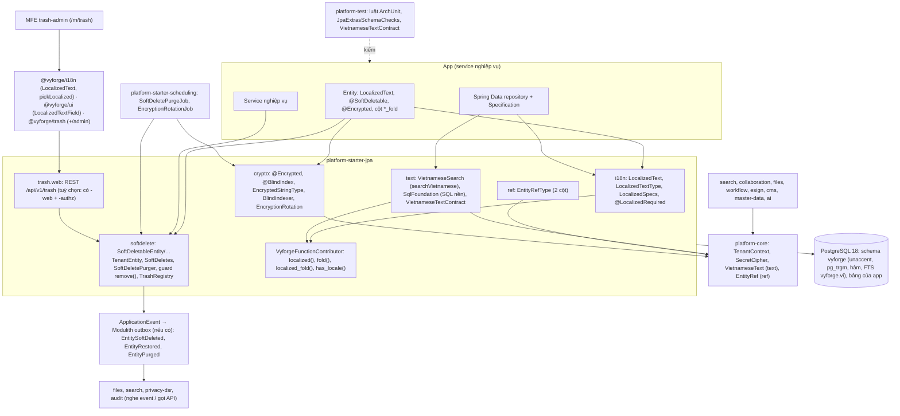
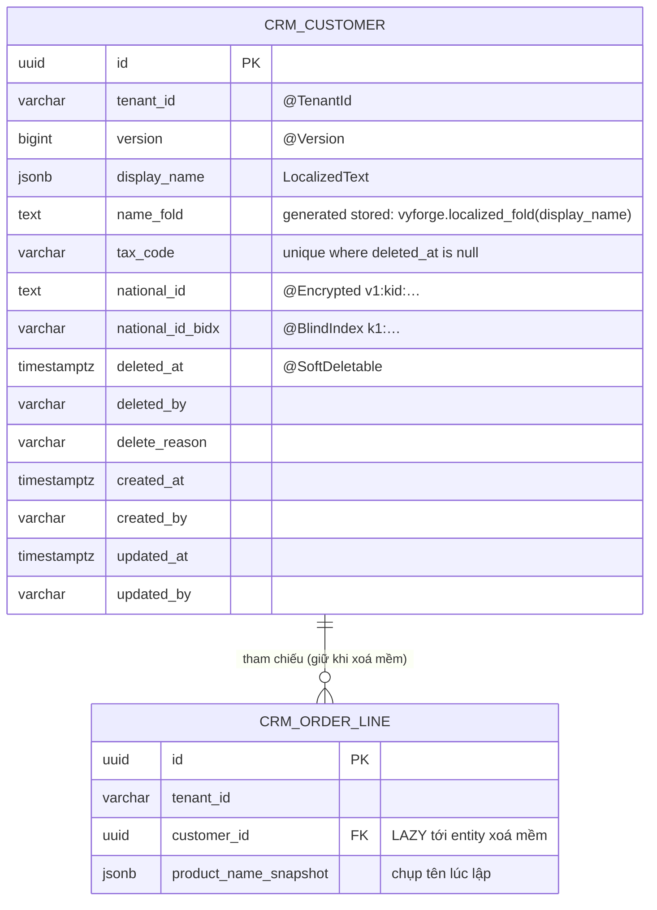

# Thiết kế jpa-extras: dữ liệu đa ngôn ngữ, xoá mềm, tìm tiếng Việt, mã hoá cột trong `platform-starter-jpa`

> Session forge-57, giai đoạn 1 (thiết kế), ngày 27/10/2026. Bổ sung cho [MODULE_PLAN.md](../MODULE_PLAN.md) (dòng `-jpa`:
> "Sau đó: `LocalizedText`, `@SoftDeletable`, tìm kiếm `unaccent` + trigram, mã hoá cột") và
> [gap analysis](../research/2026-10-gap-analysis.md) (mục 1.3 ý 4, mục 2.19, mục 3 dòng search và cms-content, đợt A).
> Theo `module-conventions.md` mục 1–6 (bản trong thư mục brief của phiên điều phối) và kiến trúc admin microfrontend
> của `platform-services.md` (forge-37: mục 0, 4.11–4.12, 5).
> Nền: platform-java `main` (0.12.1-SNAPSHOT: Spring Boot 4.1.1, Hibernate ORM 7.4.5, Flyway 12.4.0, PostgreSQL JDBC 42.7.13).

## Mục lục

0. [Tóm tắt quyết định](#0-tóm-tắt-quyết-định)
1. [Bài toán và phạm vi](#1-bài-toán-và-phạm-vi)
2. [Nghiên cứu](#2-nghiên-cứu)
3. [Kiến trúc](#3-kiến-trúc)
4. [Mô hình dữ liệu](#4-mô-hình-dữ-liệu)
5. [API](#5-api)
6. [Mở rộng](#6-mở-rộng)
7. [Vận hành](#7-vận-hành)
8. [Bảo mật và tuân thủ](#8-bảo-mật-và-tuân-thủ)
9. [Kế hoạch triển khai](#9-kế-hoạch-triển-khai)
10. [Đóng gói và triển khai độc lập](#10-đóng-gói-và-triển-khai-độc-lập)
11. [Lệch quy ước, quyết định đã tự chốt, phụ thuộc tab khác](#11-lệch-quy-ước-quyết-định-đã-tự-chốt-phụ-thuộc-tab-khác)

---

## 0. Tóm tắt quyết định

**Quyết định về module:** không tạo starter mới. Bốn tính năng vào **`platform-starter-jpa`** (thêm 4 package). Hai khối
dùng chung không cần JPA vào **`platform-core`**: `VietnameseText` (chuẩn hoá, bỏ dấu, ký tự thay chữ) và `EntityRef`
(tham chiếu bản ghi nghiệp vụ), vì search, collaboration, files, workflow, esign, cms, master-data đều cần mà không phải
module nào cũng có `-jpa` ở đường gọi (mục 5.6, 5.7). Kèm phần nhỏ ở `platform-test` (luật ArchUnit, test hợp đồng), `platform-starter-scheduling` (hai job), `@vyforge/i18n` và
`@vyforge/ui` (kiểu và component đa ngôn ngữ). Thêm **một** đơn vị triển khai mới cho phần quản trị: thùng rác dùng chung
(`@vyforge/trash`, admin MFE `trash-admin`), vì đây là màn hình duy nhất mà người vận hành và tenant admin cần thao tác.
Không bỏ và không gộp module nào.

| # | Quyết định | Lý do ngắn |
|---|---|---|
| D1 | `LocalizedText` là **value object bất biến**, lưu **một cột `jsonb`** `{"vi": "...", "en": "..."}`, map tự động (không cần annotation trên field) | Cách Odoo 16+ và Spatie đã chọn: không thêm bảng, không join, đọc một lần. Cột theo ngôn ngữ (django-modeltranslation) buộc đổi schema khi thêm ngôn ngữ; bảng dịch (ABP, django-parler) buộc join mỗi truy vấn |
| D2 | Fallback: đúng tag → ngôn ngữ gốc (`en-US` → `en`) → chuỗi mặc định cấu hình (`vi`, `en`) → giá trị đầu tiên khác rỗng theo thứ tự khoá. **Cùng một quy tắc** ở Java (`LocalizedText.resolve`), SQL (`vyforge.localized(jsonb, variadic text[])`) và TypeScript (`pickLocalized`) | Sắp xếp và lọc ở DB phải cho cùng chuỗi mà giao diện hiển thị |
| D3 | Truy vấn và sắp xếp theo locale bằng **hàm HQL** đăng ký qua `FunctionContributor` (`localized()`, `fold()`, `localized_fold()`) và hàm SQL `IMMUTABLE`, nên đánh **index biểu thức** được, sắp theo collation ICU `vi-VN-x-icu` | Đã kiểm trên PostgreSQL 18.6: index biểu thức trên `vyforge.localized(...) collate "vi-VN-x-icu"` được dùng cho `order by … limit` |
| D4 | **Xoá mềm bằng Hibernate filter** (`@FilterDef(autoEnabled = true, applyToLoadByKey = true)`), **không dùng `@SoftDelete` của Hibernate**. Xoá mềm là một `UPDATE` thường qua service `SoftDeletes` | `@SoftDelete` vẫn `@Incubating`, không ghi được người xoá và lý do, không có cách đọc lại dòng đã xoá ngoài native SQL. Filter tắt/bật được theo session, nên làm được thùng rác và khôi phục; `UPDATE` thường giữ nguyên `@Version`, auditing, `@Audited`, RLS. Đã spike trên Hibernate 7.4.5 (mục 2.3) |
| D5 | `EntityManager.remove()` trên entity xoá mềm **bị chặn** (`HardDeleteNotAllowedException`), trừ trong phạm vi `SoftDeletes.purge…` | Không ai xoá cứng nhầm qua `repository.deleteById` |
| D6 | Purge theo retention là **service thuần** `SoftDeletePurger` trong `-jpa`. Job định kỳ nằm ở `platform-starter-scheduling` (`@ClusterScheduled(perTenant = true)`), bật khi có cả hai | `-scheduling` đã phụ thuộc `-jpa`, nên `-jpa` không thể phụ thuộc ngược (vòng Maven) |
| D7 | Tìm tiếng Việt: hàm SQL trong **schema riêng `vyforge`**: `vyforge.immutable_unaccent(text)`, `vyforge.fold(text)`, `vyforge.localized(jsonb, variadic text[])`, `vyforge.localized_fold(jsonb)`, cấu hình FTS `vyforge.vi`. Extension `unaccent`, `pg_trgm` (và `btree_gin` tuỳ chọn). Tạo bằng **"SQL nền" chạy trước Flyway của app** | Migration của app (cột sinh sẵn, index) cần hàm có sẵn trước. Đặt ở schema riêng thì Flyway của app vẫn thấy schema của nó rỗng ở database mới (lý do `StarterSchemaMigrator` phải chạy sau Flyway của app) |
| D8 | `VietnameseText` nằm ở **`platform-core`** (`com.vyforge.platform.core.text`). Quy tắc bỏ dấu ở Java (`VietnameseText.fold`) **đọc chính file `unaccent.rules` của PostgreSQL 18** (nhúng vào jar, PostgreSQL License), có test hợp đồng Java ↔ SQL trên PostgreSQL thật, và kiểm nhanh lúc khởi động | Search (forge-41) cần cùng kết quả ở Java và SQL. Chép quy tắc tay sẽ lệch (file có 2.661 quy tắc, gồm `½` → ` 1/2`, `ß` → `ss`, xoá dấu kết hợp U+0300…) |
| D9 | `searchVietnamese` = `Specification` dùng cột sinh sẵn `*_fold` + GIN trigram + `LIKE`; từ khoá dưới 3 ký tự chuyển sang so tiền tố hoặc bị từ chối | Đã kiểm: `LIKE '%da nang%'` dùng GIN trigram (≈9 ms trên 200.000 dòng); từ khoá 2 ký tự thì quét cả bảng |
| D10 | `@Encrypted("<purpose>")` là annotation mang `@Type(EncryptedStringType.class)` (Hibernate `AnnotationBasedUserType`), mã hoá bằng `SecretCipher` của platform-core. AAD = `jpa:<purpose>:<tenant>` với tenant **lấy từ session Hibernate** | `UserType` nhận `WrapperOptions.getSession().getTenantIdentifierValue()` (đã spike). Bản mã chép sang tenant khác hay cột khác thì không giải mã được. `purpose` bắt buộc ghi tay để đổi tên class/field không làm hỏng dữ liệu |
| D11 | Tra cứu bằng giá trị đã mã hoá (CCCD, số điện thoại) qua **blind index** HMAC-SHA256 trong cột riêng (`@BlindIndex`), khoá HMAC tách khỏi khoá mã hoá. **Không** làm mã hoá deterministic | Rails khuyên deterministic chỉ khi cần truy vấn và không xoay khoá được; blind index (CipherSweet, `blind_index` của ankane) giữ bản mã ngẫu nhiên và vẫn tìm được |
| D13 | `VietnameseText` có ba tầng tách bạch: `normalize` (NFC, đặt dấu thanh kiểu truyền thống `hòa`, `thủy`, chữ thường `vi`, **giữ dấu**), `unaccent`/`fold` (**khớp từng ký tự** với `vyforge.immutable_unaccent`/`vyforge.fold`), và `matchForm` (dạng để so khớp bộ lọc: thêm ký tự thay chữ `0→o`, `3→e`, `@→a`…, bỏ ký tự chèn, gộp chữ lặp; **có bảng vị trí** về chuỗi gốc). Chỉ `unaccent`/`fold` có bản SQL | Search cần `normalize`+`fold`; bộ lọc của collaboration cần `matchForm` có vị trí để che đúng đoạn. Ký tự thay chữ **không** đưa vào `fold` vì sẽ phá mã và số ("DH-2026" thành "dh-zoze") và lệch SQL |
| D14 | `EntityRef(type, id)` là record trong **`platform-core`** (`com.vyforge.platform.core.ref`). `type` = `<service>:<resource>` (cùng dạng action catalog và `vrn` của authz), `id` chuỗi an toàn URL ≤ 200 ký tự. Chuỗi chuẩn `crm:order/01J9…` (= `vrn` bỏ tiền tố `vrn:`). Lưu hai cột `<prefix>_type varchar(100)` + `<prefix>_id varchar(200)`; `-jpa` có `EntityRefType` (`CompositeUserType`, tự đăng ký) | files đã có `EntityRef`, collaboration và workflow có `SubjectRef` cùng ý, esign và cms dùng `EntityRef` của files: gom về một kiểu thì event, quyền (`vrn`), topic realtime, index search nối được với nhau mà không chuyển đổi |
| D12 | Optimistic lock, cột audit, `@TenantId`, RLS **giữ nguyên**. `TENANT_ISOLATION` vẫn chạy đúng; thêm 4 luật ArchUnit tuỳ chọn và một bộ kiểm schema | Mục 8.4 |

---

## 1. Bài toán và phạm vi

### 1.1 Bài toán

Bốn việc đã hứa trong MODULE_PLAN cho `-jpa` nhưng chưa có trong code (grep `platform-java` ngày 27/10/2026: chỉ có
`BaseEntity`, `TenantEntity`, RLS, `StarterSchemaMigrator`). Thiếu chúng thì mỗi module tự làm một bản:

- cms-content (forge-43) đã ghi "nếu `-jpa` chưa có thì CMS tạo hàm cùng tên" (`immutable_unaccent`);
- ai (forge-48) đã viết hàm riêng `vyforge_unaccent`;
- search (forge-41) cần `VietnameseText` ở Java cho cùng kết quả với SQL; collaboration cần bộ chuẩn hoá có ký tự thay chữ
  cho bộ lọc, ai có `VietnameseTextNormalizer` riêng: ba bản chuẩn hoá tiếng Việt nếu không gom;
- files có `EntityRef`, collaboration và workflow mỗi module một `SubjectRef`, cùng là "loại + id bản ghi" nhưng khác
  kiểu và khác giới hạn độ dài cột (100/255, 150/200);
- webhooks dùng `LocalizedText` trong `EventTypeDefinition`;
- files, api-access tự thêm `deleted_at` và thùng rác.

### 1.2 Phạm vi

| Có | Để bản sau (mục 9.4) |
|---|---|
| `LocalizedText`: kiểu, map JPA/jsonb, Jackson, Bean Validation, hàm HQL, sắp xếp theo collation, index | Quy trình dịch (thuộc `translations`, P2), dịch máy |
| `@SoftDeletable`: filter tự động, xoá mềm có người xoá và lý do, khôi phục, thùng rác, purge theo retention, chặn xoá cứng, event | Xoá mềm theo cây quan hệ tự động (chỉ có hook) |
| Tìm tiếng Việt: extension, hàm SQL, cấu hình FTS, `searchVietnamese`, sinh cột và index | Xếp hạng, typo, synonym, facet, Telex/VNI (thuộc search, forge-41) |
| `platform-core`: `VietnameseText` (`normalize`, `unaccent`, `fold`, `tokens`, `matchForm` có ký tự thay chữ và bảng vị trí) | Chuyển font cũ TCVN3/VNI sang Unicode (giữ ở ai, chuyển vào core khi có module thứ hai cần); danh sách từ cấm (thuộc collaboration) |
| `platform-core`: `EntityRef` (định dạng, kiểm tra, parse, `vrn`, topic path, Jackson); `-jpa`: map hai cột | Kiểm bản ghi có tồn tại (thuộc SPI của từng module: `AttachmentAccessPolicy`, `SubjectAdapter`) |
| `@Encrypted`, `@BlindIndex`, xoay khoá (job mã hoá lại), che trong log | Mã hoá kiểu số/ngày (bản đầu chỉ `String`, `byte[]`); crypto-shredding theo chủ thể |
| Admin: thùng rác dùng chung (`@vyforge/trash`, MFE `trash-admin`) | Màn quản lý ngôn ngữ của tenant |

### 1.3 Kịch bản nghiệp vụ phải đáp ứng

| # | Kịch bản | Tính năng | Yêu cầu rút ra |
|---|---|---|---|
| K1 | **Danh mục sản phẩm song ngữ** cho shop xuất khẩu: tên, mô tả có `vi` và `en`; khách nước ngoài xem `en`, thiếu bản `en` thì hiện `vi` | `LocalizedText` | Fallback; API trả cả object hoặc giá trị đã chọn |
| K2 | **Danh mục dùng chung** (master-data, forge-38): tên tỉnh/thành, ngân hàng, đơn vị tính bằng `vi`/`en`; sắp theo tên **đúng thứ tự tiếng Việt** (A, Ă, Â, B, …, Đ sau D) | `LocalizedText` + collation | `order by localized(name,'vi') collate "vi-VN-x-icu"` có index |
| K3 | **Nhãn metadata** của CMS (tên content type, nhãn field, nhãn enum) và mô tả event type của webhooks | `LocalizedText` | Kiểu nhỏ, dùng cả trong record không phải entity, Jackson ra `{vi,en}` |
| K4 | **Tìm khách hàng không dấu** trong màn admin: gõ "nguyen van a" ra "Nguyễn Văn A"; gõ "duong le loi" ra "Đường Lê Lợi" | Tìm tiếng Việt | `đ → d`; chuỗi NFD (gõ trên macOS) cũng ra kết quả; dùng index |
| K5 | **Tìm theo một phần mã hoặc tên** ("1234" trong "DH-2026-001234", "nẵng" trong "Đà Nẵng") | Tìm tiếng Việt | Trigram cho `LIKE '%…%'`; từ khoá ngắn xử lý riêng |
| K6 | **Xoá nhầm khách hàng rồi khôi phục**: nhân viên xoá, trưởng nhóm vào thùng rác khôi phục trong 30 ngày, có lý do và người xoá | `@SoftDeletable` | `deleted_by`, `delete_reason`; quyền riêng cho khôi phục; audit |
| K7 | **Mã số thuế / email không trùng** giữa các bản ghi còn sống, nhưng cho tạo lại sau khi bản cũ đã vào thùng rác | `@SoftDeletable` | Unique index một phần `where deleted_at is null` (có kiểm tự động) |
| K8 | **Hoá đơn tham chiếu sản phẩm đã ngừng bán**: sản phẩm bị xoá mềm, hoá đơn cũ vẫn mở và in được tên hàng | `@SoftDeletable` | Đọc tham chiếu tới bản ghi đã xoá trong phạm vi `includingDeleted`; khuyến nghị chụp tên hàng vào dòng hoá đơn |
| K9 | **Hết hạn thùng rác thì xoá hẳn**, nhưng **không xoá** bản ghi đang bị giữ (legal hold) hoặc chưa hết thời hạn lưu theo luật (chứng từ kế toán) | Purge | Retention theo entity và theo tenant; hook `PurgeVeto`; event `EntityPurged` cho files xoá file đính kèm |
| K10 | **Yêu cầu xoá dữ liệu cá nhân** (Luật 91/2025 Điều 14): xoá mềm chưa đủ vì còn khôi phục được | Purge + privacy-dsr | privacy-dsr gọi `purgeNow`/ẩn danh ngay, không chờ retention |
| K11 | **CCCD, số tài khoản ngân hàng, số BHXH** lưu mã hoá; DBA đọc bảng không thấy giá trị; tổng đài vẫn **tra theo số CCCD** | `@Encrypted` + `@BlindIndex` | Tra bằng HMAC; không lộ trong log |
| K12 | **Xoay khoá mã hoá hằng năm** hoặc khi nghi lộ khoá: thêm khoá mới, dữ liệu cũ vẫn đọc được, job mã hoá lại dần | `@Encrypted` | `needsRotation`, job theo lô, metric tiến độ |
| K13 | **Bản on-prem cho cơ quan nhà nước**: DBA không cấp quyền `CREATE` cho user app, tự chạy file SQL | SQL nền | `vyforge.jpa.text.install=false`, file gộp cho DBA, kiểm lúc khởi động và báo lỗi rõ |
| K14 | **SaaS nhiều tenant**: tenant A không thấy thùng rác, kết quả tìm, giá trị giải mã của tenant B, kể cả khi DBA chép bản mã giữa hai tenant | Tất cả | Filter tenant + filter xoá mềm cùng lúc; AAD có tenant |
| K15 | **Thêm ngôn ngữ thứ ba** (`zh` cho đối tác Trung Quốc, `ko` cho khách Hàn) mà không sửa schema | `LocalizedText` | `vyforge.jpa.localized-text.locales` cấu hình, không migration |
| K16 | **Một hoá đơn có file đính kèm, bình luận, quy trình duyệt, hợp đồng ký số và nằm trong kết quả tìm kiếm**: năm module chỉ tới cùng một bản ghi | `EntityRef` | Một kiểu, một chuỗi chuẩn `billing:invoice/01J9…`; event `EntitySoftDeleted`/`EntityPurged` mang `EntityRef` nên files, collaboration, search, workflow nghe chung một cách |
| K17 | **Bộ lọc bình luận** chặn "ch0 ch3t", "đ.m", "nguuuu" mà không chặn "admin", "DH-2026-0001", và che đúng đoạn trong câu gốc có dấu | `VietnameseText.matchForm` | Ký tự thay chữ chỉ trong từ có chữ cái; bảng vị trí về chuỗi gốc |
| K18 | **Dữ liệu nhập từ nhiều nguồn** (Excel gõ Windows, iPhone gửi NFD, kiểu dấu `hoà`/`hòa`) phải trùng khi so trùng tên khách, tên tag | `VietnameseText.normalize` | Một dạng chuẩn có dấu để lưu khoá `name_norm`, so bằng nhau |

---

## 2. Nghiên cứu

Kiểm ngày 27/10/2026. Version lấy qua GitHub Releases/Tags API và file LICENSE (`gh api repos/<repo>/releases/latest`,
`.../license`), tài liệu chính thức qua WebFetch. Hành vi của PostgreSQL và Hibernate **chạy thử thật** (mục 2.3).

### 2.1 So sánh hệ thống tham khảo

| Hệ thống | Version, license | Mô hình dữ liệu | API | Mạnh | Yếu |
|---|---|---|---|---|---|
| **Odoo** — field `translate=True` | 19 (09/2025), LGPL-3.0 ([LICENSE nhánh 19.0](https://github.com/odoo/odoo/blob/19.0/LICENSE)) | Từ 16.0, cột của field dịch là **JSONB** `{"en_US": …, "vi_VN": …}`, `en_US` là fallback; bảng `ir_translation` bị bỏ ([changelog ORM saas-16.3](https://www.odoo.com/documentation/saas-16.3/developer/reference/backend/orm/changelog.html), [PR #97692](https://github.com/odoo/odoo/pull/97692)) | Đọc theo `context['lang']` | Một cột, không join; Odoo chuyển cả ERP sang mô hình này | Bản nâng cấp v16 làm mất bản dịch của field module tự viết ([upgrade-util #131](https://mergebot.odoo.com/odoo/upgrade-util/pull/131)): bài học là migration dữ liệu phải có công cụ |
| **Odoo** — field `active` | 19 | Lưu trữ (archive) bằng cờ `active`, mọi `search` tự lọc, `with_context(active_test=False)` để thấy | Context flag | Đơn giản | Không có người xoá, ngày xoá, hạn thùng rác |
| **Spatie laravel-translatable** | 6.15.0 (19/10/2026), MIT | Cột JSON theo field | `getTranslation('name','en')`, fallback cấu hình, `whereLocale('name','en')`, `whereLocales` ([README](https://github.com/spatie/laravel-translatable)) | API gọn, có truy vấn theo locale | Sắp xếp và index theo locale để cho người dùng tự viết |
| **django-modeltranslation** / **django-parler** | 0.20.6 (07/09/2026), BSD-3 / 2.4 (14/05/2026), Apache-2.0 | modeltranslation: **một cột mỗi ngôn ngữ** (`name_vi`, `name_en`); parler: **bảng dịch** riêng | Field ảo theo ngôn ngữ hiện tại | modeltranslation: index thường; parler: thêm ngôn ngữ không đổi schema | modeltranslation: thêm ngôn ngữ phải migration mọi bảng; parler: join mỗi truy vấn |
| **ABP Framework** | 10.7.0 (06/10/2026), LGPL-3.0 | `ISoftDelete` (`IsDeleted`), filter toàn cục trên EF Core; `IMultiLingualObject<TTranslation>` là **bảng dịch** ([data filtering](https://abp.io/docs/latest/framework/infrastructure/data-filtering), [multi-lingual](https://github.com/abpframework/abp/blob/dev/docs/en/multi-lingual-entities.md)) | `using (dataFilter.Disable<ISoftDelete>())`, `HardDeleteAsync` | `IDataFilter` lồng nhau, khôi phục trạng thái sau `using` | Gói multi-lingual **không còn phát hành trên NuGet** (PR #8271), phải chép mã; soft delete chỉ có cờ, không có retention |
| **Laravel Eloquent** `SoftDeletes` + `Prunable` | 13.38.0, MIT | Cột `deleted_at` | `withTrashed()`, `onlyTrashed()`, `restore()`, `forceDelete()`, trait `Prunable`/`MassPrunable` + lệnh `model:prune` chạy theo lịch ([docs 12.x](https://laravel.com/docs/12.x/eloquent#soft-deleting)) | API thùng rác đầy đủ, purge là khái niệm chính thức | `delete()` âm thầm thành xoá mềm, dễ nhầm; unique index để người dùng tự lo |
| **Hibernate ORM** `@SoftDelete` / `@Filter` | 7.4.5 (Boot 4.1.1 quản lý; mới nhất 7.4.14, 25/10/2026), Apache-2.0 | `@SoftDelete(strategy = DELETED/ACTIVE/TIMESTAMP)` từ 6.4, `@Incubating`; converter không dùng được với `TIMESTAMP` ([javadoc 7.2](https://docs.hibernate.org/orm/7.2/javadocs/org/hibernate/annotations/SoftDelete.html)). `@FilterDef(autoEnabled, applyToLoadByKey)` ([javadoc](https://docs.hibernate.org/orm/7.2/javadocs/org/hibernate/annotations/FilterDef.html)) | `remove()` thành `UPDATE`; filter: `session.enableFilter/disableFilter` | Có sẵn trong ORM | `@SoftDelete`: không ghi được ai xoá, không đọc được dòng đã xoá ngoài native SQL; `applyToLoadByKey` vẫn `@Incubating` |
| **Rails Active Record Encryption** | Rails 8.1.4, MIT | Bản mã kèm metadata, base64 | `encrypts :email, deterministic: true` ([guide 8.1](https://guides.rubyonrails.org/active_record_encryption.html)) | Mặc định không deterministic; nhiều khoá, khoá cũ vẫn giải mã; tự che trong log; chế độ `support_unencrypted_data` cho giai đoạn chuyển đổi | Deterministic không xoay khoá được; unique chỉ chạy với deterministic; bản mã tới ~255 byte overhead |
| **CipherSweet** / **ankane lockbox + blind_index** | v4.10.0 (05/03/2026), ISC / 2.2.0 (04/04/2026) + 2.8.1 (29/06/2026), MIT | Bản mã ngẫu nhiên + cột **blind index** (hash có khoá) | `BlindIndex` có transformation (lowercase…), độ dài bit cấu hình; slow mode Argon2id/PBKDF2 ([internals](https://ciphersweet.paragonie.com/internals/blind-index)) | Tra cứu bằng bằng-nhau mà bản mã vẫn ngẫu nhiên; độ dài bit để cân rủi ro lộ | Thêm cột; giá trị ít entropy (số điện thoại) phụ thuộc hoàn toàn vào bí mật của khoá |
| **PostgreSQL** `unaccent`, `pg_trgm`, ICU | 18.6 (bản "Current" của tài liệu), PostgreSQL License | `unaccent` là dictionary + hàm; `pg_trgm` có opclass GIN/GiST cho `LIKE/ILIKE/~`, `%`, `<%`, `similarity()` ([unaccent](https://www.postgresql.org/docs/current/unaccent.html), [pg_trgm](https://www.postgresql.org/docs/current/pgtrgm.html)) | SQL | Cả hai là extension **trusted**: chủ database có quyền `CREATE` tự cài được, không cần superuser | Hàm `unaccent()` là `STABLE` nên không dùng thẳng trong index hay cột sinh sẵn; mẫu không có trigram (dưới 3 ký tự) thì quét cả index |

Cho hai khối của `platform-core` (kiểm 27/10/2026):

| Tham khảo | Version, license | Điểm liên quan | Rút ra |
|---|---|---|---|
| **Rails** polymorphic association | Rails 8.1.4, MIT ([guide](https://guides.rubyonrails.org/association_basics.html)) | Tham chiếu đa hình lưu **hai cột** `imageable_type` (tên class) + `imageable_id`, index ghép `[type, id]` | Học hai cột và index ghép. **Không** lưu tên class Java (đổi tên class làm hỏng dữ liệu): `type` là tên nghiệp vụ ổn định |
| **Odoo** `res_model` + `res_id` (`ir.attachment`, `mail.message`, `mail.activity`) | 19, LGPL-3.0 | Cùng mô hình hai cột, `res_model` là tên model (`sale.order`) | Collaboration đã học theo (C1). Tên model ổn định, không phải tên class |
| **Google AIP-122** resource names | AIP, CC-BY-4.0 ([aip.dev/122](https://google.aip.dev/122)) | Tên dạng đường dẫn không có `/` đầu; đoạn cuối không chứa `/`; ký tự an toàn DNS (RFC 1123), không dùng chữ hoa cho ID người dùng đặt; Unicode thì phải NFC; "full name" chỉ dùng khi tham chiếu vượt API | Chuỗi chuẩn `crm:order/<id>` (tương đương tên tương đối), `vrn:` là bản đầy đủ. `id` không chứa `/`. ID hệ thống (UUID, ULID) giữ nguyên hoa/thường |
| **authz `Resources`** (platform-java, đang có) | 0.12.1 | `vrn:<service>:<resource>/<id>`, `Resources.parse` → `Ref(type, id)` | `EntityRef` thay `Resources.Ref` (giữ `Ref` làm alias deprecated một bản), chung định dạng `type` |
| **Unicode UAX #15** (NFC) và `java.text.Normalizer` | Unicode 17; JDK 25 | NFC là dạng hợp chuẩn; chuỗi gõ trên macOS thường là NFD | `normalize` luôn NFC trước |
| **Unicode UTS #39** (confusables, `skeleton`) | 18.0.0, rev. 34, 27/08/2026 ([tr39](https://www.unicode.org/reports/tr39/)) | `skeleton` là dạng **chỉ để so khớp nội bộ**, không để hiển thị; hai chuỗi giống nhau khi skeleton bằng nhau | `matchForm` theo đúng tinh thần đó: dạng chỉ để so, không lưu, không hiển thị. Bản đầu **không** gộp ký tự giả dạng Cyrillic/Hy Lạp (để bản sau, dùng bảng `confusables.txt`) |
| Kiểu đặt dấu thanh cũ/mới | [Wikipedia: Vietnamese alphabet](https://en.wikipedia.org/wiki/Vietnamese_alphabet) | Kiểu cũ đặt dấu gần giữa từ (`hóa`, `hủy`); kiểu mới đặt trên nguyên âm chính (`hoá`, `huỷ`). Cả hai đều gặp trong dữ liệu thật | `normalize` đưa về **kiểu cũ** (`hòa`, `thủy`, `khỏe`), như bảng của search §3.4; sau `fold` thì hai kiểu như nhau |

### 2.2 Học theo và không làm

| Học theo | Từ |
|---|---|
| Một cột JSONB cho field dịch, fallback rõ ràng, thêm ngôn ngữ không đổi schema | Odoo 16+, Spatie |
| `whereLocale`/`hasLocale` để lọc bản ghi còn thiếu bản dịch (màn "chưa dịch") | Spatie |
| Tắt filter theo phạm vi lồng nhau, tự khôi phục trạng thái | ABP `IDataFilter` |
| Thùng rác: `withTrashed`/`onlyTrashed`/`restore`/`forceDelete`, purge là việc định kỳ chính thức | Laravel |
| Bản mã ngẫu nhiên mặc định, nhiều khoá, khoá cũ vẫn giải mã, che trong log, chế độ chấp nhận dữ liệu chưa mã hoá khi chuyển đổi | Rails |
| Blind index có khoá riêng, chuẩn hoá trước khi băm | CipherSweet, `blind_index` |

| Không làm | Lý do |
|---|---|
| Bảng dịch riêng (ABP, parler) cho dữ liệu thường | Join mỗi truy vấn; ABP đã ngừng phát hành gói này. Nội dung có quy trình riêng theo locale (CMS: draft, duyệt, publish theo locale) thì dùng dòng theo locale — quyết định của cms-content, không phải `LocalizedText` |
| `delete()` âm thầm thành xoá mềm (Laravel, Hibernate `@SoftDelete`) | Người đọc code không biết dòng còn trong DB; chọn chặn `remove()` và gọi rõ `softDeletes.delete(...)` (D5) |
| Mã hoá deterministic | Không xoay khoá được (Rails), lộ tần suất giá trị; dùng blind index |
| `pgcrypto` / `@ColumnTransformer(read = "pgp_sym_decrypt(...)")` | Khoá phải gửi xuống DB trong câu SQL, lộ qua log câu lệnh và `pg_stat_statements` |
| Collation ICU không tất định (`deterministic = false`) để so không dấu | Đã kiểm: với locale `vi-VN-u-ks-level1`, `'Nguyễn' = 'nguyen'` và `'Đức' = 'duc'` đều **false** (tiếng Việt coi `ê`, `đ` là chữ riêng ở mức primary). Locale `und-u-ks-level1` thì true, nhưng `LIKE` không chạy trên collation không tất định ở nhiều phiên bản và không dùng được GIN trigram |
| Tự viết bảng bỏ dấu ở Java | Dễ lệch với PostgreSQL; đọc chính `unaccent.rules` (D8) |
| Ký tự thay chữ (`0→o`) trong `fold` hoặc trong hàm SQL | Phá mã, số điện thoại, số tiền; chỉ dùng cho bộ lọc (`matchForm`) |
| Lưu tên class Java làm `type` của `EntityRef` (Rails) | Đổi tên hay chuyển package làm hỏng dữ liệu và event đã phát |

### 2.3 Kiểm thật (PostgreSQL 18.6 trong Docker `postgres:18`, Hibernate 7.4.5)

| Câu hỏi | Kết quả |
|---|---|
| `unaccent('Đà Nẵng đường Nguyễn Huệ ỳ ỷ ỹ ỵ Ơ Ư')` | `Da Nang duong Nguyen Hue y y y y O U`: `đ/Đ` được xử lý |
| Chuỗi NFD (`normalize('Nguyễn Huệ', NFD)`, 14 ký tự) | `unaccent` → `Nguyen Hue`: file quy tắc có dòng xoá dấu kết hợp U+0300… |
| `unaccent('hoà')`, `unaccent('hòa')` | đều `hoa`: kiểu đặt dấu cũ/mới không ảnh hưởng bản đã bỏ dấu |
| Độ biến động hàm | `unaccent`: `provolatile = s` (STABLE). Cột sinh sẵn dùng hàm bọc `IMMUTABLE` chạy được |
| Cột sinh sẵn `VIRTUAL` (mới ở PG 18) với hàm người dùng | **Lỗi**: "Virtual generated columns that make use of user-defined functions are not yet supported" → luôn viết `STORED` |
| `show_trgm('Nguyễn Văn')` (database `en_US.utf8`) | Chữ có dấu vẫn là ký tự chữ (trigram dạng byte `0x8d23f9`), nhưng không khớp bản không dấu → trigram phải chạy trên chuỗi đã `fold` |
| GIN trigram trên `vyforge.localized_fold(name)` (200.000 dòng, cột sinh sẵn) | `LIKE '%da nang%' AND LIKE '%so 1234%'` dùng Bitmap Index Scan, 9,3 ms; index 9,2 MB / bảng 29 MB. `LIKE '%ab%'` (2 ký tự) → Parallel Seq Scan |
| GIN `(tenant_id, name_fold gin_trgm_ops)` với `btree_gin` | Dùng được, lọc tenant ngay trong index |
| Index biểu thức `(vyforge.localized(name,'vi','en')) collate "vi-VN-x-icu"` | `order by … limit 10` dùng Index Scan; hàm SQL được inline mà vẫn khớp index |
| Thứ tự `vi-VN-x-icu` | `Anh, Ảnh, Ánh, Bình, Dũng, Đức, Ô, Ông, Ơn, Út, Ưng` (đúng); collation `C` cho `… Út Đức Ơn Ưng` (sai) |
| Extension trusted | `unaccent`, `pg_trgm`, `btree_gin`, `pgcrypto`, `citext` đều `trusted = t`. User chủ database (không superuser) `create extension` được; user không có quyền `CREATE` gặp `create extension if not exists unaccent` đã cài thì chỉ NOTICE, không lỗi |
| Extension trong schema `vyforge` | Opclass dùng tên đầy đủ `vyforge.gin_trgm_ops`; `LIKE` là toán tử lõi nên không cần đặt `search_path` |
| Hibernate: `@Filter` đặt trên `@MappedSuperclass` | Kế thừa xuống entity; câu SQL có `deleted_at is null and tenant_id = ?` (cả trong join) |
| `autoEnabled = true`, `applyToLoadByKey = true` | Không cần `enableFilter`; `find()` bản ghi đã xoá trả `null` |
| Quan hệ `@ManyToOne` **EAGER** tới bản ghi đã xoá | `EntityFilterException` khi load bản ghi con |
| Quan hệ **LAZY** tới bản ghi đã xoá | Load con được; truy cập cha → `ObjectNotFoundException`. Trong phạm vi tắt filter thì đọc được |
| Tắt filter, sửa `deleted_at = null` (khôi phục) | `UPDATE … where id = ? and version = ?`: optimistic lock vẫn chạy; tenant khác thấy 0 dòng |
| `UserType` đọc tenant | `WrapperOptions.getSession().getTenantIdentifierValue()` có giá trị ở cả `nullSafeSet` và `nullSafeGet`; `DynamicParameterizedType` cho biết class và tên property |

### 2.4 Văn bản pháp lý liên quan (bản hiện hành)

| Văn bản | Tình trạng | Điểm dùng trong thiết kế | Nguồn |
|---|---|---|---|
| Luật Bảo vệ dữ liệu cá nhân 91/2025/QH15 | Thông qua 26/06/2025, hiệu lực 01/01/2026 | Điều 2: mã hoá, giải mã là "xử lý dữ liệu cá nhân"; dữ liệu đã mã hoá **vẫn là dữ liệu cá nhân**. Điều 14 khoản 3: xoá phải dùng biện pháp an toàn, ngăn khôi phục trái phép → **xoá mềm không phải là xoá** theo luật (K10) | [LexData (tóm tắt, không phải toàn văn)](https://lexdata.vn/van-ban-phap-luat/luat-bao-ve-du-lieu-ca-nhan-2025/), [TVPL](https://thuvienphapluat.vn/van-ban/Bo-may-hanh-chinh/Luat-Bao-ve-du-lieu-ca-nhan-2025-so91-2025-QH15-625628.aspx); đối chiếu với bảng pháp lý của privacy-dsr (forge-44) |
| NĐ 356/2025/NĐ-CP | Ban hành 31/12/2025, hiệu lực 01/01/2026 (Điều 42), thay NĐ 13/2023 | Điều 4 khoản 2: dữ liệu nhạy cảm phải có phân quyền và biện pháp bảo mật. Điều 9 khoản 2 điểm c: chính sách **lưu trữ, xoá, huỷ**. Điều 11 khoản 2 điểm a: chỉ dùng thuật toán mã hoá, băm an toàn. Điều 12 khoản 4: dữ liệu trên điện toán đám mây **phải mã hoá khi lưu và khi truyền**. Điều 5 khoản 4: yêu cầu xoá phản hồi trong 2 ngày làm việc, thực hiện trong 20 ngày | [hethongphapluat.com (toàn văn)](https://hethongphapluat.com/nghi-dinh-356-2025-nd-cp-huong-dan-luat-bao-ve-du-lieu-ca-nhan.html), [EY](https://www.ey.com/vi_vn/technical/tax/tax-and-law-updates/nghi-dinh-so-356-2025-nd-cp-quy-dinh-chi-tiet-mot-so-dieu-va-bien-phap-thi-hanh-luat-bao-ve-du-lieu-ca-nhan) |
| NĐ 330/2026/NĐ-CP (xử phạt an ninh mạng và bảo vệ dữ liệu cá nhân) | Hiệu lực 19/08/2026 | Biện pháp khắc phục "xoá dữ liệu xử lý trái pháp luật": purge phải chứng minh được (event + audit) | Theo bảng đã kiểm của privacy-dsr ([vanban.chinhphu.vn](https://vanban.chinhphu.vn/?pageid=27160&docid=219266)) |
| Luật Kế toán 88/2015/QH13 | Đang hiệu lực | Chứng từ, sổ kế toán có thời hạn lưu tối thiểu → retention của entity chứng từ dài hơn hạn thùng rác; `PurgeVeto` chặn purge | Theo privacy-dsr (`Retained(LEGAL_OBLIGATION, "Luật Kế toán 88/2015")`); thời hạn cụ thể do pháp chế dự án chốt |

Mã hoá cột **không** thay cho các biện pháp khác của NĐ 356 (phân quyền, MFA, giám sát): nó chỉ chống lộ qua bản sao DB,
backup, DBA và log. Thiết kế không khẳng định "tuân thủ" thay pháp chế của dự án.

---

## 3. Kiến trúc

### 3.1 Thành phần



Năm package mới trong `com.vyforge.platform.jpa`: `i18n`, `softdelete`, `text`, `crypto`, `ref`, cộng `trash.web`. Hai
package mới trong `com.vyforge.platform.core`: `text` (`VietnameseText`), `ref` (`EntityRef`), không thêm phụ thuộc Maven
cho core (file quy tắc là resource; `EntityRef` là record nên Jackson ghi/đọc `{"type","id"}` không cần annotation). Không phụ
thuộc mới bắt buộc. `platform-starter-authz`, `spring-webmvc` là `optional` (như `spring-security-core` đang làm), dùng
cho REST thùng rác; `-authz` không phụ thuộc `-jpa` nên không có vòng.

### 3.2 Port và adapter

| Port (SPI) | Mặc định | Ai thay / thêm |
|---|---|---|
| `LocaleChain` (chuỗi locale cho request hiện tại) | Từ `LocaleContextHolder` của Spring + `vyforge.jpa.localized-text.fallback` | App có setting ngôn ngữ theo tenant (module `settings`) |
| `SoftDeleteActor` (ai đang xoá) | Dùng chung `AuditorAware` của `BaseEntity` (`sub` của token, ngoài request là `system`) | Hiếm khi thay |
| `SoftDeleteListener<T>` (trước/sau xoá, khôi phục, purge; có thể chặn) | Không có | App: xoá mềm dây chuyền, kiểm còn tham chiếu |
| `PurgeVeto` (cấm purge một bản ghi) | Không có | files (legal hold), privacy-dsr/records (retention theo luật), app |
| `RetentionPolicyResolver` (hạn thùng rác theo entity, tenant) | Annotation `@SoftDeletable(retention)` → `vyforge.jpa.soft-delete.retention` | Module `settings` (tenant tự chọn 30/90 ngày) |
| `BlindIndexNormalizer` | Theo kiểu: `PHONE_VN` (về `84…`), `NATIONAL_ID` (bỏ khoảng trắng), `EMAIL` (lowercase, trim), `EXACT` | App thêm kiểu (mã khách hàng cũ…) |
| `SecretCipher` | `AesGcmSecretCipher` (platform-core) | KMS/HSM adapter sau này, cùng interface |
| `TrashResource` (đăng ký entity hiện trong thùng rác) | Không có (opt-in) | App, module khác |

### 3.3 Luồng: SQL nền lúc khởi động

```mermaid
sequenceDiagram
  autonumber
  participant B as Spring Boot
  participant F as SqlFoundation (database initializer, order -100)
  participant DB as PostgreSQL
  participant AF as Flyway của app (order 0–1)
  participant SM as StarterSchemaMigrator (order 10)
  participant H as EntityManagerFactory

  B->>F: khởi động
  F->>DB: select đã có schema vyforge, version (comment on schema)?
  alt chưa có hoặc version cũ, và vyforge.jpa.text.install=true
    F->>DB: create schema if not exists vyforge
    F->>DB: create extension if not exists unaccent / pg_trgm [/ btree_gin] schema vyforge
    F->>DB: tìm schema thật của extension (pg_extension.extnamespace)
    F->>DB: create or replace function vyforge.immutable_unaccent, fold, localized, localized_fold
    F->>DB: create text search configuration vyforge.vi (nếu chưa có)
    F->>DB: comment on schema vyforge is 'vyforge-jpa-text:1'
  else install=false (DBA tự chạy META-INF/vyforge/sql/jpa-text.sql)
    F->>DB: chỉ kiểm có đủ đối tượng
    DB-->>F: thiếu
    F-->>B: lỗi khởi động: "thiếu vyforge.fold(text); chạy META-INF/vyforge/sql/jpa-text.sql hoặc bật vyforge.jpa.text.install"
  end
  F->>DB: kiểm nhanh VietnameseText.fold == vyforge.fold trên 64 mẫu
  DB-->>F: lệch (vd. DB dùng file quy tắc khác)
  F-->>B: WARN + metric vyforge.jpa.text.fold.mismatch (không chặn khởi động)
  B->>AF: migrate (V__ của app dùng vyforge.fold trong cột sinh sẵn)
  B->>SM: migrate starter (search, cms…)
  B->>H: khởi tạo (ddl-auto=validate)
```

Vì sao trước Flyway của app: migration của app tạo cột `name_fold … generated always as (vyforge.localized_fold(name))
stored` thì hàm phải có trước. Vì sao schema riêng: Flyway của app từ chối migrate schema **không rỗng** mà chưa có bảng
lịch sử (lý do `StarterSchemaMigrator` hiện chạy sau, xem javadoc của nó); đối tượng của mình đặt ở schema `vyforge` thì
schema của app vẫn rỗng ở database mới. Mỗi lần khởi động chỉ tốn một câu `select` khi version đã đúng.

### 3.4 Luồng: xoá mềm, khôi phục, purge

```mermaid
sequenceDiagram
  autonumber
  actor U as Nhân viên
  participant S as CustomerService
  participant SD as SoftDeletes
  participant L as SoftDeleteListener (SPI)
  participant H as Hibernate (filter tenant + vyforge_soft_delete)
  participant E as ApplicationEventPublisher (outbox)
  participant P as SoftDeletePurgeJob (-scheduling, perTenant)
  participant V as PurgeVeto (files, privacy-dsr)

  U->>S: xoá khách hàng 42, lý do "trùng"
  S->>SD: delete(customer, "trùng")
  SD->>L: beforeSoftDelete(customer) (có thể ném SoftDeleteVetoException)
  SD->>H: set deletedAt=now, deletedBy=sub, deleteReason → flush: UPDATE … where id=? and version=?
  SD->>E: EntitySoftDeleted(tenant, "crm:customer", id, actor, purgeAfter)
  Note over H: Từ đây: find(42)=null, mọi query bỏ qua dòng 42
  U->>S: khôi phục (trong 30 ngày)
  S->>SD: restore(Customer.class, 42)
  SD->>H: includingDeleted: find(42); deletedAt=null… → UPDATE có version
  H-->>SD: vi phạm unique (đã có khách hàng mới cùng MST)
  SD-->>S: RestoreConflictException (code JPA_RESTORE_CONFLICT)
  P->>SD: purge(Customer.class, cutoff = now - retention, batch=500)
  SD->>V: allowPurge(ref)? cho từng lô
  V-->>SD: cấm id 7 (legal hold)
  SD->>H: purgeScope: delete … where id in (lô trừ id 7) and deleted_at < cutoff
  SD->>E: EntityPurged(tenant, type, ids)
  Note over E: files xoá file đính kèm, search xoá khỏi index, audit ghi nhận
```

Luồng lỗi chính:

| Tình huống | Xử lý |
|---|---|
| Hai người cùng xoá/khôi phục một bản ghi | `@Version`: người sau nhận `OptimisticLockingFailureException` (Problem Details `409`) |
| Khôi phục vi phạm unique (đã có bản mới cùng khoá) | `RestoreConflictException`, `409`, `code=JPA_RESTORE_CONFLICT`, message vi/en; không đổi dữ liệu |
| Purge gặp khoá ngoại (dòng khác còn tham chiếu) | Lô đó rollback, chia đôi lô thử lại tới mức từng dòng; dòng vẫn lỗi thì bỏ qua, đếm `vyforge.jpa.softdelete.purge.blocked`, log id. Không dừng cả job |
| `repository.deleteById` trên entity xoá mềm | `HardDeleteNotAllowedException` ("dùng SoftDeletes.delete hoặc SoftDeletes.purgeNow") |
| Truy cập quan hệ LAZY tới bản ghi đã xoá | `ObjectNotFoundException` của Hibernate. Đọc trong `softDeletes.includingDeleted(() -> …)` (K8) |
| Job purge chạy khi DB chậm | Lô nhỏ, mỗi lô một transaction; `lockAtMostFor` của ShedLock; dừng an toàn giữa chừng |

### 3.5 Luồng: ghi và đọc cột mã hoá

```mermaid
sequenceDiagram
  autonumber
  participant S as Service
  participant H as Hibernate
  participant T as EncryptedStringType (UserType)
  participant C as SecretCipher (AES-256-GCM)
  participant B as BlindIndexer (HMAC-SHA256)
  participant DB as PostgreSQL

  S->>H: persist(customer{nationalId="001099012345"})
  H->>B: @PrePersist: national_id_bidx = "k1:" + HMAC(k1, "crm.customer.national_id|001099012345")
  H->>T: nullSafeSet(value)
  T->>T: tenant = session.getTenantIdentifierValue() ("acme"); entity có @TenantId
  T->>C: encrypt(value, "jpa:crm.customer.national_id:acme")
  C-->>T: "v1:k2026:…"
  T->>DB: insert … national_id='v1:k2026:…', national_id_bidx='k1:…'
  S->>H: findByNationalIdBidx(blindIndexer.candidates("crm.customer.national_id", "001 099 012 345"))
  H->>DB: where national_id_bidx in (:k1, :k0) and tenant_id = ? and deleted_at is null
  DB-->>T: 'v1:k2026:…'
  T->>C: decrypt(…, "jpa:crm.customer.national_id:acme")
  C-->>T: lỗi (sai context: bản mã bị chép từ tenant khác)
  T-->>H: EncryptedValueException (không trả bản mã, không log giá trị)
```

- Bảng dùng chung (entity không có `@TenantId`): phần tenant của AAD là `*`.
- Bản mã chưa mã hoá (chuỗi không có tiền tố `v1:`) đọc được **chỉ khi** bật
  `vyforge.jpa.encryption.accept-plaintext=true` (giai đoạn chuyển đổi dữ liệu cũ, như `support_unencrypted_data` của
  Rails), có metric đếm để biết lúc nào tắt được.

### 3.6 Luồng: tìm tiếng Việt

```mermaid
sequenceDiagram
  autonumber
  participant C as Controller (?q=nguyen van a)
  participant V as VietnameseSearch
  participant H as Hibernate
  participant DB as PostgreSQL

  C->>V: searchVietnamese("nameFold", q)
  V->>V: VietnameseText.fold(q) → "nguyen van a"; tách từ ["nguyen","van","a"]
  alt mọi từ ≥ 3 ký tự hoặc cả câu ≥ 3 ký tự
    V->>H: Specification: fold_col like '%nguyen van a%'
  else câu < 3 ký tự (vd. "a")
    V->>H: fold_col like 'a%' (cần index text_pattern_ops) hoặc trả SearchTooShortException theo cấu hình
  end
  H->>DB: … where c.name_fold like ? and c.deleted_at is null and c.tenant_id = ? order by …
  DB-->>C: kết quả (dùng GIN trigram)
```

So khớp ở DB **luôn** gọi `vyforge.fold(:q)` trong SQL khi có thể (cùng một hàm cho dữ liệu và từ khoá), nên lệch quy
tắc giữa Java và PostgreSQL không làm sai kết quả của `searchVietnamese`. `VietnameseText.fold` ở Java dùng cho search
(forge-41) và cho kiểm dữ liệu trước khi gửi.

---

## 4. Mô hình dữ liệu

jpa-extras **không có bảng riêng**. Nó quy định cột trên bảng của app và tạo đối tượng SQL trong schema `vyforge`.

### 4.1 ERD ví dụ (bảng của app dùng cả bốn tính năng)



### 4.2 Quy ước cột

| Tính năng | Cột | Kiểu | Ghi chú |
|---|---|---|---|
| `LocalizedText` | `<field>` | `jsonb not null default '{}'` | Khoá là language tag BCP 47 đã chuẩn hoá (`vi`, `en`, `zh-Hans`). `check (jsonb_typeof(<field>) = 'object')` |
| | `<field>_fold` (khi cần tìm) | `text generated always as (vyforge.localized_fold(<field>)) stored` | Luôn `STORED` (mục 2.3) |
| `@SoftDeletable` | `deleted_at` | `timestamptz null` | `null` = còn sống |
| | `deleted_by` | `varchar(255) null` | Cùng định dạng `created_by` |
| | `delete_reason` | `varchar(500) null` | Tuỳ chọn hiển thị |
| `@Encrypted` | `<field>` | `text` | Bản mã `v1:<kid>:<base64url>`: dài ≈ `ceil((n + 28) · 4/3) + 4 + len(kid)` byte với `n` là byte UTF-8 của bản rõ |
| `@BlindIndex` | `<field>_bidx` | `varchar(40)` | `<kid>:<base64url 16 byte>` |
| Tìm theo cột text thường | `<field>_fold` | `text generated always as (vyforge.fold(<field>)) stored` | |
| `EntityRef` | `<prefix>_type`, `<prefix>_id` | `varchar(100)`, `varchar(200)` | Mục 5.7. files (`entity_*`, đang 255), workflow (`subject_*`, đang 150/200) chỉnh về cùng độ dài |

### 4.3 DDL dự kiến

**SQL nền** (`META-INF/vyforge/sql/jpa-text.sql`, cũng là nội dung `SqlFoundation` chạy; thay `@ext@` bằng schema thật của
extension):

```sql
create schema if not exists vyforge;
comment on schema vyforge is 'vyforge-jpa-text:1';

create extension if not exists unaccent schema vyforge;
create extension if not exists pg_trgm schema vyforge;
-- tuỳ chọn (vyforge.jpa.text.btree-gin=true): index GIN có tenant_id đứng đầu
create extension if not exists btree_gin schema vyforge;

-- unaccent() là STABLE (phụ thuộc dictionary); bản bọc chỉ định rõ dictionary nên coi là IMMUTABLE.
-- Đổi file quy tắc hoặc nâng PostgreSQL major thì phải REINDEX và sinh lại cột *_fold (mục 4.6).
create or replace function vyforge.immutable_unaccent(text) returns text
  language sql immutable parallel safe strict
  as $$ select @ext@.unaccent('@ext@.unaccent'::regdictionary, $1) $$;

create or replace function vyforge.fold(text) returns text
  language sql immutable parallel safe strict
  as $$ select lower(vyforge.immutable_unaccent($1)) $$;

-- Fallback giống LocalizedText.resolve: tag theo thứ tự, rồi giá trị khác rỗng đầu tiên theo thứ tự khoá.
create or replace function vyforge.localized(jsonb, variadic text[]) returns text
  language sql immutable parallel safe strict
  as $$ select coalesce(
          (select $1 ->> l from unnest($2) with ordinality u(l, o)
            where coalesce($1 ->> l, '') <> '' order by o limit 1),
          (select value from jsonb_each_text($1) where value <> '' order by key limit 1)) $$;

-- Mọi bản dịch, bỏ dấu, nối bằng khoảng trắng: tìm "banh mi" hay "bread" đều ra.
create or replace function vyforge.localized_fold(jsonb) returns text
  language sql immutable parallel safe strict
  as $$ select vyforge.fold(string_agg(value, ' ' order by key)) from jsonb_each_text($1) $$;

-- FTS không dấu cho search (forge-41), ai (forge-48), cms-content (forge-43)
do $$ begin
  if not exists (select 1 from pg_ts_config c join pg_namespace n on n.oid = c.cfgnamespace
                  where n.nspname = 'vyforge' and c.cfgname = 'vi') then
    create text search configuration vyforge.vi (copy = pg_catalog.simple);
    alter text search configuration vyforge.vi
      alter mapping for hword, hword_part, word with @ext@.unaccent, simple;
  end if;
end $$;
```

**Bảng của app** (migration của app, ví dụ):

```sql
create table crm_customer (
  id               uuid primary key,
  tenant_id        varchar(63) not null,
  version          bigint not null,
  display_name     jsonb not null default '{}' check (jsonb_typeof(display_name) = 'object'),
  name_fold        text generated always as (vyforge.localized_fold(display_name)) stored,
  tax_code         varchar(20),
  national_id      text,
  national_id_bidx varchar(40),
  deleted_at       timestamptz,
  deleted_by       varchar(255),
  delete_reason    varchar(500),
  created_at timestamptz not null, created_by varchar(255),
  updated_at timestamptz not null, updated_by varchar(255)
);
-- Unique chỉ giữa bản ghi còn sống (K7). JpaExtrasSchemaChecks báo lỗi nếu thiếu "where deleted_at is null".
create unique index crm_customer_tax_code on crm_customer (tenant_id, tax_code) where deleted_at is null;
-- Tìm không dấu (K4, K5)
create index crm_customer_name_fold on crm_customer
  using gin (tenant_id, name_fold vyforge.gin_trgm_ops) where deleted_at is null;      -- cần btree_gin
-- Sắp theo tên tiếng Việt (K2): biểu thức phải đúng như HQL localized(display_name,'vi') sinh ra
create index crm_customer_name_vi on crm_customer
  (tenant_id, (vyforge.localized(display_name, 'vi', 'en')) collate "vi-VN-x-icu") where deleted_at is null;
-- Tra CCCD (K11)
create index crm_customer_national_id_bidx on crm_customer (tenant_id, national_id_bidx) where deleted_at is null;
-- Purge (K9): quét bản ghi đã xoá theo thời gian
create index crm_customer_deleted on crm_customer (tenant_id, deleted_at) where deleted_at is not null;
```

`JpaDdl` (trong `platform-test`, dùng lúc viết migration) in sẵn các câu trên từ metamodel của entity, để người viết
migration không gõ sai biểu thức index.

### 4.4 Chỉ mục: khi nào dùng loại nào

| Nhu cầu | Index | Ghi chú |
|---|---|---|
| Tìm chứa (`%từ%`), không dấu | GIN `gin_trgm_ops` trên `*_fold`, partial `where deleted_at is null` | Có `btree_gin` thì đặt `tenant_id` đầu |
| Gợi ý theo tiền tố (`từ%`), từ khoá 1–2 ký tự | B-tree `(tenant_id, *_fold text_pattern_ops)` | Tuỳ chọn |
| Sắp theo tên ở locale | B-tree biểu thức `vyforge.localized(...) collate "vi-VN-x-icu"` | Một index cho mỗi locale hay dùng để sắp |
| Lọc "đã có bản `en`" | Không cần index (đếm ít), hoặc GIN `jsonb_path_ops` trên cột | |
| Tra theo giá trị mã hoá | B-tree trên `*_bidx` | |
| Purge | B-tree partial `where deleted_at is not null` | Nhỏ, chỉ chứa dòng trong thùng rác |
| FTS (search, ai) | GIN trên `tsvector` dùng `vyforge.vi` | Thuộc thiết kế của module đó |

### 4.5 Retention và dung lượng

- Thùng rác: mặc định 30 ngày (`vyforge.jpa.soft-delete.retention=P30D`), ghi đè theo entity (`@SoftDeletable(retention =
  "P90D")`) và theo tenant (`RetentionPolicyResolver`). `retention = "P0D"` nghĩa là không tự purge (chỉ purge tay hoặc
  qua privacy-dsr).
- Dung lượng thêm: cột `*_fold` khoảng bằng tổng độ dài các bản dịch; GIN trigram khoảng 30% kích thước bảng trong phép
  đo ở mục 2.3. Bản mã AES-GCM thêm 28 byte trước base64, tức khoảng 1,33 lần cộng 40 byte.
- Không partition: jpa-extras không có bảng. Bảng lớn của app tự chọn partition; filter và hàm chạy như nhau.

### 4.6 Tiến hoá schema

| Thay đổi | Cách làm |
|---|---|
| Thêm ngôn ngữ (K15) | Chỉ cấu hình `vyforge.jpa.localized-text.locales`. Không migration |
| Đổi `String` thành `LocalizedText` | Migration: `alter column name type jsonb using jsonb_build_object('vi', name)`; có `LocalizedMigrations.fromText("name","vi")` in câu SQL |
| Bật xoá mềm cho bảng đã có | Thêm 3 cột nullable (không khoá bảng lâu), đổi unique index thành partial (`create unique index concurrently … where deleted_at is null`, rồi drop cái cũ) |
| Bật mã hoá cho cột đã có dữ liệu | Bật `accept-plaintext=true`, deploy, chạy `EncryptionRotation` (mã hoá dần cả dòng chưa mã hoá), metric `plaintext.reads` về 0 thì tắt `accept-plaintext` |
| Nâng version SQL nền (đổi định nghĩa hàm) | Tăng số trong `comment on schema`; `SqlFoundation` chạy `create or replace`. Nếu hàm `fold`/`localized_fold` đổi kết quả: release note ghi rõ, app chạy `JpaTextMaintenance.rebuild()` (sinh lại cột `*_fold` bằng `update … set <nguồn> = <nguồn>` theo lô và `reindex concurrently`) |
| Nâng PostgreSQL major | Chạy lại test hợp đồng (`VietnameseTextContract`) với major mới; nếu file `unaccent.rules` khác thì cập nhật bản nhúng trong jar và rebuild như trên |
| Định dạng bản mã mới (`v2:`) | `SecretCipher` đọc được `v1` và `v2`; xoay bằng `EncryptionRotation` |

---

## 5. API

### 5.1 Java: `LocalizedText`

```java
package com.vyforge.platform.jpa.i18n;

/** Chuỗi đa ngôn ngữ bất biến, lưu một cột jsonb {"vi": "...", "en": "..."}. Khoá là language tag BCP 47 đã chuẩn hoá. */
public final class LocalizedText implements Serializable {

    public static LocalizedText empty();
    public static LocalizedText of(String languageTag, String value);
    public static LocalizedText of(Map<String, String> values);        // bỏ giá trị null/rỗng, chuẩn hoá tag
    public static LocalizedText vi(String vi, @Nullable String en);    // tiện cho dữ liệu VN

    public Optional<String> get(String languageTag);                   // đúng tag, không fallback
    public Optional<String> resolve(Locale locale);                    // fallback: tag → ngôn ngữ gốc → LocaleChain mặc định → giá trị đầu
    public Optional<String> resolve(List<Locale> preferred);
    public String resolveOrEmpty(Locale locale);
    public LocalizedText with(String languageTag, @Nullable String value);   // null/rỗng = bỏ
    public LocalizedText without(String languageTag);
    public LocalizedText merge(LocalizedText other);                   // other thắng
    public Set<String> languageTags();
    public boolean has(String languageTag);
    public boolean isEmpty();
    public Map<String, String> asMap();                                // bản sao, thứ tự theo khoá
}
```

- Hibernate: `LocalizedTextType` đăng ký tự động bằng `TypeContributor` (`META-INF/services`), nên field chỉ cần
  `private LocalizedText name = LocalizedText.empty();`. Bất biến nên dirty checking so bằng `equals`.
- Jackson 3 (`tools.jackson`): `LocalizedTextModule` ghi/đọc dạng object `{"vi":"…","en":"…"}`. Muốn trả chuỗi đã chọn
  locale thì DTO tự gọi `resolve` (không có "magic" đổi kiểu theo request).
- Bean Validation: `@LocalizedRequired({"vi"})`, `@LocalizedSize(max = 255)` (áp từng bản dịch),
  `@LocalizedLanguages` (chỉ cho tag trong `vyforge.jpa.localized-text.locales`).
- Hàm HQL (dùng trong `@Query`, Criteria qua `cb.function`, `JpaSort.unsafe`):

| HQL | SQL sinh ra | Dùng cho |
|---|---|---|
| `localized(e.name, 'vi')` | `vyforge.localized(name, 'vi', <chuỗi mặc định>)`, ví dụ `vyforge.localized(name,'vi','en')` | Lọc, sắp, chiếu ra |
| `localized_fold(e.name)` | `vyforge.localized_fold(name)` | Tìm (khi không có cột sinh sẵn) |
| `fold(e.code)` | `vyforge.fold(code)` | Tìm cột text |
| `has_locale(e.name, 'en')` | `name ? 'en'` | Màn "chưa dịch" |

- Helper cho Spring Data:

```java
public final class LocalizedSpecs {
    /** Sắp theo bản dịch ở locale, collation vyforge.jpa.text.collation (mặc định vi-VN-x-icu). */
    public static Sort sortBy(String property, Locale locale, Sort.Direction direction);
    public static <T> Specification<T> missingLocale(String property, String languageTag);
    public static <T> Specification<T> equalsIn(String property, String languageTag, String value);
}
```

### 5.2 Java: xoá mềm

```java
package com.vyforge.platform.jpa.softdelete;

/** Đánh dấu entity xoá mềm. Entity phải kế thừa SoftDeletableEntity hoặc SoftDeletableTenantEntity (kiểm lúc khởi động). */
@Target(TYPE) @Retention(RUNTIME)
public @interface SoftDeletable {
    /** Tên loại ổn định, dạng EntityRef.type: "crm:customer". Dùng cho event, thùng rác, metric. Mặc định: "<app>:<tên bảng>". */
    String type() default "";
    /** Hạn thùng rác ISO-8601 ("P30D"); "" = vyforge.jpa.soft-delete.retention; "P0D" = không tự purge. */
    String retention() default "";
    /** Purge: xoá dòng (HARD) hoặc gọi SoftDeleteListener.anonymize rồi giữ dòng (ANONYMIZE, cho dữ liệu cần giữ thống kê). */
    PurgeMode purge() default PurgeMode.HARD;
}

@MappedSuperclass
@Filter(name = SoftDeleteFilter.NAME)       // FilterDef autoEnabled + applyToLoadByKey, condition "deleted_at is null"
public abstract class SoftDeletableEntity extends BaseEntity implements SoftDeletableState { … }

@MappedSuperclass
@Filter(name = SoftDeleteFilter.NAME)
public abstract class SoftDeletableTenantEntity extends TenantEntity implements SoftDeletableState { … }

public interface SoftDeletableState {
    @Nullable Instant getDeletedAt();
    @Nullable String getDeletedBy();
    @Nullable String getDeleteReason();
    default boolean isDeleted() { return getDeletedAt() != null; }
}

public interface SoftDeletes {
    void delete(SoftDeletableState entity, @Nullable String reason);
    <T extends SoftDeletableState> T restore(Class<T> type, UUID id);          // ném EntityNotFound / RestoreConflictException
    <T> T includingDeleted(Supplier<T> work);                                 // tắt filter trong phạm vi, lồng nhau được
    <T> T onlyDeleted(Supplier<T> work);                                       // bật filter "deleted_at is not null"
    <T extends SoftDeletableState> Page<T> findDeleted(Class<T> type, Pageable page);
    void purgeNow(SoftDeletableState entity, String reason);                  // xoá hẳn ngay (privacy-dsr, xoá vĩnh viễn trong thùng rác)
}

public interface SoftDeletePurger {
    /** Purge một lô của một loại entity trong TenantContext hiện tại; trả số dòng đã xoá. */
    PurgeResult purgeExpired(Class<? extends SoftDeletableState> type, Instant cutoff, int batchSize);
}
```

- `onlyDeleted` dùng filter thứ hai `vyforge_only_deleted` (condition `deleted_at is not null`, không auto-enable).
- `SoftDeleteGuard` (Hibernate `PreDeleteEventListener`, đăng ký cùng `TenantGuardIntegrator`) ném
  `HardDeleteNotAllowedException` khi `remove()` entity `@SoftDeletable` ngoài phạm vi purge.
- Lúc khởi động, `SoftDeleteIntegrator` kiểm: entity `@SoftDeletable` có filter, có đủ 3 cột; `@ManyToOne`/`@OneToOne`
  trỏ tới entity xoá mềm mà `EAGER` thì **lỗi khởi động** (mục 2.3: `EntityFilterException`), kèm hướng dẫn.

### 5.3 Java: tìm tiếng Việt

```java
package com.vyforge.platform.jpa.text;

// VietnameseText nằm ở platform-core (mục 5.6); package này chỉ có phần cần JPA/SQL.
public final class VietnameseSearch {
    /** fold_col LIKE '%' || vyforge.fold(:q) || '%' cho từng cụm; câu < min-length → prefix hoặc SearchTooShortException. */
    public static <T> Specification<T> searchVietnamese(String foldedProperty, @Nullable String query);
    /** Nhiều cột (OR): tên, mã, số điện thoại. */
    public static <T> Specification<T> searchVietnamese(List<String> foldedProperties, @Nullable String query);
    /** Xếp theo word_similarity giảm dần (pg_trgm), cho ô gợi ý. */
    public static Sort bySimilarity(String foldedProperty, String query);
}
```

Ký tự `%`, `_`, `\` trong từ khoá được escape. Từ khoá rỗng hoặc chỉ có khoảng trắng → Specification trống (không lọc).

### 5.4 Java: mã hoá cột

```java
package com.vyforge.platform.jpa.crypto;

/** Cột String/byte[] mã hoá at-rest bằng SecretCipher. purpose ổn định, không đổi khi đổi tên class/field. */
@Target({FIELD, METHOD}) @Retention(RUNTIME)
@Type(EncryptedStringType.class)
public @interface Encrypted {
    /** Vd. "crm.customer.national_id". Nằm trong AAD: "jpa:<purpose>:<tenant|*>". */
    String value();
}

/** Cột băm có khoá của field @Encrypted khác, để tra bằng bằng-nhau. */
@Target(FIELD) @Retention(RUNTIME)
public @interface BlindIndex {
    String source();                                      // tên field @Encrypted
    String normalizer() default "EXACT";                  // EXACT, EMAIL, PHONE_VN, NATIONAL_ID hoặc tên bean BlindIndexNormalizer
}

public interface BlindIndexer {
    /** Giá trị cho mọi khoá HMAC còn trong keyring (khoá hiện tại đứng đầu): dùng cho "where bidx in (...)". */
    List<String> candidates(String purpose, String plaintext);
}

public interface EncryptionRotation {
    /** Mã hoá lại một lô dòng của entity có bản mã dùng khoá cũ (hoặc còn plaintext khi accept-plaintext). */
    RotationResult rotateBatch(Class<?> entityType, int batchSize);
}
```

`@Encrypted` không dùng được cùng `@Column(unique = true)`, không dùng trong `where`/`order by` (luật ArchUnit và kiểm
lúc khởi động báo lỗi khi `@Query` tham chiếu field mã hoá).

### 5.5 REST: thùng rác dùng chung (tuỳ chọn)

Bật khi app có `-web` + `-authz` và đăng ký ít nhất một `TrashResource`. Base `/api/v1/trash`.

```yaml
openapi: 3.1.0
info: { title: vyforge trash, version: 0.13.0 }
paths:
  /api/v1/trash/types:
    get:
      summary: Loại bản ghi có thùng rác mà người gọi có quyền xem
      responses: { '200': { content: { application/json: { schema: { type: array, items: { $ref: '#/components/schemas/TrashType' } } } } } }
  /api/v1/trash/{type}:
    get:
      summary: Bản ghi đã xoá (phân trang, lọc theo người xoá, khoảng ngày, từ khoá không dấu)
      parameters:
        - { name: type, in: path, required: true, schema: { type: string, example: crm:customer } }
        - { name: q, in: query, schema: { type: string } }
        - { name: deletedBy, in: query, schema: { type: string } }
        - { name: page, in: query, schema: { type: integer } }
        - { name: size, in: query, schema: { type: integer, maximum: 100 } }
      responses: { '200': { content: { application/json: { schema: { $ref: '#/components/schemas/TrashPage' } } } } }
  /api/v1/trash/{type}/{id}/restore:
    post:
      summary: Khôi phục
      responses:
        '200': { description: Đã khôi phục }
        '409': { description: 'JPA_RESTORE_CONFLICT (trùng khoá) hoặc xung đột version' }
  /api/v1/trash/{type}/{id}:
    delete:
      summary: Xoá vĩnh viễn ngay (PurgeVeto vẫn áp dụng)
      responses:
        '204': { description: Đã xoá vĩnh viễn }
        '423': { description: 'JPA_PURGE_BLOCKED (legal hold, retention theo luật)' }
  /api/v1/trash/admin/info:
    get: { summary: Thông tin module cho admin shell (platform-services mục 5.1) }
components:
  schemas:
    TrashType:
      type: object
      properties:
        type: { type: string }
        title: { type: object, description: 'LocalizedText {vi, en}' }
        retention: { type: string, example: P30D }
        can: { type: object, properties: { list: { type: boolean }, restore: { type: boolean }, purge: { type: boolean } } }
    TrashItem:
      type: object
      properties:
        id: { type: string, format: uuid }
        label: { type: string, description: 'Do TrashResource.label() trả, đã che PII theo -privacy' }
        deletedAt: { type: string, format: date-time }
        deletedBy: { type: string }
        deleteReason: { type: string }
        purgeAfter: { type: string, format: date-time, nullable: true }
        purgeBlocked: { type: boolean }
    TrashPage:
      type: object
      properties:
        items: { type: array, items: { $ref: '#/components/schemas/TrashItem' } }
        page: { type: integer }
        size: { type: integer }
        total: { type: integer }
```

Quyền (catalog action của module `trash`, khai báo bằng `ActionCatalog` của `-authz`):

| Action | Resource | Ý nghĩa |
|---|---|---|
| `trash:item:List` | `vrn:trash:item/<type>` | Xem thùng rác của loại |
| `trash:item:Restore` | `vrn:trash:item/<type>` | Khôi phục |
| `trash:item:Purge` | `vrn:trash:item/<type>` | Xoá vĩnh viễn |

`TrashResource` có thể khai báo action riêng của module sở hữu (vd. `crm:customer:Restore`); khi đó REST kiểm action đó
thay cho action chung. Mỗi thao tác ghi `AuditLog` nếu có `-audit`.

### 5.6 Java: `VietnameseText` (platform-core)

```java
package com.vyforge.platform.core.text;

/** Chuẩn hoá tiếng Việt dùng chung. Thuần Java, không I/O ngoài đọc resource lúc nạp class, thread-safe. */
public final class VietnameseText {

    /** Version bộ quy tắc ("vi-1"). Đổi kết quả của bất kỳ hàm nào thì tăng (search, tags lưu dạng đã chuẩn hoá). */
    public static final String VERSION = "vi-1";

    /** NFC → đặt dấu thanh kiểu truyền thống (hoà→hòa, thuỷ→thủy, khoẻ→khỏe) → chữ thường Locale vi → gộp khoảng trắng.
     *  GIỮ dấu. Dùng làm khoá so trùng có dấu (tags.name_norm, master-data). */
    public static String normalize(String s);

    /** Bỏ dấu theo unaccent.rules của PostgreSQL 18 (nhúng trong jar), KHÔNG đổi hoa/thường.
     *  Bằng đúng vyforge.immutable_unaccent(s) (test hợp đồng). */
    public static String unaccent(String s);

    /** unaccent rồi chữ thường: "Đà Nẵng" → "da nang". Bằng đúng vyforge.fold(s). */
    public static String fold(String s);

    /** Âm tiết theo ranh giới từ Unicode (giữ email, URL, mã có gạch nối nguyên khối), đã normalize. */
    public static List<String> tokens(String s);

    /** Như tokens rồi fold từng âm tiết. */
    public static List<String> foldedTokens(String s);

    /** Dạng để so khớp bộ lọc (kiểu skeleton của UTS #39): không lưu, không hiển thị. */
    public static MatchForm matchForm(String s, MatchOptions options);
}

public record MatchOptions(boolean substitutions, boolean stripInfix, int collapseRepeatsAt,
                           Map<Character, Character> extraSubstitutions) {
    /** substitutions=true, stripInfix=true, collapseRepeatsAt=3. */
    public static MatchOptions moderation();
}

/** text() là dạng so khớp; sourceRange(start, end) trả đoạn tương ứng trong chuỗi gốc (để MASK đúng chỗ). */
public interface MatchForm {
    String text();
    Range sourceRange(int start, int end);
}
```

Quy tắc `matchForm` (thứ tự cố định, áp cho cả pattern và nội dung):

| Bước | Quy tắc | Ví dụ |
|---|---|---|
| 1 | `normalize` rồi `fold` | "ĐM" → "dm"; "địt" → "dit" |
| 2 | Ký tự thay chữ, **chỉ trong token có ít nhất một chữ cái**: `0→o`, `1→i`, `!→i`, `3→e`, `4→a`, `@→a`, `5→s`, `$→s`, `7→t` (+ `extraSubstitutions` của tenant) | "ch0 ch3t" → "cho chet"; "2026", "0912345678" giữ nguyên; email `a@b.vn` là token email nên giữ nguyên |
| 3 | Bỏ ký tự chèn trong một từ: `.`, `*`, `-`, `_` giữa hai chữ cái; chuỗi chữ cái đơn cách nhau một khoảng trắng gộp lại | "đ.m", "d m" → "dm"; "DH-2026" giữ (có số) |
| 4 | Gộp chữ lặp ≥ `collapseRepeatsAt` lần thành một | "nguuuuu" → "ngu"; "xoong" giữ (lặp 2) |

Mọi bước giữ bảng vị trí (mỗi ký tự của `text()` trỏ về khoảng trong chuỗi gốc), nên collaboration che đúng "ch3t" trong
câu gốc. Danh sách từ cấm và cách khớp `WORD`/`PHRASE` vẫn thuộc collaboration (§6.4 của thiết kế đó).

Phần nào có bản SQL: chỉ `unaccent` (`vyforge.immutable_unaccent`) và `fold` (`vyforge.fold`). `normalize`, `tokens`,
`matchForm` chỉ ở Java (search và collaboration xử lý ở Java trước khi ghi). `-jpa` giữ `VietnameseTextContract`
(test hợp đồng cần PostgreSQL) và `SqlFoundation` kiểm nhanh lúc khởi động (mục 3.3).

Giới hạn hợp đồng Java ↔ SQL: database phải có `LC_CTYPE` UTF-8 (hoặc locale provider ICU) để `lower()` của PostgreSQL
đổi được chữ ngoài ASCII; với `LC_CTYPE=C`, `lower('Ж')` giữ nguyên còn Java đổi. `SqlFoundation` kiểm và WARN như mục
3.3. Bộ mẫu hợp đồng phủ đủ 134 chữ Việt có dấu, NFD, `Ð` (U+00D0), Latin mở rộng trong `unaccent.rules`; chữ ngoài phạm
vi đó (Cyrillic, CJK) chỉ cam kết bằng nhau khi `LC_CTYPE` UTF-8.

### 5.7 Java: `EntityRef` (platform-core)

```java
package com.vyforge.platform.core.ref;

/**
 * Tham chiếu tới một bản ghi nghiệp vụ, dùng chung cho files (attachment), collaboration (subject), workflow (subject),
 * search (document nguồn), esign, cms, event xoá mềm. Chuỗi chuẩn "crm:order/01J9ZK…" (= vrn bỏ tiền tố "vrn:").
 *
 * type: "<service>:<resource>", service [a-z][a-z0-9-]{0,39}, resource [a-z][a-z0-9-]{0,58}, tổng ≤ 100.
 * id:   [A-Za-z0-9._~%-]{1,200}, không có "/" hay ":" (UUID, ULID, số, mã như "DH-2026-0001").
 */
public record EntityRef(String type, String id) implements Comparable<EntityRef> {

    public EntityRef { /* kiểm định dạng, ném InvalidEntityRefException (code PLATFORM_INVALID_ENTITY_REF) */ }

    public static EntityRef of(String service, String resource, Object id);
    /** Khoá nghiệp vụ có ký tự ngoài tập cho phép ("HD/2026/001", "Mã ĐH 1"): percent-encode UTF-8 theo RFC 3986. */
    public static EntityRef ofKey(String type, String rawKey);
    /** Nhận "crm:order/01J9" hoặc "vrn:crm:order/01J9". */
    public static EntityRef parse(String value);
    public static Optional<EntityRef> tryParse(@Nullable String value);
    public static boolean isValidType(String type);

    public String service();             // "crm"
    public String resource();            // "order"
    public String rawKey();              // giải percent-encode của id
    public String vrn();                 // "vrn:crm:order/01J9" — resource của Authz.check
    public String topicPath();           // "crm/order/01J9" — topic realtime (không cho ":")
    @Override public String toString();  // chuỗi chuẩn
}
```

| Quy ước | Nội dung |
|---|---|
| Cột DB | Hai cột `<prefix>_type varchar(100) not null`, `<prefix>_id varchar(200) not null`, index ghép `(tenant_id, <prefix>_type, <prefix>_id)`. Khi chỉ cần một cột (bảng log, khoá idempotency): `<prefix>_ref varchar(301)` chứa chuỗi chuẩn |
| JPA | `-jpa` đăng ký `EntityRefType implements CompositeUserType<EntityRef>` bằng `@CompositeTypeRegistration` (có trong Hibernate 7.4.5), nên field chỉ cần `@AttributeOverride` tên cột: `@AttributeOverride(name = "type", column = @Column(name = "entity_type"))`. HQL `where a.entity.type = :t` chạy được |
| JSON | `{"type": "crm:order", "id": "01J9…"}` (record mặc định của Jackson 3). Query param REST dùng chuỗi chuẩn (`?entity=crm:order/01J9`) |
| `type` | Là tên nghiệp vụ ổn định, **không** phải tên class. Trùng `<service>:<resource>` của action catalog authz khi có, để `Authz.check("crm:order:Read", ref.vrn())` |
| Kiểm tồn tại | `EntityRef` không biết bản ghi có tồn tại: đó là việc của SPI ở module dùng (`AttachmentAccessPolicy`, `SubjectAdapter`) |
| Phiên bản bản ghi | Không thuộc `EntityRef`. Workflow giữ `SubjectRef(EntityRef entity, @Nullable String revision)` |
| authz | `Resources.Ref` thành `@Deprecated` alias, `Resources.parse` trả `EntityRef` ở bản sau (tránh đổi API giữa chừng) |

### 5.8 Event công khai

Record trong `com.vyforge.platform.jpa.softdelete.event`, implement `TenantAwareEvent`. Publish bằng
`ApplicationEventPublisher` trong transaction (có Spring Modulith thì đi qua `event_publication`, `@Externalized` do app
quyết định).

| Event | Trường | Ai nghe |
|---|---|---|
| `EntitySoftDeleted` | `tenantId, ref` (`EntityRef`, `type` = `@SoftDeletable.type`), `deletedBy, reason, purgeAfter, occurredAt` | files (đưa attachment vào thùng rác), search (gỡ khỏi index), collaboration, webhooks |
| `EntityRestored` | `tenantId, ref, restoredBy, occurredAt` | files, search (index lại) |
| `EntityPurged` | `tenantId, type, ids` (+ `refs()` tiện dụng), `mode (HARD/ANONYMIZE), reason, occurredAt` | files (purge file), search, privacy-dsr (bằng chứng xoá), audit |

Không có event cho `LocalizedText` và mã hoá (không phải thay đổi nghiệp vụ). `EncryptionRotation` chỉ có metric.

### 5.9 Frontend

| Package | Thêm | Ghi chú |
|---|---|---|
| `@vyforge/i18n` | `type LocalizedText = Partial<Record<string, string>>`, `pickLocalized(text, locale, fallback = routing.locales)` (cùng quy tắc D2), `localizedTextSchema({ required: ['vi'], max })` (zod) | Không phụ thuộc React |
| `@vyforge/ui` | `<LocalizedTextField>` (tab theo locale, đánh dấu tab còn trống, đếm ký tự), `<LocalizedText value>` (hiển thị theo locale hiện tại) | Dùng trong form của `admin-kit` |
| `@vyforge/api-client` | `type EntityRef = { type: string; id: string }`, `formatEntityRef`, `parseEntityRef`, `isEntityRef` (cùng regex với Java, test bằng file JSON mẫu chung) | files, collaboration, workflow, search dùng chung ở frontend |
| `@vyforge/trash` | Client server-only (`createTrashClient({ baseUrl, getAccessToken })` qua `@vyforge/api-client`); `/admin`: `<TrashTypeList>`, `<TrashTable>` (lọc, khôi phục, xoá vĩnh viễn có xác nhận, cột "tự xoá sau"), nhận `can` qua props | Theo D5 của platform-services |

---

## 6. Mở rộng

| Điểm mở rộng | Cách dùng | Ví dụ |
|---|---|---|
| `SoftDeleteListener<T>` | Bean generic theo entity; `beforeSoftDelete` (ném `SoftDeleteVetoException` để chặn), `afterSoftDelete`, `afterRestore`, `beforePurge`, `anonymize` (cho `PurgeMode.ANONYMIZE`) | Xoá mềm khách hàng thì xoá mềm luôn địa chỉ của khách |
| `PurgeVeto` | `boolean allowPurge(PurgeCandidate c)`; mọi bean được hỏi, một bean cấm là không purge | files: bản ghi có attachment đang legal hold; kế toán: hoá đơn chưa hết hạn lưu |
| `RetentionPolicyResolver` | `Duration retentionFor(String type, String tenantId)` | Module `settings`: tenant chọn hạn thùng rác 90 ngày |
| `TrashResource` | `type()`, `entity()`, `title()` (`LocalizedText`), `label(entity)`, `actions()` | Đăng ký `crm:customer` để hiện trong thùng rác chung |
| `BlindIndexNormalizer` | Bean có tên, `String normalize(String)` | Chuẩn hoá mã khách hàng cũ `KH-000123` → `kh123` |
| `LocaleChain` | Chuỗi locale cho request | Tenant ở Nhật đặt mặc định `ja, en` |
| Hàm HQL thêm | App tự thêm `FunctionContributor` (Hibernate SPI) | Không cần sửa starter |
| Kiểu dữ liệu đa ngôn ngữ khác | `LocalizedText` là value object nên dùng được trong `record`, `@Embeddable`, JSON payload (`attributes`) | `EventTypeDefinition.description` của webhooks |

Ví dụ: entity dùng đủ bốn tính năng.

```java
@Entity
@Table(name = "crm_customer")
@SoftDeletable(type = "crm:customer", retention = "P90D")
public class Customer extends SoftDeletableTenantEntity {

    @LocalizedRequired("vi")
    private LocalizedText displayName = LocalizedText.empty();

    /** Cột sinh sẵn: chỉ đọc. */
    @Column(insertable = false, updatable = false)
    private @Nullable String nameFold;

    private @Nullable String taxCode;

    @PersonalData
    @Encrypted("crm.customer.national_id")
    private @Nullable String nationalId;

    @NotPersonalData("HMAC có khoá của nationalId, không đảo ngược được")
    @BlindIndex(source = "nationalId", normalizer = "NATIONAL_ID")
    private @Nullable String nationalIdBidx;
}

interface CustomerRepository extends JpaRepository<Customer, UUID>, JpaSpecificationExecutor<Customer> {
    List<Customer> findByNationalIdBidxIn(Collection<String> candidates);
}

// Danh sách admin: tìm không dấu, sắp theo tên tiếng Việt
Page<Customer> page = customers.findAll(
        VietnameseSearch.searchVietnamese(List.of("nameFold", "taxCode"), q),
        PageRequest.of(0, 20, LocalizedSpecs.sortBy("displayName", locale, Sort.Direction.ASC)));

// Xoá, khôi phục, đọc tham chiếu tới bản ghi đã xoá
softDeletes.delete(customer, "Trùng hồ sơ");
softDeletes.restore(Customer.class, id);
String name = softDeletes.includingDeleted(() -> line.getCustomer().getDisplayName().resolveOrEmpty(locale));
```

---

## 7. Vận hành

### 7.1 Cấu hình

```yaml
vyforge:
  jpa:
    localized-text:
      locales: [vi, en]            # tag hợp lệ khi ghi; thêm ngôn ngữ không cần migration
      fallback: [vi, en]           # chuỗi mặc định sau locale của request
    text:
      install: true                # false: DBA tự chạy META-INF/vyforge/sql/jpa-text.sql; starter chỉ kiểm
      schema: vyforge
      btree-gin: false             # true: cài thêm btree_gin để index GIN có tenant_id
      collation: vi-VN-x-icu       # không có ICU thì dùng collation mặc định và WARN lúc khởi động
      search:
        min-length: 3              # dưới mức này: prefix-only
        short-query: PREFIX        # PREFIX | REJECT
      consistency-check: true      # so VietnameseText.fold với vyforge.fold lúc khởi động
    soft-delete:
      retention: P30D
      purge:
        enabled: true              # cần platform-starter-scheduling
        cron: "0 30 2 * * *"
        zone: Asia/Ho_Chi_Minh
        batch-size: 500
        max-per-run: 50000         # mỗi tenant mỗi lần chạy
    encryption:
      accept-plaintext: false      # true chỉ trong giai đoạn chuyển dữ liệu cũ
      blind-index:
        keys:                      # base64 32 byte, tách khỏi vyforge.crypto.keys
          k1: ${BIDX_KEY_K1}
        active-key: k1
      rotation:
        enabled: true
        cron: "0 0 3 * * *"
        batch-size: 200
  crypto:                          # của platform-core (SecretCipher), không đổi
    keys:
      k2026: ${CRYPTO_KEY_2026}
    active-key: k2026
```

### 7.2 Metric (Micrometer)

| Metric | Loại | Tag |
|---|---|---|
| `vyforge.jpa.softdelete.deleted` / `.restored` | counter | `type` |
| `vyforge.jpa.softdelete.purged` | counter | `type`, `mode` |
| `vyforge.jpa.softdelete.purge.blocked` | counter | `type`, `reason` (`veto`, `fk`) |
| `vyforge.jpa.softdelete.purge.duration` | timer | `type` |
| `vyforge.jpa.softdelete.trash.size` | gauge (mỗi lần job chạy) | `type` |
| `vyforge.jpa.encryption.decrypt.failures` | counter | `purpose` |
| `vyforge.jpa.encryption.plaintext.reads` | counter | `purpose` |
| `vyforge.jpa.encryption.rotation.pending` / `.rotated` | gauge / counter | `purpose` |
| `vyforge.jpa.text.fold.mismatch` | gauge (0/1) | — |
| `vyforge.jpa.text.search.short-query` | counter | `mode` |

Không gắn tag `tenant` (lực lượng tag lớn); tenant có trong log và span. Span OTel: `jpa.softdelete.delete/restore/purge`,
`jpa.encryption.rotate`.

### 7.3 Alert

| Alert | Điều kiện | Ý nghĩa |
|---|---|---|
| `JpaDecryptFailures` | `rate(decrypt.failures[5m]) > 0` | Sai khoá, khoá bị gỡ khỏi keyring trước khi xoay xong, hoặc bản mã bị chép/sửa |
| `JpaRotationStalled` | `rotation.pending` không giảm trong 24 giờ khi > 0 | Job xoay khoá không chạy hoặc lỗi |
| `JpaPurgeBlockedHigh` | `purge.blocked` > 1.000/ngày | Khoá ngoại hoặc veto chặn nhiều: kiểm thiết kế quan hệ |
| `JpaPlaintextReads` | `plaintext.reads` > 0 khi `accept-plaintext=false` | Không xảy ra (đọc sẽ lỗi); có thì là cấu hình sai |
| `JpaTextFoldMismatch` | gauge = 1 | PostgreSQL dùng file quy tắc khác bản nhúng: kết quả search (forge-41) có thể lệch |

### 7.4 Chế độ lỗi và giới hạn

| Lỗi | Hành vi |
|---|---|
| Thiếu quyền `CREATE` để tạo schema/extension | Khởi động lỗi với hướng dẫn (chạy file DBA hoặc cấp quyền); không chạy nửa chừng |
| Không có collation ICU | `LocalizedSpecs.sortBy` dùng collation mặc định, WARN một lần |
| Mất khoá giải mã | Đọc dòng có bản mã dùng khoá đó thì ném `EncryptedValueException` (Problem Details `500`, `code=JPA_DECRYPT_FAILED`, không lộ chi tiết); các cột khác của bảng vẫn đọc được nếu query không chọn cột đó |
| Job purge chết giữa chừng | Mỗi lô một transaction; lần sau chạy tiếp, không trùng |
| Từ khoá tìm quá dài | Cắt ở 200 ký tự |

Tải: xoá mềm thêm một điều kiện `deleted_at is null` vào mọi truy vấn (rẻ khi index là partial). Mã hoá: AES-GCM khoảng
micro giây mỗi giá trị, không đáng kể so với I/O; tránh nạp hàng chục nghìn dòng có cột mã hoá trong một request.

---

## 8. Bảo mật và tuân thủ

### 8.1 Dữ liệu cá nhân

- Luật 91/2025 coi mã hoá là một hoạt động xử lý và dữ liệu đã mã hoá vẫn là dữ liệu cá nhân: field `@Encrypted` vẫn phải
  có `@PersonalData` (luật `PERSONAL_DATA_ANNOTATED` hiện có vẫn áp dụng).
- Khuyến nghị (luật ArchUnit tuỳ chọn `SENSITIVE_PERSONAL_DATA_ENCRYPTED`): field `@PersonalData(category = SENSITIVE)` và
  số định danh (CCCD, hộ chiếu, số tài khoản) phải `@Encrypted`, hoặc ghi lý do bằng `@NotEncrypted("…")`. Đáp ứng NĐ 356
  Điều 12 khoản 4 khi chạy trên cloud.
- **Xoá mềm không phải xoá** theo Điều 14 khoản 3. privacy-dsr (forge-44) gọi `SoftDeletes.purgeNow` hoặc
  `PurgeMode.ANONYMIZE` cho yêu cầu xoá; thời hạn 20 ngày của NĐ 356 Điều 5 khoản 4 dài hơn chu kỳ job nên không phụ
  thuộc job.
- Backup vẫn chứa dữ liệu đã purge cho tới khi backup hết hạn: ghi vào chính sách lưu trữ của dự án (NĐ 356 Điều 9 khoản 2
  điểm c). Crypto-shredding (xoá khoá theo chủ thể) để bản sau (mục 9.4).
- Log: `EncryptedStringType` không bao giờ log bản rõ hay bản mã; `toString` của entity do app viết. Problem Details không
  chứa bản mã. Nhãn thùng rác (`TrashResource.label`) đi qua `PiiMasker` của `-privacy` khi có.

### 8.2 Mật mã

| Điểm | Chọn |
|---|---|
| Thuật toán | AES-256-GCM, IV 12 byte ngẫu nhiên, tag 128 bit (`SecretCipher`, platform-core); HMAC-SHA256 cho blind index. Cả hai là thuật toán chuẩn (NĐ 356 Điều 11 khoản 2 điểm a) |
| AAD | `jpa:<purpose>:<tenant|*>`: chống chép bản mã giữa cột, giữa tenant. **Không** gắn id dòng (chép giữa hai dòng cùng tenant, cùng cột vẫn giải mã được), vì `UserType` không thấy id. Ghi rõ là giới hạn |
| Khoá | Keyring của platform-core, xoay bằng `active-key` + `EncryptionRotation`. Blind index dùng keyring riêng; đổi khoá blind index thì `candidates()` trả cả giá trị theo khoá cũ tới khi job tính lại xong |
| Blind index | 128 bit (16 byte) đầu của HMAC. Giá trị ít entropy (số điện thoại, CCCD) chỉ an toàn khi khoá HMAC an toàn: khoá nằm ngoài DB (secret của K8s/Vault), không bao giờ ghi vào bảng |
| Không làm | Mã hoá deterministic, `pgcrypto` trong SQL, khoá trong `application.yml` commit vào git |

### 8.3 Phân quyền và thùng rác

- Xem và khôi phục là hai quyền khác nhau; xoá vĩnh viễn là quyền thứ ba, mặc định chỉ cho tenant admin.
- Thùng rác chỉ hiện loại đã đăng ký `TrashResource` (opt-in): không có REST tổng quát đọc mọi entity.
- Người vận hành xem thùng rác của tenant khác qua cơ chế "tenant đang xem" của platform-services (mục 5.6 của tài liệu đó),
  không có quyền xuyên tenant ngầm.

### 8.4 Tenant isolation với tính năng mới

| Tính năng | Vì sao `TENANT_ISOLATION` vẫn đúng |
|---|---|
| Filter xoá mềm | Là filter thứ hai, cộng `and` với điều kiện `@TenantId` (đã thấy trong câu SQL ở spike, cả trong join). `includingDeleted` chỉ tắt filter xoá mềm, **không** tắt tenant |
| Purge | Dùng HQL qua `EntityManager` trong `TenantContext.run(tenant, …)` của job `perTenant`, nên Hibernate tự thêm `tenant_id`. Câu xoá theo lô có thêm `and e.tenantId = :tenant` (đọc `TenantContext`) như lớp phòng thủ thứ hai. Không dùng `JdbcClient` |
| RLS (`row-level-security=true`) | Purge và khôi phục chạy trong transaction JPA nên `set_config('app.tenant_id', …)` đã đặt |
| `SqlFoundation` | Chỉ DDL toàn cục (schema `vyforge`, hàm), không đọc bảng tenant. Dùng `JdbcClient` nên đánh `@TenantExempt("DDL dùng chung của schema vyforge, không đọc dữ liệu tenant")` |
| `EncryptionRotation` | Chạy theo tenant (`perTenant`), đọc/ghi qua JPA |
| Mã hoá | AAD có tenant của session; bản mã của tenant khác không giải mã được |
| Tìm kiếm | `Specification` chạy qua Hibernate nên có điều kiện tenant |

Luật ArchUnit mới trong `platform-test` (thêm vào `PlatformArchitectureRules`, gom thành `JPA_EXTRAS`, không đổi `ALL` hay
`TENANT_ISOLATION` hiện có):

| Luật | Kiểm |
|---|---|
| `SOFT_DELETABLE_EXTENDS_BASE` | Class `@SoftDeletable` kế thừa `SoftDeletableEntity`/`SoftDeletableTenantEntity` |
| `SOFT_DELETABLE_REFERENCES_ARE_LAZY` | `@ManyToOne`/`@OneToOne` tới entity `@SoftDeletable` có `fetch = LAZY` |
| `ENCRYPTED_FIELDS_ARE_STRINGS` | `@Encrypted` chỉ trên `String`/`byte[]`, không cùng `@Column(unique = true)` |
| `SENSITIVE_PERSONAL_DATA_ENCRYPTED` (tuỳ chọn) | Mục 8.1 |

Kiểm schema (cần DB thật, chạy trong test Testcontainers của app): `JpaExtrasSchemaChecks.verify(dataSource,
entityManagerFactory)`: unique index trên bảng xoá mềm phải partial `where deleted_at is null`; cột `*_fold` là `STORED`
và dùng hàm `vyforge.*`; cột `@Encrypted` không có index thường.

---

## 9. Kế hoạch triển khai

### 9.1 Điều kiện

- platform-java `0.12.1` (hoặc `0.12.1-SNAPSHOT` trong `~/.m2`) đã có `SecretCipher`, `StarterSchemaMigrator`. Đã có trên
  `main` (commit `43a36e7`).
- Revision `0.13.0-SNAPSHOT` theo module-conventions mục 4.

### 9.2 Các bước (mỗi bước một commit, test xanh)

| # | Phần | Nội dung | Test |
|---|---|---|---|
| 1 | `text`: SQL nền | `SqlFoundation` (database initializer order -100), `jpa-text.sql`, kiểm version, `install=false`, `@TenantExempt` | Testcontainers `postgres:18`: database mới + Flyway của app dùng `vyforge.fold` trong cột sinh sẵn; user không có quyền `CREATE` + `install=false`; chạy lại idempotent |
| 2 | `platform-core`: `VietnameseText`, `EntityRef` | `core.text`: nạp `unaccent.rules` (nhúng từ PG 18.6, trie khớp dài nhất như `unaccent.c`), `normalize`, `unaccent`, `fold`, `tokens`, `matchForm`. `core.ref`: `EntityRef`, `InvalidEntityRefException`; `Resources.Ref` deprecated | Unit: bảng dấu thanh, NFD, leet chỉ trong token có chữ ("2026", SĐT, email giữ nguyên), bảng vị trí của `matchForm` (property-based: mọi đoạn trả về nằm trong chuỗi gốc), `EntityRef` hợp lệ/không hợp lệ, `ofKey` round-trip, `vrn()` khớp `Resources.of`. File mẫu JSON dùng chung với TS |
| 2b | `-jpa`: `VietnameseTextContract`, `EntityRefType` | **Test hợp đồng** (134 chữ Việt có dấu, NFD, chữ hoa, Latin mở rộng) so `VietnameseText.unaccent/fold` với `vyforge.immutable_unaccent/fold` trên `postgres:18`; xuất ra `platform-test` để search, master-data chạy lại. `EntityRefType` + `@CompositeTypeRegistration` | Testcontainers; HQL lọc theo `entity.type` |
| 3 | `FunctionContributor` + `searchVietnamese` | Hàm HQL `fold`, `localized`, `localized_fold`, `has_locale`; `VietnameseSearch` | Integration: explain dùng GIN; escape `%_\`; câu ngắn PREFIX/REJECT |
| 4 | `i18n`: `LocalizedText` | Value object, `LocalizedTextType` + `TypeContributor`, Jackson 3 module, Bean Validation, `LocalizedSpecs` | Unit fallback (D2) đối chiếu với `vyforge.localized` trên DB (cùng bộ dữ liệu); integration: lưu/đọc, dirty checking, sort có index |
| 5 | `softdelete` | Superclass, `FilterDef`, `SoftDeletes`, `SoftDeleteGuard`, `SoftDeleteIntegrator` (kiểm EAGER), event, listener, veto, `SoftDeletePurger` | Integration: find/list/join ẩn dòng đã xoá; restore có version; `RestoreConflictException`; `remove()` bị chặn; purge theo lô với FK; **hai tenant** (A không thấy/khôi phục/purge dòng của B), có và không có RLS |
| 6 | `crypto` | `@Encrypted`, `EncryptedStringType`, `@BlindIndex`, `BlindIndexer`, `EncryptionRotation`, `accept-plaintext` | Integration: bản mã trong DB không chứa bản rõ; chép bản mã sang tenant khác → lỗi; xoay khoá; blind index qua đổi khoá |
| 7 | `-scheduling` | `SoftDeletePurgeJob`, `EncryptionRotationJob` (`@ClusterScheduled(perTenant = true)`, `@ConditionalOnBean`) | Test với `TimeMachine`/clock giả |
| 8 | `platform-test` | 4 luật ArchUnit, `JpaExtrasSchemaChecks`, `JpaDdl`, `VietnameseTextContract` | Test của chính luật (class đúng/sai) |
| 9 | `trash.web` | `TrashRegistry`, REST, action catalog, Problem Details vi/en (`platform-errors*.properties`), `/admin/info` | MockMvc + authz giả; contract test OpenAPI |
| 10 | platform-web | `@vyforge/i18n` (`LocalizedText`, `pickLocalized`, zod), `@vyforge/ui` (`LocalizedTextField`), `@vyforge/trash` (+`/admin`) | Vitest: `pickLocalized` chạy cùng bộ dữ liệu fallback với Java (file JSON chung); lint, typecheck, build |
| 11 | Tài liệu | README `-jpa` (4 mục mới), mục ADR (theo phiên điều phối), hướng dẫn migration (mục 4.6) | `./mvnw -s $MVN_SETTINGS clean install` toàn repo xanh |

Phần MFE `trash-admin` (app trong `platform-admin`) làm sau khi forge-37 có `pnpm create-admin-zone` (bước P2 của
platform-services), theo mục 6 của module-conventions.

### 9.3 Test dữ liệu VN bắt buộc

- Tên người và địa danh: "Nguyễn Văn Đức", "Đắk Lắk", "Bà Rịa – Vũng Tàu", "Thừa Thiên Huế", "Quy Nhơn"/"Qui Nhơn".
- Kiểu đặt dấu cũ/mới: "hoà"/"hòa", "thuỷ"/"thủy", "khoẻ"/"khỏe".
- Chuỗi NFD (gõ trên macOS), chữ hoa có dấu ("ĐÀ NẴNG"), `Ð` (U+00D0, chữ Eth hay bị nhầm với `Đ` U+0110).
- Sắp xếp: "Anh, Ảnh, Ánh, Bình, Dũng, Đức, Ô, Ông, Ơn, Út, Ưng".
- `matchForm`: "ch0 ch3t" → "cho chet"; "đ.m", "d m" → "dm"; "nguuuuu" → "ngu"; giữ "admin", "xoong", "2026",
  "0912 345 678", "DH-2026-0001", "an.nguyen@acme.vn".
- `EntityRef`: hợp lệ `crm:order/01J9ZK3Q…`, `billing:invoice/123`, `finance:payment-request/DH-2026-0001`; không hợp lệ
  `Crm:order/1`, `crm/order/1`, `crm:order/`, `crm:order/a/b`, id 201 ký tự; `ofKey("billing:invoice", "HD/2026/001")`
  → `billing:invoice/HD%2F2026%2F001` và `rawKey()` trả lại chuỗi gốc.

### 9.4 Để bản sau

- Gộp ký tự giả dạng (Cyrillic `а`, Hy Lạp `ο`) theo `confusables.txt` của UTS #39 trong `matchForm`.
- Chuyển font cũ TCVN3/VNI sang Unicode trong `VietnameseText` (hiện ở ai).
- Mã hoá kiểu khác `String` (`LocalDate`, `BigDecimal`) qua converter về chuỗi.
- Crypto-shredding: khoá dữ liệu riêng theo chủ thể dữ liệu, xoá khoá = xoá dữ liệu kể cả trong backup.
- AAD gắn id dòng (cần Hibernate event listener thay vì `UserType`).
- Xoá mềm dây chuyền khai báo (`@SoftDeletable(cascade = …)`); bản đầu chỉ có `SoftDeleteListener`.
- Màn quản lý ngôn ngữ của tenant (`translations`, P2).
- Adapter `SecretCipher` qua KMS/HSM (Vault Transit, HSM của nhà cung cấp chứng thư số).

---

## 10. Đóng gói và triển khai độc lập

jpa-extras là **thư viện nền**, không phải service: không có server, không có bảng riêng. Phần "triển khai độc lập" theo
mục 6 của module-conventions áp cho **thùng rác dùng chung**:

| Phần | Nội dung | Cài/bỏ riêng |
|---|---|---|
| Backend | Trong `platform-starter-jpa` (package `softdelete`, `trash.web`). Chạy trong app nhúng; **không** chạy trong `platform-services` vì dữ liệu là của app (giống export, D10 của platform-services) | REST chỉ bật khi có `-web` + `-authz` và có `TrashResource`; tắt bằng `vyforge.jpa.trash.api.enabled=false` |
| Package `@vyforge/trash` | Client server-only, hook, component `/admin` | App nghiệp vụ có thể nhúng `<TrashTable>` vào trang `/admin` của mình |
| Admin MFE `trash-admin` | App Next.js trong `platform-admin/apps/trash-admin`, `basePath` `/m/trash`, ghép từ `@vyforge/trash/admin` | Deploy riêng; shell đọc qua registry |

Vì mỗi app nghiệp vụ có thùng rác của mình, MFE cần biết gọi app nào: manifest dùng `api.base` theo app (một mục registry
cho mỗi app có thùng rác, `name: trash-<app>`), hoặc gateway gom `/api/v1/trash/**` theo tiền tố app. Chọn cách thứ nhất
cho bản đầu (không đổi gateway).

Màn hình:

| Màn | Người vận hành | Tenant admin | Quyền | API |
|---|---|---|---|---|
| Danh sách loại có thùng rác (kèm số bản ghi, hạn tự xoá) | Có (tenant đang xem) | Có | `trash:item:List` | `GET /api/v1/trash/types` |
| Thùng rác của một loại: lọc người xoá, khoảng ngày, tìm không dấu; khôi phục; xoá vĩnh viễn (xác nhận gõ lại tên) | Có | Có | `trash:item:List/Restore/Purge` | `GET /api/v1/trash/{type}`, `POST …/restore`, `DELETE …/{id}` |
| Thông tin module (version, số loại đăng ký, cấu hình retention mặc định) | Có | Không | `trash:item:List` | `GET /api/v1/trash/admin/info` |

Manifest (hợp đồng `contract: 1` với shell):

```ts
export default defineAdminManifest({
  contract: 1,
  name: 'trash-crm',
  version: pkg.version,
  title: { vi: 'Thùng rác (CRM)', en: 'Trash (CRM)' },
  icon: 'trash-2',
  order: 900,
  audiences: ['operator', 'tenant'],
  minPermission: { anyOf: [{ action: 'trash:item:List', resource: 'vrn:trash:item/*' }] },
  api: { base: '/api/v1/crm/trash', requires: '>=0.13.0 <1.0.0' },
  menu: [
    { id: 'types', path: '/', title: { vi: 'Thùng rác', en: 'Trash' },
      permission: { action: 'trash:item:List', resource: 'vrn:trash:item/*' } },
  ],
});
```

i18n vi/en cho mọi nhãn; component dùng `@vyforge/ui` (`DataTable` của admin-kit khi có).

---

## 11. Lệch quy ước, quyết định đã tự chốt, phụ thuộc tab khác

### 11.1 Lệch quy ước

| Quy ước | Lệch | Lý do |
|---|---|---|
| Mỗi module là starter `platform-starter-<module>` | Thêm vào `platform-starter-jpa` | MODULE_PLAN và gap analysis 2.19 xếp đây là "mở rộng module có sẵn". Tách starter riêng sẽ phải phụ thuộc ngược `-jpa` và mọi entity đều cần nó |
| Migration ở `META-INF/vyforge/db/<module>` + `flyway_schema_history_<module>` | SQL nền idempotent chạy **trước** Flyway của app, có version bằng `comment on schema`, không có bảng lịch sử | Migration của app cần hàm trước khi chạy; `StarterSchemaMigrator` chạy sau Flyway của app (mục 3.3). Vẫn có file gộp cho DBA (`META-INF/vyforge/sql/jpa-text.sql`) và cờ tắt (`vyforge.jpa.text.install=false`) |
| Cấu hình theo tenant lưu DB, có API quản trị | Chỉ retention thùng rác theo tenant, qua SPI (module `settings` cung cấp) | Phần còn lại là hành vi của thư viện, không phải cấu hình nghiệp vụ |
| Package `@vyforge/<module>` | `@vyforge/trash` cho phần quản trị; phần đa ngôn ngữ vào `@vyforge/i18n` và `@vyforge/ui` có sẵn | Không tạo package `@vyforge/jpa-extras` không có người dùng |
| Backend chạy được trong `platform-services` | Không | Dữ liệu thuộc app (như export) |

### 11.2 Quyết định đã tự chốt (không hỏi lại, ghi để phiên điều phối review)

1. **Filter thay cho `@SoftDelete` của Hibernate** (D4), và **chặn `remove()`** thay cho tự đổi thành xoá mềm (D5).
2. **`applyToLoadByKey = true`** (an toàn mặc định: `findById` của API không trả bản ghi đã xoá). Đổi lại, tham chiếu
   tới bản ghi đã xoá phải `LAZY` và đọc trong `includingDeleted` (K8); chứng từ nên chụp tên tại thời điểm lập.
3. **Schema riêng `vyforge`** và tên hàm có tiền tố schema: `vyforge.immutable_unaccent`, `vyforge.fold`,
   `vyforge.localized`, `vyforge.localized_fold`, FTS `vyforge.vi`. Thay cho tên không schema `immutable_unaccent` (cms,
   search) và `vyforge_unaccent` (ai).
4. **`purpose` bắt buộc** trong `@Encrypted`; AAD không gắn id dòng (giới hạn ghi ở mục 8.2).
5. **Blind index 128 bit**, khoá riêng; không có mã hoá deterministic.
6. **Thùng rác là opt-in** theo `TrashResource`; REST trong `-jpa` với phụ thuộc optional `-web`/`-authz`.
7. Job purge và xoay khoá đặt ở `-scheduling` (tránh vòng phụ thuộc).
8. **`VietnameseText` và `EntityRef` vào `platform-core`** (trả lời Q2, Q6 của collaboration và Q5 của master-data):
   có ngay ở 0.13, không chờ 0.14. Tên `SubjectRef` của collaboration bỏ, dùng `EntityRef`; workflow giữ `SubjectRef` nhưng
   bọc `EntityRef` + `revision`.
9. **Ký tự thay chữ chỉ ở `matchForm`**, không ở `fold`/SQL. Dấu thanh chuẩn hoá về kiểu truyền thống (`hòa`).

Không còn quyết định nào cần người dùng chọn.

### 11.3 Phụ thuộc và việc của tab khác

| Tab | Việc | Gấp |
|---|---|---|
| search (forge-41) | `VietnameseText` import từ `com.vyforge.platform.core.text` (không phải `-jpa`); `VietnameseAnalyzer.VERSION` gắn với `VietnameseText.VERSION`; document nguồn mang `EntityRef`. Đổi tên theo §3.11 của search: `vyforge.immutable_unaccent`, `vyforge.vi` (thay `vyforge_vi`), `VietnameseText.normalize/fold` giữ đúng tên đã đề xuất; migration kiểm `to_regprocedure('vyforge.immutable_unaccent(text)')`; cờ bật là `vyforge.jpa.text.install` (không phải `vyforge.jpa.vietnamese-search`). Chạy lại `VietnameseTextContract` | Trước khi search triển khai |
| cms-content (forge-43) | Bỏ phương án "tạo hàm cùng tên trong migration của CMS"; dùng `vyforge.immutable_unaccent`/`vyforge.fold`; index trigram dùng `vyforge.gin_trgm_ops` (và `btree_gin` nếu đặt `tenant_id` đầu) | Trước khi CMS triển khai |
| ai (forge-48) | Đổi `vyforge_unaccent` thành `vyforge.immutable_unaccent`; `tsv` dùng `to_tsvector('vyforge.vi', content)` | Trước khi ai triển khai |
| collaboration | Thay `SubjectRef` bằng `com.vyforge.platform.core.ref.EntityRef` (giữ `vrn()`, `topicPath()`); bộ lọc dùng `VietnameseText.matchForm(s, MatchOptions.moderation())`, giữ danh sách từ và `WORD`/`PHRASE`; tags `name_norm` = `VietnameseText.normalize` | Trước khi collaboration triển khai |
| workflow | `SubjectRef(EntityRef entity, @Nullable String revision)`; cột `subject_type varchar(100)` (đang 150) | Trước khi workflow triển khai |
| files | `EntityRef` import từ core (bỏ record riêng); cột `entity_id varchar(200)` (đang 255); map bằng `EntityRefType` |  Trước khi files triển khai |
| esign, cms-content | Dùng `EntityRef` của core (thiết kế đang trỏ tới files) | |
| master-data (forge-38) | Q5 đã có câu trả lời: `LocalizedText` ở `-jpa`, `VietnameseText.fold` ở core, `vyforge.immutable_unaccent` trong SQL nền; không làm bản nội bộ | |
| ai (forge-48) | `VietnameseTextNormalizer` giữ phần chuyển TCVN3/VNI, gọi `VietnameseText.normalize` cho phần NFC và dấu thanh | |
| files | Nghe `EntitySoftDeleted`/`EntityRestored`/`EntityPurged` cho `onEntityDeleted` của bucket; cài `PurgeVeto` cho legal hold | Khi files triển khai |
| privacy-dsr (forge-44) | Handler ERASE gọi `SoftDeletes.purgeNow` hoặc `PurgeMode.ANONYMIZE`; cài `PurgeVeto` cho retention theo luật | |
| webhooks, master-data (forge-38) | Dùng `com.vyforge.platform.jpa.i18n.LocalizedText` | |
| admin-kit (forge-49) | `DataTable` nhận `LocalizedText`, tìm không dấu bằng `searchVietnamese`; form dùng `LocalizedTextField` | |
| settings (forge-50) | Cài `RetentionPolicyResolver`, `LocaleChain` theo tenant | |
| forge-37 (platform-services) | Thêm `trash` vào bảng module (mục 6) và registry; manifest theo app (`trash-<app>`) | |
