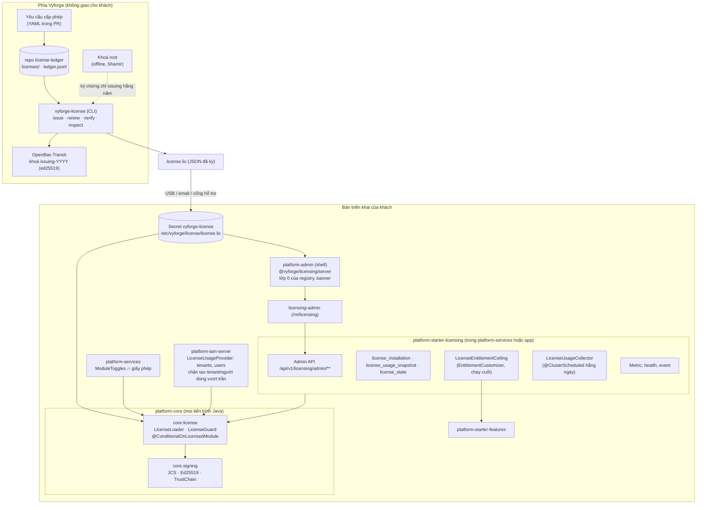
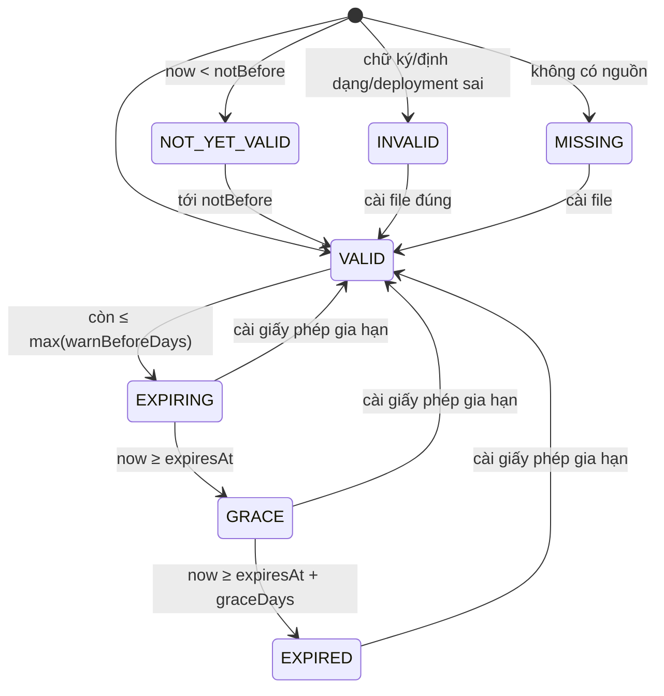
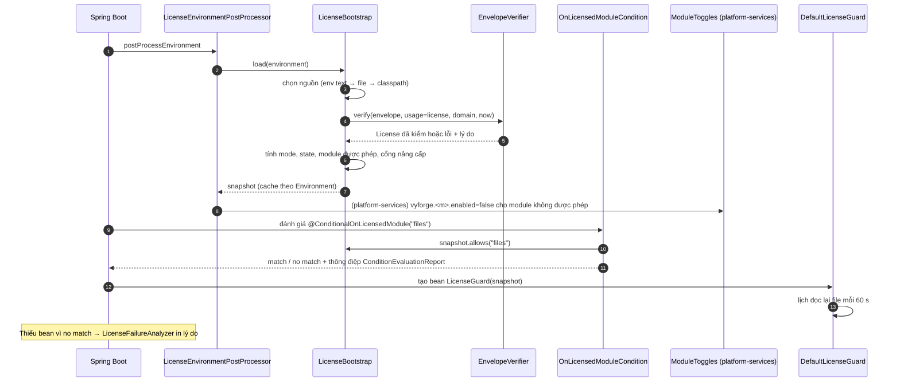
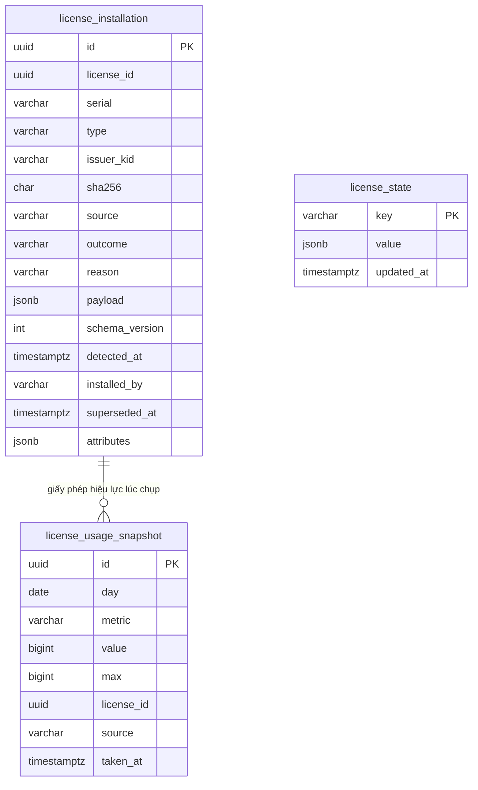
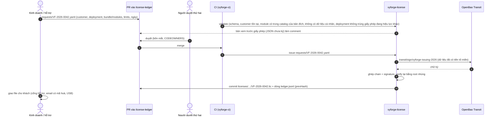

# Thiết kế module licensing: giấy phép module cho bản cài on-prem (`platform-core` + `platform-starter-licensing` + `@vyforge/licensing`)

> **Trạng thái:** bản thiết kế chờ duyệt (27/10/2026), phiên forge-51.
> **Phạm vi:** file giấy phép ký số cho bản cài on-prem và air-gapped. Giấy phép quyết định bản triển khai được chạy
> module nào, bao nhiêu tenant, bao nhiêu người dùng, tới khi nào, và được nâng cấp lên bản nào. Kiểm hoàn toàn offline
> trong mọi tiến trình Java (backend) và trong shell `platform-admin` (Next.js). Công cụ phát hành và sổ giấy phép chỉ ở
> phía Vyforge.
> **Không làm:** DRM, làm rối mã (obfuscation), gọi về máy chủ Vyforge (phone-home), khoá theo phần cứng, tắt dịch vụ từ xa.
> Không thay `features` (gói, entitlement theo tenant) hay `billing` (giá, hoá đơn): licensing là **trần theo hợp đồng
> của cả bản triển khai**, hai module kia làm việc bên dưới trần đó.
> **Nền:** platform-java 0.12.1 (`SecretCipher`, `StarterSchemaMigrator`, `@ClusterScheduled`), Spring Boot 4.1.1, Java 25,
> platform-web 0.9.0. Theo module-conventions mục 1–6, kiến trúc `platform-services` (D1–D10, mục 4.11–4.12, 5) và
> gap analysis mục 2.3, 6.3.
> **Bên phải nối:** `platform-services` (`ModuleToggles`), `@vyforge/admin-shell` (registry), `features`
> (`EntitlementCustomizer`), `platform-iam-server` (số tenant, số người dùng), `master-data` (dùng chung lớp ký Ed25519 + JCS).

Mục lục:
0. [Tóm tắt quyết định](#0-tóm-tắt-quyết-định)
1. [Bài toán và phạm vi](#1-bài-toán-và-phạm-vi)
2. [Nghiên cứu](#2-nghiên-cứu)
3. [Kiến trúc](#3-kiến-trúc)
4. [Mô hình dữ liệu](#4-mô-hình-dữ-liệu)
5. [API](#5-api)
6. [Mở rộng](#6-mở-rộng)
7. [Vận hành](#7-vận-hành)
8. [Bảo mật và tuân thủ](#8-bảo-mật-và-tuân-thủ)
9. [Kế hoạch triển khai](#9-kế-hoạch-triển-khai)
10. [Lệch quy ước và quyết định cần người dùng chọn](#10-lệch-quy-ước-và-quyết-định-cần-người-dùng-chọn)
11. [Đóng gói và triển khai độc lập](#11-đóng-gói-và-triển-khai-độc-lập)

---

## 0. Tóm tắt quyết định

| # | Quyết định | Lý do ngắn |
|---|---|---|
| D1 | **Tự xây lớp mỏng**, không dùng Keygen hay license3j làm phụ thuộc runtime. File giấy phép là **JSON đọc được**, ký **Ed25519** (JDK có sẵn từ Java 15) trên JSON chuẩn hoá **RFC 8785 (JCS)** | Keygen dùng FCL-1.0 (không phải OSI) và cần server; license3j định dạng riêng, nhị phân. JSON đọc được để khách tự xem mình đã mua gì. Cùng cách ký với data pack của `master-data` |
| D2 | **Hai tầng khoá:** khoá gốc (root) nhúng trong `platform-core` và `@vyforge/licensing`; khoá phát hành (issuing) theo năm nằm trong OpenBao Transit, có **chứng chỉ do root ký đi kèm trong mỗi file giấy phép** | Xoay khoá phát hành hằng năm mà không phải ra bản platform mới. Root chỉ dùng vài lần mỗi năm, giữ offline |
| D3 | **Phần kiểm nằm trong `platform-core`** (package `core.license` và `core.signing`), không cần DB, không cần mạng. Mọi tiến trình tự kiểm từ cùng một file (Secret/ConfigMap/đường dẫn) | Điều kiện bật module chạy rất sớm lúc khởi động, trước DataSource. Không tạo điểm chết chung: không có "license server" |
| D4 | **`@ConditionalOnLicensedModule("<module>")`** trên auto-config của mỗi starter có tính phí. Thiếu giấy phép thì bean không được tạo và `FailureAnalyzer` báo rõ "module X chưa có trong giấy phép" | Đúng brief. Không tạo bean thì không chạy migration, job, API của module |
| D5 | **Ba chế độ:** `LICENSED` (có file hợp lệ), `DEV` (không có file, profile `dev`/`test`/`local` hoặc bật tường minh), `UNLICENSED` (không có file ở môi trường khác: chỉ phần nền miễn phí chạy) | Lập trình viên và đối tác SI không cần giấy phép. Sản phẩm thật không chạy nhầm ở chế độ dev mà không ai biết |
| D6 | **Hết hạn không bao giờ tắt dịch vụ đang chạy.** Hành vi sau hạn là **chính sách ghi trong file giấy phép** (`enforcement`), gồm các hành động có tên: `banner`, `block-upgrade`, `block-new-tenants`, `block-create-over-limit`, `restrict-admin-writes`. Mặc định đề xuất: cảnh báo, ân hạn 30 ngày, sau đó chặn nâng cấp và chặn tạo tenant mới | Chủ sở hữu chọn mặc định (Q1); từng hợp đồng đổi được mà không sửa code. Dịch vụ công, ngân hàng không thể dừng vì thủ tục gia hạn chậm |
| D7 | **Chặn nâng cấp theo dòng phát hành:** giấy phép có `support_until`; một bản platform chạy được module có phí khi **ngày phát hành dòng minor** (`x.y.0`) ≤ `support_until` | Bản vá bảo mật của dòng cũ vẫn cài được sau hạn hỗ trợ (như `RESTRICT_ACCESS` của Keygen). Khách không mất quyền với bản đã mua |
| D8 | **Gia hạn không cần khởi động lại:** Secret được kubelet đồng bộ lại vào volume, `LicenseGuard` đọc lại file mỗi 60 giây. Thêm module mới thì cần khởi động lại (bean mới), việc này đằng nào cũng đi kèm deploy image/MFE | Đúng yêu cầu "gia hạn không cần cài lại" |
| D9 | **Trần cho `features`:** starter đăng ký một `EntitlementCustomizer` chạy cuối chuỗi, ép `module.<m>`/`admin.<m>` về `false` khi module không có trong giấy phép và ép hạn mức về `min(gói, trần giấy phép)` | `features` đã có SPI này (đã code ở `java--features`). Không phải sửa features ngoài thứ tự chạy |
| D10 | **Shell `platform-admin` tự kiểm file** bằng `@vyforge/licensing/server` (Node `crypto` Ed25519 + JCS), thêm lớp 0 vào registry: MFE của module không có trong giấy phép bị ẩn và hiện trạng thái `unlicensed` ở trang `/modules` | Shell không phụ thuộc backend còn sống mới biết được module nào được phép |
| D11 | **Công cụ phát hành `vyforge-license`** (CLI Java, `platform-java/tools/license-cli`, không phát hành ra Maven) ký qua OpenBao Transit; **sổ giấy phép** là repo riêng tư `license-ledger`: mỗi giấy phép là một PR được duyệt bốn mắt, CI ký và ghi vào `ledger.jsonl` có chuỗi băm | Chạy được trên mọi git host (ADR-0014). Khoá không rời OpenBao. Có lịch sử ai yêu cầu, ai duyệt, ai ký |
| D12 | **Không có phone-home.** Đối soát số người dùng bằng **báo cáo sử dụng** xuất từ trang quản trị (JSON, khách tự gửi khi gia hạn), giống file usage của GitLab | Bản cài air-gapped không có Internet; cơ quan nhà nước không cho dữ liệu ra ngoài |

---

## 1. Bài toán và phạm vi

### 1.1 Vì sao cần

Người dùng yêu cầu: *"phần cms quản trị cần tách code từng module ra, để có thể triển khai độc lập cho khách hàng theo
nhu cầu"*. Mục 6 của module-conventions và kiến trúc `platform-services` đã cho phép bật từng module bằng cấu hình
(`SERVICES_MODULES`, `ADMIN_MODULES`). Cấu hình thì khách tự sửa được. Khi giao bản cài on-prem, Vyforge cần một cách
**kiểm chứng được** rằng:

- bản triển khai chỉ chạy module đã mua;
- số tenant, số người dùng không vượt hợp đồng (hoặc vượt thì có số liệu để đối soát);
- thời hạn thuê bao và thời hạn hỗ trợ được tôn trọng;
- gia hạn không phải cài lại, không phải dừng dịch vụ.

Khách hàng mục tiêu (cơ quan nhà nước, bệnh viện, ngân hàng, doanh nghiệp sản xuất) thường chạy trong mạng không có
Internet. Vì vậy mọi kiểm tra phải offline.

### 1.2 Trong phạm vi

- Định dạng file giấy phép, khoá ký, chuỗi tin cậy, xoay khoá, danh sách thu hồi đi theo bản phát hành.
- Thư viện kiểm trong `platform-core`: nạp, kiểm chữ ký, tính trạng thái, cache, đọc lại khi file đổi.
- Điều kiện bật starter `@ConditionalOnLicensedModule`, chế độ dev, chặn nâng cấp.
- Giới hạn bản triển khai (tenant, người dùng, giới hạn riêng của module) và điểm cưỡng chế.
- Trần cho entitlement của `features`; lớp 0 của registry trong shell `platform-admin`.
- `platform-starter-licensing`: API quản trị, lịch sử cài đặt, ảnh chụp mức dùng, báo cáo sử dụng, metric, cảnh báo.
- Admin MFE `/m/licensing` cho người vận hành.
- Phía Vyforge: CLI `vyforge-license`, quy trình phát hành, sổ giấy phép.

### 1.3 Kịch bản nghiệp vụ phải đáp ứng

| # | Kịch bản | Đáp ứng bằng |
|---|---|---|
| K1 | **Bệnh viện tỉnh, mạng nội bộ không Internet**, mua notification, files, workflow, esign. Đội triển khai mang image và file giấy phép vào bằng USB | Kiểm offline (D3); file JSON đọc được; `ADMIN_MODULES`, `SERVICES_MODULES` khớp giấy phép, trang `/m/licensing` hiện ma trận "đã mua / đã cài / đang bật" |
| K2 | **Gia hạn thuê bao hằng năm** không cài lại, không dừng dịch vụ | Thay Secret, `LicenseGuard` đọc lại sau ≤ 60 giây (D8); lịch sử cài đặt ghi lại |
| K3 | **Mua thêm module giữa kỳ** (ngân hàng mua thêm payment ở tháng 7) | Giấy phép mới có thêm `payment` (thường `supersedes` bản cũ) + deploy image/MFE + khởi động lại `platform-services` |
| K4 | **Cơ quan nhà nước mua bản quyền vĩnh viễn kèm 3 năm hỗ trợ** (mua sắm công thường không chi thuê bao định kỳ được) | `type: perpetual`, `expires_at: null`, `support_until` = +3 năm; sau đó vẫn chạy và vá trong dòng cũ, chỉ không lên dòng mới (D7) |
| K5 | **Chậm gia hạn vì thủ tục thanh toán cuối năm ngân sách** (giấy phép hết 31/12, tiền về tháng 2) | Ân hạn và chính sách "không tắt dịch vụ" (D6); banner cho người vận hành từ 60 ngày trước; Vyforge có thể cấp giấy phép gia hạn tạm 60 ngày (`type: subscription`, ghi chú trong sổ) |
| K6 | **Dùng thử 30 ngày (POC)** cho một tổng công ty | `type: trial`, `expires_at` = +30 ngày, chính sách `after_grace: [banner, restrict-admin-writes]`; dữ liệu POC giữ nguyên khi chuyển sang giấy phép chính thức |
| K7 | **Môi trường staging và DR** của cùng một khách | Danh sách `deployments[]` trong một giấy phép, mỗi mục có `environment` (`production`, `staging`, `dr`); hoặc giấy phép `nfr` riêng cho staging |
| K8 | **Lập trình viên, đối tác SI** dựng app trên vyforge ở máy cá nhân, CI chạy test | Chế độ `DEV` tự bật theo profile, không cần file; test trong CI không cần khoá |
| K9 | **Đối tác bán lại** (reseller) triển khai cho khách cuối | `licensee` là khách cuối (pháp nhân, MST), `channel.reseller` ghi đối tác; sổ giấy phép lọc theo đối tác |
| K10 | **Doanh nghiệp vận hành SaaS trên vyforge cho nhiều khách nhỏ** (đối tác chạy nhiều tenant) | Giới hạn `tenants`; gói của từng tenant do `features` quản lý nhưng không vượt trần (D9) |
| K11 | **Giới hạn người dùng theo hợp đồng** (500 người dùng, vượt 10% thì tính bù khi gia hạn) | Giới hạn `users` với `enforcement: soft`, `overage_pct: 10`; báo cáo sử dụng làm căn cứ đối soát (D12) |
| K12 | **Module có giới hạn riêng**: AI 5 triệu token/tháng, payment 3 merchant, workflow 200 quy trình đang hoạt động | `modules[].caps`: ánh xạ sang feature của `features` làm trần |
| K13 | **Sắp xếp đơn vị hành chính**: sở/huyện sáp nhập, đơn vị đổi tên và MST từ 01/07/2025 | Cấp lại giấy phép với `licensee` mới, `supersedes` bản cũ; dữ liệu và `deployment.id` giữ nguyên |
| K14 | **Khách chuyển hạ tầng** (từ VM sang Kubernetes, đổi tên miền) | `deployment.id` giữ nguyên nếu là cùng bản triển khai; `urls[]` cập nhật bằng giấy phép mới; nếu dựng bản song song thì cấp giấy phép tạm cho bản mới |
| K15 | **Lộ khoá phát hành** | Thu hồi chứng chỉ khoá phát hành trong bản platform kế tiếp, cấp lại toàn bộ giấy phép do khoá đó ký (sổ cho danh sách đầy đủ) |
| K16 | **Kiểm toán nội bộ Vyforge**: liệt kê mọi giấy phép đã cấp cho khách X, ai duyệt, khi nào; doanh thu ghi nhận theo giấy phép | `license-ledger`: PR, người duyệt, `ledger.jsonl` có chuỗi băm |
| K17 | **Hỗ trợ kỹ thuật**: khách báo lỗi, kỹ sư cần biết bản triển khai chạy module nào, giấy phép nào | Trang "Giấy phép" và `GET /admin/license` cho thấy serial, module, trạng thái; `vyforge-license inspect` đọc file khách gửi |
| K18 | **Vyforge tự vận hành SaaS** (bản cài nội bộ) | `type: internal`, không hết hạn, không giới hạn; vẫn đi qua cùng cơ chế để mọi đường code được chạy thật |

### 1.4 Ngoài phạm vi

- Chống bẻ khoá ở mức DRM, làm rối mã, kiểm toàn vẹn jar lúc chạy. Bảo vệ ở mức hợp đồng + chữ ký số + pháp luật (mục 8.3).
- Floating license, đếm máy, khoá theo phần cứng (kiểu Keygen Relay). Container không có định danh phần cứng ổn định.
- Thu tiền, hoá đơn, giá: thuộc `billing`. Licensing chỉ đọc cùng danh mục module.
- Giấy phép cho app nghiệp vụ do khách tự viết. Khách dùng `features` để bán gói cho người dùng của họ.

---

## 2. Nghiên cứu

Nguồn kiểm ngày 27/10/2026 bằng WebFetch/WebSearch, version qua GitHub Releases API và `maven-metadata.xml`.

### 2.1 Hệ thống tham khảo

| Hệ thống | Version, license | Mô hình | Điểm mạnh | Điểm yếu |
|---|---|---|---|---|
| **Keygen** CE ([crypto](https://keygen.sh/docs/api/cryptography/), [policies](https://keygen.sh/docs/api/policies/), [Relay](https://keygen.sh/docs/relay/)) | keygen-api v1.7.0 (23/06/2026); **FCL-1.0-ALv2** (source-available, chuyển Apache-2.0 sau 2 năm; cấm "Competing Use", cấm vô hiệu hoá chức năng license key) | File `-----BEGIN LICENSE FILE-----`, base64 JSON `{enc, sig, alg}`; `alg` như `base64+ed25519`, `aes-256-gcm+ed25519`; ký trên `"license/" + enc`; `meta.issued`, `meta.expiry`, `ttl` (mặc định 30 ngày). Policy có `expirationStrategy`: `RESTRICT_ACCESS` (chỉ dùng bản phát hành trước hạn), `REVOKE_ACCESS`, `MAINTAIN_ACCESS`, `ALLOW_ACCESS`; `maxUsers`, `maxMachines`; entitlement gắn vào license | Mô hình chiến lược hết hạn rõ ràng; tiền tố miền (`license/`) khi ký chống dùng chữ ký sai ngữ cảnh; kiểm `issued` trong tương lai để phát hiện chỉnh đồng hồ; có Relay cho air-gapped | Cần chạy server Keygen (Rails + PostgreSQL + Redis) để phát hành; license không phải OSI; mã hoá file bằng license key không thêm an toàn thật (khoá đi cùng khách); không có khái niệm module/tenant |
| **license3j** ([GitHub](https://github.com/verhas/License3j)) | 3.3.0 (24/01/2025), Apache-2.0, 650 sao | Thư viện Java: cặp khoá, file license dạng thuộc tính có kiểu, ký RSA/khác, kiểm offline | Nhỏ, đúng việc ký/kiểm; có REPL để tạo license | Định dạng riêng (nhị phân/text riêng), không có chuỗi khoá, không có chính sách hết hạn; nhịp phát hành chậm (lần cuối 01/2025); không có bản TypeScript cho shell |
| **GitLab EE** ([license file](https://docs.gitlab.com/administration/license_file/)) | Tài liệu hiện hành | File `.gitlab-license` tải lên qua Admin hoặc `GITLAB_LICENSE_FILE`, `initial_license_file`, Helm `global.gitlab.license` (chỉ lúc cài). Giới hạn người dùng: vượt ≤ 10% thì vẫn áp, trả bù khi gia hạn; vượt hơn thì phải mua thêm. File usage gửi hằng tháng | True-up 10% thực tế, dễ bán; nhiều cách nạp file; có usage file offline | **Hết hạn là khoá tính năng, instance thành chỉ đọc** (khoá push, tạo issue); banner chỉ 15 ngày trước. Quá khắt khe cho dịch vụ công |
| **Grafana Enterprise** ([licensing](https://grafana.com/docs/grafana/latest/administration/enterprise-licensing/)) | Tài liệu hiện hành | `license.jwt` ở thư mục dữ liệu, `license_path`, `GF_ENTERPRISE_LICENSE_PATH`, `GF_ENTERPRISE_LICENSE_TEXT`; **gắn với `root_url`**; người dùng hoạt động = đăng nhập trong 30 ngày, đạt trần thì chỉ người đang hoạt động đăng nhập được; tự gia hạn token 24 giờ khi có Internet | **Hết hạn: phần lớn vẫn chạy**, chỉ dừng một số tính năng enterprise (không tạo mới quyền data source, role, report); dữ liệu và cấu hình giữ nguyên; đếm người dùng theo hoạt động công bằng hơn | Phải khởi động lại sau khi cài; tự gia hạn cần Internet; gắn URL làm khó khi đổi tên miền |
| **Mattermost** ([edition and license](https://docs.mattermost.com/administration-guide/configure/self-hosted-account-settings.html), [cập nhật license](https://support.mattermost.com/hc/en-us/articles/360058881951-Updating-a-Mattermost-Enterprise-License)) | Tài liệu hiện hành | File license tải lên System Console hoặc `mmctl`; banner **60 ngày** trước hạn; license không có ngày bắt đầu, cài sớm không ảnh hưởng | Banner sớm 60 ngày; thay license nóng bằng CLI | Hành vi sau hạn chỉ thấy trong diễn đàn (tắt tính năng enterprise, không mất dữ liệu), chưa kiểm được trong tài liệu chính thức |
| **ABP Commercial** ([hỏi đáp chính thức](https://abp.io/support/questions/9952), [ABP-LIC-0020](https://abp.io/support/questions/10865/)) | ABP 10.x | `AbpLicenseCode` trong `appsettings`/biến môi trường, **kiểm offline**; thiếu hoặc sai thì log `ABP-LIC-ERROR` và **app dừng**; chỉ gọi abp.io khi chạy Development hoặc có debugger | Khoá chỉ là một chuỗi cấu hình, dễ triển khai | Thiếu mã là dừng app: rủi ro vận hành; kiểm theo license của nhà phát triển, không theo bản triển khai |
| **Directus** ([đổi license v12](https://directus.io/blog/directus-v12-license-change)) | v12, **MSCL** (dẫn xuất FCL, chuyển GPL sau 4 năm) | Đưa "software registration key" thay cho cơ chế tự giác; miễn phí cho tổ chức dưới ngưỡng doanh thu và nhân sự | Ví dụ thực tế: chuyển từ tự giác sang khoá vì tự giác không đủ | Chưa có tài liệu kỹ thuật công khai về định dạng khoá; ngưỡng miễn phí mỗi nguồn ghi một khác |
| **Elastic** ([license management](https://www.elastic.co/guide/en/kibana/8.0/managing-licenses.html)) | 8.x | License là file JSON cài qua Kibana hoặc API, áp ngay; cảnh báo 30 ngày trước; hết hạn thì tắt một số API (SQL, watcher…) và có thể chuyển về basic | Áp ngay không khởi động lại; danh sách tính năng mất khi hết hạn rõ ràng | Tắt API là tắt chức năng đang dùng |

Thư viện mã hoá và chuẩn:

| Thành phần | Version, license | Dùng cho |
|---|---|---|
| JDK `Signature.getInstance("Ed25519")` ([JEP 339](https://openjdk.org/jeps/339)) | Java 15+, có trong Java 25 | Kiểm/ký Ed25519, không thêm phụ thuộc |
| JDK ML-DSA ([JEP 497](https://openjdk.org/jeps/497)) | Java 24+ | Để dành: `alg: ML-DSA-65` khi cần chữ ký hậu lượng tử |
| [RFC 8785 JCS](https://www.rfc-editor.org/rfc/rfc8785) | 06/2020, Informational | JSON chuẩn hoá để ký; tự cài khoảng 100 dòng Java (như thiết kế master-data) |
| `canonicalize` ([npm](https://www.npmjs.com/package/canonicalize)) | 5.1.0, Apache-2.0 | JCS phía TypeScript (hoặc tự cài, quyết lúc code) |
| OpenBao Transit ([docs](https://openbao.org/docs/secrets/transit/)) | v2.7.1 (01/10/2026), MPL-2.0 | Khoá phát hành `ed25519` không rời OpenBao, có version khoá; cũng có `mldsa-65` |
| picocli | 4.7.7, Apache-2.0 | CLI `vyforge-license` (chỉ trong tool, không vào BOM) |

### 2.2 Học theo và không làm

**Học theo:**

1. **Keygen:** đặt tên chiến lược hết hạn; `RESTRICT_ACCESS` (được dùng bản phát hành trước hạn) thành D7; ký có tiền tố
   miền; phát hiện `issued_at` ở tương lai; kiểm `alg` trước tiên, không tin `alg` trong file để chọn thuật toán.
2. **Grafana:** hết hạn thì giữ dịch vụ, chỉ chặn thao tác "mở rộng"; cho nạp bằng đường dẫn hoặc biến môi trường;
   định nghĩa "người dùng hoạt động" là tuỳ chọn.
3. **GitLab:** true-up 10%; file usage offline; nhiều cách nạp file lúc cài.
4. **Mattermost:** banner 60 ngày; giấy phép mới cài sớm không ảnh hưởng giấy phép đang chạy.
5. **ABP:** khoá nằm trong cấu hình chuẩn của nền tảng, không cần thao tác riêng.

**Không làm:**

1. Không chuyển sang chỉ đọc khi hết hạn (GitLab), không dừng app khi thiếu khoá ở môi trường thật (ABP). Thay bằng:
   thiếu giấy phép thì module có phí không bật, phần nền vẫn chạy, `FailureAnalyzer` giải thích (D4, D5).
2. Không mã hoá nội dung file bằng khoá đi cùng khách (Keygen `aes-256-gcm`): không thêm an toàn, chỉ làm khách không
   đọc được mình đã mua gì.
3. Không gắn giấy phép với một URL duy nhất (Grafana): khách đổi tên miền là hỏng. `urls[]` chỉ để hiển thị và đối chiếu
   mềm (cảnh báo, không chặn).
4. Không TTL ngắn bắt phải lấy file mới định kỳ (Keygen 30 ngày): bản cài air-gapped không lấy được.
5. Không phone-home, không tự gia hạn qua Internet (Grafana 24 giờ).
6. Không dùng định dạng riêng (license3j): khó đọc, khó kiểm từ TypeScript.

---

## 3. Kiến trúc

### 3.1 Khái niệm

| Khái niệm | Nghĩa |
|---|---|
| **Giấy phép** (`License`) | Tài liệu do Vyforge ký: ai được dùng, ở bản triển khai nào, module nào, giới hạn nào, tới khi nào. Một bản triển khai có đúng một giấy phép hiệu lực |
| **Bản triển khai** (deployment) | Một cụm cài đặt vyforge của khách (một `platform-admin`, một hoặc nhiều app, `platform-services`). Định danh `deployment.id` (UUID do Vyforge cấp lúc ký hợp đồng, khách đặt vào cấu hình) |
| **Module có phí** | Starter được đánh dấu `@ConditionalOnLicensedModule`. Danh mục ở `META-INF/vyforge/modules/*.json` của từng starter (mục 3.5) |
| **Phần nền miễn phí** | `platform-core`, `-web`, `-security`, `-jpa`, `-authz`, `-audit`, `-messaging`, `-scheduling`, `-ratelimit`, `-privacy`, `-observability`, iam-server, auth-server, gateway, shell `platform-admin`, `licensing`. Luôn chạy, kể cả khi không có giấy phép |
| **Giới hạn** (`limit`) | Giới hạn của cả bản triển khai: `tenants`, `users`, `active_users`, hoặc giới hạn riêng do module khai báo |
| **Trần** (`cap`) | Giá trị tối đa cho một feature của `features` (vd. `ai.tokens` mỗi tháng). Áp lên entitlement của mọi tenant |
| **Trạng thái** | `VALID`, `EXPIRING`, `GRACE`, `EXPIRED`, `NOT_YET_VALID`, `INVALID`, `MISSING` (mục 3.7) |
| **Chính sách cưỡng chế** (`enforcement`) | Danh sách hành động có tên áp theo trạng thái. Ghi trong giấy phép, có mặc định ở platform |

### 3.2 Thành phần



| Thành phần | Nơi ở | Phụ thuộc |
|---|---|---|
| `core.signing` | `platform-core`, package `com.vyforge.platform.core.signing` | JDK, Jackson 3 (`tools.jackson.core:jackson-databind`, BOM của Spring Boot) |
| `core.license` | `platform-core`, package `com.vyforge.platform.core.license` | `core.signing`, Spring Boot autoconfigure (đã có) |
| `platform-starter-licensing` | `platform-java`, starter mới | `platform-core`, `-web`, `-jpa` (`StarterSchemaMigrator`), `-authz`, `-audit`, `-scheduling`; `-features` tuỳ chọn (`@ConditionalOnClass`) |
| `@vyforge/licensing` | `platform-web/packages/licensing` | `node:crypto`, `@vyforge/api-client`, `@vyforge/ui` (subpath `/admin`) |
| `licensing-admin` | `platform-admin/apps/licensing-admin` | `@vyforge/admin-shell`, `@vyforge/licensing/admin` |
| `vyforge-license` | `platform-java/tools/license-cli` (`maven.deploy.skip=true`) | `core.signing`, picocli, client HTTP tới OpenBao |
| `license-ledger` | repo riêng tư mới (chỉ dữ liệu) | CI qua `vyforge-ci` |

### 3.3 Gói Java

```
com.vyforge.platform.core.signing
  Jcs                        // RFC 8785: canonicalize(JsonNode) → byte[] UTF-8
  SignatureAlgorithm         // ED25519 (mặc định), ML_DSA_65 (để dành); không chọn theo chuỗi trong file
  SignedEnvelope             // record: payload (JsonNode), signature {alg, kid, value}, chain (List<KeyCertificate>)
  KeyCertificate             // record: kid, alg, publicKey, usage, notBefore, notAfter, issuerKid, signature
  TrustAnchors               // khoá root nạp từ classpath META-INF/vyforge/trust/<usage>/*.json
  EnvelopeVerifier           // verify(envelope, usage, domain, Instant now) → VerifiedPayload | VerificationException
  RevocationList             // META-INF/vyforge/trust/<usage>/revoked.json: kid và id đã thu hồi

com.vyforge.platform.core.license
  License, LicensedModule, LicenseLimit, Enforcement, Deployment, Licensee   // record bất biến, đọc từ JSON
  LicenseLoader              // nguồn → bytes → envelope → License; không có trạng thái
  LicenseSource (SPI)        // FileLicenseSource, EnvTextLicenseSource, ClasspathLicenseSource
  LicenseBootstrap           // snapshot lúc khởi động, cache theo Environment, dùng trong Condition
  LicenseGuard               // API lúc chạy (mục 5.1); DefaultLicenseGuard đọc lại file theo chu kỳ
  LicenseStatus, LicenseState, LicenseMode, LimitStatus, LicenseIssue
  PolicyAction (SPI)         // banner, block-upgrade, block-new-tenants, block-create-over-limit, restrict-admin-writes
  ConditionalOnLicensedModule, OnLicensedModuleCondition
  LicenseFailureAnalyzer     // NoSuchBeanDefinitionException + module chưa có giấy phép → thông báo rõ
  LicenseClock (SPI)         // nguồn thời gian có mốc cao nhất; mặc định trong bộ nhớ, starter thay bằng bản lưu DB
  PlatformRelease            // đọc META-INF/vyforge/platform-release.properties: version, lineReleasedOn
  PlatformLicenseAutoConfiguration
  LicenseException           // ErrorCode: license.module_not_licensed, license.limit_reached, license.admin_restricted
```

`core.signing` dùng chung với `master-data` (data pack đã thiết kế ký Ed25519 + JCS, khoá ở
`vyforge.masterdata.packs.trusted-keys`). Đề xuất master-data chuyển sang `EnvelopeVerifier` với `usage: "masterdata-pack"`
khi triển khai; hai bên không phụ thuộc nhau, chỉ dùng chung lớp nền (mục 6.6).

### 3.4 Định dạng file giấy phép

Phần mở rộng `.lic`, nội dung là **JSON UTF-8** (không base64, không mã hoá), dễ đọc bằng mắt và bằng `jq`:

```json
{
  "format": "vyforge-license/1",
  "license": {
    "schemaVersion": 1,
    "id": "0193b0e2-7c1a-7d55-9a0e-3f5b0a9c1d22",
    "serial": "VF-2026-0042",
    "type": "subscription",
    "issuedAt": "2026-11-02T03:00:00Z",
    "notBefore": "2026-11-01T00:00:00+07:00",
    "expiresAt": "2027-11-01T00:00:00+07:00",
    "supportUntil": "2027-11-01",
    "supersedes": ["0192f3c4-…"],
    "licensee": {
      "name": "Bệnh viện Đa khoa tỉnh X",
      "taxCode": "0101234567",
      "country": "VN"
    },
    "channel": { "reseller": { "name": "Công ty TNHH Đối tác Y", "taxCode": "0309876543" } },
    "deployments": [
      { "id": "6f0c1c4e-1b9e-4f2a-9a57-2e0f6c1b7d10", "name": "BVX production", "environment": "production",
        "urls": ["https://admin.bvx.local"] },
      { "id": "a3d9e0b2-…", "name": "BVX DR", "environment": "dr" }
    ],
    "modules": [
      { "key": "notification" },
      { "key": "files", "caps": { "storage.bytes": 2199023255552 } },
      { "key": "workflow", "caps": { "workflow.definitions.active": 200 } },
      { "key": "esign", "expiresAt": "2027-05-01T00:00:00+07:00" },
      { "key": "ai", "caps": { "ai.tokens": 5000000 } }
    ],
    "limits": {
      "tenants": { "max": 3, "enforcement": "hard" },
      "users":   { "max": 500, "enforcement": "soft", "overagePct": 10 }
    },
    "enforcement": {
      "warnBeforeDays": [60, 30, 7],
      "graceDays": 30,
      "inGrace": ["banner"],
      "afterGrace": ["banner", "block-upgrade", "block-new-tenants"],
      "afterSupport": ["block-upgrade"],
      "overLimit": ["banner", "block-create-over-limit"]
    },
    "attributes": { "contractNo": "HĐ-2026/BVX-01", "salesOwner": "khu vực miền Bắc" }
  },
  "chain": [
    {
      "kid": "vyforge-issuing-2026",
      "alg": "Ed25519",
      "publicKey": "MCowBQYDK2VwAyEA…",
      "usage": "license",
      "notBefore": "2026-01-01T00:00:00Z",
      "notAfter": "2027-01-31T00:00:00Z",
      "issuerKid": "vyforge-root-2026a",
      "signature": "base64url…"
    }
  ],
  "signature": { "alg": "Ed25519", "kid": "vyforge-issuing-2026", "value": "base64url…" }
}
```

**Ký và kiểm:**

- Dữ liệu được ký = `"vyforge-license/1\n"` ‖ `JCS(license)`. Tiền tố miền ngăn dùng chữ ký của tài liệu khác (data pack,
  chứng chỉ khoá) làm chữ ký giấy phép.
- Chứng chỉ khoá phát hành: root ký `"vyforge-keycert/1\n"` ‖ `JCS(chứng chỉ trừ trường signature)`.
- Trình tự kiểm (dừng ở bước đầu tiên hỏng, trạng thái `INVALID` kèm mã lý do):
  1. `format` đúng `vyforge-license/1`; kích thước file ≤ 64 KiB; JSON hợp lệ, không trùng khoá (I-JSON).
  2. `signature.alg` nằm trong danh sách thuật toán **được cấu hình** (mặc định chỉ `Ed25519`). Không chọn thuật toán theo
     chuỗi trong file.
  3. Chứng chỉ trong `chain`: `issuerKid` là một khoá root nhúng, chữ ký đúng, `usage = license`, `kid` không nằm trong
     danh sách thu hồi.
  4. `license.issuedAt` nằm trong `[notBefore, notAfter]` của chứng chỉ (khoá phát hành chỉ được ký trong khoảng đó;
     giấy phép đã ký vẫn hiệu lực sau khi chứng chỉ hết khoảng ký).
  5. Chữ ký giấy phép đúng với `publicKey` của chứng chỉ; `license.id` không bị thu hồi.
  6. `schemaVersion` được hỗ trợ (bản này: `1`). Trường lạ được bỏ qua (tiến hoá về sau), trừ khi tên nằm trong
     `critical[]` (giống `crit` của JWS): có trường bắt buộc hiểu mà bản platform không biết thì `INVALID` với lý do
     `license.unsupported_critical`, để giấy phép cho tính năng mới không bị bản cũ hiểu sai.
  7. `deployment.id` cấu hình (`vyforge.license.deployment-id`) có trong `deployments[]`. Không khớp: `INVALID` với lý do
     `license.deployment_mismatch` (mục 10, Q4 có phương án mềm hơn).
- Thời gian (`issuedAt` không ở tương lai quá 24 giờ, `notBefore`, `expiresAt`) không làm giấy phép `INVALID`; chúng
  quyết định trạng thái ở mục 3.7.

**Kiểu giấy phép** (`type`, chuỗi có kiểm ở code, không phải enum DB):

| Kiểu | `expiresAt` | Mặc định `enforcement` | Dùng cho |
|---|---|---|---|
| `subscription` | Có | Mặc định platform | Thuê bao năm |
| `perpetual` | `null` | `afterSupport: [block-upgrade]` | Mua đứt + hỗ trợ có hạn (K4) |
| `trial` | Có, ngắn | `afterGrace: [banner, restrict-admin-writes]`, `graceDays: 7` | POC (K6) |
| `nfr` | Có | Như `subscription`, `environment` khác `production` | Staging, đào tạo, đối tác (not for resale) |
| `internal` | `null` | Không có hành động | Bản cài của chính Vyforge (K18) |

### 3.5 Danh mục module

Mỗi starter có phí khai báo mình trong `META-INF/vyforge/modules/<key>.json`:

```json
{ "key": "payment", "title": { "vi": "Thanh toán", "en": "Payments" }, "licensed": true,
  "limits": { "payment.merchants": { "unit": "merchant", "title": { "vi": "Số merchant", "en": "Merchants" } } },
  "caps": ["payment.merchants"], "since": "0.13.0" }
```

- `key` khớp với `module.<key>`/`admin.<key>` của `features`, tên MFE (`/m/<key>`) và mục trong `SERVICES_MODULES`.
- `licensed: false` cho module miễn phí có MFE (vd. `licensing`, `ops-console`), để shell không ẩn MFE đó.
- CLI dùng cùng danh mục (đọc từ jar của bản platform đích) để kiểm yêu cầu cấp phép không có module lạ, cap lạ.
- **Gói bán hàng** (bundle, vd. "Văn phòng số" = notification + files + workflow + esign + sequence) chỉ tồn tại ở
  phía Vyforge (`license-ledger/catalog/bundles.yaml`). CLI bung bundle thành danh sách module trước khi ký: giấy phép
  luôn ghi module cụ thể, nên đổi thành phần bundle không ảnh hưởng giấy phép đã cấp.

### 3.6 Nạp giấy phép

Nguồn theo thứ tự ưu tiên (nguồn đầu tiên **có dữ liệu** thắng; không trộn):

| # | Nguồn | Cấu hình | Khi nào dùng |
|---|---|---|---|
| 1 | Biến môi trường chứa nội dung | `VYFORGE_LICENSE_TEXT` (`vyforge.license.text`) | Compose, VM đơn giản |
| 2 | File | `vyforge.license.path`, mặc định `/etc/vyforge/license/license.lic` | Kubernetes: Secret `vyforge-license` mount thành thư mục (**không dùng `subPath`**, để kubelet cập nhật được) |
| 3 | Classpath | `classpath:META-INF/vyforge/license.lic` | Bản phân phối đóng gói sẵn cho một khách (ít dùng) |
| — | Không có nguồn nào | — | Chế độ `DEV` hoặc `UNLICENSED` (mục 3.8) |

`vyforge.license.deployment-id` (biến `VYFORGE_DEPLOYMENT_ID`) do `template-infra`/`platform-infra` sinh một lần và đặt
chung cho mọi workload của bản triển khai (ConfigMap `vyforge-deployment`).

**Đọc lại lúc chạy:** `DefaultLicenseGuard` kiểm `lastModified` + SHA-256 của file mỗi `vyforge.license.reload-interval`
(60 giây). Nội dung đổi thì kiểm lại, thay snapshot nguyên tử (`AtomicReference`), phát `LicenseChanged`. File mới
**không hợp lệ** thì **giữ snapshot cũ**, ghi log ERROR và phát `LicenseRejected` (thay nhầm file không làm mất giấy
phép đang chạy).

**Module mới trong giấy phép mới** không tự bật lúc chạy (bean chưa có). Trang quản trị hiện "Cần khởi động lại
`platform-services` để bật: payment". **Module bị bỏ khỏi giấy phép** lúc chạy: bean vẫn còn tới lần khởi động sau,
nhưng `LicenseGuard.isLicensed` trả `false` ngay, nên filter API (mục 3.9) chặn API của module đó; job nền của module
vẫn xử lý việc đang dở (cùng hành vi tắt module theo tenant ở platform-services 5.4).

### 3.7 Trạng thái giấy phép



- `perpetual` và `internal` không có `EXPIRING`/`GRACE`/`EXPIRED` theo `expiresAt`; trạng thái hỗ trợ (`supportUntil`)
  tính riêng thành cờ `supportActive`.
- Module có `expiresAt` riêng (vd. esign hết trước) có trạng thái riêng cùng máy trạng thái trên. Trạng thái tổng là
  trạng thái của giấy phép; trang quản trị hiện cả hai.
- Thời điểm "bây giờ" lấy từ `LicenseClock` = `max(đồng hồ hệ thống, mốc cao nhất đã thấy − 24 giờ)`. Đồng hồ lùi quá 24
  giờ so với mốc thì phát `LicenseIssue(CLOCK_ROLLBACK)` (cảnh báo, metric), không đổi quyết định nào khác. Mốc cao nhất
  lưu ở `license_state` khi có starter; không có starter thì chỉ trong bộ nhớ (khởi động lại là mất, chấp nhận).

### 3.8 Chế độ chạy

`vyforge.license.mode`: `auto` (mặc định) | `enforce` | `dev`.

| Có nguồn giấy phép | `mode` | Profile đang bật | Chế độ | Module có phí |
|---|---|---|---|---|
| Có | bất kỳ | bất kỳ | `LICENSED` | Bật đúng module trong giấy phép (kể cả khi trạng thái `EXPIRED`) |
| Có nhưng `INVALID` | bất kỳ | bất kỳ | `LICENSED` với trạng thái `INVALID` | **Không bật** module nào; `FailureAnalyzer` nêu lý do. Với `auto` + profile dev: rơi về `DEV` kèm cảnh báo |
| Không | `auto` | có `dev`, `local` hoặc `test` | `DEV` | Bật hết |
| Không | `dev` | bất kỳ | `DEV` | Bật hết |
| Không | `auto`/`enforce` | khác | `UNLICENSED` | Không bật; phần nền chạy bình thường |

Chế độ `DEV`:

- Log WARN lúc khởi động và mỗi giờ: "Đang chạy chế độ phát triển, không có giấy phép. Không dùng cho môi trường thật."
- Banner cố định trên mọi trang quản trị (shell), metric `vyforge_license_mode{mode="dev"} 1`, `/admin/info` báo `dev`.
- Giới hạn chế độ dev (mặc định, Q2): **tối đa 5 tenant và 50 người dùng**; vượt thì chặn tạo mới (`block-create-over-limit`).
  Đủ cho phát triển và demo, không đủ cho vận hành thật.
- Không có khoá test được chấp nhận trong bản phát hành. Test của dự án chạy ở `DEV` (profile `test`). Test cần giấy phép
  cụ thể dùng `platform-test` (`LicenseTestSupport`: sinh khoá root tạm trong test, ký giấy phép, đăng ký `TrustAnchors`
  của test bằng bean thay thế; chỉ có trong `test` scope).

### 3.9 Điểm cưỡng chế

| Điểm | Cơ chế | Kết quả khi không được phép |
|---|---|---|
| Khởi động starter | `@ConditionalOnLicensedModule("payment")` trên auto-config phần `embedded` của starter (phần `remote` không gắn, xem dưới bảng) | Không tạo bean, không migration, không job. App cần bean đó thì khởi động hỏng, `LicenseFailureAnalyzer` in: "Bean PaymentService không có vì module `payment` chưa có trong giấy phép VF-2026-0042 (deployment BVX production). Liên hệ Vyforge hoặc bật chế độ dev." |
| `platform-services` | `ModuleToggles`: module bật = `SERVICES_MODULES` ∩ module được phép. Module trong `SERVICES_MODULES` mà không có giấy phép: log ERROR, `/admin/info` báo `unlicensed`, không làm hỏng các module khác | Server vẫn khởi động với các module hợp lệ |
| API lúc chạy | `LicensedModuleFilter` (servlet filter của starter licensing, đặt cùng chỗ `ModuleEntitlementFilter`): path của module (`AdminPaths` + route của module) bị chặn khi `isLicensed` trả `false` (module bị rút khỏi giấy phép lúc chạy) | `404`, `code: license.module_not_licensed` (404 như platform-services 5.4, không lộ module) |
| Ghi quản trị | `PolicyAction restrict-admin-writes`: interceptor của `-web` cho mọi `POST/PUT/PATCH/DELETE` dưới `/api/v1/*/admin/**` của module có phí | `403 license.admin_restricted`; đọc vẫn được, API nghiệp vụ vẫn chạy |
| Tạo tenant | `block-new-tenants` hoặc giới hạn `tenants`: dịch vụ tạo tenant của iam-server gọi `LicenseGuard.requireWithinLimit("tenants", count + 1)` (tên lớp chốt lúc code) | `403 license.limit_reached` (hoặc `license.tenants_blocked`) |
| Tạo/kích hoạt người dùng | Giới hạn `users`: iam-server gọi trước khi tạo hoặc mở khoá tài khoản; `soft` cho vượt tới `max × (1 + overagePct/100)` | Vượt trần mềm: tạo được, banner + event; vượt trần cứng: `403 license.limit_reached`. **Không bao giờ chặn đăng nhập** của người dùng đã có |
| Giới hạn riêng của module | Module gọi `LicenseGuard.requireWithinLimit("payment.merchants", n)` hoặc để `features` lo qua trần (mục 3.10) | `403 license.limit_reached` |
| Nâng cấp | `block-upgrade`: lúc khởi động, so `PlatformRelease.lineReleasedOn` với `supportUntil` | Module có phí **không bật** trên bản mới, `FailureAnalyzer` nêu "bản 0.15 phát hành dòng ngày 2027-12-01, giấy phép hỗ trợ tới 2027-11-01; chạy lại bản 0.14.x hoặc gia hạn hỗ trợ". Không ảnh hưởng bản đang chạy |
| Shell | Lớp 0 của registry (mục 3.11) | MFE bị ẩn, trạng thái `unlicensed` |

**Chế độ `remote` của starter** (platform-services D8): client remote **không** gắn điều kiện giấy phép. Module được
kiểm ở nơi nó chạy (server), nên app chỉ giữ client không cần giấy phép riêng. Điều kiện đặt trên auto-config của phần
`embedded`. Cách lách "chạy embedded để tránh kiểm" không có tác dụng vì phần embedded cũng có điều kiện.

**Hành vi `block-upgrade` an toàn với rollback:** bản mới khởi động được (phần nền), module có phí không bật, readiness
của app hỏng vì thiếu bean → Argo CD/Helm giữ ReplicaSet cũ, không mất dịch vụ. Trước khi nâng cấp, người vận hành chạy
`vyforge-license check --target 0.15.0 license.lic` hoặc xem "Bản được phép nâng cấp tới" trên trang Giấy phép.

### 3.10 Trần cho `features`

`LicenseEntitlementCeiling implements EntitlementCustomizer, Ordered` với `getOrder() = Ordered.LOWEST_PRECEDENCE`
(`DefaultEntitlements` đã gọi `customizers.orderedStream()`, nên trần chạy sau mọi customizer của app):

```java
public Map<String, Entitlement> customize(String tenantId, Map<String, Entitlement> resolved) {
    var status = guard.status();
    return resolved.entrySet().stream().collect(toMap(Map.Entry::getKey, e -> {
        var ent = e.getValue();
        var module = ModuleFeatureKeys.moduleOf(ent.feature());          // module.payment, admin.payment → payment
        if (module.isPresent() && !status.isLicensed(module.get())) return ent.disabled("license");
        return status.cap(ent.feature())                                  // modules[].caps
                .map(cap -> ent.clampLimit(cap, "license"))               // limit = min(limit, cap); unlimited → cap
                .orElse(ent);
    }));
}
```

- `features` cần thêm hai phương thức nhỏ trên `Entitlement`: `disabled(String source)`, `clampLimit(long, String source)`
  (hoặc licensing tự dựng record mới, quyết lúc code). `source = "license"` để giao diện features hiện "giới hạn bởi giấy
  phép".
- Trang sửa gói của features gọi `GET /api/v1/licensing/admin/ceiling` để cảnh báo khi người vận hành đặt hạn mức vượt
  trần ("Gói Pro đặt 10 triệu token, giấy phép cho tối đa 5 triệu"). Chỉ cảnh báo, không chặn lưu: trần áp lúc giải.
- Thay đổi giấy phép (`LicenseChanged`) → licensing gọi `EntitlementCacheInvalidator` của features (xoá cache entitlement
  mọi tenant, kênh `vyforge:features:changed` đã có).
- Không có features: bỏ qua, các điểm cưỡng chế ở 3.9 vẫn đủ.

### 3.11 Shell `platform-admin` và MFE

Lớp 0 thêm vào điều kiện của registry (platform-services 5.3):

```
module hiện ra ⇔ license.allows(manifest.license ?? manifest.name)      ← mới
             ∧ module ở trạng thái ok
             ∧ chế độ hiện tại ∈ manifest.audiences
             ∧ người dùng thoả minPermission
             ∧ (chế độ operator ∨ manifest.entitlement trống ∨ tenant được hưởng entitlement)
```

- Manifest thêm trường tuỳ chọn `license?: string | false` (mặc định = `name`; `false` = MFE miễn phí). Thêm trường không
  bắt buộc nên `contract` vẫn là `1`.
- `license.allows(m)` = chế độ `DEV`, hoặc `m` có trong giấy phép hợp lệ (mọi trạng thái trừ `INVALID`/`MISSING`).
- Shell tự kiểm giấy phép bằng `@vyforge/licensing/server` (`loadLicense()` đọc `VYFORGE_LICENSE_PATH` hoặc
  `VYFORGE_LICENSE_TEXT`, cùng Secret với backend), cache 60 giây, giống backend.
- Trang `/[locale]/modules` của shell thêm trạng thái `unlicensed` (có trong `ADMIN_MODULES` nhưng không có trong giấy
  phép).
- Phản hồi `GET /api/admin/registry` thêm trường tuỳ chọn `license: { mode, state, daysLeft, supportUntil, messageKey }`
  để `AdminFrame` của mọi zone hiện banner. Banner chỉ hiện ở chế độ `operator` (tenant admin không cần biết hợp đồng
  giữa Vyforge và chủ bản triển khai).

### 3.12 Luồng chính: khởi động



### 3.13 Luồng gia hạn

```mermaid
sequenceDiagram
  autonumber
  actor Op as Người vận hành
  participant UI as /m/licensing
  participant API as licensing admin API
  participant K8s as Secret vyforge-license
  participant G as LicenseGuard (mọi pod)
  participant F as features
  participant S as shell
  Op->>UI: tải file license mới
  UI->>API: POST /admin/license/validate (file)
  API-->>UI: kết quả kiểm + diff: hạn mới, module thêm/bớt, giới hạn đổi
  alt Nguồn file ghi được (VM, volume)
    Op->>UI: Cài đặt
    UI->>API: PUT /admin/license (file, If-Match: serial hiện tại)
    API->>API: ghi file tạm, fsync, đổi tên nguyên tử; ghi license_installation; audit
  else Secret chỉ đọc (Kubernetes)
    UI-->>Op: lệnh kubectl hoặc đường dẫn GitOps (platform-infra) để cập nhật Secret
    Op->>K8s: cập nhật Secret
  end
  K8s-->>G: kubelet đồng bộ volume (thường ≤ 1–2 phút)
  G->>G: đọc lại, kiểm, thay snapshot, phát LicenseChanged
  G->>F: xoá cache entitlement
  S->>S: đọc lại sau ≤ 60 s, banner biến mất
  API->>API: ghi license_installation (source=file) khi phát hiện file mới
```

### 3.14 Luồng lỗi

| Tình huống | Hành vi |
|---|---|
| File mới sai chữ ký hoặc sai deployment | Giữ snapshot cũ, `LicenseRejected`, alert `VyforgeLicenseRejected`, trang quản trị hiện lý do |
| File bị xoá khi đang chạy | Giữ snapshot cũ tới khi khởi động lại; cảnh báo "nguồn giấy phép không còn" |
| Khởi động lại khi file hỏng | `INVALID`: module có phí không bật, readiness hỏng, rollout dừng ở pod mới, pod cũ giữ nguyên |
| Đồng hồ lùi | Dùng mốc cao nhất − 24 giờ, `CLOCK_ROLLBACK`, không đổi quyết định cưỡng chế |
| Đồng hồ tiến sai (vd. năm 2099) | Trạng thái có thể thành `EXPIRED`: hậu quả chỉ là các hành động ở `afterGrace` (không tắt dịch vụ). `issuedAt` ở tương lai quá 24 giờ so với đồng hồ thì cảnh báo `CLOCK_SKEW` |
| `PolicyAction` lạ trong giấy phép (giấy phép mới hơn platform) | Bỏ qua, log WARN, trang quản trị liệt kê "hành động không hỗ trợ ở bản này". Muốn bắt buộc thì đưa tên vào `critical[]` |
| Chứng chỉ khoá phát hành bị thu hồi trong bản platform mới | Giấy phép `INVALID` sau khi nâng cấp → kế hoạch xoay khoá (mục 8.2) phải cấp lại trước khi phát hành bản có danh sách thu hồi |
| Shell và backend thấy khác nhau trong ≤ 60 s | Chấp nhận; backend luôn là bên quyết định thật |

---

## 4. Mô hình dữ liệu

Phần kiểm (`platform-core`) **không có bảng**. `platform-starter-licensing` có ba bảng cấp **bản triển khai** (không có
`tenant_id`, mục 10.1).

### 4.1 ERD



### 4.2 DDL dự kiến

`classpath:META-INF/vyforge/db/licensing/V1__licensing.sql`, lịch sử riêng `flyway_schema_history_licensing`.

```sql
-- Mỗi lần thấy một giấy phép (hợp lệ hay không) ở bất kỳ nguồn nào. Không xoá: là bằng chứng cài đặt.
create table license_installation (
    id              uuid primary key,
    license_id      uuid,                         -- null khi file không đọc được
    serial          varchar(40),
    type            varchar(20),                  -- subscription | perpetual | trial | nfr | internal (kiểm ở code)
    issuer_kid      varchar(64),
    sha256          char(64) not null,
    source          varchar(20) not null,         -- env | file | classpath | upload
    outcome         varchar(20) not null,         -- ACTIVATED | REJECTED | VALIDATED_ONLY
    reason          varchar(64),                  -- mã lý do khi REJECTED, vd. license.bad_signature
    payload         jsonb,                        -- phần "license" đã kiểm (không lưu file thô khi REJECTED)
    schema_version  int not null default 1,
    detected_at     timestamptz not null default now(),
    installed_by    varchar(255),                 -- sub của người cài qua API; null khi phát hiện từ file
    superseded_at   timestamptz,
    attributes      jsonb not null default '{}'::jsonb
);
create unique index ux_license_installation_sha_outcome on license_installation (sha256, outcome);
create index ix_license_installation_detected on license_installation (detected_at desc);

-- Mức dùng theo ngày, làm báo cáo sử dụng và đối soát true-up.
create table license_usage_snapshot (
    id          uuid primary key,
    day         date not null,                    -- ngày theo vyforge.license.zone (Asia/Ho_Chi_Minh)
    metric      varchar(64) not null,             -- tenants | users | active_users | payment.merchants …
    value       bigint not null,
    max         bigint,                           -- trần trong giấy phép hiệu lực lúc chụp (null = không giới hạn)
    license_id  uuid,
    source      varchar(64) not null,             -- bean LicenseUsageProvider đã cung cấp số
    taken_at    timestamptz not null default now()
);
create unique index ux_license_usage_day_metric on license_usage_snapshot (day, metric);

-- Trạng thái nhỏ dạng key/value: mốc đồng hồ cao nhất, lần cảnh báo cuối theo ngưỡng, trạng thái đã phát event.
create table license_state (
    key         varchar(64) primary key,
    value       jsonb not null,
    updated_at  timestamptz not null default now()
);
```

Nhiều replica cùng phát hiện một file: `ux_license_installation_sha_outcome` + `insert … on conflict do nothing` nên chỉ một
dòng. Mốc đồng hồ cập nhật bằng `update … set value = greatest(...)` để không lùi.

### 4.3 Retention, dung lượng, tiến hoá

- `license_installation`: vài chục dòng mỗi năm, giữ vĩnh viễn (bằng chứng hợp đồng).
- `license_usage_snapshot`: khoảng 5–20 metric × 365 ngày ≈ 7.300 dòng/năm. Giữ 3 năm (`vyforge.license.usage.retention`,
  mặc định `P3Y`), job dọn hằng tháng. Không cần partition.
- `payload` có `schema_version`; giấy phép mới thêm trường thì cột không đổi. Định dạng file đổi lớn thì `format:
  vyforge-license/2`, verifier hỗ trợ song song hai bản trong ít nhất hai dòng minor.

---

## 5. API

### 5.1 Java

```java
package com.vyforge.platform.core.license;

/** Bật auto-config chỉ khi module có trong giấy phép (hoặc chế độ dev). */
@Retention(RUNTIME) @Target({TYPE, METHOD}) @Documented
@Conditional(OnLicensedModuleCondition.class)
public @interface ConditionalOnLicensedModule {
    /** Khoá module, khớp META-INF/vyforge/modules/<key>.json. */
    String value();
}

public interface LicenseGuard {
    LicenseStatus status();                                   // snapshot hiện tại, không chặn, không I/O
    boolean isLicensed(String module);                        // có trong giấy phép, chưa bị rút; DEV → true
    void requireModule(String module);                        // LicenseException 404 license.module_not_licensed
    LimitStatus limit(String limit);                          // max, value (từ provider, cache 5 phút), mức, enforcement
    LimitCheck check(String limit, long newTotal);            // ALLOWED | ALLOWED_OVERAGE | DENIED, không ném
    void requireWithinLimit(String limit, long newTotal);     // 403 license.limit_reached; ALLOWED_OVERAGE thì phát event
    boolean actionActive(String policyAction);                // vd. "block-new-tenants"
    OptionalLong cap(String feature);                         // trần cho features
}

public record LicenseStatus(
        LicenseMode mode,                  // LICENSED | DEV | UNLICENSED
        LicenseState state,                // VALID | EXPIRING | GRACE | EXPIRED | NOT_YET_VALID | INVALID | MISSING
        Optional<License> license,
        Set<String> licensedModules,
        Map<String, LicenseState> moduleStates,
        Optional<Instant> expiresAt,
        Optional<LocalDate> supportUntil,
        boolean supportActive,
        UpgradeGate upgradeGate,           // lineReleasedOn, allowed, latestAllowedLine
        Set<String> activeActions,         // hành động cưỡng chế đang áp
        List<LicenseIssue> issues,         // CLOCK_ROLLBACK, DEPLOYMENT_URL_MISMATCH, UNKNOWN_ACTION, …
        Instant evaluatedAt) {}

/** SPI: số hiện có của một giới hạn. iam-server cung cấp tenants, users; module cung cấp giới hạn riêng. */
public interface LicenseUsageProvider {
    Set<String> metrics();
    long current(String metric);                              // đếm toàn bản triển khai, chạy ngoài TenantContext
}

/** SPI: hành động cưỡng chế có tên; thêm hành động mới không đổi định dạng giấy phép. */
public interface PolicyAction {
    String name();                                            // "restrict-admin-writes"
    default void onActivated(LicenseStatus status) {}
    default void onDeactivated(LicenseStatus status) {}
}

/** SPI: nguồn giấy phép (ServiceLoader, vì cần trước khi có ApplicationContext). */
public interface LicenseSource {
    int order();
    Optional<LicenseDocument> read(Environment environment);  // bytes + mô tả nguồn
}
```

Ví dụ trong starter có phí:

```java
@AutoConfiguration
@ConditionalOnLicensedModule("payment")
@ConditionalOnProperty(prefix = "vyforge.payment", name = "enabled", matchIfMissing = true)
public class PaymentEmbeddedAutoConfiguration { … }
```

Ví dụ trong iam-server:

```java
public Tenant create(CreateTenantRequest request) {
    licenseGuard.requireWithinLimit("tenants", tenants.countActive() + 1);
    …
}
```

Bean trong `platform-starter-licensing`:

```java
public interface LicenseAdministration {
    LicenseView current();                                    // tóm tắt + module + giới hạn + cổng nâng cấp
    LicenseValidation validate(byte[] file);                  // kiểm + diff với giấy phép hiện tại, không cài
    LicenseView install(byte[] file, String expectedSerial);  // chỉ khi nguồn file ghi được; If-Match theo serial
    List<InstallationRecord> history(Pageable page);
    UsageReport usageReport(LocalDate from, LocalDate to);    // JSON có chữ ký tuỳ chọn (mục 6.4)
    DeploymentRequest deploymentRequest();                    // thông tin gửi Vyforge để cấp phép (K1, K14)
    ModuleMatrix modules();                                   // đã mua × đã cài (jar) × đang bật × MFE trong ADMIN_MODULES
}
```

### 5.2 REST (phác thảo OpenAPI)

Prefix `/api/v1/licensing`, chỉ người vận hành (tenant vận hành, role `platform-admin`, MFA với thao tác ghi). Không
đi qua `X-Vyforge-Tenant` (tài nguyên cấp bản triển khai).

```yaml
paths:
  /api/v1/licensing/admin/info:            # hợp đồng chung của mọi module (platform-services 5.1)
    get: { responses: { '200': { description: "module=licensing, version, apiVersion=1, capabilities=[install.file, usage.report]" } } }
  /api/v1/licensing/admin/license:
    get:
      summary: Giấy phép hiện tại, trạng thái, module, giới hạn, cổng nâng cấp
      x-action: licensing:license:Get
    put:
      summary: Cài giấy phép mới (chỉ khi nguồn file ghi được)
      x-action: licensing:license:Install
      parameters: [ { in: header, name: If-Match, description: serial hiện tại } ]
      requestBody: { content: { application/octet-stream: {} } }
      responses:
        '200': { description: Đã cài }
        '409': { description: "license.serial_conflict" }
        '422': { description: "license.invalid (kèm reason)" }
        '501': { description: "license.store_read_only — trả kèm hướng dẫn cập nhật Secret" }
  /api/v1/licensing/admin/license/validate:
    post:
      summary: Kiểm file và so sánh với giấy phép hiện tại (dry-run)
      x-action: licensing:license:Get
      responses: { '200': { description: "valid, reason, diff{modulesAdded, modulesRemoved, limitsChanged, expiresAt, supportUntil}, restartRequired" } }
  /api/v1/licensing/admin/modules:
    get: { summary: "Ma trận module: licensed, installed, enabled, adminZone", x-action: licensing:license:Get }
  /api/v1/licensing/admin/usage:
    get: { summary: "Mức dùng hiện tại và chuỗi theo ngày", x-action: licensing:usage:Get,
           parameters: [ {name: from}, {name: to}, {name: metric} ] }
  /api/v1/licensing/admin/usage/report:
    get: { summary: "Tải báo cáo sử dụng (application/json, tên file usage-<deployment>-<from>-<to>.json)", x-action: licensing:usage:Export }
  /api/v1/licensing/admin/deployment-request:
    get: { summary: "Tải thông tin yêu cầu cấp phép (deployment id, url, version, module đã cài)", x-action: licensing:license:Get }
  /api/v1/licensing/admin/history:
    get: { summary: "Lịch sử giấy phép đã thấy/cài", x-action: licensing:history:List }
  /api/v1/licensing/admin/ceiling:
    get: { summary: "Trần cho features: module được phép, caps", x-action: licensing:license:Get }
```

Lỗi (`platform-errors*.properties`, vi/en): `license.module_not_licensed`, `license.limit_reached`,
`license.tenants_blocked`, `license.admin_restricted`, `license.invalid`, `license.serial_conflict`,
`license.store_read_only`, `license.unsupported_critical`, `license.deployment_mismatch`, `license.bad_signature`,
`license.untrusted_issuer`, `license.revoked`.

### 5.3 Action catalog

| Action | Ý nghĩa |
|---|---|
| `licensing:license:Get` | Xem giấy phép, module, trần, kiểm thử file |
| `licensing:license:Install` | Cài giấy phép (MFA bắt buộc) |
| `licensing:usage:Get` | Xem mức dùng |
| `licensing:usage:Export` | Tải báo cáo sử dụng |
| `licensing:history:List` | Xem lịch sử |

Resource `vrn:licensing:license/current`, `vrn:licensing:usage/*`. Mặc định gán cho role `platform-admin`.

### 5.4 Event công khai

Event cấp bản triển khai (không phải `TenantAwareEvent`, mục 10.1), có `schemaVersion`, phát qua Spring Modulith; bật
`vyforge.licensing.events.externalize` thì ra topic `vyforge.licensing` (key `deploymentId`).

| Event | Khi nào | Dùng cho |
|---|---|---|
| `LicenseChanged(previousId, currentId, diff)` | Snapshot mới được áp | features xoá cache; notification gửi email cho người vận hành |
| `LicenseRejected(sha256, reason, source)` | File mới không hợp lệ | Alert |
| `LicenseStateChanged(from, to, module?)` | Đổi trạng thái (tổng hoặc từng module) | Banner, email nhắc gia hạn |
| `LicenseExpiring(daysLeft)` | Mỗi ngưỡng `warnBeforeDays`, một lần mỗi ngưỡng | notification (email người vận hành, liên hệ hợp đồng) |
| `LicenseLimitReached(limit, value, max, overage)` | Lần đầu vượt `max`, lần đầu vượt trần mềm | Email, đối soát |
| `LicensePolicyActionChanged(action, active)` | Hành động cưỡng chế bật/tắt | Ghi audit, giao diện |

Mọi event trên cũng ghi `AuditLog` (`-audit`) với `category: licensing`.

### 5.5 Package frontend `@vyforge/licensing`

| Subpath | Nội dung |
|---|---|
| `@vyforge/licensing/server` | `loadLicense(opts)`, `verifyLicenseDocument(text, { now, trustAnchors })` (Node `crypto.verify(null, data, ed25519Key)`), `licenseAllows(status, module)`, `createLicensingAdminClient({ baseUrl, getAccessToken })`. Khoá root nhúng giống Java (file `trust/license/*.json` sinh từ cùng nguồn, test vàng chung) |
| `@vyforge/licensing` | Kiểu dữ liệu (`LicenseStatus`, `LicenseView`, `ModuleMatrix`), hằng mã lỗi, message vi/en |
| `@vyforge/licensing/admin` | `LicenseOverview`, `ModuleLicenseMatrix`, `LimitUsageMeters`, `UsageChart`, `LicenseInstallDialog` (tải file → kết quả kiểm → diff → cài hoặc hướng dẫn cập nhật Secret), `LicenseHistoryTable`, `UsageReportExport`, `DeploymentRequestCard`, `LicenseBanner` (dùng trong `AdminFrame`) |

---

## 6. Mở rộng

### 6.1 Giới hạn riêng của module

Module khai báo giới hạn trong `META-INF/vyforge/modules/<key>.json` (mục 3.5) và cung cấp số hiện có bằng
`LicenseUsageProvider`. Ví dụ payment giới hạn số merchant:

```java
@Bean
LicenseUsageProvider paymentMerchantsUsage(MerchantAccountRepository repo) {
    return LicenseUsageProvider.of("payment.merchants", repo::countActiveAcrossTenants);
}
// Khi tạo merchant:
licenseGuard.requireWithinLimit("payment.merchants", repo.countActiveAcrossTenants() + 1);
```

Giấy phép ghi `"limits": { "payment.merchants": { "max": 3, "enforcement": "hard" } }` hoặc để trong
`modules[].caps` nếu muốn áp qua `features` theo tenant.

### 6.2 Hành động cưỡng chế mới

Một hợp đồng muốn "sau khi hết hạn 90 ngày thì tắt gửi SMS marketing" (vd.). Thêm bean:

```java
@Component
class BlockMarketingSms implements PolicyAction {
    public String name() { return "notification.block-marketing"; }
}
// notification kiểm: if (guard.actionActive("notification.block-marketing") && type.isMarketing()) skip(...)
```

Giấy phép mới ghi `"afterGrace": ["banner", "notification.block-marketing"]`. Bản platform cũ không biết hành động này
thì bỏ qua (an toàn cho khách). Không cần đổi `format`.

### 6.3 Đo người dùng hoạt động

`users` mặc định = tài khoản người (không phải service account) đang bật trong IAM, đếm toàn bản triển khai. Hợp đồng
tính theo người dùng hoạt động thì giấy phép dùng `active_users` (đăng nhập trong 30 ngày, như Grafana); iam-server cung
cấp metric này từ audit đăng nhập. Đổi cách tính là đổi tên giới hạn trong giấy phép, không đổi code (Q3).

### 6.4 Báo cáo sử dụng

```json
{
  "format": "vyforge-usage/1",
  "deploymentId": "6f0c1c4e-…", "licenseId": "0193b0e2-…", "serial": "VF-2026-0042",
  "platformVersion": "0.14.2", "period": { "from": "2026-11-01", "to": "2027-10-31" },
  "metrics": [ { "metric": "users", "max": 500, "peak": 538, "peakDay": "2027-09-15", "p95": 521 },
               { "metric": "tenants", "max": 3, "peak": 3 } ],
  "modulesEnabled": ["notification", "files", "workflow", "esign"],
  "generatedAt": "2027-10-02T02:00:00Z",
  "integrity": { "alg": "SHA-256", "chain": "…" }
}
```

- Không chứa dữ liệu cá nhân (chỉ số đếm), khách xem được trước khi gửi.
- `integrity.chain`: băm nối tiếp các snapshot ngày (phát hiện sửa tay một ngày). Không ký bằng khoá của khách (khách
  giữ khoá thì chữ ký không chứng minh gì thêm). Là căn cứ đối soát, không phải bằng chứng mật mã.

### 6.5 Nguồn giấy phép khác

`LicenseSource` qua `ServiceLoader`, vd. đọc từ OpenBao của khách (`vault kv get`) hoặc từ Kubernetes Secret qua API.
Bản đầu chỉ có env, file, classpath.

### 6.6 Dùng `core.signing` cho tài liệu ký khác

`EnvelopeVerifier` nhận `usage` và `domain`, nên dùng được cho: data pack của `master-data` (`usage: masterdata-pack`),
danh sách thu hồi, sau này là gói template/form mẫu do Vyforge phát hành. Mỗi `usage` có thư mục khoá root riêng
(`META-INF/vyforge/trust/<usage>/`), một khoá không ký được cho mục đích khác.

### 6.7 Cấu hình theo tenant

Không có. Giấy phép là của bản triển khai. Phần theo tenant (gói, hạn mức) thuộc `features` và nằm dưới trần (3.10).
Đây là lệch quy ước có chủ đích (mục 10.1).

---

## 7. Vận hành

### 7.1 Cấu hình

```yaml
vyforge:
  license:
    mode: auto                          # auto | enforce | dev
    path: /etc/vyforge/license/license.lic
    text: ${VYFORGE_LICENSE_TEXT:}      # ưu tiên hơn path
    deployment-id: ${VYFORGE_DEPLOYMENT_ID:}
    reload-interval: 60s
    zone: Asia/Ho_Chi_Minh
    algorithms: [Ed25519]               # thêm ML-DSA-65 khi có root hậu lượng tử
    dev:
      max-tenants: 5
      max-users: 50
    defaults:                           # chính sách khi giấy phép không ghi enforcement (Q1)
      warn-before-days: [60, 30, 7]
      grace-days: 30
      in-grace: [banner]
      after-grace: [banner, block-upgrade, block-new-tenants]
      after-support: [block-upgrade]
      over-limit: [banner, block-create-over-limit]
  licensing:                            # platform-starter-licensing
    enabled: true
    schema.migrate: true
    install:
      writable: auto                    # auto (thử ghi), true, false
    usage:
      collect-cron: "0 30 1 * * *"      # 01:30 giờ VN, @ClusterScheduled
      retention: P3Y
    events.externalize: false
```

Kubernetes (`platform-infra`/`template-infra`):

```yaml
# Secret vyforge-license, mount vào mọi workload Java và platform-admin
volumes:
  - name: vyforge-license
    secret: { secretName: vyforge-license, optional: true }
volumeMounts:
  - { name: vyforge-license, mountPath: /etc/vyforge/license, readOnly: true }   # không dùng subPath
env:
  - name: VYFORGE_DEPLOYMENT_ID
    valueFrom: { configMapKeyRef: { name: vyforge-deployment, key: deploymentId } }
```

`optional: true` để bản dev không có Secret vẫn chạy.

### 7.2 Metric, health, log

| Metric | Loại | Tag |
|---|---|---|
| `vyforge.license.mode` | gauge (1 cho chế độ hiện tại) | `mode` |
| `vyforge.license.state` | gauge | `state`, `module` (`_all` cho tổng) |
| `vyforge.license.expires.days` | gauge | `module` |
| `vyforge.license.support.days` | gauge | — |
| `vyforge.license.limit.value` / `.max` | gauge | `limit` |
| `vyforge.license.reload` | counter | `outcome` (`unchanged`, `applied`, `rejected`) |
| `vyforge.license.enforcement.denied` | counter | `point` (`tenant.create`, `user.create`, `admin.write`, `module.api`) |
| `vyforge.license.clock.rollback` | counter | — |

- Health indicator `license` (chi tiết: mode, state, serial, daysLeft) **không thuộc nhóm `readiness` hay `liveness`**.
  Giấy phép hết hạn không bao giờ làm pod bị khởi động lại hay rút khỏi load balancer.
- Log khởi động một dòng INFO: `License VF-2026-0042 (subscription) for "Bệnh viện Đa khoa tỉnh X", deployment BVX production,
  modules=[notification, files, workflow, esign, ai], expires 2027-11-01, support until 2027-11-01, state VALID`.
  Không log nội dung file hay chữ ký.

### 7.3 Alert gợi ý (PrometheusRule trong `platform-observability`)

| Alert | Điều kiện | Mức |
|---|---|---|
| `VyforgeLicenseExpiringSoon` | `vyforge_license_expires_days{module="_all"} < 30` | warning |
| `VyforgeLicenseExpiringCritical` | `< 7` | critical |
| `VyforgeLicenseInGraceOrExpired` | `vyforge_license_state{state=~"GRACE|EXPIRED"} == 1` | critical |
| `VyforgeLicenseInvalidOrMissing` | `vyforge_license_state{state=~"INVALID|MISSING"} == 1` và mode ≠ dev | critical |
| `VyforgeLicenseRejected` | `increase(vyforge_license_reload_total{outcome="rejected"}[10m]) > 0` | warning |
| `VyforgeLicenseLimitNear` | `value / max > 0.9` | warning |
| `VyforgeLicenseDevModeInProd` | `vyforge_license_mode{mode="dev"} == 1` trên cluster gắn nhãn `environment=production` | critical |

### 7.4 Chế độ lỗi

Đã liệt kê ở 3.14. Thêm: `platform-starter-licensing` lỗi DB thì phần kiểm (core) vẫn chạy bình thường; chỉ mất lịch sử
và snapshot ngày đó (job chạy lại hôm sau, không bù ngày thiếu).

### 7.5 Tải và dung lượng

- Kiểm chữ ký Ed25519 khoảng vài chục micro giây; chỉ chạy lúc khởi động và khi file đổi.
- `isLicensed`, `actionActive`, `cap`: đọc snapshot bất biến, không khoá, gọi được trên mọi request.
- `requireWithinLimit`: gọi `LicenseUsageProvider` (một câu `count`) chỉ trên đường tạo tenant/người dùng, không trên
  đường đọc.
- File giấy phép ≤ 64 KiB; thường 2–4 KiB.

---

## 8. Bảo mật và tuân thủ

### 8.1 Mối đe doạ và biện pháp (chống sửa đổi ở mức hợp lý, không làm DRM)

| Mối đe doạ | Biện pháp | Không làm (và lý do) |
|---|---|---|
| Sửa file (thêm module, nâng giới hạn, kéo dài hạn) | Chữ ký Ed25519 trên JCS; mọi trường đều được ký | — |
| Dùng chữ ký của tài liệu khác | Tiền tố miền `vyforge-license/1\n`; `usage` trong chứng chỉ khoá | — |
| Hạ cấp thuật toán (đổi `alg`) | Danh sách thuật toán do cấu hình quyết định; khoá root gắn với một thuật toán | — |
| Tự ký bằng khoá riêng | Chỉ tin khoá root nhúng trong jar và package; không có cấu hình thêm root ở môi trường chạy (chỉ trong test qua `platform-test`) | — |
| Thay khoá root trong jar, sửa bytecode | Ngoài khả năng của chữ ký số; điều khoản hợp đồng + Luật SHTT Điều 28 khoản 4–5 (8.3); image được ký cosign và `platform-policies` có thể bắt kiểm chữ ký image ở cụm của khách | Làm rối mã, kiểm toàn vẹn jar lúc chạy: tốn công, dễ hỏng khi khách vá, không chặn được người quyết tâm |
| Chép giấy phép sang bản triển khai khác | `deployments[].id` phải khớp cấu hình; `urls[]` lệch thì cảnh báo; báo cáo sử dụng ghi `deploymentId` | Khoá theo phần cứng/URL cứng: container và tên miền thay đổi thường xuyên |
| Lùi đồng hồ để kéo dài hạn | Mốc thời gian cao nhất (3.7); cảnh báo; hành động sau hạn không làm hỏng dịch vụ nên động cơ lùi đồng hồ thấp | NTP bắt buộc, gọi máy chủ thời gian bên ngoài |
| Lộ khoá phát hành | Khoá trong OpenBao Transit, không xuất được; chính sách OpenBao chỉ cho job CI của `license-ledger` gọi `sign`; xoay hằng năm; thu hồi qua `revoked.json` ở bản phát hành kế tiếp (mục 8.2) | Thu hồi trực tuyến (OCSP): bản cài offline không gọi được |
| Lộ khoá root | Root giữ offline, chia Shamir 3/5 trong OpenBao riêng hoặc thiết bị rời; luôn có hai root nhúng (đang dùng + dự phòng) để chuyển ngay | — |
| Người trong Vyforge tự cấp giấy phép trái phép | Phát hành chỉ qua PR được duyệt bốn mắt + CI; `ledger.jsonl` có chuỗi băm; audit của OpenBao ghi mọi lần `sign` | — |
| Lộ nội dung hợp đồng qua file | File không chứa giá, chỉ chứa module, giới hạn, ngày, tên pháp nhân; `attributes` không được chứa dữ liệu cá nhân (CLI kiểm) | Mã hoá file: khách cần đọc được |
| Tấn công qua file độc (JSON lớn, lồng sâu) | Giới hạn 64 KiB, độ sâu 32, không trùng khoá; parser Jackson với `StreamReadConstraints` | — |
| Lạm quyền cài giấy phép | `licensing:license:Install` + MFA; `If-Match` serial; audit | — |

### 8.2 Khoá và xoay khoá

| Khoá | Nơi giữ | Hạn | Xoay |
|---|---|---|---|
| Root (`vyforge-root-2026a`, `-2026b`) | Offline (Shamir 3/5), dùng khi ký chứng chỉ khoá phát hành | 5 năm | Thêm root mới vào bản platform N (cùng root cũ). Từ bản N+2 (≥ 6 tháng sau) ký chứng chỉ bằng root mới. Bỏ root cũ khỏi platform chỉ khi mọi giấy phép còn hiệu lực đã được cấp lại (sổ cho danh sách) |
| Phát hành (`vyforge-issuing-2026`) | OpenBao Transit (`ed25519`, `exportable=false`) | Cửa sổ ký 13 tháng (`notBefore` 01/01, `notAfter` 31/01 năm sau, chồng một tháng) | Hằng năm, không cần bản platform mới. Giấy phép đã ký vẫn hiệu lực sau khi hết cửa sổ ký |
| Thu hồi | `META-INF/vyforge/trust/license/revoked.json` trong `platform-core` và `@vyforge/licensing` | — | Thêm `kid` hoặc `license.id` khi lộ khoá, khi giấy phép bị cấp sai, khi khách vi phạm hợp đồng. Có hiệu lực khi khách nâng cấp |

**Quy trình khi lộ khoá phát hành (K15):** (1) tắt khoá trong OpenBao, tạo khoá mới + chứng chỉ mới; (2) `vyforge-license
reissue --issuer vyforge-issuing-2026` lấy danh sách từ sổ, ký lại toàn bộ với cùng nội dung, `supersedes` bản cũ; (3) giao
giấy phép mới cho khách; (4) bản platform kế tiếp thêm `kid` cũ vào `revoked.json`. Bước 4 chỉ làm sau khi đã giao xong
bước 3, vì thu hồi làm giấy phép cũ `INVALID` khi nâng cấp.

### 8.3 Pháp luật Việt Nam (kiểm ngày 27/10/2026)

| Văn bản | Hiện trạng | Điều liên quan |
|---|---|---|
| Luật Sở hữu trí tuệ 2005, sửa đổi 2009, 2019, 2022 (07/2022/QH15) và **Luật 131/2025/QH15** sửa đổi, bổ sung ([toàn văn 131/2025](https://english.luatvietnam.vn/law-amending-and-supplementing-a-number-of-articles-of-the-law-on-intellectual-property-dated-december-10-2025-of-the-national-assembly-no-131-2025-423358-doc1.html); [bản hợp nhất 2022, Chương II Phần hai](https://vi.wikisource.org/wiki/Lu%E1%BA%ADt_S%E1%BB%9F_h%E1%BB%AFu_tr%C3%AD_tu%E1%BB%87_n%C6%B0%E1%BB%9Bc_C%E1%BB%99ng_h%C3%B2a_x%C3%A3_h%E1%BB%99i_ch%E1%BB%A7_ngh%C4%A9a_Vi%E1%BB%87t_Nam_2005_(s%E1%BB%ADa_%C4%91%E1%BB%95i,_b%E1%BB%95_sung_2022)/Ph%E1%BA%A7n_th%E1%BB%A9_hai/Ch%C6%B0%C6%A1ng_II)) | 131/2025 thông qua 10/12/2025, **hiệu lực 01/04/2026**; một số nguồn ghi "còn hiệu lực một phần" | **Điều 22:** chương trình máy tính được bảo hộ như tác phẩm văn học, dù ở dạng mã nguồn hay mã máy; 131/2025 sửa khoản 1 Điều 22, thêm quy định bản sao dự phòng với chương trình cung cấp dạng dịch vụ phải theo điều khoản sử dụng hoặc hợp đồng. **Điều 28 khoản 4:** cố ý huỷ bỏ hoặc vô hiệu hoá biện pháp công nghệ hữu hiệu do chủ sở hữu thiết lập là xâm phạm quyền tác giả; **khoản 5:** cấm sản xuất, phân phối, cung cấp thiết bị, dịch vụ nhằm vô hiệu hoá biện pháp đó. **Điều 198 khoản 1 điểm a:** chủ thể quyền được áp dụng biện pháp công nghệ để bảo vệ quyền |
| Luật Bảo vệ dữ liệu cá nhân 91/2025/QH15, NĐ 356/2025/NĐ-CP | Hiệu lực 01/01/2026 (như thiết kế privacy-dsr) | Giấy phép chỉ ghi pháp nhân (tên, MST). `attributes` không chứa họ tên, email, số điện thoại cá nhân; liên hệ hợp đồng giữ ở hệ thống CRM của Vyforge, không vào file. Báo cáo sử dụng chỉ có số đếm. Sổ giấy phép có thể chứa tên người duyệt (nhân viên Vyforge): dữ liệu cá nhân cơ bản của người lao động, xử lý theo hợp đồng lao động, giữ theo thời hạn lưu chứng từ |

Hệ quả cho thiết kế:

- Chữ ký số trên giấy phép **là biện pháp công nghệ bảo vệ quyền** theo Điều 198. Điều khoản hợp đồng (EULA) của Vyforge
  cần ghi rõ: cấm sửa, vô hiệu hoá cơ chế kiểm giấy phép; viện dẫn Điều 28 khoản 4–5. Việc này là của bộ phận pháp chế,
  thiết kế chỉ cung cấp căn cứ kỹ thuật (Q6).
- Không cần dữ liệu cá nhân để giấy phép hoạt động, nên module không phát sinh nghĩa vụ đánh giá tác động riêng.

### 8.4 Quy định ngành

- Ngân hàng, cơ quan nhà nước thường cấm phần mềm tự kết nối ra Internet: thiết kế không có kết nối ra ngoài nào.
- Bản triển khai cho cơ quan nhà nước theo hợp đồng mua sắm có thể yêu cầu "quyền sử dụng vĩnh viễn": dùng kiểu
  `perpetual` (K4).

---

## 9. Kế hoạch triển khai

### 9.1 Phần code và thứ tự (giai đoạn 2, sau "TRIỂN KHAI")

| Bước | Việc | Repo | Phụ thuộc |
|---|---|---|---|
| L1 | `core.signing`: `Jcs` (kèm bộ test vector của RFC 8785 Appendix), `EnvelopeVerifier`, `KeyCertificate`, `TrustAnchors`, `RevocationList` | platform-java (`platform-core`) | — |
| L2 | `core.license`: model, `LicenseLoader`, nguồn env/file/classpath, `LicenseBootstrap`, `OnLicensedModuleCondition`, `LicenseFailureAnalyzer`, `DefaultLicenseGuard` (đọc lại), `PlatformRelease` (plugin build ghi `platform-release.properties`), các `PolicyAction` sẵn có, `LicenseException` + mã lỗi vi/en | platform-java | L1 |
| L3 | `platform-test`: `LicenseTestSupport` (root tạm, ký giấy phép trong test, `@WithLicense(modules=…)`) | platform-java | L2 |
| L4 | `tools/license-cli` (`vyforge-license`): `keys init-root`, `keys certify-issuing`, `issue`, `renew`, `reissue`, `verify`, `inspect`, `check --target`, `catalog` (đọc `META-INF/vyforge/modules` từ jar); `Signer` cho OpenBao Transit và file khoá cục bộ (chỉ dev) | platform-java | L1, L2 |
| L5 | `platform-starter-licensing`: migration, `LicenseAdministration`, REST, filter `LicensedModuleFilter`, `restrict-admin-writes`, `LicenseUsageCollector`, báo cáo sử dụng, `LicenseClock` lưu DB, `LicenseEntitlementCeiling` (`@ConditionalOnClass` features), metric, health, event, catalog action | platform-java | L2, features đã merge |
| L6 | Gắn `@ConditionalOnLicensedModule` + `META-INF/vyforge/modules/<key>.json` cho mọi starter có phí đã merge; `ModuleToggles` của platform-services giao với giấy phép | platform-java | L2, quyết định Q5 |
| L7 | iam-server: `LicenseUsageProvider` (`tenants`, `users`, `active_users`), gọi `requireWithinLimit` khi tạo tenant, tạo/mở khoá người dùng | platform-java | L2 |
| L8 | `@vyforge/licensing` (server, kiểu, admin components) + test vàng chung với Java | platform-web | L1 (định dạng) |
| L9 | `@vyforge/admin-shell`: trường manifest `license`, lớp 0 registry, trạng thái `unlicensed`, trường `license` trong phản hồi registry, `LicenseBanner` trong `AdminFrame` | platform-web | L8 |
| L10 | `platform-admin/apps/licensing-admin` (`/m/licensing`) | platform-admin | L5, L8, L9 |
| L11 | `license-ledger` (repo riêng tư): cấu trúc, schema yêu cầu, CI kiểm và ký qua `vyforge-ci`, `catalog/bundles.yaml` | repo mới | L4 |
| L12 | Hạ tầng: Secret `vyforge-license` (optional), ConfigMap `vyforge-deployment`, mount cho mọi workload và shell, alert | platform-infra, template-infra, platform-helm-charts | L2 |
| L13 | ADR riêng "Giấy phép module cho bản on-prem" (định dạng, khoá, hành vi hết hạn đã chốt), README module, hướng dẫn "cấp và cài giấy phép" | .github/platform-docs | Sau duyệt |

### 9.2 Test bắt buộc

| Loại | Nội dung |
|---|---|
| Unit `core.signing` | Test vector RFC 8785 (số, chuỗi Unicode, thứ tự khoá); ký/kiểm; sửa một byte → hỏng; tiền tố miền sai → hỏng; `alg` lạ → hỏng; chứng chỉ sai `usage`, ngoài cửa sổ ký, root không tin, `kid` thu hồi |
| Unit `core.license` | Máy trạng thái theo thời gian (đồng hồ giả): VALID → EXPIRING → GRACE → EXPIRED, module hết hạn riêng, perpetual; tính hành động cưỡng chế từ `enforcement` và mặc định; `critical[]`; deployment khớp/không khớp; mốc đồng hồ |
| Condition | `ApplicationContextRunner`: có giấy phép có/không module; DEV theo profile; UNLICENSED; INVALID; `block-upgrade` với `lineReleasedOn` trước/sau `supportUntil`; thông điệp `FailureAnalyzer` |
| Đọc lại | File đổi → snapshot mới + event; file hỏng → giữ snapshot cũ; file bị xoá |
| Starter (Testcontainers PostgreSQL) | Migration; nhiều replica cùng ghi `license_installation` (một dòng); snapshot ngày idempotent; báo cáo sử dụng và chuỗi băm; API + quyền + MFA; `If-Match`; `restrict-admin-writes` |
| Trần features | Với `platform-starter-features` thật: tắt `module.x` khi không có giấy phép; `clampLimit`; customizer của app chạy trước trần |
| platform-services | Khởi động với `SERVICES_MODULES` có module không có giấy phép: các module khác chạy, `/admin/info` báo `unlicensed` |
| Vàng chéo Java ↔ TypeScript | Bộ file giấy phép mẫu (hợp lệ, sai chữ ký, sai root, thu hồi, JCS có ký tự tiếng Việt và số mũ) được kiểm bằng cả hai bản cho cùng kết quả |
| CLI | `issue` → `verify` → `inspect`; `check --target`; từ chối yêu cầu có module lạ hoặc `attributes` có email |
| e2e shell | Playwright: zone có trong `ADMIN_MODULES` nhưng không có trong giấy phép bị ẩn, trang `/modules` báo `unlicensed`; banner khi `GRACE` |

### 9.3 Phụ thuộc mới

| Phụ thuộc | Ở đâu | Ghi chú |
|---|---|---|
| `tools.jackson.core:jackson-databind` (Jackson 3, theo BOM Spring Boot 4.1.1) | `platform-core` | Hiện `platform-core` chưa có Jackson trực tiếp; mọi app Spring Boot đã có sẵn qua starter JSON |
| picocli 4.7.7 | `tools/license-cli` | Không vào `platform-bom` |
| `canonicalize` 5.1.0 hoặc tự cài | `@vyforge/licensing` | Quyết lúc code, ưu tiên tự cài nếu < 100 dòng để khỏi thêm phụ thuộc vào đường kiểm |

### 9.4 Để bản sau

- Giấy phép theo **tenant** do khách cấp lại cho tenant của họ (reseller tự cấp): dùng `features` trước.
- Ký báo cáo sử dụng bằng khoá của bản triển khai sinh lúc cài (chỉ có ý nghĩa khi khoá nằm trong HSM của khách).
- Cài giấy phép bằng cách ghi Secret qua Kubernetes API (cần RBAC ghi Secret, chỉ khi khách đồng ý).
- Root hậu lượng tử (`ML-DSA-65`) song song Ed25519.
- Cổng tự phục vụ cho đối tác xin giấy phép `nfr`/`trial` (bản đầu: PR vào `license-ledger` do nhân viên Vyforge tạo).
- Helm pre-upgrade hook chạy `vyforge-license check --target` trước khi nâng cấp.

---

## 10. Lệch quy ước và quyết định cần người dùng chọn

### 10.1 Lệch quy ước

| # | Quy ước | Thiết kế này | Lý do |
|---|---|---|---|
| L1 | Bảng có `tenant_id`, `TenantContext`, luật `TENANT_ISOLATION` | Ba bảng của licensing không có `tenant_id` (`@TenantExempt`), event không phải `TenantAwareEvent` | Giấy phép thuộc bản triển khai, không thuộc tenant nào. Tiền lệ: bảng hạ tầng `vyforge_task`, `shedlock` |
| L2 | "Cấu hình theo tenant", "provider qua SPI" | Không có cấu hình theo tenant, không có provider ngoài | Module không gọi ra ngoài (không phone-home là yêu cầu). Phần theo tenant thuộc `features` |
| L3 | Mỗi module là một starter | Phần quan trọng nhất nằm trong `platform-core`, starter chỉ lo quản trị và lịch sử | Điều kiện bật module phải chạy trước DataSource, trong mọi tiến trình (cả iam-server, app không có DB riêng cho licensing) |
| L4 | `platform-core` nhỏ, ít phụ thuộc | Thêm Jackson 3 vào `platform-core` | Cần parser JSON tin cậy cho JCS; Jackson đã có trong mọi app thực tế. Phương án khác (module `platform-licensing-core` riêng) trái nguyên tắc 1 vì người dùng và nhịp phát hành như nhau |
| L5 | Repo mới chỉ khi cần quyền truy cập riêng | Thêm repo `license-ledger` | Đúng điều kiện: chứa thông tin hợp đồng khách hàng, quyền đọc hẹp hơn mọi repo code |
| L6 | `DurableTaskQueue` cho việc nền | Thu thập mức dùng dùng `@ClusterScheduled` | Việc nhỏ, idempotent theo ngày, không cần retry từng việc |

### 10.2 Quyết định đã tự chốt (có thể đổi khi duyệt)

1. Tự xây, JSON + Ed25519 + JCS, hai tầng khoá (D1, D2).
2. Phần kiểm trong `platform-core`, mỗi tiến trình tự kiểm, không có license server (D3).
3. Module bị rút khỏi giấy phép lúc chạy: chặn API ngay, bean còn tới lần khởi động sau.
4. Gia hạn nóng qua Secret; thêm module cần khởi động lại (D8).
5. Không chặn đăng nhập trong mọi trường hợp; chỉ chặn tạo mới vượt giới hạn.
6. Shell tự kiểm giấy phép, không hỏi backend (D10).
7. Health `license` không thuộc readiness/liveness.
8. Client `remote` của starter không cần giấy phép; kiểm ở nơi module chạy.
9. `urls[]` chỉ để cảnh báo, không chặn.

### 10.3 Cần người dùng (chủ sở hữu) chọn

| # | Câu hỏi | Phương án | Đề xuất |
|---|---|---|---|
| **Q1** | **Hành vi mặc định khi hết hạn** (giấy phép không ghi `enforcement`) | **A.** Cảnh báo 60/30/7 ngày; ân hạn 30 ngày; sau đó chặn nâng cấp + chặn tạo tenant mới; dịch vụ và dữ liệu giữ nguyên. **B.** Như A, thêm `restrict-admin-writes` sau ân hạn (giống Grafana: không đổi cấu hình module có phí được). **C.** Như GitLab: chỉ đọc toàn bộ sau 14 ngày. **D.** Chỉ cảnh báo, không chặn gì | **A** cho `subscription`/`perpetual`, **B** cho `trial`. C rủi ro cho dịch vụ công và ngân hàng; D không có đòn bẩy thương mại |
| **Q2** | Chế độ dev có giới hạn không, giới hạn bao nhiêu | 5 tenant / 50 người dùng (đề xuất); không giới hạn; 1 tenant / 10 người dùng | 5/50: đủ cho demo, không đủ vận hành thật |
| **Q3** | Đếm người dùng theo gì | Tài khoản đang bật (`users`, như GitLab) hay đăng nhập 30 ngày (`active_users`, như Grafana) | Hỗ trợ cả hai; mặc định trong mẫu hợp đồng là `users`, true-up 10% |
| **Q4** | `deployment.id` không khớp | **A.** `INVALID` (module có phí không bật). **B.** Chỉ cảnh báo | A: chi phí cho khách thấp (giá trị nằm trong ConfigMap, chỉ sai khi chép giấy phép); B làm `deployments[]` vô nghĩa |
| **Q5** | Module nào là **có phí** | Mọi module P1 và module mới (đề xuất), trừ `licensing`, `ops-console`, `settings`, `admin-kit`; hay để vài module P1 miễn phí (vd. notification, files) làm phần nền | Đề xuất danh sách trên; đây là quyết định kinh doanh |
| **Q6** | EULA/hợp đồng mẫu có điều khoản về cơ chế giấy phép | Pháp chế soạn, viện dẫn Luật SHTT Điều 28 khoản 4–5, Điều 198 | Cần trước khi giao bản on-prem đầu tiên |
| **Q7** | Người giữ mảnh khoá root (Shamir 3/5) và OpenBao nào giữ khoá phát hành | OpenBao của hạ tầng CI (đã có cho cosign) hay một OpenBao riêng | OpenBao riêng, mount `transit-license`, policy chỉ cho CI của `license-ledger` |
| **Q8** | Cổng nâng cấp theo `lineReleasedOn` (đề xuất) hay theo ngày phát hành từng bản vá | Theo dòng: bản vá bảo mật của dòng cũ luôn cài được; theo bản: chặt hơn | Theo dòng |

---

## 11. Đóng gói và triển khai độc lập

### 11.1 Backend

| Phần | Cách chạy |
|---|---|
| Phần kiểm (`platform-core`) | Có trong **mọi** tiến trình Java vì mọi starter phụ thuộc `platform-core`. Không bật/tắt được (chỉ đổi `mode`) |
| `platform-starter-licensing` | Nhúng trong **một** nơi có trang quản trị: mặc định `platform-services` (luôn bật, `licensed: false`); bản triển khai chỉ có một app thì nhúng vào app đó. Chạy ở nhiều nơi cũng an toàn (bảng có ràng buộc unique, job dùng `@ClusterScheduled`) nhưng không cần |
| Chế độ `remote` | Không có: không app nào cần gọi licensing của tiến trình khác, vì mỗi tiến trình tự kiểm từ cùng một Secret |
| Phụ thuộc giữa module | Không phụ thuộc cứng. features: `@ConditionalOnClass` + `@ConditionalOnBean(Entitlements)`. iam-server: chỉ dùng `LicenseGuard` từ `platform-core` |

### 11.2 Package frontend `@vyforge/licensing`

Mục 5.5. Dùng bởi shell (`/server`), `@vyforge/admin-shell` (`LicenseBanner`), MFE `licensing-admin` (`/admin`). App
nghiệp vụ thường không cần.

### 11.3 Admin microfrontend `licensing-admin` (`/m/licensing`)

Chỉ người vận hành (`audiences: ['operator']`). Tenant admin không thấy.

| Màn hình | Action | Component | API |
|---|---|---|---|
| Tổng quan: bên được cấp phép, serial, kiểu, trạng thái, ngày hết hạn, hỗ trợ tới, bản được phép nâng cấp tới, hành động cưỡng chế đang áp, cảnh báo (đồng hồ, URL) | `licensing:license:Get` | `LicenseOverview` | `GET /admin/license` |
| Module: ma trận đã mua × đã cài × đang bật × có khu quản trị; "cần khởi động lại để bật" | `licensing:license:Get` | `ModuleLicenseMatrix` | `GET /admin/modules` |
| Giới hạn và mức dùng: tenant, người dùng, giới hạn riêng; biểu đồ 90 ngày | `licensing:usage:Get` | `LimitUsageMeters`, `UsageChart` | `GET /admin/usage` |
| Cài giấy phép: tải file → kiểm → diff → cài (khi ghi được) hoặc hướng dẫn cập nhật Secret | `licensing:license:Install` (MFA) | `LicenseInstallDialog` | `POST /admin/license/validate`, `PUT /admin/license` |
| Lịch sử giấy phép | `licensing:history:List` | `LicenseHistoryTable` | `GET /admin/history` |
| Báo cáo sử dụng (tải JSON gửi Vyforge khi gia hạn) | `licensing:usage:Export` | `UsageReportExport` | `GET /admin/usage/report` |
| Yêu cầu cấp phép (thông tin bản triển khai để gửi Vyforge) | `licensing:license:Get` | `DeploymentRequestCard` | `GET /admin/deployment-request` |

Manifest:

```ts
export default defineAdminManifest({
  contract: 1,
  name: 'licensing',
  license: false,                                   // MFE miễn phí, không bị lớp 0 ẩn
  version: pkg.version,
  title: { vi: 'Giấy phép', en: 'License' },
  icon: 'key-round',
  order: 900,
  audiences: ['operator'],
  minPermission: { anyOf: [{ action: 'licensing:license:Get', resource: 'vrn:licensing:license/current' }] },
  api: { base: '/api/v1/licensing', requires: '>=0.13.0 <1.0.0' },
  menu: [
    { id: 'overview', path: '/', title: { vi: 'Tổng quan', en: 'Overview' } },
    { id: 'modules', path: '/modules', title: { vi: 'Module', en: 'Modules' } },
    { id: 'usage', path: '/usage', title: { vi: 'Mức dùng', en: 'Usage' },
      permission: { action: 'licensing:usage:Get', resource: 'vrn:licensing:usage/*' } },
    { id: 'history', path: '/history', title: { vi: 'Lịch sử', en: 'History' },
      permission: { action: 'licensing:history:List', resource: 'vrn:licensing:license/current' } },
  ],
});
```

i18n vi/en, dùng `@vyforge/ui` và `@vyforge/admin-shell` (`AdminFrame`, `AuditTrail` cho lịch sử cài đặt).

### 11.4 Phía Vyforge: `vyforge-license` và `license-ledger`

```
license-ledger/
├── catalog/
│   ├── bundles.yaml                 # gói bán hàng → danh sách module
│   └── customers/<customer-id>.yaml # pháp nhân, MST, đối tác (không có dữ liệu cá nhân)
├── requests/<serial>.yaml           # yêu cầu cấp phép (đầu vào PR)
├── licenses/<customer-id>/<serial>.lic
├── ledger.jsonl                     # mỗi dòng: serial, id, customer, type, issuedAt, issuerKid, sha256, prevHash, hash, pr
└── .ci/                             # pipeline gọi vyforge-ci: validate (mọi PR), issue (sau merge, có quyền OpenBao)
```



`ledger.jsonl` có chuỗi băm (`hash = SHA-256(prevHash ‖ JCS(dòng))`); CI kiểm cả chuỗi ở mỗi PR, nên sửa hay xoá dòng cũ bị
phát hiện. Repo dùng branch protection của git host nào cũng được (ADR-0014); bằng chứng thật nằm ở chuỗi băm và audit của
OpenBao, không phụ thuộc tính năng của GitHub.
