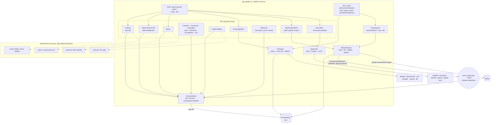
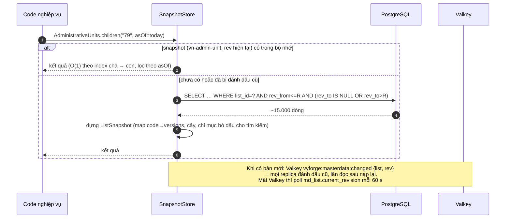
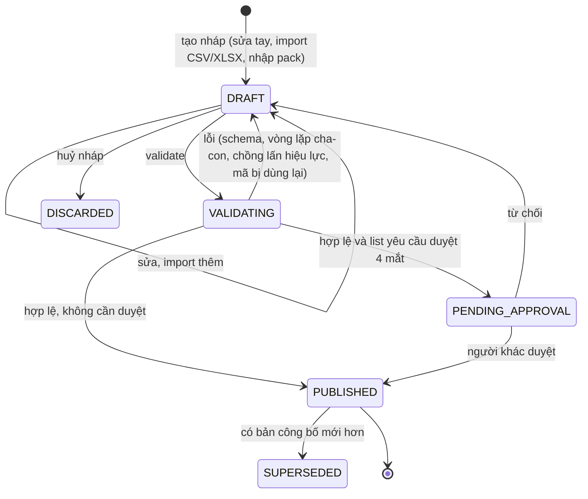
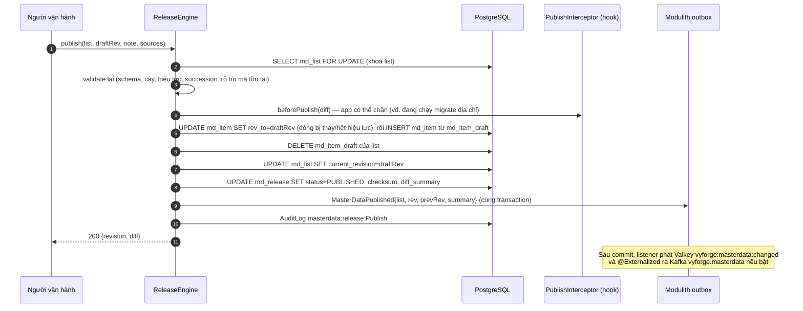
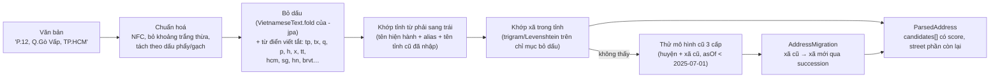
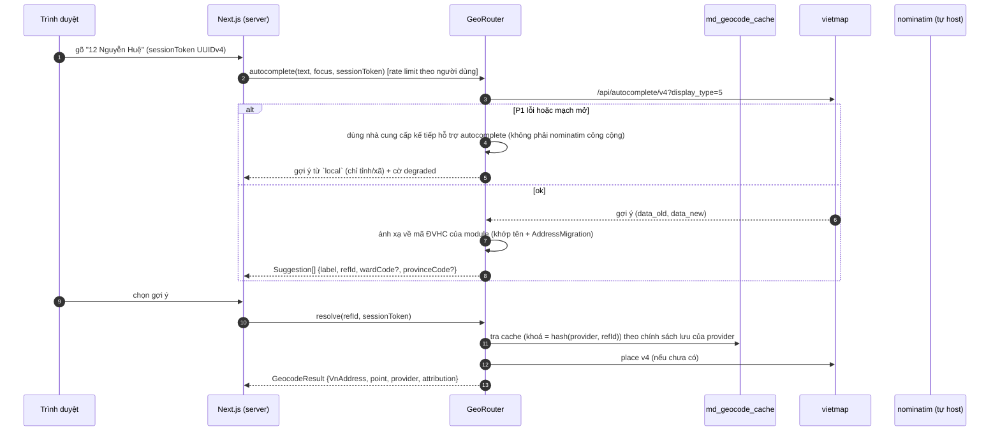
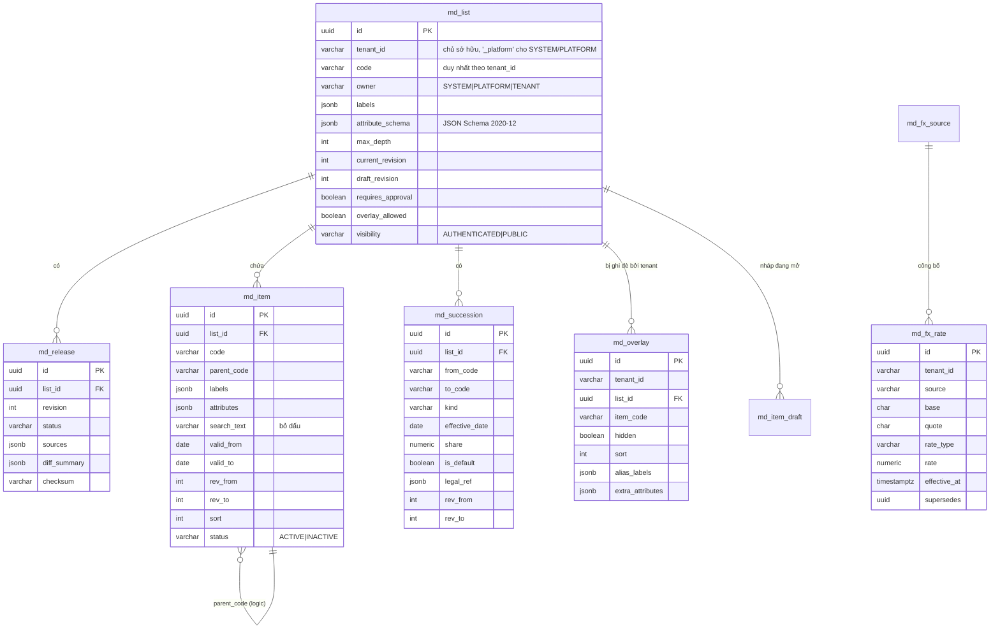

# Thiết kế: `platform-starter-master-data` và `@vyforge/master-data`

> Trạng thái: **thiết kế, chờ duyệt** (forge-38, 27/10/2026). Nhánh `docs/design-master-data`.
> Theo `module-conventions.md` (mục 1–6) và kiến trúc admin microfrontend đã chốt trong
> `docs/design/platform-services.md` (D1–D10, mục 4.11–4.12, 5.1–5.2). Phạm vi bổ sung theo
> `docs/research/2026-10-gap-analysis.md` mục 3: tỷ giá, lịch nghỉ quốc gia (chia ranh giới với `calendar`, forge-55),
> danh mục ngân hàng có BIN NAPAS dùng chung với `payment`.

Danh mục dùng chung (master data) là dữ liệu tham chiếu mà mọi app đều cần nhưng không app nào nên tự giữ một bản:
đơn vị hành chính VN, ngân hàng, quốc gia, tiền tệ, tỷ giá, lịch nghỉ, mã ngành… cùng với danh mục do tenant tự định
nghĩa. Module này giữ **một nguồn sự thật có version và ngày hiệu lực**, phát hành thay đổi dưới dạng **bản phát hành
(release)** có diff, nguồn văn bản và event, rồi phân phối tới app bằng snapshot trong bộ nhớ, ETag và kênh xoá cache.

## Mục lục

- [0. Tóm tắt quyết định](#0-tóm-tắt-quyết-định)
- [1. Bài toán và phạm vi](#1-bài-toán-và-phạm-vi)
- [2. Nghiên cứu](#2-nghiên-cứu)
- [3. Kiến trúc](#3-kiến-trúc)
- [4. Mô hình dữ liệu](#4-mô-hình-dữ-liệu)
- [5. API](#5-api)
- [6. Mở rộng](#6-mở-rộng)
- [7. Vận hành](#7-vận-hành)
- [8. Bảo mật và tuân thủ](#8-bảo-mật-và-tuân-thủ)
- [9. Kế hoạch triển khai](#9-kế-hoạch-triển-khai)
- [9a. Đóng gói và triển khai độc lập](#9a-đóng-gói-và-triển-khai-độc-lập)
- [10. Lệch quy ước và quyết định](#10-lệch-quy-ước-và-quyết-định)
- [Phụ lục A. Ranh giới với các module khác](#phụ-lục-a-ranh-giới-với-các-module-khác)
- [Phụ lục B. Nguồn đã kiểm](#phụ-lục-b-nguồn-đã-kiểm)

---

## 0. Tóm tắt quyết định

| # | Quyết định | Lý do ngắn |
|---|---|---|
| M1 | **Một lõi danh mục tổng quát** (`list` → `item`), dùng cho cả danh mục hệ thống (quốc gia, tiền tệ, ĐVHC, ngân hàng, VSIC, dân tộc, nghề nghiệp, đơn vị tính, ngôn ngữ, lịch nghỉ) lẫn danh mục do tenant tự tạo. Mỗi loại có **facade Java có kiểu** (`AdministrativeUnits`, `Banks`, `Countries`, `Currencies`, `PublicHolidays`…) đọc từ lõi này | Một bộ máy version, hiệu lực, import/export, phân phối, admin cho mọi danh mục. Thêm danh mục mới là thêm dữ liệu và schema thuộc tính, không thêm bảng |
| M2 | **Hai trục thời gian.** *Hiệu lực nghiệp vụ* (`valid_from`/`valid_to`: xã Lộc Ninh thành phường từ 30/4/2026) và *bản phát hành* (`rev_from`/`rev_to`: dữ liệu được công bố trong revision nào). Đọc theo "ngày hiệu lực X, revision R" | Mã ĐVHC giữ nguyên nhưng tên và loại đổi (Đồng Nai: tỉnh → thành phố, mã 75). Phải trả lời được cả "địa chỉ này đúng vào ngày ký hợp đồng 2024" lẫn "hôm qua app thấy bản nào" |
| M3 | **Đồ thị kế thừa (`succession`)** giữa các mục: gộp, tách, đổi tên, đổi loại, đổi mã, có tỉ lệ hoặc cờ "mặc định" khi tách | Một bảng dùng cho ĐVHC 63→34 tỉnh (≈10.000 dòng ánh xạ xã cũ → xã mới), VSIC 2018↔2025, ngân hàng đổi tên (OceanBank → MBV), tiền tệ (BGN → EUR từ 01/01/2026) |
| M4 | **Thay đổi đi qua bản phát hành.** Sửa vào bản nháp; công bố tạo revision mới, có diff, nguồn văn bản, người duyệt (tuỳ chọn 4 mắt); phát event `MasterDataPublished`. Không sửa thẳng dữ liệu đã công bố | Danh mục là dữ liệu có hệ quả pháp lý, cần audit và rollback |
| M5 | **Dữ liệu hệ thống phát hành dạng *data pack*** (JSON nén, ký Ed25519), cập nhật không cần deploy: người vận hành nhập pack (file hoặc URL), xem diff, công bố. Bản pack ban đầu đóng sẵn trong starter làm seed | ĐVHC đổi nhiều lần sau 2025 (CV 1123/CTK-CSCL ngày 05/05/2026; NQ 36/2026/QH16, 39/2026/QH16…). Không thể chờ release platform mỗi lần |
| M6 | **Phục vụ đọc từ snapshot bất biến trong bộ nhớ** theo `(list, revision)`, xoá cache qua event và kênh Valkey `vyforge:masterdata:changed`, poll dự phòng. REST có `ETag = "<list>@<revision>"`, `304`, `Cache-Control` | Danh mục lớn nhất (ĐVHC cả cũ lẫn mới) chỉ khoảng 15.000 mục; tra cứu O(1), không chạm DB |
| M7 | **Địa chỉ VN là value object, không phải bảng của module.** Module cung cấp `VnAddress`, `@Embeddable AddressColumns`, chuẩn hoá, parse, chuyển địa chỉ cũ sang mới, định dạng hiển thị; app tự lưu địa chỉ của mình | Địa chỉ của người dùng là dữ liệu cá nhân của app (Luật 91/2025). Module không trở thành kho PII thứ hai |
| M8 | **Geocoding và autocomplete là SPI**, adapter `nominatim`, `vietmap`, `goong`, `google`, `local` (chỉ ĐVHC). Chọn theo tenant, có chuỗi dự phòng, cache theo chính sách của từng nhà cung cấp | Mỗi nhà cung cấp có điều khoản khác nhau (Nominatim công cộng cấm autocomplete, tối đa 1 req/s; Google hạn chế lưu kết quả) |
| M9 | **Tỷ giá là chuỗi thời gian riêng** (`md_fx_rate`), không đi qua lõi danh mục. SPI `ExchangeRateSource` (Vietcombank, ECB, SBV nhập tay/file, manual), loại tỷ giá (mua tiền mặt, mua chuyển khoản, bán, trung tâm, giữa), **chính sách theo mục đích** (`invoice`, `accounting`, `display`) cấu hình theo tenant | Ghi nhiều lần mỗi ngày, cần lịch sử bất biến. Quy tắc chọn tỷ giá là của nghiệp vụ (kế toán, hoá đơn), module chỉ cho chọn và ghi lại tỷ giá đã dùng |
| M10 | **Ranh giới với `calendar`.** master-data giữ *dữ liệu lịch nghỉ quốc gia* (ngày nghỉ, ngày nghỉ bù, ngày làm bù theo từng năm, nguồn văn bản, version). `calendar` giữ *tính toán* (âm lịch, lịch làm việc của tenant, `addBusinessDays`, SLA, nhắc việc) và đọc dữ liệu qua `PublicHolidays` khi có cài | Một nơi công bố, nhiều nơi dùng. Âm lịch VN tính theo UTC+7 nên thuật toán thuộc về calendar, không nhân đôi |
| M11 | **Ranh giới với `payment`.** Danh mục ngân hàng (BIN NAPAS, SWIFT, mã CITAD 3 số của hệ thống, cờ hỗ trợ VietQR/Napas247) nằm ở master-data; payment chỉ giữ `bankBin` trong cấu hình merchant và gọi `Banks` khi có cài để kiểm, hiển thị tên, logo | Payment hiện để `bankName` nhập tay (`SepayProvider`). Tránh hai nơi giữ cùng danh mục |
| M12 | **Starter nhúng là mặc định**, chạy được trong `platform-services` và ở `mode: remote` (app đọc snapshot từ server, cùng interface Java) | D7, D8 của platform-services. Danh mục là dữ liệu đọc nhiều, rất hợp với remote + cache |

---

## 1. Bài toán và phạm vi

### 1.1 Use case

| Nhóm | Hiện tại | Tương lai gần |
|---|---|---|
| Địa chỉ VN | Chọn tỉnh → xã/phường theo mô hình 2 cấp sau 01/07/2025; nhập địa chỉ tự do rồi chuẩn hoá; đổi địa chỉ cũ (3 cấp, 63 tỉnh) sang mới; hiển thị địa chỉ đúng định dạng | Gợi ý địa chỉ có số nhà, đường (autocomplete qua VietMap/Goong); geocode để tính phí giao hàng, phân vùng phục vụ; kiểm điểm thuộc xã nào |
| Danh mục hệ thống | Quốc gia, tiền tệ, ngôn ngữ, ngân hàng, dân tộc, nghề nghiệp, VSIC, đơn vị tính cho form, báo cáo, hoá đơn, eKYC | Danh mục ngành khác (mã bệnh ICD, mã HS), tài liệu chuẩn của bộ ngành nhập qua pack |
| Danh mục của tenant | Loại khách hàng, kênh bán, lý do huỷ, nhóm sản phẩm có phân cấp, đa ngôn ngữ, có hiệu lực | Danh mục dùng làm lựa chọn của `custom-fields`, `forms`; đồng bộ với ERP bên ngoài |
| Tỷ giá | Hiển thị giá theo ngoại tệ; quy đổi khi thanh toán Stripe bằng USD | Billing đa tiền tệ, đánh giá lại chênh lệch tỷ giá cuối kỳ (kế toán) |
| Lịch nghỉ quốc gia | Cung cấp cho `calendar` để tính ngày làm việc (SLA 2 ngày làm việc của privacy-dsr) | Lịch của nước khác cho khách hàng có chi nhánh ngoài VN |

### 1.2 Kịch bản nghiệp vụ phải đáp ứng

| # | Kịch bản | Đặc thù | Cách đáp ứng | Khi nào |
|---|---|---|---|---|
| K1 | Form đăng ký: chọn "Thành phố Hồ Chí Minh" rồi chọn "Phường Tân Sơn". Danh sách xã phải đúng hiện trạng sau 01/07/2025 (34 tỉnh, 3.321 xã theo QĐ 19/2025/QĐ-TTg) | VN | List `vn-admin-unit`, facade `AdministrativeUnits.children(provinceCode, asOf)`; component `AdminUnitSelect`; snapshot + ETag | Hiện tại |
| K2 | CRM có 200.000 khách hàng lưu địa chỉ 3 cấp cũ (Phường 12, Quận Gò Vấp, TP HCM). Cần chuyển hàng loạt sang địa chỉ mới, đánh dấu bản ghi cần người xác nhận khi xã cũ bị **tách** vào nhiều xã mới | VN | `AddressMigration.convert(legacy)` dùng đồ thị succession; kết quả `EXACT` / `DEFAULT_OF_SPLIT` (kèm danh sách ứng viên) / `UNRESOLVED`; job của app gọi theo lô | Hiện tại |
| K3 | Ngày 30/4/2026 tỉnh Đồng Nai thành thành phố Đồng Nai (mã 75 giữ nguyên) và 10 xã thành phường (CV 1123/CTK-CSCL). Người vận hành nhập pack mới; app tự cập nhật trong vòng 1 phút, không deploy | VN | Data pack ký số → bản nháp → diff → công bố → event + Valkey; item temporal (`valid_from = 2026-04-30`) | Hiện tại |
| K4 | Hợp đồng ký năm 2024 phải in lại đúng địa chỉ theo tên ĐVHC tại ngày ký | VN, pháp lý | Đọc theo `asOf = 2024-…`; item cũ còn trong DB với `valid_to` | Hiện tại |
| K5 | Người dùng gõ "70 nguyen sy sach, tan son, hcm" hoặc "P.12, Q.Gò Vấp, TP.HCM" | VN | `AddressParser` (bỏ dấu, từ viết tắt, alias tên cũ), trả ứng viên có điểm tin cậy | Hiện tại |
| K6 | Cấu hình merchant VietQR: chọn ngân hàng từ danh sách, BIN 6 số tự điền, hiện logo; payment không giữ bảng ngân hàng riêng | VN | List `bank`, facade `Banks.byBin("970436")`, `Banks.list(filter: vietQr)`; component `BankSelect` | Hiện tại |
| K7 | Ngân hàng đổi tên (CBBank → VCBNeo 17/1/2025, DongA Bank → Vikki 14/2/2025, OceanBank → MBV 18/12/2024). Báo cáo cũ vẫn hiện tên cũ, giao dịch mới hiện tên mới | VN | Temporal item + succession `RENAME` | Hiện tại |
| K8 | Hoá đơn xuất bằng USD cần ghi tỷ giá quy đổi tại thời điểm giao dịch; doanh nghiệp chọn tỷ giá mua chuyển khoản của ngân hàng nơi mở tài khoản | VN, thuế | `ExchangeRates.convert(…, purpose = INVOICE)`; chính sách theo tenant (`source = vietcombank`, `type = BUY_TRANSFER`); trả `FxQuote` có `rateId` để app lưu kèm chứng từ | Hiện tại |
| K9 | Ngày nghỉ Tết 2027, nghỉ bù, làm bù do Thủ tướng/Bộ Nội vụ công bố cuối năm; `calendar` cập nhật ngay để SLA "2 ngày làm việc" của privacy-dsr tính đúng | VN, Luật 91/2025 | List `holiday-day:VN` (theo ngày), `holiday-day:VN-GOV` (khu vực công có hoán đổi); event `MasterDataPublished` → calendar xoá cache | Hiện tại |
| K10 | Tenant tạo danh mục "Nhóm sản phẩm" 3 cấp, nhãn vi/en, nhập từ Excel 2.000 dòng, sửa vài mục, công bố bản mới; app báo cáo thấy bản mới, báo cáo quý trước vẫn đọc bản cũ | Chung | Danh mục tenant + import CSV/XLSX + release | Hiện tại |
| K11 | Tenant chỉ bán ở 5 tỉnh: ẩn các tỉnh khác trong form của mình, đổi thứ tự, thêm nhãn riêng ("Sài Gòn") cho tỉnh của platform | Chung | Overlay của tenant trên danh mục platform (`hidden`, `sort`, `alias`) | Hiện tại |
| K12 | Đăng ký doanh nghiệp: chọn ngành cấp 4 VSIC 2025 (QĐ 36/2025/QĐ-TTg, hiệu lực 15/11/2025); hồ sơ cũ theo VSIC 2018 vẫn tra được và có bảng chuyển đổi | VN | List `vsic` có 5 cấp, temporal; succession 2018↔2025 nhập từ bảng chuyển đổi của Cục Thống kê | Hiện tại |
| K13 | eKYC đọc CCCD: "Dân tộc: Kinh", "Quốc tịch: Việt Nam", nơi thường trú theo ĐVHC mới; chuẩn hoá về mã | VN | List `ethnicity` (54 dân tộc, mã 01–54 theo QĐ 121-TCTK/PPCĐ), `country`; `AddressParser` | Hiện tại |
| K14 | App giao hàng: geocode địa chỉ để tính khoảng cách; dùng VietMap cho tenant trả phí, Nominatim tự host cho tenant khác; VietMap lỗi thì dùng Nominatim | VN | SPI `Geocoder`, chuỗi dự phòng, circuit breaker, cache | Hiện tại |
| K15 | Ô nhập địa chỉ gợi ý khi gõ ("12 Ng" → "12 Nguyễn Huệ, Phường Sài Gòn, TP HCM"), có session token để tính phí đúng | VN | SPI `PlaceAutocomplete` (`vietmap` v4 `display_type=1`, `goong`, `google`), `local` khi không có nhà cung cấp | Hiện tại |
| K16 | Billing đánh giá lại công nợ ngoại tệ cuối tháng theo tỷ giá đã chốt ngày 31; đổi nguồn tỷ giá không làm đổi số đã chốt | Kế toán | Tỷ giá bất biến (`md_fx_rate` chỉ thêm, sửa = dòng mới `supersedes`), `FxQuote.rateId` | Tương lai |
| K17 | Bulgaria dùng EUR từ 01/01/2026: BGN hết hiệu lực trong danh mục tiền tệ, dữ liệu cũ vẫn hiện BGN | Chung | Temporal + succession `REPLACED_BY` | Hiện tại |
| K18 | Khách hàng on-prem không ra Internet: nhập pack bằng file, tỷ giá nhập tay hoặc file CSV từ ngân hàng | VN | Pack offline; adapter `manual`, `file` | Hiện tại |
| K19 | Hai app (CRM, HRM) cùng dùng danh mục; bật `platform-services` để chỉ một nơi quản trị, app ở `mode: remote` | Chung | Chế độ remote đọc snapshot qua `/internal/snapshots/{list}`, cùng interface | Hiện tại |
| K20 | `search` cần synonym "Bình Dương" ↔ "Thành phố Hồ Chí Minh" (tỉnh đã nhập) để người dùng gõ tên cũ vẫn tìm ra | VN | `SynonymSource` của search đọc alias và succession qua `AdministrativeUnits.aliases()` | Hiện tại |
| K21 | `custom-fields`/`forms` cho trường "chọn từ danh mục X" (của platform hoặc tenant), kiểm giá trị hợp lệ ở server | Chung | `Lookups.validate(list, code, asOf)`; JSON Schema `x-vyforge-lookup` | Hiện tại |
| K22 | Mã bưu chính 5 số trên nhãn gửi hàng | VN | Thuộc tính `postalCode` của item ĐVHC (nguồn: bộ dữ liệu của thanglequoc từ v5.0.0, cần đối chiếu Bưu điện VN) | Tương lai |

### 1.3 Không thuộc phạm vi

- **Kho địa chỉ của người dùng, danh bạ khách hàng.** Thuộc app hoặc module `contacts` (P2 trong gap analysis). Module chỉ
  cung cấp kiểu dữ liệu, chuẩn hoá và chuyển đổi.
- **Ranh giới hành chính dạng đa giác (GIS) và kiểm điểm-thuộc-xã.** Để bản sau (mục 9.4): dữ liệu GIS của
  thanglequoc v4.0.0+ có sẵn nhưng nặng và cần PostGIS.
- **Tính toán lịch làm việc, âm lịch, SLA.** Thuộc `calendar`.
- **Sổ cái, đánh giá lại chênh lệch tỷ giá.** Thuộc payment/billing/kế toán; module chỉ cấp tỷ giá.
- **Quản trị dữ liệu chủ kiểu MDM doanh nghiệp** (khử trùng khách hàng, golden record, đối sánh nhà cung cấp). Đó là
  "master data" theo nghĩa SAP MDG; module này là *reference data*. Ghi rõ để không bị kéo phạm vi.

---

## 2. Nghiên cứu

Mọi nguồn dưới đây kiểm bằng WebSearch/WebFetch/curl ngày 27/10/2026. Chỗ nào chỉ có nguồn thứ cấp thì ghi
**(nguồn thứ cấp)**; chỗ chưa kiểm được thì ghi **(chưa kiểm chứng)**.

### 2.1 Văn bản pháp lý và danh mục chính thức của VN

| Văn bản | Nội dung dùng cho module | Hiện trạng đã kiểm |
|---|---|---|
| **Nghị quyết 202/2025/QH15** về sắp xếp ĐVHC cấp tỉnh | 34 tỉnh, thành (28 tỉnh, 6 thành phố); 11 tỉnh không sắp xếp | Thông qua và hiệu lực 12/06/2025; chính quyền mới hoạt động từ 01/07/2025 ([TVPL](https://thuvienphapluat.vn/hoi-dap-phap-luat/danh-sach-34-tinh-thanh-cua-viet-nam-nam-2025-gom-nhung-tinh-nao-138053361.html), [Báo Lào Cai](https://baolaocai.vn/nghi-quyet-cua-quoc-hoi-ve-sap-xep-don-vi-hanh-chinh-cap-tinh-post403219.html)) (nguồn thứ cấp) |
| Các nghị quyết của UBTVQH ngày 16/06/2025 về sắp xếp ĐVHC cấp xã của từng tỉnh | Danh sách xã mới, xã cũ nào gộp vào đâu | Là căn cứ của CV 1027/CTK-CSCL ([TVPL](https://thuvienphapluat.vn/cong-van/Bo-may-hanh-chinh/Cong-van-1027-CTK-CSCL-2025-thong-bao-ma-so-va-ten-don-vi-hanh-chinh-cap-xa-moi-665444.aspx)) |
| Luật Tổ chức chính quyền địa phương 2025 | Mô hình chính quyền 2 cấp (tỉnh, xã), bỏ cấp huyện từ 01/07/2025 | Ghi theo các nguồn trên; số hiệu luật **chưa kiểm chứng** trong phiên này, không dùng làm dữ liệu |
| **Quyết định 19/2025/QĐ-TTg** ngày 30/06/2025 ban hành Bảng danh mục và mã số các ĐVHC Việt Nam | Phụ lục I: 34 mã tỉnh; Phụ lục II: 3.321 mã xã. **Mã là số định danh duy nhất, không đổi trong suốt thời gian đơn vị tồn tại, không dùng lại cho đơn vị khác cùng cấp**. Cục Thống kê (Bộ Tài chính) quản lý | Hiệu lực 01/07/2025 ([Thị trường Tài chính Tiền tệ](https://thitruongtaichinhtiente.vn/bang-danh-muc-va-ma-so-cua-34-tinh-thanh-moi-3-321-don-vi-hanh-chinh-cap-xa-moi-68708.html), [Báo Lào Cai](https://baolaocai.vn/bang-danh-muc-va-ma-so-cua-34-tinh-thanh-moi-3321-don-vi-hanh-chinh-cap-xa-moi-post648007.html)) (nguồn thứ cấp; cần nạp Phụ lục từ bản gốc khi dựng pack) |
| CV 915/CTK-CSCL (16/06/2025), **CV 1027/CTK-CSCL** (25/06/2025), CV 1062/CTK-CSCL (30/06/2025, sửa mã xã Gia Lai) | 1027 công bố danh sách mã xã chính thức từ 01/07/2025 và các xã đổi tên/mã so với 915 | ([TVPL 1027](https://thuvienphapluat.vn/cong-van/Bo-may-hanh-chinh/Cong-van-1027-CTK-CSCL-2025-thong-bao-ma-so-va-ten-don-vi-hanh-chinh-cap-xa-moi-665444.aspx)). Bài học: **danh sách "dự kiến" bị sửa trong vòng 2 tuần**, cần quy trình nháp → công bố |
| **CV 1123/CTK-CSCL** ngày 05/05/2026 | Mã và tên ĐVHC thay đổi từ 02/07/2025 đến 30/04/2026: thành phố Đồng Nai (mã 75, đổi loại từ tỉnh), 10 xã thành phường (vd. 25270 Phường Lộc Ninh) theo NQ 30/2026/QH16, NQ 237/NQ-UBTVQH16 | Hiệu lực 30/04/2026 ([LuatVietnam](https://luatvietnam.vn/hanh-chinh/cong-van-1123-ctl-cscl-2026-cua-cuc-thong-ke-thong-bao-ma-so-va-ten-don-vi-hanh-chinh-moi-434442-d6.html)). Chứng minh: **mã giữ nguyên, loại và tên đổi** → M2 |
| NQ 36/2026/QH16 (Quảng Ninh thành thành phố), NQ 39/2026/QH16 (Bắc Ninh thành thành phố), NQ 388/NQ-UBTVQH16 (12 xã thành phường) | Thay đổi tiếp theo trong 2026 | Theo changelog v5.1.0 (13/09) và v5.2.0 (21/09/2026) của [thanglequoc/vietnamese-provinces-database](https://github.com/thanglequoc/vietnamese-provinces-database/releases) (nguồn thứ cấp). Tổng vẫn 34 tỉnh, 3.321 xã |
| **Quyết định 36/2025/QĐ-TTg** ngày 29/09/2025: Hệ thống ngành kinh tế VN (VSIC 2025) | 5 cấp: 22 / 87 / 259 / 495 / 743 ngành. Thay QĐ 27/2018/QĐ-TTg. Đăng ký doanh nghiệp ghi ngành cấp 4 (NĐ 168/2025/NĐ-CP Điều 7, nguồn thứ cấp). Cục Thống kê có bảng chuyển đổi 2018↔2025 | Hiệu lực 15/11/2025 ([TVPL](https://thuvienphapluat.vn/van-ban/Thuong-mai/Decision-36-2025-QD-TTg-promulgating-vietnam-standard-industrial-classification-678859.aspx?tab=1), [KPMG](https://assets.kpmg.com/content/dam/kpmg/vn/pdf/2025/11/legal-update-decision-36-vi.pdf), [Tạp chí Kinh tế Tài chính](https://tapchikinhtetaichinh.vn/xay-dung-bang-chuyen-doi-nganh-kinh-te-phuc-vu-tong-dieu-tra-kinh-te-nam-2026-135661.html)) |
| **Quyết định 34/2020/QĐ-TTg**: Danh mục nghề nghiệp VN | 5 cấp (cấp 1 là bậc kỹ năng) | Hiệu lực 15/01/2021, chưa thấy văn bản thay thế ([Luật Minh Khuê](https://luatminhkhue.vn/van-ban/quyet-dinh-34-2020-qd-ttg-danh-muc-nghe-nghiep-viet-nam.aspx)) (nguồn thứ cấp) |
| **Quyết định 121-TCTK/PPCĐ** ngày 02/03/1979: Danh mục các thành phần dân tộc VN | 54 dân tộc, mã 01 (Kinh) … 54. Ủy ban Dân tộc yêu cầu ghi mục dân tộc trên giấy tờ theo danh mục này (CV 40/UBDT-DTTS 2018); một số tên còn tranh luận (Mông/H'Mông), chưa có văn bản sửa | ([Tạp chí Viện Dân tộc học](https://vjol.info.vn/tapchiviendantochoc/article/download/127032/104189/), [TVPL CV 40](https://thuvienphapluat.vn/cong-van/Quyen-dan-su/Cong-van-40-UBDT-DTTS-2018-huong-dan-ghi-muc-dan-toc-tren-so-ho-khau-chung-minh-nhan-dan-372726.aspx), [TVPL CV 1488/2022](https://thuvienphapluat.vn/cong-van/Van-hoa-Xa-hoi/Cong-van-1488-UBDT-CSDT-2022-cach-ghi-ten-cac-thanh-phan-dan-toc-Viet-Nam-530587.aspx)) → cần alias cho tên gọi khác |
| **Thông tư 17/2015/TT-NHNN**: hệ thống mã ngân hàng (mã CITAD 8 ký tự: 2 tỉnh + 3 hệ thống + 3 đơn vị) | Thuộc tính `citadSystemCode` (3 ký tự) của ngân hàng; mã chi nhánh để bản sau | ([caselaw.vn](https://caselaw.vn/van-ban-phap-luat/263387-thong-tu-so-17-2015-tt-nhnn-ngay-21-10-2015-cua-thong-doc-ngan-hang-nha-nuoc-viet-nam-quy-dinh-ve-he-thong-ma-ngan-hang-dung-trong-hoat-dong-nghiep-vu-ngan-hang)) — **chưa kiểm hiệu lực hiện hành** |
| Lịch nghỉ: Bộ luật Lao động 2019 Điều 112; **NQ 28/2026/QH16** bổ sung 24/11 (Ngày Văn hoá Việt Nam) là ngày nghỉ hưởng nguyên lương | Định nghĩa ngày lễ (`holiday`), dữ liệu ngày nghỉ theo năm | NQ 28/2026: thông qua 24/04/2026, hiệu lực 01/07/2026 ([Báo Văn hoá](https://baovanhoa.vn/doi-song/tin-vui-tu-17-nguoi-lao-dong-chinh-thuc-co-them-1-ngay-nghi-huong-nguyen-luong-241964.html), [Cần Thơ PBGDPL](https://pbgdpl.cantho.gov.vn/mo-rong-quyen-loi-nguoi-lao-dong-va-chinh-thuc-co-them-01-ngay-nghi-le-huong-nguyen-luong)) (nguồn thứ cấp). Kiểm chi tiết là việc của calendar; master-data chỉ cần mô hình chứa được |
| Tỷ giá: NHNN công bố tỷ giá trung tâm VND/USD hằng ngày (từ 04/01/2016, QĐ 2730/QĐ-NHNN) và tỷ giá tính chéo | Nguồn `sbv` | ([VnExpress](https://vnexpress.net/ty-gia-bat-dau-theo-co-che-moi-3337090.html)) — QĐ 2730 **chưa kiểm hiệu lực hiện hành**; định dạng trang sbv.gov.vn hiện tại chưa kiểm, nên bản đầu cho nhập tay/file |
| Tỷ giá trên hoá đơn: NĐ 123/2020 sửa bởi **NĐ 70/2025/NĐ-CP**, hướng dẫn bởi **TT 32/2025/TT-BTC** (hiệu lực 01/06/2025, thay TT 78/2021) | Hoá đơn ngoại tệ ghi tỷ giá tại thời điểm giao dịch | ([TVPL TT 32](https://thuvienphapluat.vn/van-ban/thue-phi-le-phi/thong-tu-32-2025-tt-btc-huong-dan-thuc-hien-luat-quan-ly-thue-ve-hoa-don-chung-tu-659105.aspx), [PwC](https://www.pwc.com/vn/vn/publications/2025/250416-changes-to-invoicing-regulations.pdf)). **Điều khoản cụ thể về loại tỷ giá chưa kiểm chứng** → module không cứng hoá quy tắc, để tenant chọn chính sách (M9) |

**Bản quyền dữ liệu từ văn bản pháp luật.** Danh mục trong phụ lục của văn bản quy phạm pháp luật không thuộc đối tượng
bảo hộ quyền tác giả (Luật Sở hữu trí tuệ, Điều 15 — **cần pháp chế xác nhận** cho từng nguồn). Dữ liệu tổng hợp lại
từ dự án OSS thì theo license của dự án đó (mục 2.2).

### 2.2 Nguồn dữ liệu máy đọc được

| Nguồn | Version / ngày | License | Dùng cho | Ghi chú |
|---|---|---|---|---|
| [thanglequoc/vietnamese-provinces-database](https://github.com/thanglequoc/vietnamese-provinces-database) | v5.2.0 (21/09/2026), 1.839 sao | **MIT** | Seed ĐVHC hiện hành: `provinces` (34), `wards` (3.321), `administrative_units`, mã bưu chính (v5.0.0+), GIS (v4.0.0+) | Theo QĐ 19/2025 và các NQ 2026. Ghi rõ "API SOAP của TCTK chưa cập nhật mô hình 34 tỉnh" nên dữ liệu lấy từ văn bản. **Không có bảng ánh xạ cũ → mới**, chỉ có bảng trước/sau trong release note |
| [tranngocminhhieu/vietnamadminunits](https://github.com/tranngocminhhieu/vietnamadminunits) | cập nhật 08/10/2025 | **MIT** | Ánh xạ 63 tỉnh (10.040 xã cũ) → 34 tỉnh: `convert_legacy_2025_with_location_and_default_ward.csv`, cờ `isDividedWard`, `isDefaultNewWard`; toạ độ tâm | Nguồn chính cho succession 2025. Nghiên cứu cách họ chọn "xã mới mặc định" khi xã cũ bị tách (CHALLENGES.md) |
| [quangtam/vietnam-address-database](https://github.com/quangtam/vietnam-address-database) | 1.0.0 | README ghi MIT, GitHub **không nhận diện được file LICENSE** | Đối chiếu chéo (10.977 luật ánh xạ) | Không dùng làm nguồn chính cho tới khi rõ license |
| Dịch vụ SOAP `danhmuchanhchinh.gso.gov.vn/DMDVHC.asmx` | — | Dữ liệu nhà nước | Lẽ ra là nguồn gốc | **Không kết nối được** ngày 27/10/2026 (curl trả mã 000); thanglequoc ghi chưa cập nhật mô hình 34 tỉnh. Adapter `gso-soap` để bản sau, khi dịch vụ ổn định |
| [Unicode CLDR](https://github.com/unicode-org/cldr-json) | **49.0.0** (22/10/2026) | Unicode License v3 | Tên quốc gia, tiền tệ, ngôn ngữ bằng vi/en; ký hiệu tiền tệ; tiền tệ của từng lãnh thổ có ngày | CLDR 48.2 ngày 17/03/2026 là bản bảo trì trước đó ([Unicode blog](https://blog.unicode.org/2026/03/unicode-icu-783-and-cldr-482-released.html)) |
| [SIX ISO 4217 List One](https://www.six-group.com/dam/download/financial-information/data-center/iso-currrency/lists/list-one.xml) | `Pblshd="2026-09-17"`, 280 mục | Dùng tự do theo SIX (cơ quan duy trì ISO 4217) | Mã chữ, mã số, số chữ số thập phân (`CcyMnrUnts`) | Đã tải và đếm bằng curl. Bulgaria dùng EUR từ 01/01/2026 (trang SIX, nguồn thứ cấp) |
| ISO 3166-1 | — | Mã là dữ kiện; ISO bán bản đầy đủ | alpha-2/alpha-3/numeric | Lấy mã từ CLDR (`territories`, `codeMappings`), không chép ISO OBP |
| [datasets/country-codes](https://github.com/datasets/country-codes) | cập nhật 15/10/2026 | Không có LICENSE nhận diện được (README ghi ODC-PDDL) | Đối chiếu chéo mã điện thoại, mã ISO | Chỉ đối chiếu |
| [VietQR banks API](https://api.vietqr.io/v2/banks) | 76 mục (27/10/2026) | **Không có điều khoản sử dụng công bố** | Đối chiếu BIN, mã ngắn (`VCB`, `ICB`), SWIFT, cờ `transferSupported`, `lookupSupported` | Gồm cả ví (ViettelMoney BIN 971005, MoMo, ZaloPay). NAPAS **không công bố bảng BIN máy đọc được** (đã tìm, không thấy). Pack ngân hàng do Vyforge tự biên soạn từ dữ kiện (BIN, SWIFT là dữ kiện), **không chép logo** của cdn.vietqr.io |
| UNECE Recommendation 20 (đơn vị đo) | Rev. 14e (2020, nguồn thứ cấp qua [datahub](https://datahub.io/core/unece-units-of-measure)) | Công bố tự do của UNECE | Mã đơn vị chuẩn (`KGM`, `MTR`, `H87` cái) cho hoá đơn điện tử quốc tế, Peppol | Kèm danh sách đơn vị tính thông dụng ở VN (cái, chiếc, hộp, thùng…) do Vyforge biên soạn |
| [Vietcombank tỷ giá](https://www.vietcombank.com.vn/api/exchangerates?date=2026-10-27) | JSON theo ngày, 20 ngoại tệ (`cash`, `transfer`, `sell`) | Công khai, không có điều khoản API | Adapter `vietcombank` | Đã gọi thử, HTTP 200. XML cũ `portal.vietcombank.com.vn/Usercontrols/TVPortal.TyGia/pXML.aspx` có dòng **"For reference only. Only one request every 5 minutes!"** → giới hạn tần suất của adapter |
| [ECB euro reference rates](https://www.ecb.europa.eu/stats/eurofxref/eurofxref-daily.xml) | Hằng ngày làm việc | Dùng tự do, ghi nguồn | Adapter `ecb` (tỷ giá chéo quốc tế) | HTTP 200 khi kiểm |

### 2.3 So sánh hệ thống tham khảo

| Hệ thống | Version, license | Mô hình dữ liệu | API | Điểm mạnh | Điểm yếu |
|---|---|---|---|---|---|
| **Odoo** (`base`: `res.country`, `res.country.state`, `res.currency`, `res.currency.rate`) | 19.0, LGPL-3.0 (Community) | Mỗi danh mục một model. `res.country` có `address_format`, `state_required`, `zip_required`, `name_position`, `vat_label`. `res.currency`: `name` (ISO 4217, `size=3`), `iso_numeric`, `rounding`, `decimal_places`, `position`. `res.currency.rate`: `name` (ngày), `rate`, `company_rate`, `inverse_company_rate`, `company_id`; ràng buộc **duy nhất theo (ngày, tiền tệ, công ty)** (đọc mã nguồn nhánh 19.0) | ORM/JSON-RPC; tỷ giá live qua module `currency_rate_live` (nguồn thứ cấp) | Tỷ giá theo công ty (= tenant) và theo ngày; định dạng địa chỉ theo quốc gia | Không có hiệu lực theo thời gian cho tỉnh; mỗi ngày một tỷ giá, không phân loại mua/bán; không có ánh xạ ĐVHC cũ → mới. Danh mục mới phải viết model |
| **ERPNext / Frappe** (`Country`, `Address Template`, `Currency Exchange`) | develop 26/10/2026, GPL-3.0 | `Currency Exchange`: `date`, `from_currency`, `to_currency`, `exchange_rate`, `for_buying`, `for_selling` (đọc doctype JSON). Address Template là Jinja theo quốc gia, có template mặc định | REST tự sinh cho mọi DocType | **Cờ mua/bán trên tỷ giá**; template địa chỉ theo quốc gia; DocType tuỳ biến cho danh mục tự tạo | Không version danh mục; không hiệu lực; không có ĐVHC VN |
| **Salesforce Global Value Set** | Metadata API 264.0 | Tập giá trị dùng chung cho nhiều picklist; tối đa **1.000 giá trị kể cả giá trị đã tắt**; giá trị bị bỏ khỏi định nghĩa khi deploy thì **bị tắt chứ không xoá**; API trả cả giá trị tắt, UI chỉ cho chọn giá trị đang bật ([GlobalValueSet](https://developer.salesforce.com/docs/atlas.en-us.264.0.api_meta.meta/api_meta/meta_globalvalueset.htm)) | Metadata API, deploy như code | Không xoá mã đã dùng, chỉ tắt; một nơi định nghĩa, nhiều nơi dùng | Không phân cấp, không hiệu lực, không đa ngôn ngữ trong giá trị (dùng Translation Workbench riêng) |
| **SAP Master Data Governance** | S/4HANA | Change request có workflow: tạo → staging → duyệt → kích hoạt → phân phối; nhiều CR song song cho một đối tượng (từ MDG 7.0) ([SAP](https://www.sap.com/documents/2015/07/0cd0ad52-5b7c-0010-82c7-eda71af511fa.html), [SAP Learning](https://learning.sap.com/courses/introducing-sap-master-data-governance/introducing-central-governance-of-master-data)) | SOA/OData, phân phối qua DRF | Vùng staging tách khỏi dữ liệu thật; phân phối có kiểm soát | Nặng, thương mại; quá mức cho reference data |
| **thanglequoc/vietnamese-provinces-database** | v5.2.0, MIT | `provinces`, `wards`, `administrative_units` (5 loại), `administrative_regions` (đã bỏ liên kết vùng từ v3.0.0 vì sau sáp nhập không rõ tỉnh thuộc vùng nào), bảng metadata `dataset_version`, `latest_decree` | File SQL/JSON/Mongo/Redis/Elasticsearch | Cập nhật nhanh theo văn bản; nhiều định dạng | Chỉ hiện trạng, không có lịch sử trong dữ liệu; không ánh xạ |
| **vietnamadminunits** | MIT | Dataset 63 và 34 tỉnh + ánh xạ có cờ tách | Python `parse_address`, `convert_address` (mode `FROM_2025`, `LEGACY`) | Giải bài xã bị tách bằng xã mặc định + toạ độ | Python, không dùng trực tiếp trong JVM; chỉ một mốc chuyển đổi (`CONVERT_2025`) |
| **Google libaddressinput** | Apache-2.0, 632 sao | Metadata định dạng địa chỉ theo quốc gia (trường bắt buộc, thứ tự, nhãn) | Java/C++ | Chuẩn de-facto cho form địa chỉ quốc tế | Metadata VN có thể còn 3 cấp (**chưa kiểm**); không có danh sách xã |
| **libpostal** | MIT, 4.915 sao | Mô hình CRF học từ OSM | C, binding Java | Parse địa chỉ quốc tế tốt | Mô hình khoảng 2 GB, chưa học mô hình 2 cấp mới của VN; chỉ để adapter tuỳ chọn |

Về **ABP Framework** (LGPL-3.0, 14.461 sao) mà brief nhắc tới: phần lõi mã nguồn mở không có module "lookup" dùng chung
(đã kiểm danh sách module trong repo `abpframework/abp`, không thấy); lookup trong ABP thường là entity riêng của từng
ứng dụng. Không có gì để học thêm ngoài cách `Setting Management` phân tầng giá trị.

### 2.4 Geocoding và autocomplete

| Nhà cung cấp | Điều khoản đã kiểm | Hệ quả cho thiết kế |
|---|---|---|
| **Nominatim công cộng** (OSMF) | Tối đa **1 req/s cho cả ứng dụng**; bắt buộc User-Agent/Referer định danh; **cấm autocomplete**; bulk geocoding hạn chế (≤ 4 req/phút nếu chạy định kỳ), phải cache; ghi công; dữ liệu ODbL; không gửi dữ liệu cá nhân ([chính sách](https://operations.osmfoundation.org/policies/nominatim/)) | Adapter `nominatim` mặc định trỏ tới **Nominatim tự host**; khi trỏ tới máy chủ công cộng thì ép 1 req/s toàn cụm (rule `-ratelimit`), tắt autocomplete, gửi User-Agent cấu hình được |
| **VietMap** Maps API | Autocomplete **v4** (`/api/autocomplete/v4`, `display_type`: 1 = mô hình mới 2 cấp, 2 = cũ 3 cấp, 5/6 = trả cả `data_old` và `data_new`); `ref_id` của v4 khác v3; Place v4 thay Place cũ; có API chuyển đổi địa chỉ cũ/mới ([autocomplete v4](https://maps.vietmap.vn/docs/map-api/autocomplete-version/autocomplete-v4/)) | Adapter `vietmap` dùng v4, `display_type=5` để lấy cả hai dạng rồi ghép với `AddressMigration` của chính module (không phụ thuộc kết quả chuyển đổi của VietMap) |
| **Goong** | API cùng định dạng Google Maps; session token (UUID v4): một phiên gồm nhiều autocomplete và tối đa một Place Detail; tái dùng token thì tính tiền từng request; hai loại key (tiles, REST) ([docs](https://docs.goong.io/help/)) | Adapter `goong` chung khung với `google`; session token do frontend tạo, đi qua BFF |
| **Google Geocoding** | Hạn chế pre-fetch, cache, lưu nội dung; **chỉ `place_id` được lưu vô thời hạn**; kết quả hiển thị trên bản đồ phải là Google Map, nếu không thì phải ghi công ([policies](https://developers.google.com/maps/documentation/geocoding/policies)) | Cache của adapter `google` chỉ lưu `place_id` + TTL ngắn cho toạ độ (cấu hình, mặc định không lưu) |

### 2.5 Học theo và không làm

| Học theo | Từ |
|---|---|
| Mã đã cấp thì không xoá, chỉ hết hiệu lực hoặc tắt; giá trị bị gỡ khỏi bản mới = `valid_to`, không `DELETE` | Salesforce GVS, nguyên tắc mã của QĐ 19/2025 |
| Vùng nháp tách khỏi dữ liệu đã công bố; công bố có duyệt; phân phối có version | SAP MDG (bản rút gọn: một nháp mỗi danh mục) |
| Tỷ giá theo tenant, theo ngày, phân biệt mua/bán | Odoo `company_rate`, ERPNext `for_buying`/`for_selling` |
| Định dạng địa chỉ theo quốc gia bằng template | Odoo `address_format`, ERPNext Address Template, libaddressinput |
| Bảng metadata của dataset (`dataset_version`, `latest_decree`) | thanglequoc v5.1.0 |
| Xã bị tách: chọn xã mặc định và giữ danh sách ứng viên | vietnamadminunits |

| Không làm | Lý do |
|---|---|
| Một bảng riêng cho mỗi danh mục kiểu Odoo | Mỗi danh mục mới lại phải migration, API, admin. Lõi tổng quát + facade có kiểu đủ cho reference data |
| Gọi API của nhà cung cấp dữ liệu (TCTK SOAP, VietQR) lúc chạy để tra cứu | Phụ thuộc mạng ngoài cho đường đọc nóng; dịch vụ TCTK đang không truy cập được. Chỉ dùng chúng khi *dựng pack* |
| Tự viết bộ parse địa chỉ học máy | Quy tắc + từ điển đủ cho K5; libpostal để adapter tuỳ chọn |
| Lưu địa chỉ người dùng trong module | M7 |
| Cứng hoá quy tắc "tỷ giá nào dùng cho hoá đơn" | Văn bản chưa kiểm xong và quy tắc khác nhau theo nghiệp vụ; để chính sách theo tenant |
| MDM khách hàng/nhà cung cấp | Ngoài phạm vi (mục 1.3) |

---

## 3. Kiến trúc

### 3.1 Khái niệm

| Khái niệm | Ý nghĩa | Ví dụ |
|---|---|---|
| **List** (danh mục) | Một tập mã có cùng ý nghĩa, có schema thuộc tính, có thể phân cấp. Định danh bằng `code` (`[a-z][a-z0-9.:-]{1,63}`) | `vn-admin-unit`, `bank`, `country`, `currency`, `vsic`, `holiday-day:VN`, `t.product-group` |
| **Phạm vi (owner)** | `SYSTEM`: do Vyforge phát hành qua pack, tenant chỉ đọc và overlay. `PLATFORM`: người vận hành tự tạo, dùng chung mọi tenant. `TENANT`: tenant tự tạo, chỉ tenant đó thấy | `vn-admin-unit` là SYSTEM; "Kênh bán hàng chuẩn" của một bản on-prem là PLATFORM; `t.product-group` là TENANT |
| **Item** (mục) | Một mã trong một khoảng hiệu lực: `code`, `parent_code`, `labels` (LocalizedText), `attributes` (JSON theo schema), `valid_from`/`valid_to`, `status` | `79` "Thành phố Hồ Chí Minh"; `26734` "Phường Tân Sơn" (cha `79`) |
| **Revision** | Số nguyên tăng dần của mỗi list, tăng khi công bố. Mỗi dòng item mang `rev_from`/`rev_to` | `vn-admin-unit` revision 7 = bộ dữ liệu ngày 21/09/2026 |
| **Release** (bản phát hành) | Bản ghi của một lần công bố: revision, nguồn văn bản, diff tóm tắt, người tạo/duyệt, checksum | "CV 1123/CTK-CSCL: Đồng Nai thành thành phố, 10 xã thành phường" |
| **Succession** | Cạnh có hướng giữa hai mục: `MERGE`, `SPLIT`, `RENAME`, `RETYPE`, `RECODE`, `REPLACED_BY`, có `effective_date`, `share`, `is_default` | Xã cũ `26737` → xã mới `26734` (`MERGE`); `BGN` → `EUR` (`REPLACED_BY`, 2026-01-01) |
| **Overlay** | Ghi đè của tenant trên item SYSTEM/PLATFORM: `hidden`, `sort`, `alias_labels`, `extra_attributes` | Tenant ẩn 29 tỉnh, gắn alias "Sài Gòn" cho `79` |
| **Data pack** | File phát hành dữ liệu SYSTEM (JSON nén, ký số) chứa item, succession, nguồn văn bản | `vn-admin-unit@2026.09.21.pack.json.gz` |

### 3.2 Thành phần



Package (`com.vyforge.platform.masterdata`):

| Package | Nội dung |
|---|---|
| `masterdata` | API công khai: `Lookups`, `ListRef`, `Item`, `ItemQuery`, `LocalizedText` (dùng của `-jpa` khi có), `MasterDataPublished`, mã lỗi |
| `masterdata.vn` | `AdministrativeUnits`, `AdminUnit`, `AdminUnitType`, `AddressMigration`, `VnAddress`, `AddressColumns` (`@Embeddable`) |
| `masterdata.bank` | `Banks`, `Bank` |
| `masterdata.reference` | `Countries`, `Currencies`, `Languages`, `Units`, `Ethnicities`, `Occupations`, `Vsic` (facade mỏng trên `Lookups`) |
| `masterdata.holiday` | `PublicHolidays`, `HolidayDay`, `HolidayKind` |
| `masterdata.fx` | `ExchangeRates`, `FxRate`, `FxQuote`, `RateType`, `FxPurpose`, SPI `ExchangeRateSource` |
| `masterdata.address` | `Addresses`, `AddressParser` (SPI), `ParsedAddress`, `AddressFormatter` |
| `masterdata.geo` | `Geocoding`, `PlaceAutocomplete`, SPI `GeocodingProvider`, `AutocompleteProvider` |
| `masterdata.admin` | `MasterDataAdmin`, `ReleaseDiff`, `PackImporter` |
| `masterdata.spi` | `ListDefinitionContributor`, `ItemValidator`, `PublishInterceptor`, `PackSource` |
| `masterdata.internal` | JDBC, snapshot, engine, REST, auto-config (ArchUnit cấm import từ ngoài module) |

### 3.3 Port và adapter

| Port | Adapter có sẵn | Chọn theo |
|---|---|---|
| `PackSource` (lấy data pack) | `classpath` (seed trong starter), `file` (upload qua admin), `https` (URL + chữ ký, vd. asset của release platform-java) | Cấu hình `vyforge.masterdata.packs.sources` |
| `ExchangeRateSource` | `vietcombank`, `ecb`, `manual`, `file` (CSV/XLSX), `sbv` (bản đầu: nhập file theo mẫu; tự lấy để bản sau) | Platform bật nguồn; tenant chọn nguồn theo mục đích |
| `GeocodingProvider` | `nominatim`, `vietmap`, `goong`, `google`, `local` (chỉ tới cấp xã từ snapshot) | Theo tenant, chuỗi dự phòng |
| `AutocompleteProvider` | `vietmap`, `goong`, `google`, `local` | Theo tenant |
| `AddressParser` | `rule-based` (mặc định), `libpostal` (tuỳ chọn, bản sau) | Cấu hình |
| `ListDefinitionContributor` | Các list SYSTEM của module; app khai báo list của mình | Bean |

### 3.4 Đọc: snapshot bất biến



- `ListSnapshot` chứa **mọi phiên bản hiệu lực** của mọi mã trong revision đó, nên đọc theo `asOf` bất kỳ không cần DB.
- Snapshot SYSTEM/PLATFORM dùng chung mọi tenant; overlay của tenant là lớp mỏng áp lên khi đọc (`TenantView`), cache
  riêng theo `(tenant, list, rev, overlayRev)`.
- Danh mục tenant cũng dùng snapshot, nạp lười, LRU giới hạn số list (mặc định 2.000) và dung lượng ước tính.
- Đọc theo revision cũ (`rev=5`) được phép cho báo cáo tái lập; snapshot revision cũ không giữ lâu trong cache (TTL 10 phút).

### 3.5 Ghi: nháp → kiểm tra → công bố



Mỗi list có **tối đa một nháp đang mở** (đơn giản hơn nhiều CR song song của SAP MDG; không có xung đột giữa các nháp).
Thao tác trong nháp ghi vào bảng riêng `md_item_draft` (mỗi dòng là một thao tác `PUT` hoặc `EXPIRE` trên một phiên bản
item), không đụng `md_item`. Công bố áp các thao tác đó vào `md_item` trong một transaction ngắn: đóng dòng cũ
(`rev_to = draftRev`), chèn dòng mới (`rev_from = draftRev`), rồi xoá nháp. Đọc nháp (xem trước, diff) là
`md_item` hiện hành chồng với `md_item_draft`.

Succession trong nháp ghi thẳng vào `md_succession` với `rev_from = draftRev`: người đọc luôn lọc
`rev_from <= current_revision` nên dòng nháp chưa hiện. Gỡ một succession trong nháp ghi thao tác `SUCC_EXPIRE` vào
`md_item_draft` (`target_id` trỏ tới `md_succession.id`, nên cột này không có FK), áp `rev_to = draftRev` lúc công bố.



**Luồng lỗi:**

| Lỗi | Xử lý |
|---|---|
| Hai người công bố cùng lúc | `FOR UPDATE` trên `md_list`; người sau nhận `409 masterdata.release.conflict` |
| Validate lỗi | `422 masterdata.release.invalid` kèm danh sách lỗi theo mã (tối đa 1.000, có tổng số) |
| Pack sai chữ ký hoặc khác `list` | `422 masterdata.pack.signature_invalid` / `pack.list_mismatch`; không tạo nháp |
| Pack cũ hơn revision hiện tại (`datasetVersion` nhỏ hơn) | Cảnh báo `pack.older_than_current`, chỉ nhập khi `force=true` (quyền riêng) |
| Valkey mất khi công bố | Event vẫn ở outbox; replica khác thấy bản mới qua poll ≤ 60 s |
| App đang giữ tham chiếu tới mã vừa hết hiệu lực | Không lỗi: mã không bị xoá, chỉ có `valid_to`. `Lookups.validate(…, asOf=now)` trả `EXPIRED` kèm mã kế thừa |
| Rollback | `POST /lists/{code}/releases/{rev}:revert` tạo **bản mới** có nội dung bằng revision cũ (không sửa lịch sử) |

### 3.6 Địa chỉ VN

**Mô hình.** `VnAddress` là record bất biến:

```java
public record VnAddress(
        String countryCode,          // "VN"
        String provinceCode,         // mã tỉnh 2 số theo QĐ 19/2025 (vd. "79")
        String wardCode,             // mã xã 5 số
        @Nullable String street,     // số nhà, ngõ, đường, thôn/ấp — tự do
        @Nullable String postalCode,
        @Nullable LocalDate asOf,    // ngày mã có hiệu lực (null = hiện hành)
        @Nullable LegacyPart legacy, // mã 3 cấp cũ nếu địa chỉ nhập từ dữ liệu trước 01/07/2025
        @Nullable GeoPoint point) {
    public record LegacyPart(String provinceCode, String districtCode, String wardCode) {}
}
```

`AddressColumns` là `@Embeddable` (`addr_country`, `addr_province`, `addr_ward`, `addr_street`, `addr_postal`,
`addr_as_of`, `addr_legacy jsonb`, `addr_lat`, `addr_lng`) để app nhúng vào entity của mình, có sẵn `@PersonalData` trên
`street` và toạ độ. Lưu **mã** chứ không lưu tên: tên lấy từ snapshot khi hiển thị, nên đổi tên ĐVHC không phải
migrate dữ liệu của app (chỉ trường hợp gộp/tách mới cần, xem K2).

**Chuẩn hoá và parse** (`Addresses.parse(text, hints)`):



- Không đoán khi điểm thấp: trả nhiều ứng viên, app quyết định (form hỏi lại người dùng; job đánh dấu cần xem).
- Từ điển viết tắt và alias là **dữ liệu** (list `vn-address-alias`, SYSTEM, tenant overlay được), không cứng trong code.

**Chuyển địa chỉ cũ sang mới** (`AddressMigration.convert(LegacyPart, @Nullable street, @Nullable GeoPoint)`):

| Trường hợp | Kết quả |
|---|---|
| Xã cũ gộp nguyên vào một xã mới | `EXACT(newWard)` |
| Xã cũ bị tách vào nhiều xã mới, có toạ độ và bản sau có GIS | `BY_POINT(newWard)` |
| Xã cũ bị tách, không có toạ độ | `DEFAULT_OF_SPLIT(defaultWard, candidates[])` — xã mặc định theo cờ `is_default` (nguồn vietnamadminunits), cần người xác nhận |
| Mã cũ không có trong dữ liệu | `UNRESOLVED` |

Chuyển qua **nhiều mốc** (vd. xã 2024 → 2025 → phường 2026) đi theo đồ thị succession tới mục còn hiệu lực ở `asOf`
cần (giới hạn độ sâu 10, phát hiện vòng).

**Định dạng hiển thị** (`AddressFormatter`): template theo quốc gia (học Odoo `address_format`, ERPNext Address
Template), dữ liệu ở list `country` thuộc tính `addressFormat`. VN mặc định:
`{street}, {ward.fullName}, {province.fullName}` và dạng ngắn `{street}, {ward.name}, {province.shortName}`.

### 3.7 Geocoding, autocomplete



- Kết quả luôn được **ánh xạ về mã ĐVHC của module**; mã của nhà cung cấp chỉ giữ trong `providerRef`.
- Cache: khoá là hash SHA-256 của `(provider, chuỗi truy vấn đã chuẩn hoá)`; không lưu chuỗi gốc (có thể là địa chỉ nhà
  riêng). TTL theo provider (`google`: không lưu toạ độ mặc định; `nominatim`, `vietmap`, `goong`: 30 ngày, cấu hình được).
- Ghi công (`attribution`) đi kèm kết quả để UI hiển thị (OSM, Google).
- Không gửi PII ngoài địa chỉ; người gọi chịu trách nhiệm có căn cứ xử lý (mục 8).

### 3.8 Tỷ giá

**Mô hình.** Một dòng `md_fx_rate` = "nguồn S công bố, tại thời điểm T, 1 đơn vị `base` = `rate` đơn vị `quote`, loại
tỷ giá K". VN quen niêm yết "VND cho 1 USD", nên `base = USD`, `quote = VND`.

| `RateType` | Ý nghĩa | Nguồn có |
|---|---|---|
| `BUY_CASH` | Ngân hàng mua tiền mặt | vietcombank (`cash`) |
| `BUY_TRANSFER` | Ngân hàng mua chuyển khoản | vietcombank (`transfer`) |
| `SELL` | Ngân hàng bán | vietcombank (`sell`) |
| `MID` | Giữa mua và bán (tính ra, `derived`) | tính |
| `CENTRAL` | Tỷ giá trung tâm NHNN | sbv |
| `REFERENCE` | Tỷ giá tham chiếu (ECB, nguồn khác) | ecb |
| `CUSTOM` | Tỷ giá tenant tự nhập (vd. ngân hàng của tenant, tỷ giá nội bộ) | manual, file |

**Chính sách theo mục đích** (cấu hình tenant, mặc định platform):

```yaml
fx:
  policies:
    invoice:    { source: vietcombank, type: BUY_TRANSFER, maxAgeDays: 3, fallback: [ { source: manual, type: CUSTOM } ] }
    accounting: { source: vietcombank, type: BUY_TRANSFER, maxAgeDays: 3 }
    display:    { source: vietcombank, type: SELL, maxAgeDays: 7, fallback: [ { source: ecb, type: REFERENCE, cross: true } ] }
  rounding: { mode: HALF_UP }   # số chữ số thập phân lấy từ ISO 4217 (VND 0, USD 2)
```

**Tra tỷ giá** (`ExchangeRates.quote(pair, at, purpose)`):

1. Lấy chính sách của `purpose` theo tenant.
2. Tìm dòng mới nhất có `effective_at ≤ at` của `(source, type, pair)`; quá `maxAgeDays` thì coi như không có.
3. Không có cặp trực tiếp: nếu chính sách cho phép `cross`, tính qua cặp trung gian (VND hoặc EUR với ECB), đánh dấu
   `derived = true`, ghi cả hai `rateId`.
4. Không có gì: thử `fallback`; hết thì `FxRateUnavailableException` (`masterdata.fx.rate_unavailable`).
5. Trả `FxQuote {rate, inverse, rateIds[], source, type, effectiveAt, derived, policy}`. App **lưu `rateIds` cùng chứng
   từ** để tái lập về sau (K16). Dòng tỷ giá không bao giờ bị sửa: đính chính là dòng mới có `supersedes`.

**Lấy tỷ giá định kỳ:** `@ClusterScheduled` theo từng nguồn (vietcombank: 08:30, 11:00, 15:30 giờ VN các ngày làm
việc, cấu hình được; không gọi quá 1 lần/5 phút theo ghi chú trên XML của Vietcombank). Nguồn lỗi: retry backoff, sau
N lần thì metric `vyforge.masterdata.fx.fetch.failures` và alert; chính sách `maxAgeDays` bảo vệ khỏi dùng tỷ giá quá cũ.

### 3.9 Lịch nghỉ quốc gia (ranh giới với `calendar`)

| Phần | master-data | calendar (forge-55) |
|---|---|---|
| Định nghĩa ngày lễ (Tết Dương lịch, Tết Âm lịch, Giỗ Tổ, 30/4, 1/5, Quốc khánh, Ngày Văn hoá Việt Nam 24/11 từ 01/07/2026…) | List `holiday` (SYSTEM): mã, tên vi/en, quy tắc mô tả (`solar 09-02` / `lunar 03-10`), số ngày, nguồn văn bản, hiệu lực | Đọc để hiển thị, dùng quy tắc để *gợi ý* ngày cho năm chưa công bố |
| Ngày cụ thể từng năm: ngày nghỉ, nghỉ bù, làm bù | Lists `holiday-day:VN` (người lao động nói chung) và `holiday-day:VN-GOV` (cán bộ, công chức, viên chức có hoán đổi theo thông báo hằng năm). Item `code = yyyy-MM-dd`, thuộc tính `kind` (`HOLIDAY`, `COMPENSATORY_DAY_OFF`, `SWAPPED_DAY_OFF`, `MAKEUP_WORKING_DAY`), `holiday` (mã), `legalRef` | Không lưu; đọc qua `PublicHolidays.days(calendarCode, range)` |
| Âm lịch (đổi âm–dương, tháng nhuận) | **Không có** | Có. Lịch âm VN tính theo **UTC+7**, nên có năm khác lịch Trung Quốc (UTC+8) một ngày; calendar phải kiểm thư viện `cn.6tail:lunar` (tính theo lịch Trung Quốc) hoặc tự cài thuật toán theo UTC+7, test với ngày Tết đã công bố |
| Sinh nháp cho năm mới | Admin "Sinh nháp năm N": gọi SPI `HolidayDraftGenerator` (calendar cung cấp khi có cài; không có thì chỉ sinh ngày dương lịch cố định), người vận hành sửa theo thông báo chính thức rồi công bố | Cài `HolidayDraftGenerator` bằng âm lịch |
| Lịch nước khác | Thêm list `holiday-day:<ISO 3166>` qua pack hoặc tay | Như VN |
| Lịch làm việc theo tenant, ca, ngày nghỉ riêng, `addBusinessDays`, SLA, nhắc việc | **Không có** | Có |
| Khi không cài master-data | — | Dùng file mặc định đóng trong calendar, **cùng định dạng pack** (mục 4.5), nên đổi sang master-data không phải chuyển đổi |
| Event | `MasterDataPublished{list: "holiday-day:VN", …}` | Nghe để xoá cache tính toán |

Điểm nối (theo quy ước 6, không phụ thuộc cứng): calendar khai báo SPI `NationalHolidaySource`; adapter
`MasterDataNationalHolidaySource` nằm trong **calendar**, `@ConditionalOnBean(PublicHolidays.class)`, dependency
master-data là `optional`. master-data khai báo SPI `HolidayDraftGenerator`; calendar cài nó với
`@ConditionalOnBean(MasterDataAdmin.class)`. Phiên calendar cần xác nhận bảng này (mục 10.3).

### 3.10 Ngân hàng (ranh giới với `payment`)

List `bank` (SYSTEM), `code` = mã ngắn ổn định do Vyforge đặt (`VCB`, `ICB`, `BIDV`… theo mã ngắn phổ biến của VietQR),
thuộc tính:

| Thuộc tính | Kiểu | Ví dụ | Nguồn |
|---|---|---|---|
| `bin` | `string(6)` | `970436` | Dữ kiện, đối chiếu VietQR API |
| `shortName`, `fullName` | LocalizedText | Vietcombank / Ngân hàng TMCP Ngoại thương Việt Nam | |
| `swift` | `string` 8 hoặc 11 ký tự, nullable | `BFTVVNVX` | |
| `citadSystemCode` | `string(3)` nullable | | TT 17/2015/TT-NHNN (chưa kiểm hiệu lực) |
| `institutionType` | `BANK` / `FOREIGN_BRANCH` / `EWALLET` / `POLICY_BANK` / `OTHER` | `EWALLET` cho ViettelMoney (BIN 971005) | |
| `napas247` | bool | true | |
| `vietQr` | bool | true | Cờ hỗ trợ nhận VietQR |
| `logo` | `fileRef` nullable | | Người vận hành tải lên qua `-files` (không chép logo của bên thứ ba) |
| `website` | url | | |

Đổi tên/sáp nhập: item mới hiệu lực từ ngày đổi + succession `RENAME` (CBBank → VCBNeo 17/01/2025; DongA Bank → Vikki
Bank 14/02/2025; OceanBank → MBV 18/12/2024, theo [VietnamFinance](https://vietnamfinance.vn/cb-doi-ten-thanh-ngan-hang-ngoai-thuong-cong-nghe-so--vcbneo-d121700.html), [Brands Vietnam](https://www.brandsvietnam.com/24310-3-4-ngan-hang-bi-chuyen-giao-bat-buoc-da-doi-ten-vi-sao-deu-tro-thanh-ngan-hang-so), nguồn thứ cấp). BIN có đổi
hay không sau đổi tên **chưa kiểm**; mô hình chứa được cả hai trường hợp.

Payment dùng như sau (việc của phiên payment, mục 9a):

- `SepayProvider`/`PayOsProvider`: trường `bankBin` của merchant giữ nguyên; khi có bean `Banks` thì form cấu hình
  chuyển thành chọn ngân hàng (`ConfigField` kiểu `lookup:bank`), server kiểm `Banks.byBin(bin)` tồn tại và `vietQr`,
  `bankName` tự điền (bỏ nhập tay).
- `NextAction.bankTransfer.bankName` lấy từ `Banks` theo `asOf = now` khi có, nếu không thì dùng giá trị cấu hình.
- `@vyforge/payment` dùng `BankLogo` của `@vyforge/master-data` khi có.

---

## 4. Mô hình dữ liệu

### 4.1 ERD



### 4.2 DDL dự kiến

Flyway `classpath:META-INF/vyforge/db/masterdata`, bảng lịch sử `flyway_schema_history_masterdata` (quy ước 5.3), file
gộp cho DBA `META-INF/vyforge/sql/masterdata.sql`. Cần extension `btree_gist` (ràng buộc không chồng lấn hiệu lực) và
`pg_trgm` (tìm kiếm danh mục tenant lớn ở DB); nếu DBA không cho tạo extension thì tắt bằng
`vyforge.masterdata.schema.overlap-constraint=false` (kiểm ở code thay thế).

```sql
-- V1__masterdata.sql
create extension if not exists btree_gist;
create extension if not exists pg_trgm;

create table md_list (
    id                 uuid         primary key,
    tenant_id          varchar(64)  not null,                 -- '_platform' cho SYSTEM/PLATFORM
    code               varchar(64)  not null,
    owner              varchar(16)  not null,                 -- SYSTEM | PLATFORM | TENANT (kiểm ở code)
    labels             jsonb        not null,                 -- {"vi": "...", "en": "..."}
    description        jsonb,
    attribute_schema   jsonb        not null default '{"type":"object"}',
    schema_version     int          not null default 1,
    max_depth          int          not null default 1,       -- 1 = phẳng
    code_pattern       varchar(128),                          -- regex kiểm mã, vd. '^[0-9]{5}$'
    current_revision   int          not null default 0,       -- 0 = chưa công bố
    draft_revision     int,                                   -- null = không có nháp
    requires_approval  boolean      not null default false,
    overlay_allowed    boolean      not null default true,
    visibility         varchar(16)  not null default 'AUTHENTICATED',  -- PUBLIC: đọc không cần token (form công khai)
    dataset_version    varchar(32),                           -- của pack gần nhất, vd. '2026.09.21'
    attributes         jsonb        not null default '{}',
    created_at         timestamptz  not null default now(),
    updated_at         timestamptz  not null default now(),
    version            bigint       not null default 0,
    constraint uq_md_list unique (tenant_id, code)
);

create table md_item (
    id            uuid          primary key,
    list_id       uuid          not null references md_list (id),
    code          varchar(64)   not null,
    parent_code   varchar(64),
    labels        jsonb         not null,                    -- LocalizedText; có thể có "short", "full" theo schema
    attributes    jsonb         not null default '{}',
    search_text   text          not null,                    -- immutable_unaccent(lower(nhãn + alias)) — từ code
    sort          int           not null default 0,
    status        varchar(16)   not null default 'ACTIVE',   -- INACTIVE: còn hiệu lực nhưng không cho chọn mới
    valid_from    date          not null default '0001-01-01',
    valid_to      date,                                      -- null = vô hạn, loại trừ (nửa mở)
    rev_from      int           not null,
    rev_to        int,                                       -- null = còn trong revision hiện tại
    created_at    timestamptz   not null default now(),
    created_by    varchar(128),
    -- cùng một mã, cùng một revision không được có hai khoảng hiệu lực chồng nhau
    constraint ex_md_item_overlap exclude using gist (
        list_id with =, code with =,
        daterange(valid_from, coalesce(valid_to, 'infinity'), '[)') with &&,
        int4range(rev_from, coalesce(rev_to, 2147483647), '[)') with &&)
);
create index ix_md_item_list_rev  on md_item (list_id, rev_from, rev_to);
create index ix_md_item_code      on md_item (list_id, code);
create index ix_md_item_parent    on md_item (list_id, parent_code) where rev_to is null;
create index ix_md_item_search    on md_item using gin (search_text gin_trgm_ops) where rev_to is null;

-- Nháp: thao tác chờ công bố. Mỗi list tối đa một nháp (md_list.draft_revision)
create table md_item_draft (
    id            uuid         primary key,
    list_id       uuid         not null references md_list (id),
    revision      int          not null,               -- = md_list.draft_revision
    op            varchar(16)  not null,               -- PUT | EXPIRE | SUCC_EXPIRE
    target_id     uuid,                                 -- md_item.id (PUT/EXPIRE) hoặc md_succession.id (SUCC_EXPIRE)
    code          varchar(64)  not null,
    parent_code   varchar(64),
    labels        jsonb,
    attributes    jsonb,
    sort          int,
    status        varchar(16),
    valid_from    date,
    valid_to      date,
    created_at    timestamptz  not null default now(),
    created_by    varchar(128)
);
create index ix_md_item_draft on md_item_draft (list_id, revision, code);

create table md_succession (
    id              uuid         primary key,
    list_id         uuid         not null references md_list (id),
    from_code       varchar(64)  not null,
    to_code         varchar(64)  not null,
    kind            varchar(16)  not null,      -- MERGE | SPLIT | RENAME | RETYPE | RECODE | REPLACED_BY | MOVED
    effective_date  date         not null,
    share           numeric(5,4),               -- tỉ lệ (diện tích/dân số) nếu nguồn có
    is_default      boolean      not null default false,  -- xã mới mặc định khi xã cũ bị tách
    legal_ref       jsonb,                      -- [{"doc":"NQ 1656/NQ-UBTVQH15","date":"2025-06-16","url":"..."}]
    rev_from        int          not null,
    rev_to          int
);
create index ix_md_succ_from on md_succession (list_id, from_code) where rev_to is null;
create index ix_md_succ_to   on md_succession (list_id, to_code)   where rev_to is null;

create table md_release (
    id             uuid         primary key,
    list_id        uuid         not null references md_list (id),
    revision       int          not null,
    status         varchar(24)  not null,       -- DRAFT | PENDING_APPROVAL | PUBLISHED | SUPERSEDED | DISCARDED
    origin         varchar(16)  not null,       -- MANUAL | IMPORT | PACK | REVERT
    note           text,
    sources        jsonb        not null default '[]',   -- văn bản, URL, pack checksum
    diff_summary   jsonb,                       -- {"added":10,"expired":12,"changed":34,"successions":10}
    checksum       varchar(80),                 -- sha256 của snapshot đã công bố (kiểm toàn vẹn, ETag mạnh)
    pack_id        varchar(128),
    created_by     varchar(128) not null,
    created_at     timestamptz  not null default now(),
    submitted_by   varchar(128),
    approved_by    varchar(128),
    published_at   timestamptz,
    constraint uq_md_release unique (list_id, revision)
);

create table md_overlay (
    id                uuid         primary key,
    tenant_id         varchar(64)  not null,
    list_id           uuid         not null references md_list (id),
    item_code         varchar(64)  not null,
    hidden            boolean      not null default false,
    sort              int,
    alias_labels      jsonb,                    -- {"vi": ["Sài Gòn"]}
    extra_attributes  jsonb        not null default '{}',
    revision          int          not null,    -- tăng khi tenant sửa overlay của list này (ETag)
    updated_at        timestamptz  not null default now(),
    updated_by        varchar(128),
    constraint uq_md_overlay unique (tenant_id, list_id, item_code)
);

create table md_fx_source (
    code          varchar(32)  primary key,     -- vietcombank | ecb | sbv | manual | file | <adapter>
    enabled       boolean      not null default true,
    config        jsonb        not null default '{}',
    last_success  timestamptz,
    last_error    text
);

create table md_fx_rate (
    id            uuid          primary key,
    tenant_id     varchar(64)   not null,       -- '_platform' cho nguồn chung; tenant cho tỷ giá tự nhập
    source        varchar(32)   not null,
    base          char(3)       not null,
    quote         char(3)       not null,
    rate_type     varchar(16)   not null,
    rate          numeric(30,12) not null check (rate > 0),
    effective_at  timestamptz   not null,       -- thời điểm nguồn công bố
    business_date date          not null,       -- ngày (giờ VN) dùng cho tra cứu theo ngày
    fetched_at    timestamptz   not null default now(),
    supersedes    uuid          references md_fx_rate (id),
    raw           jsonb,                        -- bản ghi gốc của nguồn (không PII)
    created_by    varchar(128)
);
create unique index uq_md_fx_rate on md_fx_rate (tenant_id, source, base, quote, rate_type, effective_at)
    where supersedes is null;
create index ix_md_fx_lookup on md_fx_rate (tenant_id, source, rate_type, base, quote, effective_at desc);

create table md_geocode_cache (
    key_hash      bytea        primary key,     -- sha256(provider|normalized query|locale)
    tenant_id     varchar(64)  not null,
    provider      varchar(32)  not null,
    result        jsonb        not null,        -- đã ánh xạ về mã ĐVHC; không chứa chuỗi truy vấn gốc
    expires_at    timestamptz  not null
);
create index ix_md_geocode_exp on md_geocode_cache (expires_at);

create table md_tenant_settings (
    tenant_id       varchar(64)  primary key,
    settings        jsonb        not null,      -- fx.policies, geo.providers (secret đã mã hoá SecretCipher)
    schema_version  int          not null default 1,
    updated_at      timestamptz  not null default now(),
    updated_by      varchar(128),
    version         bigint       not null default 0
);
```

Import/export dùng `vyforge_task` của `DurableTaskQueue` (queue `masterdata`, kind `import`, `export`, `pack-import`),
không có bảng job riêng. File nguồn và kết quả nằm ở `-files` khi có cài, nếu không thì lưu tạm trong `vyforge_task.payload`
(giới hạn 5 MB) — mục 7.4.

### 4.3 Quy mô và retention

| Bảng | Quy mô dự kiến | Retention |
|---|---|---|
| `md_item` SYSTEM | ĐVHC: 34 + 3.321 hiện hành, 63 + ~705 huyện + 10.040 xã cũ ≈ 14.200 dòng; mỗi lần công bố thay đổi thêm vài chục dòng. Tổng mọi danh mục hệ thống < 30.000 dòng | Giữ vĩnh viễn (lịch sử pháp lý) |
| `md_item` TENANT | 10.000 tenant × 10 list × 200 mục ≈ 20 triệu dòng là trường hợp lớn | Giữ; nén revision cũ theo yêu cầu (mục 7.4) |
| `md_succession` | ĐVHC 2025 ≈ 10.000–11.000 cạnh; VSIC vài nghìn | Vĩnh viễn |
| `md_fx_rate` | 20 ngoại tệ × 3 loại × 3 lần/ngày × 250 ngày ≈ 45.000 dòng/năm/nguồn | Vĩnh viễn (chứng từ kế toán lưu 10 năm). Partition theo năm khi > 5 triệu dòng (không cần ở bản đầu) |
| `md_geocode_cache` | Theo lượt dùng | Xoá theo `expires_at` (job hằng ngày) |

Không partition ở bản đầu. `md_item` tenant lớn thì partition theo `hash(list_id)` là đường nâng cấp không đổi API.

### 4.4 Tiến hoá schema

- `md_list.attribute_schema` + `schema_version`: đổi schema thuộc tính là một bản phát hành (validate toàn bộ item với
  schema mới trước khi công bố).
- Thuộc tính mở rộng của tenant trên item SYSTEM nằm ở `md_overlay.extra_attributes`, không đụng vào item gốc.
- Không enum nghiệp vụ trong DB: `owner`, `status`, `kind`, `rate_type` là `varchar` kiểm ở code (quy ước 2).
- Định dạng pack có `format` (số nguyên). Module đọc được `format` hiện tại và bản trước.

### 4.5 Định dạng data pack (`format: 1`)

```json
{
  "format": 1,
  "list": "vn-admin-unit",
  "datasetVersion": "2026.09.21",
  "generatedAt": "2026-09-21T16:26:19Z",
  "generator": "vyforge-masterdata-packs 0.13.0",
  "definition": { "labels": {"vi": "Đơn vị hành chính Việt Nam", "en": "Vietnam administrative units"},
                  "maxDepth": 3, "attributeSchema": { "$ref": "…" } },
  "sources": [
    { "doc": "QĐ 19/2025/QĐ-TTg", "date": "2025-06-30", "effective": "2025-07-01" },
    { "doc": "CV 1123/CTK-CSCL",  "date": "2026-05-05", "effective": "2026-04-30" },
    { "dataset": "thanglequoc/vietnamese-provinces-database", "version": "v5.2.0", "license": "MIT" },
    { "dataset": "tranngocminhhieu/vietnamadminunits", "commit": "…", "license": "MIT" }
  ],
  "items": [
    { "code": "75", "labels": {"vi": "Đồng Nai", "en": "Dong Nai"},
      "attributes": { "type": "PROVINCE", "fullName": {"vi": "Tỉnh Đồng Nai"} },
      "validFrom": "2025-07-01", "validTo": "2026-04-30" },
    { "code": "75", "labels": {"vi": "Đồng Nai", "en": "Dong Nai"},
      "attributes": { "type": "CITY", "fullName": {"vi": "Thành phố Đồng Nai"} }, "validFrom": "2026-04-30" }
  ],
  "successions": [
    { "from": "75", "to": "75", "kind": "RETYPE", "effective": "2026-04-30",
      "legalRef": [{ "doc": "NQ 30/2026/QH16", "date": "2026-04-24" }] }
  ],
  "signature": { "alg": "Ed25519", "kid": "vyforge-packs-2026", "value": "base64…" }
}
```

- Pack chứa **toàn bộ** lịch sử của list (không phải delta), để nhập vào DB trống hay DB đã có đều ra cùng kết quả.
  Importer tính diff so với revision hiện tại và chỉ ghi phần khác.
- Chữ ký Ed25519 trên JSON chuẩn hoá (RFC 8785 JCS) của mọi trường trừ `signature`. Khoá công khai cấu hình ở
  `vyforge.masterdata.packs.trusted-keys`. Pack tự tạo của khách on-prem ký bằng khoá của họ.
- Pack được dựng bằng công cụ `tools/masterdata-packs` trong platform-java (mục 9.1) từ nguồn ở mục 2.2, kèm báo cáo
  đối chiếu (số tỉnh = 34, số xã = 3.321, mọi xã có cha, mọi mã đúng mẫu, mọi xã cũ có ít nhất một succession).

### 4.6 Danh mục hệ thống bản đầu

| List | Cấp | Mã | Thuộc tính chính | Nguồn pack |
|---|---|---|---|---|
| `vn-admin-unit` | 3 (tỉnh → [huyện, chỉ dữ liệu trước 01/07/2025] → xã) | 2 số / 3 số / 5 số | `type` (`PROVINCE`, `CITY`, `DISTRICT`, `URBAN_DISTRICT`, `TOWN`, `PROVINCIAL_CITY`, `COMMUNE`, `WARD`, `TOWNSHIP`, `SPECIAL_ZONE`), `fullName`, `shortName`, `codeName` (slug), `postalCode`, `centroid` | thanglequoc (MIT), vietnamadminunits (MIT), QĐ 19/2025, CV 1027/1062/1123 |
| `vn-address-alias` | 1 | slug | `target` (mã ĐVHC), `kind` (`ABBREVIATION`, `FORMER_NAME`, `COLLOQUIAL`) | Vyforge biên soạn |
| `country` | 1 | ISO 3166-1 alpha-2 | `alpha3`, `numeric`, `callingCode`, `currency`, `addressFormat`, `postalCodePattern` | CLDR 49 (Unicode-3.0) |
| `country-subdivision` | 2 | ISO 3166-2 | — | CLDR 49 (bản sau) |
| `currency` | 1 | ISO 4217 alpha | `numeric`, `minorUnits`, `symbol`, `symbolNarrow` | SIX List One 2026-09-17 + CLDR 49 |
| `language` | 1 | BCP 47 (ISO 639-1 khi có) | `nativeName`, `script` | CLDR 49 |
| `bank` | 1 | mã ngắn | mục 3.10 | Vyforge biên soạn, đối chiếu VietQR |
| `unit` | 1 | UN/ECE Rec 20 hoặc mã Vyforge `vn.*` | `rec20`, `dimension`, `symbol` | UNECE Rec 20 + đơn vị VN thông dụng |
| `ethnicity` | 1 | `01`–`54` | `aliases` | QĐ 121-TCTK/PPCĐ |
| `occupation` | 5 | mã theo QĐ 34/2020 | `level` | QĐ 34/2020/QĐ-TTg |
| `vsic` | 5 | `A`, `01`, `011`, `0111`, `01110` | `level` | QĐ 36/2025/QĐ-TTg (hiệu lực 15/11/2025); bản 2018 làm dữ liệu hết hiệu lực + succession |
| `holiday` | 1 | `TET_DUONG_LICH`… | `rule`, `days`, `legalRef` | BLLĐ 2019 Điều 112, NQ 28/2026/QH16 |
| `holiday-day:VN`, `holiday-day:VN-GOV` | 1 | `yyyy-MM-dd` | `kind`, `holiday`, `legalRef` | Thông báo nghỉ lễ hằng năm |

Danh mục giới tính, tình trạng hôn nhân, loại giấy tờ tuỳ thân… để tenant hoặc pack sau: chưa có văn bản danh mục mã
thống nhất được kiểm trong phiên này.

---

## 5. API

### 5.1 Java

```java
/** Mọi danh mục (SYSTEM, PLATFORM, TENANT). Đọc từ snapshot, không I/O khi đã nạp. Tenant lấy từ TenantContext. */
public interface Lookups {
    ListInfo list(String listCode);                                   // NoSuchListException
    Optional<Item> get(String listCode, String code);                 // hiện hành, có overlay của tenant
    Optional<Item> get(String listCode, String code, LocalDate asOf);
    List<Item> children(String listCode, @Nullable String parentCode, LocalDate asOf);
    Page<Item> find(String listCode, ItemQuery query);               // q (bỏ dấu), parent, level, status, asOf, attribute filter
    ValidationResult validate(String listCode, String code, LocalDate asOf); // VALID | EXPIRED(successors) | INACTIVE | UNKNOWN
    List<Succession> successors(String listCode, String code);       // một bước
    Optional<Item> resolveCurrent(String listCode, String code, LocalDate asOf); // đi hết đồ thị tới mục còn hiệu lực
    ListSnapshotRef snapshot(String listCode);                        // revision, checksum, etag — để app tự cache
}

public record Item(String list, String code, @Nullable String parentCode, LocalizedText labels,
                   Map<String, Object> attributes, LocalDate validFrom, @Nullable LocalDate validTo,
                   ItemStatus status, int sort, int revision) {
    public <T> T attribute(String name, Class<T> type) { … }
    public String label(Locale locale) { … }                        // fallback vi → en → code
}

/** Facade có kiểu cho ĐVHC VN. */
public interface AdministrativeUnits {
    List<AdminUnit> provinces(LocalDate asOf);
    List<AdminUnit> wards(String provinceCode, LocalDate asOf);
    Optional<AdminUnit> get(String code, LocalDate asOf);
    Optional<AdminUnit> province(String wardCode, LocalDate asOf);
    List<Alias> aliases();                                            // cho search SynonymSource
}
public record AdminUnit(String code, AdminUnitType type, String name, String fullName, String shortName,
                        @Nullable String parentCode, @Nullable String postalCode, @Nullable GeoPoint centroid,
                        LocalDate validFrom, @Nullable LocalDate validTo) {}

public interface AddressMigration {
    MigrationResult convert(VnAddress.LegacyPart legacy, @Nullable GeoPoint point, LocalDate targetDate);
    /** Chuyển theo lô cho job của app; không I/O ngoài snapshot. */
    List<MigrationResult> convertAll(List<VnAddress.LegacyPart> legacy, LocalDate targetDate);
}
public sealed interface MigrationResult {
    record Exact(String provinceCode, String wardCode, List<Succession> path) implements MigrationResult {}
    record DefaultOfSplit(String provinceCode, String wardCode, List<String> candidates) implements MigrationResult {}
    record ByPoint(String provinceCode, String wardCode) implements MigrationResult {}
    record Unresolved(String reason) implements MigrationResult {}
}

public interface Addresses {
    ParsedAddress parse(String text, ParseHints hints);              // hints: country, provinceCode, asOf, locale
    VnAddress normalize(VnAddress address);                           // kiểm mã, bổ sung tỉnh từ xã, chuyển mã hết hiệu lực
    String format(VnAddress address, AddressStyle style, Locale locale);
    AddressValidation validate(VnAddress address);
}

public interface Banks {
    List<Bank> list(BankFilter filter);                               // vietQr, napas247, type, q
    Optional<Bank> byCode(String code);
    Optional<Bank> byBin(String bin);
    Optional<Bank> bySwift(String swift);
}

public interface Countries   { List<Country> all(); Optional<Country> byAlpha2(String a2); Optional<Country> byAlpha3(String a3); }
public interface Currencies  { Optional<CurrencyInfo> get(String code); int minorUnits(String code); List<CurrencyInfo> active(LocalDate asOf); }
// Languages, Units, Ethnicities, Occupations, Vsic: cùng dạng, facade mỏng trên Lookups.

public interface PublicHolidays {
    List<HolidayDay> days(String calendarCode, LocalDate from, LocalDate toExclusive); // "VN", "VN-GOV"
    Optional<HolidayDay> day(String calendarCode, LocalDate date);
    Set<Integer> publishedYears(String calendarCode);                  // năm đã có dữ liệu chính thức
}
public record HolidayDay(LocalDate date, HolidayKind kind, @Nullable String holidayCode, LocalizedText name,
                         List<LegalRef> legalRefs, int revision) {}

public interface ExchangeRates {
    FxQuote quote(CurrencyPair pair, Instant at, FxPurpose purpose);   // FxRateUnavailableException
    Optional<FxRate> rate(String source, RateType type, CurrencyPair pair, LocalDate businessDate);
    Money convert(Money amount, String targetCurrency, Instant at, FxPurpose purpose); // làm tròn theo ISO 4217
    FxRate record(ManualRate rate);                                    // tenant tự nhập; audit
    List<FxRate> history(String source, RateType type, CurrencyPair pair, LocalDate from, LocalDate to);
}
public record FxQuote(CurrencyPair pair, BigDecimal rate, BigDecimal inverse, List<UUID> rateIds, String source,
                      RateType type, Instant effectiveAt, boolean derived, FxPurpose purpose) {}

public interface Geocoding {
    List<GeocodeResult> geocode(GeocodeRequest request);             // text hoặc VnAddress
    Optional<GeocodeResult> reverse(GeoPoint point, Locale locale);
}
public interface PlaceAutocomplete {
    List<Suggestion> suggest(AutocompleteRequest request);           // text, focus, sessionToken, limit
    Optional<GeocodeResult> resolve(String providerRef, String sessionToken);
}

/** Quản trị: dùng bởi REST admin và bởi app muốn tự đồng bộ danh mục từ hệ thống ngoài. */
public interface MasterDataAdmin {
    ListInfo createList(NewList spec);
    DraftRef openDraft(String listCode);
    void put(String listCode, ItemChange change);                    // vào nháp
    void expire(String listCode, String code, LocalDate validTo);
    void putSuccession(String listCode, SuccessionChange change);
    ReleaseDiff diff(String listCode);
    ValidationReport validate(String listCode);
    ReleaseInfo submit(String listCode, String note, List<LegalRef> sources);
    ReleaseInfo approve(String listCode, int revision);
    ReleaseInfo publish(String listCode, String note, List<LegalRef> sources);
    ReleaseInfo revert(String listCode, int toRevision, String note);
    TaskRef importFile(String listCode, FileRef file, ImportOptions options);   // CSV/XLSX/JSON, chạy nền
    TaskRef importPack(PackSourceRef pack);
    TaskRef export(String listCode, ExportOptions options);          // CSV/XLSX/JSON/pack
    void putOverlay(String listCode, String code, OverlayChange change);
}
```

Mã lỗi (`ErrorCode`, `platform-errors_vi/en.properties`): `masterdata.list.not_found`, `masterdata.item.not_found`,
`masterdata.item.invalid_code`, `masterdata.item.schema_violation`, `masterdata.item.overlap`,
`masterdata.item.parent_missing`, `masterdata.item.cycle`, `masterdata.draft.exists`, `masterdata.draft.none`,
`masterdata.release.conflict`, `masterdata.release.invalid`, `masterdata.release.approval_required`,
`masterdata.release.self_approval`, `masterdata.pack.signature_invalid`, `masterdata.pack.list_mismatch`,
`masterdata.pack.older_than_current`, `masterdata.list.read_only` (tenant sửa list SYSTEM),
`masterdata.fx.rate_unavailable`, `masterdata.fx.unsupported_pair`, `masterdata.geo.provider_unavailable`,
`masterdata.geo.quota_exceeded`, `masterdata.address.unparseable`.

### 5.2 REST (OpenAPI phác thảo)

Prefix `/api/v1/master-data` (qua gateway, route mới ở mục 9a.1). Loại đường theo platform-services 5.1.

```yaml
# Đọc (BFF bằng token người dùng; list visibility=PUBLIC đọc được không token qua public-paths)
GET  /lists                                   # danh mục thấy được: SYSTEM + PLATFORM + của tenant
GET  /lists/{list}                            # định nghĩa, revision, schema
GET  /lists/{list}/items?parent=&level=&q=&asOf=&rev=&status=&fields=&page=&size=
     # ETag: "vn-admin-unit@7;o3;vi"  (revision; overlay rev của tenant; locale)  Cache-Control: private, max-age=300, stale-while-revalidate=86400
GET  /lists/{list}/items/{code}?asOf=
GET  /lists/{list}/items/{code}/successors
GET  /lists/{list}/snapshot?rev=&format=json|ndjson     # toàn bộ list cho client cache; If-None-Match → 304
GET  /lists/{list}/changes?sinceRev=                    # delta giữa hai revision (thêm, hết hiệu lực, đổi)
GET  /vn/admin-units/provinces?asOf=
GET  /vn/admin-units/{province}/wards?asOf=
POST /vn/addresses:parse        { text, hints }                → ParsedAddress
POST /vn/addresses:normalize    { address }                    → VnAddress + cảnh báo
POST /vn/addresses:migrate      { items: [LegacyPart…≤ 1000] } → MigrationResult[]
GET  /banks?vietQr=true&q=
GET  /banks/by-bin/{bin}
GET  /holidays/{calendar}/days?from=&to=
GET  /fx/quote?base=USD&quote=VND&at=&purpose=display
GET  /fx/rates?source=&type=&base=&quote=&from=&to=
POST /geo/geocode               { text | address }             # rate limit theo người dùng
POST /geo/autocomplete          { text, focus, sessionToken }  # rate limit 60/phút/người
POST /geo/resolve               { providerRef, sessionToken }

# Quản trị (admin MFE, trang /admin của app)
GET  /admin/info                                               # hợp đồng platform-services 5.1
POST /admin/lists                                              # tạo list (TENANT hoặc PLATFORM)
PATCH /admin/lists/{list}                                      # nhãn, schema (vào nháp), cờ
POST /admin/lists/{list}/draft                                 # mở nháp
DELETE /admin/lists/{list}/draft
PUT  /admin/lists/{list}/draft/items/{code}                    # thêm/sửa phiên bản trong nháp
POST /admin/lists/{list}/draft/items/{code}:expire  { validTo }
PUT  /admin/lists/{list}/draft/successions/{id}
GET  /admin/lists/{list}/draft/diff
POST /admin/lists/{list}/draft:validate
POST /admin/lists/{list}/draft:submit | :approve | :reject | :publish
GET  /admin/lists/{list}/releases
GET  /admin/lists/{list}/releases/{rev}
POST /admin/lists/{list}/releases/{rev}:revert
POST /admin/lists/{list}/imports     (multipart hoặc fileId)  → 202 {taskId}
POST /admin/lists/{list}/exports     { format }                → 202 {taskId}
GET  /admin/tasks/{taskId}                                     # trạng thái import/export (ủy quyền cho DurableTaskQueue)
PUT  /admin/lists/{list}/overlays/{code}                       # tenant
POST /admin/packs                    (upload hoặc { url })     → 202 {taskId} → tạo nháp
GET  /admin/fx/sources                                         # người vận hành
PATCH /admin/fx/sources/{source}
POST /admin/fx/sources/{source}:fetch                          # lấy ngay
POST /admin/fx/rates                 { manual rate }           # tenant tự nhập
POST /admin/fx/rates:import          (CSV/XLSX)
GET/PUT /admin/settings                                        # chính sách tỷ giá, nhà cung cấp geo (secret chỉ ghi, không đọc lại)
POST /admin/settings/geo:test                                  # kiểm khoá nhà cung cấp

# Nội bộ (starter ở mode: remote; gateway chặn)
GET  /internal/snapshots/{list}?rev=   (If-None-Match)         # snapshot SYSTEM/PLATFORM + overlay theo X-Tenant-Id
GET  /internal/lists/{list}/revision                           # poll rẻ
POST /internal/fx/quote
```

Response `GET /admin/info`:

```json
{ "module": "master-data", "version": "0.13.0", "apiVersion": 1, "mode": "embedded",
  "capabilities": ["lists.tenant", "packs", "fx", "fx.source.vietcombank", "fx.source.ecb",
                   "geo.vietmap", "geo.nominatim", "autocomplete.vietmap", "address.migration", "holidays"] }
```

### 5.3 Event công khai

| Event | Khi | Payload (`TenantAwareEvent`, `schemaVersion: 1`) |
|---|---|---|
| `MasterDataPublished` | Công bố một revision (mọi list) | `tenantId` (`_platform` cho SYSTEM/PLATFORM), `list`, `revision`, `previousRevision`, `owner`, `summary {added, expired, changed, successions}`, `effectiveDates[]` (các ngày hiệu lực có thay đổi), `datasetVersion` |
| `AdministrativeUnitsChanged` | Công bố `vn-admin-unit` có succession mới | `revision`, `successions[] {from, to, kind, effectiveDate, isDefault}` (tối đa 5.000; nhiều hơn thì `truncated=true`, app gọi `/changes`) — để app chạy migrate địa chỉ của mình |
| `OverlayChanged` | Tenant sửa overlay | `tenantId`, `list`, `overlayRevision` |
| `ExchangeRatesUpdated` | Lấy xong một lượt tỷ giá | `source`, `businessDate`, `currencies[]`, `rateType[]` |
| `ExchangeRateSourceFailing` | Nguồn lỗi quá ngưỡng | `source`, `consecutiveFailures`, `lastError` |

- Spring Modulith, `@Externalized("vyforge.masterdata::#{tenantId()}")` khi `vyforge.masterdata.events.externalize=true`.
- Xoá cache giữa replica/app: Valkey `vyforge:masterdata:changed` `{tenant, list, revision, overlayRevision}` (giống
  `vyforge:features:changed`), không qua Kafka.

### 5.4 Package frontend `@vyforge/master-data`

| Export | Nội dung |
|---|---|
| `@vyforge/master-data/server` | `createMasterDataClient({ baseUrl, getAccessToken })` (server-only, qua `@vyforge/api-client`): `listItems`, `snapshot` (fetch có `If-None-Match`, Next cache `revalidate: 300`, tag `md:<list>`), `provinces`, `wards`, `parseAddress`, `banks`, `quote` |
| `@vyforge/master-data` (component, `@vyforge/ui`) | `LookupSelect` (một cấp, tìm bỏ dấu), `LookupTreeSelect` (phân cấp), `AdminUnitSelect` (tỉnh → xã, `asOf`), `AddressInput` (`street` + `AdminUnitSelect` + autocomplete tuỳ chọn), `AddressText` (định dạng), `BankSelect` (logo, BIN), `BankLogo`, `CountrySelect` (cờ emoji từ alpha-2), `CurrencySelect`, `MoneyWithFx` (hiện giá trị quy đổi, ghi nguồn tỷ giá), `HolidayBadge` |
| `@vyforge/master-data/react` | Hook client: `useLookup(list, initialSnapshot)`, `useAddressAutocomplete({ action })` (gọi Server Action, quản lý `sessionToken` UUIDv4, debounce 250 ms) |
| `@vyforge/master-data/admin` | Component quản trị (mục 9a.3) + `messages` vi/en |
| `@vyforge/master-data/messages` | Nhãn vi/en |

Nguyên tắc: component nhận dữ liệu và Server Action qua props, không tự gọi API trực tiếp từ trình duyệt (BFF,
ADR-0006). Snapshot nhỏ (tỉnh, ngân hàng, tiền tệ) truyền nguyên vào client component; danh sách xã chỉ tải theo tỉnh
đang chọn (trung bình ~100 xã/tỉnh).

---

## 6. Mở rộng

### 6.1 SPI

| SPI | Mục đích | Ví dụ |
|---|---|---|
| `ListDefinitionContributor` | App/module khai báo list của mình (code, schema, owner) lúc khởi động; tạo nếu chưa có, cập nhật schema qua nháp | Module helpdesk khai báo `helpdesk.ticket-category` (PLATFORM, overlay được) |
| `ItemValidator` | Luật kiểm thêm khi validate nháp | Danh mục VSIC: mã cấp 5 phải bắt đầu bằng mã cấp 4 cha |
| `PublishInterceptor` | `beforePublish(diff)` (chặn được), `afterPublish(release)` | App chặn công bố `vn-admin-unit` khi job migrate địa chỉ của nó đang chạy |
| `PackSource` | Nơi lấy pack | `oci` (kéo pack từ registry OCI nội bộ của khách on-prem) |
| `PackMapper` | Đổi định dạng ngoài thành pack | Đọc trực tiếp Excel phụ lục của Cục Thống kê; đọc JSON của thanglequoc |
| `ExchangeRateSource` | Nguồn tỷ giá | `bidv`, `vietinbank`, `openexchangerates` |
| `GeocodingProvider`, `AutocompleteProvider` | Nhà cung cấp bản đồ | `here`, `mapbox`, Nominatim nội bộ thứ hai |
| `AddressParser` | Parse địa chỉ | `libpostal` |
| `HolidayDraftGenerator` | Sinh nháp lịch nghỉ năm mới | Do calendar cài (âm lịch UTC+7) |

### 6.2 Cấu hình theo tenant (`md_tenant_settings`, `schema_version: 1`)

```json
{
  "fx": {
    "policies": { "invoice": { "source": "vietcombank", "type": "BUY_TRANSFER", "maxAgeDays": 3 },
                  "display": { "source": "vietcombank", "type": "SELL", "maxAgeDays": 7 } },
    "manualRatesAllowed": true
  },
  "geo": {
    "geocoding":    [ { "provider": "vietmap", "credentials": "v1:k2:…(SecretCipher)" }, { "provider": "nominatim" } ],
    "autocomplete": [ { "provider": "vietmap" }, { "provider": "local" } ],
    "cacheTtlDays": 30
  },
  "lists": { "maxLists": 50, "maxItemsPerList": 20000, "approvalRequired": false }
}
```

Mặc định platform ở `vyforge.masterdata.*` (mục 7.1); tenant không cấu hình thì dùng mặc định. Khoá của nhà cung cấp mã
hoá bằng `SecretCipher` với context `masterdata:geo:<tenant>:<provider>`; API trả `"credentials": {"set": true}`.
Giới hạn `lists.*` lấy từ entitlement của `-features` khi có (`masterdata.lists.max`, kiểu `LIMIT`).

### 6.3 Ví dụ

**Thêm nguồn tỷ giá BIDV:**

```java
@Component
class BidvRateSource implements ExchangeRateSource {
    public String code() { return "bidv"; }
    public Set<RateType> types() { return EnumSet.of(BUY_CASH, BUY_TRANSFER, SELL); }
    public List<FetchedRate> fetch(LocalDate businessDate) {
        // gọi API/trang của BIDV qua RestClient của -web (timeout, retry, circuit breaker)
    }
}
```
Bật: `vyforge.masterdata.fx.sources.bidv.enabled=true`, lịch `cron`. Tenant chọn `"source": "bidv"` trong chính sách.

**App khai báo danh mục của mình:**

```java
@Bean
ListDefinitionContributor crmLists() {
    return registry -> registry.define("crm.lead-source")
            .owner(PLATFORM).labels("Nguồn khách hàng", "Lead source")
            .attributeSchema(classpath("crm/lead-source.schema.json"))
            .overlayAllowed(true)
            .seed(classpath("crm/lead-source.seed.json"));    // chỉ áp khi list còn rỗng
}
```

**custom-fields dùng danh mục:** JSON Schema của trường có `"x-vyforge-lookup": {"list": "bank", "asOf": "now"}`;
custom-fields gọi `Lookups.validate` khi lưu, `LookupSelect` khi hiển thị.

**Danh mục quốc gia khác:** nhập pack `country-subdivision` (CLDR) hoặc tạo list PLATFORM `la-admin-unit` (Lào) với
schema riêng — không cần code.

---

## 7. Vận hành

### 7.1 Cấu hình

```yaml
vyforge:
  masterdata:
    enabled: true
    mode: embedded                 # embedded | remote
    remote:
      url: http://platform-services
      snapshot-poll: 60s
    schema:
      migrate: true
      overlap-constraint: true     # cần btree_gist
    platform-tenant: _platform
    cache:
      max-tenant-lists: 2000
      old-revision-ttl: 10m
      revision-poll: 60s           # dự phòng khi mất Valkey
    packs:
      seed: true                   # nạp pack đóng trong starter khi list SYSTEM còn rỗng
      sources: [classpath, file]   # thêm https khi cho phép tải
      https-allowed-hosts: [github.com, objects.githubusercontent.com]
      trusted-keys:
        vyforge-packs-2026: "MCowBQYDK2VwAyEA…"
      max-size: 50MB
    lists:
      tenant-enabled: true
      default-max-items: 20000
    fx:
      enabled: true
      sources:
        vietcombank: { enabled: true, crons: ["0 30 8,11 * * MON-FRI", "0 30 15 * * MON-FRI"], min-interval: 5m, zone: Asia/Ho_Chi_Minh }
        ecb:         { enabled: false, crons: ["0 30 17 * * MON-FRI"], zone: Europe/Berlin }
      default-policies:
        display: { source: vietcombank, type: SELL, max-age-days: 7 }
    geo:
      enabled: true
      providers:
        nominatim: { base-url: http://nominatim.internal, user-agent: "vyforge/0.13 (ops@example.vn)", public-instance: false }
        vietmap:   { enabled: false }
      default-chain: [local]
      cache-ttl: 30d
    events:
      externalize: false
```

### 7.2 Metric (Micrometer)

| Metric | Loại | Tag |
|---|---|---|
| `vyforge.masterdata.lookup` | timer | `list`, `hit` (snapshot/miss) |
| `vyforge.masterdata.snapshot.load` | timer | `list`, `owner` |
| `vyforge.masterdata.snapshot.size` | gauge | `list` (số mục) |
| `vyforge.masterdata.snapshot.age` | gauge | `list` (giây từ khi revision mới công bố tới khi replica nạp) |
| `vyforge.masterdata.release.published` | counter | `list`, `owner`, `origin` |
| `vyforge.masterdata.pack.import` | counter | `list`, `result` |
| `vyforge.masterdata.fx.fetch` | timer | `source`, `result` |
| `vyforge.masterdata.fx.age` | gauge | `source`, `pair` (giờ từ dòng mới nhất) |
| `vyforge.masterdata.fx.quote.unavailable` | counter | `purpose`, `pair` |
| `vyforge.masterdata.geo.request` | timer | `provider`, `op`, `result`, `cache` |
| `vyforge.masterdata.address.parse` | counter | `result` (`exact`, `candidates`, `unparseable`) |
| `vyforge.masterdata.migration` | counter | `result` (`exact`, `default_of_split`, `unresolved`) |

Span OTel quanh nạp snapshot, công bố, lấy tỷ giá, gọi nhà cung cấp geo. Log có `tenant_id`, `request_id`. Health:
`masterdata` (DB, có list SYSTEM nào rỗng), `masterdataFx` (tuổi tỷ giá của nguồn bật), `masterdataGeo` (mạch của
từng provider) — hai cái sau chỉ `UNKNOWN`/`DOWN` ở nhóm `readiness` khi người vận hành bật.

### 7.3 Alert gợi ý

| Alert | Điều kiện | Mức |
|---|---|---|
| `MasterDataFxStale` | `fx.age{source=vietcombank}` > 30 giờ trong ngày làm việc | warning |
| `MasterDataFxFetchFailing` | `fx.fetch{result=error}` liên tục 3 lượt | warning |
| `MasterDataSnapshotLag` | `snapshot.age` > 300 s | warning |
| `MasterDataGeoProviderDown` | mạch mở > 10 phút | info |
| `MasterDataNominatimPublicRate` | dùng Nominatim công cộng > 0,9 req/s | critical (vi phạm chính sách OSMF) |
| `MasterDataSystemListEmpty` | list SYSTEM bắt buộc có 0 mục sau khởi động | critical |

### 7.4 Tải, dung lượng, chế độ lỗi

| Mục | Số liệu / cách xử lý |
|---|---|
| Đọc | Từ bộ nhớ, mục tiêu p99 < 1 ms trong tiến trình, < 30 ms qua REST (không tính mạng). REST có ETag/304 nên client đã cache gần như không tốn băng thông |
| Bộ nhớ | Snapshot ĐVHC ≈ 14.200 mục × ~600 B ≈ 9 MB; mọi list SYSTEM < 25 MB; list tenant giới hạn bằng LRU |
| Ghi | Hiếm; công bố một list 20.000 mục < 5 s; import 20.000 dòng chạy nền |
| Import file | Tối đa 50.000 dòng/lần, 20 MB; quá thì tách. File lưu ở `-files` (khi có), nếu không thì giữ trong payload task tối đa 5 MB |
| Nén revision cũ (tenant) | Lệnh admin `compact(list, keepFrom)`: gộp các dòng `rev_to < keepFrom` của list tenant không còn được tham chiếu; SYSTEM không nén |
| DB mất khi đang chạy | Đọc tiếp từ snapshot đã nạp; snapshot chưa nạp thì `503 masterdata.unavailable`; ghi lỗi như bình thường |
| Valkey mất | Poll revision 60 s |
| Remote: platform-services mất | App dùng snapshot đã cache (bộ nhớ + file `vyforge.masterdata.remote.cache-dir` nếu cấu hình) và báo `degraded`; không chặn nghiệp vụ |
| Nhà cung cấp geo lỗi | Chuỗi dự phòng, cuối cùng là `local`; không bao giờ làm hỏng lưu form (geocode là bổ sung) |
| Nguồn tỷ giá lỗi | `maxAgeDays` + fallback; hết thì lỗi rõ ràng, không đoán tỷ giá |

---

## 8. Bảo mật và tuân thủ

### 8.1 Phân quyền (catalog action `masterdata:*`)

| Action | Resource (VRN) | Ai |
|---|---|---|
| `masterdata:list:List`, `masterdata:list:Get` | `vrn:masterdata:list/<code>` | Mọi người dùng đã đăng nhập (mặc định cho phép ở policy nền), list `PUBLIC` không cần token |
| `masterdata:list:Create`, `masterdata:list:Update`, `masterdata:list:Delete` | `vrn:masterdata:list/*` | Tenant admin (list TENANT); người vận hành (PLATFORM) |
| `masterdata:item:Edit` | `vrn:masterdata:list/<code>` | Người biên tập danh mục |
| `masterdata:release:Submit`, `masterdata:release:Approve`, `masterdata:release:Publish`, `masterdata:release:Revert` | `vrn:masterdata:list/<code>` | Người duyệt; `Approve` không được trùng người `Submit` khi bật 4 mắt |
| `masterdata:overlay:Put` | `vrn:masterdata:list/<code>` | Tenant admin |
| `masterdata:pack:Import` | `vrn:masterdata:list/*` | **Chỉ người vận hành** (tenant vận hành, MFA) |
| `masterdata:fx:Read` | `vrn:masterdata:fx/*` | Người dùng đã đăng nhập |
| `masterdata:fx:Record`, `masterdata:fx:Import` | `vrn:masterdata:fx/tenant` | Kế toán của tenant |
| `masterdata:fx:ManageSources` | `vrn:masterdata:fx/platform` | Người vận hành |
| `masterdata:geo:Use` | `vrn:masterdata:geo/*` | Người dùng đã đăng nhập (có rate limit) |
| `masterdata:settings:Get`, `masterdata:settings:Update` | `vrn:masterdata:settings/tenant` | Tenant admin |

List SYSTEM: tenant không có `item:Edit`/`release:*` trên chúng (trả `masterdata.list.read_only`), chỉ `overlay:Put`.
Mọi thao tác ghi có `@Audited` (`AuditLog`), gồm diff tóm tắt và nguồn văn bản.

### 8.2 Dữ liệu cá nhân (Luật 91/2025/QH15, NĐ 356/2025/NĐ-CP)

| Dữ liệu | Có trong module? | Biện pháp |
|---|---|---|
| Danh mục (ĐVHC, ngân hàng, tỷ giá…) | Có, **không phải dữ liệu cá nhân** | — |
| Địa chỉ của người dùng | **Không lưu** (M7). Đi qua bộ nhớ khi parse/geocode | `AddressColumns.street` và toạ độ có `@PersonalData` cho app dùng; log qua `LogSafeJson`, không log chuỗi địa chỉ |
| Chuỗi truy vấn geocode/autocomplete | Không lưu chuỗi gốc; cache khoá bằng hash | Kết quả cache là địa điểm công khai đã ánh xạ về mã ĐVHC; TTL; xoá theo tenant khi offboard |
| Gửi địa chỉ cho Google/VietMap/Goong | Có khi tenant bật | Là **chuyển dữ liệu cá nhân cho bên xử lý** (và ra nước ngoài với Google). Tenant bật provider phải xác nhận có căn cứ; admin hiện cảnh báo; `privacy-dsr` (forge-44) đọc cấu hình này cho hồ sơ xử lý. Mặc định chỉ `local` và Nominatim tự host — không gửi ra ngoài |
| Dân tộc | Danh mục thì không; giá trị gắn với người là dữ liệu nhạy cảm theo pháp luật bảo vệ dữ liệu cá nhân (**chưa đối chiếu toàn văn NĐ 356**) | Ghi chú cho app trong README: trường dùng `ethnicity` nên `@PersonalData(category = SENSITIVE)` |

### 8.3 Toàn vẹn và nguồn dữ liệu

- Pack ký Ed25519, kiểm trước khi đọc nội dung; tải pack qua HTTPS chỉ từ host trong danh sách cho phép (chống SSRF), giới
  hạn kích thước, giải nén có giới hạn tỉ lệ (chống zip bomb).
- `md_release.checksum` cho phép kiểm snapshot không bị sửa ngoài luồng.
- Import CSV/XLSX: chống CSV injection khi export (ký tự `= + - @` ở đầu ô được thoát), giới hạn số dòng, Apache POI
  streaming (đã dùng trong `-export`).
- Mỗi release ghi nguồn văn bản; giao diện hiện nguồn để người dùng biết dữ liệu từ đâu, cùng giấy phép của nguồn OSS
  (MIT, Unicode-3.0) trong trang "Nguồn dữ liệu".
- Ghi công OSM/Google theo điều khoản khi hiển thị kết quả geocode.

---

## 9. Kế hoạch triển khai

### 9.1 Thứ tự (platform-java `platform-starter-master-data`, `0.13.0-SNAPSHOT`)

1. **Khung:** module Maven, `platform-bom`, auto-config, `vyforge.masterdata.enabled`, Flyway `masterdata` qua
   `StarterSchemaMigrator`, catalog action, mã lỗi vi/en.
2. **Lõi danh mục:** `md_list`/`md_item`/`md_item_draft`/`md_succession`/`md_release`, `ReleaseEngine` (nháp, diff,
   validate, công bố, revert), `SnapshotStore`, `Lookups`, event `MasterDataPublished`, Valkey invalidation, poll.
3. **Pack:** định dạng `format: 1`, ký/kiểm Ed25519 (JDK `Ed25519` có sẵn), JCS, `PackImporter`, seed classpath.
4. **Công cụ dựng pack** `tools/masterdata-packs` (Java CLI trong platform-java, không vào image): mapper thanglequoc
   v5.2.0, vietnamadminunits, CLDR 49 (country, currency, language), SIX List One, VSIC 2025/2018 + bảng chuyển đổi, nghề
   nghiệp, dân tộc, ngân hàng (YAML biên soạn tay), đơn vị tính, `holiday`, `holiday-day:VN` 2025–2027. Báo cáo đối chiếu.
5. **Facade VN:** `AdministrativeUnits`, `AddressMigration`, `Addresses` (parse, normalize, format), `VnAddress`,
   `AddressColumns`, alias.
6. **Facade khác:** `Banks`, `Countries`, `Currencies`, `Languages`, `Units`, `Ethnicities`, `Occupations`, `Vsic`,
   `PublicHolidays`; overlay tenant.
7. **Tỷ giá:** `md_fx_*`, `ExchangeRates`, chính sách, adapter `vietcombank`, `ecb`, `manual`, `file`; job.
8. **Geo:** `GeoRouter`, adapter `local`, `nominatim`, `vietmap`, `goong`, `google`, cache, rate limit.
9. **REST** đọc + admin + internal, `GET /admin/info`, ETag/304.
10. **Import/export** CSV/XLSX/JSON qua `DurableTaskQueue`.
11. **Chế độ `remote`:** client `@HttpExchange` cài cùng interface, cache snapshot, test hợp đồng hai chế độ.
12. **Web:** `packages/master-data` trong platform-web: client, component, hook, `/admin`, i18n.
13. **Admin MFE:** `platform-admin/apps/master-data-admin` bằng `pnpm create-admin-zone master-data` khi forge-37 xong.
14. README, ADR (mục trong ADR-0020 theo hướng dẫn của phiên điều phối).

### 9.2 Test

| Loại | Nội dung |
|---|---|
| Unit | Bitemporal (đọc theo `asOf`/`rev`), diff, validate (vòng cha-con, chồng hiệu lực, mã dùng lại), đồ thị succession (nhiều bước, vòng), parser địa chỉ (bộ ≥ 300 câu mẫu: viết tắt, không dấu, tên cũ, sai chính tả), formatter, `FxEngine` (chéo, fallback, `maxAgeDays`, làm tròn theo ISO 4217), JCS + Ed25519 |
| Dữ liệu (chạy với pack thật) | 34 tỉnh, 3.321 xã ở `asOf=2026-10-27`; 63 tỉnh ở `asOf=2025-06-30`; mã 75 là `CITY` từ 2026-04-30; mọi xã cũ có succession; VSIC 2025 đủ 22/87/259/495/743; `Currencies.minorUnits("VND") == 0`; BGN hết hiệu lực 2026-01-01 |
| Testcontainers PostgreSQL | Migration (cả khi tắt `btree_gist`), công bố đồng thời (`409`), import 20.000 dòng, snapshot nạp lại sau event, overlay theo tenant, tenant A không thấy list của tenant B |
| Testcontainers Valkey | Hai instance app: công bố ở A, B thấy revision mới < 2 s |
| Adapter (WireMock) | Vietcombank JSON/XML mẫu đã lưu 27/10/2026, ECB XML, VietMap v4 `display_type=5`, Goong, Google, Nominatim (kiểm User-Agent, giới hạn 1 req/s khi `public-instance=true`) |
| Hợp đồng | `MasterDataContractTests` chạy cùng kịch bản ở `embedded` và `remote` (platform-services trong Testcontainers) |
| ArchUnit | `TENANT_ISOLATION` (với ngoại lệ có kiểm soát ở mục 10.1), không import `internal` từ ngoài |
| Web | Vitest cho component (`AdminUnitSelect` đổi tỉnh thì xoá xã, `AddressInput` session token), Playwright cho admin (nháp → diff → công bố) |

### 9.3 Phụ thuộc mới (platform-bom)

| Thư viện | Version | License | Dùng |
|---|---|---|---|
| (không thêm cho Ed25519, JCS tự cài ~80 dòng theo RFC 8785) | — | — | JDK 21+ có `Ed25519` |
| `org.apache.poi:poi-ooxml` | theo `-export` | Apache-2.0 | Import/export XLSX (đã có trong bom nếu export vào trước) |
| `com.networknt:json-schema-validator` | kiểm lúc code (bản 1.x mới nhất) | Apache-2.0 | Validate `attributes` theo JSON Schema 2020-12 |

Dữ liệu (không phải dependency runtime): thanglequoc v5.2.0 (MIT), vietnamadminunits (MIT), CLDR 49 (Unicode-3.0),
SIX List One (2026-09-17). Ghi trong `THIRD-PARTY-DATA.md` của pack.

### 9.4 Để bản sau

- GIS: ranh giới tỉnh/xã (PostGIS), `ByPoint` trong `AddressMigration`, reverse geocode offline.
- Adapter `gso-soap` khi dịch vụ của Cục Thống kê truy cập được và cập nhật mô hình 2 cấp.
- Adapter tỷ giá `sbv` tự lấy (cần kiểm định dạng trang sbv.gov.vn), ngân hàng khác.
- `country-subdivision` đầy đủ, `libpostal`.
- Đồng bộ danh mục hai chiều với ERP ngoài (qua `webhooks` + API admin đã có).
- Mã chi nhánh ngân hàng (CITAD 8 ký tự).

---

## 9a. Đóng gói và triển khai độc lập

Theo module-conventions mục 6 và platform-services D1–D10, 4.11–4.12, 5.1–5.2.

### 9a.1 Backend

| Cách chạy | Cấu hình | Ghi chú |
|---|---|---|
| **Starter nhúng** (mặc định) | `platform-starter-master-data` | Cần lớp nền `-jpa`, `-web`, `-security`, `-authz`, `-audit`, `-scheduling` (job tỷ giá, task import). Thiếu `DataSource` thì module không bật |
| **Trong `platform-services`** | `SERVICES_MODULES=…,master-data` | Khuyến nghị khi ≥ 2 app: một nơi quản trị danh mục, tỷ giá, khoá nhà cung cấp geo. App đặt `vyforge.masterdata.mode=remote` |
| **Server riêng** | Image `platform-services` chỉ bật `master-data` | Khi muốn tách khỏi các module khác (hiếm) |
| Tắt từng phần | `vyforge.masterdata.fx.enabled=false`, `vyforge.masterdata.geo.enabled=false`, `vyforge.masterdata.lists.tenant-enabled=false` | Chỉ dùng danh mục hệ thống |

**Chế độ `remote`** (platform-services 3.5): không migration, không job; bean `Lookups`, `AdministrativeUnits`,
`Banks`, `PublicHolidays`, `Addresses`, `AddressMigration` đọc từ **snapshot tải về** (`/internal/snapshots/{list}`,
ETag, client credentials + `X-Tenant-Id`) nên vẫn không I/O trên đường đọc; làm mới khi nhận `vyforge:masterdata:changed`
qua Valkey chung, poll 60 s dự phòng. `ExchangeRates.quote`, `Geocoding`, `PlaceAutocomplete`, `MasterDataAdmin` gọi REST
nội bộ (đọc có retry, ghi có `Idempotency-Key`).

| Interface | Đường ở `remote` | Token |
|---|---|---|
| `Lookups`, facade danh mục, `Addresses`, `AddressMigration` | Snapshot nội bộ, cache | Client credentials + `X-Tenant-Id` |
| `ExchangeRates` | `POST /internal/fx/quote` (cache 60 s theo khoá) | Client credentials + `X-Tenant-Id` |
| `Geocoding`, `PlaceAutocomplete` | REST công khai qua token exchange (để rate limit theo người dùng) | Token exchange |
| `MasterDataAdmin` | REST admin | Token exchange |
| `ListDefinitionContributor` của app | `PUT /internal/lists/definitions/{service}` lúc khởi động | Client credentials |

**Route gateway** (thêm vào bảng platform-services 5.1):

| Route | Đích | `public-paths` | Rate limit |
|---|---|---|---|
| `/api/v1/master-data/**` | `platform-services` (hoặc app nhúng) | `GET /lists/{list}/**` của list `PUBLIC` (module tự kiểm `visibility`), `GET /vn/admin-units/**` | Chung; `/geo/**` 60/phút/người; đường public 300/phút/IP |

**Không phụ thuộc cứng module P1 khác.** Điểm nối:

- `-files` (logo ngân hàng, file import): `@ConditionalOnBean(FileService.class)`; không có thì logo là URL, import qua
  multipart lưu tạm.
- `-features` (giới hạn số list): `@ConditionalOnBean(Entitlements.class)`.
- `-notification` (báo người vận hành khi nguồn tỷ giá lỗi): qua event `ExchangeRateSourceFailing`, notification nghe nếu có.
- payment, calendar, search, custom-fields **dùng** master-data qua interface + `@ConditionalOnBean` (Phụ lục A);
  master-data không import code của chúng.

### 9a.2 Package frontend `@vyforge/master-data`

Như mục 5.4: client server-only, component chọn danh mục/địa chỉ/ngân hàng/tiền tệ, hook. Không chứa màn hình quản trị
ngoài subpath `/admin`.

### 9a.3 Admin microfrontend (`/m/master-data`, app `platform-admin/apps/master-data-admin`)

Component quản trị ở `@vyforge/master-data/admin` (D5): nhận dữ liệu và Server Action qua props, nhận `can` để ẩn nút,
không tự đọc cookie hay env. App zone dựng bằng `pnpm create-admin-zone master-data` khi forge-37 xong. Nhóm
(platform-services 4.8): **O** = người vận hành, **T** = tenant admin.

| Màn hình | Nhóm | Action | Component | API |
|---|---|---|---|---|
| Danh sách danh mục: SYSTEM/PLATFORM/TENANT, revision, ngày công bố, nguồn, số mục | O+T | `masterdata:list:List` | `ListTable` | `GET /lists` |
| Duyệt mục: cây (ĐVHC, VSIC, nghề nghiệp), tìm bỏ dấu, xem theo ngày hiệu lực (`asOf`), xem lịch sử một mã và succession | O+T | `masterdata:list:Get` | `ItemBrowser`, `ItemTimeline`, `SuccessionGraph` | `GET /lists/{l}/items`, `/items/{c}/successors` |
| Tạo/sửa danh mục của tenant: nhãn vi/en, schema thuộc tính (form từ JSON Schema), số cấp, cờ duyệt | T (O cho PLATFORM) | `masterdata:list:Create/Update` | `ListDefinitionForm`, `AttributeSchemaEditor` | `POST/PATCH /admin/lists` |
| Nháp: sửa mục, hết hiệu lực, thêm succession, diff, validate, gửi duyệt, duyệt, công bố, huỷ | O+T | `masterdata:item:Edit`, `masterdata:release:*` | `DraftEditor`, `ReleaseDiffView`, `ValidationReportView`, `PublishDialog` (bắt buộc ghi chú + nguồn văn bản cho SYSTEM) | `/admin/lists/{l}/draft/**` |
| Lịch sử bản phát hành, revert | O+T | `masterdata:release:Revert` | `ReleaseTable` | `/admin/lists/{l}/releases/**` |
| Import/export CSV, XLSX, JSON; tải file mẫu; theo dõi tiến độ | O+T | `masterdata:item:Edit` | `ImportWizard` (ánh xạ cột, xem trước 20 dòng, lỗi theo dòng), `TaskProgress` | `/admin/lists/{l}/imports`, `/exports`, `/admin/tasks/{id}` |
| Tuỳ chỉnh danh mục hệ thống cho tenant: ẩn, sắp xếp, alias | T | `masterdata:overlay:Put` | `OverlayEditor` | `PUT /admin/lists/{l}/overlays/{c}` |
| **Nhập data pack** (ĐVHC, VSIC, ngân hàng…): upload/URL, kiểm chữ ký, xem diff, công bố; trang "Nguồn dữ liệu và giấy phép" | O | `masterdata:pack:Import` | `PackImportWizard`, `DataSourcesView` | `POST /admin/packs` |
| **Lịch nghỉ quốc gia**: xem theo năm (`holiday-day:VN`, `VN-GOV`), sinh nháp năm mới, sửa theo thông báo, công bố | O | `masterdata:release:Publish` trên `vrn:masterdata:list/holiday-day:*` | `HolidayYearEditor` | `/admin/lists/holiday-day:VN/draft/**` |
| **Ngân hàng**: danh sách, BIN, SWIFT, cờ VietQR/Napas247, logo, đổi tên | O | `masterdata:item:Edit` trên `vrn:masterdata:list/bank` | `BankEditor` | draft API |
| **Nguồn tỷ giá** (platform): bật/tắt, lịch, lần lấy cuối, lỗi, lấy ngay | O | `masterdata:fx:ManageSources` | `FxSourceTable` | `/admin/fx/sources/**` |
| **Tỷ giá**: bảng theo ngày/nguồn/loại, biểu đồ, nhập tay, import file, chính sách theo mục đích của tenant | O+T | `masterdata:fx:Read`, `fx:Record`, `fx:Import`, `settings:Update` | `FxRateTable`, `FxRateChart` (theo skill dataviz), `ManualRateForm`, `FxPolicyForm` | `/fx/rates`, `/admin/fx/rates`, `/admin/settings` |
| **Bản đồ và địa chỉ**: chọn nhà cung cấp geocoding/autocomplete, nhập khoá (chỉ ghi), thử, cảnh báo chuyển dữ liệu | T (O cho mặc định platform) | `masterdata:settings:Update` | `GeoProviderForm`, `GeoTestPanel` | `/admin/settings`, `/admin/settings/geo:test` |
| Công cụ địa chỉ: parse thử, chuyển địa chỉ cũ → mới (dán danh sách hoặc tải CSV) | O+T | `masterdata:list:Get` | `AddressTools` | `/vn/addresses:*` |

**Manifest** (`apps/master-data-admin/admin.manifest.ts`, hợp đồng `contract: 1`):

```ts
import { defineAdminManifest } from '@vyforge/admin-shell/manifest';
import pkg from './package.json' with { type: 'json' };

export default defineAdminManifest({
  contract: 1,
  name: 'master-data',
  version: pkg.version,
  title: { vi: 'Danh mục dùng chung', en: 'Master data' },
  icon: 'library',
  order: 150,
  audiences: ['operator', 'tenant'],
  minPermission: { anyOf: [{ action: 'masterdata:list:List', resource: 'vrn:masterdata:list/*' }] },
  entitlement: 'admin.master-data',
  api: { base: '/api/v1/master-data', requires: '>=0.13.0 <1.0.0' },
  menu: [
    { id: 'lists', path: '/lists', title: { vi: 'Danh mục', en: 'Lists' },
      permission: { action: 'masterdata:list:List', resource: 'vrn:masterdata:list/*' } },
    { id: 'fx', path: '/fx', title: { vi: 'Tỷ giá', en: 'Exchange rates' },
      permission: { action: 'masterdata:fx:Read', resource: 'vrn:masterdata:fx/*' } },
    { id: 'address', path: '/address', title: { vi: 'Địa chỉ và bản đồ', en: 'Addresses & maps' },
      permission: { action: 'masterdata:settings:Get', resource: 'vrn:masterdata:settings/tenant' } },
    { id: 'holidays', path: '/holidays', title: { vi: 'Lịch nghỉ quốc gia', en: 'National holidays' },
      audience: 'operator' },
    { id: 'packs', path: '/packs', title: { vi: 'Gói dữ liệu', en: 'Data packs' },
      permission: { action: 'masterdata:pack:Import', resource: 'vrn:masterdata:list/*' }, audience: 'operator' },
    { id: 'fx-sources', path: '/fx/sources', title: { vi: 'Nguồn tỷ giá', en: 'Rate sources' },
      permission: { action: 'masterdata:fx:ManageSources', resource: 'vrn:masterdata:fx/platform' }, audience: 'operator' },
  ],
  health: '/api/health',
});
```

Màn hình theo `capabilities` của `GET /admin/info`: không có `fx` thì ẩn menu Tỷ giá; không có `geo.*` thì "Địa chỉ và
bản đồ" chỉ còn công cụ địa chỉ; không có `lists.tenant` thì ẩn nút tạo danh mục. Nhãn vi/en trong
`@vyforge/master-data/admin/messages`; lỗi backend dịch theo `code`. Công bố danh mục SYSTEM và nhập pack yêu cầu MFA
(`requireStepUp()`). Thao tác của người vận hành trên tenant khác dùng "tenant đang xem" (platform-services 5.6).

---

## 10. Lệch quy ước và quyết định

### 10.1 Lệch quy ước

| Lệch | Lý do | Kiểm soát |
|---|---|---|
| Bảng `md_list`, `md_item`, `md_succession`, `md_release`, `md_fx_rate` chứa cả dữ liệu dùng chung (`tenant_id = '_platform'`) lẫn dữ liệu tenant; **không dùng `@TenantId` filter của Hibernate** cho các bảng này mà đọc bằng JDBC với điều kiện `tenant_id in ('_platform', :tenant)` | Filter `@TenantId` sẽ giấu dữ liệu dùng chung khỏi tenant. Danh mục là dữ liệu đọc nhiều, đọc qua snapshot, không cần entity | Repository nằm trong `internal`, mọi truy vấn qua một lớp `TenantScopedSql` có test riêng; ArchUnit cho phép ngoại lệ đúng package này; test "tenant A không thấy list của B". `md_overlay`, `md_tenant_settings` là `TenantEntity` bình thường |
| Tên module trong URL/npm/MFE là `master-data`, trong định danh kỹ thuật (Flyway, action IAM, metric, cấu hình) là `masterdata` | Action IAM `<service>:<resource>:<Verb>` và tên Flyway không nên có gạch nối; URL và tên MFE theo regex `[a-z][a-z0-9-]{1,30}` | Ghi rõ trong README |
| Một số danh mục hệ thống có nguồn ngoài OSS (VietQR) không có điều khoản | NAPAS không công bố bảng BIN máy đọc được | Chỉ lấy dữ kiện, không chép logo; ghi rõ trong `THIRD-PARTY-DATA.md` |

### 10.2 Quyết định đã tự chốt (có thể đổi khi duyệt)

1. Lõi danh mục tổng quát + facade có kiểu (M1) thay vì bảng riêng cho mỗi danh mục.
2. Bitemporal bằng `valid_*` + `rev_*` trong cùng bảng; nháp ở bảng riêng `md_item_draft`.
3. Một nháp mỗi list; 4 mắt tuỳ chọn theo list (mặc định bật cho list SYSTEM khi có ≥ 2 người vận hành).
4. Pack chứa toàn bộ lịch sử, ký Ed25519 + JCS; seed đóng trong starter.
5. Địa chỉ là value object; module không lưu địa chỉ người dùng.
6. Geocoding mặc định chỉ `local` (không gửi dữ liệu ra ngoài); nhà cung cấp ngoài phải bật theo tenant.
7. Tỷ giá: chính sách theo mục đích, không cứng quy tắc thuế; `FxQuote.rateIds` để tái lập.
8. Lịch nghỉ: dữ liệu ở master-data, tính toán và âm lịch ở calendar (M10).
9. Ngân hàng: master-data giữ danh mục, payment chỉ giữ `bankBin` (M11).
10. Mã ngắn ngân hàng theo mã ngắn phổ biến của VietQR (`VCB`, `ICB`…) để quen với dev VN; BIN là thuộc tính tra được.
11. Không partition ở bản đầu.

### 10.3 Cần người dùng hoặc phiên điều phối xác nhận

| # | Câu hỏi | Đề xuất |
|---|---|---|
| Q1 | Phiên **calendar (forge-55)** đồng ý ranh giới ở mục 3.9 (dữ liệu ở master-data; SPI `NationalHolidaySource` ở calendar; `HolidayDraftGenerator` do calendar cài) | Đồng ý như mục 3.9 |
| Q2 | Phiên **payment** thêm `ConfigField` kiểu `lookup:bank` và gọi `Banks` khi có cài (mục 3.10) | Làm trong đợt 0.13 |
| Q3 | Khoá ký pack: ai giữ, xoay thế nào; pack phát hành ở đâu (asset của release platform-java hay registry OCI) | Khoá Ed25519 trong secret của CI phát hành (platform-ci), pack là asset của release platform-java; khách on-prem tải về rồi nhập bằng file |
| Q4 | Pháp chế xác nhận: dùng dữ liệu phụ lục văn bản pháp luật và dữ kiện BIN/SWIFT để phát hành pack | Cần trước khi phát hành pack ra ngoài |
| Q5 | `jpa-extras` có kịp `LocalizedText` và `immutable_unaccent()`/`VietnameseText.fold` cho 0.13 không | Nếu chưa, master-data dùng JSON `{vi,en}` và hàm bỏ dấu nội bộ cùng quy tắc, chuyển sang `-jpa` khi có |
| Q6 | Có cần lịch `VN-GOV` (công chức) ngay bản đầu không | Có, vì dự án khu vực công là khách chính |

---

## Phụ lục A. Ranh giới với các module khác

| Module | Dùng gì của master-data | Cách nối | Ai làm |
|---|---|---|---|
| **calendar** (forge-55) | `PublicHolidays`, list `holiday`, `holiday-day:*`, event `MasterDataPublished` | SPI `NationalHolidaySource` của calendar + adapter `@ConditionalOnBean(PublicHolidays.class)` trong calendar; `HolidayDraftGenerator` của master-data do calendar cài | Cả hai (mục 3.9) |
| **payment** | `Banks` (BIN, tên, logo, cờ VietQR) | `@ConditionalOnBean(Banks.class)` trong payment; payment không giữ bảng ngân hàng | payment |
| **billing** (forge-45) | `ExchangeRates.quote(…, INVOICE/ACCOUNTING)`, `Currencies.minorUnits` | Interface | billing |
| **search** (forge-41) | `AdministrativeUnits.aliases()` + succession làm `SynonymSource` (K9 của search) | Adapter trong search, `@ConditionalOnBean` | search |
| **custom-fields**, **forms** | `Lookups.validate`, `LookupSelect`, `x-vyforge-lookup` | Interface + component | custom-fields, forms |
| **ekyc** (forge-46) | `ethnicity`, `country`, `Addresses.parse` cho nơi thường trú trên CCCD | Interface | ekyc |
| **export** | Xuất/nhập danh mục có thể dùng renderer XLSX của export; bản đầu master-data tự làm CSV/XLSX streaming đơn giản | Không phụ thuộc | — |
| **privacy-dsr** (forge-44) | Đọc cấu hình nhà cung cấp geo của tenant cho hồ sơ xử lý dữ liệu | API admin settings | privacy-dsr |
| **contacts** (P2) | `VnAddress`, `AddressColumns`, `AddressMigration` | Thư viện | contacts |

## Phụ lục B. Nguồn đã kiểm

Kiểm ngày 27/10/2026.

- QĐ 19/2025/QĐ-TTg: [Thị trường Tài chính Tiền tệ](https://thitruongtaichinhtiente.vn/bang-danh-muc-va-ma-so-cua-34-tinh-thanh-moi-3-321-don-vi-hanh-chinh-cap-xa-moi-68708.html), [Báo Lào Cai](https://baolaocai.vn/bang-danh-muc-va-ma-so-cua-34-tinh-thanh-moi-3321-don-vi-hanh-chinh-cap-xa-moi-post648007.html), [TVPL mã 34 tỉnh](https://thuvienphapluat.vn/phap-luat-nha-dat/ma-so-34-tinh-thanh-sau-sap-nhap-moi-nhat-2025-9799.html)
- NQ 202/2025/QH15: [TVPL](https://thuvienphapluat.vn/hoi-dap-phap-luat/danh-sach-34-tinh-thanh-cua-viet-nam-nam-2025-gom-nhung-tinh-nao-138053361.html), [Báo Lào Cai](https://baolaocai.vn/nghi-quyet-cua-quoc-hoi-ve-sap-xep-don-vi-hanh-chinh-cap-tinh-post403219.html)
- CV 1027/CTK-CSCL: [TVPL](https://thuvienphapluat.vn/cong-van/Bo-may-hanh-chinh/Cong-van-1027-CTK-CSCL-2025-thong-bao-ma-so-va-ten-don-vi-hanh-chinh-cap-xa-moi-665444.aspx); CV 915: [TVPL](https://thuvienphapluat.vn/cong-van/Bo-may-hanh-chinh/Cong-van-915-CTK-CSCL-2025-thong-bao-ten-don-vi-hanh-chinh-cap-xa-moi-684702.aspx); CV 1123/CTK-CSCL: [LuatVietnam](https://luatvietnam.vn/hanh-chinh/cong-van-1123-ctl-cscl-2026-cua-cuc-thong-ke-thong-bao-ma-so-va-ten-don-vi-hanh-chinh-moi-434442-d6.html)
- QĐ 36/2025/QĐ-TTg (VSIC 2025): [TVPL](https://thuvienphapluat.vn/van-ban/Thuong-mai/Decision-36-2025-QD-TTg-promulgating-vietnam-standard-industrial-classification-678859.aspx?tab=1), [KPMG](https://assets.kpmg.com/content/dam/kpmg/vn/pdf/2025/11/legal-update-decision-36-vi.pdf), [Vietnam Briefing](https://www.vietnam-briefing.com/news/vietnam-standard-industrial-classification-updated-for-administrative-purposes.html/)
- QĐ 34/2020/QĐ-TTg: [Luật Minh Khuê](https://luatminhkhue.vn/van-ban/quyet-dinh-34-2020-qd-ttg-danh-muc-nghe-nghiep-viet-nam.aspx)
- QĐ 121-TCTK/PPCĐ: [Tạp chí Dân tộc học](https://vjol.info.vn/tapchiviendantochoc/article/download/127032/104189/), [TVPL CV 40/UBDT-DTTS](https://thuvienphapluat.vn/cong-van/Quyen-dan-su/Cong-van-40-UBDT-DTTS-2018-huong-dan-ghi-muc-dan-toc-tren-so-ho-khau-chung-minh-nhan-dan-372726.aspx)
- TT 17/2015/TT-NHNN: [caselaw.vn](https://caselaw.vn/van-ban-phap-luat/263387-thong-tu-so-17-2015-tt-nhnn-ngay-21-10-2015-cua-thong-doc-ngan-hang-nha-nuoc-viet-nam-quy-dinh-ve-he-thong-ma-ngan-hang-dung-trong-hoat-dong-nghiep-vu-ngan-hang)
- TT 32/2025/TT-BTC: [TVPL](https://thuvienphapluat.vn/van-ban/thue-phi-le-phi/thong-tu-32-2025-tt-btc-huong-dan-thuc-hien-luat-quan-ly-thue-ve-hoa-don-chung-tu-659105.aspx), [PwC](https://www.pwc.com/vn/vn/publications/2025/250416-changes-to-invoicing-regulations.pdf)
- NQ 28/2026/QH16: [Báo Văn hoá](https://baovanhoa.vn/doi-song/tin-vui-tu-17-nguoi-lao-dong-chinh-thuc-co-them-1-ngay-nghi-huong-nguyen-luong-241964.html)
- Tỷ giá trung tâm NHNN: [VnExpress](https://vnexpress.net/ty-gia-bat-dau-theo-co-che-moi-3337090.html)
- Ngân hàng đổi tên: [VietnamFinance](https://vietnamfinance.vn/cb-doi-ten-thanh-ngan-hang-ngoai-thuong-cong-nghe-so--vcbneo-d121700.html), [Brands Vietnam](https://www.brandsvietnam.com/24310-3-4-ngan-hang-bi-chuyen-giao-bat-buoc-da-doi-ten-vi-sao-deu-tro-thanh-ngan-hang-so)
- Dữ liệu OSS: [thanglequoc/vietnamese-provinces-database](https://github.com/thanglequoc/vietnamese-provinces-database) (releases), [tranngocminhhieu/vietnamadminunits](https://github.com/tranngocminhhieu/vietnamadminunits), [quangtam/vietnam-address-database](https://github.com/quangtam/vietnam-address-database), [unicode-org/cldr-json](https://github.com/unicode-org/cldr-json), [SIX List One](https://www.six-group.com/dam/download/financial-information/data-center/iso-currrency/lists/list-one.xml), [datasets/country-codes](https://github.com/datasets/country-codes), [UNECE Rec 20 (datahub)](https://datahub.io/core/unece-units-of-measure)
- Hệ thống tham khảo: Odoo 19.0 `odoo/addons/base/models/res_currency.py`, `res_country.py` (mã nguồn), ERPNext `currency_exchange.json` (mã nguồn), [Salesforce GlobalValueSet](https://developer.salesforce.com/docs/atlas.en-us.264.0.api_meta.meta/api_meta/meta_globalvalueset.htm), [SAP MDG](https://www.sap.com/documents/2015/07/0cd0ad52-5b7c-0010-82c7-eda71af511fa.html), [ERPNext Address Template](https://docs.erpnext.com/docs/user/manual/en/address-template), ABP `modules/` (GitHub API)
- Geo: [Nominatim usage policy](https://operations.osmfoundation.org/policies/nominatim/), [VietMap autocomplete v4](https://maps.vietmap.vn/docs/map-api/autocomplete-version/autocomplete-v4/), [Goong](https://docs.goong.io/help/), [Google Geocoding policies](https://developers.google.com/maps/documentation/geocoding/policies)
- Tỷ giá: Vietcombank `https://www.vietcombank.com.vn/api/exchangerates?date=2026-10-27` và `pXML.aspx` (gọi bằng curl), [ECB](https://www.ecb.europa.eu/stats/eurofxref/eurofxref-daily.xml)
