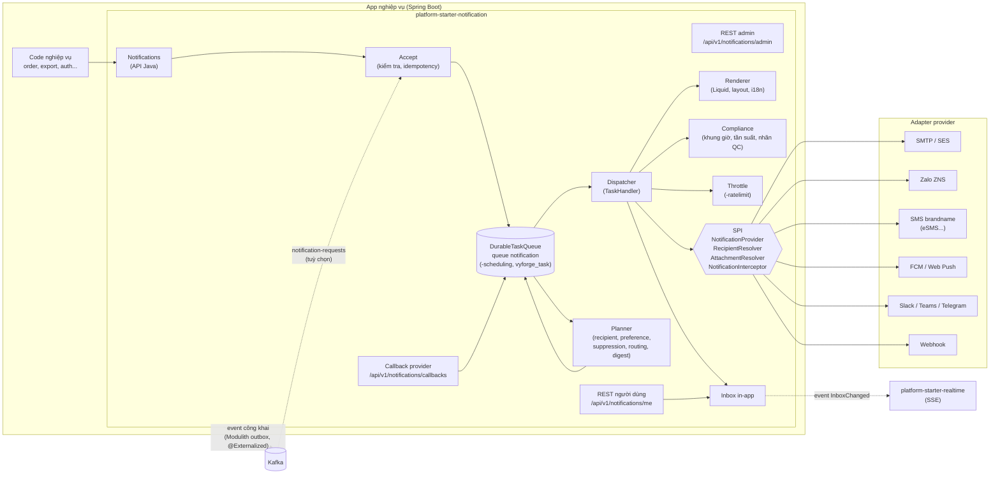
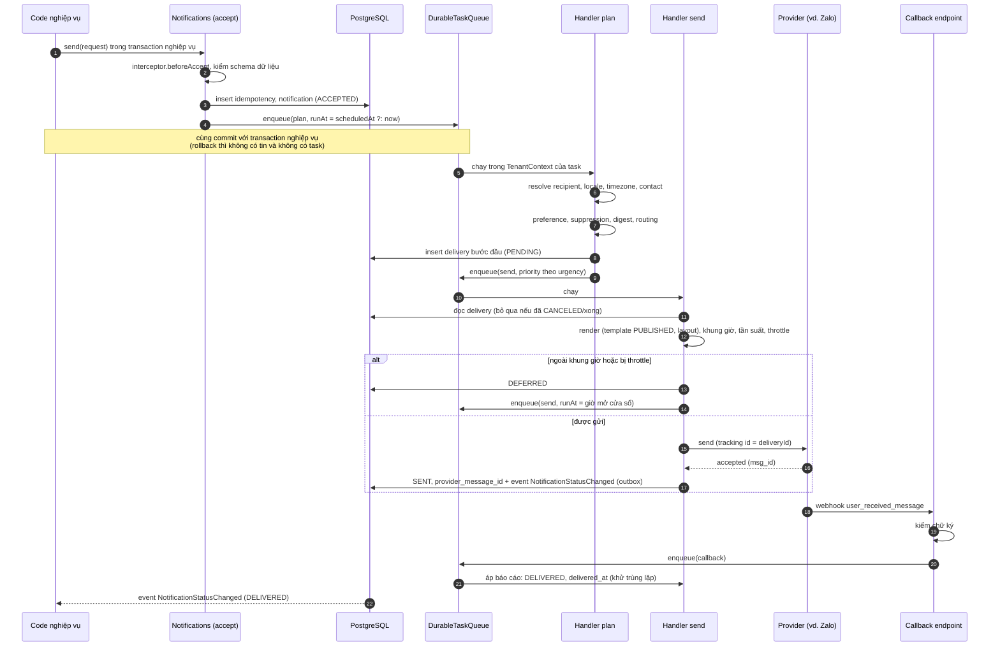
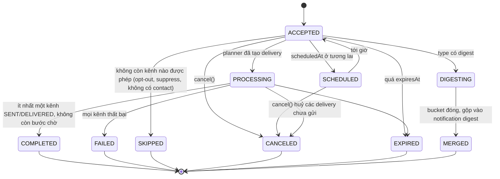
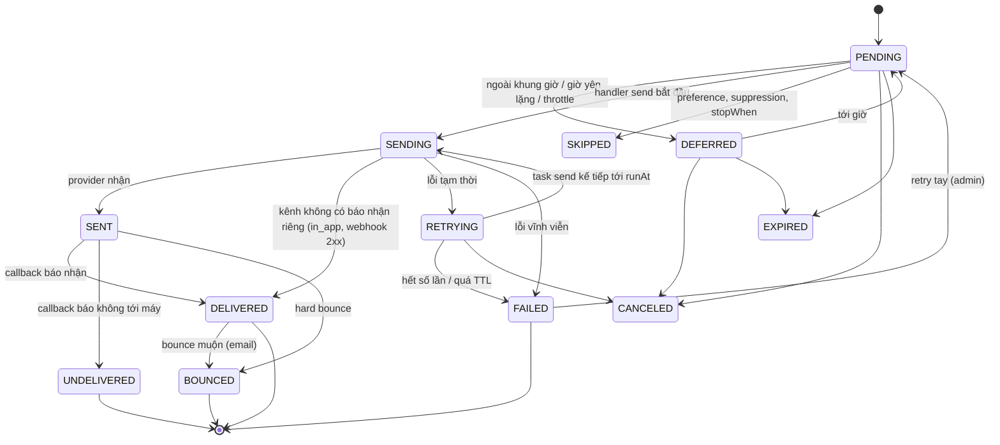
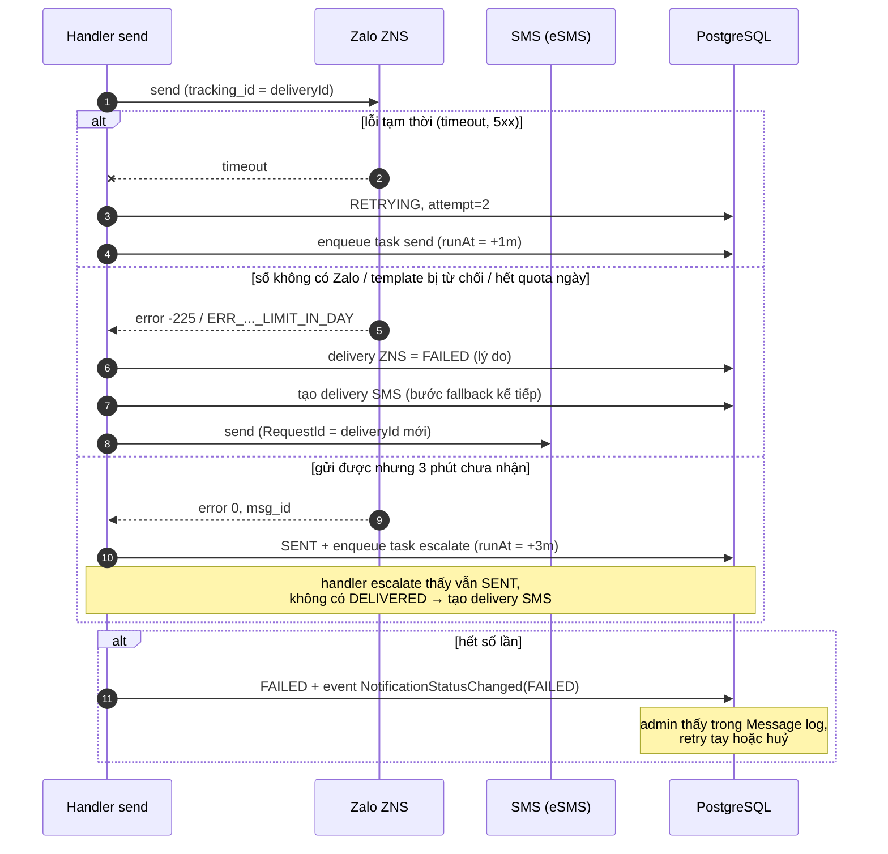
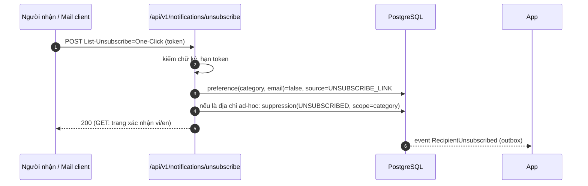
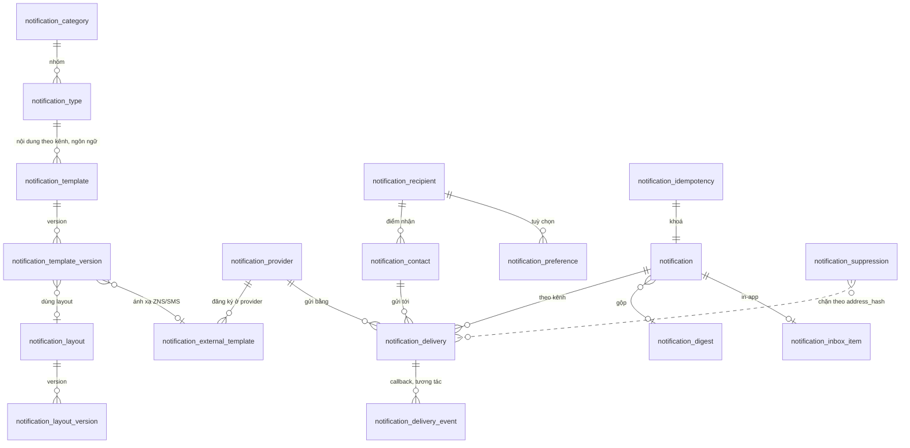

# Thiết kế module notification: `platform-starter-notification` + `@vyforge/notifications`

- **Trạng thái:** Bản thiết kế chờ duyệt (26/10/2026). Chưa có code.
- **Phạm vi phát hành:** `platform-java` 0.13.0 (`platform-starter-notification`), `platform-web` (`@vyforge/notifications` 0.1.0).
- **Nền:** [module-conventions](#) của đợt P1, [MODULE_PLAN.md](../MODULE_PLAN.md) mục 4 và 5,
  [nghiên cứu module thông dụng](../research/2026-10-module-thong-dung.md) mục 3.1, ADR-0009, ADR-0011, ADR-0015.
- **Khối dùng chung (module-conventions mục 5, platform-java 0.12.1):** module **không tự làm** mã hoá secret, hàng đợi
  việc nền và khung migration. Dùng `SecretCipher` (platform-core), `DurableTaskQueue` (platform-starter-scheduling) và
  `StarterSchemaMigrator` (platform-starter-jpa).
- **Ghi chú độ tin cậy.** Version thư viện lấy từ `maven-metadata.xml` trên Maven Central và registry npm, version
  server OSS lấy từ GitHub Releases API. Tất cả kiểm ngày 26/10/2026. Tài liệu Zalo for Developers render bằng
  JavaScript nên không đọc tự động được. Phần Zalo lấy từ hướng dẫn chính thức `zalo.solutions` và tài liệu của các
  reseller (eSMS, nhanh.vn, AdFlex, Infobip). Phần pháp lý lấy từ cổng thông tin cơ quan nhà nước và báo chí, chưa đối
  chiếu toàn văn trên Công báo. Những chỗ chưa có nguồn gốc chính thức được đánh dấu **(chưa kiểm chứng)**.

## Mục lục

1. [Bài toán và phạm vi](#1-bài-toán-và-phạm-vi)
2. [Nghiên cứu](#2-nghiên-cứu)
3. [Kiến trúc](#3-kiến-trúc)
4. [Mô hình dữ liệu](#4-mô-hình-dữ-liệu)
5. [API](#5-api)
6. [Mở rộng](#6-mở-rộng)
7. [Vận hành](#7-vận-hành)
8. [Bảo mật và tuân thủ](#8-bảo-mật-và-tuân-thủ)
9. [Kế hoạch triển khai](#9-kế-hoạch-triển-khai)
10. [Lệch quy ước và quyết định cần người dùng chọn](#10-lệch-quy-ước-và-quyết-định-cần-người-dùng-chọn)
11. [Đóng gói và triển khai độc lập](#11-đóng-gói-và-triển-khai-độc-lập)

---

## 1. Bài toán và phạm vi

### 1.1 Bài toán

Dự án nào cũng gửi thông báo: email giao dịch, OTP, nhắc việc, cảnh báo nội bộ, tin chăm sóc khách hàng qua Zalo. Hiện
mỗi dự án tự làm. Retry mỗi nơi một kiểu, template nằm rải trong code, không ai giữ danh sách người đã huỷ nhận tin. Khi
nhà mạng hay Zalo báo lỗi thì cũng không có chỗ đối soát chi phí.

Module cần giải quyết năm việc:

1. **Một API gửi** cho mọi kênh. Nghiệp vụ chỉ nói "gửi thông báo loại `order.shipped` cho người này, kèm dữ liệu này".
   Module lo phần còn lại: chọn kênh, chọn template và ngôn ngữ, tôn trọng tuỳ chọn của người nhận, giờ yên lặng, gửi
   lại khi lỗi, chuyển kênh dự phòng, ghi trạng thái.
2. **Nội dung tách khỏi code.** Template có version, có vi/en, biến có kiểu. Tenant tự sửa được nội dung mà không cần
   deploy, nhưng không phá được dữ liệu và không chạy được code tuỳ ý.
3. **Người nhận làm chủ.** Người nhận chọn được nhận gì, qua kênh nào, giờ nào. Huỷ nhận phải có hiệu lực ngay.
4. **Bền và quan sát được.** Không mất tin khi app restart hay provider sập. Biết từng tin đang ở đâu. Có cách xử lý tay
   với tin hỏng.
5. **Đúng luật Việt Nam.** Chống tin nhắn rác (NĐ 91/2020/NĐ-CP), dữ liệu cá nhân (Luật 91/2025/QH15, NĐ 356/2025/NĐ-CP),
   và quy định riêng của Zalo, nhà mạng.

### 1.2 Kịch bản nghiệp vụ phải đáp ứng

| # | Kịch bản | Điều module phải làm được |
|---|---|---|
| K1 | **OTP đăng nhập/giao dịch** qua SMS brandname. Nếu Zalo có tài khoản thì gửi ZNS OTP (rẻ hơn), lỗi thì chuyển SMS | Kênh ưu tiên kèm dự phòng (`zalo_zns` → `sms`). Mức `CRITICAL` bỏ qua giờ yên lặng và opt-out. TTL ngắn (OTP quá 5 phút thì huỷ, không gửi trễ). Idempotency theo phiên OTP |
| K2 | **Đơn hàng đã giao** (TMĐT): in-app + email; ZNS "chăm sóc khách hàng" cho khách đã mua | Gửi song song nhiều kênh. Template ZNS đã được Zalo duyệt, ánh xạ biến. ZNS chỉ gửi 6h–22h nên tin lúc 23h phải chờ tới 6h sáng |
| K3 | **Nhắc lịch hẹn khám** (y tế) lúc 7h sáng hôm trước, theo múi giờ của bệnh nhân | Hẹn giờ (`scheduledAt`), huỷ được khi lịch hẹn bị huỷ (`cancel` theo `correlationKey`). Dữ liệu sức khoẻ là dữ liệu nhạy cảm: không lưu nội dung đã render quá thời hạn |
| K4 | **Bình luận/mention trong dự án** (SaaS cộng tác): 20 bình luận trong 10 phút gom thành một email | Digest theo `recipient + digestKey`, cửa sổ trượt có trần, in-app vẫn hiện từng mục |
| K5 | **Báo cáo xuất xong** (module export): in-app + email có link tải hạn 24h | Module export gọi API Java. Link presigned từ module files. Đẩy realtime vào inbox |
| K6 | **Cảnh báo vận hành** gửi kênh Slack/Teams/Telegram của đội trực, không gắn với user | Người nhận kiểu "đối tượng" (kênh chat), không có tuỳ chọn cá nhân. Throttle để không spam khi có bão alert |
| K7 | **Tin khuyến mại** cho khách đã đồng ý nhận (bán lẻ) | Category `PROMOTIONAL`: bắt buộc opt-in có bằng chứng, nhãn `[QC]`, chỉ 7h–22h, tối đa 3 tin/24h/số, link huỷ một chạm, tôn trọng suppression list |
| K8 | **Thông báo học phí, điểm danh** (giáo dục): phụ huynh nhận qua Zalo, học sinh nhận push app | Một học sinh có nhiều người nhận liên quan: nghiệp vụ truyền danh sách recipient. Fallback SMS cho phụ huynh không dùng Zalo |
| K9 | **Hoá đơn điện tử phát hành / nhắc nợ** (B2B): email đính kèm PDF, CC kế toán | File đính kèm qua module files, giới hạn kích thước, quá thì gửi link. Địa chỉ ad-hoc (không phải user hệ thống) |
| K10 | **Mật khẩu, bảo mật tài khoản** (auth-server: đặt lại mật khẩu, đăng nhập lạ) | Category `SECURITY` không cho opt-out. Thay `ThymeleafAccountMailer` của auth-server khi starter ổn định |
| K11 | **Webhook tới hệ thống đối tác** khi có thông báo (đối tác tự hiển thị cho người dùng của họ) | Kênh `webhook`, ký theo Standard Webhooks, nối sang `platform-starter-webhooks` khi module đó có |
| K12 | **Thông báo trong ứng dụng ngân hàng/ví** có nhiều thiết bị | Push tới mọi thiết bị còn hiệu lực, tự xoá token chết (`UNREGISTERED` của FCM, `410` của Web Push) |
| K13 | **Admin tenant tự soạn mẫu email** theo thương hiệu (logo, màu, chân trang), xem trước vi/en, gửi thử | Layout dùng chung theo tenant, template có version, preview với dữ liệu mẫu, publish/rollback |
| K14 | **Chiến dịch nhắc gia hạn** cho 200.000 khách mỗi tháng | Gửi hàng loạt qua API batch/Kafka, throttle theo provider (ZNS có hạn mức/ngày), không làm nghẽn tin giao dịch (hàng đợi theo mức ưu tiên) |
| K15 | **Người dùng yêu cầu xoá dữ liệu** (Luật 91/2025) | Xoá inbox, tuỳ chọn, contact; ẩn danh hoá lịch sử gửi; giữ hash trong suppression list để vẫn tôn trọng opt-out |
| K16 | **Email bị trả về (hard bounce) hoặc bị báo spam** | Tự đưa địa chỉ vào suppression list, ngừng gửi tới địa chỉ đó, báo cho app qua event |

### 1.3 Ngoài phạm vi

- **Marketing automation** (journey nhiều bước theo hành vi, phân khúc khách hàng, A/B test nội dung). Module có hook để
  app tự làm, nhưng không xây workflow engine. Đúng nguyên tắc "không tự viết engine" của MODULE_PLAN.
- **Gửi email hàng loạt kiểu newsletter** hàng triệu địa chỉ. Gửi được, nhưng không tối ưu cho việc này. Nên dùng dịch
  vụ chuyên dụng.
- **Nhận và trả lời tin hai chiều** (chat CSKH qua Zalo OA). Module chỉ nhận callback trạng thái và từ khoá huỷ nhận.
- **Thoại (voice OTP), WhatsApp, Viber.** Thêm được qua SPI (mục 6) khi có dự án cần.

---

## 2. Nghiên cứu

### 2.1 Các hệ thống tham khảo

| Hệ thống | Phiên bản, license | Mô hình dữ liệu | API | Điểm mạnh | Điểm yếu (với vyforge) |
|---|---|---|---|---|---|
| **Novu** (OSS, tự host hoặc cloud) | Server v3.19.0 (07/08/2026), `@novu/framework` v2.14.0 (28/09/2026), `@novu/react` 3.19.2. Lõi MIT, thư mục `enterprise/` license thương mại ([LICENSE](https://github.com/novuhq/novu)) | `Subscriber` (`subscriberId` do app đặt, `email`, `phone`, `locale`, `timezone`, `data` tuỳ ý, credentials theo kênh: `deviceTokens` tối đa 100/kênh, `webhookUrl`) ([docs](https://docs.novu.co/platform/concepts/subscribers)); `Topic`; `Workflow` gồm các step kênh + step hành động (digest, delay); `Integration` = provider theo kênh | `trigger(workflowId, to, payload)`; workflow viết bằng code (`@novu/framework`) hoặc trên dashboard | Danh mục provider rất rộng (20 email, 37 SMS, 8 push, 13 chat); `<Inbox />` có sẵn; preference nhiều tầng: mặc định của workflow → tuỳ chọn toàn cục của subscriber → tuỳ chọn theo workflow, workflow "critical" bỏ qua tuỳ chọn ([docs](https://docs.novu.co/platform/concepts/preferences)); digest có "lịch nhận" theo múi giờ subscriber ([digest](https://docs.novu.co/platform/workflow/add-and-configure-steps/configure-action-steps/digest)) | Phải chạy cụm riêng (API, worker, WebSocket, MongoDB, Redis): thêm một hệ phải trực. Không có Zalo ZNS, không có SMS nhà mạng VN. Một số tính năng nằm ở phần enterprise |
| **Knock** (SaaS) | Dịch vụ đóng; SDK `@knocklabs/react` 0.14.0 | `Recipient` (user hoặc object), `Tenant`, `Workflow` (step kênh + function: batch, delay, branch, throttle), `Message` có trạng thái giao và trạng thái tương tác tách riêng ([statuses](https://docs.knock.app/send-notifications/message-statuses)) | `workflows.trigger(key, {recipients, data, tenant, actor})` | **Mô hình preference rõ nhất**: `PreferenceSet` có `categories`, `channel_types`, `channels`, `workflows`; mặc định `true`; mọi tổ hợp phải `true` mới gửi; category `false` thắng; tenant đặt mặc định cho user mới; `commercial_subscribed` riêng cho tin thương mại ([preferences](https://docs.knock.app/preferences/overview)). Batch có khoá, cửa sổ cố định/trượt, `max items`, template thấy `total_activities` và 10 mục đầu ([batch](https://docs.knock.app/designing-workflows/batch-function)). Template dùng Liquid | Đóng, dữ liệu ra nước ngoài (vướng Luật 91/2025 về chuyển dữ liệu xuyên biên giới), không có kênh VN |
| **Courier** (SaaS) | Dịch vụ đóng | `Message` có `routing` (`method: single` = thử lần lượt, `all` = gửi hết) và failover giữa kênh và giữa provider; `Brand` (logo, màu, footer); `List`, `Audience` để fan-out ([send](https://www.courier.com/docs/platform/sending/)) | `send({message: {to, template, data, routing}})` | **Routing/failover** gọn: một cấu trúc khai báo được kênh nào thử trước, provider nào dự phòng. Brand tách khỏi template | Như Knock: đóng, không có kênh VN. Template dùng Handlebars |
| **SuprSend** (SaaS) | Dịch vụ đóng | Workflow + "Smart Channel Routing" | Trigger theo event | **Gửi tuần tự có điều kiện dừng**: in-app gửi ngay, các kênh ngoài app gửi lần lượt theo chi phí tăng dần, cách nhau `TTL/(số kênh − 1)`, dừng khi đạt điều kiện (delivered, seen, click hoặc event nghiệp vụ như `invoice_paid`) ([smart delivery](https://docs.suprsend.com/docs/smart-delivery)) | Đóng. Mô hình tối ưu chi phí hay, nhưng tính interval tự động khó giải thích cho người vận hành |
| **Apprise** (thư viện OSS, Python) | v2.1.0 (24/10/2026), BSD-2-Clause ([GitHub](https://github.com/caronc/apprise)) | Mỗi đích là một URL (`mailto://`, `tgram://token/chat`, `slack://...`) | `apprise.notify(body, title)` | **Cấu hình kênh chat bằng một URL** dễ lưu, dễ nhập. Hơn 100 dịch vụ | Python, không nhúng vào JVM được; không có template, preference, trạng thái |
| **AWS SES / Pinpoint / End User Messaging** | Pinpoint **ngừng hỗ trợ 30/10/2026**, phần engagement (segment, campaign, journey) chuyển sang Amazon Connect; API kênh (SMS, push, voice) chuyển sang AWS End User Messaging ([AWS](https://docs.aws.amazon.com/pinpoint/latest/userguide/migrate.html)). SES vẫn là dịch vụ email | SES: suppression list cấp account và cấp tenant; bounce `Permanent`/`Transient`/`Undetermined` kèm sub-type; complaint theo chuẩn ARF ([SES](https://docs.aws.amazon.com/ses/latest/dg/notification-contents.html)) | `SendEmail` (v2), event qua SNS/EventBridge | **Phân loại bounce và suppression** là chuẩn thực tế của ngành. Có suppression theo tenant | Bài học từ Pinpoint: đừng gắn lõi nghiệp vụ (journey, segment) vào một provider. SES là adapter, không phải lõi |

Ngoài ra, khung pháp lý và hạ tầng kênh ở Việt Nam:

| Kênh VN | Điều kiện (đã kiểm) |
|---|---|
| **Zalo ZNS/ZBS** | API `POST https://business.openapi.zalo.me/message/template`, header access token. Body: `phone` (định dạng `84…`), `template_id`, `template_data`, `tracking_id` (≤ 48 ký tự, không ký tự đặc biệt). Kết quả: `error` (0 là thành công), `msg_id`, `sent_time`, `quota.dailyQuota`/`remainingQuota`. Access token sống 25 giờ, refresh token 3 tháng. Webhook `user_received_message` có `message.delivery_time` (giờ máy người nhận thật sự nhận), `message.msg_id`, `message.tracking_id` ([zalo.solutions](https://zalo.solutions/business-message/guidelines/en/gui-api)). Template phải được Zalo duyệt trước, nội dung tối đa 400 ký tự. Template duyệt từ 10/12/2025 gửi được theo cả UID (ZBS, giá rẻ hơn) và số điện thoại; OTP không gửi theo UID được. Tin khuyến mại tối đa 1 tin/OA/người/ngày ([Infobip](https://www.infobip.com/docs/zalo/message-templates)). Chỉ gửi 6h–22h, trừ template OTP ([nhanh.vn](https://apidocs.nhanh.vn/v3/zalo/zbs)) **(nguồn reseller)**. Chữ ký webhook `X-ZEvent-Signature = sha256(appId + body + timestamp + OASecretKey)` ([dataism.one](https://www.dataism.one/2025/04/handling-zalo-webhooks-with-aws-lambda.html)) **(chưa kiểm chứng với tài liệu chính thức)** |
| **SMS brandname** (qua aggregator, ví dụ eSMS) | Brandname phải đăng ký trước. Tin CSKH phải khớp mẫu đã đăng ký (sai mẫu thì lỗi `146`). Có `IsUnicode` (có dấu/không dấu), `Sandbox`, `RequestId` chặn trùng trong 24 giờ, `CallbackUrl` nhận trạng thái cuối. Mã `100` chỉ là "đã nhận yêu cầu", chưa phải đã tới máy ([eSMS](https://developers.esms.vn/esms-api/ham-gui-tin/tin-nhan-sms-otp-cskh)) |
| **FCM** | HTTP v1. `UNREGISTERED` (404) thì xoá token; `QUOTA_EXCEEDED` (429) thì backoff, tối thiểu 1 phút; `UNAVAILABLE`/`INTERNAL` thì retry có backoff, tôn trọng `Retry-After`; `INVALID_ARGUMENT`, `SENDER_ID_MISMATCH`, `THIRD_PARTY_AUTH_ERROR` không retry. Payload tối đa 4096 byte ([FCM](https://firebase.google.com/docs/cloud-messaging/error-codes)) |
| **Microsoft Teams** | Office 365 Connectors (gồm Incoming Webhook cũ) đã bị tắt trong 2026, thay bằng webhook của Workflows (Power Automate). Các nguồn ghi ngày khác nhau (31/03 – 22/05/2026) ([Argo CD docs](https://argo-cd.readthedocs.io/en/latest/operator-manual/notifications/services/teams/), [Microsoft Q&A](https://learn.microsoft.com/en-au/answers/questions/5852893/office-365-connectors-private-channels-support-inquiry)). Adapter chỉ hỗ trợ webhook Workflows |
| **Email đại trà** | Gmail/Yahoo từ 02/2024: bên gửi trên 5.000 thư/ngày phải có SPF, DKIM, DMARC; thư thương mại phải có `List-Unsubscribe` + `List-Unsubscribe-Post` (RFC 8058), xử lý huỷ nhận trong 2 ngày; tỉ lệ báo spam dưới 0,3% ([tổng hợp của Bird](https://bird.com/docs/knowledge-base/deliverability/gmail-yahoo-requirements)) **(nguồn thứ cấp)** |

### 2.2 Thư viện dự kiến dùng

| Việc | Thư viện | Version (Maven Central/npm, 26/10/2026) | License | Ghi chú |
|---|---|---|---|---|
| Template do tenant soạn | **Liqp** (Liquid cho Java) `nl.big-o:liqp` | 0.9.2.3 | MIT ([GitHub](https://github.com/bkiers/Liqp)) | Có `withStrictVariables`, `withMaxIterations`, `withMaxRenderTimeMillis`, `withMaxSizeRenderedString`, `withMaxTemplateSizeBytes`: chặn được template độc hại. Thêm filter riêng bằng `withFilter`. Cùng cú pháp với Knock, Novu, Shopify |
| Kiểm kiểu biến | `com.networknt:json-schema-validator` | 3.0.8 | Apache-2.0 | Schema biến lưu dạng JSON Schema 2020-12 |
| Email SMTP | Spring Mail + Angus Mail (Boot 4.1.1 quản lý version) | 2.0.x | EPL-2.0/GPL-2.0 w/ CPE (như mọi app Spring dùng mail) | Mailpit cho dev và test |
| Email SES | `software.amazon.awssdk:sesv2` | 2.57.3 | Apache-2.0 | Cùng version AWS SDK với module files |
| Push FCM | `com.google.firebase:firebase-admin` | 9.11.0 | Apache-2.0 | FCM cũng giao được tới iOS (qua APNs) và web |
| Push APNs trực tiếp | `com.eatthepath:pushy` | 0.15.6 | MIT | Để bản sau, chỉ khi dự án không muốn qua FCM |
| Web Push (VAPID, RFC 8030/8291/8292) | `nl.martijndwars:web-push` | 5.1.2 (02/2025) | MIT ([GitHub](https://github.com/web-push-libs/webpush-java), repo còn hoạt động) | Phương án dự phòng: `com.interaso:webpush` 1.3.0 (01/2026, Kotlin) |
| Chuẩn hoá số điện thoại | `com.googlecode.libphonenumber:libphonenumber` | 9.0.42 | Apache-2.0 | `0912…` → `+84912…` (E.164) → `84912…` cho ZNS |
| Làm sạch HTML (in-app, preview) | `org.jsoup:jsoup` | 1.23.2 | MIT | `Safelist` cho nội dung in-app |
| Biên dịch MJML (giao diện quản trị) | `mjml-browser` (npm) | 5.4.1 | MIT | Biên dịch ở trình duyệt khi lưu layout. Server chỉ lưu HTML, không cần Node lúc chạy |

Cân nhắc nhưng **không dùng**:

| Thư viện | Lý do |
|---|---|
| Thymeleaf cho template do tenant soạn | Biểu thức SpEL/OGNL trong template người dùng nhập là đường SSTI dẫn tới RCE. Thymeleaf chỉ giữ cho template nằm trong code (tin cậy), qua SPI `TemplateEngine` (mục 6) |
| Handlebars.java 4.5.7 (Apache-2.0) | Dùng được, nhưng không có giới hạn thời gian render và số vòng lặp. Liquid là chuẩn chung của Knock và Novu nên người soạn quen hơn |
| JobRunr (LGPL-3.0), db-scheduler 16.12.0 (Apache-2.0), hàng đợi tự viết | Platform đã chốt `DurableTaskQueue` dùng chung trong `-scheduling` (module-conventions mục 5.2). Module chỉ khai báo queue và handler. JobRunr còn vướng LGPL (MODULE_PLAN, câu hỏi 5) |
| Tự host Novu | MODULE_PLAN mục 5 đã loại. Nghiên cứu lại thấy vẫn đúng: thêm MongoDB và một cụm service; không có kênh VN |

### 2.3 Học theo và không làm

**Học theo:**

| Từ | Học gì | Áp vào đâu |
|---|---|---|
| Knock | Preference là tập boolean theo `category × channel` và theo loại thông báo; mặc định cho phép; mọi tổ hợp phải cho phép; tenant đặt mặc định; tin thương mại có cờ riêng | Mục 4.4, bảng `notification_preference` |
| Knock | Tách **trạng thái giao** (một giá trị, có thứ tự ưu tiên) khỏi **trạng thái tương tác** (seen, read, clicked, archived: nhiều mốc thời gian) | State machine mục 3.5, cột `*_at` |
| Novu | Workflow "critical" bỏ qua tuỳ chọn và bị ẩn khỏi trang tuỳ chọn | Category `SECURITY` và mức `CRITICAL` |
| Novu, Knock | Inbox in-app là một kênh như mọi kênh, có component sẵn | `in_app` + `@vyforge/notifications/ui` |
| Courier | Routing khai báo: thử lần lượt hoặc gửi hết; failover giữa kênh và giữa provider | `RoutingPlan` mục 3.3 |
| SuprSend | Leo thang có điều kiện dừng: gửi kênh rẻ trước, chưa đạt thì gửi kênh đắt | `escalateAfter` và `stopWhen` |
| Knock, Novu | Digest/batch có khoá, cửa sổ cố định hoặc trượt, trần số mục | Mục 3.6 |
| SES | Phân loại bounce, suppression list theo tenant, sub-type ghi lại để giải thích | Bảng `notification_suppression` |
| Apprise | Đích chat cấu hình bằng một URL | Contact kiểu `CHAT_URL` (`slack://`, `teams://`, `tgram://`) |
| Pinpoint | Không đặt lõi nghiệp vụ vào provider | Mọi provider là adapter |

**Không làm:**

- **Workflow engine tổng quát** (branch, loop, wait-for-event tuỳ ý). Bốn khả năng (song song, dự phòng, leo thang, digest)
  phủ được các kịch bản ở mục 1.2. Cần hơn thì app tự điều phối bằng event và gọi lại API gửi.
- **Trình soạn kéo thả email.** Dùng MJML (người soạn viết mã), xem trước trực tiếp. Kéo thả để bản sau, có thể nhúng
  editor OSS.
- **Phân khúc người nhận** (audience theo điều kiện). App tự truy vấn rồi gọi `sendAll`.
- **Tracking mở thư mặc định.** Pixel theo dõi thu IP và thời điểm, là dữ liệu cá nhân. Mặc định tắt (mục 8).

---

## 3. Kiến trúc

### 3.1 Sơ đồ thành phần



Starter là thư viện nhúng vào app, đúng quy ước. **Không tách service riêng.** Hệ có nhiều microservice có hai cách:
(a) mỗi service nhúng starter và dùng chung database schema của service đó; (b) một app "notification hub" nhúng starter
và bật cổng nhận `notification-requests` qua Kafka, các service khác chỉ phát event. Cách (b) vẫn là cùng một starter, chỉ
khác cấu hình.

### 3.2 Gói và lớp

```text
com.vyforge.platform.notification
├── Notifications, NotificationRequest, Recipient, SendResult...      API công khai (Java thuần)
├── event/        NotificationStatusChanged, InboxChanged...            event công khai
├── spi/          NotificationProvider, ChannelDefinition, RecipientResolver, AttachmentResolver,
│                 NotificationInterceptor, TemplateEngine, PromotionalConsent, SendWindowPolicy
├── core/         accept, planner, dispatcher, state machine, retry, digest     (nội bộ)
├── template/     Liquid engine, filter VN, schema validator, layout           (nội bộ)
├── preference/   resolver, quiet hours, suppression                           (nội bộ)
├── compliance/   VnAntiSpamPolicy, ZaloSendWindow                              (nội bộ)
├── inbox/        in-app inbox                                                  (nội bộ)
├── persistence/  JDBC repository, partition maintenance                        (nội bộ)
├── web/          controller me, admin, callback, unsubscribe                   (nội bộ)
├── channel/
│   ├── email/    SmtpEmailProvider, SesEmailProvider
│   ├── sms/      EsmsSmsProvider, GenericHttpSmsProvider
│   ├── zalo/     ZaloZnsProvider, ZaloTokenManager, ZaloCallbackHandler
│   ├── push/     FcmPushProvider, WebPushProvider
│   ├── chat/     SlackProvider, TeamsWorkflowProvider, TelegramProvider
│   └── webhook/  SignedWebhookProvider
└── autoconfigure/
```

Adapter provider nằm cùng artifact nhưng chỉ bật khi thư viện của nó có trên classpath (`@ConditionalOnClass`). Ví dụ
firebase-admin là dependency `optional`: dự án cần FCM thì thêm dependency, không cần thì không kéo. Không tách thành
nhiều artifact vì MODULE_PLAN nguyên tắc 1 (code ít hay nhiều không phải lý do tách).

Lớp lưu trữ dùng **JDBC (`JdbcClient`)**, không dùng JPA, vì ba lý do:

1. Bảng có partition. PK gồm cột thời gian, không khớp với `BaseEntity`.
2. Cập nhật trạng thái hàng loạt (huỷ theo `correlationKey`, retry theo bộ lọc) và đếm tần suất viết thẳng SQL rõ hơn.
3. App không dùng JPA vẫn dùng được starter.

Theo README của platform-java, mọi method JDBC nhận tham số `tenantId` hoặc đọc `TenantContext.require()`. Truy vấn
xuyên tenant (job partition, job retention) đánh dấu `@TenantExempt("…lý do…")`. Handler của `DurableTaskQueue` đã chạy
trong `TenantContext.run` của việc nên truy vấn trong handler vẫn theo tenant như bình thường.

### 3.3 Khái niệm

| Khái niệm | Ý nghĩa | Ví dụ |
|---|---|---|
| **Channel** (kênh) | Cách người nhận thấy tin. Mỗi kênh có mô hình nội dung riêng | `email`, `sms`, `zalo_zns`, `push`, `in_app`, `chat`, `webhook` |
| **Provider** | Dịch vụ cụ thể gửi một kênh. Mỗi tenant có thể có nhiều provider cho một kênh, xếp theo ưu tiên | `smtp`, `ses`, `esms`, `zalo-oa`, `fcm`, `webpush`, `slack` |
| **Category** | Nhóm thông báo theo mục đích. Quyết định luật pháp lý áp dụng và cách người nhận chọn tuỳ chọn | `security` (`kind=SECURITY`), `orders` (`TRANSACTIONAL`), `promotions` (`PROMOTIONAL`), `system` (`OPERATIONAL`) |
| **Notification type** | Một loại thông báo mà nghiệp vụ gửi. Gắn với category; có schema dữ liệu, kế hoạch routing, digest, TTL, template theo kênh | `order.shipped`, `auth.password_reset`, `export.completed` |
| **Template / version** | Nội dung của một type cho một kênh và một ngôn ngữ. Có version, chỉ bản `PUBLISHED` được dùng | `order.shipped` × `email` × `vi` v3 |
| **Layout** | Khung email dùng chung theo tenant (logo, màu, chân trang, link huỷ nhận) | `default`, `minimal` |
| **External template** | Template đã đăng ký và được duyệt ở phía provider. Module chỉ ánh xạ biến | ZNS `template_id=231456`, mẫu SMS CSKH của brandname |
| **Recipient** | Người hoặc đối tượng nhận. `user:<sub>`, địa chỉ ad-hoc (`email:…`, `phone:…`), hoặc đối tượng (`object:ops-oncall`) | |
| **Contact** | Một điểm nhận của recipient trên một kênh | email, số điện thoại, token FCM, subscription Web Push, Zalo UID, URL Slack |
| **Notification** | Một lần gửi một type tới **một** recipient. Request có 3 người nhận tạo 3 notification | |
| **Delivery** | Một lần gửi notification qua **một** kênh, tới **một** contact, bằng một provider. Có state machine và retry riêng | |

**Kế hoạch routing** (`RoutingPlan`) của mỗi type là danh sách bước. Mỗi bước là một trong ba dạng:

```yaml
routing:
  - channel: in_app                  # 1. gửi ngay
  - fallback: [zalo_zns, sms]        # 2. thử lần lượt; kênh sau chạy khi kênh trước thất bại hẳn,
    escalateAfter: 3m                #    hoặc chưa "delivered" sau 3 phút (cần provider có báo nhận)
  - channel: email                   # 3. chỉ gửi nếu sau 1 giờ in-app vẫn chưa đọc
    delay: 1h
    stopWhen: { step: 0, reached: READ }
```

- `channel`: một kênh. `all: [email, push]`: gửi song song. `fallback: [...]`: thử lần lượt.
- `delay`: chờ bao lâu tính từ lúc notification được lập kế hoạch.
- `stopWhen`: bỏ bước nếu một bước trước đã đạt trạng thái (`DELIVERED`, `READ`, `CLICKED`), hoặc nghiệp vụ báo xong
  (`notifications.acknowledge(correlationKey)`, ví dụ hoá đơn đã thanh toán).
- Trong một kênh, provider dự phòng xếp theo `priority`. Lỗi tạm thời ở provider A quá ngưỡng (circuit mở) thì dùng
  provider B. Đây là failover cấp provider, khác với `fallback` cấp kênh.
- Kênh mà recipient không có contact, đã tắt trong tuỳ chọn, hoặc địa chỉ bị suppress thì **bỏ qua ngay** (`SKIPPED`
  kèm lý do), chuyển sang kênh tiếp theo của `fallback`.
- App có thể ghi đè routing cho một request (`request.channels(...)`), nhưng chỉ trong tập kênh của type. Không vượt được
  tuỳ chọn người nhận, trừ type `CRITICAL`.

### 3.4 Luồng chính

**Thực thi qua `DurableTaskQueue`.** Outbox Modulith (`event_publication`) hợp với việc "giao event đúng một lần sau
commit", nhưng không có hẹn giờ, backoff theo từng tin, ưu tiên hay huỷ. Gửi thông báo cần cả bốn. Module dùng hàng đợi
việc nền chung của platform (`DurableTaskQueue`, bảng `vyforge_task`, module-conventions mục 5.2) và **không tự viết
hàng đợi**. Phân vai:

- **`notification_delivery` là nguồn sự thật về nghiệp vụ** (trạng thái giao, lý do, provider, mốc thời gian). Đây là thứ
  admin và người dùng thấy.
- **`vyforge_task` chỉ là phương tiện thực thi**: "lúc nào chạy bước nào". Mỗi task mang id của notification hoặc
  delivery. Handler luôn đọc lại trạng thái nghiệp vụ trước khi làm, nên task chạy trùng, chạy trễ hay chạy sau khi đã
  huỷ đều vô hại (handler idempotent).

Queue `notification` (cấu hình đồng thời, backoff theo queue nằm ở `-scheduling`), các `kind`:

| `kind` | Payload | Tạo khi | Handler làm |
|---|---|---|---|
| `plan` | `{notificationId, createdAt}` | Accept (cùng transaction nghiệp vụ, `runAt = scheduledAt` nếu hẹn giờ) | Resolve recipient, preference, suppression, digest, routing; tạo delivery bước đầu và task `send` |
| `send` | `{deliveryId, createdAt}` | Planner, bước fallback kế tiếp, retry tay | Render, kiểm khung giờ/tần suất/throttle, gọi provider, cập nhật delivery |
| `escalate` | `{deliveryId, createdAt}` | Delivery `SENT` thuộc bước có `escalateAfter` (`runAt = sent_at + escalateAfter`) | Chưa `DELIVERED` thì tạo delivery của kênh kế tiếp |
| `step` | `{notificationId, step}` | Bước có `delay` (`runAt = plannedAt + delay`) | Kiểm `stopWhen`, rồi tạo delivery của bước |
| `digest-close` | `{digestId}` | Mở bucket (`runAt = close_at`) | Bucket chưa tới `close_at` (cửa sổ trượt đã đẩy lùi) thì enqueue lại với `close_at` mới; tới hạn thì đóng và tạo notification tổng hợp |
| `callback` | `{providerId, eventRef}` | Callback endpoint nhận payload hợp lệ | Áp báo cáo trạng thái vào delivery |

Quy tắc dùng hàng đợi:

- **`idempotency_key` của task** = `<kind>:<id>[:<lần>]` (ví dụ `send:<deliveryId>:3`), nên accept hay planner chạy lại
  không tạo task trùng.
- **`priority`** lấy từ urgency: `CRITICAL` > `HIGH` > `NORMAL` > `LOW`. Tin hàng loạt `LOW` không chặn OTP. Giới hạn
  đồng thời theo tenant của queue giữ một tenant gửi hàng loạt không chiếm hết worker.
- **Lỗi tạm thời của provider** (timeout, 5xx, 429): handler ghi `RETRYING` + `attempt` vào delivery, rồi **enqueue task
  `send` mới** với `runAt` theo backoff của module (tôn trọng `Retry-After`) và hoàn thành task hiện tại. Không dựa vào
  retry nội bộ của queue cho lỗi nghiệp vụ, vì cần `Retry-After`, `DEFERRED` theo khung giờ và chuyển kênh dự phòng.
  Retry của queue (`max_attempts`, trạng thái `DEAD`) chỉ hứng lỗi bất ngờ (exception, DB chập chờn).
- **Task `DEAD`**: job đối soát (`notification-reconcile`, `@ClusterScheduled` mỗi 5 phút) tìm delivery còn ở trạng thái
  chưa cuối mà không có task sống, đánh dấu `FAILED` (`task.dead`) và phát event. Admin retry từ màn hình của module
  (tạo task mới), không cần vào màn hình task chung.
- **Huỷ**: cập nhật delivery/notification `CANCELED`, rồi gọi cancel của queue theo `idempotency_key` nếu API hỗ trợ.
  Không hỗ trợ cũng không sao: handler thấy `CANCELED` thì bỏ qua.

> Điều cần kiểm khi 0.12.1 phát hành: API `enqueue` có nhận `runAt`, `priority`, `idempotencyKey` và cancel theo khoá.
> Phụ lục chỉ liệt kê cột của bảng. Nếu thiếu `runAt` thì đây là yêu cầu gửi forge-35, không tự làm vòng ngoài.



Độ trễ từ accept tới khi gửi do `DurableTaskQueue` quyết định (chu kỳ lấy việc của queue). Module không thêm cơ chế đánh
thức riêng.

### 3.5 State machine

**Notification** (một recipient):



**Delivery** (một kênh, một contact). Trạng thái giao là một giá trị. Tương tác (`opened_at`, `clicked_at`, `read_at`)
là mốc thời gian riêng, như Knock:



- `SENDING` gắn với task đang `RUNNING`. Replica chết giữa chừng thì `DurableTaskQueue` hết `locked_until` và chạy lại
  task; handler thấy delivery đang `SENDING` của lần trước thì gửi lại với cùng khoá idempotent. Provider phải nhận
  **khoá idempotent** = id delivery khi API có hỗ trợ (eSMS `RequestId`, ZNS `tracking_id`, SES message tag, FCM không
  có nên có thể trùng một lần: ghi rõ trong tài liệu).
- `FAILED` là trạng thái dead-letter. Admin xem và gửi lại (`POST /admin/deliveries/{id}/retry`), hoặc huỷ.
- `UNDELIVERED`, `FAILED`, `BOUNCED`, `SKIPPED` của một bước `fallback` kích hoạt kênh tiếp theo. `SENT` quá
  `escalateAfter` mà chưa `DELIVERED` cũng kích hoạt kênh tiếp theo (bước cũ giữ nguyên trạng thái).
- Thứ tự ưu tiên khi callback đến lộn xộn (ví dụ `DELIVERED` đến trước `SENT`): trạng thái chỉ tiến, không lùi, theo
  thứ hạng `PENDING < SENDING < SENT < DELIVERED`, còn `BOUNCED`/`UNDELIVERED` thắng `SENT`. Bảng chuyển trạng thái nằm ở
  một class (`DeliveryTransitions`), có test cho mọi cặp.

### 3.6 Luồng lỗi và các luồng đặc biệt

**Retry và dead-letter.** Lỗi tạm thời (timeout, 5xx, 429, quota tạm) thì `RETRYING` với backoff luỹ thừa có jitter:
30 s, 1 m, 2 m, 4 m… tối đa 1 giờ, tối đa 8 lần (cấu hình theo kênh). Provider trả `Retry-After` thì dùng giá trị đó.
Hết số lần, hoặc quá `expiresAt` của notification, thì `FAILED`. Lỗi vĩnh viễn (sai template, số không hợp lệ, token
chết) thì `FAILED` ngay. Với lỗi địa chỉ, provider báo `AddressProblem` để module cập nhật contact hoặc suppression.



**Provider sập hàng loạt.** Mỗi provider của mỗi tenant có circuit breaker (Resilience4j, như `RestClient` của platform).
Circuit mở thì delivery chuyển `DEFERRED` tới lúc half-open, không đốt số lần retry, và dùng provider dự phòng nếu có.
Metric và health báo `DOWN` cho provider đó.

**Digest.** Type có `digest` thì notification vào trạng thái `DIGESTING` và gắn vào bucket mở theo
`(tenant, type, recipient, digestKey)`. Bucket đóng khi tới `close_at` (cửa sổ cố định, hoặc trượt: mỗi tin mới đẩy
`close_at` thêm một cửa sổ nhưng không quá `max_close_at`), hoặc đủ `maxItems`. Khi đóng, planner tạo một notification
tổng hợp. Template thấy `digest.total`, `digest.items` (tối đa `renderLimit`, mặc định 10) và `digest.actors`. Kênh
`in_app` có thể đặt `digest.inApp: individual` để inbox vẫn hiện từng mục. Digest theo lịch (ví dụ 8h sáng mỗi ngày theo
múi giờ người nhận) là dạng `schedule: "daily@08:00"`.

**Hẹn giờ và huỷ.** `scheduledAt` lưu ở notification. Planner chỉ chạy khi tới giờ. `cancel(notificationId)` hoặc
`cancelByCorrelation(correlationKey)` huỷ mọi notification và delivery chưa `SENDING`. Delivery đang `SENDING` thì không
huỷ được, kết quả trả về ghi rõ.

**Giờ yên lặng và khung giờ pháp lý.** Kiểm ngay trước khi gửi (không phải lúc lập kế hoạch), vì tin có thể chờ retry
qua đêm. Hai lớp:

1. **Khung giờ bắt buộc** (`SendWindowPolicy`) theo kênh và category: tin `PROMOTIONAL` qua SMS/email 7h–22h (NĐ 91/2020);
   ZNS không phải OTP 6h–22h (quy định của Zalo). Giờ tính theo `Asia/Ho_Chi_Minh` vì quy định áp theo giờ Việt Nam.
2. **Giờ yên lặng của người nhận** theo múi giờ của họ. Tin `CRITICAL` bỏ qua lớp này (OTP, cảnh báo bảo mật), không bỏ
   qua được lớp 1.

Ngoài khung thì `DEFERRED` tới giờ mở cửa sổ kế tiếp. Nếu khi đó đã quá `expiresAt` thì `EXPIRED`. Ví dụ OTP không bao
giờ gửi trễ.

**Huỷ nhận (unsubscribe).** Email `PROMOTIONAL` và `OPERATIONAL` có header `List-Unsubscribe` (URL + mailto) và
`List-Unsubscribe-Post: List-Unsubscribe=One-Click` (RFC 8058). Link chứa token ký HMAC
`(tenant, recipient, category, channel, hạn)`, không cần đăng nhập.



SMS quảng cáo: từ khoá huỷ (ví dụ "TC") gửi tới đầu số đến qua callback MO của aggregator, nếu aggregator hỗ trợ. Hook
`InboundMessageHandler` (mục 6) xử lý. NĐ 91/2020 yêu cầu phải có cách từ chối bằng tin nhắn và gửi xác nhận ngay (mục 8).

**Bounce và complaint.** Callback SES (qua SNS, kiểm chữ ký SNS) hoặc webhook của provider khác: `Permanent` thì
`BOUNCED` và đưa địa chỉ vào suppression (`HARD_BOUNCE`, mọi category). `Transient` chỉ ghi event, quá 5 lần trong 30
ngày thì suppress 7 ngày. `Complaint` thì suppress category `PROMOTIONAL` và `OPERATIONAL`, không chặn `SECURITY`. Contact
push bị `UNREGISTERED`/`410` thì đánh dấu `INVALID` và ngừng dùng.

---

## 4. Mô hình dữ liệu

### 4.1 ERD



Mọi bảng có `tenant_id varchar(63) not null` và index bắt đầu bằng `tenant_id` (ADR-0015). Định nghĩa nằm trong code
(classpath) thì không có dòng trong DB. Bảng cấu hình chỉ chứa **phần tenant thêm hoặc ghi đè**.

### 4.2 Nguyên tắc tiến hoá schema

- **Không khoá enum nghiệp vụ trong DB.** Kênh, provider, category kind, trạng thái là `varchar(32)`, kiểm ở code. Thêm
  kênh mới không cần migration.
- **Payload JSONB có `schema_version`.** `notification_type.definition`, `notification_template_version.content`,
  `notification_provider.settings` đều có `schema_version`. Code đọc mọi version còn hỗ trợ và nâng cấp khi đọc
  (`DefinitionUpgrader`), chỉ ghi version mới nhất.
- **`attributes jsonb`** ở các bảng chính cho dữ liệu riêng của app. Có giới hạn kích thước (mặc định 8 KB) và khoá
  phải khớp `^[a-z][a-z0-9_.]{0,63}$`. Module không đọc nội dung `attributes`.
- **Migration** theo module-conventions mục 5.3: location `classpath:META-INF/vyforge/db/notification`, version `V1__…`,
  `V2__…`, **bảng lịch sử riêng `flyway_schema_history_notification`**, chạy bằng `StarterSchemaMigrator` của
  platform-starter-jpa (trước `EntityManagerFactory`). Tắt bằng `vyforge.notification.schema.migrate=false`; file gộp cho
  DBA ở `META-INF/vyforge/sql/notification.sql`. Bảng `vyforge_task` thuộc `-scheduling`, không nằm trong migration này. Không
  sửa migration đã phát hành.
- **Dữ liệu lớn có partition theo tháng** (mục 4.5). Đổi cấu trúc bảng partition chỉ dùng thao tác áp được cho bảng cha.

### 4.3 DDL dự kiến

```sql
-- ===== Cấu hình (do tenant thêm/ghi đè; mặc định nằm trong code) =====
create table notification_category (
    tenant_id          varchar(63)  not null,
    key                varchar(64)  not null,               -- 'orders', 'promotions'
    kind               varchar(32)  not null,               -- SECURITY | TRANSACTIONAL | OPERATIONAL | PROMOTIONAL (kiểm ở code)
    name               jsonb        not null,               -- {"vi": "...", "en": "..."}
    description        jsonb,
    user_configurable  boolean      not null default true,  -- hiện trên trang tuỳ chọn
    default_channels   jsonb        not null default '{}',  -- {"email": true, "sms": false}
    attributes         jsonb        not null default '{}',
    version            bigint       not null default 0,
    created_at         timestamptz  not null default now(),
    updated_at         timestamptz  not null default now(),
    primary key (tenant_id, key)
);

create table notification_type (
    tenant_id      varchar(63)  not null,
    key            varchar(100) not null,                   -- 'order.shipped'
    category_key   varchar(64)  not null,
    status         varchar(16)  not null default 'ACTIVE',  -- ACTIVE | DISABLED
    definition     jsonb        not null,                   -- {schema_version, data_schema, routing, digest, ttl, priority, urgency}
    attributes     jsonb        not null default '{}',
    version        bigint       not null default 0,
    created_at     timestamptz  not null default now(),
    updated_at     timestamptz  not null default now(),
    primary key (tenant_id, key)
);

create table notification_layout (
    id                  uuid primary key,
    tenant_id           varchar(63) not null,
    key                 varchar(64) not null,
    current_version_id  uuid,
    created_at          timestamptz not null default now(),
    unique (tenant_id, key)
);

create table notification_layout_version (
    id          uuid primary key,
    tenant_id   varchar(63) not null,
    layout_id   uuid        not null references notification_layout (id),
    version     int         not null,
    status      varchar(16) not null,                       -- DRAFT | PUBLISHED | ARCHIVED
    source      text,                                       -- MJML gốc (để sửa lại)
    html        text        not null,                       -- HTML đã biên dịch, có {{ content }}
    text        text,
    created_by  varchar(255) not null,
    created_at  timestamptz not null default now(),
    unique (layout_id, version)
);

create table notification_template (
    id                  uuid primary key,
    tenant_id           varchar(63)  not null,
    type_key            varchar(100) not null,
    channel             varchar(32)  not null,
    locale              varchar(16)  not null,              -- 'vi', 'en'
    current_version_id  uuid,                               -- bản PUBLISHED đang dùng
    created_at          timestamptz  not null default now(),
    unique (tenant_id, type_key, channel, locale)
);

create table notification_template_version (
    id                    uuid primary key,
    tenant_id             varchar(63)  not null,
    template_id           uuid         not null references notification_template (id),
    version               int          not null,
    status                varchar(16)  not null,            -- DRAFT | PUBLISHED | ARCHIVED
    engine                varchar(16)  not null default 'liquid',
    content               jsonb        not null,            -- {schema_version, subject, html, text, title, body, actions, push, zns}
    layout_key            varchar(64),
    external_template_id  uuid,                             -- ZNS/SMS mẫu đã duyệt
    variables             text[]       not null default '{}', -- biến dùng trong template (lint lúc publish)
    checksum              varchar(64)  not null,
    created_by            varchar(255) not null,
    created_at            timestamptz  not null default now(),
    published_by          varchar(255),
    published_at          timestamptz,
    unique (template_id, version)
);
create index notification_template_version_tenant_idx on notification_template_version (tenant_id, template_id, status);

create table notification_provider (
    id             uuid primary key,
    tenant_id      varchar(63)  not null,
    channel        varchar(32)  not null,
    provider_type  varchar(32)  not null,                   -- 'smtp', 'ses', 'esms', 'zalo-oa', 'fcm', 'webpush', 'slack'...
    name           varchar(100) not null,
    priority       int          not null default 100,       -- nhỏ = ưu tiên
    enabled        boolean      not null default true,
    sandbox        boolean      not null default false,     -- gửi thử, không gửi thật (nếu provider hỗ trợ)
    settings       jsonb        not null,                   -- {schema_version, from, brandname, oa_id...} không chứa secret
    secrets        text,                                    -- SecretCipher (platform-core): 'v1:<kid>:…', JSON các secret
    rate_limit     jsonb,                                   -- {"capacity": 50, "per": "1s"}
    state          jsonb        not null default '{}',      -- token_expires_at, quota còn lại, lần kiểm cuối...
    version        bigint       not null default 0,
    created_at     timestamptz  not null default now(),
    updated_at     timestamptz  not null default now(),
    unique (tenant_id, channel, name)
);

create table notification_external_template (
    id             uuid primary key,
    tenant_id      varchar(63)  not null,
    provider_id    uuid         not null references notification_provider (id),
    external_id    varchar(64)  not null,                   -- ZNS template_id, mã mẫu SMS
    name           varchar(200) not null,
    template_kind  varchar(32),                             -- OTP | TRANSACTION | CUSTOMER_CARE | PROMOTION (theo provider)
    status         varchar(32)  not null,                   -- PENDING_REVIEW | APPROVED | REJECTED | DISABLED
    params         jsonb        not null,                   -- [{"name": "order_code", "type": "STRING", "maxLength": 30, "required": true}]
    preview        text,
    raw            jsonb,
    synced_at      timestamptz,
    unique (tenant_id, provider_id, external_id)
);

-- ===== Người nhận =====
create table notification_recipient (
    tenant_id     varchar(63)  not null,
    recipient_id  varchar(255) not null,                    -- 'user:<sub>' | 'object:<key>'
    locale        varchar(16),
    timezone      varchar(64),                              -- 'Asia/Ho_Chi_Minh'
    quiet_hours   jsonb,                                    -- {"start": "22:00", "end": "07:00", "days": [1..7]}
    attributes    jsonb        not null default '{}',
    created_at    timestamptz  not null default now(),
    updated_at    timestamptz  not null default now(),
    primary key (tenant_id, recipient_id)
);

create table notification_contact (
    id            uuid primary key,
    tenant_id     varchar(63)  not null,
    recipient_id  varchar(255) not null,
    channel       varchar(32)  not null,
    kind          varchar(32)  not null,                    -- EMAIL | PHONE | FCM_TOKEN | WEB_PUSH | ZALO_UID | CHAT_URL | WEBHOOK_URL
    address       text         not null,                    -- SecretCipher (PII hoặc bí mật: URL webhook chứa token)
    address_hash  varchar(80)  not null,                    -- HMAC-SHA256 (PersonalDataRedactor.hash) để tra và khử trùng
    address_hint  varchar(64),                              -- 'a***@vyforge.vn', '***678', 'Chrome/Android'
    data          jsonb        not null default '{}',       -- web push: endpoint/keys đã mã hoá trong address
    status        varchar(16)  not null default 'ACTIVE',   -- ACTIVE | INVALID | DISABLED
    verified_at   timestamptz,
    last_used_at  timestamptz,
    failure_count int          not null default 0,
    created_at    timestamptz  not null default now(),
    unique (tenant_id, recipient_id, kind, address_hash)
);
create index notification_contact_recipient_idx on notification_contact (tenant_id, recipient_id, channel) where status = 'ACTIVE';

create table notification_preference (
    tenant_id     varchar(63)  not null,
    recipient_id  varchar(255) not null,                    -- '*' = mặc định của tenant
    scope         varchar(16)  not null,                    -- GLOBAL | CATEGORY | TYPE
    scope_key     varchar(100) not null,                    -- '*' khi GLOBAL
    channel       varchar(32)  not null,                    -- '*' = mọi kênh
    enabled       boolean      not null,
    enforced      boolean      not null default false,      -- chỉ cho dòng '*': tenant ép, user không đổi được
    source        varchar(32)  not null,                    -- USER | ADMIN | UNSUBSCRIBE_LINK | SMS_KEYWORD | IMPORT | DEFAULT
    evidence      jsonb,                                    -- bằng chứng opt-in tin quảng cáo: {form, version, ip_hash, at}
    updated_at    timestamptz  not null default now(),
    primary key (tenant_id, recipient_id, scope, scope_key, channel)
);

create table notification_suppression (
    id            uuid primary key,
    tenant_id     varchar(63)  not null,
    channel       varchar(32)  not null,
    address_hash  varchar(80)  not null,
    scope         varchar(100) not null default '*',        -- '*' | 'kind:PROMOTIONAL' | 'category:<key>'
    reason        varchar(32)  not null,                    -- HARD_BOUNCE | SOFT_BOUNCE | COMPLAINT | UNSUBSCRIBED | INVALID | MANUAL | DO_NOT_CONTACT
    source        varchar(64),                              -- provider, admin sub, 'import'
    details       jsonb,                                    -- bounce sub-type, mã chẩn đoán (đã che)
    created_at    timestamptz  not null default now(),
    expires_at    timestamptz,                              -- null = vĩnh viễn
    unique (tenant_id, channel, address_hash, scope)
);

-- ===== Gửi =====
create table notification_idempotency (
    tenant_id        varchar(63)  not null,
    key              varchar(200) not null,
    request_hash     varchar(64)  not null,                 -- cùng key khác nội dung → 409
    notification_ids uuid[]       not null,
    created_at       timestamptz  not null default now(),
    expires_at       timestamptz  not null,                 -- mặc định +7 ngày
    primary key (tenant_id, key)
);

create table notification (
    id               uuid         not null,                 -- UUID v7
    tenant_id        varchar(63)  not null,
    type_key         varchar(100) not null,
    category_key     varchar(64)  not null,
    kind             varchar(32)  not null,
    urgency          varchar(16)  not null default 'NORMAL', -- CRITICAL | HIGH | NORMAL | LOW
    recipient_id     varchar(255) not null,                 -- 'user:<sub>' | 'email:<hash>' | 'object:<key>'
    adhoc_address    text,                                  -- địa chỉ ad-hoc, SecretCipher
    status           varchar(16)  not null,
    locale           varchar(16),
    data             jsonb,                                 -- dữ liệu biến; xoá sau data-retention
    data_schema_ver  int,
    actor            varchar(255),
    correlation_key  varchar(200),                          -- 'vrn:shop:order/123', để cancel/acknowledge
    digest_id        uuid,
    scheduled_at     timestamptz,
    expires_at       timestamptz,
    attributes       jsonb        not null default '{}',
    created_at       timestamptz  not null,
    updated_at       timestamptz  not null,
    completed_at     timestamptz,
    primary key (created_at, id)
) partition by range (created_at);
create index on notification (tenant_id, recipient_id, created_at desc);
create index on notification (tenant_id, correlation_key) where correlation_key is not null;

create table notification_delivery (
    id                   uuid         not null,             -- UUID v7, dùng làm tracking id gửi provider
    tenant_id            varchar(63)  not null,
    notification_id      uuid         not null,
    notification_at      timestamptz  not null,             -- created_at của notification (tra partition)
    step                 smallint     not null,
    channel              varchar(32)  not null,
    kind                 varchar(32)  not null,             -- chép từ category: đếm tần suất tin quảng cáo
    urgency              varchar(16)  not null,
    provider_id          uuid,
    contact_id           uuid,
    address_hash         varchar(80),
    address_hint         varchar(64),
    template_version_id  uuid,
    status               varchar(16)  not null,
    status_reason        varchar(64),                       -- 'preference.opted_out', 'zalo.-225', 'quiet_hours'...
    attempt              smallint     not null default 0,
    next_attempt_at      timestamptz,                       -- chỉ để hiển thị: runAt của task send kế tiếp
    provider_message_id  varchar(200),
    error_code           varchar(64),
    error_message        varchar(500),                      -- đã che PII
    cost_units           numeric(10, 3),                    -- số đoạn SMS, số tin ZNS
    sent_at              timestamptz,
    delivered_at         timestamptz,
    opened_at            timestamptz,
    clicked_at           timestamptz,
    failed_at            timestamptz,
    created_at           timestamptz  not null,
    updated_at           timestamptz  not null,
    primary key (created_at, id)
) partition by range (created_at);
create index on notification_delivery (tenant_id, status, updated_at) where status in ('PENDING', 'RETRYING', 'DEFERRED', 'SENDING'); -- đối soát task DEAD
create index on notification_delivery (tenant_id, notification_id);
create index on notification_delivery (tenant_id, address_hash, sent_at) where kind = 'PROMOTIONAL';
create index on notification_delivery (provider_message_id) where provider_message_id is not null;
create index on notification_delivery (tenant_id, status, created_at desc);

create table notification_delivery_event (
    id                 uuid         not null,
    tenant_id          varchar(63)  not null,
    delivery_id        uuid         not null,
    delivery_at        timestamptz  not null,               -- = created_at của delivery (cùng partition)
    type               varchar(32)  not null,               -- SENT | DELIVERED | UNDELIVERED | OPENED | CLICKED | BOUNCED | COMPLAINED | FAILED | RETRY
    provider_event_id  varchar(200) not null default '',
    occurred_at        timestamptz  not null,
    payload            jsonb,                               -- đã lọc, đã che
    received_at        timestamptz  not null default now(),
    primary key (delivery_at, id),
    unique (delivery_at, delivery_id, type, provider_event_id)  -- khử trùng callback lặp
) partition by range (delivery_at);

create table notification_digest (
    id            uuid         primary key,
    tenant_id     varchar(63)  not null,
    type_key      varchar(100) not null,
    recipient_id  varchar(255) not null,
    digest_key    varchar(200) not null default '',
    status        varchar(16)  not null,                    -- OPEN | CLOSED | SENT
    item_count    int          not null default 0,
    opened_at     timestamptz  not null,
    close_at      timestamptz  not null,
    max_close_at  timestamptz  not null,
    result_id     uuid                                      -- notification tổng hợp
);
create unique index notification_digest_open_uq on notification_digest (tenant_id, type_key, recipient_id, digest_key) where status = 'OPEN';
create index on notification_digest (close_at) where status = 'OPEN';

create table notification_inbox_item (
    id               uuid         primary key,
    tenant_id        varchar(63)  not null,
    recipient_id     varchar(255) not null,
    notification_id  uuid         not null,
    type_key         varchar(100) not null,
    category_key     varchar(64)  not null,
    title            varchar(500) not null,
    body             text,                                  -- Markdown giới hạn, đã làm sạch
    action_url       varchar(2000),
    actions          jsonb,                                 -- [{"label": "...", "url": "...", "style": "primary"}]
    actor            jsonb,                                 -- {"id", "name", "avatarUrl"}
    data             jsonb,                                 -- dữ liệu cho UI tuỳ biến (không chứa PII nhạy cảm)
    seen_at          timestamptz,
    read_at          timestamptz,
    interacted_at    timestamptz,
    archived_at      timestamptz,
    expires_at       timestamptz,
    created_at       timestamptz  not null
);
create index notification_inbox_list_idx on notification_inbox_item (tenant_id, recipient_id, created_at desc, id desc) where archived_at is null;
create index notification_inbox_unread_idx on notification_inbox_item (tenant_id, recipient_id) where read_at is null and archived_at is null;
```

### 4.4 Cách tính tuỳ chọn (preference)

Theo Knock, có bổ sung cho kind và tenant:

1. **Category kind `SECURITY`** hoặc urgency `CRITICAL`: luôn gửi, bỏ qua bước 2–5. Không hiện trên trang tuỳ chọn.
2. **Suppression** của địa chỉ (theo channel, scope `*`, `kind:…`, `category:…`): có thì bỏ qua (`SKIPPED`,
   `suppressed.<reason>`). Áp cho mọi kind trừ `SECURITY` với lý do `UNSUBSCRIBED`.
3. **`PROMOTIONAL`**: phải có opt-in **tường minh** (dòng `enabled=true`, `source` ≠ `DEFAULT`) ở scope category hoặc
   global, hoặc `PromotionalConsent` (SPI, nối với consent của `-privacy` sau này) trả `true`. Mặc định là **không gửi**.
4. **Dòng của tenant có `enforced=true`** (recipient `*`): thắng mọi dòng của người nhận. Ví dụ tenant tắt hẳn SMS cho
   category `orders` để tiết kiệm chi phí.
5. **Các dòng còn lại** (người nhận trước, rồi mặc định của tenant, rồi `default_channels` của category, rồi mặc định
   trong code): với mỗi chiều `GLOBAL`, `CATEGORY`, `TYPE`, lấy dòng cụ thể nhất (kênh cụ thể thắng `*`). Notification
   chỉ gửi qua kênh `c` khi **mọi chiều có giá trị đều cho phép**. Chiều không có dòng nào thì coi là cho phép.

Hàm tính là thuần (input: các dòng, output: quyết định + lý do), nằm trong `PreferenceResolver`. Test dạng bảng phủ mọi tổ
hợp. API `/me/preferences` trả về **ma trận đã tính** (`category × channel`, kèm `locked` và lý do) để UI không phải tự
tính lại.

### 4.5 Partition, retention, dung lượng

| Bảng | Partition | Giữ mặc định | Cách dọn |
|---|---|---|---|
| `notification` | tháng, theo `created_at` | 180 ngày; cột `data` và `adhoc_address` xoá sau 30 ngày | Drop partition; job xoá cột `data` hằng ngày |
| `notification_delivery` | tháng | 180 ngày | Drop partition |
| `notification_delivery_event` | tháng, theo `delivery_at` | 90 ngày | Drop partition |
| `notification_inbox_item` | không | 90 ngày sau khi đọc; 30 ngày sau khi archive; `expires_at` nếu có | Job xoá theo lô 5.000 dòng |
| `notification_idempotency` | không | 7 ngày | Job xoá theo `expires_at` |
| `notification_digest` | không | 30 ngày sau `SENT` | Job xoá |
| Cấu hình, contact, preference, suppression | không | Đến khi xoá | Theo API hoặc yêu cầu xoá dữ liệu |

- Job `notification-partitions` (`@ClusterScheduled`, mỗi ngày) tạo trước partition của 2 tháng tới và drop partition quá
  hạn. Không phụ thuộc `pg_partman`. Thiếu partition thì insert lỗi, nên migration V1 tạo luôn partition `default` làm
  lưới an toàn, và health báo `DOWN` khi partition `default` có dữ liệu.
- Retention ngắn hơn theo tenant (ví dụ tenant y tế giữ 30 ngày): job xoá theo tenant + khoảng thời gian, chạy theo lô.
- **Ước tính dung lượng.** Mỗi notification khoảng 0,6 KB (có `data`), mỗi delivery khoảng 0,5 KB, mỗi event 0,3 KB,
  tính cả index thì nhân khoảng 2. Với 50.000 thông báo/ngày, 1,5 delivery/thông báo, 1 event/delivery:
  `50k × (0,6 + 1,5 × 0,5 + 1,5 × 0,3) × 2 ≈ 180 MB/ngày`, giữ 180 ngày khoảng 32 GB. Sau 30 ngày cột `data` bị xoá nên
  thực tế còn khoảng 2/3. Dự án lớn hơn mức này nên giảm retention của delivery event và đặt database riêng cho log gửi.

### 4.6 Định nghĩa trong code

Category và type mặc định khai báo trong code hoặc YAML trên classpath. Module khác (export, auth) đăng ký type của mình
mà không cần migration:

```yaml
# src/main/resources/META-INF/vyforge/notification/types/orders.yml
categories:
  orders:
    kind: TRANSACTIONAL
    name: { vi: "Đơn hàng", en: "Orders" }
    defaultChannels: { in_app: true, email: true, zalo_zns: true, sms: false }
types:
  order.shipped:
    category: orders
    urgency: NORMAL
    ttl: 3d
    dataSchema:                                  # JSON Schema rút gọn; kiểu 'money', 'date' là kiểu mở rộng
      orderCode:   { type: string, maxLength: 30 }
      total:       { type: money, currency: VND }
      shippedAt:   { type: datetime }
      trackingUrl: { type: url, required: false }
    routing:
      - channel: in_app
      - fallback: [zalo_zns, sms]
        escalateAfter: 5m
      - channel: email
    templates:                                   # nội dung mặc định; tenant ghi đè qua admin
      email:  { vi: classpath:notification/order-shipped.vi.liquid.yml, en: ... }
      in_app: { vi: { title: "Đơn {{ orderCode }} đã giao", body: "Tổng {{ total | vnd }}" } }
```

Bản ghi trong DB của tenant (nếu có) ghi đè từng trường. Admin "khôi phục mặc định" là xoá bản ghi ghi đè.

---

## 5. API

### 5.1 Java

```java
package com.vyforge.platform.notification;

/** Điểm vào duy nhất của nghiệp vụ. Mọi method chạy trong TenantContext hiện tại. */
public interface Notifications {

    /**
     * Ghi nhận yêu cầu gửi trong transaction hiện tại (có transaction thì join, không có thì mở mới). Không gọi provider:
     * việc gửi chạy nền sau commit. Kiểm schema dữ liệu và quyền gửi type ngay, sai thì ném {@link NotificationException}.
     */
    SendResult send(NotificationRequest request);

    /** Gửi nhiều request trong một transaction; tối đa {@code vyforge.notification.max-batch} (mặc định 1.000). */
    List<SendResult> sendAll(List<NotificationRequest> requests);

    /** Huỷ mọi phần chưa gửi. Phần đang gửi không huỷ được, kết quả ghi rõ. */
    CancelResult cancel(UUID notificationId);

    CancelResult cancelByCorrelation(String correlationKey);

    /** Nghiệp vụ báo "đã xong" để các bước có {@code stopWhen: acknowledged} không chạy nữa (vd. hoá đơn đã trả). */
    void acknowledge(String correlationKey);

    Optional<NotificationView> find(UUID notificationId);
}

public record NotificationRequest(
        String type,                         // 'order.shipped'
        List<Recipient> recipients,          // 1..max-recipients (mặc định 100); nhiều hơn thì sendAll
        Map<String, Object> data,            // kiểm theo dataSchema của type
        @Nullable String idempotencyKey,     // trùng key + cùng nội dung → trả kết quả cũ; khác nội dung → 409
        @Nullable String correlationKey,
        @Nullable String actor,              // sub người gây ra sự kiện; mặc định RequestContext
        @Nullable Instant scheduledAt,
        @Nullable Duration ttl,              // ghi đè ttl của type
        @Nullable Urgency urgency,
        @Nullable Set<String> channels,      // chỉ thu hẹp được trong routing của type
        @Nullable String locale,             // ép ngôn ngữ (mặc định theo recipient)
        List<AttachmentRef> attachments,     // email; nối module files
        Map<String, Object> attributes) {

    public static Builder of(String type) { ... }
}

// Người nhận
Recipient.user("sub-123");                                   // tra qua RecipientResolver + bảng contact
Recipient.email("ketoan@khachhang.vn").locale("vi");         // địa chỉ ad-hoc, không phải user hệ thống
Recipient.phone("0912345678");                               // chuẩn hoá E.164
Recipient.object("ops-oncall");                              // đối tượng có contact riêng (kênh chat)

// Gửi kiểu có kiểu: record được chuyển thành data, schema sinh từ record
public record OrderShipped(String orderCode, Money total, Instant shippedAt) implements NotificationData {
    public static final NotificationType<OrderShipped> TYPE = NotificationType.of("order.shipped", OrderShipped.class);
}
notifications.send(NotificationRequest.of(OrderShipped.TYPE, new OrderShipped(...)).to(Recipient.user(sub)).build());
```

Các service phụ (dùng ở API quản trị, UI, và app tự dựng màn hình):

```java
public interface NotificationInbox {           // inbox của người đang đăng nhập hoặc recipient chỉ định (admin)
    CursorPage<InboxItem> list(String recipientId, InboxQuery query);   // cursor = (created_at, id)
    InboxCounts counts(String recipientId);                             // unread, unseen theo category
    void markSeen(String recipientId, Collection<UUID> ids);
    void markRead(String recipientId, Collection<UUID> ids);
    void markAllRead(String recipientId, @Nullable String category);
    void archive(String recipientId, Collection<UUID> ids);
}

public interface NotificationPreferences {
    PreferenceMatrix matrix(String recipientId);                        // đã tính, kèm locked/lý do
    void update(String recipientId, List<PreferenceChange> changes, PreferenceSource source);
    RecipientSettings settings(String recipientId);                     // locale, timezone, quiet hours
    void updateSettings(String recipientId, RecipientSettings settings);
}

public interface NotificationContacts {        // thiết bị push, Zalo UID, URL chat...
    ContactView register(String recipientId, ContactRegistration registration);   // idempotent theo address_hash
    void remove(String recipientId, UUID contactId);
    List<ContactView> list(String recipientId);                         // chỉ address_hint
}

public interface SuppressionList {
    void suppress(String channel, String address, SuppressionReason reason, String scope, @Nullable Duration ttl);
    void release(String channel, String address, String scope);
    Optional<Suppression> find(String channel, String address);
}

public interface NotificationTemplates {       // dùng cho admin API; app ít khi gọi trực tiếp
    TemplateVersionView saveDraft(TemplateKey key, TemplateContent content);
    TemplateVersionView publish(TemplateKey key, int version);           // lint biến với dataSchema, render thử
    RenderedPreview preview(TemplateKey key, int version, Map<String, Object> sampleData);
    SendResult testSend(TemplateKey key, int version, Recipient to, Map<String, Object> sampleData);
}
```

Lỗi (enum `NotificationErrors implements ErrorCode`, bản dịch trong `i18n/errors*.properties`):

| Mã | HTTP | Khi nào |
|---|---|---|
| `notification.type_unknown` | 400 | Type không có trong code và DB |
| `notification.type_disabled` | 409 | Type bị tenant tắt |
| `notification.data_invalid` | 400 | Dữ liệu sai schema; `errors[]` theo đường dẫn JSON |
| `notification.recipient_invalid` | 400 | Email/số điện thoại sai định dạng, quá số người nhận |
| `notification.idempotency_conflict` | 409 | Cùng khoá, khác nội dung |
| `notification.template_invalid` | 422 | Liquid lỗi cú pháp, dùng biến không có trong schema, vượt giới hạn render |
| `notification.template_not_publishable` | 409 | Thiếu ngôn ngữ mặc định; ZNS chưa được duyệt; tham số không khớp |
| `notification.provider_invalid` | 422 | Cấu hình provider thiếu trường, kiểm kết nối thất bại |
| `notification.not_cancelable` | 409 | Notification đã xong |
| `notification.unsubscribe_token_invalid` | 400 | Token sai hoặc hết hạn |
| `notification.callback_signature_invalid` | 401 | Callback của provider sai chữ ký |

### 5.2 REST (OpenAPI phác thảo)

Mọi đường dẫn có tiền tố `vyforge.notification.api.base-path` (mặc định `/api/v1/notifications`). Response lỗi là
Problem Details của platform-starter-web. Danh sách dùng `PageResponse` (admin) hoặc cursor (inbox).

**Người dùng (token người dùng, recipient = `user:<sub>` của token, không cần action IAM):**

| Method | Path | Mô tả |
|---|---|---|
| `GET` | `/me/inbox?status=unread\|all\|archived&category=&cursor=&size=` | Danh sách inbox, `{items, nextCursor}` |
| `GET` | `/me/inbox/counts` | `{unread, unseen, byCategory}`; ETag để client poll rẻ |
| `POST` | `/me/inbox/seen`, `/me/inbox/read`, `/me/inbox/archive` | Body `{ids: [...]}` (tối đa 100) |
| `POST` | `/me/inbox/read-all` | Body `{category?}` |
| `GET` / `PUT` | `/me/preferences` | Ma trận đã tính; `PUT` nhận danh sách thay đổi; dòng `locked` bị từ chối |
| `GET` / `PUT` | `/me/settings` | Locale, timezone, giờ yên lặng |
| `GET` / `POST` / `DELETE` | `/me/contacts`, `/me/contacts/{id}` | Đăng ký token FCM, subscription Web Push, Zalo UID (sau khi app xác minh) |
| `GET` | `/me/web-push/vapid-public-key` | Khoá công khai VAPID của tenant |

**Quản trị (token có quyền IAM theo bảng ở mục 8.3):**

| Method | Path | Mô tả |
|---|---|---|
| `GET` / `PUT` / `DELETE` | `/admin/categories`, `/admin/categories/{key}` | `DELETE` = khôi phục mặc định trong code |
| `GET` / `PUT` / `DELETE` | `/admin/types`, `/admin/types/{key}` | Routing, digest, TTL, bật/tắt |
| `GET` | `/admin/types/{key}/templates` | Ma trận kênh × ngôn ngữ, version đang dùng |
| `GET` / `POST` | `/admin/templates/{type}/{channel}/{locale}/versions` | Lịch sử; `POST` lưu nháp |
| `POST` | `/admin/templates/{type}/{channel}/{locale}/versions/{v}/publish` | Lint + publish |
| `POST` | `/admin/templates/{type}/{channel}/{locale}/versions/{v}/preview` | Render với dữ liệu mẫu (sinh từ schema nếu không truyền) |
| `POST` | `/admin/templates/{type}/{channel}/{locale}/versions/{v}/test-send` | Gửi thử tới chính người gọi hoặc địa chỉ trong danh sách cho phép |
| `GET` / `POST` / `PUT` | `/admin/layouts`, `/admin/layouts/{key}/versions` | Layout email (MJML nguồn + HTML) |
| `GET` / `POST` / `PUT` / `DELETE` | `/admin/providers`, `/admin/providers/{id}` | Secret **chỉ ghi**: response trả `secretsSet: ["apiKey"]`, không trả giá trị |
| `POST` | `/admin/providers/{id}/test` | Kiểm kết nối, quota, hạn token |
| `GET` | `/admin/provider-types` | Danh sách provider có trên classpath, kèm JSON Schema của `settings` và tên trường secret (để UI tự sinh form) |
| `POST` | `/admin/providers/{id}/external-templates/sync` | Đồng bộ template ZNS (trạng thái duyệt, tham số) |
| `GET` | `/admin/messages?type=&recipient=&status=&channel=&from=&to=` | Tra cứu notification |
| `GET` | `/admin/messages/{id}` | Chi tiết: delivery, timeline event, nội dung đã render (nếu còn) |
| `POST` | `/admin/messages/{id}/cancel`, `/admin/deliveries/{id}/retry` | Xử lý tay |
| `POST` | `/admin/send` | Gửi từ giao diện (thông báo hệ thống cho user trong tenant) |
| `GET` / `POST` / `DELETE` | `/admin/suppressions` | Tra theo địa chỉ (server tự băm), thêm, gỡ |
| `GET` / `PUT` | `/admin/recipients/{id}/preferences` | Hỗ trợ khách hàng xem/sửa tuỳ chọn hộ (ghi audit) |
| `GET` | `/admin/stats?from=&to=&groupBy=channel\|type\|provider` | Số lượng theo trạng thái, chi phí ước tính |

**Công khai (không cần token, có kiểm chữ ký):**

| Method | Path | Mô tả |
|---|---|---|
| `POST` | `/callbacks/{providerType}/{providerId}` | Callback trạng thái. Adapter kiểm chữ ký. Trả 200 ngay, xử lý nền. Rate limit theo IP |
| `GET` / `POST` | `/unsubscribe?t=<token>` | Trang xác nhận (GET, vi/en) và one-click (POST, RFC 8058) |
| `GET` | `/t/c/{token}` | Click tracking (chỉ khi bật): ghi `CLICKED` rồi 302 tới URL đã ký trong token |

Phác thảo OpenAPI cho phần người dùng:

```yaml
paths:
  /api/v1/notifications/me/inbox:
    get:
      operationId: listMyInbox
      parameters:
        - { name: status, in: query, schema: { type: string, enum: [unread, all, archived], default: all } }
        - { name: category, in: query, schema: { type: string } }
        - { name: cursor, in: query, schema: { type: string } }
        - { name: size, in: query, schema: { type: integer, minimum: 1, maximum: 100, default: 20 } }
      responses:
        "200":
          content:
            application/json:
              schema:
                type: object
                required: [items]
                properties:
                  items: { type: array, items: { $ref: "#/components/schemas/InboxItem" } }
                  nextCursor: { type: string, nullable: true }
components:
  schemas:
    InboxItem:
      type: object
      required: [id, type, category, title, createdAt]
      properties:
        id: { type: string, format: uuid }
        type: { type: string, example: order.shipped }
        category: { type: string, example: orders }
        title: { type: string }
        body: { type: string, description: "Markdown giới hạn (đậm, nghiêng, link, danh sách)" }
        actionUrl: { type: string, format: uri }
        actions: { type: array, items: { type: object, properties: { label: { type: string }, url: { type: string }, style: { type: string, enum: [primary, secondary] } } } }
        actor: { type: object, properties: { id: { type: string }, name: { type: string }, avatarUrl: { type: string } } }
        seenAt: { type: string, format: date-time }
        readAt: { type: string, format: date-time }
        archivedAt: { type: string, format: date-time }
        createdAt: { type: string, format: date-time }
    PreferenceMatrix:
      type: object
      properties:
        channels: { type: array, items: { type: string } }
        categories:
          type: array
          items:
            type: object
            properties:
              key: { type: string }
              name: { type: string }
              kind: { type: string }
              channels:
                type: object
                additionalProperties:
                  type: object
                  properties:
                    enabled: { type: boolean }
                    locked: { type: boolean }
                    reason: { type: string, example: "kind.security" }
```

### 5.3 Event công khai

Tất cả là record Java, `implements IntegrationEvent, TenantAwareEvent`, phát qua outbox Modulith trong cùng transaction
với thay đổi trạng thái. Không `@Externalized` sẵn. Dự án muốn đưa ra Kafka thì bật
`vyforge.notification.events.externalize=true` (topic `notification-events`, key = `notificationId`). Event **không**
chứa nội dung tin và địa chỉ, chỉ chứa id, type, kênh, trạng thái.

| Event | Khi nào | Trường chính |
|---|---|---|
| `NotificationAccepted` | Accept xong (sau commit) | `notificationId`, `type`, `recipientId`, `correlationKey`, `scheduledAt` |
| `NotificationStatusChanged` | Delivery đổi trạng thái giao (`SENT`, `DELIVERED`, `UNDELIVERED`, `BOUNCED`, `FAILED`, `SKIPPED`) và notification đổi trạng thái cuối | `notificationId`, `deliveryId?`, `channel?`, `status`, `reason`, `attempt` |
| `NotificationEngaged` | `OPENED`, `CLICKED`, `READ` (in-app) | `notificationId`, `deliveryId`, `engagement` |
| `InboxChanged` | Inbox của một recipient thay đổi (mục mới, đọc, archive) | `recipientId`, `change` (`CREATED`/`UPDATED`), `itemIds`, `unreadCount` |
| `RecipientUnsubscribed` | Người nhận tắt một category/kênh qua link, từ khoá SMS hoặc API | `recipientId?`, `addressHash?`, `channel`, `scope`, `source` |
| `AddressSuppressed` | Thêm suppression (bounce, complaint, admin) | `channel`, `addressHash`, `reason`, `scope` |
| `ProviderHealthChanged` | Circuit mở/đóng, token ZNS sắp hết hạn, quota dưới ngưỡng | `providerId`, `providerType`, `state`, `detail` |

Kafka vào (tuỳ chọn, `vyforge.notification.ingress.kafka.enabled=true`): topic `notification-requests` nhận
`NotificationRequestMessage` (JSON cùng cấu trúc `NotificationRequest`), consumer `@RequiresTenant`, khử trùng lặp theo
`idempotencyKey` (bắt buộc với đường này). Service khác chỉ cần phát event, không nhúng starter.

### 5.4 Package frontend `@vyforge/notifications`

Theo khuôn `@vyforge/iam`: entry server-only, entry UI, Server Action dựng sẵn, i18n vi/en.

| Entry | Nội dung |
|---|---|
| `@vyforge/notifications` | `createNotificationsClient({ baseUrl, getAccessToken })` (server-only, qua `@vyforge/api-client`): inbox, counts, preferences, settings, contacts. `createNotificationAdminClient()`: types, templates, layouts, providers, messages, suppressions, stats. Kiểu TypeScript sinh từ OpenAPI |
| `@vyforge/notifications/actions` | `createInboxActions(client, { authorize })` (seen/read/archive/read-all), `createPreferencesAction()`, `createTemplateFormAction()`, `createPublishTemplateAction()`, `createTestSendAction()`, `createProviderFormAction()` (secret chỉ gửi khi người dùng nhập), `createRetryDeliveryAction()` |
| `@vyforge/notifications/ui` | Người dùng: `NotificationBell` (badge, popover), `InboxList` (tab chưa đọc/tất cả/lưu trữ, cuộn vô hạn, nhóm theo ngày, `renderItem` tuỳ biến), `PreferencesForm` (ma trận category × kênh, ô `locked` có tooltip lý do, giờ yên lặng, múi giờ). Quản trị: `TemplateMatrix`, `TemplateEditor` (Liquid có gợi ý biến theo schema, xem trước vi/en, gửi thử, lịch sử version, so sánh), `LayoutEditor` (MJML, biên dịch bằng `mjml-browser` lúc lưu), `ProviderSettings` (form sinh từ JSON Schema, secret chỉ ghi, nút kiểm kết nối), `ExternalTemplateMapper` (ánh xạ biến ZNS), `MessageLog` + `MessageTimeline`, `SuppressionTable`, `DeliveryStats` |
| `@vyforge/notifications/realtime` | `useInboxUpdates({ subscribe })`: cập nhật inbox khi có event. `subscribe` là hàm do app truyền vào (dùng `@vyforge/realtime` khi module đó có). Không truyền thì poll `/me/inbox/counts` mỗi 30 giây có ETag |
| `@vyforge/notifications/web-push` | `registerWebPush({ vapidPublicKey, serviceWorkerPath, onSubscribe })` + mẫu service worker. Đăng ký xong thì gọi Server Action `/me/contacts` |

Component dùng `@vyforge/ui` (Radix), mọi chuỗi có bản vi/en (`notificationsMessages`). Nội dung inbox (Markdown giới
hạn) render bằng renderer an toàn, không dùng `dangerouslySetInnerHTML` với HTML thô.

---

## 6. Mở rộng

### 6.1 SPI

| SPI | Dùng để | Mặc định |
|---|---|---|
| `NotificationProvider` | Thêm provider cho một kênh | Các adapter ở mục 3.2 |
| `ChannelDefinition` | Thêm kênh mới (mô hình nội dung, kiểu contact, cách render) | 7 kênh có sẵn |
| `RecipientResolver` | Lấy email, tên, locale, số điện thoại của `user:<sub>` | `DirectoryRecipientResolver` (gọi danh bạ của platform-auth-server, cache 5 phút, ghép với bảng `notification_recipient`/`notification_contact`) |
| `AttachmentResolver` | Lấy file đính kèm theo `AttachmentRef` | Không có. Module files cung cấp (mục 9.4) |
| `NotificationInterceptor` | Hook trước/sau accept, trước/sau gửi | Không có |
| `RoutingCustomizer` | Đổi routing theo ngữ cảnh (A/B, chi phí, VIP) | Không có |
| `TemplateEngine` | Engine template khác (Thymeleaf cho template trong code) | `liquid` |
| `TemplateFilters` | Thêm filter Liquid | `vnd`, `number_vi`, `date_vi`, `datetime_tz`, `mask_phone`, `strip_diacritics`, `truncate_sms` |
| `PromotionalConsent` | Nguồn consent cho tin quảng cáo (nối `-privacy`) | Đọc `notification_preference` |
| `SendWindowPolicy` | Luật khung giờ theo kênh/kind | `VnAntiSpamWindowPolicy`, `ZaloSendWindowPolicy` |
| `InboundMessageHandler` | Xử lý tin đến (từ khoá huỷ SMS, Zalo user gửi lệnh) | `UnsubscribeKeywordHandler` ("TC", "HUY", "STOP") |

```java
public interface NotificationProvider {

    /** Loại provider ('esms'), kênh phục vụ, JSON Schema của settings, tên các trường secret, khả năng. */
    ProviderDescriptor descriptor();

    /** Gửi một tin đã render. Không ném exception cho lỗi nghiệp vụ: trả {@link SendOutcome}. */
    SendOutcome send(OutboundMessage message, ProviderContext context);

    /** Gửi lô (ZNS, SMS hỗ trợ batch); mặc định gọi lần lượt. */
    default List<SendOutcome> sendBatch(List<OutboundMessage> messages, ProviderContext context) { ... }

    /** Kiểm cấu hình và kết nối cho nút "Kiểm tra" và health. */
    default ProviderCheck check(ProviderContext context) { return ProviderCheck.unknown(); }

    /** Xử lý callback: kiểm chữ ký, đổi payload thành các DeliveryReport. */
    default Optional<CallbackHandler> callbackHandler() { return Optional.empty(); }
}

public sealed interface SendOutcome {
    record Accepted(String providerMessageId, boolean delivered, @Nullable BigDecimal costUnits) implements SendOutcome {}
    record Retryable(String code, String message, @Nullable Duration retryAfter) implements SendOutcome {}
    record Rejected(String code, String message, @Nullable AddressProblem addressProblem) implements SendOutcome {}
    record Throttled(Duration retryAfter) implements SendOutcome {}
}

public interface NotificationInterceptor extends Ordered {
    /** Bổ sung hoặc từ chối request (ném NotificationException). Chạy trong transaction của người gọi. */
    default NotificationRequest beforeAccept(NotificationRequest request) { return request; }
    /** Trước khi gọi provider: sửa nội dung (thêm UTM, chữ ký), hoặc context.skip("reason"). */
    default OutboundMessage beforeSend(DeliveryContext context, OutboundMessage message) { return message; }
    default void afterSend(DeliveryContext context, SendOutcome outcome) {}
}
```

`ProviderContext` cấp: settings và secret đã giải mã của provider (theo tenant), `RestClient.Builder` đã gắn timeout,
retry, circuit breaker theo tên `notification-<providerType>`, `Clock`, metric. Provider không tự đọc `TenantContext`
hay DB.

### 6.2 Cấu hình theo tenant

- Provider, layout, template, category, type, mặc định tuỳ chọn: lưu DB theo tenant, sửa qua API quản trị, không cần
  deploy.
- **Mặc định cấp platform** trong `application.yml` (ví dụ SMTP chung của công ty dùng cho mọi tenant chưa cấu hình):

  ```yaml
  vyforge:
    notification:
      defaults:
        locale: vi
        timezone: Asia/Ho_Chi_Minh
      providers:                            # provider cấp platform, tenant nào chưa có provider cho kênh thì dùng
        email-default:
          channel: email
          type: smtp                        # dùng spring.mail.* nếu không khai báo settings
          settings: { from: "Vyforge <no-reply@vyforge.vn>" }
        sms-default:
          channel: sms
          type: esms
          settings: { brandname: VYFORGE, sms-type: 2 }
          secrets: { api-key: "${ESMS_API_KEY}", secret-key: "${ESMS_SECRET_KEY}" }
      tenants-may-override-providers: true  # false: tenant chỉ dùng provider platform (SaaS do mình trả phí kênh)
  ```

- Tenant có thể **giới hạn kênh** (dòng preference `*` có `enforced`) và **đặt hạn mức** chi phí:
  `vyforge.notification.quota.<channel>.daily` hoặc `settings.dailyLimit` của provider. Vượt thì `DEFERRED` tới ngày sau,
  tin `CRITICAL` vẫn đi và có cảnh báo.

### 6.3 Ví dụ: thêm provider SMS mới (SpeedSMS)

```java
@Component
class SpeedSmsProvider implements NotificationProvider {

    public ProviderDescriptor descriptor() {
        return ProviderDescriptor.builder("speedsms", Channels.SMS)
                .settingsSchema("""
                        {"type":"object","required":["sender"],
                         "properties":{"sender":{"type":"string"},"smsType":{"type":"integer","enum":[2,3,4,5]}}}""")
                .secrets("accessToken")
                .capabilities(Capability.DELIVERY_REPORT, Capability.IDEMPOTENCY_KEY)
                .build();
    }

    public SendOutcome send(OutboundMessage message, ProviderContext ctx) {
        SmsContent sms = message.content(SmsContent.class);
        try {
            SpeedSmsResponse r = ctx.restClient().post().uri("https://api.speedsms.vn/index.php/sms/send")
                    .headers(h -> h.setBasicAuth(ctx.secret("accessToken"), "x"))
                    .body(Map.of("to", List.of(message.address().e164Digits()), "content", sms.text(),
                            "sms_type", ctx.settings().get("smsType"), "sender", ctx.settings().get("sender")))
                    .retrieve().body(SpeedSmsResponse.class);
            return r.success() ? new SendOutcome.Accepted(r.tranId(), false, sms.segments())
                               : SpeedSmsErrors.toOutcome(r);
        } catch (ResourceAccessException e) {
            return new SendOutcome.Retryable("timeout", e.getMessage(), null);
        }
    }
}
```

Không cần sửa lõi. Provider xuất hiện ngay trong `/admin/provider-types`, UI tự sinh form từ `settingsSchema`.

### 6.4 Ví dụ: thêm kênh mới (WhatsApp)

```java
@Bean
ChannelDefinition whatsapp() {
    return ChannelDefinition.builder("whatsapp")
            .contactKinds(ContactKind.PHONE)
            .content(WhatsAppContent.class)            // record: externalTemplate, params, language
            .requiresExternalTemplate(true)            // như ZNS: nội dung phải là template đã duyệt
            .deliveryTracking(true)
            .build();
}
// + một NotificationProvider cho channel "whatsapp" (Meta Cloud API hoặc Infobip)
```

Thêm kênh không cần migration (kênh là `varchar`). Trang tuỳ chọn tự có thêm cột khi type nào đó dùng kênh mới.

### 6.5 Ví dụ: hook nghiệp vụ

```java
@Component
class VipRouting implements RoutingCustomizer {
    public RoutingPlan customize(RoutingContext ctx, RoutingPlan plan) {
        // khách VIP: gọi thêm Zalo trước SMS cho mọi tin đơn hàng
        return ctx.recipient().attribute("tier").equals("vip") && ctx.type().startsWith("order.")
                ? plan.prependFallback("zalo_zns") : plan;
    }
}

@Component
class UtmTagging implements NotificationInterceptor {
    public OutboundMessage beforeSend(DeliveryContext ctx, OutboundMessage m) {
        return ctx.channel().equals("email") ? m.mapLinks(url -> Utm.add(url, "notification", ctx.type())) : m;
    }
}
```

---

## 7. Vận hành

### 7.1 Cấu hình chính

| Khoá `vyforge.notification.*` | Mặc định | Ý nghĩa |
|---|---|---|
| `enabled` | `true` | Tắt toàn bộ starter |
| `task.queue` | `notification` | Tên queue trong `DurableTaskQueue`. Đồng thời, giới hạn theo tenant, chu kỳ lấy việc cấu hình ở `-scheduling` theo queue này. Replica chỉ phục vụ API thì tắt worker của queue ở `-scheduling` |
| `task.max-attempts` | `5` | Số lần queue tự chạy lại khi handler ném exception bất ngờ (không phải lỗi provider) |
| `retry.max-attempts` | `8` (theo kênh ghi đè được) | |
| `retry.initial-backoff` / `max-backoff` | `30s` / `1h` | Luỹ thừa 2, jitter ±20% |
| `retention.notification` / `.data` / `.delivery-event` / `.inbox-read` | `180d` / `30d` / `90d` / `90d` | Mục 4.5 |
| `compliance.vn.enabled` | `true` | Bật luật NĐ 91/2020 cho kind `PROMOTIONAL` |
| `compliance.vn.promo-window` | `07:00-22:00` | |
| `compliance.vn.promo-max-per-24h` | `{sms: 3, email: 3}` | |
| `compliance.vn.promo-label` | `[QC]` | Thêm đầu SMS và tiêu đề email nếu chưa có |
| `zalo.send-window` | `06:00-22:00` | Không áp cho template OTP |
| `tracking.opens` / `tracking.clicks` | `false` / `false` | Mục 8 |
| (khoá mã hoá) | `vyforge.crypto.keys.<kid>`, `vyforge.crypto.active-key` | Keyring của `SecretCipher` (platform-core), không có khoá riêng của module |
| `links.base-url` | (bắt buộc khi dùng unsubscribe/tracking) | URL công khai của app |
| `api.enabled` / `api.base-path` | `true` / `/api/v1/notifications` | |
| `ingress.kafka.enabled` / `.topic` | `false` / `notification-requests` | |
| `events.externalize` | `false` | |
| `schema.migrate` | `true` | Chạy migration của starter (`StarterSchemaMigrator`, bảng `flyway_schema_history_notification`) |

### 7.2 Metric (Micrometer)

| Metric | Loại | Tag |
|---|---|---|
| `vyforge.notification.requests` | counter | `type`, `outcome` (`accepted`, `duplicate`, `rejected`) |
| `vyforge.notification.deliveries` | counter | `channel`, `provider`, `status`, `reason` (giới hạn tập giá trị) |
| `vyforge.notification.send.duration` | timer | `channel`, `provider`, `outcome` (thời gian gọi provider) |
| `vyforge.notification.latency` | timer | `channel`, `stage` (`accepted_to_sent`, `sent_to_delivered`) |
| `vyforge.notification.backlog` | gauge | `channel`, `status` (`PENDING`, `RETRYING`, `DEFERRED`): số delivery chưa xong, đếm từ bảng của module. Độ sâu và tuổi của queue lấy từ `vyforge.task.*{queue="notification"}` của `-scheduling` |
| `vyforge.notification.backlog.oldest` | gauge (giây) | `channel`: tuổi của delivery `PENDING`/`RETRYING` đến hạn lâu nhất |
| `vyforge.notification.cost.units` | counter | `channel`, `provider` (số đoạn SMS, số tin ZNS) |
| `vyforge.notification.suppressed` | counter | `channel`, `reason` |
| `vyforge.notification.provider.state` | gauge | `provider` (`1` = up, `0` = circuit mở) |
| `vyforge.notification.zalo.quota.remaining` | gauge | `provider` |

Không gắn `tenant` làm tag mặc định (tránh bùng nổ cardinality). Bật `metrics.tenant-tag=true` khi số tenant nhỏ.

Span OTel: `notification.accept`, `notification.plan`, `notification.send` (thuộc tính `notification.type`,
`notification.channel`, `notification.provider`, `notification.delivery_id`; không có địa chỉ). Span gửi nối với trace
của request gốc qua `traceparent` lưu trong `attributes` của notification. Log có `tenant_id`, `request_id` (của request
gốc), `notification_id`, `delivery_id`.

Health indicator `notification`: `DOWN` khi partition `default` có dữ liệu hoặc backlog đến hạn không giảm trong 5 phút liền khi
hàng có việc; `notificationProviders`: trạng thái từng provider cấp platform. Provider của tenant không đưa vào health
probe (một tenant cấu hình sai không được làm pod bị restart). Trạng thái của chúng xem qua API admin và metric.

### 7.3 Alert gợi ý (PrometheusRule trong chart `platform-observability`)

| Alert | Điều kiện | Mức |
|---|---|---|
| `NotificationBacklogOld` | `backlog.oldest{channel!="email"} > 120` trong 5 phút | critical (OTP trễ) |
| `NotificationBacklogOldEmail` | `backlog.oldest{channel="email"} > 900` | warning |
| `NotificationFailureRate` | tỉ lệ `FAILED` trên tổng > 5% trong 15 phút theo provider | warning |
| `NotificationProviderDown` | `provider.state == 0` quá 5 phút | critical |
| `NotificationBounceRate` | `BOUNCED` email > 5% trong 1 giờ | warning |
| `NotificationComplaintRate` | complaint > 0,1% trong 24 giờ | warning (ngưỡng Gmail 0,3%) |
| `ZaloTokenExpiring` | token ZNS còn < 2 giờ mà refresh lỗi | critical |
| `ZaloQuotaLow` | `zalo.quota.remaining` < 10% `dailyQuota` | warning |

### 7.4 Chế độ lỗi

| Sự cố | Hành vi |
|---|---|
| PostgreSQL mất | `send()` lỗi cùng transaction nghiệp vụ (đúng: không có tin "ma"). Worker dừng, tự chạy lại khi DB về |
| Redis/Valkey mất | Throttle theo provider lùi về bucket trong bộ nhớ, chia `capacity / số replica` (cấu hình `throttle.replicas-hint`). Không mất tin |
| Provider timeout/5xx | Retry có backoff; circuit mở thì `DEFERRED`; có provider dự phòng thì dùng |
| Provider trả lỗi vĩnh viễn hàng loạt (sai API key) | `FAILED` nhanh, alert failure rate. Admin sửa cấu hình rồi retry hàng loạt theo bộ lọc (`POST /admin/deliveries/retry` với filter) |
| Callback trùng hoặc đến sai thứ tự | Khử trùng theo `(delivery, type, provider_event_id)`; trạng thái chỉ tiến (mục 3.5) |
| Callback cho delivery không tồn tại (đã quá retention) | Ghi log mức debug, trả 200 để provider không gửi lại mãi |
| Replica chết khi đang gửi | `DurableTaskQueue` chạy lại task sau `locked_until`, handler gửi lại với cùng khoá idempotent. Provider có idempotency key thì không trùng; FCM và SMTP có thể trùng một lần (ghi rõ) |
| Template bị lỗi lúc render (dữ liệu cũ không khớp schema mới) | `FAILED` với `template.render_error`; type có `fallbackLocale` thì thử ngôn ngữ đó; admin sửa rồi retry |
| Tenant bị vô hiệu | Interceptor hệ thống huỷ tin của tenant không còn trong `TenantDirectory` (nếu có bean) |
| Gửi hàng loạt làm đầy hàng đợi | `priority` của task theo urgency và giới hạn đồng thời theo tenant của `DurableTaskQueue` giữ chỗ cho `CRITICAL`/`HIGH`; throttle provider; tin `LOW` có thể đặt `quota` riêng |

### 7.5 Giới hạn tải

- **Đích thiết kế** mỗi replica: accept 1.000 request/giây (một insert notification + một insert idempotency mỗi
  recipient), gửi 200 delivery/giây (giới hạn bởi provider, không phải module). Đo bằng k6 + Testcontainers trước khi
  phát hành, ghi kết quả vào README.
- Provider: mặc định ZNS 8 tin/giây/OA (con số AdFlex dùng khi chuyển tiếp tới Zalo, **chưa kiểm chứng** với hạn mức
  chính thức), eSMS 30/giây, SMTP 10/giây, FCM 500/giây. Đều là `rate_limit` cấu hình được theo provider.
- `sendAll` tối đa 1.000 request mỗi lần, mỗi request tối đa 100 recipient. Gửi 200.000 khách: app chia lô hoặc dùng
  Kafka ingress. Module không giữ cả danh sách trong RAM.
- Inbox: `counts` dùng partial index, dưới 5 ms với 10.000 mục chưa đọc của một user. Mỗi user giữ tối đa
  `inbox.max-items` (mặc định 1.000), quá thì archive mục cũ nhất.

---

## 8. Bảo mật và tuân thủ

### 8.1 Dữ liệu cá nhân (Luật 91/2025/QH15, NĐ 356/2025/NĐ-CP)

Module xử lý dữ liệu cá nhân cơ bản: email, số điện thoại, token thiết bị, Zalo UID, giờ đọc tin, (khi bật tracking) IP.
Nội dung tin có thể chứa dữ liệu nhạy cảm (sức khoẻ, tài chính) tuỳ nghiệp vụ.

| Yêu cầu | Cách làm |
|---|---|
| Đánh dấu | Field `address`, `adhoc_address`, `data`, `evidence` của record/DTO có `@PersonalData`; `address_hint` có `@NotPersonalData("đã che")`. Luật ArchUnit `PERSONAL_DATA_ANNOTATED` chạy trên module |
| Tối thiểu hoá | Không lưu nội dung đã render của email/SMS/ZNS/push. Lưu `template_version_id` + `data` để dựng lại khi cần, và `data` bị xoá sau 30 ngày. Chỉ in-app lưu nội dung (vì người nhận cần đọc lại) |
| Mã hoá at-rest | `address`, `adhoc_address`, secret provider: `SecretCipher` của platform-core (mục 8.2). Tra cứu bằng `address_hash` (HMAC-SHA256 với `vyforge.privacy.hash-key`, dùng `PersonalDataRedactor.hash`) |
| Log | Log qua `LogSafeJson`; message log được `PiiLogMasking` che email/số điện thoại. `error_message` của delivery được che trước khi lưu |
| Quyền của chủ thể | Cài `PersonalDataExporter`/`PersonalDataEraser` khi `-privacy` có SPI này (mục 9.4). Xoá: xoá inbox, preference, contact, recipient; ẩn danh delivery (`address_hash`, `address_hint` = null); **giữ** suppression (chỉ có hash) để tiếp tục tôn trọng opt-out, có ghi lý do pháp lý trong tài liệu |
| Chuyển dữ liệu ra nước ngoài | Provider đặt ngoài VN (SES, FCM, Slack...) là chuyển dữ liệu xuyên biên giới. Descriptor của provider có `dataResidency` (`VN`, `GLOBAL`). UI quản trị hiện cảnh báo khi bật provider `GLOBAL`. Hồ sơ đánh giá tác động chuyển dữ liệu là việc của dự án |
| Tracking | Pixel mở thư và click tracking mặc định **tắt**. Bật theo tenant, và chỉ cho category tenant chọn. Khi bật, IP lưu dạng hash và chỉ giữ 90 ngày |

### 8.2 Secret

- Secret của provider (API key, OA secret, refresh token ZNS, private key FCM, khoá VAPID) và địa chỉ contact mã hoá bằng
  **`SecretCipher` của platform-core** (AES-256-GCM, bản mã `v1:<kid>:…`, keyring `vyforge.crypto.*`). Module không có
  cipher hay khoá riêng.
- `context` (vào AAD) gắn bản mã với đúng chỗ, để chép bản mã sang dòng khác thì giải mã thất bại:
  `notification:provider:<tenant>:<providerId>`, `notification:contact:<tenant>:<contactId>`,
  `notification:adhoc:<tenant>:<notificationId>`.
- Xoay khoá: job `notification-rekey` (`@ClusterScheduled`, theo lô) tìm bản mã có `needsRotation(...) == true` và mã
  hoá lại bằng khoá hiện tại.
- Refresh token ZNS đổi sau mỗi lần làm mới: ghi bản mã mới trong cùng transaction với khoá dòng provider
  (`select … for update`), để hai replica không làm mới cùng lúc **(tính dùng một lần của refresh token Zalo chưa kiểm chứng; thiết kế an toàn cho cả hai trường hợp)**.
- API không bao giờ trả secret. Response chỉ có `secretsSet`. Cập nhật provider mà không gửi trường secret thì giữ
  nguyên giá trị cũ.

### 8.3 Phân quyền

Action catalog `notification:<resource>:<Verb>` (đăng ký bằng `ActionCatalog`, resource `vrn:notification:<loại>/<id>`):

| Action | Dùng cho |
|---|---|
| `notification:type:List`, `:Get`, `:Update`, `:Reset` | Category và type |
| `notification:template:List`, `:Get`, `:Update`, `:Publish`, `:Preview`, `:TestSend` | Template, layout |
| `notification:provider:List`, `:Get`, `:Create`, `:Update`, `:Delete`, `:Test` | Provider (có secret: nên chỉ cấp cho admin tenant) |
| `notification:message:List`, `:Get`, `:Retry`, `:Cancel`, `:Send` | Log gửi, xử lý tay, gửi từ giao diện |
| `notification:message:GetContent` | Xem nội dung đã render và dữ liệu (tách riêng vì chứa PII) |
| `notification:suppression:List`, `:Create`, `:Delete` | |
| `notification:preference:Get`, `:Update` | Xem/sửa tuỳ chọn của người khác (CSKH) |
| `notification:stats:Get` | Thống kê |

API `/me/**` chỉ cần token hợp lệ. Recipient luôn là `user:<sub>` của token. Không có tham số nào chọn được người khác.
Mọi thay đổi cấu hình, gửi tay, retry, gỡ suppression đều ghi `AuditLog` (`@Audited`).

`/admin/send` và `test-send` có rate limit (`@RateLimited`, mặc định 30/phút/người). `test-send` chỉ gửi tới chính người
gọi hoặc địa chỉ trong `testing.allowed-recipients` của tenant, để không dùng được làm công cụ spam.

### 8.4 Callback và link công khai

- Mỗi adapter tự kiểm chữ ký: SES qua SNS (kiểm chứng chỉ SNS, chỉ nhận `SigningCertURL` thuộc `amazonaws.com`), Zalo
  (`X-ZEvent-Signature`), eSMS (callback không có chữ ký: URL chứa token bí mật theo provider, so sánh constant-time,
  có thể giới hạn IP nguồn), Slack/Teams/Telegram không có callback.
- Endpoint callback trả 200 nhanh rồi xử lý nền (Zalo được ghi nhận yêu cầu phản hồi nhanh). Rate limit theo IP.
- Token unsubscribe và click: HMAC-SHA256 với khoá riêng (`links.signing-key`), có hạn (unsubscribe 1 năm, click 90
  ngày). URL click đích nằm trong token đã ký, nên không thành open redirect.
- Webhook ra ngoài (kênh `webhook`, chat URL): chặn IP nội bộ/loopback/link-local, chỉ HTTPS (trừ profile dev), kiểm lại
  sau khi phân giải DNS (chống DNS rebinding), timeout 5 giây, không theo redirect. Khi có `-webhooks` thì dùng bộ chống
  SSRF của module đó.

### 8.5 Template an toàn

- Liquid với `strictVariables`, giới hạn: template 64 KB, render 200 ms, 10.000 vòng lặp, kết quả 512 KB. Không có tag
  `include` đọc file; layout chỉ là chuỗi trong DB.
- Biến được **escape HTML theo mặc định** trong nội dung email (filter `raw` chỉ cho trường mà schema đánh dấu
  `format: html`, và trường đó được jsoup làm sạch).
- Nội dung in-app là Markdown giới hạn, làm sạch bằng jsoup `Safelist.basic()` khi render; link chỉ `https:` và đường dẫn
  tương đối.
- Tenant chỉ sửa template của tenant mình. Template trong code (Thymeleaf được phép) không sửa qua API.

### 8.6 Chống tin nhắn rác: NĐ 91/2020/NĐ-CP và quy định kênh

**Tình trạng văn bản.** NĐ 91/2020/NĐ-CP (hiệu lực 01/10/2020) vẫn là văn bản đang áp dụng. Bộ Công an đang lấy ý kiến dự
thảo nghị định **thay thế toàn bộ** NĐ 91. Dự thảo đề xuất bắt buộc đăng ký và dùng **tên định danh** khi gửi tin nhắn,
thư điện tử, cuộc gọi kinh doanh và quảng cáo, và lập danh sách Không làm phiền (DoNotCall) ([VnEconomy, 10/09/2026](https://vneconomy.vn/de-xuat-thay-nghi-dinh-91-siet-quan-ly-cuoc-goi-va-tin-nhan-rac.htm);
[Công an Quảng Trị](https://congan.quangtri.gov.vn/tang-cuong-quan-ly-tin-nhan-rac-thu-dien-tu-rac-cuoc-goi-rac-de-ngan-chan-toi-pham-tren-khong-gian-mang/)).
Tới 26/10/2026 chưa tìm thấy số hiệu của nghị định mới. Vì vậy luật được cài thành **chính sách cấu hình được**, không
viết cứng.

Các điểm của NĐ 91/2020 mà module áp cho kind `PROMOTIONAL` (nguồn: [Bộ KH&CN](https://mst.gov.vn/tu-hom-nay-0110-cam-tu-y-nhan-tin-goi-dien-quang-cao-197144805.htm),
[Sở Ngoại vụ Hà Tĩnh](https://songoaivu.hatinh.gov.vn/nghi-dinh-so-91-2020-nd-cp-cua-chinh-phu-ve-chong-tin-nhan-racthu-dien-tu-raccuoc-goi-rac-1607949317.html);
**chưa đối chiếu toàn văn**):

| Quy định | Module làm |
|---|---|
| Chỉ gửi khi người nhận đã đồng ý (Điều 11) | Opt-in tường minh có `evidence` (mục 4.4 bước 3). Không có thì `SKIPPED` (`consent.missing`) |
| Từ chối hoặc không trả lời tin đăng ký đầu tiên thì không gửi tiếp (Điều 13) | Không tự gửi "tin đăng ký". Opt-in phải đến từ form/app có bằng chứng |
| Tin nhắn quảng cáo chỉ gửi 7h–22h | `compliance.vn.promo-window`, giờ Việt Nam |
| Không quá 3 tin nhắn, 3 thư điện tử quảng cáo / 24 giờ / người nhận, trừ khi có thoả thuận khác | Đếm delivery `PROMOTIONAL` theo `address_hash` trong 24 giờ trượt (index riêng). Vượt thì `DEFERRED`. Thoả thuận khác: preference `evidence.frequency` |
| Nhãn `[QC]` hoặc `[AD]` | Tự thêm vào đầu SMS và tiêu đề email nếu template chưa có. Lint cảnh báo khi template `PROMOTIONAL` thiếu nhãn |
| Phải có cách từ chối; xác nhận ngay; chấm dứt gửi loại tin đã bị từ chối (Điều 16) | Link one-click trong email; từ khoá SMS (`InboundMessageHandler`) gửi tin xác nhận; preference cập nhật ngay trong transaction |
| Thư điện tử quảng cáo có thông tin giá nếu dịch vụ có phí; có cách từ chối | Lint cảnh báo; footer layout có link huỷ nhận bắt buộc với `PROMOTIONAL` |
| Danh sách không nhận quảng cáo (DNC) | Suppression `DO_NOT_CONTACT` nhập được theo lô (CSV các số đã băm phía server). Khi danh sách quốc gia có API thì thêm `SuppressionSource` |
| Tên định danh (brandname) phải đúng | Provider SMS cấu hình brandname đã đăng ký. Dự thảo mới yêu cầu cả email: `settings.senderIdentity` để sẵn |

Quy định của kênh:

- **Zalo:** template phải được duyệt (admin chỉ ánh xạ được template `APPROVED`); 6h–22h trừ OTP; tin khuyến mại tối đa 1
  tin/OA/người/ngày (Zalo tự chặn, module đếm trước để không tốn lượt gọi); link chỉ ở nút CTA, domain phải của OA
  (lint cảnh báo).
- **SMS brandname:** nội dung CSKH phải khớp mẫu đã đăng ký với nhà mạng (eSMS lỗi `146`). Template SMS gắn được với
  `external_template` để lint so khớp phần cố định trước khi publish. Đếm số đoạn: GSM-7 160 ký tự (153 khi nối), UCS-2
  70 (67). Filter `strip_diacritics` để gửi không dấu khi brandname không hỗ trợ Unicode.
- **Email:** checklist vận hành SPF, DKIM, DMARC cho domain gửi; `List-Unsubscribe` + `List-Unsubscribe-Post` cho mọi
  email không phải `SECURITY`/`TRANSACTIONAL`.

Phân định trách nhiệm: module cung cấp cơ chế. **Dự án** chịu trách nhiệm phân loại category đúng (tin nào là quảng cáo),
thu thập consent hợp lệ và đăng ký brandname/OA. README có checklist cho việc này.

---

## 9. Kế hoạch triển khai

### 9.1 Phần code và thứ tự

| Bước | Nội dung | Kiểm bằng |
|---|---|---|
| 1 | Skeleton `platform-starter-notification`, `pom.xml` gốc + `platform-bom` (0.13.0-SNAPSHOT), auto-config, properties record, error catalog vi/en, action catalog | `ErrorCatalogAssertions`, context test |
| 2 | Migration V1 qua `StarterSchemaMigrator` (bảng lịch sử `flyway_schema_history_notification`), file gộp `META-INF/vyforge/sql/notification.sql`, partition manager, repository JDBC, `notification_idempotency` | Testcontainers PostgreSQL; `TenantIsolationTests` cho mỗi store |
| 3 | Registry category/type (classpath YAML + DB ghi đè), JSON Schema dữ liệu, `NotificationType<T>` từ record | Unit |
| 4 | Template: Liquid sandbox, filter VN, layout, lint biến, preview | Unit: giới hạn render, escape, strict vars, i18n fallback |
| 5 | Accept + planner + `PreferenceResolver` + suppression + recipient resolver | Unit dạng bảng cho preference; integration |
| 6 | Handler `TaskHandler` cho queue `notification` (`plan`, `send`, `escalate`, `step`, `digest-close`, `callback`) trên `DurableTaskQueue`; backoff nghiệp vụ, `Retry-After`, job đối soát task `DEAD`; state machine | Testcontainers: task chạy trùng không gửi trùng; task chạy sau khi huỷ là no-op; task `DEAD` → delivery `FAILED` |
| 7 | Routing: song song, fallback, escalate, `stopWhen`, acknowledge; send window + quiet hours + tần suất | Unit với `Clock` giả (múi giờ, qua nửa đêm) |
| 8 | Kênh `in_app` + inbox API + `InboxChanged` | MockMvc + Testcontainers |
| 9 | Kênh `email`: SMTP (Spring Mail), layout, List-Unsubscribe, đính kèm | Testcontainers **Mailpit** (đọc thư qua API của Mailpit, kiểm header) |
| 10 | Kênh `zalo_zns`: gửi, token manager (refresh single-flight bằng khoá dòng), đồng bộ template, callback | WireMock với payload mẫu từ tài liệu; test chữ ký |
| 11 | Kênh `sms`: eSMS + generic HTTP, callback, đếm đoạn | WireMock |
| 12 | Kênh `push`: FCM (firebase-admin, endpoint giả qua WireMock), Web Push (VAPID, kiểm mã hoá bằng giải mã ngược trong test) | Unit + WireMock |
| 13 | Kênh `chat` (Slack webhook, Teams Workflows, Telegram) và `webhook` (Standard Webhooks, chặn SSRF) | WireMock |
| 14 | Digest | Testcontainers với `Clock` giả |
| 15 | REST admin + me + callback + unsubscribe, authz, audit, rate limit | MockMvc + `TestAuthz` + `TestJwt.tenantUser` |
| 16 | Metric, span, health, job retention/partition | Unit + integration |
| 17 | Kafka ingress + event externalize (tuỳ chọn) | Testcontainers Kafka |
| 18 | `@vyforge/notifications`: client, actions, UI người dùng, UI quản trị, realtime adapter, web push helper | Vitest + MSW, Storybook story cho component chính; ví dụ trong `examples/next-app` |
| 19 | README (starter + package), mục ADR-0020, checklist vận hành (SPF/DKIM/DMARC, brandname, OA, consent) | Review |

`./mvnw -s $MVN_SETTINGS clean install` toàn repo phải xanh. Frontend: lint, typecheck, test, build xanh.

### 9.2 Test hợp đồng và kiến trúc

- Contract test cho mỗi adapter dựa trên payload mẫu trong tài liệu provider (lưu trong `src/test/resources/contracts/<provider>`), để khi tài liệu đổi chỉ sửa một chỗ.
- `PlatformArchitectureRules` (gồm `TENANT_ISOLATION`, `PERSONAL_DATA_ANNOTATED`, `NO_PLAIN_SCHEDULED`) cho module.
  Thêm luật riêng: package `channel..` không phụ thuộc `core..` (chỉ qua `spi`); `spi` không phụ thuộc Spring.
- Test OpenAPI: sinh spec trong test, so với `openapi/notification.yaml` đã commit, để frontend sinh kiểu từ file này.

### 9.3 Để bản sau

| Việc | Lý do để sau |
|---|---|
| APNs trực tiếp (Pushy), SendGrid/Postmark/Resend, Twilio, SpeedSMS/Viettel/VNPT | FCM phủ iOS; thêm adapter khi pilot cần (SPI đã sẵn) |
| ZBS gửi theo Zalo UID | Cần OA và luồng lấy UID (đăng nhập Zalo, ADR-0012) của pilot |
| SES bounce qua SNS | Làm cùng adapter SES. SMTP thuần không có bounce tự động; nếu pilot dùng SMTP riêng thì suppression làm tay |
| Tracking mở/click | Mặc định tắt; code khung để sẵn, bật khi pilot có nhu cầu và có ý kiến pháp chế |
| Trình soạn kéo thả, A/B nội dung, lịch gửi theo hành vi | Ngoài phạm vi (mục 1.3) |
| Chuyển `ThymeleafAccountMailer` của auth-server sang starter | Sau khi starter ổn định một minor (MODULE_PLAN) |
| Đọc DNC quốc gia | Chờ nghị định thay thế NĐ 91 |

### 9.4 Điểm nối với module khác (không phụ thuộc code chưa merge)

| Module | Hướng | Hợp đồng chốt trong thiết kế này |
|---|---|---|
| **export** | export → notification | Gọi `Notifications.send(...)` với type `export.completed` / `export.failed` mà export tự khai báo trong `META-INF/vyforge/notification/types/export.yml`. Data: `jobId`, `fileName`, `downloadUrl` (presigned, hạn 24 giờ), `expiresAt`, `rowCount`, `errorCount`. export phụ thuộc `platform-starter-notification` dạng `optional`; không có thì bỏ qua |
| **files** | notification → files | Interface `AttachmentResolver` (`spi`): `Optional<ResolvedAttachment> resolve(AttachmentRef ref)` với `AttachmentRef(String fileId, @Nullable String fileName)` và `ResolvedAttachment(String fileName, String contentType, long size, Supplier<InputStream> content, @Nullable URI presignedUrl)`. files cài bean này. Email đính kèm khi `size ≤ email.max-attachment-size` (mặc định 10 MB), lớn hơn thì chèn link presigned. Không có bean thì request có attachment bị từ chối (`notification.attachment_unsupported`) |
| **realtime** | notification → realtime (qua event) | notification phát `InboxChanged(tenantId, recipientId, change, itemIds, unreadCount)`. realtime (hoặc app) nghe event và đẩy lên kênh `user:<sub>` với tên event `notifications.inbox`. Frontend: `useInboxUpdates({ subscribe })` nhận hàm subscribe của `@vyforge/realtime`. Không có realtime thì poll |
| **webhooks** | webhooks → notification (adapter) | Kênh `webhook` có `WebhookDispatcher` (`spi`): `SendOutcome dispatch(WebhookMessage m, ProviderContext ctx)`. Mặc định là bản tối thiểu trong module (ký Standard Webhooks, chặn SSRF). Khi `-webhooks` có, module đó đăng ký bean `WebhookDispatcher` để dùng chung endpoint, retry, log. Hướng phụ thuộc: webhooks phụ thuộc `optional` vào notification, không ngược lại |
| **privacy** | notification → privacy (SPI) | Khi `-privacy` có `PersonalDataEraser`/`PersonalDataExporter` và consent, notification cài các SPI đó và `PromotionalConsent` đọc consent của privacy. Trước khi có thì dùng bản tự chứa trong module |
| **payment** | payment → notification | Gửi `payment.succeeded`/`payment.failed` qua `Notifications.send`, và `acknowledge("vrn:payment:invoice/<id>")` để dừng chuỗi nhắc nợ |
| **auth-server** | auth-server → notification (sau) | Type `auth.password_reset`, `auth.email_verify`, `auth.new_login` thuộc category `security` |
| **Khối dùng chung (forge-35, 0.12.1)** | notification → platform-core, -scheduling, -jpa | `SecretCipher.encrypt/decrypt/needsRotation(…, context)`; `DurableTaskQueue` + `TaskHandler<P>` với queue `notification` và các `kind` ở mục 3.4 (cần `runAt`, `priority`, `idempotencyKey` khi enqueue); `StarterSchemaMigrator` với module `notification`. Code theo đúng interface của phụ lục; chưa có 0.12.1 thì compile với 0.12.1-SNAPSHOT do forge-35 install |

---

## 10. Lệch quy ước và quyết định cần người dùng chọn

### 10.1 Lệch quy ước

Mã hoá secret, hàng đợi việc nền và migration **theo đúng** module-conventions mục 5 (`SecretCipher`, `DurableTaskQueue`,
`StarterSchemaMigrator` với bảng `flyway_schema_history_notification`), không còn là lệch quy ước. Còn hai điểm lệch:

| # | Quy ước | Thiết kế này | Lý do |
|---|---|---|---|
| L1 | Lưu trữ bằng JPA `TenantEntity` | JDBC (`JdbcClient`) với tham số `tenantId` tường minh | Bảng partition có PK gồm cột thời gian; cập nhật hàng loạt; app không dùng JPA vẫn dùng được |
| L2 | Nghiên cứu 3.1 đề xuất Thymeleaf cho template email | Liquid cho template do tenant soạn; Thymeleaf chỉ cho template trong code | Tránh SSTI. Tenant sửa template là yêu cầu của module |

### 10.2 Quyết định cần người dùng chọn

Đã tự chọn hướng an toàn để triển khai được. Người dùng có thể đổi:

1. **Dự án pilot** (MODULE_PLAN nguyên tắc 5). Thiết kế giả định có pilot cần email + in-app + ZNS/SMS. Cần ghi tên pilot
   vào mục ADR-0020.
2. **Provider SMS đầu tiên**: chọn eSMS (tài liệu API công khai, có sandbox và `RequestId` chống trùng). Có thể đổi sang
   aggregator mà khách hàng đang dùng.
3. **ZNS gọi thẳng Zalo hay qua reseller.** Thiết kế gọi thẳng OpenAPI của Zalo (cần OA đã xác thực của khách). Gửi qua
   reseller (eSMS cũng có ZNS) thì chỉ là thêm một provider.
4. **Tracking mở/click mặc định tắt.** Cần pháp chế xác nhận trước khi bật cho tin quảng cáo.
5. **Diễn giải NĐ 91/2020** (3 tin/24 giờ, 7h–22h, nhãn `[QC]`) lấy từ tóm tắt của cơ quan nhà nước, chưa đối chiếu
   toàn văn. Cần pháp chế xác nhận và theo dõi nghị định thay thế. Mọi con số là cấu hình.
6. **Tenant được tự cấu hình provider hay không** (`tenants-may-override-providers`). Mặc định `true`. Với SaaS mà công ty
   trả phí kênh thay khách thì nên đặt `false`.

---

## 11. Đóng gói và triển khai độc lập

Theo module-conventions mục 6 (yêu cầu của người dùng ngày 26/10/2026), notification là một đơn vị triển khai độc lập
gồm ba phần. Mỗi phần cài hay bỏ riêng được. Khách hàng không mua notification thì không có phần nào.

### 11.1 Backend

| Cách chạy | Cách làm | Khi nào |
|---|---|---|
| **Starter nhúng vào app** | Thêm `platform-starter-notification` vào app nghiệp vụ | Mặc định: một app, hoặc mỗi service tự gửi tin của mình |
| **Trong server dùng chung `platform-services`** | `platform-services` (forge-37) nhúng starter. App khác gọi REST `/api/v1/notifications/**` qua gateway | Nhiều service dùng chung cấu hình provider, template, inbox của tenant |
| **Server riêng của module** | Một app tối thiểu chỉ nhúng starter (cùng jar, khác cấu hình). Có Kafka ingress `notification-requests` thì service khác chỉ phát event | Lưu lượng lớn, cần scale và trực riêng |

**Không phụ thuộc cứng vào module khác.** Phụ thuộc bắt buộc chỉ là các khối nền của platform (`platform-core`, `-web`,
`-jpa` cho `StarterSchemaMigrator`, `-scheduling` cho `DurableTaskQueue`, `-privacy`, `-messaging` cho kiểu event). Mọi
điểm nối với module ứng dụng khác đi qua interface hoặc event, bật bằng `@ConditionalOnBean`/`@ConditionalOnClass`:

| Module khác | Điểm nối | Vắng thì |
|---|---|---|
| files | `AttachmentResolver`; mặc định `FilesAttachmentResolver` bật khi có bean `com.vyforge.platform.files.FileContentReader` (gọi qua reflection, không phụ thuộc biên dịch) | Request có file đính kèm bị từ chối `notification.attachment_unsupported` |
| realtime | Event `InboxChanged` và SPI `InboxRealtimeBridge` (realtime cài bằng `RealtimePublisher.toUser(sub, "inbox", …)`) | Client poll `/me/inbox/counts` |
| webhooks | Module webhooks đăng ký `NotificationProvider` cho kênh `webhook` | Dùng `SignedWebhookProvider` tối thiểu |
| privacy (consent) | `PromotionalConsent` | Dùng opt-in trong tuỳ chọn của module |
| authz, audit, ratelimit, security | Optional; API admin chỉ bật khi có `Authz`, audit khi có `AuditLog`, throttle chung khi có `RateLimiter` | Không có API admin; không ghi audit; throttle trong bộ nhớ |
| export, payment, auth-server | Gọi `Notifications` (optional dependency phía họ) | Họ bỏ qua bước gửi tin |

### 11.2 Package frontend `@vyforge/notifications`

Cho app nghiệp vụ (người dùng cuối): client server-only, Server Action, `NotificationBell`, `InboxList`,
`PreferencesForm`, hook realtime (`subscribe` do app truyền vào), helper Web Push. Không chứa màn hình quản trị.

### 11.3 Admin microfrontend `@vyforge/notifications-admin`

Build và deploy riêng, gắn vào shell `platform-admin` lúc chạy. Kỹ thuật MFE do forge-37 chốt trong
`docs/design/platform-services.md`; module không tự chọn. **Trong lúc chờ, component admin nằm ở
`@vyforge/notifications/admin`** (dùng `@vyforge/ui`, i18n vi/en, client gọi API admin); khi kỹ thuật đã chốt chỉ còn
bọc thành MFE và viết manifest.

Màn hình, quyền và API:

| Màn hình | Action IAM tối thiểu | API | Tenant admin | Người vận hành |
|---|---|---|---|---|
| Tổng quan gửi tin (số lượng theo kênh/trạng thái, chi phí ước tính) | `notification:stats:Get` | `GET /admin/stats` | Có | Có, chọn tenant |
| Tra cứu tin, timeline delivery, gửi lại, huỷ | `notification:message:List`, `:Get`, `:Retry`, `:Cancel`; xem dữ liệu cần `:GetContent` | `GET /admin/messages`, `GET /admin/messages/{id}`, `POST /admin/deliveries/{id}/retry`, `POST /admin/messages/{id}/cancel` | Có | Có |
| Loại thông báo và nhóm (routing, digest, bật/tắt, khôi phục mặc định) | `notification:type:List`, `:Update`, `:Reset` | `GET/PUT/DELETE /admin/types/{key}`, `/admin/categories/{key}` | Có | Có |
| Template (ma trận kênh × ngôn ngữ, soạn Liquid, xem trước, gửi thử, publish, lịch sử) | `notification:template:*` | `/admin/types/{type}/templates`, `/admin/templates/{type}/{channel}/{locale}/versions[/…]`, `/preview` | Có | Có |
| Layout email (MJML biên dịch ở trình duyệt) | `notification:template:Update` | `GET /admin/layouts`, `PUT /admin/layouts/{key}` | Có | Có |
| Template ZNS đã được Zalo duyệt | `notification:template:Update` | `GET/PUT/DELETE /admin/external-templates/{providerType}/{id}` | Có | Có |
| Provider (form sinh từ JSON Schema, secret chỉ ghi, kiểm kết nối) | `notification:provider:*` | `GET /admin/provider-types`, `/admin/providers[/{id}[/test]]` | Chỉ khi `tenants-may-override-providers=true` | Có; provider cấp platform chỉ đọc |
| Suppression list | `notification:suppression:*` | `GET/POST/DELETE /admin/suppressions` | Có | Có |
| Tuỳ chọn của một người nhận (CSKH), mặc định của tenant | `notification:preference:Get`, `:Update` | `GET/PUT /admin/recipients/{id}/preferences`, `PUT /admin/defaults/preferences` | Có | Có |
| Gửi thông báo hệ thống | `notification:message:Send` | `POST /admin/send` | Có | Có |

Phác thảo manifest (hợp đồng với shell; trường cuối cùng theo chuẩn forge-37 chốt):

```json
{
  "module": "notifications",
  "version": "0.1.0",
  "route": "/notifications",
  "apiBase": "/api/v1/notifications/admin",
  "menu": [
    { "id": "overview", "label": { "vi": "Thông báo", "en": "Notifications" }, "icon": "bell", "path": "/" },
    { "id": "messages", "label": { "vi": "Tin đã gửi", "en": "Messages" }, "path": "/messages", "permission": "notification:message:List" },
    { "id": "templates", "label": { "vi": "Template", "en": "Templates" }, "path": "/templates", "permission": "notification:template:List" },
    { "id": "providers", "label": { "vi": "Nhà cung cấp", "en": "Providers" }, "path": "/providers", "permission": "notification:provider:List" },
    { "id": "suppressions", "label": { "vi": "Địa chỉ bị chặn", "en": "Suppressions" }, "path": "/suppressions", "permission": "notification:suppression:List" }
  ],
  "requiredPermission": "notification:message:List",
  "audiences": ["tenant-admin", "operator"]
}
```

