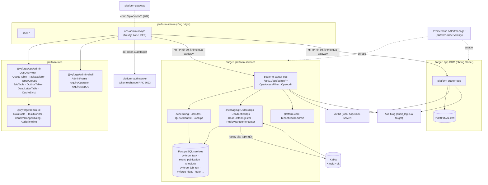
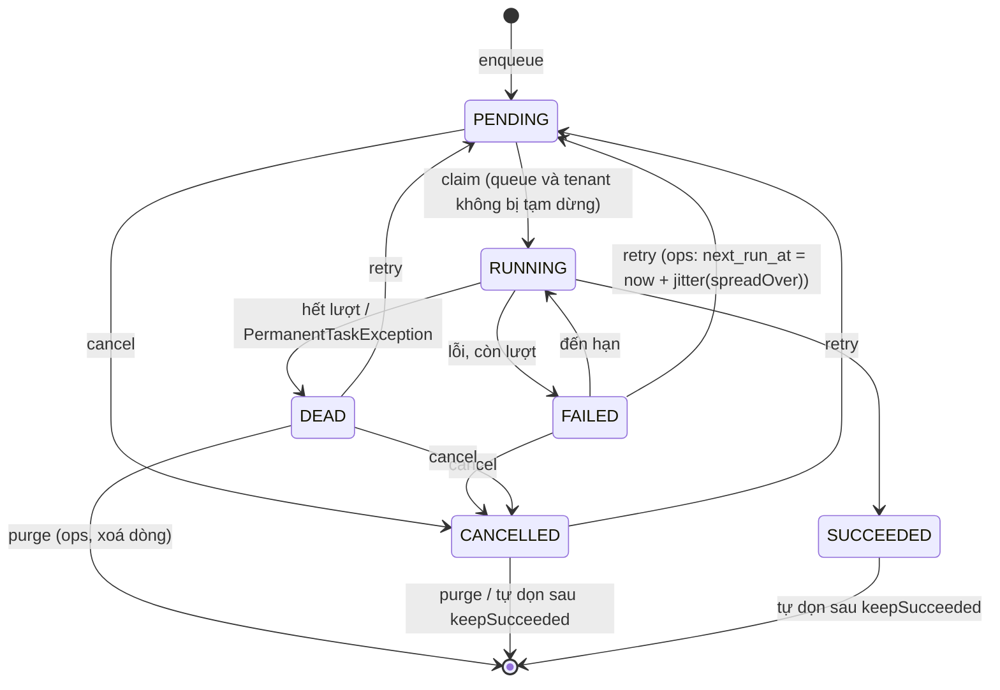
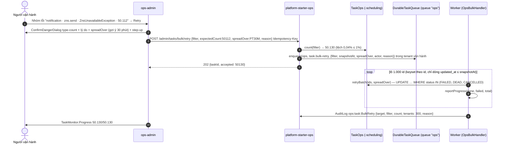
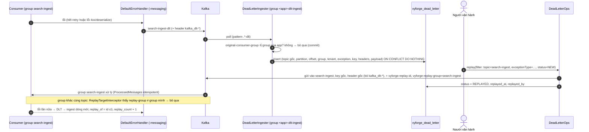
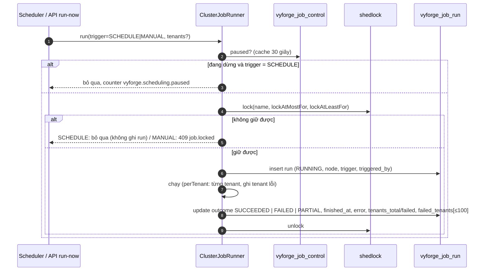
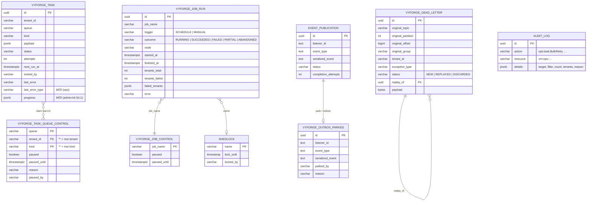

# Thiết kế: `ops-console`, vận hành việc nền, outbox, dead-letter và job định kỳ

> Trạng thái: **thiết kế, chờ duyệt** (forge-52, 27/10/2026). Nhánh `docs/design-ops-console`.
> Theo `module-conventions.md` (mục 1–6), kiến trúc admin microfrontend đã duyệt trong
> [platform-services.md](platform-services.md) (D1–D10, mục 4.8–4.12, 5.1–5.6, 10.4) và hợp đồng việc nền của
> [admin-kit.md](admin-kit.md) (D8, D10, §3.6, §3.9, §5.1.3, §5.2.3). Phạm vi lấy từ
> `docs/research/2026-10-gap-analysis.md` mục 2.4 và brief 6.4.
>
> Nền đã đọc trong code (`platform-java` `main`, 0.12.1): `DurableTaskQueue`, `TaskAdmin`, `TaskInfo`, `TaskQuery`,
> `QueueBacklog`, `MicrometerTaskMetrics`, migration `db/task/V1__vyforge_task.sql` (-scheduling); `@ClusterScheduled`,
> `ClusterJobRunner`, `JobMetrics`, bảng `shedlock` (-scheduling); `EventPublicationMaintenance`,
> `PlatformMessagingAutoConfiguration` (DLT `<topic>-dlt`), `TenantRecordInterceptor`, `ProcessedMessages`,
> `event_publication.sql` (-messaging); `TenantCacheManager` (platform-core); chart `platform-observability`
> (`slo-rules.yaml`, `dashboards/*.json`).
>
> Nối với thiết kế đã có: queue và kind của các module (mục 1.3), `TaskMonitor`/`BulkExecutor`/`CursorPage` của admin-kit,
> `OperatorTenantSelection` và manifest của platform-services, `@ClusterScheduled` của sequence, privacy-dsr, esign,
> api-access, master-data, organization, cms-content, payment, files, export, features.

ops-console là **bàn điều khiển vận hành xuyên module, xuyên tenant** cho bốn loại "việc chạy ngầm" mà mọi module
dùng chung: việc nền `DurableTaskQueue` (`vyforge_task`), outbox Spring Modulith (`event_publication`), dead-letter
Kafka (`<topic>-dlt`) và job định kỳ `@ClusterScheduled` (`shedlock`). Nó không có nghiệp vụ riêng. Nó cho người vận
hành platform **thấy** (backlog, lỗi, tuổi việc, lần chạy) và **xử lý tay** (retry, cancel, republish, replay, chạy lại,
tạm dừng) một cách có kiểm soát: quyền riêng, MFA, xác nhận, lý do, audit.

## Mục lục

0. [Tóm tắt quyết định](#0-tóm-tắt-quyết-định)
1. [Bài toán và phạm vi](#1-bài-toán-và-phạm-vi)
2. [Nghiên cứu](#2-nghiên-cứu)
3. [Kiến trúc](#3-kiến-trúc)
4. [Mô hình dữ liệu](#4-mô-hình-dữ-liệu)
5. [API](#5-api)
6. [Mở rộng](#6-mở-rộng)
7. [Vận hành](#7-vận-hành)
8. [Bảo mật và tuân thủ](#8-bảo-mật-và-tuân-thủ)
9. [Kế hoạch triển khai](#9-kế-hoạch-triển-khai)
10. [Đóng gói và triển khai độc lập](#10-đóng-gói-và-triển-khai-độc-lập)
11. [Lệch quy ước, quyết định, phụ thuộc tab khác](#11-lệch-quy-ước-quyết-định-phụ-thuộc-tab-khác)
- [Phụ lục A. Nguồn đã kiểm](#phụ-lục-a-nguồn-đã-kiểm)

---

## 0. Tóm tắt quyết định

**Quyết định về module:**
- **Thêm** một starter mỏng `platform-starter-ops`: REST `/api/v1/ops/admin/**`, kiểm người vận hành, audit, catalog
  action `ops:*`. Không có bảng riêng.
- **Thêm vào starter có sẵn** phần dịch vụ Java (không REST): `-scheduling` (quản trị việc nền xuyên tenant, tạm dừng
  queue, lịch sử và điều khiển job), `-messaging` (quản trị outbox, kho dead-letter, replay), `platform-core` (xoá cache
  theo tenant).
- **Thêm** package web `@vyforge/ops` (component dưới subpath `/admin`) và admin MFE `ops-admin` (`/m/ops`) trong repo
  `platform-admin`. **Chỉ người vận hành**; tenant admin dùng `TaskMonitor` của admin-kit trong khu của từng module.
- **Thêm** alert và dashboard vào chart `platform-observability`.
- **Không thêm** server riêng, không dùng JobRunr/Sidekiq/kafka-ui làm thành phần.

| # | Quyết định | Lý do ngắn |
|---|---|---|
| D1 | **Ops API nằm ở từng backend, không tập trung.** Mỗi app có việc nền (app nghiệp vụ, `platform-services`, deployment tách riêng) tự phục vụ `/api/v1/ops/admin/**` trên dữ liệu của chính nó. MFE `ops-admin` gộp nhiều backend ("target") theo cấu hình `OPS_TARGETS` | `vyforge_task`, `event_publication`, `shedlock`, DLT nằm trong database và Kafka group của từng app; gom về một chỗ sẽ cần quyền đọc database của mọi app. Giống cách registry MFE dùng `ADMIN_MODULES` (platform-services D2) |
| D2 | **Ops API không đi qua gateway.** Gateway chặn `/api/v*/ops/**` (404, như `/internal/**`). BFF của `ops-admin` gọi URL nội bộ của target bằng token đổi qua RFC 8693 (`aud` = target), NetworkPolicy chỉ cho namespace của `platform-admin` | Đây là đường có quyền xuyên tenant; không cần lộ ra Internet. Khớp hệ quả của điều kiện L2-c (platform-services §10.4): thao tác của người vận hành đi đường nội bộ |
| D3 | **Chỉ người vận hành, ba lớp kiểm:** token thuộc tenant vận hành, role `platform-admin`, `amr` có `mfa` (như `OperatorTenantSelection`), **và** action `ops:<resource>:<Verb>` qua `Authz`. Thao tác nguy hiểm đòi step-up (MFA trong 15 phút) | Gap analysis: "chỉ người vận hành, bắt buộc MFA". Tách quyền đọc/ghi/huỷ để có vai `ops-viewer`, `ops-operator`, `ops-admin` |
| D4 | **Cùng hợp đồng với admin-kit.** `TaskInfo` (thêm `progress`, `lastErrorType`), `CursorPage`, `BulkRequest`/`BulkResult`, tham số lọc phẳng, `Idempotency-Key`. Ops chỉ thêm tham số `tenantId` và phạm vi xuyên tenant | Một bộ component (`TaskMonitor`, `DataTable`) dùng cho cả hai nơi; không có hai định nghĩa "việc nền" |
| D5 | **Retry hàng loạt có giãn nhịp** (`spreadOver`): việc được đặt `next_run_at = now + ngẫu nhiên(0, spreadOver)` thay vì chạy ngay cùng lúc | 50.000 tin ZNS retry cùng giây sẽ vượt hạn mức của provider và lại `DEAD`. Sidekiq/JobRunr retry ngay; đây là điểm vyforge làm khác |
| D6 | **Tạm dừng queue**, toàn queue hoặc một tenant trong queue (bảng `vyforge_task_queue_control`). Worker bỏ qua khi claim; enqueue vẫn nhận | Provider của một tenant hỏng (brandname hết hạn) không được làm việc của tenant đó cứ chạy rồi `DEAD`. River có "pausing queues"; Frappe có cờ `stopped` cho Scheduled Job Type |
| D7 | **Job định kỳ có lịch sử và điều khiển:** bảng `vyforge_job_run` (mỗi lượt đã giữ khoá), `vyforge_job_control` (tạm dừng). "Chạy ngay" chạy trên replica nhận request qua chính `ClusterJobRunner`, vẫn giữ khoá. Xem và nhả khoá `shedlock` kẹt | Hiện chỉ có metric; không trả lời được "lượt 01:00 đêm qua có chạy không, lỗi gì". Frappe có `Scheduled Job Log` và `stopped`; JobRunr có trigger recurring job |
| D8 | **Outbox đọc thẳng `event_publication` bằng JDBC**, republish qua `FailedEventPublications.resubmit` của Modulith (lọc theo id). Event không sửa được thì **cất** (`park`) sang `vyforge_outbox_parked`, khôi phục được trong 30 ngày | API Modulith 2.1 không có liệt kê có phân trang/lọc. Xoá thẳng event là mất dữ liệu không lấy lại được |
| D9 | **Dead-letter Kafka được nạp vào bảng** `vyforge_dead_letter` của app sở hữu consumer group (`DeadLetterIngester`), rồi lọc, xem, replay, bỏ trên bảng | Kafka không lọc theo tenant/lỗi, không có trạng thái "đã xử lý" cho từng bản ghi, retention 7 ngày. Bảng cho lọc theo tenant, nhóm lỗi, thao tác hàng loạt, audit |
| D10 | **Replay nhắm đúng consumer group bị lỗi:** gửi lại vào topic gốc với header `vyforge-replay-group`; `ReplayTargetInterceptor` ở mọi consumer bỏ qua bản ghi replay không dành cho group của mình | DLT chung `<topic>-dlt` cho mọi group; replay thường làm mọi group nhận lại. Consumer idempotent vẫn là lớp bảo vệ thứ hai |
| D11 | **Nhóm lỗi** theo `(queue, kind, last_error_type)` cho việc nền và `(topic, exception_fqcn)` cho DLT; cột mới `vyforge_task.last_error_type` | Triage nhanh: "50.000 việc DEAD đều do `ZnsQuotaExceededException`" thay vì đọc từng dòng (kiểu error group của Sentry, Sidekiq Dead tab gom theo lỗi bằng tay) |
| D12 | **Payload không hiện mặc định.** Xem payload việc nền/DLT/outbox cần `ops:<resource>:ReadPayload` + step-up, hiện qua `LogSafeJson` (che field `@PersonalData`, mẫu số điện thoại, CCCD, email), và ghi audit kể cả khi chỉ đọc | Payload có thể chứa dữ liệu cá nhân (Luật 91/2025). `TaskInfo` hiện đã bỏ payload; giữ nguyên hướng đó |
| D13 | **Mọi thao tác ghi bắt buộc có lý do** (10–500 ký tự) và ghi `AuditLog` `ops:<resource>:<Verb>` với target, bộ lọc, số lượng, tenant bị ảnh hưởng | Kiểm toán hỏi "ai replay giao dịch thanh toán, vì sao" |
| D14 | **Metric và alert đặt trong `platform-observability`**: `PrometheusRule` `ops-rules.yaml` (DEAD tồn, việc đến hạn quá lâu, outbox kẹt, DLT mới, job không chạy thành công quá hạn) và dashboard "Việc nền và sự kiện" | Brief. Người vận hành nhận alert trước khi mở console |
| D15 | **SPI `OpsQueueSource`** để module có hàng đợi riêng (webhooks: `webhook_delivery` + lease) hiện backlog trong trang tổng quan và dẫn link sang khu admin của module | Webhooks không dùng `DurableTaskQueue` (thiết kế webhooks L5); không bắt module đổi kiến trúc để hiện trong console |

---

## 1. Bài toán và phạm vi

### 1.1 Use case

**Hiện tại.** Có `TaskAdmin` theo tenant (liệt kê, retry, cancel, backlog) nhưng chưa có REST, chưa có màn hình. Outbox
tự phục hồi bằng `EventPublicationMaintenance` (đánh dấu treo → `FAILED` → gửi lại tối đa 10 lần); quá 10 lần thì "giữ
FAILED để vận hành xem" nhưng không có chỗ nào để xem ngoài SQL. Listener Kafka lỗi đi vào `<topic>-dlt` và nằm đó tới
khi hết retention. `@ClusterScheduled` chỉ có metric `vyforge.scheduling.runs`. Người vận hành phải `psql` vào database
production để xử lý sự cố: vừa chậm, vừa không có audit, vừa dễ sai.

**Sắp tới.** 19 module đã thiết kế dùng `DurableTaskQueue` (bảng dưới), khoảng 25 job `@ClusterScheduled`, ít nhất 8
topic Kafka (platform-services §5.5, search, billing). Mỗi bản triển khai có 1–5 backend (app nghiệp vụ,
`platform-services`, deployment tách cho realtime/payment).

**Tương lai.** Thêm loại "việc chạy ngầm" mới (vd. workflow engine, hàng đợi pgmq nếu có) bằng SPI (§6) mà không đổi
console. Tự động hoá runbook ("khi provider phục hồi thì retry các việc DEAD của provider đó") qua `automation` (đợt C)
gọi cùng API.

### 1.2 Người dùng

| Vai | Làm gì | Quyền gợi ý |
|---|---|---|
| Người trực vận hành (L1) | Xem tổng quan, nhận alert, xem lỗi, retry/resubmit theo runbook | `ops-operator` |
| Kỹ sư vận hành/SRE (L2) | Mọi việc của L1, cộng: huỷ/xoá hàng loạt, cất/xoá event, nhả khoá, xem payload | `ops-admin` |
| Kiểm toán, quản lý | Chỉ xem tổng quan và audit | `ops-viewer` |
| Tenant admin | **Không dùng ops-console.** Xem việc nền của tenant mình trong khu của từng module (`TaskMonitor`) | — |

### 1.3 Queue, kind, job, topic hiện có (đầu vào để thiết kế)

| Module | Queue `DurableTaskQueue` (kind tiêu biểu) | Job `@ClusterScheduled` | Topic Kafka |
|---|---|---|---|
| notification | `notification` (gửi theo kênh: email, SMS brandname, ZNS, push) | dọn, digest | `notification-requests`, `notification-events` |
| files | `files` (`scan`, transform, purge) | purge, retention, upload hết hạn, đối soát quota, mồ côi | `vyforge.files` |
| export | `export` (`export.run`, import) | `export-reconcile` | — |
| webhooks | **hàng đợi riêng** `webhook_delivery` + lease (không dùng `vyforge_task`) | — | `webhooks-messages` |
| features | `features` | `features-reconcile` | `vyforge.features` |
| payment | `payment` (đối soát, IPN) | `payment-sweep`, `Reconciler` (perTenant) | `payment-events` |
| ai | `ai` (`embedding`, `kb.reindex`, `agent.resume`) | `PartitionMaintainer` | — |
| api-access | `api-access` | `api-access-usage-rollup`, `api-access-key-expiry` | — |
| billing | `billing` (`subscription.cycle`, `invoice.finalize`, `einvoice`, `dunning.step`) | chu kỳ, dunning | — |
| cms-content | `cms` (`cms.publish`, `cms.invalidate`, `cms.migrate-entries`) | `cms-schedule-sweeper` | — |
| collaboration | `collaboration` (`fanout`, `remind`) | partition | — |
| ekyc | `ekyc` (`process-callback`) | hết hạn phiên, retention, SLA duyệt | — |
| esign | `esign` (`request-signature`, `complete-signature`, `notify-recipients`, `archive-timestamp`) | nhắc ký, gia hạn dấu thời gian, partition | — |
| forms | `forms` (`action`) | `forms-schedule` | — |
| master-data | `masterdata` (`import`) | lấy tỷ giá theo nguồn | — |
| organization | `organization` | `EffectiveTimeTicker` (1 phút) | — |
| privacy-dsr | `privacy` (`dsr.plan`, `dsr.task`, `dsr.package`, `retention.sweep`) | `privacy-retention` (perTenant) | — |
| search | `search` (reindex) | partition query log | `search-ingest` (+ `search-ingest-dlt`) |
| sequence | — | `sequence-reservation-sweep`, `sequence-partition-maintenance` | — |
| workflow | `workflow` (`sla.remind`, `action.execute`) | quét SLA mỗi giờ | — |
| jpa-extras | — | `SoftDeletePurgeJob`, `EncryptionRotationJob` (perTenant) | — |
| admin-kit | queue của module, kind `bulk.<op>` | — | — |

Kết luận cho thiết kế: queue/kind là chuỗi tự do theo module (đúng quy ước, không enum trong DB), số queue ~20, số kind
~60, số job ~25. Console phải lấy danh sách **động** từ dữ liệu và từ registry handler/job, không mã hoá cứng.

### 1.4 Kịch bản nghiệp vụ phải đáp ứng

| # | Kịch bản | Đòi hỏi | Ở đâu |
|---|---|---|---|
| K1 | **Cổng Zalo ZNS lỗi 2 giờ**: 50.000 việc queue `notification` thành `DEAD`, rải trên 300 tenant. Sau khi ZNS phục hồi, người trực lọc `queue=notification, status=DEAD, lastErrorType=ZnsUnavailableException, updatedFrom=…`, retry toàn bộ, **giãn trong 30 phút** để không vượt hạn mức gửi của Zalo | Lọc xuyên tenant, nhóm lỗi, bulk theo bộ lọc, `spreadOver` | §3.3, §5.2 |
| K2 | **Brandname SMS của tenant X hết hạn đăng ký** với nhà mạng: mọi tin SMS của X lỗi `BrandnameNotRegistered`. Người vận hành **tạm dừng queue `notification` chỉ cho tenant X** tới khi tenant gia hạn, rồi tiếp tục; việc không bị đốt lượt thử | Pause theo (queue, tenant) | §3.4 |
| K3 | **Deploy lỗi**: listener `PaymentSucceeded → billing` ném lỗi, 3.200 event trong `event_publication` thành `FAILED` và đã hết 10 lần tự gửi lại. Sau hotfix, lọc theo `listenerId`, resubmit toàn bộ | Outbox theo listener/event type, resubmit hàng loạt | §3.5 |
| K4 | **Một event không bao giờ xử lý được** (event type đã bị xoá khỏi code, deserialize lỗi): cất (`park`) với lý do, outbox sạch, alert tắt; 30 ngày sau tự xoá | Park/restore | §3.5 |
| K5 | **Consumer `search-ingest` sai schema** sau khi đổi envelope: 12.000 bản ghi vào `search-ingest-dlt`. Sau khi sửa, replay **chỉ cho group của search**, không làm group khác cùng topic nhận lại | DLT ingest, replay nhắm group | §3.6 |
| K6 | **Poison message** trong `payment-events` (payload hỏng từ bản cũ): xem payload đã che PII, xác nhận không sửa được, bỏ (`discard`) có lý do | Xem payload có kiểm soát, discard, audit | §3.6, §8 |
| K7 | **Job đối soát VNPay/SePay 01:00** (`payment-sweep`) lỗi ở 3/120 tenant đêm qua. Người vận hành xem lượt chạy, lỗi theo tenant, **chạy lại tay chỉ cho 3 tenant đó** | Lịch sử job theo tenant, run-now theo tenant | §3.7 |
| K8 | **Khoá `shedlock` kẹt**: pod chạy `esign` gia hạn dấu thời gian (`lockAtMostFor = 6h`) bị OOM kill; job không chạy lại tới 6 giờ sau. Người vận hành thấy khoá giữ bởi pod đã chết, nhả khoá | Xem và nhả khoá | §3.7 |
| K9 | **Hệ thống hoá đơn điện tử của cơ quan thuế bảo trì** cuối tuần: tạm dừng job và queue `billing` kind `einvoice` trong khung bảo trì, tiếp tục sau đó; mọi việc vẫn được enqueue | Pause job, pause queue | §3.4, §3.7 |
| K10 | **Khách ngân hàng on-prem** có CRM, HRM, kho và `platform-services`: một console cho 4 backend, không Internet; backend chết thì console vẫn hiện 3 cái còn lại | Nhiều target, không phụ thuộc dịch vụ ngoài | §3.1 |
| K11 | **Thanh tra, kiểm toán nội bộ** hỏi ai đã replay 40 giao dịch thanh toán ngày 15/11, vì sao | Audit có lý do, bộ lọc, số lượng | §8 |
| K12 | **Tenant chấm dứt hợp đồng**: sau offboarding, xoá các việc `DEAD`/`CANCELLED` và dead-letter còn chứa dữ liệu cá nhân của tenant đó (Luật 91/2025: xoá khi hết mục đích) | Purge theo tenant | §3.3, §8 |
| K13 | **Cấu hình provider của tenant đổi nhưng cache cũ** (TTL 1 giờ): xoá cache `notification-providers` cho riêng tenant đó | Xoá cache theo tenant | §3.8 |
| K14 | **Webhook của đối tác lỗi**: trang tổng quan hiện 8.000 delivery chờ của webhooks (hàng đợi riêng), bấm link sang khu webhooks để replay | SPI `OpsQueueSource` | §6.1 |
| K15 | **Tết Nguyên Đán**: lượng thông báo tăng 10 lần; tuổi việc đến hạn cũ nhất của `notification` vượt 5 phút → alert; người trực xem tenant nào đang chiếm queue | Backlog theo tenant, alert | §3.3, §7 |
| K16 | **Chẩn đoán việc `export.run` của một tenant** cần xem payload (bộ lọc xuất có số điện thoại khách): người vận hành L2 bấm "Xem payload", MFA lại, thấy bản đã che; audit ghi lại việc xem | ReadPayload + step-up + che PII | §8 |
| K17 | **Thao tác hàng loạt lớn** (retry 50.000 việc) chạy nền, theo dõi tiến độ, huỷ giữa chừng | Việc nền `ops`, `TaskMonitor.Progress` | §3.3 |

### 1.5 Không thuộc phạm vi

| Không làm | Thuộc về |
|---|---|
| Màn việc nền **theo tenant** trong khu của từng module | admin-kit `TaskMonitor` + `TaskAdminEndpoint` |
| Nhật ký nghiệp vụ của module (log gửi tin, delivery webhook, giao dịch) | Khu admin của module |
| Xem log ứng dụng, trace, metric thô | Grafana/Loki/Tempo (`platform-observability`); console chỉ dẫn link theo `requestId`/`traceId` |
| Quản trị cluster Kafka (tạo topic, partition, ACL, reset offset tuỳ ý) | Công cụ hạ tầng (Strimzi, kafka-ui nếu khách muốn) |
| Đổi cấu hình queue lúc chạy (concurrency, backoff) | Cấu hình `vyforge.task.queues.*` qua GitOps; bản sau có thể thêm (§9.4) |
| Sửa payload việc/event/bản ghi DLT rồi gửi lại | Không làm ở bản đầu: sửa dữ liệu bằng tay trên production là rủi ro lớn; sửa code rồi replay |
| Tự động retry theo luật | `automation` (đợt C) gọi API của ops-console |

---

## 2. Nghiên cứu

Nguồn kiểm ngày 27/10/2026: version qua GitHub Releases API (`gh api repos/<repo>/releases/latest`, tags), license qua
`gh api repos/<repo>` và file LICENSE; Maven Central `maven-metadata.xml`; tài liệu đọc ở trang chính thức (Phụ lục A).

### 2.1 Bảng so sánh

| Hệ thống | Version, license | Mô hình dữ liệu | Màn hình, API vận hành | Điểm mạnh | Điểm yếu với vyforge |
|---|---|---|---|---|---|
| **JobRunr** | 9.0.2 (20/10/2026); LGPL-3.0 (OSS), Pro thương mại | Bảng job với trạng thái (enqueued, processing, succeeded, failed, deleted…) và lịch sử trạng thái; recurring job | Dashboard có sẵn: tổng quan, chi tiết job (timeline, Gantt), recurring job (trigger, xoá), servers. Bản Pro mới có xác thực, nhìn theo queue, batch, multi-cluster | Lịch sử trạng thái từng job, nút "trigger" recurring job | Dashboard bản OSS **không có xác thực**, chạy cổng riêng 8000; LGPL; vyforge đã không chọn JobRunr (MODULE_PLAN câu hỏi 5) |
| **Sidekiq Web** | 8.1.7; LGPL-3.0 (OSS), Pro/Enterprise thương mại | Redis: queue (list), retry set, scheduled set, dead set (mặc định giới hạn 10.000 job hoặc 6 tháng) | Tab Queues, Busy, Retries, Scheduled, Dead; chạy lại, xem, xoá job; thống kê processed/failed/latency | Mô hình **Retries → Dead** rõ ràng; dead set có giới hạn; latency theo queue là chỉ số chính | Bảo mật do app tự gắn (route constraint, Basic Auth); không đa tenant; retry hàng loạt chạy ngay, dễ dội vào provider |
| **Hangfire** | 1.8.25 (28/08/2026); LGPL-3.0 + thương mại | Bảng job, state history, set, counter | Dashboard: job theo trạng thái, retry/xoá, recurring job (trigger), servers | Lịch sử trạng thái, recurring job | Cùng loại với JobRunr; .NET; dashboard mặc định chỉ local |
| **Frappe** (RQ Job, Scheduled Job Type/Log) | v16.53.0 (22/10/2026); MIT | `RQ Job` (virtual doctype trên Redis: `queue`, `status` queued/started/finished/failed/deferred/scheduled/canceled, `exc_info`, `arguments`, `time_taken`); `Scheduled Job Type` (`method`, `cron_format`, `frequency`, **`stopped`**, `last_execution`, `next_execution`, `create_log`); `Scheduled Job Log` (`status` Scheduled/Complete/Failed, `details`, `debug_log`) | Danh sách RQ Job lọc theo queue/trạng thái, stop/cancel/delete; job định kỳ bật tắt bằng cờ `stopped`, xem log từng lượt | **Job định kỳ có cờ dừng và log lượt chạy** ngay trong UI quản trị; quyền theo role của Frappe | Log job dạng doctype không giới hạn có thể phình; `arguments` hiện thẳng (lộ dữ liệu) |
| **pgmq / Supabase Queues** | pgmq v1.13.1 (20/10/2026, PostgreSQL License); Supabase v1.26.08 (Apache-2.0) | Mỗi queue một bảng `pgmq.q_<name>` (`msg_id`, `read_ct`, `enqueued_at`, `vt`, `message`, `headers`), archive `a_<name>` (+`archived_at`); visibility timeout | Supabase Dashboard tạo, quản lý, theo dõi queue và message; quyền qua RLS | Queue trên Postgres, archive thay vì xoá | Không có DLQ sẵn (tự dựa `read_ct`); không có khái niệm tenant; UI gắn với Supabase Studio |
| **River + River UI** | river v0.49.0, riverui v0.22.0 (25/10/2026); MPL-2.0 | Bảng `river_job` trên Postgres, trạng thái gồm retryable/discarded/cancelled…; queue có thể tạm dừng | UI xem và quản lý job; công khai mặc định, bật Basic Auth bằng biến môi trường hoặc nhúng vào app Go | **Pause queue**; cùng mô hình "queue trên Postgres" với `vyforge_task` | Go; xác thực tối thiểu |
| **kafbat kafka-ui / AKHQ** | kafka-ui v1.5.0 (20/04/2026), AKHQ 0.28.0 (06/08/2026); Apache-2.0 | Đọc thẳng Kafka | Duyệt message (JSON/Avro, bộ lọc CEL), gửi message, xem consumer group và lag, RBAC, che dữ liệu (data masking) | Che dữ liệu khi duyệt message; RBAC theo UI | Công cụ hạ tầng, không biết tenant, không có trạng thái "đã xử lý" cho bản ghi DLT, không audit lý do |
| **Spring Modulith event registry** | 2.1.2 (23/10/2026), vyforge dùng 2.1.1; Apache-2.0 | `event_publication`: `status` PUBLISHED/PROCESSING/COMPLETED/FAILED/RESUBMITTED, `completion_attempts`, `last_resubmission_date`; completion mode UPDATE/DELETE/ARCHIVE | API: `IncompleteEventPublications`, `FailedEventPublications.resubmit(ResubmissionOptions)` (`withFilter`, `withMinAge`, `withBatchSize`), `CompletedEventPublications`; `EventPublicationRepository` có `findFailedPublications(FailedCriteria)`, `countByStatus`, `deletePublications(ids)` | Trạng thái rõ, resubmit có lọc | Không có API liệt kê có phân trang/lọc theo listener; không có tenant; không có màn hình |
| **Spring Kafka DLT** | 4.1.2 (22/10/2026); Apache-2.0 | `DeadLetterPublishingRecoverer` thêm header `kafka_dlt-original-topic`, `-original-partition`, `-original-offset`, `-original-timestamp`, `-original-consumer-group`, `kafka_dlt-exception-fqcn`, `-exception-cause-fqcn`, `-exception-message`, `-exception-stacktrace` | Không có công cụ replay | Đủ metadata để biết group nào lỗi, ở offset nào | Replay, trạng thái, lọc phải tự làm |
| **JHipster admin** | 9.4.0 (18/09/2026); Apache-2.0 | Actuator | Metrics, health, logs (đổi level), configuration, user management | Gom màn vận hành vào admin của app | Không có việc nền, outbox, DLT |

### 2.2 Học theo

1. **Sidekiq:** tách rõ "đang thử lại" (`FAILED` của vyforge) và "chết, chờ người" (`DEAD`); latency/tuổi việc đến hạn
   là chỉ số chính của queue (vyforge đã có `vyforge.task.oldest.due.age`).
2. **Frappe:** job định kỳ có **cờ dừng** và **log từng lượt** xem được trong UI quản trị; `exc_info` hiện cùng job.
3. **River:** tạm dừng queue là thao tác vận hành hạng nhất.
4. **JobRunr/Hangfire:** nút "trigger now" cho job định kỳ; xem server nào đang chạy (vyforge: `locked_by`).
5. **kafka-ui/AKHQ:** che dữ liệu khi xem message; RBAC theo thao tác.
6. **pgmq:** cất (archive) thay vì xoá ngay → vyforge "park" event outbox, giữ dead-letter đã xử lý một thời gian.
7. **Spring Kafka:** dùng header DLT có sẵn (`original-consumer-group`) để replay đúng group thay vì phát minh metadata.

### 2.3 Không làm

1. **Không nhúng dashboard của bên thứ ba** (JobRunr, kafka-ui): xác thực yếu hoặc riêng, không biết tenant, không audit
   lý do, license LGPL (JobRunr) hoặc thêm một service phải vận hành.
2. **Không retry hàng loạt chạy ngay** như Sidekiq/JobRunr: luôn có `spreadOver` (mặc định 0 cho dưới 100 việc, 5 phút
   từ 100 việc trở lên, người dùng chỉnh được).
3. **Không cho sửa payload rồi gửi lại** (kafka-ui cho gửi message tuỳ ý): tạo dữ liệu không qua code nghiệp vụ.
4. **Không hiện payload/`arguments` mặc định** (Frappe hiện `arguments`): chỉ với quyền riêng, step-up, đã che.
5. **Không tập trung dữ liệu vận hành của mọi app vào một database** (kiểu dashboard multi-cluster của JobRunr Pro): mỗi
   app tự phục vụ, console gộp ở tầng BFF (D1).
6. **Không giữ log job vô hạn** (Frappe): `vyforge_job_run` giữ 30 ngày, không ghi lượt bị bỏ qua vì replica khác giữ
   khoá (đã có counter `vyforge.scheduling.skipped`).

---

## 3. Kiến trúc

### 3.1 Thành phần



**Ba lớp, ba artifact:**

| Lớp | Ở đâu | Có gì | Phụ thuộc |
|---|---|---|---|
| Dịch vụ vận hành (Java thuần, không web) | `-scheduling` package `…scheduling.ops`; `-messaging` package `…messaging.ops`; `platform-core` `…core.cache` | `TaskOps`, `QueueControl`, `JobOps`, `OutboxOps`, `DeadLetterOps`, `TenantCacheAdmin` | Như starter hiện có |
| REST + an ninh + audit | **`platform-starter-ops`** (mới, mỏng) | Controller `/api/v1/ops/admin/**`, `OpsAccessFilter`, `OpsAudit`, `OpsActions` (catalog), `OpsBulkHandler` (việc nền hàng loạt), `/admin/info` | `-web`, `-authz`, `-audit`, `-security`; `-scheduling`, `-messaging` **optional** (`@ConditionalOnBean`) |
| Giao diện | `@vyforge/ops/admin` (platform-web); app `apps/ops-admin` (platform-admin) | Trang và Server Action | admin-kit, admin-shell |

Không có dịch vụ ops nào thì controller tương ứng không tạo (vd. app không dùng Kafka → không có `/dead-letters`;
`/admin/info` báo `capabilities` thiếu `deadletter`).

### 3.2 Target và gọi xuyên backend

`OPS_TARGETS` (JSON, do infra sinh, giống `ADMIN_MODULES`):

```yaml
# platform-infra/apps/platform-admin-ops/overlays/prod/values.yaml
env:
  OPS_TARGETS: >-
    [{"name":"services","title":"platform-services","url":"http://platform-services:8087","audience":"platform-services"},
     {"name":"services-payment","title":"Payment","url":"http://platform-services-payment:8087","audience":"platform-services"},
     {"name":"crm","title":"CRM","url":"http://crm-api:8080","audience":"crm-api"}]
```

```mermaid
sequenceDiagram
  autonumber
  actor O as Người vận hành
  participant Z as ops-admin (Server Component)
  participant A as auth-server
  participant T as Target (platform-starter-ops)
  participant Z2 as Authz
  O->>Z: GET /m/ops/vi/tasks?target=services&status=DEAD
  Z->>Z: requireOperator() (tenant vận hành, role, amr mfa)
  Z->>A: token exchange (subject_token = access token, audience = platform-services)
  A-->>Z: token aud=platform-services, giữ sub, roles, tenant_id, amr, auth_time; thêm act
  Z->>T: GET /api/v1/ops/admin/tasks?status=DEAD (Bearer, X-Request-Id)
  T->>T: OpsAccessFilter: tenant vận hành, role platform-admin, amr mfa
  T->>Z2: check(ops:task:List, vrn:ops:task/*)
  Z2-->>T: allow
  T-->>Z: CursorPage<TaskInfo> (mọi tenant)
  Z-->>O: render TaskExplorer
```

- Token đổi được cache theo `(sub, audience)` tới 60 giây trước khi hết hạn, trong bộ nhớ của zone.
- Trang tổng quan gọi song song mọi target (timeout 3 giây mỗi target). Target lỗi hiện thẻ "không truy cập được" với
  mã lỗi, các target khác vẫn hiện (K10).
- Target không có `platform-starter-ops` → `/api/v1/ops/admin/info` trả 404 → hiện "chưa cài ops".

### 3.3 Việc nền (`vyforge_task`)

**Màn hình:** tổng quan queue (backlog theo trạng thái, tuổi việc đến hạn cũ nhất, top tenant), danh sách việc lọc theo
target/queue/kind/tenant/trạng thái/loại lỗi/khoảng thời gian, nhóm lỗi, chi tiết việc, thao tác đơn và hàng loạt.

**Trạng thái và thao tác** (state machine giữ nguyên của `TaskStatus`; ops chỉ thêm `purge`):



**Retry hàng loạt (K1, K17):**



- Dưới 500 việc (`ids`) chạy đồng bộ trong request (như admin-kit D8).
- `snapshotAt`: chỉ đụng việc có `updated_at ≤ snapshotAt`, để việc mới lỗi sau khi bấm không bị kéo vào.
- `spreadOver`: `next_run_at = now() + random() * spreadOver` tính trong SQL, mỗi dòng một giá trị; `attempts = 0`
  (đúng hành vi `TaskAdmin.retry` hiện có: "đếm lại lượt thử từ đầu").
- Việc hàng loạt của ops chạy ở queue `ops` của **chính target**, trong tenant vận hành (việc xuyên tenant, đánh dấu
  `@TenantExempt` với lý do). Handler kiểm lại quyền bằng principal đã lưu trong payload (`sub`, `roles`) trước mỗi lô;
  mất quyền giữa chừng thì dừng, việc thành `DEAD` với `ops.permission_revoked`.
- Cancel và purge hàng loạt cùng cơ chế. Purge chỉ nhận `DEAD`, `CANCELLED` (không bao giờ xoá việc chưa xong).

**Nhóm lỗi (D11):** `GET /admin/tasks/errors?status=DEAD,FAILED&queue=…` trả
`[{queue, kind, lastErrorType, count, tenants, firstAt, lastAt, sampleError}]`, sắp theo `count`. `lastErrorType` là
tên lớp exception ngắn (hoặc `ErrorCode` nếu exception là `PlatformException`), do worker ghi khi việc lỗi (cột mới).
`sampleError` là `last_error` của dòng mới nhất, cắt 500 ký tự.

### 3.4 Tạm dừng queue (D6)

- Phạm vi: `(queue, tenant)` với tenant là `*` (toàn queue) hoặc một tenant; tuỳ chọn `kind` (`*` hoặc một kind, cho K9
  `billing/einvoice`); tuỳ chọn `until` (tự tiếp tục).
- Worker: `JdbcDurableTaskQueue.claim` thêm điều kiện loại trừ, đọc bảng điều khiển **một lần mỗi chu kỳ poll** (cache
  trong bộ nhớ worker 5 giây; bảng nhỏ):

```sql
-- trong câu claim hiện có (vyforge_task_due_idx), thêm:
and not exists (
  select 1 from vyforge_task_queue_control c
  where c.queue = t.queue and c.paused
    and (c.tenant_id = '*' or c.tenant_id = t.tenant_id)
    and (c.kind = '*' or c.kind = t.kind)
    and (c.paused_until is null or c.paused_until > now()))
```

- Việc đang `RUNNING` chạy tiếp tới xong; tạm dừng không ngắt.
- Enqueue vẫn nhận (không mất việc). Gauge `vyforge.task.paused{queue}` = số phạm vi đang dừng; alert nếu dừng quá 24 giờ
  mà không có `until` (quên tiếp tục).
- Tenant admin **không** tạm dừng được (thao tác ảnh hưởng vận hành); module có thể hiện cờ "đang tạm dừng bởi vận hành"
  trong `TaskMonitor.Backlog` qua trường `paused` của `QueueBacklog`.

### 3.5 Outbox (`event_publication`)

vyforge đặt `completion-mode=delete`, nên bảng chỉ còn event **chưa xong**. `EventPublicationMaintenance` đã tự gửi lại
tối đa `max-attempts` (10). Ops xử lý phần còn lại.

| Thao tác | Cách làm |
|---|---|
| Tổng quan | `select listener_id, event_type, status, count(*), min(publication_date), max(completion_attempts) … group by 1,2,3` |
| Danh sách | Keyset `(publication_date, id)`; lọc `status`, `listenerId`, `eventType`, `tenantId`, `publishedFrom/To`, `attemptsMin` |
| Tenant | Event `TenantAwareEvent` được Jackson ghi `"tenantId"`: lọc bằng `serialized_event::jsonb ->> 'tenantId'` (statement timeout 5 giây, luôn kèm `limit`). Event không mang tenant hiện "—" |
| Resubmit | Dòng `PUBLISHED`/`PROCESSING`/`RESUBMITTED` cũ hơn `stale-after` → JDBC `update … set status='FAILED'`; rồi `FailedEventPublications.resubmit(ResubmissionOptions.defaults().withFilter(p -> ids.contains(p.getIdentifier())).withBatchSize(500))`, trong `TenantContext.run(tenant)` theo nhóm tenant như `EventPublicationMaintenance`. Không đặt lại `completion_attempts` (để thấy event đã thử bao lần) |
| Park (K4) | Một transaction: `insert into vyforge_outbox_parked select …, :actor, :reason, now()` rồi `delete from event_publication where id in (…)`. Chỉ nhận `FAILED` |
| Restore | Insert lại vào `event_publication` với `status='FAILED'`, `completion_attempts` giữ nguyên, rồi xoá khỏi parked. Maintenance hoặc người vận hành resubmit |
| Xem event | `serialized_event` qua `LogSafeJson` (D12), cần `ops:outbox:ReadPayload` |

Tính an toàn: resubmit có thể làm listener chạy hai lần nếu event thật ra vẫn đang xử lý ở replica khác; đúng như
`EventPublicationMaintenance` đã ghi nhận, listener phải idempotent (B7). Ops chỉ resubmit dòng `PROCESSING` khi cũ hơn
`stale-after`.

### 3.6 Dead-letter Kafka



- **Ingest ở app sở hữu consumer.** `DeadLetterIngester` là `@KafkaListener` (`topicPattern`
  `vyforge.messaging.dlt.topic-pattern`, mặc định `.*-dlt`), group `${spring.application.name}-dlt-ingest`. Chỉ giữ
  bản ghi có `kafka_dlt-original-consumer-group` thuộc tập group của app (lấy từ `KafkaListenerEndpointRegistry` lúc
  khởi động, cộng `vyforge.messaging.dlt.owned-groups`). Khoá duy nhất `(original_topic, original_partition,
  original_offset, original_group)` nên ingest lại không tạo trùng.
- **Ingest lỗi** (database chết): không commit offset, thử lại theo backoff; DLT của chính ingester không tồn tại (lỗi
  ingest không được đẩy sang `*-dlt-dlt`): listener này dùng error handler riêng chỉ retry, không recoverer.
- **Tenant** lấy từ header `tenant_id` (quy ước của `TenantProducerInterceptor`).
- **Payload** giữ nguyên byte (`bytea`), tối đa `vyforge.messaging.dlt.max-payload` (1 MiB; lớn hơn thì chỉ giữ metadata,
  `payload_truncated = true`). Hết `payload-retention` (14 ngày) thì đặt `payload = null`, giữ metadata tới
  `retention` (30 ngày).
- **Replay** gửi lại bằng `KafkaTemplate` (transaction producer nếu app bật), cùng key và header gốc trừ `kafka_dlt-*`,
  cộng `vyforge-replay-id` (id dòng), `vyforge-replay-group`. Tuỳ chọn `targetTopic` (mặc định topic gốc) cho trường hợp
  topic đã đổi tên; chỉ nhận topic nằm trong danh sách topic app đang consume.
- **`ReplayTargetInterceptor`** (`RecordInterceptor`, ghép với `TenantRecordInterceptor` bằng
  `CompositeRecordInterceptor`): bản ghi có `vyforge-replay-group` khác group của listener → trả `null` (bỏ qua, vẫn
  commit offset). Không có header → đi tiếp như thường.
- **Discard**: `status = DISCARDED`, giữ metadata tới hết retention để kiểm toán.
- Không có Kafka trong bản triển khai → không tạo bean, `capabilities` không có `deadletter`.

### 3.7 Job định kỳ (`@ClusterScheduled`)

**Registry:** `ClusterJobScheduler` đã biết mọi `ClusterJob` (tên, cron/fixedDelay, zone, lockAtMostFor, perTenant). Thêm
`ClusterJobRegistry` công khai đọc danh sách này, kèm lượt kế tiếp (tính từ cron/fixedDelay) và lượt gần nhất từ
`vyforge_job_run`.

**Ghi lượt chạy** (trong `ClusterJobRunner`, sau khi giữ khoá):



- Ghi run lỗi (database chết) **không làm job lỗi**: log cảnh báo và chạy tiếp (job quan trọng hơn lịch sử của nó).
- **Run-now (K7):** `POST /admin/jobs/{name}/run {tenants?: [..], reason}` → replica nhận request chạy `ClusterJobRunner`
  trên virtual thread, trả `202 {runId}`. Job `perTenant` nhận danh sách tenant (tối đa 500) thay cho `TenantDirectory`.
  Đang có lượt giữ khoá → `409 ops.job_locked`. Job dừng (`paused`) vẫn chạy tay được (để thử sau sửa lỗi).
- **Pause/resume (K9):** `vyforge_job_control (job_name, paused, paused_until, reason, paused_by)`.
- **Khoá (K8):** `GET /admin/jobs/{name}` hiện dòng `shedlock` (`lock_until`, `locked_at`, `locked_by`) và lượt
  `RUNNING` trong `vyforge_job_run`. `POST /admin/jobs/{name}/lock/release` đặt `lock_until = locked_at` (chỉ khi
  `lock_until > now()`), cần `ops:job:ReleaseLock`, step-up, lý do. Cảnh báo trong dialog: nếu node giữ khoá còn sống,
  job có thể chạy chồng. Lượt `RUNNING` mồ côi (node không cập nhật quá `lockAtMostFor`) được đánh dấu `ABANDONED` bởi
  bảo trì.
- Job có lịch sử tối thiểu ở metric `vyforge.scheduling.last.success` (gauge, epoch giây) để alert "quá hạn" mà không
  cần database (§7).

### 3.8 Xoá cache theo tenant (K13)

`TenantCacheAdmin` (platform-core) liệt kê cache khai báo trong `vyforge.cache.caches` và xoá entry của **một tenant**:
backend Caffeine duyệt `asMap().keySet()` lọc `TenantCacheKey.tenant`; backend Redis `SCAN` theo tiền tố
`<cache>::t:<tenant>:` (batch 500) rồi `UNLINK`. Cache nhiều replica Caffeine: phát thông điệp xoá qua kênh Valkey
`vyforge:cache:evict` (đã có mẫu ở `vyforge:iam:changed`); không có Valkey thì chỉ xoá replica nhận request và trả
`partial: true`. Xoá toàn cache mọi tenant (`clear`) cần `ops:cache:EvictAll` riêng.

### 3.9 Luồng lỗi

| Lỗi | Hành vi |
|---|---|
| Target không truy cập được | Thẻ target "unreachable" (mã, thời điểm), các target khác vẫn hiện; thao tác trên target đó bị khoá |
| Token exchange bị từ chối | Trang báo `ops.target_auth_failed`, gợi ý cấu hình audience; không fallback dùng token gốc |
| Đếm lệch > 1% khi bulk theo bộ lọc | `409 bulk.count_changed` (admin-kit), giao diện đếm lại và hỏi xác nhận lần nữa |
| Việc bulk của ops lỗi giữa chừng | Lô đã xong giữ nguyên (idempotent: retry việc đã `PENDING` là no-op), việc `ops` retry theo backoff; tiến độ hiện số đã xong |
| Kafka không gửi được khi replay | Dòng giữ `NEW`, ghi `last_replay_error`; trả `BulkResult.failed` theo id |
| Outbox resubmit trong lúc listener vẫn lỗi | Event lại `FAILED`, `completion_attempts` tăng; console hiện "lỗi lại sau resubmit" |
| Hai người cùng thao tác một việc | Câu UPDATE có điều kiện trạng thái; người sau nhận `409 task.invalid_state` (hoặc `BulkFailure`) |
| `vyforge_task_queue_control` không đọc được | Worker **không** dừng (fail-open cho xử lý việc), log lỗi, metric `vyforge.task.control.errors`; lý do: dừng mọi queue vì một bảng điều khiển lỗi là sự cố lớn hơn |
| Mất quyền giữa thao tác hàng loạt | Việc `ops` dừng ở lô kế tiếp, `DEAD` với `ops.permission_revoked` |

---

## 4. Mô hình dữ liệu

### 4.1 ERD



### 4.2 DDL dự kiến

**`-scheduling`, starter schema `task`** (bảng lịch sử `flyway_schema_history_task`, đã có V1). Một migration V2 chung
cho phần của admin-kit và ops-console để không tranh số version:

```sql
-- META-INF/vyforge/db/task/V2__task_progress_and_ops.sql
alter table vyforge_task add column progress jsonb;               -- admin-kit §4.1
alter table vyforge_task add column last_error_type varchar(255); -- ops: nhóm lỗi (tên exception ngắn hoặc ErrorCode)
comment on column vyforge_task.last_error_type is 'Loại lỗi của lần thử gần nhất, để nhóm lỗi; null khi chưa lỗi';

-- Ops xuyên tenant: liệt kê việc lỗi mới nhất trước (keyset theo id = UUIDv7)
create index vyforge_task_ops_failed_idx on vyforge_task (queue, status, id desc)
    where status in ('FAILED', 'DEAD');
-- Nhóm lỗi
create index vyforge_task_ops_error_idx on vyforge_task (queue, kind, last_error_type)
    where status in ('FAILED', 'DEAD');

-- Tạm dừng queue (D6). Không có tenant_id kiểu TenantEntity: bảng điều khiển của người vận hành, tenant '*' = mọi tenant.
create table vyforge_task_queue_control
(
    queue        varchar(63)  not null,
    tenant_id    varchar(63)  not null default '*',
    kind         varchar(63)  not null default '*',
    paused       boolean      not null,
    paused_until timestamptz,
    reason       varchar(500) not null,
    paused_by    varchar(255) not null,
    updated_at   timestamptz  not null,
    primary key (queue, tenant_id, kind)
);
```

`META-INF/vyforge/sql/task.sql` (file gộp cho DBA) cập nhật tương ứng.

**`-scheduling`, starter schema mới `job`** (`META-INF/vyforge/db/job`, lịch sử `flyway_schema_history_job`). Không đặt
trong `db/scheduling` vì location đó đang chạy bằng Flyway của app (R__ `shedlock`), thêm `V…` sẽ trùng dải version của
app.

```sql
-- META-INF/vyforge/db/job/V1__vyforge_job.sql
create table vyforge_job_run
(
    id             uuid primary key,             -- UUIDv7
    job_name       varchar(64)   not null,
    trigger        varchar(16)   not null,       -- SCHEDULE | MANUAL (varchar, kiểm ở code)
    triggered_by   varchar(255),                 -- sub khi MANUAL
    outcome        varchar(16)   not null,       -- RUNNING | SUCCEEDED | FAILED | PARTIAL | ABANDONED
    node           varchar(255)  not null,
    started_at     timestamptz   not null,
    finished_at    timestamptz,
    duration_ms    bigint,
    tenants_total  integer,
    tenants_failed integer,
    failed_tenants jsonb,                        -- [{"tenant":"x","error":"…"}], tối đa 100
    error          varchar(4000)
);
create index vyforge_job_run_job_idx on vyforge_job_run (job_name, started_at desc);
create index vyforge_job_run_running_idx on vyforge_job_run (started_at) where outcome = 'RUNNING';

create table vyforge_job_control
(
    job_name     varchar(64)  primary key,
    paused       boolean      not null,
    paused_until timestamptz,
    reason       varchar(500) not null,
    paused_by    varchar(255) not null,
    updated_at   timestamptz  not null
);
```

**`-messaging`, starter schema mới `messaging`** (`META-INF/vyforge/db/messaging`, lịch sử
`flyway_schema_history_messaging`; dùng `StarterSchemaMigrator` của `-jpa` qua phụ thuộc optional, §11.1 L4).
`event_publication` và `processed_messages` **không** chuyển vào đây (đang do dự án tự tạo theo hướng dẫn hiện có).

```sql
-- META-INF/vyforge/db/messaging/V1__vyforge_messaging_ops.sql
create table vyforge_outbox_parked
(
    id                     uuid primary key,     -- id gốc của event_publication
    listener_id            text          not null,
    event_type             text          not null,
    serialized_event       text          not null,
    publication_date       timestamptz   not null,
    completion_attempts    integer       not null,
    last_resubmission_date timestamptz,
    tenant_id              varchar(63),          -- trích từ serialized_event lúc park, để lọc
    parked_at              timestamptz   not null,
    parked_by              varchar(255)  not null,
    reason                 varchar(500)  not null
);
create index vyforge_outbox_parked_at_idx on vyforge_outbox_parked (parked_at);

create table vyforge_dead_letter
(
    id                 uuid primary key,          -- UUIDv7
    original_topic     varchar(249)  not null,
    original_partition integer       not null,
    original_offset    bigint        not null,
    original_group     varchar(255)  not null,
    original_timestamp timestamptz,
    dlt_topic          varchar(249)  not null,
    dlt_partition      integer       not null,
    dlt_offset         bigint        not null,
    tenant_id          varchar(63),               -- header tenant_id; null nếu không có
    message_key        bytea,
    headers            jsonb         not null,    -- header gốc (trừ kafka_dlt-*), giá trị base64; tối đa 16 KiB
    payload            bytea,                     -- null khi quá max-payload hoặc đã hết payload-retention
    payload_size       integer       not null,
    payload_truncated  boolean       not null default false,
    exception_type     varchar(255)  not null,    -- kafka_dlt-exception-cause-fqcn, không có thì -exception-fqcn
    exception_message  varchar(4000),
    status             varchar(16)   not null,    -- NEW | REPLAYED | DISCARDED (varchar, kiểm ở code)
    replay_of          uuid,                      -- dòng DLT trước đó nếu bản ghi này là replay lỗi lại
    replay_count       integer       not null default 0,
    handled_at         timestamptz,
    handled_by         varchar(255),
    handle_reason      varchar(500),
    last_replay_error  varchar(1000),
    received_at        timestamptz   not null,
    constraint vyforge_dead_letter_origin_uk
        unique (original_topic, original_partition, original_offset, original_group)
);
create index vyforge_dead_letter_list_idx on vyforge_dead_letter (status, original_topic, id desc);
create index vyforge_dead_letter_tenant_idx on vyforge_dead_letter (tenant_id, status, id desc);
create index vyforge_dead_letter_group_idx on vyforge_dead_letter (original_topic, exception_type) where status = 'NEW';
create index vyforge_dead_letter_received_idx on vyforge_dead_letter (received_at);
```

Không lưu stack trace (`kafka_dlt-exception-stacktrace`) vào bảng: dài, có thể chứa dữ liệu; log của consumer đã có, nối
bằng `traceId` trong header nếu có.

### 4.3 Retention và dung lượng

| Bảng | Giữ | Ai dọn | Ước lượng |
|---|---|---|---|
| `vyforge_task` | Như hiện có (`keepSucceeded` 7 ngày; `DEAD` tới khi xử lý tay). Thêm `vyforge.task.keep-dead` (mặc định **90 ngày**, 0 = mãi) để `DEAD` không nằm vô hạn (Sidekiq: 6 tháng) | Bảo trì hiện có của -scheduling | 50.000 DEAD × ~1 KB = 50 MB trong sự cố |
| `vyforge_task_queue_control`, `vyforge_job_control` | Dòng `paused=false` cũ hơn 30 ngày xoá | Bảo trì -scheduling | Vài chục dòng |
| `vyforge_job_run` | 30 ngày (`vyforge.scheduling.history.retention`); lượt `RUNNING` quá `lockAtMostFor` → `ABANDONED` | Bảo trì -scheduling | 25 job, job 1 phút → ~45.000 dòng/tháng mỗi job nhanh; tổng < 500.000 dòng, < 100 MB |
| `vyforge_outbox_parked` | 30 ngày (`vyforge.messaging.outbox.parked-retention`) | Bảo trì outbox hiện có | Nhỏ |
| `vyforge_dead_letter` | Payload 14 ngày, metadata 30 ngày; `NEW` cũng hết hạn sau 30 ngày (có alert trước 3 ngày) | `DeadLetterMaintenance` (`@ClusterScheduled`, hằng giờ, xoá theo lô 5.000) | Sự cố 12.000 bản ghi × 4 KB ≈ 50 MB |

Không partition ở bản đầu: khối lượng nhỏ, xoá theo lô có chỉ mục `received_at`/`started_at`. Nếu một bản triển khai
vượt 10 triệu dòng dead-letter/tháng thì chuyển partition theo tháng (bản sau).

### 4.4 Tiến hoá schema

- Mọi trạng thái, trigger, outcome là `varchar` kiểm ở code (quy ước), thêm giá trị không cần migration.
- Payload bulk của queue `ops` có `schema_version` (cột sẵn của `vyforge_task`); handler đọc được bản cũ một minor.
- `headers` của dead-letter là JSON có `schemaVersion: 1`.
- Hợp đồng REST `/api/v1/ops/admin/**` có `apiVersion` trong `/admin/info`; thêm trường không bắt buộc không tăng version.

---

## 5. API

### 5.1 Java

#### 5.1.1 `platform-starter-scheduling`, package `com.vyforge.platform.scheduling.ops`

```java
/**
 * Quản trị việc nền xuyên tenant cho người vận hành. Khác TaskAdmin (theo TenantContext): tenantId là bộ lọc tuỳ chọn.
 * Không kiểm quyền (lớp REST của platform-starter-ops kiểm); không bao giờ trả payload trừ khi gọi readPayload.
 */
public interface TaskOps {
    CursorSlice<TaskInfo> list(TaskOpsFilter filter, @Nullable UUID before, int limit);
    Optional<TaskInfo> find(UUID id);
    long count(TaskOpsFilter filter);
    List<QueueOverview> overview(int topTenants);                 // mọi queue, mọi tenant
    List<ErrorGroup> errorGroups(TaskOpsFilter filter, int limit);
    Optional<String> readPayload(UUID id);                        // JSON thô; REST che bằng LogSafeJson

    BulkOutcome retry(Collection<UUID> ids, Duration spreadOver);  // FAILED/DEAD/CANCELLED → PENDING, attempts=0
    BulkOutcome cancel(Collection<UUID> ids);                      // PENDING/FAILED/DEAD → CANCELLED
    BulkOutcome purge(Collection<UUID> ids);                       // chỉ DEAD/CANCELLED
    Stream<UUID> ids(TaskOpsFilter filter, Instant snapshotAt);    // keyset theo lô, cho bulk theo bộ lọc
}

public record TaskOpsFilter(@Nullable String tenantId, @Nullable String queue, @Nullable String kind,
                            Set<TaskStatus> statuses, @Nullable String lastErrorType,
                            @Nullable Instant updatedFrom, @Nullable Instant updatedTo) {}

public record QueueOverview(String queue, Map<TaskStatus, Long> counts, @Nullable Instant oldestDueAt,
                            List<TenantCount> topTenants, List<QueuePause> pauses) {}
public record ErrorGroup(String queue, String kind, @Nullable String lastErrorType, long count, long tenants,
                         Instant firstAt, Instant lastAt, @Nullable String sampleError) {}
public record BulkOutcome(long changed, List<UUID> skipped) {}   // skipped: không tồn tại hoặc sai trạng thái

/** Tạm dừng queue (D6). */
public interface QueueControl {
    void pause(QueuePauseScope scope, @Nullable Instant until, String reason, String actor);
    void resume(QueuePauseScope scope, String actor);
    List<QueuePause> pauses();
}
public record QueuePauseScope(String queue, String tenantId /* "*" */, String kind /* "*" */) {}

/** Job định kỳ (D7). */
public interface JobOps {
    List<JobInfo> jobs();                                          // registry + lượt gần nhất + khoá + paused
    Optional<JobInfo> find(String name);
    CursorSlice<JobRun> runs(String name, @Nullable UUID before, int limit);
    UUID runNow(String name, @Nullable Collection<String> tenants, String actor);   // ném JobLockedException
    void pause(String name, @Nullable Instant until, String reason, String actor);
    void resume(String name, String actor);
    boolean releaseLock(String name);
}
public record JobInfo(String name, @Nullable String cron, @Nullable Duration fixedDelay, @Nullable String zone,
                      boolean perTenant, Duration lockAtMostFor, @Nullable Instant nextRunAt,
                      @Nullable JobRun lastRun, @Nullable JobRun lastSuccess, @Nullable LockState lock,
                      @Nullable JobPause pause) {}
```

Thay đổi trong code hiện có:

| Lớp | Thay đổi |
|---|---|
| `TaskInfo` | Thêm `@Nullable String lastErrorType`, `@Nullable TaskProgress progress` (admin-kit) |
| `QueueBacklog` | Thêm `boolean paused` (tenant hiện tại hoặc toàn queue đang bị dừng) |
| `TaskWorker` | Ghi `last_error_type`: `ErrorCode` của `PlatformException` nếu có, không thì `getClass().getSimpleName()` của cause gốc |
| `JdbcDurableTaskQueue.claim` | Điều kiện loại trừ §3.4 |
| `ClusterJobRunner` | Kiểm `paused`, ghi `vyforge_job_run`, nhận `trigger` và danh sách tenant; gauge `vyforge.scheduling.last.success` |
| `ClusterJobScheduler` | Xuất `ClusterJobRegistry` (danh sách job, lượt kế tiếp) |

`CursorSlice<T>(List<T> content, @Nullable String next)` là bản Java thuần không phụ thuộc -web; lớp REST chuyển sang
`CursorPage` của -web (admin-kit §5.1.1).

#### 5.1.2 `platform-starter-messaging`, package `com.vyforge.platform.messaging.ops`

```java
public interface OutboxOps {
    List<OutboxGroup> summary();                                   // theo listener, event type, status
    CursorSlice<OutboxEntry> list(OutboxFilter filter, @Nullable String cursor, int limit);
    Optional<String> readEvent(UUID id);
    BulkOutcome resubmit(Collection<UUID> ids);
    BulkOutcome park(Collection<UUID> ids, String reason, String actor);
    CursorSlice<ParkedEntry> parked(OutboxFilter filter, @Nullable String cursor, int limit);
    BulkOutcome restore(Collection<UUID> ids);
    BulkOutcome deleteParked(Collection<UUID> ids);
    Stream<UUID> ids(OutboxFilter filter, Instant snapshotAt);
}
public record OutboxFilter(Set<String> statuses, @Nullable String listenerId, @Nullable String eventType,
                           @Nullable String tenantId, @Nullable Instant publishedFrom, @Nullable Instant publishedTo,
                           @Nullable Integer attemptsMin) {}

public interface DeadLetterOps {
    List<DeadLetterGroup> summary(DeadLetterFilter filter);        // theo topic, group, exception type
    CursorSlice<DeadLetterEntry> list(DeadLetterFilter filter, @Nullable UUID before, int limit);
    Optional<DeadLetterEntry> find(UUID id);
    Optional<byte[]> readPayload(UUID id);
    BulkOutcome replay(Collection<UUID> ids, @Nullable String targetTopic, String actor);
    BulkOutcome discard(Collection<UUID> ids, String reason, String actor);
    Stream<UUID> ids(DeadLetterFilter filter, Instant snapshotAt);
}
public record DeadLetterFilter(Set<DeadLetterStatus> statuses, @Nullable String topic, @Nullable String group,
                               @Nullable String tenantId, @Nullable String exceptionType,
                               @Nullable Instant receivedFrom, @Nullable Instant receivedTo) {}
```

Lớp mới khác: `DeadLetterIngester`, `DeadLetterMaintenance`, `ReplayTargetInterceptor`, `ReplayHeaders`
(`vyforge-replay-id`, `vyforge-replay-group`). `PlatformMessagingAutoConfiguration` đổi bean `RecordInterceptor` thành
`CompositeRecordInterceptor(tenant, replayTarget)` (vẫn `@ConditionalOnMissingBean`).

#### 5.1.3 `platform-core`, package `com.vyforge.platform.core.cache`

```java
public interface TenantCacheAdmin {
    List<CacheInfo> caches();                                      // tên, backend, TTL, số entry ước lượng
    EvictResult evictTenant(String cache, String tenantId);        // một cache, một tenant
    EvictResult evictTenantAll(String tenantId);                   // mọi cache khai báo, một tenant
    EvictResult clear(String cache);                               // mọi tenant
}
public record EvictResult(long evicted, boolean partial) {}
```

#### 5.1.4 `platform-starter-ops` (mới), package `com.vyforge.platform.ops`

| Lớp | Vai trò |
|---|---|
| `PlatformOpsAutoConfiguration` | Bật khi `vyforge.ops.enabled` (mặc định `true`) và có `Authz`, `AuditLog`; từng controller `@ConditionalOnBean` dịch vụ tương ứng |
| `OpsAccessFilter` | Áp cho `/api/v1/ops/**`: token thuộc tenant vận hành (`vyforge.ops.operator-tenant`, mặc định lấy `vyforge.services.operator-tenant` hoặc `default`), role trong `vyforge.ops.operator-roles` (mặc định `platform-admin`), `amr` có `mfa`. Thiếu → `403 ops.operator_required`. Bỏ qua mọi header `X-Tenant-Id`/`X-Vyforge-Tenant` |
| `OpsStepUp` | Thao tác đánh dấu `@OpsStepUp`: `auth_time` trong `vyforge.ops.step-up-max-age` (15 phút), không thì `401 ops.step_up_required` kèm `WWW-Authenticate: Bearer error="insufficient_user_authentication", max_age=900` (RFC 9470) để BFF chuyển đăng nhập lại |
| `OpsActions` | `ActionCatalog` service `ops` (§8.1) |
| `OpsAudit` | Ghi `AuditLog` mọi thao tác ghi và mọi lần đọc payload; `details` = `{target, filter, ids?, count, tenants, reason, spreadOver?}`; `ids` tối đa 100, còn lại chỉ số lượng |
| `OpsBulkHandler` | `TaskHandler` queue `ops`, kind `task.bulk-retry`, `task.bulk-cancel`, `task.bulk-purge`, `outbox.bulk-resubmit`, `outbox.bulk-park`, `deadletter.bulk-replay`, `deadletter.bulk-discard`; lô 1.000, `reportProgress` |
| `Ops*Controller` | REST §5.2 |
| `OpsInfoController` | `/api/v1/ops/admin/info` (hợp đồng platform-services §5.1) |

### 5.2 REST (OpenAPI phác thảo)

Base `/api/v1/ops/admin`. Mọi đường cần đăng nhập + `OpsAccessFilter`. Thao tác ghi cần header `Idempotency-Key`
(nhớ 24 giờ trong `processed_messages` với consumer `ops-api`) và `reason` trong body. Danh sách theo hợp đồng admin-kit
§5.2.1 (cursor `before`, `limit` ≤ 200, lọc phẳng). Lỗi là Problem Details có `code`.

```yaml
/api/v1/ops/admin/info:
  get: { responses: { '200': { module: ops, version, apiVersion: 1, mode, application, capabilities: [tasks, jobs, outbox, deadletter, cache], operatorTenant } } }

/api/v1/ops/admin/overview:            # ops:overview:Get
  get: { responses: { '200': { queues: QueueOverview[], outbox: OutboxGroup[], deadLetters: DeadLetterGroup[], jobs: { failing: JobInfo[], overdue: JobInfo[] }, sources: OpsQueueSourceSummary[] } } }

# ---- Việc nền
/api/v1/ops/admin/tasks:               # ops:task:List
  get:
    parameters: [tenantId, queue, kind, status (lặp), lastErrorType, updatedFrom, updatedTo, before, limit]
    responses: { '200': CursorPage<TaskInfo> }
/api/v1/ops/admin/tasks/errors:        # ops:task:List
  get: { parameters: [tenantId, queue, status (lặp), updatedFrom, limit], responses: { '200': ErrorGroup[] } }
/api/v1/ops/admin/tasks/{id}:          { get: TaskInfo }
/api/v1/ops/admin/tasks/{id}/payload:  # ops:task:ReadPayload + step-up; audit
  get: { responses: { '200': { masked: true, json: {} } } }
/api/v1/ops/admin/tasks/{id}/retry:    { post: { body: { reason }, responses: { '204', '409': task.invalid_state } } }   # ops:task:Retry
/api/v1/ops/admin/tasks/{id}/cancel:   { post: ... }                                                                     # ops:task:Cancel
/api/v1/ops/admin/tasks/bulk/{op}:     # op = retry | cancel | purge ; ops:task:Retry|Cancel|Purge ; purge cần step-up
  post:
    requestBody: { ids?: uuid[≤500], filter?: TaskOpsFilter, expectedCount?, spreadOver?: duration (≤ PT6H), reason }
    responses: { '200': BulkResult, '202': { taskId, accepted }, '409': bulk.count_changed, '422': bulk.* }

/api/v1/ops/admin/queues:              # ops:task:List
  get: { responses: { '200': { queue, handlers: [kind], settings: QueueSettings, pauses: QueuePause[] }[] } }
/api/v1/ops/admin/queues/{queue}/pause:   # ops:queue:Pause
  post: { body: { tenantId: '*', kind: '*', until?, reason }, responses: { '204' } }
/api/v1/ops/admin/queues/{queue}/resume:  { post: { body: { tenantId, kind, reason } } }

# ---- Job định kỳ
/api/v1/ops/admin/jobs:                      { get: JobInfo[] }                         # ops:job:List
/api/v1/ops/admin/jobs/{name}:               { get: JobInfo }
/api/v1/ops/admin/jobs/{name}/runs:          { get: CursorPage<JobRun> }
/api/v1/ops/admin/jobs/{name}/run:           # ops:job:Run
  post: { body: { tenants?: string[≤500], reason }, responses: { '202': { runId }, '409': ops.job_locked } }
/api/v1/ops/admin/jobs/{name}/pause:         { post: { body: { until?, reason } } }    # ops:job:Pause
/api/v1/ops/admin/jobs/{name}/resume:        { post: { body: { reason } } }
/api/v1/ops/admin/jobs/{name}/lock/release:  { post: { body: { reason }, responses: { '204', '409': ops.lock_not_held } } }   # ops:job:ReleaseLock + step-up

# ---- Outbox
/api/v1/ops/admin/outbox/summary:      { get: OutboxGroup[] }                           # ops:outbox:List
/api/v1/ops/admin/outbox:              { get: { parameters: [status, listenerId, eventType, tenantId, publishedFrom, publishedTo, attemptsMin, cursor, limit] } }
/api/v1/ops/admin/outbox/{id}:         { get: OutboxEntry }
/api/v1/ops/admin/outbox/{id}/event:   { get: masked JSON }                             # ops:outbox:ReadPayload + step-up
/api/v1/ops/admin/outbox/bulk/{op}:    # op = resubmit | park ; ops:outbox:Resubmit | ops:outbox:Park
  post: { requestBody: BulkRequest<OutboxFilter> }
/api/v1/ops/admin/outbox/parked:       { get: CursorPage<ParkedEntry> }
/api/v1/ops/admin/outbox/parked/bulk/{op}:   # op = restore | delete ; ops:outbox:Park ; delete cần step-up
  post: { requestBody: BulkRequest }

# ---- Dead-letter
/api/v1/ops/admin/dead-letters/summary:  { get: DeadLetterGroup[] }                    # ops:deadletter:List
/api/v1/ops/admin/dead-letters:          { get: { parameters: [status, topic, group, tenantId, exceptionType, receivedFrom, receivedTo, before, limit] } }
/api/v1/ops/admin/dead-letters/{id}:     { get: DeadLetterEntry (không payload; headers đã lọc) }
/api/v1/ops/admin/dead-letters/{id}/payload: { get: { contentType, masked, text | base64 } }   # ops:deadletter:ReadPayload + step-up
/api/v1/ops/admin/dead-letters/bulk/{op}:    # op = replay | discard ; ops:deadletter:Replay | Discard
  post: { requestBody: BulkRequest<DeadLetterFilter> & { targetTopic? } }

# ---- Cache
/api/v1/ops/admin/caches:                    { get: CacheInfo[] }                       # ops:cache:List
/api/v1/ops/admin/caches/{name}/evict:       # ops:cache:Evict (tenantId bắt buộc) ; không tenantId = clear → ops:cache:EvictAll + step-up
  post: { body: { tenantId?, reason }, responses: { '200': EvictResult } }
/api/v1/ops/admin/caches/evict-tenant:       { post: { body: { tenantId, reason } } }

# ---- Audit của ops trên target
/api/v1/ops/admin/audit:                     # ModuleAuditEndpoint.forService("ops", ops:audit:List)
  get: { parameters: [actor, action, outcome, from, to, before, limit] }
```

Mã lỗi mới (`platform-errors*.properties`, vi/en): `ops.operator_required`, `ops.step_up_required`,
`ops.reason_required`, `ops.job_not_found`, `ops.job_locked`, `ops.lock_not_held`, `ops.queue_not_found`,
`ops.spread_too_long`, `ops.payload_unavailable`, `ops.replay_topic_not_allowed`, `ops.cache_not_found`,
`ops.permission_revoked`, `ops.target_auth_failed` (BFF). Mã của admin-kit (`bulk.*`, `list.*`) và
`task.invalid_state` dùng lại.

### 5.3 Event công khai

| Event | Khi nào | Ai dùng |
|---|---|---|
| `TaskQueuePaused`, `TaskQueueResumed` (`TenantAwareEvent` khi `tenantId ≠ '*'`) | Tạm dừng/tiếp tục | Module muốn báo tenant ("gửi SMS đang tạm dừng bởi vận hành"); `automation` |
| `DeadLetterReceived` (gom: tối đa 1 event/phút/topic, `{topic, group, count}`) | Ingest bản ghi mới | Kênh cảnh báo nội bộ qua notification (tuỳ chọn) |
| `OpsActionPerformed` | Mọi thao tác ghi của ops (cùng nội dung audit) | Gửi thông báo cho kênh vận hành (Slack/Teams qua webhooks) |

Event có `schemaVersion: 1`, phát qua Modulith; `@Externalized` tắt mặc định.

### 5.4 Package frontend `@vyforge/ops`

```ts
// @vyforge/ops (server-only client)
export function createOpsAdminClient(opts: { baseUrl: string; getAccessToken: () => Promise<string> }): OpsAdminClient;
export interface OpsAdminClient {
  info(): Promise<OpsInfo>;
  overview(): Promise<OpsOverview>;
  tasks: { list(q: TaskOpsQuery): Promise<CursorPage<TaskInfo>>; errors(q): Promise<ErrorGroup[]>; get(id): Promise<TaskInfo>;
           payload(id): Promise<MaskedPayload>; bulk(op: 'retry'|'cancel'|'purge', req: BulkRequest<TaskOpsFilter> & { spreadOver?: string }, key: string): Promise<BulkResult | Accepted> };
  queues: { list(): Promise<QueueInfo[]>; pause(queue, scope, until?, reason); resume(queue, scope, reason) };
  jobs:   { list(); get(name); runs(name, before?); run(name, tenants?, reason); pause(name, until?, reason); resume(name, reason); releaseLock(name, reason) };
  outbox: { summary(); list(q); event(id); bulk(op: 'resubmit'|'park', req, key); parked(q); parkedBulk(op: 'restore'|'delete', req, key) };
  deadLetters: { summary(q); list(q); get(id); payload(id); bulk(op: 'replay'|'discard', req, key) };
  caches: { list(); evict(name, tenantId?, reason); evictTenant(tenantId, reason) };
  audit(q): Promise<CursorPage<AuditEntry>>;
}

// Nhiều target, chỉ dùng trong BFF của ops-admin
export function loadOpsTargets(env?: string): OpsTarget[];              // parse + zod OPS_TARGETS
export function opsClientFor(target: OpsTarget, subjectToken: string): OpsAdminClient; // token exchange + cache

// @vyforge/ops/admin (component; nhận dữ liệu và Server Action qua props, nhận `can`)
export { OpsOverview, TargetSwitcher, QueueTable, QueuePauseDialog, TaskExplorer, ErrorGroups, TaskDetail,
         JobTable, JobDetail, JobRunHistory, RunJobDialog, OutboxSummary, OutboxTable, ParkedTable,
         DeadLetterSummary, DeadLetterTable, DeadLetterDetail, PayloadViewer, CacheTable, OpsAuditPage } from './admin';
export { default as messagesVi } from './admin/messages/vi.json';
export { default as messagesEn } from './admin/messages/en.json';
```

Component dựng trên admin-kit: `TaskExplorer` = `defineAdminResource` + `DataTable` (cột `tenant` luôn hiện vì đây là
màn xuyên tenant) + `BulkBar` + `TaskMonitor.Progress`; mọi nút nguy hiểm dùng `ConfirmDangerDialog` (`type-count` cho
bulk theo bộ lọc, `type-name` cho nhả khoá/xoá parked, cờ `reason` luôn bật). `PayloadViewer` chỉ render chuỗi đã che
do server trả, không có nút "hiện bản gốc".

---

## 6. Mở rộng

### 6.1 `OpsQueueSource`: hàng đợi riêng của module (D15)

```java
/** Module có hàng đợi riêng (không dùng vyforge_task) khai báo bean để hiện trong tổng quan của ops. */
public interface OpsQueueSource {
    String id();                                   // "webhooks.deliveries"
    String module();                               // "webhooks" → link /m/webhooks
    Map<String, String> title();                   // {"vi": "Delivery webhook", "en": "Webhook deliveries"}
    OpsQueueSnapshot snapshot();                   // {pending, retrying, dead, oldestDueAt, topTenants}, xuyên tenant
    String adminPath();                            // "/deliveries?status=FAILED" trong MFE của module
}
```

Ví dụ webhooks (K14): bean `WebhookDeliveryOpsSource` đếm `webhook_delivery` theo trạng thái. Ops chỉ hiện số và link;
thao tác vẫn nằm ở khu webhooks (đúng chủ sở hữu dữ liệu). Snapshot có timeout 2 giây; lỗi thì hiện "không lấy được".

### 6.2 Kind hiển thị đẹp và runbook

Module khai báo nhãn và runbook cho kind/lỗi bằng resource `META-INF/vyforge/ops/<module>.yml` (không cần code):

```yaml
# platform-starter-notification: META-INF/vyforge/ops/notification.yml
queues:
  notification:
    title: { vi: Gửi thông báo, en: Notification delivery }
    kinds:
      zns.send: { title: { vi: Gửi Zalo ZNS, en: Send Zalo ZNS } }
    errors:
      ZnsUnavailableException:
        runbook: https://docs.vyforge.internal/runbooks/notification#zns-unavailable
        suggest: { action: retry, spreadOver: PT30M }
      BrandnameNotRegistered:
        suggest: { action: pause-tenant }
```

`/admin/queues` trả kèm nhãn và gợi ý; `ErrorGroups` hiện nút gợi ý (K1, K2). Không có file thì hiện tên kỹ thuật.

### 6.3 Loại "việc chạy ngầm" mới

Thêm loại mới (vd. hàng đợi pgmq, workflow engine) = một dịch vụ Java trong starter của nó + `OpsQueueSource` cho tổng
quan; nếu cần màn hình riêng thì thêm controller vào `platform-starter-ops` theo cùng mẫu (catalog `ops:<resource>:*`,
`OpsAudit`, bulk qua `OpsBulkHandler`) và trang trong `@vyforge/ops/admin`. Manifest thêm mục menu với `permission`
tương ứng; MFE cũ gặp backend thiếu capability thì ẩn mục (platform-services §4.10).

### 6.4 Hook trước thao tác

```java
/** Chặn hoặc bổ sung kiểm tra trước thao tác ops (vd. không cho replay payment-events ngoài giờ hành chính). */
public interface OpsActionGuard {
    void check(OpsAction action, OpsActionContext context);   // ném OpsActionRejectedException(code) để chặn
}
```

Ví dụ: dự án ngân hàng thêm guard đòi `reason` có số ticket (`^CHG-\d+`) cho mọi thao tác trên queue `payment`.

### 6.5 Cấu hình theo tenant

ops-console là công cụ của người vận hành, không có cấu hình theo tenant. Tạm dừng theo tenant (D6) là dữ liệu điều khiển,
không phải cấu hình của tenant. Đây là lệch quy ước có chủ đích (§11.1 L3).

### 6.6 Tự động hoá

`automation` (đợt C) hoặc script runbook gọi cùng REST bằng client credentials của một service account có role vận
hành **và** MFA không áp dụng được: dùng scope riêng `ops.automation` cấp cho client đã đăng ký trong
`vyforge.ops.automation-clients` (chỉ các action `Retry`, `Resubmit`, `Pause`), audit actor là client id. Mặc định tắt.

---

## 7. Vận hành

### 7.1 Cấu hình

```yaml
vyforge:
  ops:
    enabled: true                       # platform-starter-ops
    operator-tenant: default
    operator-roles: [platform-admin]
    require-mfa: true                   # chỉ tắt được ở profile dev
    step-up-max-age: 15m
    bulk:
      sync-limit: 500
      batch-size: 1000
      max-items: 200000
      max-spread: 6h
      default-spread-threshold: 100     # từ 100 việc trở lên gợi ý spread 5 phút
    payload:
      max-view-bytes: 262144
    automation-clients: {}              # client_id → [actions]
  task:
    keep-dead: 90d                      # mới
    control-cache: 5s                   # mới: cache bảng tạm dừng ở worker
  scheduling:
    history:
      enabled: true
      retention: 30d
    control-cache: 30s
  messaging:
    outbox:
      parked-retention: 30d
    dlt:
      ingest-enabled: true              # cần Kafka
      topic-pattern: ".*-dlt"
      owned-groups: []                  # thêm group ngoài KafkaListenerEndpointRegistry
      max-payload: 1MB
      payload-retention: 14d
      retention: 30d
```

Biến của `ops-admin`: `OPS_TARGETS` (§3.2), `OPS_TOKEN_EXCHANGE_CLIENT` (client của platform-admin được phép exchange),
cùng các biến chung của zone (platform-services §4.6).

### 7.2 Metric

| Metric | Loại | Tag | Nguồn |
|---|---|---|---|
| `vyforge.task.backlog`, `vyforge.task.oldest.due.age`, `vyforge.task.executions`, `vyforge.task.lock.lost` | có sẵn | `queue`, `status`/`kind`/`outcome` | -scheduling |
| `vyforge.task.paused` | gauge | `queue` | mới |
| `vyforge.task.control.errors` | counter | — | mới |
| `vyforge.scheduling.runs`, `.skipped`, `.tenant.failures` | có sẵn | `job` | -scheduling |
| `vyforge.scheduling.last.success` | gauge (epoch giây) | `job` | mới |
| `vyforge.scheduling.expected.interval` | gauge (giây; cron lấy khoảng giữa hai lượt kế tiếp) | `job` | mới, để alert quá hạn |
| `vyforge.scheduling.paused` | gauge 0/1 | `job` | mới |
| `vyforge.outbox.publications` | gauge | `status` | mới (bảo trì outbox, mỗi chu kỳ `countByStatus`) |
| `vyforge.outbox.oldest.incomplete.age` | gauge (giây) | — | mới |
| `vyforge.outbox.parked` | gauge | — | mới |
| `vyforge.dlt.records` | gauge | `topic`, `status` | mới (`DeadLetterMaintenance`) |
| `vyforge.dlt.ingested` | counter | `topic` | mới |
| `vyforge.dlt.ingest.lag` | gauge | `topic` | mới (lag của group `-dlt-ingest`) |
| `vyforge.ops.actions` | counter | `action`, `outcome` | `platform-starter-ops` |

Không gắn tag `tenant` (giống quyết định của `MicrometerTaskMetrics`); xem theo tenant trong console.

### 7.3 Alert (đưa vào chart `platform-observability`)

Template mới `templates/ops-rules.yaml` (PrometheusRule, bật bằng `opsAlerts.enabled`, nhãn chung `opsAlerts.labels`),
ngưỡng chỉnh qua values:

| Alert | Biểu thức (rút gọn) | for | Mức |
|---|---|---|---|
| `VyforgeTaskDeadBacklog` | `sum by (job, queue) (vyforge_task_backlog{status="DEAD"}) > 0` | 15m | warning |
| `VyforgeTaskDeadSurge` | `sum by (job, queue) (vyforge_task_backlog{status="DEAD"}) > 1000` | 5m | critical |
| `VyforgeTaskDueTooOld` | `max by (job, queue) (vyforge_task_oldest_due_age) > 300` | 10m | warning (khớp SLO "tuổi PENDING < 5 phút" của platform-services §7.2) |
| `VyforgeTaskLockLost` | `sum by (job, queue) (rate(vyforge_task_lock_lost_total[15m])) > 0` | 15m | warning (lockDuration quá ngắn) |
| `VyforgeTaskQueuePausedLong` | `max by (job, queue) (vyforge_task_paused) > 0` | 24h | info |
| `VyforgeJobOverdue` | `time() - vyforge_scheduling_last_success > 2 * vyforge_scheduling_expected_interval + 300` và `vyforge_scheduling_paused == 0` | 5m | warning |
| `VyforgeJobFailing` | `increase(vyforge_scheduling_runs_seconds_count{success="false"}[1h]) >= 3` | 0m | warning |
| `VyforgeOutboxStuck` | `vyforge_outbox_publications{status="FAILED"} > 0` và `vyforge_outbox_oldest_incomplete_age > 1800` | 15m | warning |
| `VyforgeDeadLetterNew` | `sum by (job, topic) (vyforge_dlt_records{status="NEW"}) > 0` | 10m | warning |
| `VyforgeDeadLetterIngestLag` | `vyforge_dlt_ingest_lag > 1000` | 15m | warning |
| `VyforgeOpsBulkDestructive` | `increase(vyforge_ops_actions_total{action=~".*(Purge|Discard|ReleaseLock|EvictAll)",outcome="success"}[5m]) > 0` | 0m | info (thông báo kênh vận hành) |

Tên tag `success` của `vyforge.scheduling.runs` kiểm lại theo `MicrometerJobMetrics` lúc code. Annotation của alert có
`runbook_url` và link tới `/m/ops/vi/...` đã lọc sẵn (vd. `tasks?queue={{ $labels.queue }}&status=DEAD`), host lấy
từ `opsAlerts.consoleUrl`.

**Dashboard** `dashboards/background-work.json` ("Việc nền và sự kiện"): backlog theo queue/trạng thái, tuổi việc đến
hạn, tốc độ thực thi và tỉ lệ `retry`/`dead`, khoá mất; job: lượt chạy, lỗi, tuổi lần thành công; outbox theo trạng
thái và tuổi; DLT mới theo topic, lag ingest; thao tác ops theo loại. Biến `job` (tên deployment) và `queue`.

### 7.4 Giới hạn tải và chế độ lỗi

| Hạng mục | Giới hạn | Lý do |
|---|---|---|
| Danh sách | `limit` ≤ 200, cursor; không `count(*)` trên danh sách (đếm chỉ khi bulk theo bộ lọc, có statement timeout 10 giây) | Bảng triệu dòng |
| Tổng quan | `group by` trên chỉ mục một phần (`due_idx`, `ops_failed_idx`); cache 10 giây ở server | Trang mở liên tục trong sự cố |
| Bulk | ≤ 200.000 dòng một yêu cầu; lô 1.000, mỗi lô một transaction; tối đa 2 việc `ops` chạy đồng thời mỗi target (`vyforge.task.queues.ops.max-running=2`) | Không khoá lâu `vyforge_task` đang được worker claim |
| Retry hàng loạt | `spreadOver` ≤ 6 giờ | Tránh đẩy việc quá xa mà quên |
| Replay DLT | Gửi tuần tự theo partition gốc, tối đa 500 bản ghi/giây (`vyforge.messaging.dlt.replay-rate`) | Không dội consumer vừa phục hồi |
| Xem payload | ≤ 256 KiB hiển thị | Trình duyệt |
| Rate limit API | 60 thao tác ghi/phút/người (`-ratelimit` rule `ops-write`) | Chống script lỗi lặp |

### 7.5 Dung lượng ops-admin

Zone Next.js như các MFE khác: 1 replica (2 khi HA), request 100m CPU / 256 MiB. Không giữ trạng thái; token exchange
cache trong bộ nhớ.

---

## 8. Bảo mật và tuân thủ

### 8.1 Phân quyền

Catalog action service `ops` (đăng ký lên iam-server qua `PUT /api/v1/iam/internal/catalogs/ops` như mọi starter):

| Action | Resource | Vai gợi ý |
|---|---|---|
| `ops:overview:Get` | `vrn:ops:overview` | viewer, operator, admin |
| `ops:task:List` | `vrn:ops:task/<queue>` | viewer, operator, admin |
| `ops:task:Retry`, `ops:task:Cancel` | `vrn:ops:task/<queue>` | operator, admin |
| `ops:task:Purge` | `vrn:ops:task/<queue>` | admin |
| `ops:task:ReadPayload` | `vrn:ops:task/<queue>` | admin |
| `ops:queue:Pause` | `vrn:ops:queue/<queue>` | operator, admin |
| `ops:job:List` | `vrn:ops:job/<name>` | viewer, operator, admin |
| `ops:job:Run`, `ops:job:Pause` | `vrn:ops:job/<name>` | operator, admin |
| `ops:job:ReleaseLock` | `vrn:ops:job/<name>` | admin |
| `ops:outbox:List` | `vrn:ops:outbox/*` | viewer, operator, admin |
| `ops:outbox:Resubmit` | `vrn:ops:outbox/<listenerId>` | operator, admin |
| `ops:outbox:Park`, `ops:outbox:ReadPayload` | `vrn:ops:outbox/<listenerId>` | admin |
| `ops:deadletter:List` | `vrn:ops:deadletter/<topic>` | viewer, operator, admin |
| `ops:deadletter:Replay` | `vrn:ops:deadletter/<topic>` | operator, admin |
| `ops:deadletter:Discard`, `ops:deadletter:ReadPayload` | `vrn:ops:deadletter/<topic>` | admin |
| `ops:cache:List`, `ops:cache:Evict` | `vrn:ops:cache/<name>` | operator, admin |
| `ops:cache:EvictAll` | `vrn:ops:cache/<name>` | admin |
| `ops:audit:List` | `vrn:ops:audit/*` | viewer, admin |

Resource có tên queue/topic/job để IAM giới hạn theo phạm vi (vd. đội thanh toán chỉ có `ops:*` trên
`vrn:ops:task/payment`, `vrn:ops:deadletter/payment-events`). Context IAM có `target` (`resource.target`) để giới hạn
theo backend. Với bulk theo bộ lọc không có `queue`, quyền kiểm trên `vrn:ops:task/*`.

Ba lớp kiểm (D3) ở **backend**; trang và Server Action của zone kiểm lại bằng `requireOperator()` + `can()` (B13) chỉ để
ẩn giao diện sớm. Step-up cho: purge, discard, park/xoá parked, nhả khoá, đọc payload, xoá cache mọi tenant, mọi bulk
theo bộ lọc trên 10.000 dòng.

### 8.2 Rủi ro và biện pháp

| Rủi ro | Biện pháp |
|---|---|
| Ops API lộ ra Internet | Không route qua gateway; gateway chặn `/api/v*/ops/**`; NetworkPolicy chỉ namespace của platform-admin; filter đòi token tenant vận hành + MFA |
| Lạm quyền xuyên tenant | Quyền tách nhỏ, step-up, lý do bắt buộc, audit mọi ghi và mọi lần đọc payload; alert `VyforgeOpsBulkDestructive` |
| Replay gây xử lý trùng (tiền, hoá đơn) | Consumer idempotent bắt buộc (`ProcessedMessages`); replay nhắm group; outbox resubmit chỉ với dòng `FAILED` hoặc treo quá `stale-after`; guard tuỳ chọn cho queue nhạy cảm (§6.4) |
| Retry hàng loạt dội provider | `spreadOver`, rate replay, gợi ý từ runbook |
| Nhả khoá khi node còn sống → job chạy chồng | Chỉ admin, step-up, dialog nêu `locked_by` và lượt `RUNNING` hiện tại; job phải idempotent (B22 đã yêu cầu) |
| Lộ dữ liệu cá nhân trong payload, `last_error`, `exception_message` | Payload ẩn mặc định, che bằng `LogSafeJson`; `last_error`/`exception_message` cắt 500 ký tự trên danh sách và qua bộ che mẫu (số điện thoại VN `(0|\+84)\d{9,10}`, email, CCCD 12 số, MST) trước khi trả về |
| Token exchange lạm dụng | Chỉ client `platform-admin` được exchange tới audience trong `OPS_TARGETS`; token đổi giữ `act` để audit biết qua BFF |
| CSRF/clickjacking | Như mọi zone (Server Action `allowedOrigins`, `frame-ancestors 'none'`) |

### 8.3 Dữ liệu cá nhân: Luật 91/2025/QH15 và NĐ 356/2025/NĐ-CP

Luật Bảo vệ dữ liệu cá nhân 91/2025/QH15 có hiệu lực 01/01/2026; NĐ 356/2025/NĐ-CP (ban hành 31/12/2025, hiệu lực
01/01/2026) hướng dẫn và thay NĐ 13/2023 (kiểm lại ngày 27/10/2026, Phụ lục A). ops-console không tạo dữ liệu
cá nhân mới nhưng **chạm** vào dữ liệu do module khác tạo:

| Yêu cầu | Cách đáp ứng |
|---|---|
| Hạn chế truy cập, chỉ người có nhiệm vụ | Quyền `ReadPayload` riêng, chỉ vai admin, step-up |
| Ghi nhận việc truy cập, xử lý | Audit mọi lần đọc payload (`ops:*:ReadPayload`, `vrn`, tenant của dữ liệu, lý do) |
| Lưu trữ không quá thời hạn cần thiết | `keep-dead` 90 ngày, payload DLT 14 ngày, metadata 30 ngày, parked 30 ngày, job run 30 ngày; payload việc nền xoá cùng dòng |
| Xoá khi chủ thể yêu cầu hoặc hết mục đích (K12) | Purge theo tenant; privacy-dsr gọi `TaskOps.purge`/`DeadLetterOps.discard` theo tenant khi offboarding. Xoá theo chủ thể trong payload không làm ở ops (payload là JSON tự do của module); module chịu trách nhiệm không để dữ liệu cá nhân trong payload quá mức cần (khuyến nghị: payload chỉ chứa id) |
| Bên xử lý dữ liệu nhiều tenant | Người vận hành của Vyforge xem dữ liệu tenant khác luôn có audit với `actorTenant` (platform-services §8) |

Nghị định xử phạt vi phạm hành chính về bảo vệ dữ liệu cá nhân (NĐ 330/2026/NĐ-CP, hiệu lực 19/08/2026 theo tin luật) **chưa
đối chiếu toàn văn**; không ảnh hưởng thiết kế vì các biện pháp trên đã theo yêu cầu của Luật và NĐ 356.

---

## 9. Kế hoạch triển khai

### 9.1 Thứ tự

| Bước | Việc | Repo | Phụ thuộc | Test |
|---|---|---|---|---|
| 1 | `-scheduling`: V2 migration (chung với admin-kit), `last_error_type`, `TaskOps` (JDBC), `QueueControl` + điều kiện claim, `keep-dead`, `TaskInfo` mới | platform-java | — | Testcontainers PostgreSQL: lọc xuyên tenant, keyset, nhóm lỗi, retry có spread (phân bố `next_run_at`), purge chỉ DEAD/CANCELLED, pause theo tenant/kind/until không claim, fail-open khi bảng điều khiển lỗi, `TenantIsolationTests` cho `TaskAdmin` không đổi |
| 2 | `-scheduling`: starter schema `job`, `ClusterJobRegistry`, ghi `vyforge_job_run`, pause, run-now (theo tenant), release lock, `ABANDONED`, metric mới | platform-java | 1 | Testcontainers + `TimeMachine`/clock giả: lượt chạy ghi đủ outcome, PARTIAL khi một tenant lỗi, run-now 409 khi đang khoá, pause bỏ lượt SCHEDULE nhưng cho MANUAL, ghi run lỗi không làm job lỗi |
| 3 | `-messaging`: starter schema `messaging`, `OutboxOps` (list/summary/resubmit/park/restore), metric outbox | platform-java | — | Testcontainers + Modulith: event FAILED → resubmit chạy lại listener trong đúng tenant; park/restore giữ `completion_attempts`; lọc tenant theo `serialized_event` |
| 4 | `-messaging`: `DeadLetterIngester`, `DeadLetterOps`, `ReplayTargetInterceptor` (composite), `DeadLetterMaintenance` | platform-java | 3 | Testcontainers Kafka (KRaft) + PostgreSQL: listener lỗi → DLT → ingest đúng group, bỏ group lạ, không trùng khi ingest lại; replay chỉ group đích nhận, group khác bỏ qua; lỗi lại → dòng mới `replay_of`; retention xoá payload rồi dòng |
| 5 | `platform-core`: `TenantCacheAdmin` (Caffeine, Redis SCAN, kênh Valkey) | platform-java | — | Unit (Caffeine), Testcontainers Valkey: xoá đúng tenant, không đụng tenant khác |
| 6 | `platform-starter-ops`: auto-config, `OpsAccessFilter`, step-up, catalog, `OpsAudit`, controller, `OpsBulkHandler`, `/admin/info`, mã lỗi vi/en, `OpsQueueSource`, `OpsActionGuard`, đọc `META-INF/vyforge/ops/*.yml`; thêm vào `pom.xml` gốc và `platform-bom` | platform-java | 1–5 | MockMvc: thiếu MFA/role/tenant vận hành → 403; step-up → 401 có `WWW-Authenticate`; header tenant bị bỏ qua; mọi thao tác ghi có audit; bulk ≥500 → 202 + tiến độ; contract test hợp đồng `TaskInfo`/`CursorPage` dùng chung với admin-kit (`AdminListContractTests`) |
| 7 | `@vyforge/ops` (client, `loadOpsTargets`, `opsClientFor` + token exchange) và `@vyforge/ops/admin` (component, message vi/en) | platform-web | admin-kit, admin-shell | Vitest + MSW: client, parse `OPS_TARGETS`, cache token; component: ẩn nút theo `can`, `ConfirmDangerDialog` đúng mức, `PayloadViewer` không có đường hiện bản gốc; Storybook |
| 8 | App `platform-admin/apps/ops-admin` (`pnpm create-admin-zone ops`), manifest, trang, Server Action | platform-admin | 7, template zone | Playwright trong e2e compose: người không MFA không vào được; tổng quan với 2 target (một target chết); bulk retry → tiến độ; xem payload đòi step-up |
| 9 | Chart: `templates/ops-rules.yaml`, `dashboards/background-work.json`, values `opsAlerts` | platform-helm-charts | 1–4 (tên metric) | `helm template` + `promtool check rules` + test rule (`promtool test rules`) cho từng alert |
| 10 | Gateway: rule chặn `/api/v*/ops/**`; infra: app `platform-admin-ops`, `OPS_TARGETS`, NetworkPolicy, policy IAM mẫu `ops-viewer/operator/admin` | platform-gateway, platform-infra | 8 | e2e gateway 404; Argo CD sync dev |
| 11 | README `platform-starter-ops`, mục README của -scheduling/-messaging, runbook (ZNS sập, deploy lỗi outbox, DLT schema), mục ADR-0020 | platform-java, .github | sau duyệt | — |

### 9.2 Ước lượng

Khoảng 2,5 tuần-người (gap analysis ước 2; thêm DLT ingest và lịch sử job): backend 1,5; web + MFE 0,7; chart, gateway,
tài liệu 0,3.

### 9.3 Phụ thuộc mới

Không thêm thư viện ngoài. `-messaging` thêm phụ thuộc optional `platform-starter-jpa` (cho `StarterSchemaMigrator`).
`platform-starter-ops` phụ thuộc `-web`, `-authz`, `-audit`, `-security`, `-privacy` (`LogSafeJson`); `-scheduling`,
`-messaging` optional.

### 9.4 Để bản sau

- Đổi cấu hình queue lúc chạy (concurrency, max-running) từ console.
- Partition `vyforge_dead_letter`/`vyforge_job_run` theo tháng khi khối lượng lớn.
- Realtime cho tổng quan (thay polling) khi module realtime có.
- Bản tenant admin của ops (một tenant, mọi queue xuyên module) nếu khách cần; hiện tenant admin dùng khu từng module.
- Sửa payload rồi gửi lại (cần quy trình hai người duyệt).
- Xuất danh sách việc lỗi ra Excel qua `export` (cột đã che).

---

## 10. Đóng gói và triển khai độc lập

| Phần | ops-console | Ghi chú |
|---|---|---|
| 1. Backend | Dịch vụ trong `-scheduling`, `-messaging`, `platform-core` (đi cùng starter mà app đã có); REST trong **`platform-starter-ops`** nhúng vào **mỗi** backend cần vận hành: app nghiệp vụ, `platform-services`, deployment tách riêng. Không có server riêng của ops và không cần: dữ liệu vận hành nằm ở từng backend (D1). Trong `platform-services` thì `ops` luôn bật, không phải một mục của `SERVICES_MODULES` | Không phụ thuộc cứng: thiếu Kafka → không có DLT; thiếu `-messaging` → không có outbox; thiếu `DurableTaskQueue` → bulk chỉ đồng bộ (`bulk.async_unavailable`) |
| 2. Package frontend | `@vyforge/ops` (client server-only, `loadOpsTargets`) và `@vyforge/ops/admin` (component) | App nghiệp vụ một backend có thể dựng trang `/admin/ops` của riêng mình từ cùng component với một target là chính nó (dự án nhỏ, K4 của platform-services) |
| 3. Admin MFE | `ops-admin`, `/m/ops`, image `platform-admin-ops`, chỉ `audiences: ['operator']` | Cài/gỡ bằng một dòng `ADMIN_MODULES` như mọi MFE |

**Manifest:**

```ts
// platform-admin/apps/ops-admin/admin.manifest.ts
import { defineAdminManifest } from '@vyforge/admin-shell/manifest';
import pkg from './package.json' with { type: 'json' };

export default defineAdminManifest({
  contract: 1,
  name: 'ops',
  version: pkg.version,
  title: { vi: 'Vận hành', en: 'Operations' },
  icon: 'activity',
  order: 900,
  audiences: ['operator'],
  minPermission: { anyOf: [{ action: 'ops:overview:Get', resource: 'vrn:ops:overview' }] },
  // không có entitlement: không bật/tắt theo tenant
  api: { base: '/api/v1/ops', requires: '>=0.13.0 <1.0.0' },   // gọi qua URL nội bộ của từng target (OPS_TARGETS)
  menu: [
    { id: 'overview', path: '/', title: { vi: 'Tổng quan', en: 'Overview' } },
    { id: 'tasks', path: '/tasks', title: { vi: 'Việc nền', en: 'Background tasks' },
      permission: { action: 'ops:task:List', resource: 'vrn:ops:task/*' },
      children: [
        { id: 'errors', path: '/tasks/errors', title: { vi: 'Nhóm lỗi', en: 'Error groups' } },
        { id: 'queues', path: '/queues', title: { vi: 'Queue', en: 'Queues' } } ] },
    { id: 'jobs', path: '/jobs', title: { vi: 'Job định kỳ', en: 'Scheduled jobs' },
      permission: { action: 'ops:job:List', resource: 'vrn:ops:job/*' } },
    { id: 'outbox', path: '/outbox', title: { vi: 'Outbox sự kiện', en: 'Event outbox' },
      permission: { action: 'ops:outbox:List', resource: 'vrn:ops:outbox/*' } },
    { id: 'dead-letters', path: '/dead-letters', title: { vi: 'Dead-letter Kafka', en: 'Kafka dead letters' },
      permission: { action: 'ops:deadletter:List', resource: 'vrn:ops:deadletter/*' } },
    { id: 'caches', path: '/caches', title: { vi: 'Cache', en: 'Caches' },
      permission: { action: 'ops:cache:List', resource: 'vrn:ops:cache/*' } },
    { id: 'audit', path: '/audit', title: { vi: 'Nhật ký vận hành', en: 'Operations audit' },
      permission: { action: 'ops:audit:List', resource: 'vrn:ops:audit/*' } },
  ],
  health: '/api/health',
});
```

`api.base` ở đây chỉ để khai báo hợp đồng; MFE kiểm `api.requires` với `/api/v1/ops/admin/info` của **từng** target, target
cũ hơn thì chuyển chỉ đọc riêng target đó.

**Màn hình:**

| Màn hình | Route | Nhóm | Quyền đọc / ghi | Component | API |
|---|---|---|---|---|---|
| Tổng quan (mọi target: thẻ queue có DEAD, job lỗi/quá hạn, outbox kẹt, DLT mới, nguồn ngoài) | `/` | O | `ops:overview:Get` | `OpsOverview`, `TargetSwitcher` | `/overview`, `/info` |
| Việc nền | `/tasks` | O | `ops:task:List` / `Retry`, `Cancel`, `Purge` | `TaskExplorer`, `TaskMonitor.Progress` | `/tasks`, `/tasks/bulk/*` |
| Chi tiết việc | `/tasks/[id]` | O | `ops:task:List` / `ReadPayload` | `TaskDetail`, `PayloadViewer` | `/tasks/{id}`, `/payload` |
| Nhóm lỗi | `/tasks/errors` | O | `ops:task:List` / `Retry`, `Cancel` | `ErrorGroups` | `/tasks/errors` |
| Queue (cấu hình hiệu lực, handler, tạm dừng) | `/queues` | O | `ops:task:List` / `ops:queue:Pause` | `QueueTable`, `QueuePauseDialog` | `/queues` |
| Job định kỳ | `/jobs`, `/jobs/[name]` | O | `ops:job:List` / `Run`, `Pause`, `ReleaseLock` | `JobTable`, `JobDetail`, `JobRunHistory`, `RunJobDialog` | `/jobs/**` |
| Outbox | `/outbox`, `/outbox/parked` | O | `ops:outbox:List` / `Resubmit`, `Park` | `OutboxSummary`, `OutboxTable`, `ParkedTable` | `/outbox/**` |
| Dead-letter | `/dead-letters`, `/dead-letters/[id]` | O | `ops:deadletter:List` / `Replay`, `Discard`, `ReadPayload` | `DeadLetterSummary`, `DeadLetterTable`, `DeadLetterDetail` | `/dead-letters/**` |
| Cache | `/caches` | O | `ops:cache:List` / `Evict`, `EvictAll` | `CacheTable` | `/caches/**` |
| Nhật ký vận hành | `/audit` | O | `ops:audit:List` | `OpsAuditPage` (`AuditTimeline`) | `/audit` |

Mọi trang có tham số `?target=` (mặc định target đầu tiên; tổng quan dùng mọi target). Không có màn hình nào cho
tenant admin (`T`): tenant admin xem việc nền của mình trong khu module (`TaskMonitor`, admin-kit §3.9). "Tenant đang
xem" của admin-shell **không áp** vào ops (màn xuyên tenant); lọc tenant là bộ lọc `tenantId` thông thường.

i18n: message vi/en trong `@vyforge/ops/admin/messages`; nhãn queue/kind/lỗi lấy từ `META-INF/vyforge/ops/*.yml` (§6.2);
mã lỗi backend dịch qua `errorTranslator`. Định dạng giờ Asia/Ho_Chi_Minh, số theo locale.

---

## 11. Lệch quy ước, quyết định, phụ thuộc tab khác

### 11.1 Lệch quy ước

| # | Quy ước hoặc tài liệu | Thiết kế này | Lý do |
|---|---|---|---|
| L1 | Gap analysis 2.4: "Không cần starter mới: thêm endpoint quản trị vào `-scheduling` và `-messaging`" | Dịch vụ Java vào `-scheduling`/`-messaging` như gap analysis, nhưng **REST tách ra starter mỏng `platform-starter-ops`** | REST cần `-web`, `-authz`, `-audit`, `-security`, `-privacy`; `-scheduling` hiện chỉ phụ thuộc `-core` và `-jpa`. Đặt controller vào hai starter thì phải kéo bốn phụ thuộc vào cả hai và viết đôi phần kiểm người vận hành, step-up, audit. Starter riêng giữ hai starter nền gọn và cho tắt toàn bộ ops bằng cách không thêm artifact |
| L2 | platform-services §5.1: API quản trị đi qua gateway; ADR-0015 tenant từ claim | Ops API **không** qua gateway (chặn), gọi bằng URL nội bộ; truy vấn xuyên tenant, `tenantId` là bộ lọc | Cùng tinh thần điều kiện L2-c đã duyệt; dữ liệu ops là hạ tầng của mọi tenant, chỉ người vận hành có MFA truy cập. Truy vấn xuyên tenant đánh dấu `@TenantExempt` có lý do, giới hạn trong package `…ops` (luật ArchUnit `TENANT_ISOLATION` thêm ngoại lệ đúng package) |
| L3 | module-conventions mục 2: cấu hình theo tenant, API quản trị theo tenant | Không có cấu hình theo tenant, không có bản tenant admin | Công cụ của người vận hành; tenant admin đã có `TaskMonitor` theo module (admin-kit) |
| L4 | module-conventions 5.3: mỗi starter có schema riêng `flyway_schema_history_<module>` | Ba schema theo starter chứa bảng: `task` (V2), `job` (mới, trong -scheduling), `messaging` (mới); `platform-starter-ops` không có bảng | `job` tách khỏi `db/scheduling` vì location đó đang chạy bằng Flyway của app (R__ shedlock); `-messaging` cần `StarterSchemaMigrator` của `-jpa` nên thêm phụ thuộc optional |
| L5 | Khối dùng chung 0.12.1: schema `vyforge_task` đã chốt | Thêm `last_error_type` và bảng `vyforge_task_queue_control`, đổi câu claim | Cùng migration V2 với cột `progress` của admin-kit (admin-kit §11.3 mục 2 cũng xin duyệt); tương thích ngược |
| L6 | admin-kit §5.1.3: `TaskAdminEndpoint` mount `{base}/admin/tasks` theo module | Ops có `/api/v1/ops/admin/tasks` xuyên tenant, **cùng** record và tham số, cộng `tenantId`, `lastErrorType`, `spreadOver` | Trả lời admin-kit §11.3 mục 4: admin-kit làm helper theo module; ops dùng lại `TaskInfo`, `BulkRequest`, `CursorPage`; `spreadOver` cũng mở cho `TaskAdminEndpoint` (tuỳ chọn) |
| L7 | platform-services §5.6: người vận hành thao tác trên tenant khác qua `X-Vyforge-Tenant` | Ops không dùng "tenant đang xem" | Màn xuyên tenant; dùng header sẽ thu hẹp về một tenant và mất tổng quan |

### 11.2 Quyết định đã tự chốt (có thể đổi khi duyệt)

1. Ops API phân tán theo backend, MFE gộp bằng `OPS_TARGETS` (D1).
2. Không qua gateway; token exchange theo audience target (D2).
3. Ba lớp kiểm + step-up; ba vai viewer/operator/admin (D3).
4. Dùng chung hợp đồng admin-kit (D4); một migration V2 chung cho `vyforge_task`.
5. Retry hàng loạt có `spreadOver` (D5).
6. Tạm dừng queue theo (queue, tenant, kind), fail-open khi bảng điều khiển lỗi (D6, §3.9).
7. Lịch sử job 30 ngày, không ghi lượt bị bỏ vì khoá (D7).
8. Outbox: park thay vì xoá (D8).
9. DLT nạp vào bảng của app sở hữu group; replay nhắm group bằng header (D9, D10).
10. `keep-dead` mặc định 90 ngày (hiện tại `DEAD` giữ vô hạn).
11. Không bản tenant admin; không sửa payload.

### 11.3 Cần phiên điều phối xác nhận

1. **L1**: starter mới `platform-starter-ops` thay cho việc đặt REST vào `-scheduling`/`-messaging`.
2. **L5 + admin-kit §11.3 mục 2**: migration `db/task/V2__task_progress_and_ops.sql` chung (cột `progress`,
   `last_error_type`, bảng `vyforge_task_queue_control`) và đổi câu claim; ai làm (đề xuất: phiên admin-kit làm
   `progress` + `TaskAdminEndpoint`, phiên ops làm phần còn lại trong cùng file V2; ai merge trước tạo file, người sau
   thêm vào trước khi release 0.13.0).
3. **`keep-dead` 90 ngày** làm thay đổi hành vi hiện có (`DEAD` giữ tới khi xử lý tay). Phương án khác: mặc định 0 (giữ
   mãi) và chỉ alert.
4. **Token exchange cho `ops-admin`**: auth-server phải cho client của platform-admin exchange tới audience của các
   target và **giữ `amr`, `auth_time`** trong token đổi. Nếu không giữ được thì phương án dự phòng: ops API chấp nhận
   token có `aud = platform-admin` khi gọi từ NetworkPolicy của namespace admin (kém chặt hơn).
5. **Gateway** thêm rule chặn `/api/v*/ops/**` (luồng P5 của platform-services).
6. Số ADR: mục trong ADR-0020 hay ADR riêng.

### 11.4 Phụ thuộc tab khác

| Tab | Cần gì | Nếu chưa có |
|---|---|---|
| admin-kit (forge-49) | `DataTable`, `TaskMonitor`, `ConfirmDangerDialog`, `AuditTimeline`, `CursorPage`/`BulkRequest`/`BulkResult` (-web), `ModuleAuditEndpoint` (-audit), cột `progress` | Ops tự viết bảng đơn giản trên `@vyforge/ui` và trả tiến độ bằng số dòng đã xử lý trong payload việc `ops` |
| platform-services L1/L2 (forge-37) | `@vyforge/admin-shell` (`requireOperator`, `requireStepUp`, `AdminFrame`), template zone | Chờ; component `@vyforge/ops/admin` làm trước |
| auth-server | Token exchange giữ `amr`/`auth_time` (§11.3 mục 4) | Phương án dự phòng §11.3 mục 4 |
| notification, files, payment, billing, search… | File `META-INF/vyforge/ops/<module>.yml` (nhãn, runbook); `PermanentTaskException` cho lỗi không nên retry; payload chỉ chứa id | Hiện tên kỹ thuật |
| webhooks | Bean `OpsQueueSource` cho `webhook_delivery` | Tổng quan không có thẻ webhooks |
| privacy-dsr (forge-44) | Gọi purge theo tenant khi offboarding (K12) | Người vận hành purge tay |
| platform-gateway | Rule chặn `/api/v*/ops/**` | NetworkPolicy vẫn chặn; ops API không có route nên ngoài cluster không gọi được |

---

## Phụ lục A. Nguồn đã kiểm

| Nguồn | Version / ngày | License | Cách kiểm |
|---|---|---|---|
| [JobRunr](https://github.com/jobrunr/jobrunr), [Dashboard](https://www.jobrunr.io/en/documentation/background-methods/dashboard/) | v9.0.2 (20/10/2026) | LGPL-3.0 (multi-license, file `License.md`); Pro thương mại | GitHub Releases API, `License.md`, đọc docs |
| [Sidekiq](https://github.com/sidekiq/sidekiq), [Error Handling](https://github.com/sidekiq/sidekiq/wiki/Error-Handling), [Monitoring](https://github.com/sidekiq/sidekiq/wiki/Monitoring) | v8.1.7 (tag) | LGPL-3.0 (`LICENSE.txt`); Pro/Enterprise thương mại | GitHub tags, LICENSE, đọc wiki (25 lần retry ~20 ngày; dead set 10.000 job hoặc 6 tháng) |
| [Hangfire](https://github.com/HangfireIO/Hangfire) | v1.8.25 (28/08/2026) | LGPL-3.0 + thương mại (`LICENSE.md`) | GitHub Releases API, LICENSE |
| [Frappe](https://github.com/frappe/frappe), [Background jobs](https://docs.frappe.io/framework/user/en/api/background_jobs) | v16.53.0 (22/10/2026) | MIT | GitHub API; đọc `rq_job.json`, `scheduled_job_type.json` (cờ `stopped`), `scheduled_job_log.json`, `rq_job.py` (`stop_job`, `cancel`) ở tag v16.53.0 |
| [pgmq](https://github.com/pgmq/pgmq), [Supabase Queues](https://supabase.com/docs/guides/queues) | pgmq v1.13.1 (20/10/2026); Supabase v1.26.08 (07/08/2026) | PostgreSQL; Apache-2.0 | GitHub Releases API, README, docs |
| [River](https://github.com/riverqueue/river), [River UI](https://riverqueue.com/docs/river-ui) | river v0.49.0; riverui v0.22.0 (25/10/2026) | MPL-2.0 | GitHub Releases API, docs (Basic Auth, embed; trang "Pausing queues") |
| [kafbat kafka-ui](https://github.com/kafbat/kafka-ui) | v1.5.0 (20/04/2026) | Apache-2.0 | GitHub Releases API, README (message browser, RBAC, data masking) |
| [AKHQ](https://github.com/tchiotludo/akhq) | 0.28.0 (06/08/2026) | Apache-2.0 | GitHub Releases API |
| [JHipster](https://github.com/jhipster/generator-jhipster) | v9.4.0 (18/09/2026) | Apache-2.0 | GitHub Releases API |
| [Spring Modulith](https://github.com/spring-projects/spring-modulith), [Events](https://docs.spring.io/spring-modulith/reference/events.html) | 2.1.2 (23/10/2026); vyforge dùng 2.1.1; 2.2.0-RC1 trên Maven Central | Apache-2.0 | GitHub Releases API, Maven Central, docs; đọc `EventPublicationRepository.java` tag 2.1.2 (`findFailedPublications(FailedCriteria)`, `countByStatus`, `deletePublications`) |
| [Spring Kafka](https://github.com/spring-projects/spring-kafka), [Error handling / DLT](https://docs.spring.io/spring-kafka/reference/kafka/annotation-error-handling.html) | 4.1.2 (22/10/2026) | Apache-2.0 | GitHub Releases API, docs; đọc `KafkaHeaders.java` tag v4.1.2 (giá trị `kafka_dlt-*`) |
| RFC 8693 (Token Exchange), RFC 9470 (Step-Up Authentication Challenge) | — | — | Theo ADR-0010 và platform-services §3.6 |
| Luật Bảo vệ dữ liệu cá nhân 91/2025/QH15; NĐ 356/2025/NĐ-CP; NĐ 330/2026/NĐ-CP | Hiệu lực 01/01/2026; 01/01/2026; 19/08/2026 | — | Kiểm lại 27/10/2026: [thuvienphapluat.vn (NĐ 356)](https://thuvienphapluat.vn/van-ban/Quyen-dan-su/Nghi-dinh-356-2025-ND-CP-huong-dan-Luat-Bao-ve-du-lieu-ca-nhan-687428.aspx), [PwC Việt Nam 28/01/2026](https://www.pwc.com/vn/vn/publications/legal-news-brief/20260128-new-rules-personal-data-protection.html), [EY Việt Nam 03/2026](https://www.ey.com/vi_vn/technical/tax/tax-and-law-updates/nghi-dinh-so-356-2025-nd-cp-quy-dinh-chi-tiet-mot-so-dieu-va-bien-phap-thi-hanh-luat-bao-ve-du-lieu-ca-nhan); NĐ 330 theo admin-kit Phụ lục A, **chưa đối chiếu toàn văn** |
| Code nội bộ | platform-java `main` 0.12.1 (`43a36e7`): -scheduling, -messaging, platform-core cache; chart `platform-observability` | — | Đọc trực tiếp |
