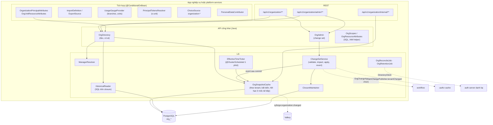
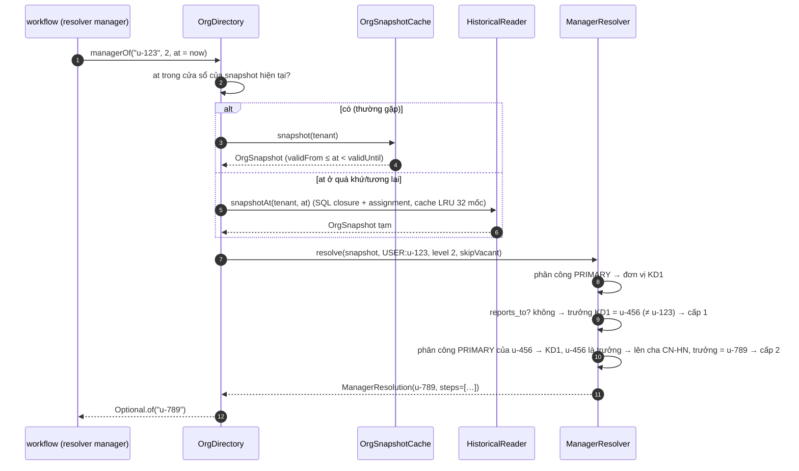
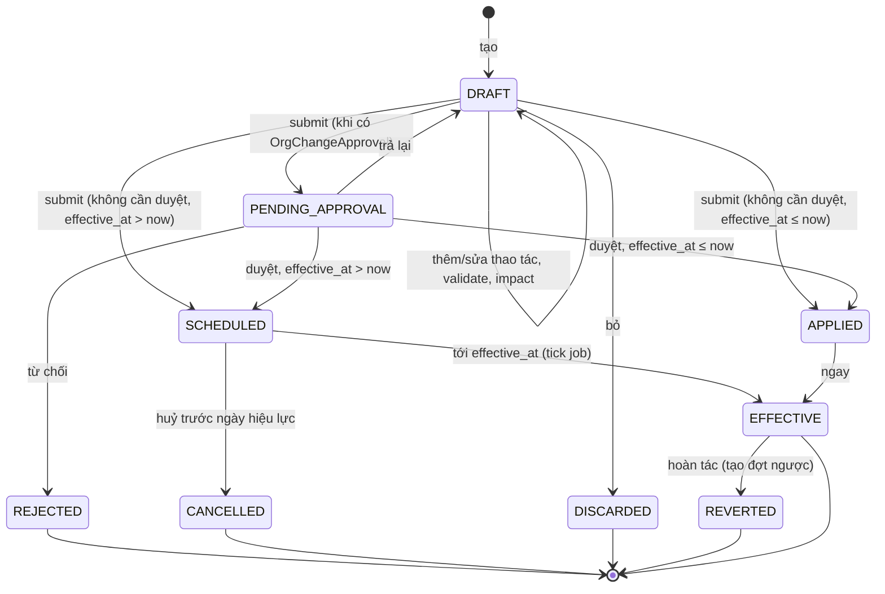
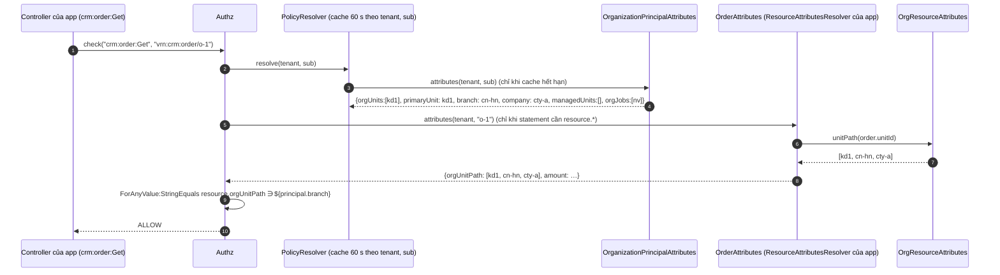
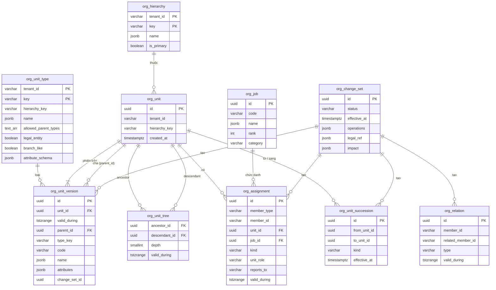

# Thiết kế module organization: `platform-starter-organization` + `@vyforge/organization` + `organization-admin`

> **Trạng thái:** bản thiết kế chờ duyệt (27/10/2026), phiên forge-53. Chưa có code. Nhánh `docs/design-organization`.
>
> **Phạm vi:** cơ cấu tổ chức dùng chung cho mọi dự án Vyforge:
> - cây đơn vị (công ty, chi nhánh, văn phòng đại diện, khối, phòng ban, nhóm…) **có hiệu lực theo thời gian**;
> - chức danh; người thuộc đơn vị (chính, kiêm nhiệm, quyền/phụ trách, biệt phái); trưởng, phó đơn vị; quản lý trực
>   tiếp; quan hệ quản lý chéo (dự án, chức năng);
> - thay đổi cơ cấu theo **đợt thay đổi** (change set) có ngày hiệu lực, số quyết định, xem trước tác động, duyệt tuỳ
>   chọn, lịch sử, sáp nhập/chia tách có quan hệ kế thừa;
> - API tra cứu `managerOf`, `unitsOf`, `descendants`, `headOf`, `holders`, `ancestorOfType`… cho workflow,
>   collaboration, search, forms, helpdesk, booking, cms-content, features;
> - thuộc tính cho IAM (`principal.orgUnits`, `principal.branch`…) để viết policy "chỉ dữ liệu chi nhánh của tôi",
>   và quản trị uỷ quyền theo nhánh cây (kiểu administrative unit của Entra);
> - nhập/xuất Excel qua `-export`, sơ đồ tổ chức ở web, khu quản trị cho tenant admin.
>
> **Nền:** platform-java 0.12.1 (`SecretCipher`, `DurableTaskQueue`, `StarterSchemaMigrator`), platform-web 0.9.0,
> module-conventions mục 1–6, `platform-services.md` (forge-37: Next.js Multi-Zones, `/m/<module>`,
> `@vyforge/admin-shell`, manifest `contract: 1`, `GET /api/v1/<module>/admin/info`), gap analysis 10/2026 mục 2.5 và
> 6.5, ADR-0009/0010/0011/0015. Bản phát hành đích: platform-java 0.13.0 (`platform-starter-organization`), platform-web
> (`@vyforge/organization` 0.1.0), app `platform-admin/apps/organization-admin`.
>
> **Nối với thiết kế đã có:** workflow (forge-39) đã chốt port `OrgDirectory` phía nó (workflow §6.2); collaboration
> (forge-40) dùng `searchUnits`, `members` cho mention `ORG_UNIT` và `Assignee.OrgUnit`; search (forge-41) cần token
> đơn vị `o:<unitId>` cho `PrincipalTokensResolver`; forms (forge-56) cần `ChoiceSource` `organization:unit`,
> `organization:branch`; cms-content cần `AudienceResolver` theo phòng ban; features cần đếm số chi nhánh cho gói. Thiết
> kế này giữ **đúng chữ ký** workflow đã đề xuất để adapter của workflow chỉ là lớp chuyển tiếp (mục 5.1.3).
>
> **Ghi chú độ tin cậy.** Version và license lấy qua GitHub API, registry npm và trang tài liệu chính thức, kiểm ngày
> 27/10/2026. Văn bản pháp lý lấy từ thư viện pháp luật và cổng thông tin; chỗ chưa đối chiếu được với Công báo ghi
> **(chưa kiểm chứng toàn văn)**.

## Mục lục

- [0. Tóm tắt quyết định](#0-tóm-tắt-quyết-định)
- [1. Bài toán và phạm vi](#1-bài-toán-và-phạm-vi)
- [2. Nghiên cứu](#2-nghiên-cứu)
- [3. Kiến trúc](#3-kiến-trúc)
- [4. Mô hình dữ liệu](#4-mô-hình-dữ-liệu)
- [5. API](#5-api)
- [6. Mở rộng](#6-mở-rộng)
- [7. Vận hành](#7-vận-hành)
- [8. Bảo mật và tuân thủ](#8-bảo-mật-và-tuân-thủ)
- [9. Kế hoạch triển khai](#9-kế-hoạch-triển-khai)
- [9a. Đóng gói và triển khai độc lập](#9a-đóng-gói-và-triển-khai-độc-lập)
- [10. Lệch quy ước và quyết định](#10-lệch-quy-ước-và-quyết-định)
- [Phụ lục A. Ranh giới và điểm nối với module khác](#phụ-lục-a-ranh-giới-và-điểm-nối-với-module-khác)
- [Phụ lục B. Nguồn đã kiểm](#phụ-lục-b-nguồn-đã-kiểm)

---

## 0. Tóm tắt quyết định

| # | Quyết định | Lý do ngắn |
|---|---|---|
| O1 | **Một module riêng, không thuộc workflow hay IAM.** Starter `platform-starter-organization`, package `com.vyforge.platform.organization`, route `/api/v1/organization`, action `organization:*`, bảng tiền tố `org_` | Ít nhất 8 module cần cơ cấu tổ chức (Phụ lục A). Không module nào trong số đó nên sở hữu nó (gap analysis 2.5) |
| O2 | **Danh tính người vẫn ở auth-server** (ADR-0011). Module chỉ giữ `member_id` (`sub`), không giữ tên, email, số điện thoại. Thêm loại thành viên `PERSON` (id do app cấp, vd. mã nhân viên không có tài khoản) qua SPI `PersonDirectory` | Không tạo kho PII thứ hai (Luật 91/2025). Công nhân, cộng tác viên vẫn có trong sơ đồ dù không đăng nhập |
| O3 | **Hiệu lực theo thời gian (valid time) ở mọi thứ có cấu trúc:** phiên bản đơn vị (`org_unit_version`), phân công (`org_assignment`), quan hệ quản lý chéo (`org_relation`) đều có `valid_during tstzrange`, chồng lấn bị chặn bằng ràng buộc exclusion của PostgreSQL. Mọi API đọc nhận `at` (mặc định `now`) | Người chuyển phòng giữa kỳ vẫn đúng lịch sử duyệt; quyết định tổ chức lại có hiệu lực tương lai (01/01/2027) được nhập trước. Odoo 20 (`hr.version`) và SuccessFactors (Position effective-dated) cùng hướng |
| O4 | **Không làm bitemporal đầy đủ.** Trục thứ hai ("hôm qua hệ thống biết gì") lấy từ **nhật ký đợt thay đổi bất biến** (`org_change_set` + `operations` JSONB) và `-audit` | Câu hỏi nghiệp vụ thật là "ai là trưởng phòng vào ngày X". Câu hỏi "lúc 9h ngày Y hệ thống tin rằng…" chỉ cho kiểm toán, nhật ký đã đủ. Tránh gấp đôi độ phức tạp truy vấn (khác master-data M2, nơi revision là sản phẩm phát hành) |
| O5 | **Lưu cây: danh sách kề có hiệu lực (nguồn sự thật) + closure table có hiệu lực (chỉ mục dẫn xuất)** `org_unit_tree(ancestor_id, descendant_id, depth, valid_during)`. Không dùng `ltree`, không dùng nested set | So sánh ở mục 2.4: closure có `depth` (cần cho `levelUp`, `managerOf`), join thẳng được với bảng của app, khoá ngoại thật, chịu được cây thay đổi theo thời gian; `ltree` phải viết lại path của cả nhánh ở mỗi lần dời và nhãn không mang được UUID có gạch nối một cách an toàn với mọi locale; nested set (Frappe) đắt khi sửa và không biểu diễn được thời gian |
| O6 | **Đọc từ snapshot bất biến trong bộ nhớ** theo tenant cho thời điểm hiện tại (`OrgSnapshot`); đọc quá khứ hoặc tương lai đi SQL trên closure. Snapshot tự biết thời điểm hết hạn (mốc hiệu lực kế tiếp) và tự dựng lại | Đường nóng là `PrincipalAttributesProvider` của `-authz` và resolver của workflow: O(1)–O(depth), không chạm DB. Cây doanh nghiệp VN điển hình vài trăm tới vài nghìn đơn vị |
| O7 | **Thay đổi đi qua đợt thay đổi** (`org_change_set`): nháp → (duyệt) → đã lên lịch → có hiệu lực; có số và ngày quyết định, lý do, xem trước tác động (người đổi quản lý, việc workflow đang chờ bị ảnh hưởng, policy IAM theo chi nhánh). Sửa nhanh trong giao diện là một đợt một thao tác, áp ngay | Thay đổi cơ cấu là quyết định hành chính có số hiệu (cơ quan nhà nước, doanh nghiệp lớn), cần hoàn tác và audit. Workflow duyệt đợt thay đổi là tuỳ chọn (`OrgChangeApproval` SPI) |
| O8 | **Sáp nhập, chia tách, đổi tên, chuyển trực thuộc có quan hệ kế thừa** (`org_unit_succession`) | Đợt sắp xếp bộ máy 2025–2026 gộp phòng, sở; báo cáo cũ theo đơn vị A phải quy về đơn vị mới C. Cùng ý với `md_succession` của master-data |
| O9 | **Loại đơn vị, loại phân công, loại quan hệ là dữ liệu** (bảng tham chiếu theo tenant, mặc định trong code), không phải enum trong DB. Loại đơn vị khai báo cha hợp lệ, cờ `legalEntity`, `branchLike`, JSON Schema của `attributes` | Doanh nghiệp, cơ quan nhà nước, trường học, bệnh viện có bộ loại khác nhau. Có sẵn mẫu theo ngành (mục 6.4) |
| O10 | **Nhiều cây (hierarchy)** trong một tenant: `main` (hành chính, quyết định quản lý trực tiếp) là bắt buộc; thêm `region` (vùng miền), `cost` (trung tâm chi phí), `project` (ma trận) tuỳ tenant | Workday tách supervisory org, cost center, company; doanh nghiệp VN hay có "Miền Bắc/Miền Nam" song song với cây pháp nhân. `managerOf` chỉ đi theo `main` |
| O11 | **Quản lý trực tiếp tính theo luật rõ ràng:** (1) `reports_to` khai báo trên phân công chính; (2) trưởng đơn vị chính của người đó; (3) nếu người đó là trưởng, hoặc đơn vị không có trưởng (khi `skipVacant`), đi lên đơn vị cha. Cấp N lặp N lần. Có lời giải thích (`ManagerResolution`) | Đúng với cách Odoo cập nhật `parent_id` theo `manager_id` của phòng, SuccessFactors lấy người giữ vị trí cha. Lời giải thích để workflow ghi vào `wf_step.resolution` |
| O12 | **Thuộc tính IAM qua `PrincipalAttributesProvider`**: `orgUnits`, `primaryUnit`, `branch`, `branches`, `company`, `orgJobs`, `managedUnits`, `isUnitHead`. Kèm helper `OrgResourceAttributes.unitPath(unitId)` để `ResourceAttributesResolver` của app đưa `resource.orgUnitPath` (đơn vị và mọi đơn vị cha) | Policy "dữ liệu thuộc nhánh chi nhánh của tôi" viết được bằng toán tử hiện có: `ForAnyValue:StringEquals {"resource.orgUnitPath": "${principal.branch}"}` |
| O13 | **Quản trị uỷ quyền theo nhánh cây:** resource `organization:unit` và `organization:assignment` có thuộc tính `unitPath`, nên policy cho "nhân sự chi nhánh HN chỉ sửa được cơ cấu và người trong nhánh HN" | Học từ Entra administrative units và ABP OU, nhưng phân cấp (Entra AU phẳng, không lồng được) |
| O14 | **Không phụ thuộc cứng module khác.** export, features, files, workflow, notification, search… nối qua interface + `@ConditionalOnBean`. Không có `-authz` thì không có thuộc tính IAM, mọi thứ khác chạy | Mục 6 module-conventions |
| O15 | **Ba cách chạy** như mọi module (D7 của platform-services): nhúng; trong `platform-services` (khuyến nghị khi ≥ 2 app dùng chung cơ cấu); server riêng. Ở `mode: remote` app tải **snapshot** về bộ nhớ (ETag, kênh Valkey `vyforge:organization:changed`), nên đường đọc vẫn không có I/O | Cơ cấu tổ chức là dữ liệu dùng chung của cả doanh nghiệp, mọi app cần cùng một bản |
| O16 | **Admin MFE `/m/organization`** cho tenant admin (cây, người, chức danh, đợt thay đổi, nhập Excel, đối soát) và người vận hành (mẫu loại đơn vị theo ngành, xem tenant) | Platform-services 4.8, 4.12 |

---

## 1. Bài toán và phạm vi

### 1.1 Use case

| Nhóm | Hiện tại (0.13) | Tương lai (đã chừa chỗ) |
|---|---|---|
| Cấu trúc | Cây đơn vị nhiều cấp, nhiều gốc (tập đoàn nhiều pháp nhân), có hiệu lực, mã, tên vi/en, loại, thuộc tính mở rộng theo loại | Định biên/biên chế theo vị trí việc làm (`org_position_slot`), kế hoạch nhân sự |
| Người | Phân công chính, kiêm nhiệm, quyền/phụ trách, biệt phái; trưởng/phó; chức danh; tỷ lệ thời gian (FTE); quản lý trực tiếp khai báo; quản lý chéo | Đồng bộ từ phần mềm nhân sự (SPI `OrgSyncSource`: MISA AMIS, Base HRM, SAP SF, CSV định kỳ) |
| Tra cứu | `managerOf`, chuỗi quản lý, `unitsOf`, `descendants`, `ancestors`, `ancestorOfType`, `headOf`, `holders`, `members`, `isInUnit`, tìm đơn vị không dấu | Truy vấn đồ thị nâng cao (đường quản lý chung gần nhất của hai người, `lca`) |
| Thay đổi | Đợt thay đổi có hiệu lực tương lai, số quyết định, xem trước tác động, duyệt tuỳ chọn, hoàn tác; sáp nhập/chia tách có kế thừa | Mô phỏng phương án tổ chức ("what-if") nhiều nhánh nháp so sánh |
| Phân quyền | Thuộc tính `principal.*` cho IAM; thuộc tính `resource.unitPath` cho quản trị uỷ quyền; token đơn vị cho search | Đồng bộ đơn vị thành group IAM tự động (group động theo đơn vị) |
| Giao diện | Chọn đơn vị (cây + tìm), sơ đồ tổ chức (mở dần, in/ xuất ảnh), thẻ "tổ chức của tôi", khu quản trị | Sơ đồ có ảnh đại diện từ `-files`, chế độ trình chiếu |
| Nhập/xuất | Excel/CSV qua `-export` (đơn vị, phân công, chức danh), ATOMIC, hoàn tác | Xuất theo chuẩn mã định danh QĐ 20/2020 cho khu vực công |

### 1.2 Kịch bản nghiệp vụ phải đáp ứng

| # | Kịch bản | Yêu cầu với module | Thành phần |
|---|---|---|---|
| K1 | **Đề nghị thanh toán** của công ty phân phối: trưởng phòng duyệt, trên 50 triệu thêm giám đốc chi nhánh, trên 500 triệu thêm tổng giám đốc (workflow K1) | `managerOf(user, 1)`, `ancestorOfType(unit, "branch")`, `holders("GDCN", branch)`, `holders("TGD", company)` tại thời điểm bước kích hoạt | `OrgDirectory`, closure, `org_assignment` |
| K2 | **Nhân viên chi nhánh Hà Nội chỉ thấy đơn hàng chi nhánh mình**; trưởng vùng Miền Bắc thấy mọi chi nhánh trong vùng | `principal.branch`, `resource.orgUnitPath`; cây `region` riêng | `OrganizationPrincipalAttributes`, `OrgResourceAttributes` |
| K3 | **Kiêm nhiệm và quyền trưởng phòng:** Phó giám đốc kiêm Trưởng phòng Kinh doanh; Trưởng phòng Kế toán nghỉ thai sản 6 tháng, Phó phòng được giao **phụ trách** từ 01/11 đến 30/04 | Phân công `CONCURRENT`, `ACTING` có hạn; một trưởng mỗi đơn vị tại mỗi thời điểm (gồm cả người phụ trách); hết hạn tự quay về | `org_assignment` + exclusion constraint, tick job |
| K4 | **Chuyển công tác giữa kỳ:** nhân viên chuyển từ phòng KD1 sang KD2 ngày 15/10. Hồ sơ trình 10/10 vẫn do trưởng KD1 duyệt; hồ sơ trình 16/10 do trưởng KD2 duyệt | Đọc theo `at`; workflow chụp lại người duyệt (W5); event `MemberTransferred` để workflow tuỳ chọn giao lại | `org_assignment.valid_during`, event |
| K5 | **Quyết định tổ chức lại có hiệu lực tương lai:** "QĐ số 125/QĐ-HĐQT ngày 20/11/2026, hiệu lực 01/01/2027: tách phòng Hành chính – Nhân sự thành hai phòng". Nhập trước, xem trước tác động, tới ngày tự có hiệu lực | Đợt thay đổi `SCHEDULED`, `legal_ref`, `ImpactReport`; tick job phát event và xoá cache đúng giờ | `org_change_set`, `ChangeImpactAnalyzer` |
| K6 | **Sáp nhập theo đợt tinh gọn bộ máy:** gộp Sở A và Sở B thành Sở C; phòng con chuyển sang C; người của A, B chuyển sang C; báo cáo năm 2025 theo A, B vẫn cộng được vào C | Thao tác `merge` sinh `org_unit_succession`; `successorsOf(A)`; đơn vị cũ đóng, không xoá | `org_unit_succession`, event `OrgUnitsMerged` |
| K7 | **Tập đoàn nhiều pháp nhân:** công ty mẹ, ba công ty con; chi nhánh có mã số thuế 13 số; văn phòng đại diện; địa điểm kinh doanh (Luật DN 2020 Điều 44, sửa đổi 2025) | Nhiều gốc; loại `company` (`legalEntity`), `branch`, `rep_office`, `business_location`; thuộc tính `taxCode` kiểm theo schema | `org_unit_type`, `attributes` |
| K8 | **Cơ quan nhà nước:** UBND tỉnh → Sở → phòng chuyên môn; mỗi đơn vị có **mã định danh điện tử** theo QĐ 20/2020/QĐ-TTg (`G01.xx.yy`); văn thư giao văn bản đến cho "Phòng KH-TC chủ trì" (collaboration K4) | `external_ids.govId` có kiểm định dạng; mẫu loại đơn vị khu vực công; `members(unit)` cho giao việc đơn vị | Mẫu `public-sector`, `OrgDirectory.members` |
| K9 | **Gói Pro giới hạn 5 chi nhánh** (features) | Đếm đơn vị `branchLike` đang hiệu lực; chặn tạo chi nhánh thứ 6 trong cùng transaction | `UsageGaugeProvider`, `Entitlements.checkLimit` |
| K10 | **Ticket chuyển về hàng đợi phòng CSKH của chi nhánh** (helpdesk), giao vòng tròn cho thành viên | `members(unit, includeDescendants=false, at)`; `headOf` để chuyển cấp | `OrgDirectory` |
| K11 | **HR chi nhánh chỉ quản trị cơ cấu và người trong nhánh mình** | Policy trên `organization:unit`/`organization:assignment` với `resource.unitPath` | `OrgUnitResourceAttributes` |
| K12 | **Nhập lần đầu 800 đơn vị, 5.000 người từ Excel** của phòng nhân sự; sai một dòng mã cha thì không nhập gì; nhập nhầm thì hoàn tác | `ImportDefinition` `organization.units` (ATOMIC), `organization.assignments`; email → `sub` qua danh bạ; hoàn tác bằng đợt thay đổi ngược | `-export` integration |
| K13 | **Sơ đồ tổ chức trên intranet**, mở dần từng cấp, tìm người, in khổ A3 cho bảng tin | Endpoint `/chart` trả từng phần; component `OrgChart`; xuất SVG/PNG | `@vyforge/organization` |
| K14 | **Quản lý dự án ma trận:** kỹ sư thuộc phòng Kỹ thuật nhưng làm dự án X dưới PM; PM duyệt timesheet, trưởng phòng duyệt nghỉ phép | `org_relation` loại `PROJECT`; `managersOf(user, "PROJECT")`; `managerOf` chỉ theo cây `main` | `org_relation` |
| K15 | **Nhà máy và văn phòng có lịch làm việc khác nhau** (calendar), mã chứng từ theo chi nhánh `PT-HN-…` (sequence) | Thuộc tính kế thừa theo cây: `calendarKey`, `sequencePrefix` đặt ở chi nhánh, đơn vị con thừa hưởng | `OrgDirectory.inheritedAttribute` |
| K16 | **Công nhân không có tài khoản** vẫn có trong sơ đồ và được tính định biên | Thành viên `PERSON` qua `PersonDirectory` của app (vd. module nhân sự) | `member_type` |
| K17 | **Người nghỉ việc:** tenant admin gỡ tài khoản khỏi tenant ở auth-server, phân công trong cơ cấu còn treo; sau thời hạn lưu trữ phải xoá/ẩn danh (Luật 91/2025 Điều 25 khoản 2) | Job đối soát với danh bạ, đánh dấu phân công "mồ côi", tuỳ chọn tự kết thúc; retention ẩn danh hoá `member_id` | `OrgReconcileJob`, `OrgRetentionJob`, privacy-dsr |
| K18 | **Trường đại học, bệnh viện:** khoa → bộ môn; bệnh viện → khối lâm sàng → khoa → đơn nguyên; booking lịch khám theo khoa | Mẫu loại đơn vị `education`, `healthcare`; booking gắn tài nguyên với `unitId` | Mẫu, `OrgDirectory` |
| K19 | **Trưởng phòng tự lập đề nghị** (workflow K9): quản lý cấp 1 của trưởng phòng là trưởng đơn vị cha, không phải chính họ | Luật O11 bước 3 | `ManagerResolver` |
| K20 | **Dự án nhỏ không cài organization** (workflow K17) | Workflow và collaboration vẫn chạy, resolver theo tổ chức tắt rõ ràng | `@ConditionalOnBean` phía họ |

### 1.3 Không thuộc phạm vi

| Không làm | Thuộc về |
|---|---|
| Hồ sơ nhân sự (lý lịch, hợp đồng lao động, lương, BHXH, chấm công) | Module/sản phẩm HRM của dự án. Module này chỉ có "ai thuộc đơn vị nào, chức danh gì, từ ngày nào" |
| Tài khoản, mật khẩu, MFA, mời thành viên vào tenant | auth-server (ADR-0011) |
| Group IAM, policy | `-authz`/iam-server. Module này chỉ cung cấp thuộc tính |
| Uỷ quyền phê duyệt, vắng mặt | workflow (`wf_delegation`). Module này chỉ có phân công `ACTING` (phụ trách đơn vị theo quyết định), không phải uỷ quyền ký việc |
| Lịch làm việc, ngày lễ | calendar. Module này chỉ giữ khoá `calendarKey` kế thừa |
| Danh bạ khách hàng, đối tác (tổ chức bên ngoài) | `contacts` (P2) |
| Địa chỉ hành chính | master-data (`VnAddress`). Đơn vị lưu địa chỉ trụ sở bằng value object đó |

---

## 2. Nghiên cứu

### 2.1 Hệ thống tham khảo

| Hệ thống | Version, license, nguồn | Mô hình dữ liệu | API | Điểm mạnh | Điểm yếu |
|---|---|---|---|---|---|
| **ABP Framework – Organization Units** | ABP 10.7.0 (06/10/2026), LGPL-3.0 ([docs](https://abp.io/docs/3.3/Modules/Organization-Units), [repo](https://github.com/abpframework/abp)) | `OrganizationUnit` (`ParentId`, `DisplayName`, `Code` dạng `00001.00042.00005` do manager sinh, duy nhất theo tenant, tiền tố của cha); user ↔ OU và role ↔ OU nhiều-nhiều; user thừa hưởng role của OU | `OrganizationUnitManager` (Create/Update/Delete/Move, lấy cây), `IdentityUserManager.AddToOrganizationUnit`, truy vấn con cháu bằng `Code.StartsWith` | Mã materialized path cho truy vấn con cháu một câu; multi-tenant sẵn; role theo OU | Không có hiệu lực theo thời gian; không có chức danh, trưởng đơn vị, quản lý trực tiếp; mã đổi khi dời (tài liệu ABP: "tham chiếu OU bằng Id, không bằng Code") |
| **Odoo `hr.department` + `hr.employee` + `hr.version`** | Odoo 20.0 (`version_info = (20,0,0,FINAL)`), LGPL-3.0 ([hr_department.py](https://github.com/odoo/odoo/blob/20.0/addons/hr/models/hr_department.py), [hr_version.py](https://github.com/odoo/odoo/blob/20.0/addons/hr/models/hr_version.py)) | Phòng: `parent_id`, `parent_path` (`_parent_store`), `manager_id`, `company_id` theo cha, `complete_name`. Nhân viên: `parent_id` (quản lý), `coach_id`, `department_id`, `job_id`. `hr.version` ("Employee Record") có `date_version` (ngày hiệu lực), `department_id`, `job_id`, hợp đồng | ORM `child_of`, `get_department_hierarchy()`; record rule theo công ty | Đổi `manager_id` của phòng thì cập nhật quản lý của nhân viên trong phòng (`_update_employee_manager`); version nhân viên theo ngày hiệu lực; chặn vòng lặp cha-con | **Cây phòng ban không có lịch sử** (chỉ nhân viên có version); quản lý là một trường trên nhân viên nên dễ lệch với trưởng phòng; gắn với ORM Odoo |
| **Frappe / ERPNext – Department, Employee, User Permission** | Frappe v16.53.0 (22/10/2026) MIT; ERPNext develop, GPL-3.0; HRMS v16.52.0 GPL-3.0 ([user permissions](https://docs.frappe.io/erpnext/user/manual/en/user-permissions), [nestedset.py](https://github.com/frappe/frappe/blob/develop/frappe/utils/nestedset.py)) | Department là tree doctype (nested set `lft`/`rgt`, `parent_department`, `is_group`); Employee cũng là cây theo `reports_to`, có `branch`, `designation`, `department`, `company`. **User Permission**: (user, doctype, giá trị) hạn chế mọi bản ghi có trường link tới giá trị đó; với tree doctype mặc định gồm con cháu, tắt bằng "Hide Descendants"; "Apply To All Document Types" | `get_ancestors_of`, `get_descendants_of`, `rebuild_tree` | Quyền theo phạm vi dữ liệu rất gần với nhu cầu "chi nhánh của tôi"; có cờ bao gồm con cháu; designation tách khỏi department | Nested set phải đánh số lại khi chèn/dời (có hàm `rebuild_tree` vì hay lệch); không có hiệu lực theo thời gian; quyền gắn vào trường link nên dễ quá rộng |
| **Microsoft Entra administrative units** | Tài liệu cập nhật 19/02/2026, SaaS ([learn.microsoft.com](https://learn.microsoft.com/en-us/entra/identity/role-based-access-control/administrative-units)) | AU là container của user, group, thiết bị; user thuộc nhiều AU (theo địa lý và theo khối cùng lúc); thành viên gán tay hoặc theo luật động; role gán với phạm vi AU | Graph API `administrativeUnit` | Ý tưởng **giới hạn phạm vi quản trị** theo nhóm người; một người thuộc nhiều nhóm theo nhiều trục | **Không lồng được** (tài liệu: "Administrative units can't be nested"); chỉ phạm vi quản trị, không phải cơ cấu tổ chức; thêm group vào AU không kéo theo thành viên |
| **SAP SuccessFactors Employee Central – Position Management** | SaaS ([SAP Learning](https://learning.sap.com/courses/sap-successfactors-employee-central-position-management-academy/configuring-the-position-object_bf49ecbc-fe31-4909-ace8-202e8e5e5933), [KBA 2406020](https://userapps.support.sap.com/sap/support/knowledge/en/2406020)) | Position là đối tượng có hiệu lực theo ngày, có đơn vị, job, lương; mỗi position có position cha, **người giữ position cha là quản lý trực tiếp**; "Insert New Record" thêm bản ghi hiệu lực mới không sửa lịch sử | OData | Hiệu lực theo ngày cho cả cấu trúc; quản lý suy ra từ cấu trúc, không gõ tay; vị trí trống vẫn tồn tại | Ràng buộc ngày hiệu lực cha ≤ con gây lỗi khó hiểu (KBA 2406020); nặng, cần đội triển khai |
| **Workday – Supervisory / Cost center / Company / Matrix** | SaaS ([Workday admin guide](https://doc.workday.com/admin-guide/en-us/manage-workday/organizations/hyy1482338118782.html)) | Mỗi người thuộc đúng một supervisory org (cây báo cáo); cost center là cây chi phí; company là pháp nhân; **matrix organization** có manager lãnh đạo chéo nhưng quản lý của supervisory org giữ quyền cuối | — | Tách rõ cây người, cây tiền, cây pháp nhân; quan hệ ma trận có nghĩa rõ | SaaS, đắt; khái niệm nhiều với dự án nhỏ |

**Thư viện giao diện sơ đồ tổ chức** (kiểm registry npm 27/10/2026):

| Thư viện | Version, license | Nhận xét |
|---|---|---|
| `@xyflow/react` (React Flow) | 12.12.0 (11/10/2026), MIT | Render node là React component (dùng được `@vyforge/ui`), pan/zoom, ảo hoá; cần thuật toán bố cục ngoài |
| `@dagrejs/dagre` | 3.1.3 (24/10/2026), MIT | Bố cục cây/đồ thị có hướng, nhẹ, chạy trên trình duyệt hoặc server |
| `d3-org-chart` | 3.1.1, MIT, **không cập nhật từ 09/2023** | Đẹp sẵn nhưng D3 thao tác DOM trực tiếp, khó theme, không bảo trì |
| `elkjs` | 0.12.0, EPL-2.0 OR GPL-3.0 | Bố cục tốt nhất nhưng license không hợp với gói MIT/Apache của platform-web |
| `dabeng/OrgChart` | v7.0.0, MIT | jQuery, không hợp React 19 |

Chọn `@xyflow/react` + `@dagrejs/dagre`.

### 2.2 Văn bản pháp lý và chuẩn liên quan

| Văn bản | Hiện hành (kiểm 27/10/2026) | Liên quan |
|---|---|---|
| Luật Bảo vệ dữ liệu cá nhân **91/2025/QH15** | Thông qua 26/06/2025, hiệu lực 01/01/2026 ([TVPL](https://thuvienphapluat.vn/van-ban/Quyen-dan-su/Nghi-dinh-356-2025-ND-CP-huong-dan-Luat-Bao-ve-du-lieu-ca-nhan-687428.aspx), [PwC 01/2026](https://www.pwc.com/vn/vn/publications/2026/20260128-new-rules-personal-data-protection.pdf)) | **Điều 25** (bảo vệ DLCN trong tuyển dụng, quản lý, sử dụng người lao động): khoản 2 – lưu trữ dữ liệu người lao động trong thời hạn theo luật hoặc thoả thuận; **xoá, huỷ khi chấm dứt hợp đồng**, trừ khi có thoả thuận hoặc luật khác quy định ([hethongphapluat](https://hethongphapluat.com/luat-bao-ve-du-lieu-ca-nhan-2025/dieu-25)) **(chưa kiểm chứng toàn văn trên Công báo)**. Phân công (người X là trưởng phòng Y) là dữ liệu cá nhân của người lao động |
| Nghị định **356/2025/NĐ-CP** | Ban hành 31/12/2025, hiệu lực 01/01/2026, thay NĐ 13/2023 | Biện pháp bảo vệ, nhật ký xử lý, đánh giá tác động. Module ghi audit mọi thay đổi và mọi lần xuất |
| Nghị định **330/2026/NĐ-CP** (xử phạt) | Hiệu lực 19/08/2026 theo [luatvietnam](https://luatvietnam.vn/bai-viet-lien-quan/luat-91-2025-qh15-405135.html) **(chưa kiểm chứng)** | Mức phạt; lý do bật retention mặc định |
| Luật Doanh nghiệp **59/2020/QH14**, sửa đổi bởi Luật 03/2022/QH15 và **Luật 76/2025/QH15** (thông qua 17/06/2025, hiệu lực 01/07/2025) ([TVPL](https://thuvienphapluat.vn/van-ban/doanh-nghiep/Luat-Doanh-nghiep-sua-doi-2025-so-76-2025-QH15-659899.aspx), [luatvietnam](https://luatvietnam.vn/tin-van-ban-moi/da-co-luat-sua-doi-bo-sung-luat-doanh-nghiep-so-76-2025-qh15-186-102694-article.html)) | Còn hiệu lực | **Điều 44**: chi nhánh (đơn vị phụ thuộc, thực hiện toàn bộ/một phần chức năng), văn phòng đại diện (không kinh doanh), địa điểm kinh doanh. Luật 76/2025 không thấy sửa Điều 44 trong các bản tóm tắt **(chưa kiểm chứng toàn văn)**. → ba loại đơn vị mặc định `branch`, `rep_office`, `business_location` |
| Quyết định **20/2020/QĐ-TTg** về mã định danh điện tử của cơ quan, tổ chức | Ban hành 22/07/2020, hiệu lực 15/09/2020, còn hiệu lực ([luatminhkhue](https://luatminhkhue.vn/van-ban/quyet-dinh-20-2020-qd-ttg.aspx), [Công văn 1018/BTTTT-THH](https://thuvienphapluat.vn/cong-van/Cong-nghe-thong-tin/Cong-van-1018-BTTTT-THH-2021-huong-dan-Quyet-dinh-20-2020-QD-TTg-475634.aspx)) | Mã tối đa 35 ký tự, gồm chữ hoa A–Z, số, dấu chấm, chia nhóm theo cấp; doanh nghiệp dùng mã số doanh nghiệp. → `external_ids.govId` kiểm regex `^[A-Z0-9]+(\.[A-Z0-9]+)*$`, ≤ 35 |
| Nghị định 30/2020/NĐ-CP (công tác văn thư) | Còn hiệu lực (workflow §8.2 đã kiểm) | Người được giao phụ trách ký thay; module chỉ phân biệt `ACTING` để workflow hiển thị "KT./Q." đúng |

### 2.3 Học theo và không làm

**Học theo:**
- ABP: mã đơn vị do người dùng đặt, nhưng **tham chiếu bằng id**; multi-tenant theo `tenant_id`.
- Odoo: chặn vòng lặp cha-con; `complete_name` (đường dẫn tên) để hiển thị; trưởng phòng là nguồn của quản lý trực tiếp.
- Odoo 20 `hr.version`, SuccessFactors: **mọi thay đổi có ngày hiệu lực**, thêm bản ghi mới thay vì sửa cũ.
- Frappe User Permission: phạm vi dữ liệu theo đơn vị, **mặc định gồm con cháu, có cờ chỉ đúng đơn vị**.
- Entra AU: một người thuộc nhiều nhóm theo nhiều trục; phạm vi quản trị theo nhóm.
- Workday: tách cây báo cáo (`main`) với cây chi phí, cây vùng; quan hệ ma trận không thay quyền của quản lý chính.

**Không làm:**
- Không lưu quản lý trực tiếp như một trường độc lập trên người (Odoo `parent_id`) làm nguồn chính: dễ lệch với
  trưởng phòng. Ở đây quản lý **suy ra** từ cây; `reports_to` chỉ là ngoại lệ khai báo.
- Không dùng nested set (Frappe) vì phải đánh số lại, không biểu diễn được thời gian.
- Không thừa hưởng role IAM theo đơn vị (ABP). Quyền vẫn do IAM quyết định; đơn vị chỉ là thuộc tính. Đồng bộ đơn vị →
  group IAM để bản sau, và sẽ là tuỳ chọn.
- Không làm position management đầy đủ (vị trí có lương, định biên) ở bản đầu: tốn công, chỉ HRM cần. Chừa bảng
  `org_position_slot` ở bản sau (mục 9.4).

### 2.4 Lưu cây: closure table hay `ltree`

| Tiêu chí | Danh sách kề + CTE đệ quy | `ltree` (materialized path) | Nested set | **Closure table có hiệu lực (chọn)** |
|---|---|---|---|---|
| Con cháu của X | CTE đệ quy, O(kích thước nhánh) mỗi lần | `path <@ 'X'` dùng GiST | `lft BETWEEN` | `ancestor_id = X` dùng B-tree |
| Tổ tiên của X | CTE | `path @> …`, `subpath` | `lft <` và `rgt >` | `descendant_id = X` |
| Độ sâu tương đối (`levelUp`, cấp N) | Đếm trong CTE | `nlevel` hiệu hai path | Không trực tiếp | Cột `depth` |
| Dời một nhánh k nút, sâu d | O(1) | Viết lại path của k nút | Đánh số lại nửa cây | Xoá/chèn O(k·d) dòng |
| Có hiệu lực theo thời gian | Cha theo version, CTE phải lọc thời gian ở mỗi bước | Path phải nằm trên từng version: dời nhánh tạo version mới cho **mọi** nút con | Không làm được | Mỗi dòng có `valid_during`; dời nhánh chỉ cắt khoảng của các cặp bị ảnh hưởng |
| Join với bảng của app (`where branch_id in nhánh X`) | CTE trong mỗi truy vấn | Cần cột path ở bảng app hoặc join qua bảng đơn vị | Join + `between` | `join org_unit_tree t on t.descendant_id = o.unit_id and t.ancestor_id = :x` |
| Khoá ngoại | Có | Không (path là chuỗi) | Không | Có (hai cột FK) |
| Phụ thuộc | — | Extension `ltree` (trusted) | — | Extension `btree_gist` cho exclusion constraint (trusted) |
| Dung lượng | N | N | N | N × độ sâu trung bình × số đoạn thời gian. 10.000 đơn vị, sâu 6, 3 lần đổi: ≈ 180.000 dòng, khoảng 25 MB kể cả chỉ mục |

Tham khảo: [ltree, PostgreSQL 18](https://www.postgresql.org/docs/current/ltree.html) (nhãn chỉ gồm chữ, số, `_`, `-`
theo locale, tối đa 1.000 ký tự, GiST `gist_ltree_ops(siglen)`; `lca` tối đa 8 đối số);
[so sánh của dev.to](https://dev.to/dowerdev/implementing-hierarchical-data-structures-in-postgresql-ltree-vs-adjacency-list-vs-closure-table-2jpb)
và [Cybertec](https://www.cybertec-postgresql.com/en/postgresql-speeding-up-recursive-queries-and-hierarchic-data) (chỉ
có số đo giai thoại, nên mục 9.2 có benchmark riêng trên cây 10.000 nút).

**Kết luận:** nguồn sự thật là danh sách kề có hiệu lực (`org_unit_version.parent_id`); closure table có hiệu lực là chỉ
mục dẫn xuất, module tự duy trì trong cùng transaction (mục 3.6), có job kiểm và dựng lại. Cấu trúc ghi ít (vài lần
mỗi tháng), đọc rất nhiều, nên trả giá ở lúc ghi là hợp lý. Đường đọc nóng (thời điểm hiện tại) còn không chạm closure
vì đi qua snapshot trong bộ nhớ.

---

## 3. Kiến trúc

### 3.1 Khái niệm

| Khái niệm | Nghĩa |
|---|---|
| **Cây (hierarchy)** | Một cách chia tổ chức. `main` bắt buộc, quyết định quản lý trực tiếp. Tenant thêm `region`, `cost`, `project`… |
| **Đơn vị (unit)** | Nút trong một cây. Danh tính bất biến (`id` UUIDv7); mọi thuộc tính khác nằm ở **phiên bản** theo thời gian |
| **Phiên bản đơn vị (unit version)** | Mã, tên vi/en, loại, cha, trạng thái, thuộc tính trong một khoảng hiệu lực. Các phiên bản của một đơn vị không chồng lấn; khoảng trống nghĩa là đơn vị không tồn tại lúc đó |
| **Loại đơn vị (unit type)** | `company`, `branch`, `department`… Khai báo loại cha hợp lệ, cờ `legalEntity`, `branchLike`, JSON Schema của thuộc tính |
| **Chức danh (job)** | Danh mục chức danh của tenant (`TGD`, `GDCN`, `TP`, `PP`, `KTT`, `NV`), có cấp bậc (`rank`). Không có hiệu lực (đổi tên không đổi nghĩa) |
| **Thành viên (member)** | `USER:<sub>` (auth-server) hoặc `PERSON:<id>` (app cấp qua `PersonDirectory`) |
| **Phân công (assignment)** | Thành viên thuộc đơn vị, có chức danh, loại (`PRIMARY`, `CONCURRENT`, `ACTING`, `SECONDMENT`), vai trò trong đơn vị (`HEAD`, `DEPUTY`, `MEMBER`), `reports_to` tuỳ chọn, FTE, khoảng hiệu lực |
| **Quan hệ (relation)** | Quan hệ quản lý chéo giữa hai thành viên (`PROJECT`, `FUNCTIONAL`, `MENTOR`), có hiệu lực |
| **Đợt thay đổi (change set)** | Tập thao tác có cùng ngày hiệu lực, lý do, số quyết định, trạng thái. Đơn vị ghi duy nhất vào cấu trúc |
| **Kế thừa (succession)** | Quan hệ đơn vị cũ → đơn vị mới khi gộp, tách, chuyển |
| **Snapshot** | Ảnh bất biến cơ cấu của một tenant tại một thời điểm, trong bộ nhớ |

### 3.2 Thành phần



### 3.3 Port và adapter

| Port (SPI) | Mặc định | Adapter khác | Dùng để |
|---|---|---|---|
| `MemberDirectory` | `AuthServerMemberDirectory` (danh bạ ADR-0011 §6, client credentials, scope `directory.read`) | `StaticMemberDirectory` (test) | Kiểm `sub` thuộc tenant, đổi email → `sub` khi nhập, lấy tên hiển thị cho sơ đồ, đối soát |
| `PersonDirectory` | không có (thành viên `PERSON` tắt) | App nhân sự cài | Tên, ảnh, trạng thái của người không có tài khoản |
| `OrgChangeApproval` | `NoApproval` (áp ngay khi gửi) | `WorkflowOrgChangeApproval` (khi có workflow: tạo hồ sơ `organization.changeset`, nghe `InstanceCompleted`) | Duyệt đợt thay đổi |
| `OrgChangeInterceptor` | — | App | Hook trước validate, trước áp, sau áp (vd. chặn đóng đơn vị còn hợp đồng đang mở) |
| `ImpactContributor` | thành viên đổi quản lý, đơn vị mất trưởng, thuộc tính kế thừa đổi | workflow (việc đang chờ bị ảnh hưởng), app | Báo cáo tác động trước khi áp |
| `OrgSyncSource` | — (bản sau) | CSV định kỳ, MISA AMIS, SAP SF | Đồng bộ từ HRM |
| `UnitTypePreset` | `enterprise`, `public-sector`, `education`, `healthcare`, `retail-chain` | App | Mẫu loại đơn vị, chức danh khi tenant khởi tạo |

### 3.4 Luồng đọc: `managerOf`



**Luật `ManagerResolver`** (một chỗ duy nhất, test bảng):

1. Lấy phân công tại `at`: theo `viaUnit` nếu truyền (người kiêm nhiệm, hồ sơ trình theo đơn vị kiêm nhiệm), không thì
   phân công `PRIMARY` trong cây `main`. Không có phân công → rỗng, lý do `NO_ASSIGNMENT`.
2. Nếu phân công có `reports_to` đang hiệu lực → đó là quản lý cấp 1.
3. Không thì xét đơn vị `u` của phân công: trưởng `h = headOf(u)` (gồm người phụ trách `ACTING`). Nếu `h` rỗng (đơn vị
   trống) hoặc `h` là chính người đang xét → lên `parent(u)` và lặp. Khi `skipVacant = false`, gặp đơn vị trống thì dừng,
   trả rỗng với lý do `VACANT`.
4. Cấp N: lặp bước 1–3 với người vừa tìm được, N lần. Gặp gốc mà chưa đủ cấp → rỗng, lý do `TOP_REACHED`.
5. Chống vòng: tập người đã đi qua; lặp lại người cũ (có thể do `reports_to` vòng) → rỗng, lý do `CYCLE`, và đợt thay
   đổi tạo ra vòng đó đã bị chặn ở validate (mục 3.5).

### 3.5 Luồng ghi: đợt thay đổi



- **Ghi dữ liệu khi duyệt, không chờ ngày hiệu lực.** Lúc chuyển sang `SCHEDULED`/`APPLIED`, các phiên bản và phân công
  được ghi với `valid_during` bắt đầu ở `effective_at`. Đọc ở `now` chưa thấy; đọc ở `at ≥ effective_at` thấy ngay. Nhờ
  vậy workflow có thể hỏi "ngày 01/01 ai là trưởng phòng mới" trước khi tới ngày đó. `SCHEDULED → EFFECTIVE` chỉ là
  trạng thái và event, không ghi cấu trúc.
- **Huỷ đợt `SCHEDULED`** xoá các dòng tương lai do chính đợt đó tạo và khôi phục đoạn cũ (dòng mang `change_set_id`).
- **Hoàn tác đợt `EFFECTIVE`** tạo đợt ngược (thao tác nghịch đảo, `effective_at = now` hoặc ngày chọn), không xoá lịch
  sử. Chỉ cho phép khi không có đợt sau chạm cùng đơn vị hoặc phân công (`organization.changeset.revert_conflict`).
- **Khoá:** mọi lần áp cấu trúc lấy `pg_advisory_xact_lock(hash('org', tenant))`, nên các đợt của một tenant áp tuần tự.
  Tần suất ghi cấu trúc thấp nên chấp nhận được; đọc không bị khoá.
- **Validate** (trên snapshot giả lập tại mọi mốc thời gian từ `effective_at` trở đi):
  không vòng cha-con ở bất kỳ mốc nào; loại cha hợp lệ; mã duy nhất trong cây tại mọi thời điểm; một `PRIMARY` mỗi
  thành viên mỗi cây `main`; một trưởng mỗi đơn vị; đơn vị đóng không còn con hay phân công còn hiệu lực sau ngày đóng
  (trừ khi đợt chuyển chúng đi); độ sâu ≤ `max-depth`; giới hạn gói (features); `attributes` khớp JSON Schema của loại;
  `OrgChangeInterceptor.beforeApply`.

```mermaid
sequenceDiagram
  autonumber
  actor A as Tenant admin
  participant UI as organization-admin
  participant API as /admin/change-sets
  participant CS as ChangeSetService
  participant AP as OrgChangeApproval
  participant DB as PostgreSQL
  participant EV as Modulith events
  A->>UI: Kéo phòng KD2 sang chi nhánh HCM, hiệu lực 01/12
  UI->>API: POST /admin/change-sets {effectiveAt, ops:[move]}
  API->>CS: create + validate
  CS-->>UI: DRAFT, violations=[], impact={members: 42 đổi quản lý cấp 2, workflowTasks: 3}
  A->>UI: Gửi (số QĐ 88/QĐ-TGĐ)
  UI->>API: POST /admin/change-sets/{id}:submit
  API->>CS: submit
  CS->>AP: requiresApproval?
  alt không cần duyệt
    CS->>DB: advisory lock tenant; ghi org_unit_version mới; cắt bản cũ; ClosureMaintainer.recompute(KD2 subtree, from 01/12)
    CS->>DB: change_set.status = SCHEDULED
    CS->>EV: OrgChangeSetScheduled (sau commit)
  else cần duyệt
    CS->>DB: status = PENDING_APPROVAL
    AP-->>CS: (sau) approved → như nhánh trên
  end
  Note over CS,EV: 01/12 00:00 (giờ tenant)
  CS->>EV: EffectiveTimeTicker: OrgChangeSetEffective, OrgUnitMoved
  EV->>EV: OrgSnapshotCache.invalidate(tenant), IamChangePublisher.tenantChanged(tenant), Valkey publish
```

**Luồng lỗi:**

| Lỗi | Xử lý |
|---|---|
| Validate trượt | `422 organization.changeset.invalid` kèm danh sách `violations[]` (`code`, `opIndex`, `at`, thông điệp vi/en). Không ghi gì |
| Hai admin sửa cùng đợt | `If-Match` theo `version` của đợt; lệch → `409 organization.changeset.stale` |
| Đợt khác vừa áp cùng đơn vị sau khi validate | Áp chạy lại validate trong khoá; trượt → đợt về `DRAFT` với `violations`, `409 organization.changeset.revalidation_failed` |
| Workflow duyệt lỗi/không có | Đợt ở `PENDING_APPROVAL`; admin có quyền `organization:changeset:Approve` duyệt tay (ghi audit, lý do bắt buộc) |
| Tick job chậm (cluster dừng lúc 00:00) | Lần chạy kế tiếp xử lý mọi đợt `SCHEDULED` có `effective_at ≤ now` theo thứ tự; dữ liệu đã đúng từ trước, chỉ event và xoá cache bị trễ. Snapshot vẫn đúng giờ vì tự hết hạn ở `validUntil` (mục 3.7) |
| Closure lệch (bug, sửa tay DB) | `OrgTreeVerifier` (job đêm, cũng gọi được qua admin) so closure với danh sách kề, báo metric `vyforge.organization.tree.drift`, tự dựng lại khi `auto-repair` |
| Danh bạ auth-server lỗi khi nhập email | Dòng nhập lỗi `organization.member.directory_unavailable`, job nhập retry theo backoff của `DurableTaskQueue` |

### 3.6 Duy trì closure có hiệu lực

`ClosureMaintainer.recompute(tenant, roots, from)`:

1. Tập nút ảnh hưởng `S` = mọi đơn vị là con cháu của `roots` tại **bất kỳ** thời điểm ≥ `from` (lấy từ closure hiện
   có, hợp với các phiên bản mới của đợt).
2. Mốc thời gian `B` = mọi điểm đầu/cuối của phiên bản thuộc `S` và của tổ tiên của chúng, trong `[from, ∞)`.
3. Xoá các dòng closure có `descendant_id ∈ S` và `valid_during && [from, ∞)`; chèn lại phần trước `from` (cắt khoảng).
4. Với mỗi khoảng liên tiếp giữa hai mốc của `B`, đi chuỗi cha (trong bộ nhớ, từ phiên bản) cho từng nút của `S`, sinh
   các cặp `(ancestor, descendant, depth)`; gộp các khoảng liền kề có cùng cặp và độ sâu thành một dòng.
5. Tất cả trong transaction của đợt thay đổi. Cây 10.000 nút, dời nhánh 500 nút sâu 6: khoảng 3.000 dòng, dưới 200 ms
   (mục tiêu benchmark 9.2).

Dòng tự thân `(x, x, 0)` có mặt cho mọi khoảng đơn vị tồn tại, để truy vấn "đơn vị và con cháu" là một điều kiện.

### 3.7 Snapshot và thời gian

- `OrgSnapshot` gồm: đơn vị theo id/mã, con theo đơn vị, mảng tổ tiên của mỗi đơn vị (theo cây), phân công theo thành
  viên và theo đơn vị, trưởng/phó theo đơn vị, quan hệ chéo, thuộc tính kế thừa đã tính sẵn, `validFrom`, `validUntil`.
- `validUntil` = mốc hiệu lực gần nhất sau `now` (đầu/cuối của bất kỳ phiên bản, phân công, quan hệ). Gọi đọc khi
  `now ≥ validUntil` thì dựng lại (một luồng dựng, các luồng khác dùng bản cũ tối đa 1 giây, kiểu single-flight). Nhờ vậy
  phân công "phụ trách đến 30/04" tự hết đúng giờ mà không cần tick job.
- Cache: Caffeine, trọng số theo số phần tử, mặc định tối đa 2 triệu phần tử cho mọi tenant (khoảng 300 MB nếu đầy; cấu
  hình `vyforge.organization.snapshot.max-weight`). Tenant ít dùng bị đẩy ra và dựng lại khi cần.
- Xoá cache: event Modulith sau commit (cùng tiến trình), kênh Valkey `vyforge:organization:changed` (nội dung `tenantId`,
  cho replica khác và app `remote`), poll dự phòng `snapshot.poll-interval` 5 phút so `org_tenant_state.revision`.
- Đọc theo `at` ngoài cửa sổ: `HistoricalReader` dựng snapshot tạm từ SQL (closure + phân công lọc `valid_during @> at`),
  cache LRU 32 mốc mỗi tenant, TTL 10 phút. Mốc thường gặp là "đầu ngày" nên trúng cache cao.
- **Múi giờ:** API nhận `Instant`. Giao diện nhập **ngày**, đổi thành 00:00 theo múi giờ của tenant
  (`settings.timezone`, mặc định `Asia/Ho_Chi_Minh`). REST nhận `at` dạng `2026-12-01` (đầu ngày theo múi giờ tenant) hoặc
  ISO-8601 có offset.

### 3.8 Thuộc tính cho IAM và phạm vi dữ liệu



| Khoá `principal.*` | Giá trị | Ví dụ policy |
|---|---|---|
| `orgUnits` | id mọi đơn vị có phân công hiệu lực (mọi loại, mọi cây) | `ForAnyValue:StringEquals {"principal.orgUnits": "${resource.orgUnitId}"}`: thành viên đúng đơn vị của bản ghi |
| `primaryUnit` | id đơn vị chính (cây `main`) | `ForAnyValue:StringEquals {"resource.orgUnitPath": "${principal.primaryUnit}"}`: đơn vị chính và mọi đơn vị con |
| `branch`, `branches` | đơn vị `branchLike` gần nhất phía trên đơn vị chính; tất cả theo mọi phân công | "Chi nhánh của tôi" (K2) |
| `company`, `companies` | đơn vị `legalEntity` gần nhất | Tách dữ liệu theo pháp nhân trong một tenant |
| `region` (mỗi cây phụ có `principal.<hierarchy>`) | đơn vị chính ở cây `region` | Trưởng vùng xem mọi chi nhánh (resource có `orgUnitPath` của cây `region`) |
| `managedUnits` | đơn vị mà người là trưởng hoặc phụ trách | `Bool`/`Null` để viết "chỉ trưởng đơn vị mới duyệt" |
| `isUnitHead` | `true`/`false` | |
| `orgJobs` | mã chức danh (chữ thường) | `ForAnyValue:StringEquals {"principal.orgJobs": ["ktt", "gdcn"]}` |
| `orgUnitCodes`, `branchCode` | mã (chữ thường) | Policy viết bằng mã cho dễ đọc |

**Ràng buộc của `-authz` hiện tại cần biết** (đọc code `Glob`, `PolicyEvaluator` của platform-java 0.12.1):

- Biến `${…}` **lấy giá trị đầu tiên** và luôn **chuyển chữ thường**. Vì vậy: id dùng UUID (vốn chữ thường); mã đơn vị,
  mã chức danh đưa vào thuộc tính ở dạng chữ thường (`branchCode: "hn"`), và `OrgResourceAttributes` cũng trả mã chữ
  thường. Tài liệu module ghi rõ: policy theo mã phải viết chữ thường.
- Vì biến chỉ lấy một giá trị, điều kiện "bản ghi thuộc nhánh của **bất kỳ** đơn vị nào tôi quản lý" (nhiều – nhiều)
  chưa viết được. Có ba cách, chọn (a) cho 0.13 và đề xuất (c) (Q1, mục 10.3):
  (a) thuộc tính đơn trị đủ cho đa số: `primaryUnit`, `branch`, `company`;
  (b) thuộc tính `managedScope` = mọi đơn vị con của các đơn vị quản lý, so `ForAnyValue` với `${resource.orgUnitId}`
  (đúng nhưng có thể rất dài với tổng giám đốc; giới hạn `iam.managed-scope-max` 500, quá thì bỏ thuộc tính và log
  cảnh báo, Deny vẫn an toàn vì thiếu biến thì Allow không áp dụng);
  (c) mở rộng `-authz`: biến đa trị trong giá trị điều kiện được **mở thành nhiều giá trị** (OR), đúng với ngữ nghĩa
  "nhiều giá trị là OR" đã có. Khi đó `ForAnyValue:StringEquals {"resource.orgUnitPath": "${principal.managedUnits}"}`
  là giao hai tập.
- Cache thuộc tính theo `(tenant, sub)` 60 giây (`vyforge.authz.cache-ttl`). Sau mỗi đợt có hiệu lực, module gọi
  `IamChangePublisher.tenantChanged(tenant)` (gộp trong 2 giây; job nhập 5.000 dòng chỉ phát một lần ở cuối), nên thay đổi
  có hiệu lực ở mọi replica trong vài giây thay vì chờ hết TTL.
- Ở chế độ `vyforge.authz.mode=remote`, `PolicyResolver` vẫn gọi `PrincipalAttributesProvider` **trong app** (đọc code
  `RemotePolicyLoader`), nên provider đọc snapshot cục bộ của app (nhúng hoặc `remote`), không thêm lần gọi mạng.

---

## 4. Mô hình dữ liệu

### 4.1 ERD



### 4.2 DDL dự kiến

Migration ở `classpath:META-INF/vyforge/db/organization`, bảng lịch sử `flyway_schema_history_organization`
(module-conventions 5.3), file gộp cho DBA `META-INF/vyforge/sql/organization.sql`.

```sql
-- V1__organization_core.sql
create extension if not exists btree_gist;   -- trusted từ PG 13; không tạo được thì xem mục 7.4

create table org_hierarchy (
    tenant_id    varchar(63)  not null,
    key          varchar(32)  not null check (key ~ '^[a-z][a-z0-9_-]{0,31}$'),
    name         jsonb        not null,                       -- LocalizedText
    is_primary   boolean      not null default false,         -- đúng một: 'main'
    sort_order   int          not null default 0,
    created_at   timestamptz  not null default now(),
    primary key (tenant_id, key)
);

create table org_unit_type (
    tenant_id             varchar(63) not null,
    key                   varchar(40) not null check (key ~ '^[a-z][a-z0-9_]{0,39}$'),
    hierarchy_key         varchar(32) not null,
    name                  jsonb       not null,
    allowed_parent_types  text[]      not null default '{}',  -- rỗng = chỉ làm gốc; '*' = mọi loại
    legal_entity          boolean     not null default false,
    branch_like           boolean     not null default false,
    attribute_schema      jsonb,                              -- JSON Schema 2020-12 của attributes
    schema_version        int         not null default 1,
    icon                  varchar(40),
    sort_order            int         not null default 0,
    active                boolean     not null default true,
    primary key (tenant_id, key),
    foreign key (tenant_id, hierarchy_key) references org_hierarchy (tenant_id, key)
);

create table org_unit (
    id             uuid         primary key,                  -- UUIDv7
    tenant_id      varchar(63)  not null,
    hierarchy_key  varchar(32)  not null,
    created_at     timestamptz  not null default now(),
    created_by     varchar(255),
    foreign key (tenant_id, hierarchy_key) references org_hierarchy (tenant_id, key)
);
create unique index org_unit_tenant_id_uk on org_unit (tenant_id, id);   -- cho FK kèm tenant

create table org_change_set (
    id              uuid         primary key,
    tenant_id       varchar(63)  not null,
    status          varchar(24)  not null,                    -- kiểm ở code (mục 3.5)
    title           varchar(300) not null,
    reason          text,
    legal_ref       jsonb,       -- {number:"125/QĐ-HĐQT", date:"2026-11-20", signer:"…", fileId:"…"}
    effective_at    timestamptz  not null,
    operations      jsonb        not null,                    -- [{op, …}], schema_version
    schema_version  int          not null default 1,
    impact          jsonb,                                    -- ImpactReport lần validate cuối
    violations      jsonb,
    source          varchar(24)  not null default 'ADMIN',    -- ADMIN | IMPORT | SYNC | API | REVERT
    import_job_id   uuid,
    reverts_id      uuid references org_change_set (id),
    approval_ref    varchar(200),                             -- id hồ sơ workflow
    created_by      varchar(255) not null,
    submitted_by    varchar(255), submitted_at timestamptz,
    decided_by      varchar(255), decided_at   timestamptz,
    applied_at      timestamptz,  effective_emitted_at timestamptz,
    version         int          not null default 0,
    created_at      timestamptz  not null default now(),
    updated_at      timestamptz  not null default now()
);
create index org_change_set_tenant_status on org_change_set (tenant_id, status, effective_at);
create index org_change_set_due on org_change_set (effective_at) where status = 'SCHEDULED';

create table org_unit_version (
    id             uuid         primary key,
    tenant_id      varchar(63)  not null,
    unit_id        uuid         not null references org_unit (id),
    hierarchy_key  varchar(32)  not null,                     -- bản sao của org_unit để dùng trong exclusion
    valid_during   tstzrange    not null check (not isempty(valid_during) and lower_inc(valid_during) and not upper_inc(valid_during)),
    parent_id      uuid         references org_unit (id),     -- null = gốc
    type_key       varchar(40)  not null,
    code           varchar(64)  not null,                     -- mã người dùng đặt, vd. "KD1", "G01.15.03"
    code_norm      varchar(64)  generated always as (lower(code)) stored,
    name           jsonb        not null,                     -- LocalizedText
    short_name     jsonb,
    status         varchar(16)  not null default 'ACTIVE',    -- ACTIVE | SUSPENDED (tạm ngưng hoạt động, vẫn tồn tại)
    sort_order     int          not null default 0,
    external_ids   jsonb        not null default '{}',        -- {govId, taxCode, hrmId, costCenter…}
    address        jsonb,                                     -- VnAddress (master-data) của trụ sở
    attributes     jsonb        not null default '{}',
    schema_version int          not null default 1,
    change_set_id  uuid         not null references org_change_set (id),
    foreign key (tenant_id, type_key) references org_unit_type (tenant_id, key),
    check (parent_id is null or parent_id <> unit_id),
    exclude using gist (unit_id with =, valid_during with &&),                        -- không chồng phiên bản
    -- mã duy nhất trong một cây tại mọi thời điểm
    exclude using gist (tenant_id with =, hierarchy_key with =, code_norm with =, valid_during with &&)
);
create index org_unit_version_parent on org_unit_version (tenant_id, parent_id) include (unit_id, valid_during);
create index org_unit_version_unit on org_unit_version using gist (unit_id, valid_during);
-- Tìm tên không dấu: chỉ tạo khi -jpa có vyforge.fold/vyforge.localized và pg_trgm (jpa-extras D2, D8);
-- không có thì searchUnits chạy trên snapshot (đủ nhanh với ≤ 20.000 đơn vị)
-- create index org_unit_version_name_trgm on org_unit_version
--     using gin (vyforge.fold(vyforge.localized(name, 'vi')) gin_trgm_ops);

create table org_unit_tree (
    tenant_id      varchar(63) not null,
    ancestor_id    uuid        not null references org_unit (id),
    descendant_id  uuid        not null references org_unit (id),
    depth          smallint    not null check (depth >= 0),
    valid_during   tstzrange   not null,
    exclude using gist (ancestor_id with =, descendant_id with =, valid_during with &&)
);
create index org_unit_tree_anc on org_unit_tree using gist (ancestor_id, valid_during);
create index org_unit_tree_desc on org_unit_tree using gist (descendant_id, valid_during);
create index org_unit_tree_anc_cur on org_unit_tree (ancestor_id, descendant_id)
    where upper_inf(valid_during);                             -- đường nhanh cho "hiện tại và mãi mãi"

create table org_job (
    id          uuid        primary key,
    tenant_id   varchar(63) not null,
    code        varchar(32) not null,
    name        jsonb       not null,
    rank        int,                                          -- cấp bậc để sắp xếp, so sánh
    category    varchar(24) not null default 'STAFF',         -- MANAGEMENT | STAFF | …, kiểm ở code
    attributes  jsonb       not null default '{}',
    active      boolean     not null default true,
    created_at  timestamptz not null default now(),
    unique (tenant_id, code)
);

create table org_assignment (
    id               uuid         primary key,
    tenant_id        varchar(63)  not null,
    member_type      varchar(8)   not null check (member_type in ('USER','PERSON')),
    member_id        varchar(255) not null,                   -- sub hoặc id của PersonDirectory
    unit_id          uuid         not null references org_unit (id),
    hierarchy_key    varchar(32)  not null,                   -- bản sao để ràng buộc
    job_id           uuid         references org_job (id),
    kind             varchar(16)  not null,                   -- PRIMARY | CONCURRENT | ACTING | SECONDMENT (bảng tham chiếu ở code, tenant thêm được)
    unit_role        varchar(16)  not null default 'MEMBER',  -- HEAD | DEPUTY | MEMBER
    is_primary       boolean      generated always as (kind = 'PRIMARY') stored,
    is_head          boolean      generated always as (unit_role = 'HEAD') stored,
    reports_to_type  varchar(8),
    reports_to_id    varchar(255),
    fte              numeric(4,3) check (fte is null or (fte > 0 and fte <= 1)),
    valid_during     tstzrange    not null check (not isempty(valid_during)),
    end_reason       varchar(40),                             -- TRANSFER | RESIGNED | ENDED | REORG | ORPHANED
    attributes       jsonb        not null default '{}',
    schema_version   int          not null default 1,
    change_set_id    uuid         not null references org_change_set (id),
    erased_at        timestamptz,                             -- đã ẩn danh hoá (mục 8.2)
    -- một phân công chính mỗi người mỗi cây tại mỗi thời điểm
    exclude using gist (tenant_id with =, member_type with =, member_id with =, hierarchy_key with =,
                        valid_during with &&) where (is_primary),
    -- một trưởng (kể cả phụ trách) mỗi đơn vị tại mỗi thời điểm
    exclude using gist (unit_id with =, valid_during with &&) where (is_head),
    -- một người không có hai phân công trùng thời gian ở cùng đơn vị
    exclude using gist (unit_id with =, member_type with =, member_id with =, valid_during with &&)
);
create index org_assignment_member on org_assignment using gist (tenant_id, member_id, valid_during);
create index org_assignment_unit on org_assignment using gist (unit_id, valid_during);

create table org_relation (
    id                   uuid         primary key,
    tenant_id            varchar(63)  not null,
    member_type          varchar(8)   not null,
    member_id            varchar(255) not null,
    related_member_type  varchar(8)   not null,
    related_member_id    varchar(255) not null,               -- người quản lý chéo
    type                 varchar(24)  not null,               -- PROJECT | FUNCTIONAL | MENTOR | …
    context              jsonb,                               -- {projectId, unitId…}
    valid_during         tstzrange    not null,
    change_set_id        uuid         not null references org_change_set (id),
    check (member_id <> related_member_id or member_type <> related_member_type)
);
create index org_relation_member on org_relation using gist (tenant_id, member_id, valid_during);
create index org_relation_related on org_relation using gist (tenant_id, related_member_id, valid_during);

create table org_unit_succession (
    id             uuid        primary key,
    tenant_id      varchar(63) not null,
    from_unit_id   uuid        not null references org_unit (id),
    to_unit_id     uuid        not null references org_unit (id),
    kind           varchar(16) not null,                      -- MERGE | SPLIT | RENAME | TRANSFER | REPLACE
    weight         numeric(5,4),                              -- tỷ lệ khi tách (tuỳ chọn)
    is_default     boolean     not null default false,        -- đích mặc định khi tách
    effective_at   timestamptz not null,
    change_set_id  uuid        not null references org_change_set (id),
    unique (from_unit_id, to_unit_id, effective_at)
);

create table org_tenant_state (               -- revision để poll, cờ khởi tạo
    tenant_id   varchar(63) primary key,
    revision    bigint      not null default 0,
    preset      varchar(40),
    updated_at  timestamptz not null default now()
);

create table org_tenant_settings (
    tenant_id       varchar(63) primary key,
    settings        jsonb       not null,                     -- mục 6.2
    schema_version  int         not null default 1,
    version         int         not null default 0,
    updated_at      timestamptz not null default now(),
    updated_by      varchar(255)
);
```

Ghi chú:

- `TenantEntity` (`@TenantId`) dùng cho entity JPA: `org_change_set`, `org_job`, `org_unit_type`, `org_hierarchy`,
  `org_tenant_settings`. Bảng cấu trúc (`org_unit_version`, `org_unit_tree`, `org_assignment`, `org_relation`) đọc ghi
  bằng `JdbcClient` trong `internal` (truy vấn khoảng thời gian, exclusion constraint), luôn có `tenant_id = :tenant`
  qua một lớp `TenantScopedSql` có test riêng; luật ArchUnit `TENANT_ISOLATION` có ngoại lệ đúng package này (giống
  master-data 10.1).
- Không có `on delete cascade`. Đơn vị **không bao giờ bị xoá** khi đã có đợt `EFFECTIVE`; chỉ đóng (phiên bản cuối có
  `upper` hữu hạn). Đơn vị chỉ có trong đợt nháp thì không tồn tại ở bảng cấu trúc.
- `operations` của đợt thay đổi có schema riêng (mục 5.2.3), `schema_version` để đọc được đợt cũ khi thêm thao tác mới.

### 4.3 Chỉ mục và truy vấn chính

```sql
-- Con cháu của X (gồm X) tại thời điểm :at
select t.descendant_id, t.depth
from org_unit_tree t
where t.tenant_id = :tenant and t.ancestor_id = :x and t.valid_during @> :at::timestamptz;

-- Bản ghi của app thuộc nhánh X hiện tại (helper OrgScopes.subtreeCondition)
select o.* from crm_order o
join org_unit_tree t on t.descendant_id = o.unit_id
where t.tenant_id = :tenant and t.ancestor_id = :x and t.valid_during @> now();

-- Đơn vị cha gần nhất có loại branch_like
select v.unit_id
from org_unit_tree t
join org_unit_version v on v.unit_id = t.ancestor_id and v.valid_during @> :at
join org_unit_type ty on ty.tenant_id = v.tenant_id and ty.key = v.type_key and ty.branch_like
where t.tenant_id = :tenant and t.descendant_id = :unit and t.valid_during @> :at
order by t.depth limit 1;
```

Các truy vấn trên là cho đọc quá khứ, cho SQL của app và cho job; đường nóng dùng snapshot.

### 4.4 Quy mô, retention, partition

| Đối tượng | Quy mô thiết kế mỗi tenant | Giới hạn mặc định (cấu hình được) |
|---|---|---|
| Đơn vị | 50 – 5.000 | `max-units` 20.000; `max-depth` 15 |
| Phân công đang hiệu lực | 100 – 50.000 | `max-active-assignments` 200.000 |
| Lịch sử phân công | tăng khoảng 20%/năm | Retention ẩn danh hoá mục 8.2 |
| Đợt thay đổi | vài trăm/năm; nhập Excel là 1 đợt | Giữ vĩnh viễn (nhật ký cơ cấu, không chứa PII ngoài `member_id`; ẩn danh hoá cùng retention) |
| Closure | N × sâu × số đoạn | Không partition; dọn đoạn đã đóng quá `tree-history-retention` (mặc định giữ hết) |

Không partition ở bản đầu: tổng dữ liệu một tenant lớn dưới 1 GB.

### 4.5 Tiến hoá schema

- Thao tác mới trong đợt thay đổi: thêm `op` mới, tăng `schema_version` của `operations`; bộ đọc giữ hỗ trợ bản cũ.
- Thuộc tính mới cho đơn vị: thêm vào JSON Schema của loại (`attribute_schema`, `schema_version` của loại), không đổi
  bảng. Thuộc tính "lọc được" cần chỉ mục thì thêm chỉ mục biểu thức qua migration của app.
- Loại phân công, loại quan hệ, loại đơn vị mới: dữ liệu (bảng tham chiếu, giá trị `varchar` kiểm ở code).
- Định biên (`org_position_slot`) ở bản sau sẽ là bảng mới tham chiếu `org_unit` và `org_job`, phân công thêm cột
  `slot_id` nullable. Không phá dữ liệu cũ.

---

## 5. API

### 5.1 Java

#### 5.1.1 Đọc: `OrgDirectory`

```java
package com.vyforge.platform.organization;

/** Đọc cơ cấu tổ chức. Mọi phương thức có bản không có {@code at} (= now). Tenant lấy từ TenantContext. */
public interface OrgDirectory {

    // --- đơn vị
    Optional<OrgUnit> unit(String unitId, Instant at);
    Optional<OrgUnit> unitByCode(String hierarchy, String code, Instant at);
    List<OrgUnit> roots(String hierarchy, Instant at);
    List<OrgUnit> children(String unitId, Instant at);
    List<OrgUnitRef> ancestors(String unitId, Instant at);                       // từ cha lên gốc
    List<OrgUnitRef> descendants(String unitId, DescendantQuery query, Instant at); // maxDepth, types, includeSelf
    Optional<OrgUnitRef> ancestorOfType(String unitId, String unitType, Instant at); // gồm chính nó
    Optional<OrgUnitRef> ancestorWithFlag(String unitId, UnitFlag flag, Instant at); // BRANCH_LIKE, LEGAL_ENTITY
    List<OrgUnitRef> searchUnits(String query, UnitSearch filter, int limit);      // không dấu, theo mã/tên
    Optional<Object> inheritedAttribute(String unitId, String key, Instant at);   // gần nhất từ đơn vị lên gốc
    List<OrgUnitRef> successorsOf(String unitId);                                  // theo org_unit_succession, bắc cầu

    // --- người
    List<OrgUnitRef> unitsOf(String userId, Instant at);          // chính đứng đầu, rồi kiêm nhiệm…; mọi cây
    List<OrgAssignment> assignmentsOf(MemberRef member, Instant at);
    Optional<OrgUnitRef> primaryUnitOf(String userId, Instant at);
    boolean isInUnit(String userId, String unitId, boolean includeDescendants, Instant at);
    Set<String> members(String unitId, boolean includeDescendants, Instant at);   // userId (USER); cho collaboration
    List<OrgAssignment> memberAssignments(String unitId, MemberQuery query, Instant at); // có PERSON, có phân trang

    // --- quản lý
    Optional<String> managerOf(String userId, int level, Instant at);
    ManagerResolution resolveManager(ManagerQuery query);         // viaUnit, level, skipVacant, kèm lời giải thích
    List<String> managerChain(String userId, int maxLevels, Instant at);
    List<String> managersOf(String userId, String relationType, Instant at);       // quan hệ chéo
    Optional<String> headOf(String unitId, Instant at);           // HEAD gồm ACTING
    List<String> deputiesOf(String unitId, Instant at);
    List<String> holders(String jobCode, String scopeUnitId, Instant at);         // trong nhánh scopeUnit
    List<OrgUnitRef> managedUnits(String userId, Instant at);
    Set<String> reports(String userId, boolean transitive, Instant at);            // cấp dưới

    // --- snapshot cho xử lý lô
    OrgSnapshot snapshot(Instant at);
}

public record OrgUnitRef(String id, String code, String hierarchy, String type, LocalizedText name, int depth) {}
public record OrgUnit(String id, String code, String hierarchy, String type, LocalizedText name,
        @Nullable LocalizedText shortName, @Nullable String parentId, UnitStatus status, Interval validDuring,
        Map<String, String> externalIds, @Nullable VnAddressValue address, Map<String, Object> attributes) {}
public record MemberRef(MemberType type, String id) {  public static MemberRef user(String sub) { … } }
public record OrgAssignment(String id, MemberRef member, OrgUnitRef unit, @Nullable OrgJobRef job,
        String kind, UnitRole role, @Nullable MemberRef reportsTo, @Nullable BigDecimal fte, Interval validDuring) {}
public record ManagerQuery(String userId, int level, @Nullable String viaUnitId, boolean skipVacant, Instant at) {}
public record ManagerResolution(Optional<String> manager, List<Step> steps, @Nullable Reason unresolvedReason) {
    public record Step(int level, String from, String via, Rule rule, @Nullable String result) {}   // REPORTS_TO, UNIT_HEAD, PARENT_HEAD
    public enum Reason { NO_ASSIGNMENT, VACANT, TOP_REACHED, CYCLE }
    public enum Rule { REPORTS_TO, UNIT_HEAD, SKIPPED_SELF, SKIPPED_VACANT }
}
```

`VnAddressValue` là `VnAddress` của master-data khi có, không thì `Map` (không phụ thuộc cứng).

#### 5.1.2 Ghi: `OrgAdmin`

```java
public interface OrgAdmin {
    ChangeSetRef draft(NewChangeSet request);                       // title, effectiveAt, reason, legalRef
    ChangeSetView addOperations(UUID changeSetId, List<OrgOperation> ops, int expectedVersion);
    ValidationReport validate(UUID changeSetId);                    // violations + ImpactReport
    ChangeSetView submit(UUID changeSetId, int expectedVersion);
    ChangeSetView decide(UUID changeSetId, Decision decision, String comment);   // approve | reject | return
    ChangeSetView cancel(UUID changeSetId);                         // SCHEDULED hoặc DRAFT
    ChangeSetRef revert(UUID changeSetId, Instant effectiveAt, String reason);

    /** Một thao tác áp ngay (giao diện "sửa nhanh"): tạo đợt một thao tác, submit. */
    ChangeSetView applyNow(OrgOperation op, @Nullable String reason);
}

public sealed interface OrgOperation permits
        CreateUnit, UpdateUnit, MoveUnit, CloseUnit, ReopenUnit, MergeUnits, SplitUnit,
        Assign, UpdateAssignment, EndAssignment, Transfer, SetHead, SetRelation, EndRelation {}

// ví dụ
public record CreateUnit(String ref, String hierarchy, String type, String code, LocalizedText name,
        @Nullable String parent /* id hoặc "ref:<ref>" trong cùng đợt */, Map<String, Object> attributes) implements OrgOperation {}
public record MoveUnit(String unitId, String newParent) implements OrgOperation {}
public record MergeUnits(List<String> sourceUnitIds, String target /* id có sẵn hoặc ref của CreateUnit */,
        boolean moveChildren, boolean moveMembers) implements OrgOperation {}
public record SplitUnit(String sourceUnitId, List<SplitTarget> targets, boolean closeSource) implements OrgOperation {}
public record Transfer(MemberRef member, String toUnitId, @Nullable String jobCode, boolean keepConcurrent) implements OrgOperation {}
public record Assign(MemberRef member, String unitId, @Nullable String jobCode, String kind, UnitRole role,
        @Nullable MemberRef reportsTo, @Nullable BigDecimal fte, @Nullable Instant until) implements OrgOperation {}
```

Mọi thao tác có hiệu lực từ `effectiveAt` của đợt; `Assign.until` cho phân công có hạn (phụ trách 6 tháng).

#### 5.1.3 Tương thích với port của workflow

Workflow (§6.2) định nghĩa `com.vyforge.platform.workflow.port.OrgDirectory`. Mọi phương thức của port đó có trong
`OrgDirectory` của module này với **cùng tên, cùng kiểu tham số** (`managerOf(String,int,Instant)`,
`unitsOf(String,Instant)`, `headOf`, `holders(String,String,Instant)`, `ancestorOfType`, `isInUnit`). Adapter
`OrganizationOrgDirectory` của workflow chỉ chuyển `OrgUnitRef` sang record của workflow. Collaboration dùng thẳng
`searchUnits(q, limit)` và `members(unitId, includeDescendants)` (bản không `at`).

#### 5.1.4 Helper cho app và IAM

```java
/** SQL cho app: lọc bản ghi theo nhánh đơn vị. */
public interface OrgScopes {
    /** "unit_col in (select descendant_id from org_unit_tree where …)" + tham số; dùng với JdbcClient/JPA native. */
    SqlFragment subtreeCondition(String unitColumn, String rootUnitId, @Nullable Instant at);
    /** Tập id trong nhánh (từ snapshot), cho "= any(?)" khi app ở database khác (mode remote). */
    Set<String> subtreeIds(String rootUnitId, Instant at);
}

/** Cho ResourceAttributesResolver của app: đơn vị và mọi đơn vị cha, kèm mã chữ thường. */
public interface OrgResourceAttributes {
    Map<String, List<String>> unitPath(String unitId);   // {orgUnitPath:[…ids], orgUnitPathCodes:[…], orgUnitId:[id]}
}
```

Khi app ở database khác (organization chạy trong `platform-services`), `subtreeCondition` không dùng được vì không có
`org_unit_tree` cục bộ; `admin/info` của app báo, helper ném `UnsupportedOperationException` có hướng dẫn dùng
`subtreeIds`. Bản sau có tuỳ chọn **bản sao closure** vào database của app (`vyforge.organization.replica.enabled`)
nghe event để giữ đồng bộ.

### 5.2 REST

Base `/api/v1/organization`. Lỗi Problem Details có `code` (mục 5.2.4). Tham số `at` dạng `YYYY-MM-DD` (đầu ngày theo
múi giờ tenant) hoặc ISO-8601.

#### 5.2.1 Công khai cho frontend (token người dùng)

```yaml
/me:
  get: { summary: "Tổ chức của tôi: phân công, đơn vị, quản lý cấp 1–3, đơn vị tôi quản lý; chỉ cần đăng nhập" }
/units:
  get:
    parameters: [hierarchy, at, parent, type, q, status, page, size]
    x-action: organization:unit:List
/units/{id}:
  get: { parameters: [at], x-action: organization:unit:Get }
/units/{id}/children:      { get: { parameters: [at] } }
/units/{id}/ancestors:     { get: { parameters: [at] } }
/units/{id}/descendants:   { get: { parameters: [at, maxDepth, types] } }
/units/{id}/members:
  get: { parameters: [at, includeDescendants, kind, page, size], x-action: organization:assignment:List }
/units/{id}/history:       { get: { summary: "Các phiên bản và đợt thay đổi", x-action: organization:unit:Get } }
/units/{id}/successors:    { get: {} }
/chart:
  get:
    summary: "Sơ đồ: gốc + depth cấp, mỗi node có trưởng, số người, hasChildren; mở dần bằng root=<id>"
    parameters: [hierarchy, root, depth (≤3), at, includePeople (≤50/node)]
    x-action: organization:unit:List
/people/{memberType}/{memberId}/assignments: { get: { parameters: [at], x-action: organization:assignment:List } }
/people/{memberType}/{memberId}/managers:    { get: { parameters: [at, levels (≤9), viaUnit], x-action: organization:assignment:List } }
/jobs:      { get: { x-action: organization:job:List } }
/unit-types:{ get: {} }
/search:
  get: { summary: "Tìm đơn vị và người (người: chỉ id, tên lấy từ danh bạ)", parameters: [q, types, limit] }
```

Người xem không có `organization:assignment:List` vẫn xem được sơ đồ đơn vị nhưng không thấy danh sách người, chỉ thấy
trưởng đơn vị nếu `settings.chart.showHeads = true` (mục 6.2).

#### 5.2.2 Quản trị (admin MFE, trang `/admin` của app)

```yaml
/admin/info:   { get: { summary: "Hợp đồng platform-services 5.1", response: { module: organization, version, apiVersion: 1, capabilities: [person-members, workflow-approval, export, features-limit, iam-attributes, hierarchies, search-tokens], mode } } }
/admin/change-sets:
  get:  { parameters: [status, from, to, q, page, size], x-action: organization:changeset:List }
  post: { body: NewChangeSet, x-action: organization:changeset:Create }
/admin/change-sets/{id}:
  get:    {}
  patch:  { summary: "Sửa tiêu đề, ngày, lý do, legalRef", headers: [If-Match] }
  delete: { summary: "Bỏ nháp" }
/admin/change-sets/{id}/operations:
  post:   { body: "OrgOperation[]", headers: [If-Match] }
  put:    { summary: "Thay toàn bộ" }
/admin/change-sets/{id}:validate: { post: { response: ValidationReport } }
/admin/change-sets/{id}:submit:   { post: { x-action: organization:changeset:Submit } }
/admin/change-sets/{id}:approve:  { post: { x-action: organization:changeset:Approve } }
/admin/change-sets/{id}:reject:   { post: {} }
/admin/change-sets/{id}:cancel:   { post: {} }
/admin/change-sets/{id}:revert:   { post: { body: { effectiveAt, reason }, x-action: organization:changeset:Revert } }
/admin/units:            { post: { summary: "Sửa nhanh: tạo đơn vị (đợt một thao tác, áp ngay)", x-action: organization:unit:Create } }
/admin/units/{id}:       { patch: { x-action: organization:unit:Update } }
/admin/units/{id}:move:  { post: { x-action: organization:unit:Move } }
/admin/units/{id}:close: { post: { x-action: organization:unit:Close } }
/admin/assignments:      { post: { x-action: organization:assignment:Create } }
/admin/assignments/{id}: { patch: {}, delete: { summary: "Kết thúc (không xoá)" } }
/admin/people/{memberType}/{memberId}:transfer: { post: { x-action: organization:assignment:Update } }
/admin/jobs:             { get: {}, post: { x-action: organization:job:Manage } }
/admin/jobs/{id}:        { patch: {}, delete: { summary: "Chỉ khi chưa dùng; không thì active=false" } }
/admin/unit-types:       { get: {}, post: { x-action: organization:type:Manage } }
/admin/unit-types/{key}: { put: {}, delete: {} }
/admin/hierarchies:      { get: {}, post: { x-action: organization:type:Manage } }
/admin/presets:          { get: { summary: "Mẫu theo ngành" } }
/admin/presets/{key}:apply: { post: { summary: "Chỉ khi tenant chưa có đơn vị", x-action: organization:type:Manage } }
/admin/settings:         { get: {}, put: { x-action: organization:settings:Update } }
/admin/reconcile:        { get: { summary: "Phân công mồ côi (tài khoản đã rời tenant/bị vô hiệu)" }, post: { summary: "Chạy đối soát ngay" } }
/admin/reconcile/{assignmentId}:resolve: { post: { body: { action: END | KEEP | REASSIGN } } }
/admin/tree:verify:      { post: { summary: "Kiểm closure; repair=true dựng lại", x-action: organization:settings:Update } }
```

Nhập/xuất Excel đi qua API của `-export` (`/api/v1/<app>/imports`, `/exports` với definition `organization.*`), không
thêm endpoint riêng (mục 6.3).

#### 5.2.3 Nội bộ (starter ở `mode: remote`, không qua gateway)

| Endpoint | Dùng |
|---|---|
| `GET /internal/snapshot?at=` | Snapshot nén (JSON + gzip), `ETag: "<tenant>@<revision>@<validUntil>"`, `304`. Client credentials + `X-Tenant-Id` |
| `GET /internal/history?at=` | Snapshot tạm cho thời điểm khác |
| `GET /internal/scopes/{unitId}/subtree?at=` | Cho `OrgScopes.subtreeIds` khi snapshot chưa tải xong |

**Định dạng `operations`** (`schema_version: 1`), ví dụ đợt tách phòng của K5:

```json
{
  "schemaVersion": 1,
  "operations": [
    { "op": "createUnit", "ref": "hc", "hierarchy": "main", "type": "department", "code": "HC",
      "name": { "vi": "Phòng Hành chính", "en": "Administration" }, "parent": "0192f…cn-hn" },
    { "op": "createUnit", "ref": "ns", "hierarchy": "main", "type": "department", "code": "NS",
      "name": { "vi": "Phòng Nhân sự", "en": "Human Resources" }, "parent": "0192f…cn-hn" },
    { "op": "splitUnit", "source": "0192f…hcns", "closeSource": true,
      "targets": [ { "unit": "ref:hc", "isDefault": true }, { "unit": "ref:ns" } ] },
    { "op": "transfer", "member": { "type": "USER", "id": "u-1" }, "toUnit": "ref:ns", "job": "TP" },
    { "op": "setHead", "unit": "ref:hc", "member": { "type": "USER", "id": "u-2" }, "kind": "ACTING", "until": "2027-06-30" }
  ]
}
```

#### 5.2.4 Mã lỗi

| `code` | HTTP | Khi |
|---|---|---|
| `organization.unit.not_found` | 404 | Đơn vị không tồn tại tại `at` hoặc thuộc tenant khác |
| `organization.changeset.invalid` | 422 | Validate trượt; `violations[]` gồm `cycle`, `parent_type_not_allowed`, `code_conflict`, `primary_overlap`, `head_overlap`, `unit_has_children`, `unit_has_members`, `depth_exceeded`, `attributes_invalid`, `member_not_in_tenant`, `limit_reached` |
| `organization.changeset.stale` | 409 | `If-Match` lệch |
| `organization.changeset.revalidation_failed` | 409 | Đợt khác đã áp chen vào |
| `organization.changeset.invalid_state` | 409 | Thao tác không hợp trạng thái |
| `organization.changeset.revert_conflict` | 409 | Có đợt sau chạm cùng đối tượng |
| `organization.member.directory_unavailable` | 503 | Không kiểm được thành viên |
| `organization.limit_reached` | 403 | Vượt `max-units` hoặc entitlement (`entitlement.limit_reached` của features khi có) |
| `organization.scope.unsupported` | 501 | `subtreeCondition` ở app không có bảng closure |
| `organization.dependency_unavailable` | 503 | Ở `remote`, server không trả lời và chưa có snapshot |

Thông điệp vi/en trong `platform-errors-organization*.properties`.

### 5.3 Event công khai

Mọi event là `TenantAwareEvent`, có `schemaVersion`, phát sau commit (Modulith), `@Externalized` ra topic
`vyforge.organization` (key `tenantId`) khi `vyforge.organization.events.externalize=true`.

| Event | Khi | Payload chính | Ai nghe |
|---|---|---|---|
| `OrgChangeSetScheduled` | Đợt được ghi, hiệu lực tương lai | `changeSetId`, `effectiveAt`, `summary` (số thao tác theo loại) | notification (báo HR), workflow |
| `OrgChangeSetEffective` | Tới `effectiveAt` (hoặc ngay khi áp) | `changeSetId`, `unitIds[]`, `memberIds[]` bị chạm | cache, IAM, search (đánh lại token), app |
| `OrgUnitCreated`, `OrgUnitUpdated`, `OrgUnitMoved`, `OrgUnitClosed`, `OrgUnitReopened` | Khi có hiệu lực | `unitId`, `before`/`after` (mã, tên, cha, loại) | app (danh mục chi nhánh), features (gauge), forms |
| `OrgUnitsMerged`, `OrgUnitSplit` | Khi có hiệu lực | nguồn, đích, `successions[]` | báo cáo, search, app chuyển dữ liệu tham chiếu |
| `MemberAssigned`, `MemberAssignmentEnded`, `MemberTransferred` | Khi có hiệu lực | `member`, `unitId`, `fromUnitId`, `kind`, `role`, `endReason` | workflow (`follow-org-changes`), collaboration (to-do của đơn vị), helpdesk (hàng đợi) |
| `UnitHeadChanged` | Trưởng/phụ trách đổi | `unitId`, `from`, `to`, `kind` | workflow (giao lại việc theo `unitHead`), notification |
| `MemberOrphaned` | Đối soát thấy tài khoản rời tenant | `member`, `assignmentIds[]` | HR, admin |

Dữ liệu cá nhân trong event chỉ là `member_id`; không có tên, email.

### 5.4 Package frontend `@vyforge/organization`

| Subpath | Nội dung |
|---|---|
| `@vyforge/organization` (server-only client) | `createOrganizationClient({ baseUrl, getAccessToken })` qua `@vyforge/api-client`: `me()`, `units()`, `unit()`, `children()`, `chart()`, `members()`, `managers()`, `search()` |
| `@vyforge/organization/components` | `OrgUnitPicker` (cây chọn một/nhiều, tìm không dấu, lọc loại, chọn theo `at`), `OrgUnitBreadcrumb`, `OrgChart` (`@xyflow/react` + `@dagrejs/dagre`, mở dần, tìm và nhảy tới node, xuất SVG/PNG, chế độ in), `PersonOrgCard` (đơn vị, chức danh, quản lý), `MyOrgPanel`, `UnitBadge` |
| `@vyforge/organization/hooks` | `useOrgUnitSearch`, `useOrgChartState` (client) |
| `@vyforge/organization/admin` | Component quản trị (mục 9a.3) |
| `@vyforge/organization/admin/messages`, `/messages` | i18n vi/en |

Component dùng `@vyforge/ui` (TreeView, Combobox, Dialog, DataTable của admin-kit khi có). Tên người lấy qua
`@vyforge/iam` (danh bạ) hoặc prop `resolveMember`; package không gọi danh bạ trực tiếp.

---

## 6. Mở rộng

### 6.1 SPI và hook

| Điểm mở rộng | Kiểu | Ví dụ |
|---|---|---|
| `MemberDirectory` | bean (một) | Danh bạ từ LDAP của khách on-prem thay auth-server |
| `PersonDirectory` | bean (một) | Module HRM cấp `PERSON:NV00123` cho công nhân |
| `OrgChangeApproval` | bean (một) | Workflow; hoặc "4 mắt" đơn giản: người duyệt khác người gửi |
| `OrgChangeInterceptor` | nhiều bean, có `order` | Chặn đóng chi nhánh còn công nợ; tự sinh mã `code` theo quy tắc của tenant |
| `ImpactContributor` | nhiều bean | workflow: "3 việc đang chờ trưởng KD2 sẽ đổi người nếu bật follow-org-changes"; booking: "12 lịch hẹn ở khoa bị gộp" |
| `UnitTypePreset` | nhiều bean | Mẫu cho chuỗi nhà thuốc: vùng → cửa hàng |
| `OrgAttributeContributor` | nhiều bean | Thêm khoá `principal.costCenter` từ thuộc tính đơn vị |
| `OrgSyncSource` (bản sau) | bean | Đồng bộ MISA AMIS hằng đêm thành đợt thay đổi `source = SYNC` |
| Event mục 5.3 | Modulith/Kafka | App phản ứng khi chi nhánh đóng |

Ví dụ, chặn đóng chi nhánh còn đơn hàng mở:

```java
@Component
class OpenOrdersGuard implements OrgChangeInterceptor {
    public void beforeApply(ChangeSetContext ctx, ViolationCollector violations) {
        ctx.operations(CloseUnit.class).forEach(op -> {
            long open = orders.countOpenByUnit(op.unitId());
            if (open > 0) {
                violations.add(op, "crm.unit_has_open_orders", Map.of("count", open));
            }
        });
    }
}
```

### 6.2 Cấu hình theo tenant (`org_tenant_settings`, `schema_version: 1`)

```json
{
  "schemaVersion": 1,
  "timezone": "Asia/Ho_Chi_Minh",
  "codePolicy": { "pattern": "^[A-Z0-9][A-Z0-9._-]{0,31}$", "uppercase": true },
  "manager": { "skipVacant": true, "allowReportsTo": true },
  "changeSets": { "approval": "none", "requireLegalRefForStructural": false, "allowBackdatedDays": 90 },
  "chart": { "visibleTo": "members", "showHeads": true, "showPeople": "withPermission", "defaultDepth": 2 },
  "members": { "personMembers": false, "orphanPolicy": "flag", "orphanGraceDays": 7 },
  "retention": { "anonymizeEndedAssignmentsAfter": "P24M" },
  "iam": { "attributes": ["orgUnits","primaryUnit","branch","company","orgJobs","managedUnits","isUnitHead"], "managedScopeMax": 500 }
}
```

- `approval`: `none` | `four-eyes` | `workflow` (khi có workflow, định nghĩa `organization.changeset`).
- `allowBackdatedDays`: đợt có `effectiveAt` trong quá khứ quá số ngày này bị chặn (sửa sai lịch sử cần quyền
  `organization:changeset:Backdate`). Sửa quá khứ có thể làm lệch lịch sử duyệt đã chụp của workflow, nên giới hạn.
- `orphanPolicy`: `flag` (chỉ đánh dấu) | `end` (tự kết thúc sau `orphanGraceDays`).
- Mặc định cấp platform ở `vyforge.organization.defaults.*`; người vận hành đặt mặc định cho tenant mới.

### 6.3 Nhập/xuất Excel qua `-export`

Khi có `-export` (`@ConditionalOnBean(ImportService.class)`), module đăng ký:

| Definition | Cột | Chế độ | Ghi |
|---|---|---|---|
| `organization.units` | `code`*, `name_vi`*, `name_en`, `type`*, `parent_code`, `hierarchy` (mặc định `main`), `short_name`, `gov_id`, `tax_code`, `effective_from` | `ATOMIC` mặc định (cây phải nhất quán) | Mọi dòng → **một đợt thay đổi** `source = IMPORT`; validate toàn file (`validateAll`) bằng chính validate của đợt; `parent_code` tra trong file trước, rồi trong cây hiện có |
| `organization.assignments` | `email` hoặc `member_id`*, `unit_code`*, `job_code`, `kind` (`chính`/`kiêm nhiệm`/`phụ trách`/`biệt phái` hoặc mã), `role` (`trưởng`/`phó`/trống), `reports_to_email`, `from`, `to` | `ATOMIC` hoặc `PARTIAL` | Email → `sub` qua `MemberDirectory` theo lô 50 (giới hạn của danh bạ); email chưa có tài khoản → lỗi dòng, gợi ý mời ở auth-server |
| `organization.jobs` | `code`*, `name_vi`*, `name_en`, `rank`, `category` | `PARTIAL`, upsert theo mã | Không qua đợt (danh mục không có hiệu lực) |

- Hoàn tác (`ImportTarget.undo`): huỷ đợt nếu còn `SCHEDULED`, hoặc tạo đợt ngược nếu đã `EFFECTIVE` (mục 3.5).
- Xuất: `ExportSource` `organization.units` (cây phẳng có `parent_code`, `level`, `path_names`), `organization.assignments`
  (có tên và email lấy từ danh bạ lúc xuất, đánh dấu cột PII để `-export` áp chính sách che), xuất theo `at`.
- File mẫu có sheet hướng dẫn tiếng Việt và danh sách loại đơn vị, chức danh của tenant.
- Không có `-export` thì capability `export` tắt; admin vẫn sửa trên giao diện.

### 6.4 Mẫu theo ngành (`UnitTypePreset`)

| Mẫu | Cây | Loại đơn vị (cha hợp lệ) | Chức danh mặc định |
|---|---|---|---|
| `enterprise` | `main`, `region` | `company` (gốc, `legalEntity`), `branch` (company; `branchLike`), `rep_office` (company), `business_location` (company, branch), `division` (company, branch), `department` (company, branch, division), `team` (department) | TGD, PTGD, GDCN, KTT, TP, PP, TN (trưởng nhóm), NV |
| `public-sector` | `main` | `agency` (gốc: UBND, Bộ), `department_agency` (Sở, Cục: agency), `office` (Văn phòng), `division` (Phòng: các loại trên), `public_unit` (đơn vị sự nghiệp) — thuộc tính `govId` bắt buộc theo QĐ 20/2020 | CT, PCT, GĐ, PGĐ, CVP, TP, PP, CV (chuyên viên), VT (văn thư) |
| `education` | `main` | `university`, `school`/`faculty` (khoa), `department` (bộ môn), `office` (phòng chức năng), `center` | HT/HP (hiệu trưởng/phó), TK/PK (trưởng/phó khoa), TBM, GV, CV |
| `healthcare` | `main` | `hospital`, `block` (khối), `clinical_dept` (khoa lâm sàng), `paraclinical_dept`, `unit` (đơn nguyên), `office` | GĐ, PGĐ, TK, PK, ĐDT (điều dưỡng trưởng), BS, ĐD |
| `retail-chain` | `main`, `region` | `company`, `area` (vùng), `store` (`branchLike`), `warehouse` | GĐ, QLV (quản lý vùng), CHT (cửa hàng trưởng), NV |

Áp mẫu chỉ khi tenant chưa có đơn vị; sau đó tenant tự sửa. Người vận hành thêm mẫu mới bằng bean hoặc file YAML
`META-INF/vyforge/organization/presets/*.yml`.

### 6.5 Ví dụ cho các module dùng

**search** — token đơn vị cho `PrincipalTokensResolver`:

```java
@Component
@ConditionalOnBean(OrgDirectory.class)
class OrgPrincipalTokens implements PrincipalTokensResolver {
    public Set<String> tokens(AuthzPrincipal p) {
        // đơn vị của tôi và mọi đơn vị cha: tài liệu chia sẻ cho "o:<chi nhánh>" thì cả phòng con thấy
        return org.unitsOf(p.id(), Instant.now()).stream()
                .flatMap(u -> Stream.concat(Stream.of(u), org.ancestors(u.id(), Instant.now()).stream()))
                .map(u -> "o:" + u.id()).collect(toSet());
    }
}
```

Khi `OrgChangeSetEffective` chạm thành viên, search không phải đánh lại index (token nằm phía người xem), chỉ xoá cache
token.

**forms** — `ChoiceSource` `organization:unit` (tham số `type`, `hierarchy`, `under`) và `organization:branch`.

**features** — `UsageGaugeProvider` cho `org.branches` (đếm đơn vị `branchLike` đang hiệu lực) và `org.units`. Validate
đợt thay đổi gọi `Entitlements.checkLimit("org.branches", newTotal)` nếu có bean; trượt thì violation `limit_reached`.

**calendar, sequence** — thuộc tính kế thừa: chi nhánh đặt `attributes.calendarKey = "factory-3-shifts"`, mọi đơn vị
con trả về qua `inheritedAttribute(unit, "calendarKey")`. Khoá kế thừa được khai báo trong `settings.inheritedAttributes`
để snapshot tính sẵn.

**notification** — gửi cho một đơn vị: app gọi `members(unitId, includeDescendants)` rồi `Notifications.sendAll`. Không
có "người nhận kiểu đơn vị" trong notification ở bản này.

**cms-content** — `AudienceResolver` theo đơn vị: bài nội bộ "chỉ cho khối Kinh doanh" kiểm `isInUnit(user, unit, true)`.

---

## 7. Vận hành

### 7.1 Cấu hình

```yaml
vyforge:
  organization:
    enabled: true
    mode: embedded                    # embedded | remote
    remote:
      url: http://platform-services   # mode remote
      snapshot-poll-interval: 60s
    schema:
      migrate: true
    defaults:                         # mặc định cấp platform cho tenant mới (mục 6.2)
      preset: enterprise
      timezone: Asia/Ho_Chi_Minh
    limits:
      max-units: 20000
      max-depth: 15
      max-active-assignments: 200000
      max-operations-per-change-set: 20000
    snapshot:
      max-weight: 2000000             # tổng phần tử của mọi tenant trong cache
      historical-cache-size: 32
      poll-interval: 5m
    tick:
      cron: "0 * * * * *"             # mỗi phút: phát event cho đợt/phân công tới hạn
    reconcile:
      cron: "0 30 2 * * *"            # đối soát danh bạ, perTenant
    retention:
      cron: "0 0 3 * * *"
    tree:
      verify-cron: "0 15 3 * * SUN"
      auto-repair: false
    iam:
      attributes-enabled: true
      invalidate-debounce: 2s
    events:
      externalize: false
```

### 7.2 Metric (Micrometer)

| Metric | Loại | Tag |
|---|---|---|
| `vyforge.organization.snapshot.build` | timer | `tenant` (chỉ khi `metrics.per-tenant=true`), `kind` (current/historical) |
| `vyforge.organization.snapshot.size` | gauge | units, assignments |
| `vyforge.organization.snapshot.hits` / `.misses` | counter | `kind` |
| `vyforge.organization.resolve` | timer | `op` (managerOf, descendants, holders…), `source` (snapshot/sql/remote) |
| `vyforge.organization.changeset` | counter | `status` chuyển tới, `source` |
| `vyforge.organization.changeset.apply` | timer | — |
| `vyforge.organization.tree.recompute.rows` | distribution | — |
| `vyforge.organization.tree.drift` | gauge | — |
| `vyforge.organization.reconcile.orphans` | gauge | — |
| `vyforge.organization.tick.lag` | gauge (giây) | thời gian từ `effective_at` tới lúc phát event |
| `vyforge.organization.remote.snapshot.age` | gauge | app ở `remote` |

Span OTel: `organization.resolve`, `organization.changeset.apply`, `organization.snapshot.build`. Log có `tenant`,
`requestId`, `changeSetId`.

Health indicator: `organization` (DB, tuổi snapshot ở `remote`, closure drift > 0 là `DEGRADED`), `organizationDirectory`
(danh bạ trả lời).

### 7.3 Alert gợi ý

| Alert | Điều kiện | Ý nghĩa |
|---|---|---|
| `OrgTickLagging` | `tick.lag` > 300 s trong 10 phút | Event hiệu lực bị trễ; dữ liệu đúng nhưng cache IAM có thể cũ tới 60 s sau đó |
| `OrgTreeDrift` | `tree.drift` > 0 | Closure lệch danh sách kề: chạy `/admin/tree:verify?repair=true` |
| `OrgRemoteSnapshotStale` | `remote.snapshot.age` > 15 phút | App ở `remote` không làm mới được snapshot |
| `OrgOrphansGrowing` | `reconcile.orphans` tăng 3 ngày liền | Tài khoản rời tenant nhưng chưa ai xử lý phân công |
| `OrgSnapshotBuildSlow` | p95 `snapshot.build` > 2 s | Tenant quá lớn hoặc DB chậm |

### 7.4 Tải, dung lượng, chế độ lỗi

| Mục | Ước lượng / cách xử lý |
|---|---|
| Đọc nóng | `managerOf`, `unitsOf`, thuộc tính IAM từ snapshot: < 5 µs; không giới hạn tải ngoài CPU |
| Dựng snapshot | 5.000 đơn vị + 50.000 phân công: khoảng 300 ms, 40 MB heap; single-flight |
| Ghi cấu trúc | Tuần tự theo tenant (advisory lock); một đợt 20.000 thao tác (nhập lần đầu) dưới 30 s trong job `DurableTaskQueue` (queue `organization`), không trong request |
| `btree_gist` không tạo được (DBA không cho extension) | Migration có nhánh: không tạo exclusion constraint, bật `vyforge.organization.integrity=application` (kiểm chồng lấn trong validate dưới advisory lock). `admin/info` báo `integrity: application`. Mặc định yêu cầu extension |
| Auth-server/danh bạ lỗi | Đọc không ảnh hưởng (không cần tên). Nhập theo email và đối soát hoãn, retry |
| `remote`: server lỗi | Dùng snapshot cũ (không giới hạn tuổi cho đọc, có alert); ghi trả `503 organization.dependency_unavailable`; chưa từng tải snapshot thì `OrgDirectory` ném `OrgUnavailableException` và workflow trả `503 workflow.dependency_unavailable` như đã thiết kế |
| Sửa quá khứ làm lệch workflow | Giới hạn `allowBackdatedDays`; đợt lùi ngày luôn có cảnh báo trong `ImpactReport` "N việc đã chụp người duyệt theo cơ cấu cũ" |

---

## 8. Bảo mật và tuân thủ

### 8.1 Phân quyền (catalog `organization:*`)

| Action | Resource | Ai thường có |
|---|---|---|
| `organization:unit:List`, `:Get` | `vrn:organization:unit/<id>` | Mọi nhân viên (tenant admin gắn policy cho group "nhân viên") |
| `organization:unit:Create`, `:Update`, `:Move`, `:Close`, `:Merge` | `vrn:organization:unit/<id>` (đơn vị cha cho Create) | Tenant admin, HR |
| `organization:assignment:List`, `:Get` | `vrn:organization:assignment/<unitId>` | HR, quản lý (theo nhánh) |
| `organization:assignment:Create`, `:Update`, `:End` | `vrn:organization:assignment/<unitId>` | HR |
| `organization:job:List`; `organization:job:Manage` | `vrn:organization:job/*` | Mọi người; HR |
| `organization:type:Manage` | `vrn:organization:type/*` | Tenant admin |
| `organization:changeset:List`, `:Create`, `:Submit`, `:Approve`, `:Revert`, `:Backdate` | `vrn:organization:changeset/<id>` | HR (Create, Submit), giám đốc nhân sự (Approve) |
| `organization:settings:Get`, `:Update` | `vrn:organization:settings` | Tenant admin |
| `organization:reconcile:Manage` | `vrn:organization:reconcile` | HR, tenant admin |

- **Quản trị theo nhánh (K11):** `OrgUnitResourceAttributes` (resource type `organization:unit`,
  `organization:assignment`) trả `unitPath`. Policy mẫu "HR chi nhánh HN":

  ```json
  { "Statement": [{
      "Sid": "HrBranchScope", "Effect": "Allow",
      "Action": ["organization:unit:*", "organization:assignment:*", "organization:changeset:Create", "organization:changeset:Submit"],
      "Resource": ["vrn:organization:unit/*", "vrn:organization:assignment/*", "vrn:organization:changeset/*"],
      "Condition": { "ForAnyValue:StringEquals": { "resource.unitPath": "${principal.branch}" } } }] }
  ```

  Một đợt thay đổi được kiểm quyền **trên từng thao tác** (đơn vị nguồn và đích của move/transfer đều phải thoả), không
  chỉ trên đợt, để HR chi nhánh không dời được đơn vị sang nhánh khác hoặc kéo người của chi nhánh khác về.
- **Chống leo thang:** người gửi đợt không tự duyệt khi `approval = four-eyes`; thao tác làm chính người gửi thành trưởng
  đơn vị cần người duyệt khác (vì trưởng đơn vị kéo theo quyền duyệt ở workflow).
- `/me` chỉ cần đăng nhập và chỉ trả dữ liệu của chính người gọi.
- Người vận hành xem tenant khác qua "tenant đang xem" (platform-services 5.6), có audit.

### 8.2 Dữ liệu cá nhân (Luật 91/2025/QH15, NĐ 356/2025/NĐ-CP)

| Yêu cầu | Cách đáp ứng |
|---|---|
| Tối thiểu hoá | Chỉ lưu `member_id`, đơn vị, chức danh, khoảng thời gian. Tên, email, ảnh lấy từ danh bạ/`PersonDirectory` lúc hiển thị, không lưu. Đánh dấu `@PersonalData` cho `member_id`, `reports_to_id`, `related_member_id`; log dùng `LogSafeJson` |
| Mục đích | Phân công phục vụ quản lý lao động và phân quyền; ghi trong `THIRD-PARTY-DATA.md`/README để tenant đưa vào thông báo xử lý dữ liệu |
| **Xoá khi chấm dứt (Điều 25 khoản 2)** | `OrgRetentionJob`: phân công kết thúc quá `anonymizeEndedAssignmentsAfter` (mặc định 24 tháng, tenant chỉnh, `P0D` = ngay khi hết hiệu lực) → thay `member_id` bằng `erased:<hmac(tenant, member_id)>` (giữ được đếm "một người" trong lịch sử cơ cấu mà không nhận diện được), đặt `erased_at`. Thời hạn mặc định cần pháp chế xác nhận (Q3) |
| Quyền của chủ thể (truy cập, xoá) | `PersonalDataContributor` cho privacy-dsr: xuất mọi phân công và quan hệ của một `sub`; xoá = ẩn danh hoá ngay (trừ phân công đang hiệu lực: báo "đang làm việc" để tenant quyết) |
| Nhật ký | Mọi đợt thay đổi, mọi lần xuất danh sách người (`-export`), mọi lần xem lịch sử của một người ghi `AuditLog` (`organization:*`), kể cả bị từ chối |
| Người không có tài khoản (`PERSON`) | Module không biết họ là ai; app cung cấp `PersonDirectory` chịu trách nhiệm dữ liệu đó. Retention áp như `USER` |
| Sơ đồ công khai trong tenant | Mặc định hiện trưởng đơn vị, danh sách người cần quyền. Tenant chỉnh `chart.showPeople` |

### 8.3 Toàn vẹn

- Ràng buộc exclusion và khoá ngoại ở DB là lớp chặn cuối, validate ở code là lớp báo lỗi dễ hiểu.
- Đợt thay đổi đã `EFFECTIVE` là bất biến (chỉ hoàn tác bằng đợt ngược). `legal_ref.fileId` trỏ tới file quyết định ở
  `-files` (khi có), có checksum của files.
- Tenant isolation: mọi bảng có `tenant_id`; truy vấn qua `TenantScopedSql`; test "tenant A không thấy cây của B" cho
  mọi endpoint và mọi phương thức `OrgDirectory`; snapshot cache khoá theo tenant; kênh Valkey chỉ mang `tenantId`.

---

## 9. Kế hoạch triển khai

### 9.1 Thứ tự (platform-java `platform-starter-organization`, `0.13.0-SNAPSHOT`)

| # | Phần | Ghi chú |
|---|---|---|
| 1 | Khung starter, `PlatformOrganizationAutoConfiguration`, properties, migration V1 qua `StarterSchemaMigrator`, `TenantScopedSql`, action catalog | Thêm vào `pom.xml` gốc và `platform-bom` |
| 2 | Mô hình miền thuần (không Spring): `Interval`, `UnitVersion`, `Assignment`, `TimelineIndex`, `OrgSnapshot` builder, `ManagerResolver` | Unit test bảng cho luật O11 (≥ 40 ca), property-based test (jqwik) cho snapshot |
| 3 | Đợt thay đổi: operations JSON, validate, `ClosureMaintainer`, apply/cancel/revert, advisory lock | Test so closure với tính đệ quy ngây thơ trên cây ngẫu nhiên (jqwik, 1.000 ca) |
| 4 | `OrgDirectory` (snapshot + `HistoricalReader`), `OrgScopes`, `OrgResourceAttributes`, cache + Valkey + tick job | Testcontainers PostgreSQL 18 + Valkey |
| 5 | REST công khai, admin, internal; Problem Details; `admin/info` | MockMvc + test quyền |
| 6 | Tích hợp `-authz`: `OrganizationPrincipalAttributes`, `OrgUnitResourceAttributes`, invalidation | Test policy K2, K11 với `TestAuthz` |
| 7 | `MemberDirectory` (auth-server), đối soát, retention, `PersonalDataContributor` | WireMock cho danh bạ |
| 8 | Tích hợp tùy chọn: `-export` (import/export), features (gauge, checkLimit), search (token), forms (`ChoiceSource`), workflow (`OrgChangeApproval`, `ImpactContributor` phía workflow do phiên workflow viết) | Mỗi adapter có test có/không có bean |
| 9 | Chế độ `remote`: client snapshot, `OrgAdmin` qua REST; `OrganizationContractTests` chạy cùng kịch bản trên `embedded` và `remote` | Theo platform-services 3.5 |
| 10 | platform-web `@vyforge/organization`: client, `OrgUnitPicker`, `OrgChart`, `PersonOrgCard`, i18n | Vitest + Testing Library; Storybook nếu có |
| 11 | `@vyforge/organization/admin` + app `platform-admin/apps/organization-admin` | Khi `@vyforge/admin-shell` sẵn sàng (P2 của platform-services) |
| 12 | README, ADR (mục trong ADR-0020 hoặc riêng theo phiên điều phối), mẫu ngành | |

### 9.2 Test

- **Unit:** `ManagerResolver` (trưởng tự lập, đơn vị trống, `reports_to`, kiêm nhiệm với `viaUnit`, phụ trách hết hạn,
  vòng), validate (mọi violation), tính `validUntil`, mở rộng thuộc tính kế thừa.
- **Property-based:** cây ngẫu nhiên với chuỗi thay đổi ngẫu nhiên theo thời gian; tại mọi mốc, closure = bao đóng của
  danh sách kề; snapshot(at) = SQL(at).
- **Testcontainers PostgreSQL 18:** exclusion constraint (chồng `PRIMARY`, hai trưởng), migration có/không `btree_gist`,
  truy vấn closure với chỉ mục, advisory lock hai đợt song song, retention.
- **Hợp đồng:** `OrganizationContractTests` (embedded/remote); test tương thích chữ ký với port `OrgDirectory` của
  workflow (biên dịch adapter mẫu trong test).
- **Bảo mật:** cô lập tenant mọi endpoint; HR chi nhánh không dời được đơn vị ra ngoài nhánh; `/me` không lộ người khác.
- **Benchmark (JMH, không chạy trong CI mặc định):** cây 10.000 nút sâu 8, 100.000 phân công: dựng snapshot,
  `managerOf`, dời nhánh 500 nút; mục tiêu ở mục 3.6 và 7.4.
- **Frontend:** `OrgChart` với 2.000 node (ảo hoá), `OrgUnitPicker` tìm không dấu; Playwright trong e2e của
  `platform-admin` cho luồng tạo đợt → xem tác động → gửi.

### 9.3 Phụ thuộc mới

| Thư viện | Version | License | Nơi dùng |
|---|---|---|---|
| Không có thư viện Java mới | — | — | Dùng `-jpa`, `-web`, `-authz`, `-audit`, `-scheduling`, `-messaging`, Caffeine (đã có trong platform) |
| `@xyflow/react` | 12.12.0 | MIT | `OrgChart` |
| `@dagrejs/dagre` | 3.1.3 | MIT | Bố cục sơ đồ |
| PostgreSQL extension `btree_gist` | theo PG 18 | PostgreSQL License | Exclusion constraint |

### 9.4 Để bản sau

- Định biên/vị trí việc làm (`org_position_slot`): số chỉ tiêu theo đơn vị và chức danh, vị trí trống.
- `OrgSyncSource` đồng bộ HRM (MISA AMIS, SAP SF, CSV định kỳ qua SFTP).
- Đồng bộ đơn vị → group IAM động.
- Bản sao closure vào database của app ở chế độ `remote`.
- Mô phỏng phương án tổ chức (nhiều nháp so sánh), so sánh hai thời điểm trên sơ đồ.
- Mở rộng biến đa trị trong `-authz` (Q1) nếu được duyệt thì làm cùng 0.13 ở `-authz`, không phải ở module này.

---

## 9a. Đóng gói và triển khai độc lập

### 9a.1 Backend

| Cách chạy | Cấu hình | Ghi chú |
|---|---|---|
| **Starter nhúng** (mặc định) | `platform-starter-organization` | Cần `-jpa`, `-web`, `-security`. Tuỳ chọn: `-authz` (quyền, thuộc tính IAM; không có thì API chỉ cần đăng nhập và mọi thao tác ghi cần role `admin`), `-audit`, `-scheduling` (tick, đối soát, retention; không có thì snapshot vẫn tự hết hạn, nhưng event "có hiệu lực" phát lúc đọc đầu tiên), `-messaging` (externalize) |
| **Trong `platform-services`** | `SERVICES_MODULES=…,organization` | Khuyến nghị khi ≥ 2 app dùng chung cơ cấu. App đặt `vyforge.organization.mode=remote` |
| **Server riêng** | Image `platform-services` chỉ bật `organization` | Hiếm; khi khách muốn tách hẳn dữ liệu nhân sự |

**Chế độ `remote`** (platform-services 3.5):

| Interface | Đường | Token |
|---|---|---|
| `OrgDirectory` (thời điểm hiện tại), `OrgScopes.subtreeIds`, `OrgResourceAttributes`, thuộc tính IAM | Snapshot tải về `/internal/snapshot` (ETag, gzip), làm mới khi nhận `vyforge:organization:changed` qua Valkey chung hoặc tới `validUntil`, poll 60 s dự phòng | Client credentials + `X-Tenant-Id` |
| `OrgDirectory` (thời điểm khác) | `/internal/history?at=`, cache LRU như nhúng | Client credentials + `X-Tenant-Id` |
| `OrgAdmin` | REST admin | Token exchange (kiểm quyền của chính người dùng) |
| `OrgScopes.subtreeCondition` | Không hỗ trợ (501) | — |

**Route gateway** (thêm vào bảng platform-services 5.1):

| Route | Đích | `public-paths` | Rate limit |
|---|---|---|---|
| `/api/v1/organization/**` | `platform-services` (hoặc app nhúng) | — | Chung; `/search` và `/chart` 120/phút/người (chống dò danh sách người) |

**Không phụ thuộc cứng module khác:** export, features, files (file quyết định), workflow, search, forms, notification,
master-data (`VnAddress`) đều qua `@ConditionalOnBean`/`@ConditionalOnClass`. Ngược lại, workflow, collaboration,
search, forms, cms-content, helpdesk, booking dùng organization qua interface + `@ConditionalOnBean`; organization không
import code của họ (trừ adapter trong `..organization.integration.<module>` bật theo class).

### 9a.2 Package frontend `@vyforge/organization`

Như mục 5.4: client server-only, component chọn đơn vị, sơ đồ, thẻ tổ chức, hook. Màn hình quản trị chỉ ở subpath
`/admin`.

### 9a.3 Admin microfrontend (`/m/organization`, app `platform-admin/apps/organization-admin`)

Component ở `@vyforge/organization/admin` (D5): nhận dữ liệu và Server Action qua props, nhận `can` để ẩn nút, không tự
đọc cookie hay env. Dựng bằng `pnpm create-admin-zone organization`. Nhóm (platform-services 4.8): **O** = người vận
hành, **T** = tenant admin (và người vận hành khi đang xem tenant đó).

| Màn hình | Nhóm | Action | Component | API |
|---|---|---|---|---|
| **Cây tổ chức**: cây theo `hierarchy`, thanh thời gian (`at`), tìm không dấu, chi tiết đơn vị (phiên bản, trưởng/phó, số người, thuộc tính, đợt đã chạm), kéo thả để dời (tạo đợt nháp) | T | `organization:unit:List` | `UnitTreeEditor`, `UnitDetailPanel`, `AsOfTimeline` | `/units`, `/units/{id}/history` |
| Tạo/sửa đơn vị (form dựng từ JSON Schema của loại), đóng, mở lại | T | `organization:unit:Create/Update/Close` | `UnitForm` (dùng `JsonSchemaForm` của admin-shell) | `/admin/units/**` |
| **Người trong đơn vị**: danh sách phân công (lọc loại, gồm đơn vị con), thêm người (tìm trong danh bạ), kiêm nhiệm, phụ trách có hạn, chuyển công tác, đặt trưởng | T | `organization:assignment:*` | `AssignmentTable`, `AssignDialog`, `TransferDialog`, `SetHeadDialog` | `/units/{id}/members`, `/admin/assignments/**` |
| **Hồ sơ tổ chức của một người**: mọi phân công theo thời gian, chuỗi quản lý, quan hệ chéo, giải thích `managerOf` | T | `organization:assignment:Get` | `PersonOrgTimeline`, `ManagerExplain` | `/people/**` |
| **Đợt thay đổi**: danh sách theo trạng thái, soạn đợt (thêm thao tác, gộp/tách có trình hướng dẫn), xem trước tác động và vi phạm, số/ngày quyết định + đính kèm file, gửi, duyệt, huỷ, hoàn tác; so sánh cây trước/sau | T | `organization:changeset:*` | `ChangeSetTable`, `ChangeSetEditor`, `MergeWizard`, `SplitWizard`, `ImpactReportView`, `TreeDiffView` | `/admin/change-sets/**` |
| **Sơ đồ tổ chức** (xem như nhân viên, in, xuất ảnh) | T | `organization:unit:List` | `OrgChart` | `/chart` |
| **Chức danh** | T | `organization:job:Manage` | `JobCatalogTable` | `/admin/jobs/**` |
| **Loại đơn vị và cây**: loại, cha hợp lệ, cờ, schema thuộc tính, thêm cây `region`/`cost`/`project` | T | `organization:type:Manage` | `UnitTypeEditor`, `AttributeSchemaEditor`, `HierarchyTable` | `/admin/unit-types/**`, `/admin/hierarchies` |
| **Nhập/xuất Excel** (đơn vị, người, chức danh), file mẫu, tiến độ, lỗi theo dòng, hoàn tác | T | `organization:changeset:Create` + quyền export | `ImportWizard`, `TaskProgress` (của `@vyforge/export/admin`) | API `-export` |
| **Đối soát**: phân công mồ côi, xử lý (kết thúc/giữ/chuyển) | T | `organization:reconcile:Manage` | `ReconcileTable` | `/admin/reconcile/**` |
| **Cài đặt**: múi giờ, duyệt đợt, quy tắc mã, sơ đồ, retention, thuộc tính IAM, thuộc tính kế thừa | T | `organization:settings:Update` | `OrgSettingsForm` | `/admin/settings` |
| **Khởi tạo**: chọn mẫu ngành (khi tenant chưa có đơn vị) | T | `organization:type:Manage` | `PresetPicker` | `/admin/presets/**` |
| **Mặc định platform và mẫu ngành** (xem, đặt mẫu mặc định cho tenant mới) | O | `organization:settings:Update` trên `vrn:organization:settings` của tenant vận hành | `PlatformDefaultsForm` | `/admin/settings` (tenant vận hành) |
| **Kiểm toàn vẹn cây** (verify/repair), backlog job | O | `organization:settings:Update` | `TreeVerifyPanel`, `TaskQueueTable` (admin-shell) | `/admin/tree:verify` |

**Manifest** (`apps/organization-admin/admin.manifest.ts`, `contract: 1`):

```ts
import { defineAdminManifest } from '@vyforge/admin-shell/manifest';
import pkg from './package.json' with { type: 'json' };

export default defineAdminManifest({
  contract: 1,
  name: 'organization',
  version: pkg.version,
  title: { vi: 'Cơ cấu tổ chức', en: 'Organization' },
  icon: 'network',
  order: 120,
  audiences: ['tenant', 'operator'],
  minPermission: { anyOf: [{ action: 'organization:unit:List', resource: 'vrn:organization:unit/*' }] },
  entitlement: 'admin.organization',
  api: { base: '/api/v1/organization', requires: '>=0.13.0 <1.0.0' },
  menu: [
    { id: 'tree', path: '/tree', title: { vi: 'Cây tổ chức', en: 'Structure' },
      permission: { action: 'organization:unit:List', resource: 'vrn:organization:unit/*' } },
    { id: 'chart', path: '/chart', title: { vi: 'Sơ đồ', en: 'Org chart' },
      permission: { action: 'organization:unit:List', resource: 'vrn:organization:unit/*' } },
    { id: 'people', path: '/people', title: { vi: 'Nhân sự theo đơn vị', en: 'People' },
      permission: { action: 'organization:assignment:List', resource: 'vrn:organization:assignment/*' } },
    { id: 'change-sets', path: '/change-sets', title: { vi: 'Đợt thay đổi', en: 'Change sets' },
      permission: { action: 'organization:changeset:List', resource: 'vrn:organization:changeset/*' } },
    { id: 'jobs', path: '/jobs', title: { vi: 'Chức danh', en: 'Job titles' },
      permission: { action: 'organization:job:Manage', resource: 'vrn:organization:job/*' } },
    { id: 'setup', path: '/setup', title: { vi: 'Thiết lập', en: 'Setup' },
      permission: { action: 'organization:type:Manage', resource: 'vrn:organization:type/*' },
      children: [
        { id: 'types', path: '/setup/types', title: { vi: 'Loại đơn vị', en: 'Unit types' } },
        { id: 'settings', path: '/setup/settings', title: { vi: 'Cài đặt', en: 'Settings' } },
        { id: 'reconcile', path: '/setup/reconcile', title: { vi: 'Đối soát', en: 'Reconcile' } },
      ] },
    { id: 'platform', path: '/platform', title: { vi: 'Mặc định platform', en: 'Platform defaults' },
      audience: 'operator' },
  ],
  health: '/api/health',
});
```

Màn hình theo `capabilities` của `GET /admin/info`: không có `export` thì ẩn nhập/xuất; không có `workflow-approval` thì
lựa chọn duyệt chỉ có `none`/`four-eyes`; không có `person-members` thì ẩn tab "Người không có tài khoản"; không có
`hierarchies` thì ẩn chọn cây. Nhãn vi/en ở `@vyforge/organization/admin/messages`; lỗi backend dịch theo `code`. Duyệt
đợt thay đổi và áp mẫu yêu cầu MFA (`requireStepUp()`).

---

## 10. Lệch quy ước và quyết định

### 10.1 Lệch quy ước

| Lệch | Lý do | Kiểm soát |
|---|---|---|
| Bảng cấu trúc (`org_unit_version`, `org_unit_tree`, `org_assignment`, `org_relation`) đọc ghi bằng `JdbcClient`, không qua entity `@TenantId` | Truy vấn khoảng thời gian, exclusion constraint, closure: JPA không diễn đạt gọn; đường đọc chính là snapshot | `TenantScopedSql` + test cô lập; ArchUnit ngoại lệ đúng package `..organization.internal.store` (như master-data) |
| Cần extension `btree_gist` | Exclusion constraint cho khoảng thời gian chồng lấn | Extension trusted; có chế độ `integrity=application` khi không được tạo (mục 7.4) |
| Không bitemporal đầy đủ (khác master-data M2) | O4: câu hỏi nghiệp vụ là valid time; trục ghi nhận đã có ở nhật ký đợt thay đổi + audit | Ghi rõ trong README; đợt thay đổi bất biến |
| Hai interface cùng tên `OrgDirectory` (của workflow trong `..workflow.port` và của module này) | Workflow đã chốt port phía người dùng trước; collaboration dùng tên này cho module organization | Khác package; chữ ký tương thích (5.1.3) |

### 10.2 Quyết định đã tự chốt (có thể đổi khi duyệt)

1. Danh sách kề có hiệu lực + closure có hiệu lực; không `ltree` (O5, mục 2.4).
2. Valid time cho cấu trúc và phân công; không bitemporal (O3, O4).
3. Quản lý trực tiếp suy ra từ cây, `reports_to` là ngoại lệ (O11).
4. Thành viên `PERSON` có trong mô hình ngay từ đầu, tắt mặc định (O2).
5. Đợt thay đổi là đường ghi duy nhất, "sửa nhanh" là đợt một thao tác áp ngay (O7).
6. Duyệt đợt mặc định `none`; `workflow` là tuỳ chọn khi có module workflow.
7. Thuộc tính IAM bản đầu dùng toán tử hiện có (cách (a) mục 3.8); đề xuất mở rộng `-authz` (Q1).
8. Nhiều cây trong một tenant, `main` quyết định quản lý (O10).
9. Retention ẩn danh hoá phân công kết thúc sau 24 tháng, tenant chỉnh được (Q3).
10. Sơ đồ dùng `@xyflow/react` + `@dagrejs/dagre` (MIT).
11. Không partition ở bản đầu.

### 10.3 Cần người dùng hoặc phiên điều phối xác nhận

| # | Câu hỏi | Đề xuất |
|---|---|---|
| Q1 | **Mở rộng `-authz`**: biến đa trị trong giá trị điều kiện được mở thành nhiều giá trị (OR) thay vì lấy giá trị đầu, để viết "bản ghi thuộc nhánh của bất kỳ đơn vị nào tôi quản lý" | Đồng ý, làm ở `-authz` 0.13 (thay đổi nhỏ trong `Glob.compile`/`PolicyEvaluator`, có test; tương thích ngược vì biến đơn trị không đổi nghĩa). Trước đó dùng cách (a)/(b) |
| Q2 | **auth-server phát event khi gỡ thành viên khỏi tenant hoặc vô hiệu tài khoản** (`TenantMemberRemoved`, `AccountDisabled` ra Kafka/webhook nội bộ) để đối soát tức thì thay vì job đêm | Thêm ở auth-server (việc của phiên auth); trước đó job đêm qua danh bạ |
| Q3 | Thời hạn mặc định ẩn danh hoá phân công đã kết thúc (24 tháng) theo Luật 91/2025 Điều 25 khoản 2 | Pháp chế xác nhận; tenant luôn chỉnh được |
| Q4 | Phiên **workflow** đồng ý: `OrganizationOrgDirectory` gọi API ở mục 5.1.1; workflow cài `ImpactContributor` (việc đang chờ bị ảnh hưởng) và định nghĩa quy trình mẫu `organization.changeset` | Đồng ý; organization cung cấp `OrgChangeApproval` adapter gọi `WorkflowService` khi có bean |
| Q5 | Phiên **search** đồng ý ngữ nghĩa token `o:<unitId>`: người xem mang token của đơn vị mình và mọi đơn vị cha (tài liệu chia cho chi nhánh thì phòng con thấy, không ngược lại) | Đồng ý như mục 6.5 |
| Q6 | Số ADR: mục trong ADR-0020 hay ADR riêng (thiết kế có quyết định ảnh hưởng nhiều module: nguồn quản lý trực tiếp, thuộc tính IAM) | ADR riêng `ADR-00xx: Cơ cấu tổ chức dùng chung` |

---

## Phụ lục A. Ranh giới và điểm nối với module khác

| Module | Dùng gì của organization | Cách nối | Ai làm |
|---|---|---|---|
| workflow (forge-39) | `managerOf`, `headOf`, `holders`, `ancestorOfType`, `unitsOf`, `isInUnit` (theo `at`); event `UnitHeadChanged`, `MemberTransferred`; duyệt đợt thay đổi | Adapter `OrganizationOrgDirectory` (phía workflow); `OrgChangeApproval` (phía organization, bật khi có workflow) | workflow, organization |
| collaboration (forge-40) | `searchUnits`, `members`, `managerOf` (mention `ORG_UNIT`, `Assignee.OrgUnit`, `MANAGER_OF_OWNER`) | `@ConditionalOnBean(OrgDirectory.class)` phía collaboration | collaboration |
| search (forge-41) | Token `o:<unitId>` + đơn vị cha | `OrgPrincipalTokens` trong `..organization.integration.search` | organization |
| forms (forge-56) | `ChoiceSource` `organization:unit`, `organization:branch` | Bean trong `..organization.integration.forms` | organization |
| cms-content (forge-43) | `AudienceResolver` theo đơn vị | `isInUnit` | cms-content |
| features | Gauge `org.branches`, `org.units`; `checkLimit` khi validate | `UsageGaugeProvider` (organization cài), `Entitlements` (organization gọi) | organization |
| export | Import/export đơn vị, phân công, chức danh | `ImportDefinition`, `ExportSource` | organization |
| `-authz` | Thuộc tính `principal.*`, resource `organization:*` | `PrincipalAttributesProvider`, `ResourceAttributesResolver`, `IamChangePublisher` | organization (+ Q1 ở `-authz`) |
| auth-server | Danh bạ thành viên tenant | `MemberDirectory` → `/api/v1/directory/users` | organization (+ Q2 ở auth) |
| privacy-dsr (forge-44) | Xuất/xoá phân công của một người | `PersonalDataContributor` | organization |
| calendar (forge-55), sequence (forge-54) | Thuộc tính kế thừa `calendarKey`, `sequencePrefix`, mã chi nhánh | `inheritedAttribute`, `ancestorWithFlag(BRANCH_LIKE)` | calendar, sequence |
| helpdesk, booking (đợt C) | Hàng đợi theo đơn vị, tài nguyên theo khoa/chi nhánh | `members`, `headOf`, `descendants` | helpdesk, booking |
| master-data | `VnAddress` cho địa chỉ trụ sở | `@ConditionalOnClass` | organization |
| files | File quyết định đính kèm đợt thay đổi | `FileService` khi có | organization |
| settings (P0) | Tầng cài đặt theo đơn vị (bản sau của settings) | settings gọi `ancestors` để tìm giá trị gần nhất | settings |

## Phụ lục B. Nguồn đã kiểm

Kiểm ngày 27/10/2026.

- ABP Framework: [Organization Units docs](https://abp.io/docs/3.3/Modules/Organization-Units); repo
  [abpframework/abp](https://github.com/abpframework/abp) release 10.7.0 (06/10/2026), LGPL-3.0 (GitHub API).
- Odoo 20.0 (`odoo/release.py`: `version_info = (20, 0, 0, FINAL, 0, '')`), LGPL-3.0:
  [hr_department.py](https://github.com/odoo/odoo/blob/20.0/addons/hr/models/hr_department.py),
  [hr_employee.py](https://github.com/odoo/odoo/blob/20.0/addons/hr/models/hr_employee.py),
  [hr_version.py](https://github.com/odoo/odoo/blob/20.0/addons/hr/models/hr_version.py).
- Frappe v16.53.0 (22/10/2026, MIT), HRMS v16.52.0 (GPL-3.0), ERPNext develop (GPL-3.0):
  [User Permissions](https://docs.frappe.io/erpnext/user/manual/en/user-permissions),
  [framework user permissions](https://docs.frappe.io/framework-git/security/user-permissions),
  [nestedset.py](https://github.com/frappe/frappe/blob/develop/frappe/utils/nestedset.py),
  `erpnext/setup/doctype/department/department.json`, `employee.json` (`is_tree`, `lft`, `rgt`, `reports_to`, `branch`).
- Microsoft Entra: [Administrative units](https://learn.microsoft.com/en-us/entra/identity/role-based-access-control/administrative-units)
  (cập nhật 19/02/2026).
- SAP SuccessFactors: [Position Management – Configuring the Position Object](https://learning.sap.com/courses/sap-successfactors-employee-central-position-management-academy/configuring-the-position-object_bf49ecbc-fe31-4909-ace8-202e8e5e5933),
  [KBA 2406020](https://userapps.support.sap.com/sap/support/knowledge/en/2406020),
  [KBA 2556364](https://userapps.support.sap.com/sap/support/knowledge/en/2556364).
- Workday: [Organization types](https://doc.workday.com/admin-guide/en-us/manage-workday/organizations/hyy1482338118782.html),
  [HCM organizations and hierarchies](https://doc.workday.com/workday-education/en-us/course-manuals/hcm-core-for-administrators/organizations-and-hierarchies.html).
- PostgreSQL 18: [ltree](https://www.postgresql.org/docs/current/ltree.html) (PG 19 RC1 ngày 15/10/2026, chưa phát hành).
- So sánh cây: [dev.to](https://dev.to/dowerdev/implementing-hierarchical-data-structures-in-postgresql-ltree-vs-adjacency-list-vs-closure-table-2jpb),
  [Cybertec](https://www.cybertec-postgresql.com/en/postgresql-speeding-up-recursive-queries-and-hierarchic-data).
- npm: `@xyflow/react` 12.12.0 MIT, `@dagrejs/dagre` 3.1.3 MIT, `d3-org-chart` 3.1.1 MIT (09/2023), `elkjs` 0.12.0
  EPL-2.0 OR GPL-3.0-or-later; GitHub `dabeng/OrgChart` v7.0.0 MIT; Keycloak 26.8.1 Apache-2.0 (Organizations chỉ tham
  khảo, không dùng).
- Pháp lý: Luật 91/2025/QH15 [Điều 25](https://hethongphapluat.com/luat-bao-ve-du-lieu-ca-nhan-2025/dieu-25);
  NĐ 356/2025/NĐ-CP ([TVPL](https://thuvienphapluat.vn/van-ban/Quyen-dan-su/Nghi-dinh-356-2025-ND-CP-huong-dan-Luat-Bao-ve-du-lieu-ca-nhan-687428.aspx),
  [PwC](https://www.pwc.com/vn/vn/publications/2026/20260128-new-rules-personal-data-protection.pdf));
  Luật 76/2025/QH15 sửa Luật Doanh nghiệp ([TVPL](https://thuvienphapluat.vn/van-ban/doanh-nghiep/Luat-Doanh-nghiep-sua-doi-2025-so-76-2025-QH15-659899.aspx),
  [luatvietnam](https://luatvietnam.vn/tin-van-ban-moi/da-co-luat-sua-doi-bo-sung-luat-doanh-nghiep-so-76-2025-qh15-186-102694-article.html));
  QĐ 20/2020/QĐ-TTg ([luatminhkhue](https://luatminhkhue.vn/van-ban/quyet-dinh-20-2020-qd-ttg.aspx),
  [thitruongtaichinhtiente](https://thitruongtaichinhtiente.vn/quy-dinh-ma-dinh-danh-dien-tu-cua-co-quan-to-chuc-phuc-vu-ket-noi-chia-se-du-lieu-28382.html)).
- Nội bộ: code `platform-starter-authz` 0.12.1 (`PrincipalAttributesProvider`, `PolicyResolver.attributes`, `Glob`,
  `PolicyEvaluator`, `IamChangePublisher`, `RemotePolicyLoader`); ADR-0011; thiết kế workflow, collaboration, search,
  forms, export, features, master-data, jpa-extras, platform-services.
