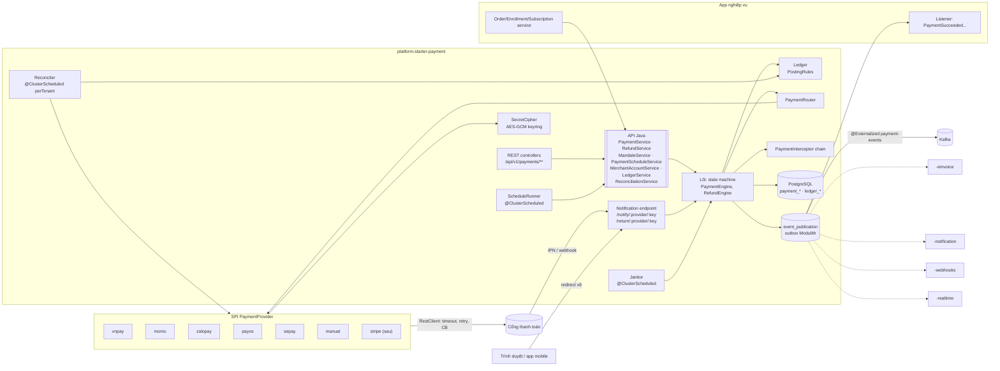
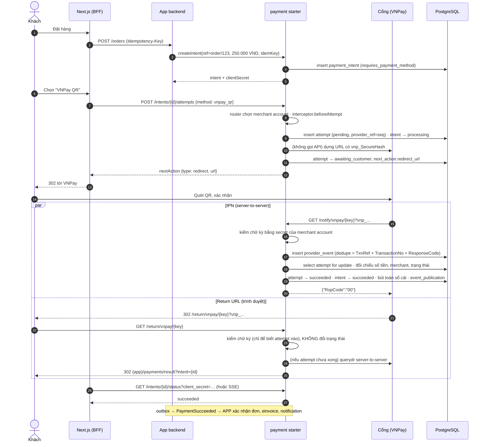
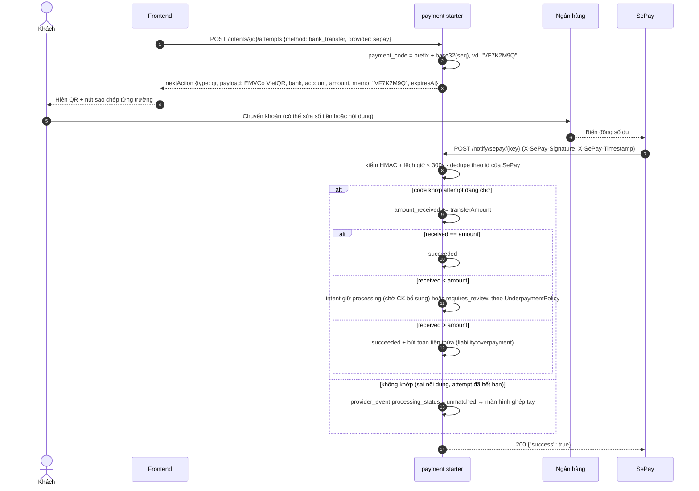
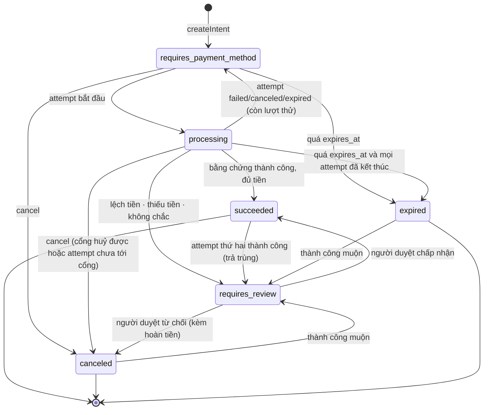
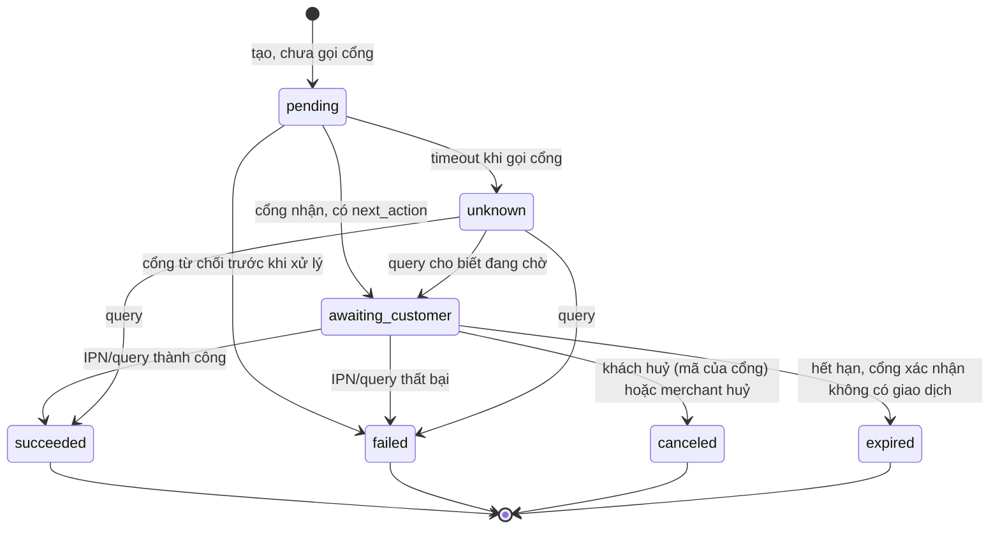
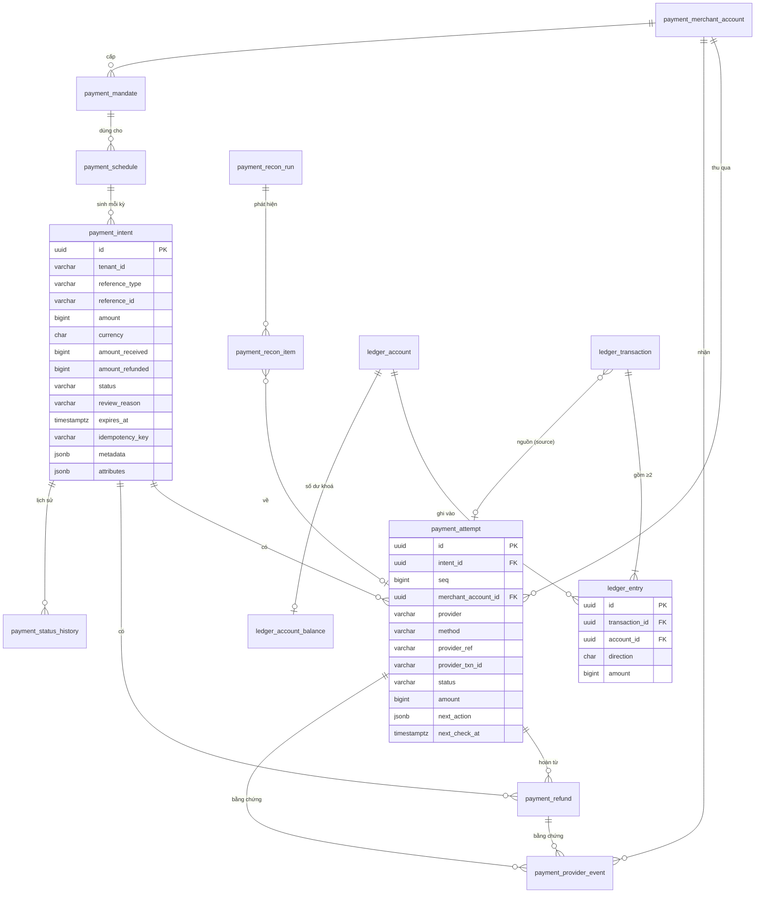

# Thiết kế module `payment`: thanh toán, hoàn tiền, định kỳ, sổ cái, đối soát

> **Trạng thái:** bản thiết kế chờ duyệt (26/10/2026), phiên forge-33.
> **Sản phẩm:** `platform-starter-payment` (platform-java 0.13.0) và `@vyforge/payment` (platform-web).
> **ADR dự kiến:** ADR-0021 "Thanh toán nội địa" theo [MODULE_PLAN](../MODULE_PLAN.md), hoặc một mục trong ADR-0020,
> tuỳ phiên điều phối.
> **Đọc kèm:** [module-thong-dung §3.11](../research/2026-10-module-thong-dung.md), quy tắc B25 trong MODULE_PLAN,
> ADR-0015 (tenant ở tầng dữ liệu).

Tóm tắt trong năm dòng:

1. Tách **ý định thanh toán** (`PaymentIntent`: thu bao nhiêu cho việc gì) khỏi **lần thử** (`PaymentAttempt`: thu qua
   cổng nào, kết quả ra sao), giống Stripe và Hyperswitch. Một intent có nhiều attempt; mỗi đối tượng có state machine riêng.
2. Trạng thái tiền **chỉ đổi** khi có bằng chứng từ server của cổng: IPN đã kiểm chữ ký, hoặc kết quả của API truy vấn do
   chính server mình gọi. Return URL của trình duyệt không bao giờ đổi trạng thái (B25).
3. Mỗi cổng là một adapter sau SPI `PaymentProvider`, khai báo khả năng của mình (`refund.partial`, `tokenization`...).
   Lõi không có `if (provider == VNPAY)`.
4. Mọi biến động tiền được ghi vào **sổ cái bút toán kép** append-only. Database tự từ chối bút toán lệch nợ/có. Sổ cái
   là nền cho đối soát, rồi sau này cho ví trả trước và công nợ.
5. Ba lớp chống sai lệch: janitor truy vấn lại giao dịch treo (học Kill Bill), đối soát định kỳ với sao kê của cổng, và
   kiểm tra toàn vẹn sổ cái hằng đêm.

---

## 1. Bài toán và phạm vi

### 1.1 Vì sao cần module riêng

Mọi dự án thương mại ở VN đều phải tích hợp ít nhất một cổng nội địa. Các nền tảng ngoại (ABP, JHipster, Medusa) không
có VNPay, MoMo, ZaloPay hay VietQR. Tự viết lại ở từng dự án thường mắc cùng một nhóm lỗi:

- tin Return URL;
- không đối chiếu số tiền;
- xử lý IPN hai lần;
- không truy vấn lại khi mất IPN;
- để lộ secret của merchant;
- không đối soát được với cổng.

Module làm phần đó đúng một lần, rồi để nghiệp vụ (đơn hàng, học phí, gói thuê bao...) phản ứng qua event.

### 1.2 Trong phạm vi

| Nhóm | Nội dung |
|---|---|
| Thu tiền | Intent và attempt; redirect tới trang của cổng (VNPay, MoMo, ZaloPay, Stripe Checkout sau này); QR động (VietQR qua payOS, SePay; QR của VNPay, MoMo); deeplink ví trên mobile |
| Bằng chứng | IPN/webhook kiểm chữ ký; truy vấn chủ động; lưu nguyên payload của cổng làm chứng từ |
| Hoàn tiền | Một phần hoặc toàn phần, nhiều lần, qua API của cổng. Với cổng không hỗ trợ, ghi nhận hoàn tay có chứng từ |
| Định kỳ | Mandate (token, liên kết ví) và lịch thu định kỳ, theo hai chế độ: tự trừ tiền khi cổng hỗ trợ, hoặc gửi link/QR mỗi kỳ |
| Merchant theo tenant | Mỗi tenant có một hoặc nhiều merchant account cho mỗi cổng (theo chi nhánh, theo pháp nhân). Platform có merchant mặc định |
| Sổ cái | Bút toán kép, hệ tài khoản mặc định, quy tắc hạch toán thay được |
| Đối soát | Janitor theo giao dịch; đối soát theo sao kê (API hoặc file); kiểm toàn vẹn sổ cái |
| Liên kết | Event công khai qua outbox (hoá đơn điện tử, thông báo, webhook ra ngoài, realtime) |
| Frontend | Chọn phương thức, hiển thị QR, chuyển hướng, trang kết quả, theo dõi trạng thái, màn quản trị |

### 1.3 Ngoài phạm vi (và module nào lo)

| Không làm | Lý do / nơi làm |
|---|---|
| Nhận, lưu, truyền số thẻ (PAN, CVV) | PCI DSS: chỉ dùng redirect hoặc hosted page của cổng (mục 8.1) |
| Billing đầy đủ: gói, giá, proration, dùng thử, coupon | Thuộc module `billing` sau này (kiểu Kill Bill). Payment chỉ cung cấp mandate và lịch thu đơn giản để billing dựng lên trên |
| Phát hành hoá đơn điện tử | Module `-einvoice` (P2) nghe event `PaymentSucceeded`/`RefundSucceeded` (mục 5.3) |
| Ví điện tử giữ tiền của bên thứ ba, chi hộ, thu hộ cho người bán khác | Cần giấy phép trung gian thanh toán (mục 8.2). Sổ cái chỉ chuẩn bị chỗ cho "số dư trả trước" của chính merchant |
| Định tuyến tối ưu theo tỷ lệ thành công (kiểu Hyperswitch) | Có SPI `PaymentRouter`; thuật toán thông minh để sau |
| Chống gian lận chuyên sâu | Có hook `beforeAttempt` để gắn engine ngoài |

### 1.4 Kịch bản nghiệp vụ phải đáp ứng

Mỗi kịch bản ghi rõ khối nào của thiết kế phục vụ nó. "Hiện tại" là bản 0.13; "tương lai" là thứ thiết kế đã chừa chỗ.

| # | Kịch bản | Đặc thù | Khối đáp ứng | Bản |
|---|---|---|---|---|
| K1 | Website bán lẻ: khách chọn VNPay, quét QR bằng app ngân hàng, hoặc nhập thẻ ATM nội địa, hoặc thẻ quốc tế (`INTCARD`) trên trang VNPay | VN | Attempt `vnpay` + `method` (`vnpay_qr`, `domestic_card`, `intl_card`); IPN; querydr | Hiện tại |
| K2 | App mobile: khách trả bằng ví MoMo hoặc ZaloPay qua deeplink; trên desktop thì quét QR | VN | `nextAction` có `redirect_url`, `deeplink`, `qr` để frontend chọn theo thiết bị | Hiện tại |
| K3 | Đơn B2B 480 triệu trả bằng chuyển khoản VietQR. Khách gõ sai nội dung, chuyển thiếu, hoặc chuyển hai lần | VN, rất phổ biến | Adapter `sepay`/`payos`; mã đối chiếu trong nội dung CK; `amount_received` cộng dồn; trạng thái `requires_review`; bảng giao dịch chưa khớp và API ghép tay | Hiện tại |
| K4 | Chuỗi trường học thu học phí. Mỗi cơ sở là một pháp nhân, có merchant VNPay riêng, cùng thuộc một tenant | VN | Nhiều `merchant_account` mỗi tenant; `PaymentRouter` chọn theo `attributes.branch` | Hiện tại |
| K5 | SaaS thu phí tháng. Khách liên kết ví ZaloPay/MoMo để tự trừ, hoặc mỗi kỳ nhận email kèm link/QR | VN | `Mandate` + `PaymentSchedule` (`auto_charge` / `pay_link`); event `PaymentScheduleDue` cho module notification | Khung hiện tại; tự trừ qua ZaloPay AgreementPay / MoMo token ở 0.14 |
| K6 | Khách trả lại một món trong đơn ba món (hoàn một phần), sau đó huỷ cả đơn (hoàn nốt) | Chung | `Refund` nhiều lần; ràng buộc tổng hoàn ≤ đã nhận; sổ cái | Hiện tại |
| K7 | Đơn trả bằng chuyển khoản cần hoàn tiền. VietQR không có API hoàn, nên kế toán chuyển trả bằng tay | VN | Refund `mode=manual` có số tham chiếu và người xác nhận; sổ cái ghi như hoàn qua cổng | Hiện tại |
| K8 | Khách mở hai tab và trả hai lần; hoặc IPN thành công tới sau khi intent đã hết hạn | Chung | Attempt thứ hai thành công khi intent đã `succeeded` → `requires_review` + event; chính sách `DuplicatePaymentPolicy` (mặc định: đánh dấu xem xét, tuỳ chọn tự hoàn) | Hiện tại |
| K9 | IPN bị firewall chặn hoặc server down lúc cổng gọi | Chung | Janitor gọi API truy vấn theo lịch backoff; return URL kích hoạt truy vấn | Hiện tại |
| K10 | VNPay bảo trì: tạm ẩn VNPay và gợi ý MoMo/VietQR | VN | Circuit breaker theo cổng; `listAvailableMethods()` bỏ cổng đang mở mạch; health | Hiện tại |
| K11 | Cuối ngày kế toán đối soát với sao kê của cổng, ghi nhận phí cổng và tiền về tài khoản T+1 | Chung | `ReconciliationRun`; `StatementSource` theo cổng; bút toán phí và quyết toán | Hiện tại (payOS, SePay qua API; file CSV chung); VNPay, MoMo theo file ở 0.14 |
| K12 | Thu tiền trước khi cung cấp dịch vụ, nên phải xuất hoá đơn điện tử ngay khi nhận tiền (NĐ 70/2025 sửa Điều 9 NĐ 123/2020). Hoàn tiền thì lập hoá đơn điều chỉnh | VN | Event `PaymentSucceeded`/`RefundSucceeded` qua outbox, có `reference` và số tiền | Event có ngay; module einvoice ở P2 |
| K13 | Đặt cọc khám bệnh, khách sạn: cọc 30% trước, phần còn lại thu sau, có thể ở cổng khác | Chung | Nhiều intent cùng `reference`; API `summaryByReference` | Hiện tại |
| K14 | Thu tiền mặt tại quầy hoặc COD, cần ghi nhận để sổ cái và báo cáo đủ | VN | Provider `manual` (ghi nhận tay, cần quyền riêng) | Hiện tại |
| K15 | Kiosk hoặc màn hình POS hiện QR động, tự đổi sang "đã thanh toán" trong vài giây | VN | `@vyforge/payment` `PaymentQr` + `PaymentStatus` (SSE qua `-realtime`, dự phòng polling) | Hiện tại |
| K16 | SaaS đa tenant: tenant nhỏ chưa có hợp đồng với cổng thì dùng merchant của nhà cung cấp SaaS, tenant lớn tự cấu hình merchant riêng | Chung | Merchant mặc định của platform + chính sách `allowPlatformMerchant` | Hiện tại |
| K17 | Ví trả trước hoặc điểm thưởng của chính merchant: nạp qua VietQR, dùng dần | Chung, có rủi ro pháp lý | Tài khoản sổ cái `liability:prepaid:<customer>` có khoá số dư | Tương lai: chỉ là mẫu hạch toán, cần pháp chế duyệt (mục 8.2) |
| K18 | Công nợ B2B: xuất hàng ghi nợ, khách trả nhiều lần | Chung | Tài khoản `asset:receivable:<customer>`; intent gắn `reference` là hoá đơn | Tương lai |
| K19 | Dự án quốc tế dùng Stripe: thẻ quốc tế, 3DS, Apple Pay | Quốc tế | Adapter `stripe` (Checkout Session, redirect); tiền tệ khác VND (`Money` có số mũ) | Tương lai: thêm adapter, không sửa lõi |

---

## 2. Nghiên cứu

### 2.1 Hệ thống tham khảo

Các con số phiên bản kiểm ngày 26/10/2026 qua GitHub API (`gh api repos/<repo>/releases/latest`) và trang tài liệu chính thức.

| Hệ thống | Loại, phiên bản, license | Mô hình dữ liệu | API | Điểm mạnh | Điểm yếu (với ta) |
|---|---|---|---|---|---|
| **Stripe** ([PaymentIntent lifecycle](https://docs.stripe.com/payments/paymentintents/lifecycle), [Refund](https://docs.stripe.com/api/refunds/object), [Idempotency](https://docs.stripe.com/api/idempotent_requests)) | SaaS; SDK `stripe-java` v34.0.0 (01/10/2026), MIT | `PaymentIntent` (`requires_payment_method` → `requires_confirmation` → `requires_action` → `processing` → `succeeded`/`canceled`; thất bại thì quay về `requires_payment_method` để thử lại), `Charge` cho từng lần thu, `Refund` (`pending`, `requires_action`, `succeeded`, `failed`, `canceled`), `SetupIntent` + `Mandate` cho thu sau, `BalanceTransaction` | REST + `Idempotency-Key` (≤255 ký tự, giữ ≥24h, so tham số, lưu cả response 500); webhook có ký; `metadata` ≤50 khoá | Mô hình intent/charge rõ ràng, thử lại không tạo intent mới; idempotency chuẩn mực; `client_secret` cho trình duyệt đọc trạng thái | Thiết kế cho thẻ (auth/capture, 3DS). Ví VN và chuyển khoản không có auth/capture. Nay Stripe khuyên Checkout Sessions thay cho PaymentIntent |
| **Hyperswitch** (juspay) ([repo](https://github.com/juspay/hyperswitch), [enums.rs](https://github.com/juspay/hyperswitch/blob/main/crates/common_enums/src/enums.rs)) | OSS payment orchestrator (Rust), v1.128.0 (16/10/2026), Apache-2.0 | `payment_intent` (17 trạng thái, gồm `RequiresCustomerAction`, `Processing`, `PartiallyCaptured`, `Conflicted`, `Expired`, `Review`) tách khỏi `payment_attempt` (29 trạng thái, gồm `Unresolved`, `IntegrityFailure`); `refund` (`Pending`, `Success`, `Failure`, `ManualReview`, `TransactionFailure`); `mandate` (`Active`, `Inactive`, `Pending`, `Revoked`); merchant → profile → connector account | REST kiểu Stripe; connector là trait trong code; routing theo luật và theo tỷ lệ thành công; scheduler (producer/consumer trên Redis) cho việc định kỳ | Tách intent/attempt; có trạng thái riêng cho "không chắc chắn" (`Unresolved`), "lệch số tiền" (`IntegrityFailure`) và "cần xem xét"; mỗi merchant có nhiều connector account; locker riêng cho dữ liệu nhạy cảm | Là một service lớn (Rust, Redis, nhiều crate). Ta là thư viện nhúng. Không có cổng VN nào trong 100+ connector |
| **Kill Bill** ([repo](https://github.com/killbill/killbill), [Payment user guide](https://docs.killbill.io/latest/userguide_payment.html)) | OSS billing + payment (Java), 0.24.22 (29/09/2026), Apache-2.0 | `Payment` chứa nhiều `PaymentTransaction` (`AUTHORIZE`, `CAPTURE`, `PURCHASE`, `REFUND`, `CREDIT`, `VOID`, `CHARGEBACK`). Trạng thái giao dịch: `SUCCESS`, `PENDING`, `PAYMENT_FAILURE`, `PLUGIN_FAILURE`, `UNKNOWN`. Máy trạng thái khai báo trong `PaymentStates.xml` | Plugin API (`purchasePayment`, `refundPayment`, `getPaymentInfo`, `buildFormDescriptor` cho trang hosted); payment control plugin (trước/sau giao dịch, retry); `transactionExternalKey` để khử trùng | **Janitor**: tự đưa giao dịch `PENDING`/`UNKNOWN` về trạng thái cuối bằng cách hỏi plugin theo lịch (mặc định UNKNOWN: `5m,1h,1d,1d,1d,1d,1d`; PENDING: `1h,1d`). Phân biệt "cổng từ chối" với "plugin lỗi, chưa gửi" với "không biết" | Nặng (service riêng, multi-tenant theo API key). Billing gắn chặt với payment. Không có cổng VN |
| **Medusa** v2 ([Payment module](https://docs.medusajs.com/resources/commerce-modules/payment), [PaymentCollection](https://docs.medusajs.com/resources/references/payment/models/PaymentCollection)) | OSS commerce (TypeScript), v2.22.1 (23/10/2026), MIT (trừ phần Enterprise) | `PaymentCollection` gắn với cart/order (`amount`, `authorized_amount`, `captured_amount`, `refunded_amount`, `status`), chứa nhiều `PaymentSession` (mỗi provider một session) và `Payment` (sinh ra khi authorize); `Capture`, `Refund` | Module provider (interface `AbstractPaymentProvider`); webhook route chung `/hooks/payment/{provider}`, rồi `getWebhookActionAndData` chuẩn hoá | Gắn với một tài nguyên bất kỳ qua link module; cộng dồn số tiền ở cấp collection, hợp với trả nhiều lần (K3, K13); webhook route chung theo provider | Không có sổ cái, không có đối soát; idempotency phụ thuộc workflow engine |
| **Modern Treasury Ledgers** ([Transaction status](https://docs.moderntreasury.com/platform/docs/transaction-status-and-balances), [Ledger account](https://docs.moderntreasury.com/reference/ledger-account-object)) | SaaS | `ledger_account` (normal balance `credit`/`debit`), `ledger_transaction` (`pending` → `posted` → `archived`; đã post thì không sửa, chỉ đảo bằng giao dịch ngược), `ledger_entry`; ba loại số dư `pending`, `posted`, `available`; settlement | REST, khoá idempotent theo giao dịch | Quy tắc rõ ràng: tổng nợ = tổng có, bất biến sau khi post, đảo bằng giao dịch mới; tách số dư pending và posted | SaaS nước ngoài. Dữ liệu tài chính ra khỏi VN; không phù hợp on-prem |
| **TigerBeetle** ([Two-phase transfers](https://docs.tigerbeetle.com/coding/two-phase-transfers/), [Account](https://docs.tigerbeetle.com/reference/account/)) | OSS database cho sổ cái (Zig), 0.17.9 (06/07/2026), Apache-2.0 | `Account` (`debits_pending`, `debits_posted`, `credits_pending`, `credits_posted`, cờ giới hạn số dư), `Transfer` hai pha (pending → post/void/timeout, chỉ giải quyết một lần) | Client Java/Node/Go... | Mô hình số dư bốn cột, giữ tiền hai pha, ràng buộc "không âm" ở tầng database | Thêm một database chuyên dụng phải vận hành; quá mức với khối lượng của dự án outsourcing |

**Tài liệu chính thức của cổng VN** (kiểm 26/10/2026):

| Cổng | Nguồn | Điểm thiết kế cần nắm |
|---|---|---|
| **VNPay** PAY v2.1.0 | [Thanh toán PAY](https://sandbox.vnpayment.vn/apis/docs/thanh-toan-pay/pay.html), [Truy vấn & hoàn tiền](https://sandbox.vnpayment.vn/apis/docs/truy-van-hoan-tien/querydr&refund.html), [Token](https://sandbox.vnpayment.vn/apis/docs/thanh-toan-token/token.html) | `vnp_Amount` = số tiền × 100, chỉ VND. `vnp_TxnRef` không trùng trong ngày. Giờ GMT+7. `vnp_BankCode`: `VNPAYQR`, `VNBANK`, `INTCARD`. Chữ ký HMAC-SHA512 trên tham số sắp xếp và URL-encode. IPN là GET, cần HTTPS; merchant trả JSON `RspCode` (`00` xong, `01` không có đơn, `02` đã xác nhận, `04` sai số tiền, `97` sai chữ ký, `99` lỗi khác). Mã khác `00`/`02` hoặc timeout thì VNPay gọi lại tối đa 10 lần, cách 5 phút. Return URL chỉ để hiển thị. `querydr`/`refund` là POST JSON tới `merchant_webapi/api/transaction`, checksum trên các trường nối bằng `\|`; refund `02` toàn phần, `03` một phần; `vnp_RequestId` không trùng trong ngày. Token: `token_create`, `pay_and_create`, `token_pay`, `token_remove`. **`token_pay` vẫn bắt khách xác nhận OTP trên trang VNPay**, nên không dùng được cho tự trừ tiền |
| **MoMo** API v3 | [Mẫu chính thức momo-wallet/payment](https://github.com/momo-wallet/payment/blob/master/nodejs/MoMo.js), [Notification](https://developers.momo.vn/v3/docs/payment/api/result-handling/notification/), [Refund](https://developers.momo.vn/v3/docs/payment/api/payment-api/refund/), [Tokenization](https://developers.momo.vn/v3/docs/payment/guides/aio-tokenization-payment/) | Tạo giao dịch `POST /v2/gateway/api/create`, `requestType` (`captureWallet`, `payWithATM`, `payWithCC`, `payWithMethod`). Chữ ký HMAC-SHA256 trên `accessKey=…&amount=…&extraData=…&ipnUrl=…&orderId=…&orderInfo=…&partnerCode=…&redirectUrl=…&requestId=…&requestType=…`. Response có `payUrl`, `deeplink`, `qrCodeUrl`. IPN: phải kiểm chữ ký và đối chiếu `partnerCode`, `orderId`, `amount`, rồi trả **HTTP 204 trong 15 giây**. Refund `POST /v2/gateway/api/refund` theo `transId`, cần `orderId` mới, hỗ trợ hoàn một phần, giới hạn 1.000–50.000.000 đ với giao dịch thường, timeout tối thiểu 30 giây. Tokenization có hai loại: account binding và subscription (`aesToken`). *Trang developers.momo.vn chặn truy cập tự động (HTTP 403): chi tiết trên lấy từ mẫu code chính thức và đoạn trích tìm kiếm; phải đối chiếu toàn văn khi viết adapter* |
| **ZaloPay** API v2 | [Gateway guide](https://docs.zalopay.vn/en/v2/docs/gateway/guide.html), [Callback](https://docs.zalopay.vn/docs/developer-tools/knowledge-base/callback), [Refund](https://docs.zalopay.vn/docs/specs/order-refund), [Query refund](https://docs.zalopay.vn/docs/specs/order-query-refund), [Agreement pay](https://docs.zalopay.vn/docs/specs/agreement-pay) | Tạo đơn `/v2/create` (sandbox `sb-openapi.zalopay.vn`, production `openapi.zalopay.vn`), `app_trans_id` bắt đầu bằng `yymmdd`, `mac` HMAC-SHA256 với **key1**. Callback là JSON `{data, mac, type}`: `mac` = HMAC-SHA256(**key2**, chuỗi `data` thô). Merchant trả `return_code` 1 (thành công), 0 (cổng gọi lại), -1 (sai mac). Refund `/v2/refund` **bất đồng bộ**: `m_refund_id` dạng `yymmdd_appid_xxx`, rồi phải gọi `/v2/query_refund`. AgreementPay (`/v2/agreement/pay`, `pay_token`) cho tự trừ tiền. *Trang tài liệu là SPA, nội dung lấy qua đoạn trích tìm kiếm; đối chiếu toàn văn khi viết adapter* |
| **payOS** (VietQR) | [API](https://payos.vn/docs/api/), [Kiểm tra signature](https://payos.vn/docs/tich-hop-webhook/kiem-tra-du-lieu-voi-signature/), SDK [payos-lib-java](https://github.com/payOSHQ/payos-lib-java) v2.0.1, MIT | `POST https://api-merchant.payos.vn/v2/payment-requests`, header `x-client-id`, `x-api-key`. `orderCode` là **số nguyên**. Chữ ký HMAC-SHA256 trên `amount=…&cancelUrl=…&description=…&orderCode=…&returnUrl=…`. Response có `checkoutUrl`, `qrCode` (chuỗi VietQR), `paymentLinkId`. `GET /v2/payment-requests/{id}` trả `amountPaid`, `amountRemaining`, `transactions`. Webhook: chỉ ký phần `data`, khoá sắp xếp a–z, `null` thành chuỗi rỗng. Với tài khoản không liên kết qua payOS, `description` tối đa 9 ký tự |
| **SePay** | [Webhook](https://developer.sepay.vn/en/sepay-webhooks/tich-hop-webhook), [Xác thực](https://developer.sepay.vn/en/sepay-webhooks/xac-thuc) | Webhook theo biến động số dư: `id` (khoá khử trùng, giữ nguyên khi gửi lại), `gateway`, `transactionDate` (giờ VN), `accountNumber`, `code` (mã thanh toán SePay tự tách từ nội dung; `null` nếu không tách được), `content`, `transferType` `in`/`out`, `transferAmount`, `referenceCode`. Xác thực khuyến nghị HMAC-SHA256: header `X-SePay-Signature: sha256=<hex>`, `X-SePay-Timestamp`, ký `{timestamp}.{raw_body}`, lệch tối đa 300 giây. Thành công là 200/201 với body đúng `{"success": true}` trong 30 giây; ngoài ra SePay gửi lại. Admin có thể replay cả log đã thành công |
| **VietQR (NAPAS)** | [Thông cáo NAPAS](https://bizhub.vietnamnews.vn/vietqr-launched-to-promote-digital-transformation-in-banking-sector-post325152.html), thư viện cộng đồng (vd. [vietqr_gen](https://pub.dev/packages/vietqr_gen)) | Payload theo EMVCo MPM: tag 38 (GUID `A000000727`, BIN ngân hàng, số tài khoản, dịch vụ `QRIBFTTA`), tag 54 số tiền, tag 62 nội dung, CRC16 ở tag 63. *Đặc tả NAPAS chính thức không công khai; cấu trúc tag lấy từ thư viện cộng đồng, cần đối chiếu bằng test quét thật với app ngân hàng* |

### 2.2 Học theo gì, không làm gì

**Học theo:**

| Từ | Học gì | Áp vào đâu |
|---|---|---|
| Stripe, Hyperswitch | Tách intent và attempt. Attempt thất bại thì intent quay về chờ phương thức, không phải tạo intent mới | §4 |
| Stripe | `Idempotency-Key` trên mọi lệnh ghi (platform đã có filter); `client_secret` cho trình duyệt đọc trạng thái mà không cần đăng nhập; `metadata` có giới hạn | §5.2 |
| Hyperswitch | Có trạng thái riêng cho "lệch dữ liệu" (`IntegrityFailure`), "không chắc" (`Unresolved`) và "cần người xem" (`Review`). Mỗi tenant có nhiều connector account | Trạng thái `requires_review`, `unknown`; `merchant_account` |
| Kill Bill | Janitor theo lịch backoff. Phân biệt `PLUGIN_FAILURE` (chưa gửi được, an toàn để thử lại) với `UNKNOWN` (đã gửi, không biết kết quả, **không được** thử lại mù) | §3.4, mã lỗi chuẩn hoá §6.2 |
| Kill Bill | Control plugin trước/sau giao dịch | `PaymentInterceptor` §6.3 |
| Medusa | Gắn payment với tài nguyên bất kỳ qua `reference`; cộng dồn số tiền ở cấp tổng hợp | `reference_type`/`reference_id`, `amount_received` |
| Medusa | Một route webhook chung theo provider, adapter chuẩn hoá payload thành hành động | `/notify/{provider}/{key}` + `NotificationParser` |
| Modern Treasury, TigerBeetle | Bút toán kép bất biến, đảo bằng giao dịch ngược; tài khoản có normal balance; số dư bốn cột; khoá số dư cho tài khoản không được âm | §4.5 |

**Không làm:**

- **Không tách service riêng** như Hyperswitch hay Kill Bill. Starter nhúng chạy chung transaction với nghiệp vụ (đơn hàng
  và payment commit cùng nhau), đúng nguyên tắc "thư viện, không phải service". Muốn tách sau này thì API Java đã là ranh
  giới.
- **Không làm auth/capture tách rời ở bản đầu.** Cổng VN không có auth/capture cho ví và chuyển khoản. Thẻ qua VNPay cũng
  là purchase. Field `capture_method` vẫn có, chỉ nhận `automatic`, để Stripe thêm `manual` sau.
- **Không chép 17 trạng thái của Hyperswitch.** Giữ 7 trạng thái intent đủ cho các kịch bản ở §1.4.
- **Không dùng SDK chính thức của cổng.** payOS có SDK Java (MIT) nhưng kéo thêm HTTP client riêng. Các SDK khác không có
  bản Java chính thức. Adapter tự viết trên `RestClient` của platform để có sẵn timeout, retry, circuit breaker, request id
  và metric.
- **Không dùng TigerBeetle hay ledger SaaS.** PostgreSQL với trigger cân bằng là đủ cho khối lượng dự kiến (§7.4).
- **Không cho app gửi số thẻ.** Kể cả khi một cổng có API direct (MoMo `payWithCC` tạo hosted page, vẫn được dùng).

---

## 3. Kiến trúc

### 3.1 Sơ đồ thành phần



### 3.2 Ranh giới package (hexagonal)

```
com.vyforge.platform.payment
├── (gốc)            API công khai: PaymentService, RefundService, MandateService, PaymentScheduleService,
│                    MerchantAccountService, ReconciliationService; record lệnh/kết quả; Money; PaymentErrors; PaymentActions
├── event            Event công khai (record, TenantAwareEvent + IntegrationEvent)
├── spi              PaymentProvider, ProviderCapability, ProviderDescriptor, NotificationParser, StatementSource,
│                    PaymentRouter, PaymentInterceptor, PostingRules, SecretCipher, DuplicatePaymentPolicy...
├── ledger           LedgerService (API công khai của sổ cái), LedgerAccountRef, JournalEntry
├── provider.vnpay   adapter (mỗi adapter một package; chỉ phụ thuộc spi + platform-starter-web)
├── provider.momo / .zalopay / .payos / .sepay / .manual
├── internal         entity JPA, repository, engine, state machine, janitor, reconciler (không ai ngoài starter dùng)
└── web              controller REST, notification endpoint, DTO, ProblemDetails mapping
```

Luật ArchUnit của starter: `provider..` chỉ phụ thuộc `spi..`, gốc và `platform-starter-web`, không phụ thuộc `internal..`.
`spi..` không phụ thuộc Spring. Gốc và `event..` không phụ thuộc JPA.

**Vì sao adapter nằm chung artifact.** Adapter VN chỉ là HTTP + HMAC, không kéo dependency ngoài, cùng nhịp release với lõi.
Nguyên tắc 1 của MODULE_PLAN chỉ tách artifact khi có phụ thuộc ngoài hoặc nhịp release riêng. Mỗi adapter bật/tắt bằng
`vyforge.payment.providers.<code>.enabled`. Adapter có dependency nặng (Stripe SDK) sẽ là artifact riêng
`platform-payment-stripe`, đăng ký qua cùng SPI.

### 3.3 Luồng chính: redirect + IPN (VNPay, MoMo, ZaloPay)



Điểm then chốt:

- Một transaction gồm: ghi `provider_event`, chuyển trạng thái, ghi bút toán, ghi `event_publication`. Gãy giữa chừng thì
  rollback, và cổng gọi lại (VNPay nhận `99`, MoMo không nhận 204, ZaloPay nhận `return_code=0`).
- Return URL chỉ được làm một việc có tác dụng: **gọi API truy vấn của cổng** từ server. Kết quả truy vấn đáng tin vì do
  server mình gọi tới cổng qua HTTPS với khoá của mình. Đây cũng là cách Kill Bill sửa trạng thái "on-the-fly".

### 3.4 Luồng chuyển khoản VietQR (SePay; payOS tương tự)



### 3.5 Luồng lỗi

| Tình huống | Hành vi |
|---|---|
| Sai chữ ký IPN | Không đụng database. Trả mã "sai chữ ký" theo giao thức của cổng (VNPay `97`, ZaloPay `-1`, MoMo 400, SePay 401). Metric `notifications{outcome=bad_signature}`, log WARN đã che PII. Rate limit theo `notify_key` |
| `notify_key` không tồn tại | 404, không ghi gì |
| Không tìm thấy attempt theo `provider_ref` | `provider_event` = `unmatched`, trả "không có đơn" (VNPay `01`) để cổng gọi lại (phòng race khi IPN tới trước commit của attempt). Riêng chuyển khoản: trả thành công cho SePay vì tiền đã thật sự về |
| Lệch số tiền | Attempt → `failed` với `failure_code=amount_mismatch`, intent → `requires_review`, event `PaymentRequiresReview`. Trả VNPay `04` |
| IPN trùng | `provider_event` trùng khoá dedupe: trả "đã xử lý" (VNPay `02`, ZaloPay `1`, MoMo 204, SePay success). Không đổi gì |
| IPN thành công khi intent đã `succeeded` bởi attempt khác (K8) | Attempt mới → `succeeded`, intent → `requires_review` với `review_reason=duplicate_payment`. `DuplicatePaymentPolicy` mặc định `REVIEW`, tuỳ chọn `AUTO_REFUND` |
| IPN thành công khi intent đã `canceled`/`expired` | Tiền đã bị trừ thật, nên attempt → `succeeded`, intent → `requires_review` (`late_success`). Không bao giờ bỏ qua tiền đã nhận |
| Gọi API của cổng bị timeout hoặc mất kết nối (refund, query) | Thao tác → `unknown`, **không** thử lại lệnh ghi một cách mù quáng. Janitor truy vấn trạng thái rồi mới quyết định |
| Cổng trả lỗi nghiệp vụ trước khi xử lý (sai tham số, merchant bị khoá) | `failed` với mã chuẩn hoá (`provider_rejected`), an toàn để thử lại bằng attempt khác |
| Circuit breaker mở | Attempt mới bị từ chối ngay với `payment.provider_unavailable` (503); `listAvailableMethods()` ẩn cổng đó |
| Xử lý IPN lỗi ngoài dự kiến (DB down) | Rollback; trả mã "thử lại" của cổng; janitor là lưới an toàn |
| Janitor hết lịch mà vẫn `unknown`/`awaiting_customer` | Attempt → `expired` nếu cổng xác nhận không có giao dịch; nếu cổng vẫn không trả lời thì intent → `requires_review` + alert |

### 3.6 Janitor (đối soát theo giao dịch)

`@ClusterScheduled(name = "payment-janitor", fixedDelay = "30s")`. Một truy vấn toàn cục `@TenantExempt` lấy tối đa
`batch-size` attempt hoặc refund có `next_check_at <= now()` theo index `(next_check_at) where status in (...)`, rồi xử lý
từng dòng trong `TenantContext.run(tenant, ...)` với transaction riêng.

- Lịch mặc định cho attempt `awaiting_customer`: lần đầu sau `expires_at` của cổng + 1 phút, rồi `5m, 15m, 1h, 6h, 1d`.
- Attempt và refund `unknown`: `1m, 5m, 15m, 1h, 6h, 1d, 1d, 1d` (gần lịch UNKNOWN của Kill Bill, dày hơn ở đầu vì ví VN
  thường có kết quả trong vài phút).
- Cổng không có API truy vấn (SePay chỉ có webhook): attempt `awaiting_customer` hết `expires_at` thì → `expired`. Tiền về
  muộn thì đi theo nhánh `unmatched` hoặc `late_success`.
- Không truy vấn dồn dập: `ProviderCapability.QUERY_RATE` giới hạn số lần truy vấn mỗi phút cho từng merchant account
  (`-ratelimit`).

---

## 4. Mô hình dữ liệu

### 4.1 State machine

**PaymentIntent**



Hoàn tiền không đổi `status` của intent (giống Stripe). Trạng thái hoàn tiền suy ra từ `amount_refunded`: `none`,
`partial`, `full`; API trả field `refundState`. Như vậy "đã thanh toán" và "đã hoàn" là hai trục độc lập. Nghiệp vụ không
phải xử lý tổ hợp như `PARTIALLY_REFUNDED_AND_REVIEW`.

**PaymentAttempt**



**Refund:** `pending` → (`processing` khi cổng xử lý bất đồng bộ, như ZaloPay) → `succeeded` | `failed`; mọi bước gọi
cổng có thể → `unknown` rồi janitor giải quyết. Refund `manual` tạo thẳng ở `succeeded`, kèm chứng từ.

**Mandate:** `pending` → `active` → `revoked` | `expired`; `pending` → `failed`.

**PaymentSchedule:** `active` ⇄ `paused`; `active` → `past_due` (hết lượt thử lại) → `active` (trả được) | `canceled`;
`active` → `completed` (tới `end_at`).

Máy trạng thái được khai báo bằng một bảng chuyển hợp lệ trong code (`Transitions.of(...)`), giống `PaymentStates.xml` của
Kill Bill nhưng bằng Java. Mọi chuyển trạng thái đi qua một chỗ duy nhất: kiểm bảng, ghi `status_history`, gọi interceptor
`afterTransition`, phát event. Test sinh tự động: mọi cặp (trạng thái, sự kiện) không có trong bảng phải bị từ chối.

### 4.2 ERD



### 4.3 DDL dự kiến

Tiền là `bigint` theo **đơn vị nhỏ nhất** của tiền tệ (VND số mũ 0, USD số mũ 2), luôn đi kèm `currency`. Không dùng
`numeric` hay `double`. Mọi bảng thuộc tenant có `tenant_id varchar(63) not null`, index bắt đầu bằng `tenant_id`
(ADR-0015). Mã trạng thái, provider, method là `varchar` có kiểm ở code, không phải enum của PostgreSQL (quy ước §2).

```sql
-- Merchant account: cấu hình của tenant với một cổng
create table payment_merchant_account (
    id                uuid primary key,
    tenant_id         varchar(63)  not null,
    provider          varchar(32)  not null,              -- vnpay | momo | zalopay | payos | sepay | manual | ...
    name              varchar(100) not null,              -- "VNPay - Cơ sở Cầu Giấy"
    environment       varchar(16)  not null,              -- sandbox | production
    status            varchar(16)  not null,              -- active | disabled
    notify_key        varchar(43)  not null unique,       -- 256 bit ngẫu nhiên, base64url; nằm trong URL IPN
    public_config     jsonb        not null default '{}', -- không bí mật: tmnCode, partnerCode, BIN + số TK, methods
    credentials_enc   text         not null,              -- envelope của SecretCipher: v1:<kid>:<iv>:<ciphertext+tag>
    credentials_kid   varchar(32)  not null,              -- để tìm dòng cần mã hoá lại khi xoay khoá
    priority          int          not null default 100,
    attributes        jsonb        not null default '{}', -- vd. {"branch": "cau-giay"} cho PaymentRouter
    schema_version    int          not null default 1,    -- version của public_config theo ProviderDescriptor
    created_at timestamptz not null, created_by varchar(255), updated_at timestamptz, updated_by varchar(255),
    version           bigint       not null default 0,
    unique (tenant_id, provider, name)
);
create index payment_merchant_account_tenant_idx on payment_merchant_account (tenant_id, provider, status);

create sequence payment_attempt_seq;                       -- nguồn của provider_ref và mã chuyển khoản

create table payment_intent (
    id                 uuid primary key,                   -- UUID v7
    tenant_id          varchar(63)  not null,
    reference_type     varchar(64)  not null,              -- "order", "tuition", "subscription"...
    reference_id       varchar(128) not null,
    amount             bigint       not null check (amount > 0),
    currency           char(3)      not null,
    amount_received    bigint       not null default 0 check (amount_received >= 0),
    amount_refunded    bigint       not null default 0 check (amount_refunded >= 0),
    status             varchar(32)  not null,
    review_reason      varchar(32),                        -- amount_mismatch | underpaid | duplicate_payment | late_success | unknown
    capture_method     varchar(16)  not null default 'automatic',
    customer_ref       varchar(128),                       -- id khách trong app (không phải PII thô)
    description        varchar(255),
    merchant_account_id uuid references payment_merchant_account (id), -- null = để router chọn
    schedule_id        uuid,
    latest_attempt_id  uuid,
    max_attempts       int          not null default 10,
    expires_at         timestamptz  not null,
    succeeded_at       timestamptz,
    canceled_at        timestamptz,
    cancellation_reason varchar(64),
    idempotency_key    varchar(255),
    request_hash       varchar(64),                        -- SHA-256 tham số tạo, để báo dùng lại khoá với tham số khác
    client_secret_hash varchar(64)  not null,              -- SHA-256 của client secret; secret chỉ trả một lần
    metadata           jsonb        not null default '{}', -- của app: ≤ 50 khoá, khoá ≤ 40 ký tự, giá trị ≤ 500 ký tự
    attributes         jsonb        not null default '{}', -- của module/extension, có schema theo khoá
    schema_version     int          not null default 1,
    created_at timestamptz not null, created_by varchar(255), updated_at timestamptz, updated_by varchar(255),
    version            bigint       not null default 0,
    check (amount_refunded <= amount_received)
);
create unique index payment_intent_idem_uq on payment_intent (tenant_id, idempotency_key) where idempotency_key is not null;
create index payment_intent_ref_idx    on payment_intent (tenant_id, reference_type, reference_id);
create index payment_intent_list_idx   on payment_intent (tenant_id, created_at desc);
create index payment_intent_status_idx on payment_intent (tenant_id, status, created_at desc);
create index payment_intent_expiry_idx on payment_intent (expires_at)
    where status in ('requires_payment_method', 'processing');               -- job hết hạn (toàn cục)

create table payment_attempt (
    id                 uuid primary key,
    tenant_id          varchar(63)  not null,
    intent_id          uuid         not null references payment_intent (id),
    seq                bigint       not null unique,         -- nextval('payment_attempt_seq')
    merchant_account_id uuid        not null references payment_merchant_account (id),
    provider           varchar(32)  not null,
    method             varchar(32)  not null,                -- vnpay_qr | domestic_card | intl_card | wallet | bank_transfer | mandate | cash
    provider_ref       varchar(64)  not null,                -- mã mình gửi cổng: vnp_TxnRef, orderId, app_trans_id, orderCode, mã CK
    provider_txn_id    varchar(128),                         -- mã của cổng: vnp_TransactionNo, transId, zp_trans_id
    status             varchar(32)  not null,
    amount             bigint       not null check (amount > 0),
    currency           char(3)      not null,
    amount_received    bigint       not null default 0,
    next_action        jsonb,                                -- {type: redirect|qr|deeplink|none, url, qr, deeplink, expiresAt}
    failure_code       varchar(64),                          -- mã chuẩn hoá (§6.2)
    provider_code      varchar(32),                          -- mã gốc của cổng, vd. vnp_ResponseCode=24
    failure_message    varchar(255),
    payer              jsonb,                                -- @PersonalData SENSITIVE: ngân hàng, thẻ/tài khoản đã che
    mandate_id         uuid,
    expires_at         timestamptz  not null,
    completed_at       timestamptz,
    next_check_at      timestamptz,
    check_count        int          not null default 0,
    attributes         jsonb        not null default '{}',
    created_at timestamptz not null, created_by varchar(255), updated_at timestamptz, updated_by varchar(255),
    version            bigint       not null default 0,
    unique (merchant_account_id, provider_ref)
);
create index payment_attempt_intent_idx on payment_attempt (tenant_id, intent_id);
create index payment_attempt_txn_idx    on payment_attempt (merchant_account_id, provider_txn_id) where provider_txn_id is not null;
create index payment_attempt_check_idx  on payment_attempt (next_check_at)
    where status in ('pending', 'awaiting_customer', 'unknown');           -- janitor (toàn cục)
create index payment_attempt_recon_idx  on payment_attempt (tenant_id, merchant_account_id, completed_at);

create table payment_refund (
    id                 uuid primary key,
    tenant_id          varchar(63)  not null,
    intent_id          uuid         not null references payment_intent (id),
    attempt_id         uuid         not null references payment_attempt (id),
    mode               varchar(16)  not null,                -- provider | manual
    amount             bigint       not null check (amount > 0),
    currency           char(3)      not null,
    status             varchar(32)  not null,
    reason             varchar(32)  not null,                -- requested_by_customer | duplicate | fraudulent | order_canceled | other
    note               varchar(500),
    provider_ref       varchar(64),                          -- m_refund_id, vnp_RequestId, orderId mới của MoMo
    provider_refund_id varchar(128),
    manual_reference   varchar(128),                         -- số UNC/mã giao dịch ngân hàng khi hoàn tay
    failure_code       varchar(64),
    provider_code      varchar(32),
    idempotency_key    varchar(255),
    next_check_at      timestamptz,
    check_count        int          not null default 0,
    completed_at       timestamptz,
    attributes         jsonb        not null default '{}',
    created_at timestamptz not null, created_by varchar(255), updated_at timestamptz, updated_by varchar(255),
    version            bigint       not null default 0
);
create unique index payment_refund_idem_uq on payment_refund (tenant_id, idempotency_key) where idempotency_key is not null;
create index payment_refund_intent_idx on payment_refund (tenant_id, intent_id);
create index payment_refund_check_idx  on payment_refund (next_check_at) where status in ('pending', 'processing', 'unknown');

-- Bằng chứng từ cổng: IPN, webhook, kết quả truy vấn, return. Chứng từ, giữ theo §7.5
create table payment_provider_event (
    id                 uuid primary key,
    tenant_id          varchar(63)  not null,
    merchant_account_id uuid        not null references payment_merchant_account (id),
    provider           varchar(32)  not null,
    kind               varchar(32)  not null,                -- payment_notification | refund_notification | bank_credit | query | return
    dedupe_key         varchar(200) not null,
    received_at        timestamptz  not null,
    payload            jsonb        not null,                -- nguyên văn (đã parse) từ cổng; có PII
    payload_schema     int          not null default 1,
    processing_status  varchar(16)  not null,                -- accepted | duplicate | unmatched | rejected | failed | resolved
    attempt_id         uuid,
    refund_id          uuid,
    note               varchar(500),
    unique (merchant_account_id, dedupe_key)
);
create index payment_provider_event_tenant_idx on payment_provider_event (tenant_id, received_at desc);
create index payment_provider_event_unmatched_idx on payment_provider_event (tenant_id, received_at)
    where processing_status = 'unmatched';

create table payment_status_history (
    id          uuid primary key,
    tenant_id   varchar(63) not null,
    object_type varchar(16) not null,                         -- intent | attempt | refund | mandate | schedule
    object_id   uuid        not null,
    from_status varchar(32),
    to_status   varchar(32) not null,
    cause       varchar(32) not null,                         -- api | notification | query | janitor | review | schedule
    event_id    uuid,                                         -- payment_provider_event gây ra
    actor       varchar(255),
    at          timestamptz not null
);
create index payment_status_history_obj_idx on payment_status_history (tenant_id, object_id, at);

create table payment_mandate (
    id                  uuid primary key,
    tenant_id           varchar(63)  not null,
    customer_ref        varchar(128) not null,
    merchant_account_id uuid         not null references payment_merchant_account (id),
    provider            varchar(32)  not null,
    type                varchar(32)  not null,                -- wallet_binding | card_token | subscription_token
    status              varchar(16)  not null,
    token_enc           text,                                 -- token của cổng, mã hoá bằng SecretCipher
    display             jsonb        not null default '{}',   -- {"brand":"ZaloPay","masked":"***678"}
    max_amount          bigint,
    currency            char(3)      not null,
    provider_binding_id varchar(128),
    expires_at          timestamptz,
    revoked_at          timestamptz,
    attributes          jsonb        not null default '{}',
    created_at timestamptz not null, created_by varchar(255), updated_at timestamptz, updated_by varchar(255),
    version             bigint       not null default 0
);
create index payment_mandate_customer_idx on payment_mandate (tenant_id, customer_ref, status);

create table payment_schedule (
    id               uuid primary key,
    tenant_id        varchar(63)  not null,
    customer_ref     varchar(128) not null,
    reference_type   varchar(64)  not null,
    reference_id     varchar(128) not null,
    amount           bigint       not null check (amount > 0),
    currency         char(3)      not null,
    interval_unit    varchar(8)   not null,                   -- day | week | month | year
    interval_count   int          not null check (interval_count > 0),
    anchor_at        timestamptz  not null,
    next_run_at      timestamptz  not null,
    end_at           timestamptz,
    mode             varchar(16)  not null,                   -- auto_charge | pay_link
    mandate_id       uuid references payment_mandate (id),
    status           varchar(16)  not null,
    retry_policy     jsonb        not null default '{"delays":["P1D","P3D","P5D"]}',
    failed_count     int          not null default 0,
    current_period   int          not null default 0,         -- khoá idempotent của intent mỗi kỳ: schedule:<id>:<period>
    attributes       jsonb        not null default '{}',
    created_at timestamptz not null, created_by varchar(255), updated_at timestamptz, updated_by varchar(255),
    version          bigint       not null default 0
);
create index payment_schedule_due_idx on payment_schedule (next_run_at) where status in ('active', 'past_due');

-- Chính sách theo tenant (§6.4); không có dòng thì dùng vyforge.payment.defaults.*
create table payment_tenant_settings (
    tenant_id      varchar(63) primary key,
    settings       jsonb       not null,                     -- expiry, methods, policies, refund window, memo prefix...
    schema_version int         not null default 1,
    updated_at     timestamptz not null,
    updated_by     varchar(255),
    version        bigint      not null default 0
);

-- Sổ cái
create table ledger_account (
    id             uuid primary key,
    tenant_id      varchar(63)  not null,
    code           varchar(128) not null,                    -- "asset:clearing:vnpay:<merchantAccountId>", "liability:customer_receipts"
    type           varchar(16)  not null,                    -- asset | liability | equity | revenue | expense
    normal_balance char(1)      not null,                    -- D | C
    currency       char(3)      not null,
    owner_ref      varchar(128),                             -- customer_ref cho tài khoản trả trước/công nợ
    lock_balance   boolean      not null default false,      -- true: duy trì ledger_account_balance + cấm âm
    allow_negative boolean      not null default true,
    status         varchar(16)  not null default 'active',
    attributes     jsonb        not null default '{}',
    created_at     timestamptz  not null,
    unique (tenant_id, code, currency)
);

create table ledger_transaction (
    id              uuid primary key,
    tenant_id       varchar(63)  not null,
    effective_at    timestamptz  not null,                   -- ngày nghiệp vụ (ngày tiền về)
    posted_at       timestamptz  not null,
    description     varchar(255) not null,
    source_type     varchar(32)  not null,                   -- attempt | refund | fee | settlement | manual | reversal
    source_id       uuid,
    idempotency_key varchar(200) not null,                   -- vd. "attempt:<id>:succeeded"
    reverses_id     uuid references ledger_transaction (id),
    metadata        jsonb        not null default '{}',
    unique (tenant_id, idempotency_key)
);
create index ledger_transaction_source_idx on ledger_transaction (tenant_id, source_type, source_id);

create table ledger_entry (
    id             uuid primary key,
    tenant_id      varchar(63)  not null,
    transaction_id uuid         not null references ledger_transaction (id),
    account_id     uuid         not null references ledger_account (id),
    direction      char(1)      not null check (direction in ('D', 'C')),
    amount         bigint       not null check (amount > 0),
    currency       char(3)      not null,
    effective_at   timestamptz  not null
);
create index ledger_entry_account_idx on ledger_entry (tenant_id, account_id, effective_at);
create index ledger_entry_tx_idx      on ledger_entry (transaction_id);

-- Cân bằng nợ = có theo từng giao dịch và từng tiền tệ, kiểm lúc COMMIT (deferred): app có lỗi cũng không ghi lệch được
create function ledger_check_balanced() returns trigger language plpgsql as $$
begin
    if exists (select 1 from ledger_entry where transaction_id = new.transaction_id
               group by currency
               having sum(case direction when 'D' then amount else -amount end) <> 0)
       or (select count(*) from ledger_entry where transaction_id = new.transaction_id) < 2 then
        raise exception 'ledger transaction % is not balanced', new.transaction_id using errcode = '23514';
    end if;
    return null;
end $$;
create constraint trigger ledger_entry_balanced after insert on ledger_entry
    deferrable initially deferred for each row execute function ledger_check_balanced();

-- Bất biến: không sửa, không xoá; sai thì đảo bằng giao dịch ngược
create function ledger_immutable() returns trigger language plpgsql as $$
begin raise exception 'ledger rows are append-only' using errcode = '55000'; end $$;
create trigger ledger_entry_immutable before update or delete on ledger_entry for each row execute function ledger_immutable();
create trigger ledger_transaction_immutable before update or delete on ledger_transaction for each row execute function ledger_immutable();

-- Số dư duy trì sẵn, chỉ cho tài khoản lock_balance (trả trước, công nợ): cập nhật trong cùng transaction, khoá dòng
create table ledger_account_balance (
    account_id     uuid primary key references ledger_account (id),
    tenant_id      varchar(63) not null,
    debits_posted  bigint      not null default 0,
    credits_posted bigint      not null default 0,
    version        bigint      not null default 0
);

-- Ảnh chụp số dư cuối ngày cho mọi tài khoản: số dư = snapshot gần nhất + entry sau đó
create table ledger_balance_snapshot (
    account_id     uuid        not null references ledger_account (id),
    tenant_id      varchar(63) not null,
    as_of          date        not null,
    debits_posted  bigint      not null,
    credits_posted bigint      not null,
    primary key (account_id, as_of)
);

-- Đối soát
create table payment_recon_run (
    id                  uuid primary key,
    tenant_id           varchar(63) not null,
    merchant_account_id uuid        not null references payment_merchant_account (id),
    period_from         timestamptz not null,
    period_to           timestamptz not null,
    source              varchar(16) not null,                -- api | file
    file_ref            varchar(255),                        -- khoá object ở -files khi nhập file
    status              varchar(16) not null,                -- running | completed | failed
    stats               jsonb       not null default '{}',   -- matched, missing_local, missing_provider, amount_mismatch, fees
    started_at          timestamptz not null,
    finished_at         timestamptz,
    created_by          varchar(255)
);
create index payment_recon_run_idx on payment_recon_run (tenant_id, merchant_account_id, period_from desc);

create table payment_recon_item (
    id              uuid primary key,
    tenant_id       varchar(63) not null,
    run_id          uuid        not null references payment_recon_run (id),
    type            varchar(32) not null,                    -- missing_local | missing_provider | amount_mismatch | status_mismatch | fee_mismatch
    attempt_id      uuid,
    refund_id       uuid,
    provider_txn_id varchar(128),
    local           jsonb,
    remote          jsonb,
    resolution      varchar(16) not null default 'open',     -- open | resolved | ignored
    resolution_note varchar(500),
    resolved_by     varchar(255),
    resolved_at     timestamptz
);
create index payment_recon_item_open_idx on payment_recon_item (tenant_id, resolution, run_id);
```

Ghi chú về bảng:

- DDL trên đã chạy thử trên PostgreSQL 18 (26/10/2026): tạo đủ 16 bảng; bút toán cân bằng được nhận; bút toán lệch
  (nợ 100, có 90) bị từ chối lúc `COMMIT`; `UPDATE ledger_entry` bị trigger chặn.

- **Ràng buộc "tổng hoàn ≤ đã nhận"** có hai lớp: `check (amount_refunded <= amount_received)` trên intent, và
  `RefundEngine` khoá dòng intent (`select ... for update`) khi tạo refund, cộng cả refund đang `pending`/`processing`/`unknown`.
- **`provider_ref`** do adapter sinh từ `seq` theo ràng buộc của cổng. VNPay: chữ và số, ≤ 100, không trùng trong ngày.
  ZaloPay: `yymmdd_<seq>`. payOS: số nguyên. Chuyển khoản: `<prefix><base32(seq)>`, ngắn để khách gõ tay được và payOS cho
  phép 9 ký tự. Unique theo `(merchant_account_id, provider_ref)`, nên cổng gửi lại IPN luôn tìm đúng attempt.
- **`notify_key`** là 256 bit ngẫu nhiên, không phải UUID v7 (UUID v7 đoán được một phần vì có thời gian). Lộ khoá này
  cũng không giả được IPN, vì chữ ký vẫn cần secret của merchant. Khoá chỉ dùng để định tuyến và để xoay URL khi bị spam.

### 4.4 Tenant khi không có token

IPN, webhook và Return URL không có JWT. Tenant được xác định từ `notify_key` trong path. Truy vấn
`payment_merchant_account by notify_key` là truy vấn `@TenantExempt` duy nhất ở đường vào. Chỉ sau khi **kiểm chữ ký bằng
secret của chính merchant đó** mới mở `TenantContext.run(account.tenantId, ...)`. Đây là chỗ lệch ADR-0015 ("tenant chỉ lấy
từ claim"), ghi ở §10. Janitor, job hết hạn và job lịch thu dùng truy vấn toàn cục `@TenantExempt` theo index của
`next_check_at` hoặc `next_run_at`, rồi chạy từng dòng trong tenant của dòng đó.

### 4.5 Sổ cái: hệ tài khoản và quy tắc hạch toán mặc định

Mỗi tenant và mỗi tiền tệ có hệ tài khoản tạo lười (tạo khi dùng lần đầu):

| Mã | Loại | Ý nghĩa |
|---|---|---|
| `asset:clearing:<provider>:<merchantAccountId>` | asset (D) | Tiền đang nằm ở cổng, chờ quyết toán về ngân hàng |
| `asset:bank:<merchantAccountId>` | asset (D) | Tiền đã về tài khoản ngân hàng (chuyển khoản trực tiếp ghi thẳng vào đây) |
| `asset:cash` | asset (D) | Tiền mặt, COD (provider `manual`) |
| `liability:customer_receipts` | liability (C) | Tiền khách đã trả, chờ app ghi nhận doanh thu. Platform không biết doanh thu nên dừng ở tài khoản trung gian này |
| `liability:overpayment` | liability (C) | Tiền khách trả thừa (K3), chờ hoàn hoặc cấn trừ |
| `liability:unallocated` | liability (C) | Tiền về nhưng chưa khớp đơn (chuyển khoản sai nội dung) |
| `expense:provider_fees:<provider>` | expense (D) | Phí cổng (từ đối soát) |
| `liability:prepaid:<customerRef>` | liability (C), `lock_balance`, không âm | K17, tương lai |
| `asset:receivable:<customerRef>` | asset (D), `lock_balance` | K18, tương lai |

| Sự kiện | Bút toán |
|---|---|
| Attempt thành công (qua cổng) | Nợ `clearing:<p>` / Có `customer_receipts` |
| Attempt thành công (chuyển khoản trực tiếp) | Nợ `bank:<m>` / Có `customer_receipts` |
| Nhận thừa | Thêm: Nợ `clearing`/`bank` / Có `overpayment` |
| Tiền về không khớp | Nợ `bank:<m>` / Có `unallocated`. Khi ghép tay: Nợ `unallocated` / Có `customer_receipts` |
| Refund thành công | Nợ `customer_receipts` / Có `clearing:<p>` (hoặc `bank`) |
| Phí cổng (đối soát) | Nợ `provider_fees:<p>` / Có `clearing:<p>` |
| Quyết toán về ngân hàng (đối soát) | Nợ `bank:<m>` / Có `clearing:<p>` |

Bảng trên là hành vi của bean `PostingRules` mặc định. App thay bean này để hạch toán theo hệ thống kế toán của mình (vd.
ghi thẳng doanh thu theo dòng hàng). Sổ cái được ghi trong **cùng transaction** với chuyển trạng thái, với khoá idempotent
`<source>:<id>:<event>`, nên IPN lặp lại không ghi hai lần.

**Hiệu năng.** Không cập nhật số dư cho tài khoản nóng (`clearing`, `customer_receipts`), vì mọi giao dịch sẽ tranh khoá
cùng một dòng. Số dư của chúng = snapshot cuối ngày + tổng entry sau snapshot. Chỉ tài khoản `lock_balance` (mỗi khách
một tài khoản, ít tranh chấp) mới có dòng số dư được khoá và kiểm "không âm" trong transaction, như cờ giới hạn số dư của
TigerBeetle.

### 4.6 Partition, retention, tiến hoá schema

- **Khối lượng dự kiến** của một dự án lớn trong danh mục (TMĐT cỡ vừa): 20 nghìn intent/ngày, khoảng 1,3 attempt/intent,
  khoảng 2 event/attempt, 4 entry sổ cái/intent. Sau 10 năm (thời hạn lưu chứng từ): khoảng 73 triệu intent, 190 triệu event,
  290 triệu entry. Mức này PostgreSQL vẫn chịu được khi có index đúng. Bản đầu **chưa partition**, để tránh phức tạp
  (unique cross-partition phải chứa khoá partition, sẽ phá ràng buộc dedupe). Mọi index lớn đều có cột thời gian, để sau này
  chuyển `payment_provider_event` và `ledger_entry` sang partition theo tháng (`received_at`, `effective_at`) mà không đổi
  truy vấn. Ngưỡng làm: bảng nào vượt khoảng 50 triệu dòng.
- **Retention** (§7.5, §8.3):
  - intent, attempt, refund, ledger, recon: **10 năm** kể từ hết năm tài chính;
  - `payment_provider_event`: 10 năm, nhưng job `payment-retention` thay payload bằng bản đã che PII sau `pii-retention`
    (mặc định 2 năm), giữ lại số tiền, mã giao dịch và chữ ký gốc;
  - `payment_status_history` theo intent.
- **Tiến hoá schema:**
  - payload JSONB có `schema_version` hoặc `payload_schema`; adapter có `upcast(int from, JsonNode)` để đọc payload cũ;
  - `public_config` theo `ProviderDescriptor.configSchemaVersion`;
  - `attributes` là chỗ mở rộng có kiểm soát: mỗi khoá phải được đăng ký qua `AttributeDefinition` (tên, kiểu, ai được
    ghi), khoá lạ bị từ chối;
  - `metadata` thuộc app, có giới hạn kích thước như Stripe.
- **Migration:** Flyway của riêng starter, location `classpath:META-INF/vyforge/db/payment`, bảng lịch sử riêng
  `vyforge_payment_schema_history`, version `V1__`, `V2__`... độc lập với app (§10, quyết định D1).

---

## 5. API

### 5.1 Java (API chính)

```java
package com.vyforge.platform.payment;

public interface PaymentService {
    /** Idempotent theo (tenant, idempotencyKey). Trả clientSecret một lần duy nhất. */
    CreatedIntent createIntent(CreateIntent command);
    PaymentIntentView get(UUID intentId);
    Page<PaymentIntentView> search(IntentQuery query, Pageable page);
    ReferenceSummary summaryByReference(String referenceType, String referenceId); // K13: đã nhận, đã hoàn, theo intent

    /** Bắt đầu một lần thử. nextAction cho frontend: redirect, qr, deeplink, none. */
    AttemptStarted startAttempt(UUID intentId, StartAttempt command);
    List<AvailableMethod> availableMethods(UUID intentId);                         // đã lọc theo cấu hình, mạch, hạn mức

    PaymentIntentView cancel(UUID intentId, String reason);
    PaymentIntentView sync(UUID intentId);                                          // truy vấn cổng ngay
    PaymentIntentView resolveReview(UUID intentId, ReviewDecision decision);        // accept | reject(+refund)
    PaymentIntentView recordManual(UUID intentId, ManualPayment payment);           // K14: tiền mặt, CK đối chiếu tay
    PaymentIntentView matchUnallocated(UUID providerEventId, UUID intentId);        // K3: ghép tiền về sai nội dung
}

public record CreateIntent(
        Reference reference,               // ("order", "123")
        Money amount,                      // Money.vnd(250_000)
        @Nullable String customerRef,
        @Nullable String description,
        @Nullable Duration expiresIn,      // mặc định vyforge.payment.intent.default-expiry (30m)
        @Nullable UUID merchantAccountId,  // ghim merchant; null = PaymentRouter chọn
        Map<String, String> metadata,
        @Nullable String idempotencyKey) {}

public record StartAttempt(
        String method,                     // "vnpay_qr", "wallet", "bank_transfer"...
        @Nullable String provider,         // null = router chọn theo method
        URI returnUrl,                     // trang kết quả của app; starter tự thêm intent id
        Locale locale,
        @Nullable InetAddress clientIp,    // VNPay bắt buộc; không lưu
        @Nullable UUID mandateId,
        @Nullable Platform platform) {}    // web | ios | android: chọn deeplink hay QR

public interface RefundService {
    RefundView create(CreateRefund command);   // idempotent; kiểm capability refund.partial, refund.window
    RefundView get(UUID refundId);
    Page<RefundView> search(RefundQuery query, Pageable page);
    RefundView recordManual(UUID intentId, ManualRefund refund);   // K7
}

public interface MandateService {
    AttemptStarted setup(SetupMandate command);              // liên kết ví/token: redirect như attempt, số tiền 0 hoặc nhỏ
    MandateView get(UUID id);
    List<MandateView> forCustomer(String customerRef);
    MandateView revoke(UUID id);
}

public interface PaymentScheduleService {
    ScheduleView create(CreateSchedule command);
    ScheduleView pause(UUID id); ScheduleView resume(UUID id); ScheduleView cancel(UUID id);
    ScheduleView changeAmount(UUID id, Money amount, ChangeTiming timing);        // next_period | immediately
}

public interface MerchantAccountService {
    MerchantAccountView create(CreateMerchantAccount command);   // credentials vào thẳng SecretCipher, không trả lại
    MerchantAccountView update(UUID id, UpdateMerchantAccount command);
    MerchantAccountView rotateNotifyKey(UUID id);
    ConnectionTest test(UUID id);                                 // gọi API truy vấn với mã không tồn tại để kiểm khoá
    List<ProviderDescriptor> providers();                         // danh mục cổng + JSON Schema cấu hình cho UI
}

public interface LedgerService {
    LedgerTransactionView post(PostTransaction command);          // ≥2 entry, cân; idempotent
    LedgerTransactionView reverse(UUID transactionId, String reason);
    Balance balance(LedgerAccountRef account, @Nullable Instant asOf);
    Page<LedgerEntryView> entries(LedgerAccountRef account, Instant from, Instant to, Pageable page);
}

public interface ReconciliationService {
    ReconRunView run(UUID merchantAccountId, LocalDate from, LocalDate to);         // qua StatementSource API
    ReconRunView importStatement(UUID merchantAccountId, StatementFile file);       // CSV/XLSX của cổng hoặc ngân hàng
    ReconItemView resolve(UUID itemId, Resolution resolution, String note);
}
```

`Money` là record `(long minor, Currency currency)` với `Money.vnd(long)`, `plus`, `minus`, `compareTo`. Ném lỗi khi trộn
tiền tệ. Hiển thị theo `Currency.getDefaultFractionDigits()`.

### 5.2 REST (phác thảo OpenAPI)

Prefix `/api/v1/payments`. Bật bằng `vyforge.payment.api.enabled` (mặc định `true`). Mọi lệnh ghi nhận `Idempotency-Key`.
Mọi endpoint (trừ nhóm public) kiểm quyền bằng `@RequiresPermission`.

| Method | Path | Action | Ghi chú |
|---|---|---|---|
| `POST` | `/intents` | `payment:intent:Create` | Thường do backend của app gọi qua Java API; REST cho app tách service |
| `GET` | `/intents`, `/intents/{id}` | `payment:intent:List` / `Get` | Lọc `status`, `referenceType`, `referenceId`, `customerRef`, `from`, `to` |
| `GET` | `/intents/{id}/methods` | `payment:intent:Get` | Phương thức khả dụng |
| `POST` | `/intents/{id}/attempts` | `payment:intent:Pay` | Trả `nextAction` |
| `POST` | `/intents/{id}/cancel` · `/sync` · `/review` · `/manual` | `Cancel` · `Get` · `Review` · `RecordManual` | |
| `GET` | `/intents/{id}/status?client_secret=` | public, `@RateLimited` | Chỉ trả `{status, refundState, amount, nextAction?}`; so hash hằng thời gian |
| `POST` / `GET` | `/refunds`, `/refunds/{id}` | `payment:refund:Create` / `Get` / `List` | Resource `vrn:payment:intent/<id>`; `resource.amount` dùng được trong `Condition` (vd. Deny hoàn > 10 triệu với nhân viên) |
| `POST` | `/intents/{id}/manual-refunds` | `payment:refund:RecordManual` | |
| `GET` / `POST` | `/mandates`, `/mandates/{id}/revoke`, `/mandates/setup` | `payment:mandate:*` | |
| `GET` / `POST` / `PATCH` | `/schedules/**` | `payment:schedule:*` | |
| `GET` / `POST` / `PATCH` / `DELETE` | `/merchant-accounts/**` (`/test`, `/rotate-notify-key`) | `payment:merchant:*` | Không bao giờ trả credentials; trả `credentialsSetAt`, `notifyUrl`, `returnUrl` để dán vào cổng |
| `GET` | `/providers` | `payment:merchant:List` | `ProviderDescriptor` + JSON Schema |
| `GET` | `/provider-events`, `/provider-events/{id}` | `payment:event:List` / `Get` | Payload hiển thị đã che PII trừ khi có `payment:event:GetRaw` |
| `POST` | `/provider-events/{id}/reprocess` | `payment:event:Reprocess` | Xử lý lại event `failed`/`unmatched` |
| `POST` / `GET` | `/reconciliation/runs`, `/reconciliation/items/{id}/resolve` | `payment:reconciliation:*` | |
| `GET` / `POST` | `/ledger/accounts`, `/ledger/accounts/{code}/balance`, `/ledger/transactions`, `/ledger/transactions/{id}/reverse` | `payment:ledger:*` | Bút toán tay cần `payment:ledger:Post` |
| `GET` / `POST` | `/notify/{provider}/{notifyKey}` | public | IPN/webhook; giữ nguyên body thô để kiểm chữ ký |
| `GET` / `POST` | `/return/{provider}/{notifyKey}` | public | Redirect 302 về `returnUrl` của app |

Đường public được đăng ký vào `vyforge.security.public-paths` bởi auto-configuration. Endpoint `notify` không qua
`IdempotencyFilter` của platform (cổng không gửi header đó; khử trùng nằm ở `provider_event`).

Ví dụ response tạo attempt:

```json
{
  "attemptId": "01929f0e-…",
  "status": "awaiting_customer",
  "provider": "sepay",
  "method": "bank_transfer",
  "expiresAt": "2026-10-26T10:45:00+07:00",
  "nextAction": {
    "type": "qr",
    "qr": "00020101021238570010A00000072701270006970436011300123456789010208QRIBFTTA53037045406480000…6304ABCD",
    "bankTransfer": { "bankBin": "970436", "bankName": "Vietcombank", "accountNumber": "0123456789",
                      "accountName": "CONG TY ABC", "amount": 480000000, "memo": "VF7K2M9Q" }
  }
}
```

Lỗi: Problem Details có `code` ổn định (`PaymentErrors`), bản dịch vi/en trong `i18n/errors*.properties` của starter:

| Code | HTTP | Khi nào |
|---|---|---|
| `payment.intent_not_payable` | 409 | Intent đã kết thúc hoặc hết lượt thử |
| `payment.method_unavailable` | 422 | Không merchant nào của tenant hỗ trợ method này |
| `payment.provider_unavailable` | 503 | Mạch đang mở |
| `payment.amount_out_of_range` | 422 | Ngoài hạn mức của cổng (MoMo 1.000–50.000.000 đ...) |
| `payment.refund_exceeds_received` | 409 | Tổng hoàn vượt số đã nhận |
| `payment.refund_not_supported` | 422 | Cổng không hỗ trợ hoàn qua API (gợi ý hoàn tay) hoặc quá hạn hoàn |
| `payment.refund_partial_not_supported` | 422 | |
| `payment.merchant_not_configured` | 422 | |
| `payment.currency_not_supported` | 422 | |
| `payment.mandate_inactive` | 409 | |
| `payment.review_required` | 409 | Thao tác bị chặn khi intent đang `requires_review` |
| `payment.ledger_unbalanced` | 422 | Bút toán tay lệch |

### 5.3 Event công khai

Mọi event là `record` implement `TenantAwareEvent` và `IntegrationEvent`, có `schemaVersion`, phát qua outbox Modulith.
Event ra Kafka dùng `@Externalized("payment-events::#{intentId()}")`, nên thứ tự theo intent được giữ. Event **không chứa
PII** (không tên, SĐT, số tài khoản của người trả); consumer cần thì đọc từ nghiệp vụ của mình.

| Event | Khi nào | Field chính | Ai dùng |
|---|---|---|---|
| `PaymentIntentCreated` | tạo intent | intentId, reference, amount | realtime, audit |
| `PaymentAttemptStarted` | attempt có `nextAction` | intentId, attemptId, provider, method, expiresAt | realtime |
| `PaymentSucceeded` | intent → `succeeded` | intentId, attemptId, reference, amount, amountReceived, provider, method, providerTxnId, paidAt, customerRef | **app** (xác nhận đơn), **einvoice** (K12), **notification** (biên nhận), **webhooks** |
| `PaymentAttemptFailed` | attempt thất bại | intentId, attemptId, failureCode, retryable | app, notification |
| `PaymentCanceled` / `PaymentExpired` | | intentId, reference, reason | app (nhả tồn kho) |
| `PaymentRequiresReview` | | intentId, reason, amountReceived | notification cho kế toán, app |
| `RefundSucceeded` / `RefundFailed` | | refundId, intentId, reference, amount, totalRefunded, mode, reason | **einvoice** (hoá đơn điều chỉnh), app |
| `MandateActivated` / `MandateRevoked` | | mandateId, customerRef, provider, display | app |
| `PaymentScheduleDue` | tới kỳ, chế độ `pay_link` | scheduleId, intentId, customerRef, dueAt | **notification** gửi link/QR |
| `PaymentSchedulePastDue` | hết lượt thử lại | scheduleId, failedCount | app (khoá dịch vụ), notification |
| `ReconciliationCompleted` | xong một run | runId, stats | notification cho kế toán |
| `PaymentStatusChanged` | mọi chuyển trạng thái của intent | intentId, from, to | **realtime**; nội bộ, không `@Externalized` |

**Điểm nối với module đang làm song song** (không phụ thuộc code chưa merge):

- `-realtime`: module realtime đăng ký listener `PaymentStatusChanged` và đẩy lên kênh `payment-intent:<id>`. Payment không
  import gì của realtime. Frontend dự phòng bằng polling.
- `-notification`: nghe `PaymentSucceeded`, `PaymentScheduleDue`, `PaymentRequiresReview` ở tầng app hoặc module.
- `-webhooks`: đăng ký các event `payment.*` làm loại event ra ngoài. Tên event ngoài: `payment.succeeded`, `refund.succeeded`...
- `-files`: `ReconciliationService.importStatement` nhận `StatementFile` (stream + tên + loại). Có `-files` thì app truyền
  object từ đó; payment không phụ thuộc.
- `-einvoice` (P2): nghe event ở trên. Field `reference` để einvoice tìm dòng hàng.

### 5.4 Package frontend `@vyforge/payment`

```ts
// server-only
createPaymentClient({ baseUrl, getAccessToken })         // intents, attempts, refunds, merchant accounts, events, recon, ledger
createStartAttemptAction(client, { authorize })           // Server Action → { nextAction }
createRefundAction(client, { authorize, translate })
createMerchantAccountAction(client, { authorize })
getIntentStatus(baseUrl, intentId, clientSecret)          // cho trang kết quả của khách chưa đăng nhập
paymentErrorMessages                                      // vi/en cho mã payment.*

// '@vyforge/payment/ui' (client components, dùng @vyforge/ui)
<PaymentMethodPicker methods={…} action={startAttempt} />    // nhóm theo loại: QR ngân hàng, ví, thẻ
<PaymentNextAction nextAction={…} />                         // redirect | qr | deeplink theo thiết bị
<PaymentQr qr={…} bankTransfer={…} expiresAt={…} />         // QR SVG, logo VietQR, nút sao chép số TK/số tiền/nội dung, đếm ngược
<PaymentRedirect url={…} />                                  // chuyển ngay, có nút dự phòng
<PaymentStatus intentId={…} initial={…} poll={…} subscribe={…} onSettled={…} />  // SSE nếu truyền subscribe, polling backoff 2s→10s
<PaymentResult status={…} amount={…} reference={…} />        // thành công / thất bại / đang xử lý / cần xem xét

// '@vyforge/payment/admin'
<PaymentTable />, <PaymentDetail />, <RefundForm />, <MerchantAccountForm descriptor={…} />  // form dựng từ JSON Schema của provider
<ProviderEventTable />, <UnmatchedTransfers onMatch={…} />, <ReconciliationRuns />, <LedgerAccountTable />
```

QR được dựng ở server thành SVG (thư viện `qrcode`, MIT; chốt version lúc triển khai), nên trình duyệt không cần thư viện QR.

---

## 6. Mở rộng

### 6.1 SPI `PaymentProvider`

```java
package com.vyforge.platform.payment.spi;

public interface PaymentProvider {
    ProviderDescriptor descriptor();          // code, tên, methods, capabilities, JSON Schema cấu hình, hạn mức, tiền tệ

    StartResult start(StartContext ctx);      // dựng URL/gọi API tạo giao dịch → NextAction | Rejected | Unknown
    QueryResult query(QueryContext ctx);      // trạng thái attempt từ cổng
    default RefundResult refund(RefundContext ctx) { throw unsupported(REFUND); }
    default RefundResult queryRefund(RefundContext ctx) { throw unsupported(REFUND_QUERY); }
    default StartResult chargeMandate(MandateChargeContext ctx) { throw unsupported(MANDATE_CHARGE); }
    default MandateResult setupMandate(StartContext ctx) { throw unsupported(MANDATE_SETUP); }

    NotificationParser notifications();       // kiểm chữ ký + chuẩn hoá + mã phản hồi cho cổng
    default Optional<StatementSource> statements() { return Optional.empty(); }
}

public interface NotificationParser {
    /** raw: method, query, headers, body thô. secrets: credentials đã giải mã của merchant account. */
    ParsedNotification parse(RawNotification raw, ProviderSecrets secrets);   // BadSignature | Parsed(kind, providerRef, ..., dedupeKey)
    NotificationAck ack(AckOutcome outcome);                                  // OK | ALREADY | NOT_FOUND | AMOUNT_MISMATCH | BAD_SIGNATURE | RETRY
}
```

`ProviderCapability`: `REDIRECT`, `QR`, `DEEPLINK`, `QUERY`, `REFUND`, `REFUND_PARTIAL`, `REFUND_MULTIPLE`,
`REFUND_ASYNC`, `REFUND_QUERY`, `MANDATE_SETUP`, `MANDATE_CHARGE` (off-session), `CANCEL`, `STATEMENT_API`,
`ACCUMULATIVE` (chuyển khoản cộng dồn). Lõi đọc capability để quyết định (vd. refund trên cổng không có `REFUND` thì báo
`payment.refund_not_supported` và gợi ý hoàn tay), không bao giờ so tên cổng.

Adapter **không** truy cập database, không đổi trạng thái, không biết tenant. Nó nhận context gồm số tiền, `provider_ref`,
secrets, URL notify/return đã dựng sẵn, `PlatformHttpClients` builder, `Clock`, rồi trả kết quả chuẩn hoá. Nhờ vậy adapter
test được bằng unit test với vector chữ ký lấy từ tài liệu, và WireMock.

**Ma trận khả năng dự kiến:**

| Cổng | Methods | Query | Refund | Partial | Mandate off-session | Statement API |
|---|---|---|---|---|---|---|
| vnpay | `vnpay_qr`, `domestic_card`, `intl_card`, `vnpay_wallet` | ✓ `querydr` | ✓ | ✓ (`03`) | ✗ (`token_pay` cần OTP) | ✗ (file) |
| momo | `wallet`, `domestic_card`, `intl_card` | ✓ | ✓ | ✓ | ✓ (token, 0.14) | ✗ (file) |
| zalopay | `wallet`, `domestic_card`, `intl_card` | ✓ | ✓ (async) | ✓ (kiểm toàn văn) | ✓ (AgreementPay, 0.14) | ✗ |
| payos | `bank_transfer` | ✓ | ✗ | – | ✗ | ✓ |
| sepay | `bank_transfer` | ✗ (chỉ webhook) | ✗ | – | ✗ | ✓ (API giao dịch) |
| manual | `cash`, `bank_transfer`, `other` | – | ✓ (tay) | ✓ | ✗ | ✗ |

### 6.2 Mã kết quả chuẩn hoá

Adapter ánh xạ mã của cổng sang tập mã chung để nghiệp vụ và frontend không phải biết `vnp_ResponseCode=24`:

| Mã chung | Retryable | Ví dụ ánh xạ |
|---|---|---|
| `customer_canceled` | ✓ | VNPay `24` |
| `insufficient_funds` | ✓ | VNPay `51` |
| `limit_exceeded` | ✓ | VNPay `65` |
| `authentication_failed` | ✓ | VNPay `13`, `79`, `10` |
| `account_not_eligible` | ✓ | VNPay `09`, `12` |
| `provider_maintenance` | ✓ (cổng khác) | VNPay `75` |
| `expired` | ✓ | VNPay `11` |
| `suspected_fraud` | ✗ | VNPay `07` (đã trừ tiền nhưng nghi ngờ) → `requires_review` |
| `provider_rejected` | ✗ | Sai tham số, merchant bị khoá |
| `amount_mismatch` | ✗ | Lõi tự phát hiện |
| `unknown` | – | Timeout, mã lạ |

### 6.3 Hook và cổng mở rộng nghiệp vụ

| Interface | Bean mặc định | Dùng để |
|---|---|---|
| `PaymentInterceptor` (nhiều bean, có `@Order`) | không | `beforeCreateIntent` (kiểm hạn mức theo khách), `beforeAttempt` (chống gian lận, chặn method), `afterTransition`, `beforeRefund` (chính sách: chỉ hoàn trong 30 ngày, cần duyệt khi > X) |
| `PaymentRouter` | `PriorityRouter`: lọc merchant `active` có method, khớp `attributes` với `metadata` của intent theo `vyforge.payment.routing.match-attributes`, bỏ cổng mở mạch, lấy `priority` nhỏ nhất | K4, K10; sau này định tuyến theo phí hoặc tỷ lệ thành công |
| `PostingRules` | §4.5 | Hạch toán theo hệ thống kế toán của app |
| `DuplicatePaymentPolicy` | `REVIEW` | `AUTO_REFUND` cho TMĐT nhỏ |
| `UnderpaymentPolicy` | `WAIT_THEN_REVIEW` (chờ tới `expires_at` để khách chuyển bổ sung, rồi `requires_review`) | `ACCEPT_WITH_TOLERANCE(amount)` cho sai số nhỏ |
| `TransferMemoFormat` | `VF` + base32(seq), 8 ký tự | Tiền tố riêng của tenant để SePay tách mã |
| `PaymentReferenceDescriber` | dùng `description` | Dựng `vnp_OrderInfo`/`orderInfo` không dấu, đúng giới hạn độ dài của từng cổng |
| `SecretCipher` | `AesGcmSecretCipher` (keyring trong cấu hình) | Adapter OpenBao Transit hoặc KMS |
| `AttributeDefinition` | — | Đăng ký khoá `attributes` hợp lệ |

### 6.4 Cấu hình theo tenant

- **Merchant account** lưu DB theo tenant (§4.3), quản trị qua API `/merchant-accounts` hoặc `MerchantAccountForm`.
  Credentials mã hoá at-rest. API chỉ ghi được, không đọc lại được.
- **Chính sách theo tenant** (`payment_tenant_settings`, một dòng mỗi tenant, JSONB có `schema_version`): thời hạn intent
  mặc định, method cho phép, `DuplicatePaymentPolicy`, `UnderpaymentPolicy`, hạn hoàn tiền, `allowPlatformMerchant`, tiền
  tố mã chuyển khoản. Không có dòng thì dùng giá trị platform (`vyforge.payment.defaults.*`).
- **Merchant mặc định của platform** (K16): khai báo trong `application.yml`, secret từ biến môi trường hoặc secret store.
  Dùng cho tenant không có merchant riêng khi `allowPlatformMerchant=true`.

  ```yaml
  vyforge.payment.platform-merchants:
    vnpay-main:
      provider: vnpay
      environment: production
      public-config: { tmnCode: ${VNPAY_TMN_CODE} }
      credentials: { hashSecret: ${VNPAY_HASH_SECRET} }
  ```

  Merchant mặc định có một `notify_key` cố định trong cấu hình. Sổ cái vẫn tách theo tenant của intent, nên vẫn biết tiền
  của tenant nào.

### 6.5 Ví dụ: thêm cổng OnePay

1. Tạo `OnePayProvider implements PaymentProvider` trong artifact của dự án hoặc package `provider.onepay`. Khai báo
   `ProviderDescriptor`: code `onepay`, methods, capabilities, JSON Schema `{merchantId, accessCode, hashKey(secret)}`.
2. Viết `NotificationParser` (kiểm `vpc_SecureHash`), `start` (dựng URL), `query`, `refund`.
3. Đăng ký bean `@Bean PaymentProvider onePay(...)`. Starter tự phát hiện provider qua `ObjectProvider<PaymentProvider>`
   và `ServiceLoader` (cho artifact không dùng Spring).
4. Viết test hợp đồng bằng `PaymentProviderContractTests` (lớp trừu tượng có trong `platform-test` hoặc test-jar của
   starter). Bộ test kiểm: vector chữ ký, IPN trùng, sai chữ ký, sai số tiền, timeout → `Unknown`, ánh xạ mã.
5. Tenant thêm merchant account `onepay` trên UI: form tự dựng từ JSON Schema. Không sửa lõi, không migration.

### 6.6 Ví dụ: hook hạn mức hoàn tiền theo vai trò

```java
@Component
@Order(10)
class RefundApprovalPolicy implements PaymentInterceptor {
    @Override
    public void beforeRefund(RefundRequestContext ctx) {
        if (ctx.amount().minor() > 10_000_000 && !ctx.principal().hasRole("ACCOUNTANT_LEAD")) {
            throw new PlatformException(ShopErrors.REFUND_NEEDS_APPROVAL);
        }
    }
}
```

Quy tắc kiểu này cũng viết được bằng policy IAM (`Deny payment:refund:Create` khi `resource.amount > 10000000`). Hook dành
cho logic cần dữ liệu nghiệp vụ, như "đơn đã giao chưa".

---

## 7. Vận hành

### 7.1 Cấu hình chính

```yaml
vyforge.payment:
  enabled: true
  api.enabled: true
  public-base-url: https://shop.example.com        # dựng notify/return URL; bắt buộc ở production, phải là https
  intent:
    default-expiry: 30m
    max-attempts: 10
  attempt.default-expiry: 15m                      # VNPay vnp_ExpireDate, payOS expiredAt...
  encryption:
    active-key: k2026a
    keys: { k2026a: ${PAYMENT_KEY_2026A} }         # 32 byte base64; giữ khoá cũ để giải mã tới khi rotate xong
  janitor: { enabled: true, interval: 30s, batch-size: 200 }
  reconciliation: { cron: "0 30 6 * * *", zone: Asia/Ho_Chi_Minh, lookback: 3d }
  retention: { pii: 2y, records: 10y }
  routing.match-attributes: [branch]
  providers:
    vnpay:   { enabled: true, base-url: https://sandbox.vnpayment.vn, api-url: https://sandbox.vnpayment.vn/merchant_webapi/api/transaction }
    momo:    { enabled: true, base-url: https://test-payment.momo.vn }
    zalopay: { enabled: true, base-url: https://sb-openapi.zalopay.vn }
    payos:   { enabled: true, base-url: https://api-merchant.payos.vn }
    sepay:   { enabled: true, max-clock-skew: 300s }
vyforge.http.clients.payment-momo.read-timeout: 30s   # refund MoMo cần ≥ 30 giây
```

URL production và sandbox của cổng nằm trong `public_config.environment` của merchant account. Cấu hình ở trên chỉ ghi đè
khi cần (proxy, mock).

### 7.2 Metric (Micrometer), trace, log

| Metric | Loại | Tag |
|---|---|---|
| `vyforge.payment.intents.created` | counter | `currency` |
| `vyforge.payment.intents.settled` | counter | `status` (succeeded, canceled, expired, requires_review) |
| `vyforge.payment.attempts` | counter | `provider`, `method`, `outcome` (succeeded, failed, canceled, expired), `failure_code` |
| `vyforge.payment.attempt.duration` | timer (tạo → kết thúc) | `provider`, `method` |
| `vyforge.payment.notifications` | counter | `provider`, `kind`, `outcome` (accepted, duplicate, unmatched, bad_signature, amount_mismatch, failed) |
| `vyforge.payment.provider.requests` | timer | `provider`, `operation` (start, query, refund...), `outcome` |
| `vyforge.payment.refunds` | counter | `provider`, `mode`, `outcome` |
| `vyforge.payment.janitor.backlog` | gauge | `type` (attempt, refund) |
| `vyforge.payment.janitor.oldest.seconds` | gauge | |
| `vyforge.payment.reconciliation.discrepancies` | counter | `provider`, `type` |
| `vyforge.payment.ledger.imbalanced` | gauge (kết quả kiểm hằng đêm, phải = 0) | |
| `vyforge.payment.review.open` | gauge | `reason` |

Tag không chứa `tenant_id` để tránh bùng nổ cardinality. Log và trace có MDC `tenant_id`, `request_id`, `payment_intent_id`.
Span OTel cho mỗi lệnh gọi cổng (`payment.provider.<op>`, thuộc tính `payment.provider`, `payment.method`; không có số tiền
và PII). Health indicator `paymentProviders`: `UP`, hoặc `UNKNOWN` khi mạch của một cổng đang mở, kèm chi tiết theo cổng.
Indicator **không** nằm trong nhóm readiness: cổng VNPay sập không được làm Kubernetes rút pod.

### 7.3 Alert gợi ý (PrometheusRule trong chart `platform-observability`)

| Alert | Điều kiện | Mức |
|---|---|---|
| `PaymentBadSignatureSpike` | `bad_signature` > 10 trong 5 phút | warning (dò khoá hoặc cấu hình sai) |
| `PaymentSuccessRateDrop` | tỷ lệ `succeeded` của một provider giảm > 50% so với cùng giờ 7 ngày trước | critical |
| `PaymentJanitorBacklog` | `janitor.oldest.seconds` > 1h | warning |
| `PaymentReviewOpen` | `review.open` > 0 trong 4h | warning (kế toán phải xử lý) |
| `PaymentReconDiscrepancy` | discrepancy mới | warning |
| `PaymentLedgerImbalanced` | > 0 | critical (lỗi nghiêm trọng, không được xảy ra) |
| `PaymentNotificationFailures` | `failed` > 0 trong 15 phút | critical |

### 7.4 Giới hạn tải và dung lượng

- Đường tạo attempt: 1 insert attempt + 1 update intent (+ lời gọi HTTP với MoMo, ZaloPay, payOS). Đường IPN: 1 insert
  event + 2 update + 2–4 insert sổ cái + 1 insert outbox, khoảng 5–10 ms trên PostgreSQL bình thường. Một replica xử lý
  hàng trăm IPN mỗi giây, cao hơn nhiều mức thực tế (giờ cao điểm flash sale cỡ vài chục giao dịch mỗi giây).
- Tranh khoá: IPN khoá dòng attempt và intent của chính nó. Không có tài khoản nóng bị khoá (§4.5).
- Endpoint notify có rate limit theo `notify_key` (mặc định 50/giây, fail-open) để chặn spam; endpoint `status` công khai
  có rate limit theo IP.
- Lời gọi cổng: timeout connect 2s, read 10s (refund MoMo 30s); retry của platform **chỉ** cho GET/query. Lệnh ghi
  (tạo, refund) không retry tự động mà đi theo nhánh `unknown` + janitor. Circuit breaker theo từng
  `(provider, merchant_account)`.
- Dung lượng: một `provider_event` khoảng 1–2 KB. 20 nghìn intent/ngày ứng với khoảng 30 GB sau 10 năm, kể cả index. Chấp
  nhận được; partition khi cần (§4.6).

### 7.5 Chế độ lỗi và xử lý tay

| Chế độ | Phát hiện | Xử lý |
|---|---|---|
| IPN không tới (sai URL, firewall) | backlog của janitor, `notifications` = 0 | Janitor tự giải quyết; UI hiện `notifyUrl` đúng để dán lại vào cổng |
| Secret sai sau khi cổng đổi khoá | `bad_signature` tăng | Cập nhật credentials; event `failed`/`unmatched` thì bấm `reprocess` |
| Tiền về sai nội dung | `unmatched` | Màn `UnmatchedTransfers`: ghép tay vào intent (cần quyền) hoặc hoàn tay |
| Intent `requires_review` | gauge + event | `resolveReview`: chấp nhận, hoặc từ chối kèm hoàn |
| Lệch đối soát | `recon_item` mở | `resolve` có ghi chú; điều chỉnh sổ cái bằng bút toán tay có quyền riêng |
| Xoay khoá mã hoá | — | Thêm khoá mới, đặt `active-key`, job `payment-rekey` mã hoá lại theo `credentials_kid`, rồi gỡ khoá cũ |
| Lộ `notify_key` / bị spam | rate limit, metric | `rotate-notify-key`, rồi cập nhật URL ở cổng |

---

## 8. Bảo mật và tuân thủ

### 8.1 PCI DSS

- Phiên bản hiện hành là PCI DSS v4.0.1. Tháng 1/2025, PCI SSC bỏ hai yêu cầu 6.4.3 và 11.6.1 khỏi SAQ A, thay bằng tiêu
  chí điều kiện: trang của merchant không bị tấn công bằng script ảnh hưởng tới hệ thống thương mại điện tử. Merchant chỉ
  **redirect** sang trang của cổng được loại khỏi tiêu chí này; tiêu chí nhắm vào merchant nhúng iframe
  ([Compass IT Compliance](https://www.compassitc.com/blog/saq-a-requirements-6.4.3-11.6.1-what-the-eligibility-change-means),
  [Integrity360](https://insights.integrity360.com/important-update-on-pci-dss-saq-a-eligibility-criteria); nguồn thứ cấp,
  cần đối chiếu SAQ A gốc của PCI SSC).
- Quyết định: **chỉ redirect** (hoặc QR/deeplink) cho mọi cổng ở bản đầu. Không iframe, không hosted fields. Mục tiêu là
  merchant đủ điều kiện SAQ A, phạm vi tuân thủ nhỏ nhất. Hosted fields (Stripe Elements) để sau, kèm hướng dẫn CSP và
  giám sát script.
- Module không có field, DTO hay tham số nào nhận PAN/CVV. Luật ArchUnit của starter cấm tên field kiểu `cardNumber`,
  `pan`, `cvv`, `cvc` trong package payment. Chỉ lưu số thẻ đã che (`***1234`) do cổng trả về, trong `payer` (`@PersonalData`).
- Token của mandate là dữ liệu nhạy cảm, mã hoá bằng `SecretCipher` và không trả qua API.

### 8.2 Quy định NHNN về thanh toán

- **Văn bản hiện hành** (kiểm 26/10/2026):
  - Nghị định 52/2024/NĐ-CP về thanh toán không dùng tiền mặt (hiệu lực 01/07/2024);
  - Thông tư 40/2024/TT-NHNN về dịch vụ trung gian thanh toán, ký ngày 17/07/2024
    ([thuvienphapluat](https://thuvienphapluat.vn/van-ban/Tien-te-Ngan-hang/Thong-tu-40-2024-TT-NHNN-huong-dan-hoat-dong-cung-ung-dich-vu-trung-gian-thanh-toan-615328.aspx)),
    đã được sửa hai lần:
    - [Thông tư 41/2025/TT-NHNN](https://thuvienphapluat.vn/van-ban/Tien-te-Ngan-hang/Thong-tu-41-2025-TT-NHNN-sua-doi-Thong-tu-40-2024-TT-NHNN-679853.aspx)
      (05/11/2025);
    - [Thông tư 22/2026/TT-NHNN](https://congbao.chinhphu.vn/van-ban/thong-tu-so-22-2026-tt-nhnn-469607.htm), ban hành và
      hiệu lực 19/05/2026, Công báo số 307. **Chưa đọc được toàn văn của thông tư này**: trang công báo chỉ có tóm tắt.
      Pháp chế phải đọc trước khi pilot.
- **Vị trí của app:** app dùng module là **đơn vị chấp nhận thanh toán (merchant)** ký hợp đồng trực tiếp với cổng. Nó
  không cung ứng dịch vụ trung gian thanh toán, nên không cần giấy phép. Thiết kế giữ ranh giới này bằng ba điều:
  1. Mỗi merchant account là hợp đồng của chính tenant với cổng. Merchant mặc định của platform (K16) chỉ dùng khi nhà
     cung cấp SaaS bán **dịch vụ của chính mình**.
  2. Không có chức năng giữ tiền rồi chi trả cho bên thứ ba (marketplace thu hộ người bán). Nếu dự án cần mô hình này thì
     phải dùng dịch vụ thu hộ/chi hộ của tổ chức có giấy phép, hoặc mỗi người bán có merchant riêng (đúng mô hình
     multi-merchant).
  3. "Ví trả trước" (K17) chỉ là số dư dùng cho dịch vụ của chính merchant, không rút ra tiền mặt, không chuyển cho người
     khác. Kể cả như vậy, **pháp chế phải xác nhận trước khi bật** (rủi ro bị coi là ví điện tử). Bản 0.13 chỉ có mẫu hạch
     toán, không có API ví.
- Chứng từ giao dịch (payload gốc của cổng, lịch sử trạng thái, sổ cái) được lưu đầy đủ để giải quyết tra soát, khiếu nại
  với cổng và ngân hàng.

### 8.3 Dữ liệu cá nhân: Luật 91/2025/QH15 và NĐ 356/2025/NĐ-CP

| Dữ liệu | Ở đâu | Phân loại | Xử lý |
|---|---|---|---|
| Thông tin người trả do cổng trả về: ngân hàng, số tài khoản/thẻ đã che, tên chủ TK (SePay `content`/`description` có thể chứa tên, nội dung CK) | `payment_attempt.payer`, `payment_provider_event.payload` | Thông tin tài khoản và giao dịch tài chính: đề xuất `SENSITIVE` (theo cách xếp nhóm của NĐ 13/2023 trước đây; **chưa đối chiếu toàn văn NĐ 356**; pháp chế dự án quyết) | `@PersonalData(category = SENSITIVE)`; log qua `LogSafeJson`; API che trừ khi có `payment:event:GetRaw`; sau `retention.pii` thì thay bằng bản đã che |
| `customer_ref` | intent, mandate, schedule | định danh nội bộ (giả danh) | Không lưu email/SĐT trong module. App truyền id |
| IP khách | chỉ trong request tới VNPay | BASIC | **Không lưu** (tối thiểu hoá) |
| `description`, `metadata` | intent | có thể bị app nhét PII | Tài liệu cấm; validator cảnh báo theo pattern email/SĐT/CCCD (của `-privacy`) |

- **Căn cứ xử lý** cho dữ liệu giao dịch: thực hiện hợp đồng và nghĩa vụ pháp lý (kế toán, thuế), không cần consent riêng.
  App vẫn phải nêu trong thông báo xử lý dữ liệu.
- **Yêu cầu xoá của chủ thể:** dữ liệu giao dịch thuộc nghĩa vụ lưu trữ kế toán thì không xoá. Module cung cấp
  `PaymentDataSubjectHandler`: (a) xuất mọi intent, refund, mandate theo `customer_ref`; (b) ẩn danh hoá phần PII ngoài
  nghĩa vụ (payer, payload) và giữ số tiền, mã giao dịch. Hook này nối với luồng DSR của `-privacy` khi có.
- Event và metric không chứa PII (§5.3, §7.2).

### 8.4 Lưu chứng từ

- Luật Kế toán 88/2015/QH13 và NĐ 174/2016/NĐ-CP Điều 13: tài liệu dùng trực tiếp để ghi sổ và lập báo cáo tài chính lưu
  tối thiểu **10 năm** (Điều 12: chứng từ không dùng trực tiếp thì 5 năm). Tài liệu điện tử phải bảo đảm an toàn và tra
  cứu được suốt thời hạn ([tóm tắt](https://luatminhkhue.vn/chung-tu-ke-toan-hoa-don-phai-luu-tru-trong-thoi-gian-bao-lau.aspx);
  nguồn tư vấn, đối chiếu văn bản gốc). Module chọn mức an toàn là 10 năm cho mọi bản ghi tiền.
- Tính toàn vẹn: sổ cái append-only bằng trigger. `payment_provider_event` lưu nguyên payload kèm chữ ký gốc, nên kiểm lại
  được về sau. Quyền DB của app trên bảng `ledger_*` và `payment_provider_event` chỉ cần `INSERT`/`SELECT` (job retention
  dùng role riêng).
- Hoá đơn điện tử (K12): NĐ 70/2025/NĐ-CP sửa Điều 9 NĐ 123/2020/NĐ-CP, hiệu lực 01/06/2025. Thu tiền trước hoặc trong
  khi cung cấp dịch vụ thì lập hoá đơn tại thời điểm thu tiền (trừ một số khoản đặt cọc đặc thù)
  ([thuvienphapluat](https://thuvienphapluat.vn/ma-so-thue/phap-luat-thue/thoi-diem-xuat-hoa-don-theo-nghi-dinh-70-chi-tiet-248654-215343.html)).
  Vì vậy `PaymentSucceeded` phải tới module einvoice gần thời gian thực: nó đi qua outbox, không chờ batch.

### 8.5 Kiểm soát bảo mật khác

- **Kiểm chữ ký:**
  - so sánh hằng thời gian (`MessageDigest.isEqual`);
  - tính trên **body thô** (SePay, ZaloPay `data`), không phải JSON đã parse lại;
  - kiểm lệch giờ khi cổng có timestamp;
  - kiểm `merchant`/`partnerCode`/`tmnCode` trong payload trùng với merchant account của `notify_key`. Thiếu bước này thì
    tenant A có thể dùng IPN hợp lệ của mình để chạm vào tenant B.
- **Đối chiếu số tiền và tiền tệ** trước mọi chuyển sang `succeeded`. Đối chiếu ở cả đường IPN lẫn đường query.
- **Secret:** AES-256-GCM, nonce 96 bit ngẫu nhiên, AAD = `tenant_id|merchant_account_id`, nên ciphertext chép sang dòng
  khác không giải mã được. Keyring có `kid` để xoay khoá. Secret không bao giờ xuất hiện trong log, API hay `toString()`.
- **Phân quyền:** catalog `PaymentActions` (`payment:intent:*`, `payment:refund:*`, `payment:merchant:*`,
  `payment:mandate:*`, `payment:schedule:*`, `payment:event:*`, `payment:reconciliation:*`, `payment:ledger:*`). Các thao
  tác nhạy cảm (tạo/sửa merchant, hoàn tiền, ghi nhận tay, ghép tay, bút toán tay, xem payload thô) đều ghi `AuditLog`.
- **Open redirect:** `returnUrl` phải khớp `vyforge.payment.allowed-return-origins` (mặc định chỉ `public-base-url`).
- **SSRF:** adapter chỉ gọi host cố định của cổng theo `environment`. Base URL ghi đè chỉ đặt được ở cấu hình platform,
  tenant không đặt được.
- **Checklist review bắt buộc** cho mọi adapter mới (theo rủi ro nêu ở báo cáo nghiên cứu): kiểm chữ ký, kiểm merchant,
  đối chiếu số tiền, khử trùng, mã phản hồi đúng giao thức, không retry lệnh ghi, test vector.

---

## 9. Kế hoạch triển khai

### 9.1 Bản 0.13.0 (giai đoạn 2 của phiên này)

Thứ tự (mỗi bước có test, commit riêng):

1. **Khung starter:** module `platform-starter-payment`, thêm vào `pom.xml` gốc và `platform-bom` (0.13.0-SNAPSHOT),
   auto-configuration, properties, Flyway riêng (`V1__payment.sql` theo §4.3), `PaymentErrors` + i18n vi/en,
   `PaymentActions`.
2. **Domain + state machine:** `Money`, bảng chuyển cho intent/attempt/refund/mandate/schedule, `TransitionService` (lịch
   sử, interceptor, event). Unit test sinh tự động cho mọi cặp chuyển.
3. **SecretCipher** AES-GCM keyring; **MerchantAccountService**, API quản trị; `notify_key`.
4. **Sổ cái:** entity, `LedgerService`, `PostingRules` mặc định, trigger cân bằng và bất biến (Testcontainers chứng minh
   database từ chối bút toán lệch và lệnh sửa/xoá), snapshot, job kiểm toàn vẹn.
5. **PaymentEngine:** createIntent (idempotent), startAttempt, router, cancel, expiry job, review, recordManual,
   matchUnallocated; outbox event.
6. **Pipeline notification:** endpoint notify/return, `NotificationParser`, dedupe, đối chiếu, mã ack theo cổng; rate limit.
7. **Adapter:** `manual` → `vnpay` (pay, IPN, return, querydr, refund) → `sepay` (webhook, VietQR payload EMVCo + CRC16)
   → `payos` (create, webhook, get, cancel) → `momo` (create captureWallet/payWithMethod, IPN, query, refund) → `zalopay`
   (create, callback, query, refund + query_refund). Mỗi adapter có test vector chữ ký và WireMock.
8. **RefundEngine:** một phần, toàn phần, async, manual; khoá intent.
9. **Janitor**, job hết hạn, **ScheduleRunner** (chế độ `pay_link`; `auto_charge` chạy qua SPI, chưa có adapter thật),
   **Reconciler** (payOS và SePay qua API; nhập CSV chung theo mapping cột).
10. **REST controllers**, OpenAPI, `@RequiresPermission`, audit.
11. **Metric, span, health.**
12. **README** của starter, mục trong README gốc.
13. **`@vyforge/payment`:** client + server actions, `PaymentMethodPicker`, `PaymentNextAction`, `PaymentQr`,
    `PaymentRedirect`, `PaymentStatus`, `PaymentResult`, `MerchantAccountForm`, `PaymentTable`, `RefundForm`,
    `UnmatchedTransfers`; i18n vi/en; Storybook story cho QR và trạng thái.

### 9.2 Test

| Loại | Nội dung |
|---|---|
| Unit | State machine (bảng chuyển đầy đủ), `Money`, ánh xạ mã của cổng, chữ ký: vector tính từ chuỗi mẫu trong tài liệu chính thức (VNPay HMAC-SHA512 trên query sắp xếp; MoMo rawSignature của mẫu chính thức; ZaloPay `mac` trên `data` với key2; payOS sắp xếp a–z; SePay `{timestamp}.{body}`), VietQR CRC16 (so với payload mẫu của thư viện cộng đồng) |
| Testcontainers PostgreSQL | Repository + `TenantIsolationTests` cho mọi store; trigger sổ cái; idempotency (createIntent song song cùng khoá); **race IPN + janitor + return** trên cùng attempt (bắn đồng thời, chỉ đúng một chuyển trạng thái, một bút toán, một event); refund song song không vượt số đã nhận |
| Contract (WireMock) | Mỗi adapter: tạo giao dịch, query, refund, timeout → `unknown`, 5xx, response sai chữ ký. Payload mẫu lấy từ tài liệu chính thức, ghi nguồn trong file fixture |
| Tích hợp end-to-end trong JVM | MockMvc: tạo intent → attempt → giả IPN VNPay có chữ ký → `PaymentSucceeded` vào outbox → listener của app test nhận được |
| ArchUnit | Ranh giới package (§3.2), `TENANT_ISOLATION`, `PERSONAL_DATA_ANNOTATED`, `NO_PLAIN_SCHEDULED`, cấm field PAN |
| Catalog | `ErrorCatalogAssertions` (vi/en), danh mục action |
| Frontend | Vitest + MSW: client, action, `PaymentStatus` (polling, dừng khi settled, backoff), `PaymentQr` (render, sao chép), `MerchantAccountForm` (dựng từ schema); lint, typecheck, build |

`wiremock-standalone` (Apache-2.0) được thêm vào `platform-bom` ở scope test, chốt version lúc triển khai.

### 9.3 Để bản sau

| Bản | Việc |
|---|---|
| 0.14 | Tự trừ tiền: ZaloPay AgreementPay, MoMo tokenization (cần hợp đồng và sandbox riêng); đối soát VNPay, MoMo theo file sao kê; `AUTO_REFUND` cho trả trùng; UI đối soát đầy đủ |
| 0.15 | Adapter `stripe` (artifact riêng, Checkout Session, webhook có ký, `capture_method=manual`), đa tiền tệ |
| Theo pilot | Ví trả trước, công nợ (sau khi pháp chế duyệt); partition bảng lớn; định tuyến theo tỷ lệ thành công; adapter OpenBao cho `SecretCipher`; module `billing` dựng trên mandate + schedule |

---

## 10. Lệch quy ước và quyết định cần chọn

### 10.1 Lệch quy ước

| Quy ước | Lệch | Lý do |
|---|---|---|
| Tenant chỉ lấy từ claim `tenant_id` của token (ADR-0015) | IPN/webhook/return lấy tenant từ `notify_key` của merchant account, **sau khi** kiểm chữ ký bằng secret của merchant đó | Cổng không gửi JWT. Chữ ký là bằng chứng xác thực tương đương. Tra cứu `@TenantExempt` có một chỗ duy nhất, có test |
| Migration: `R__` hoặc dải số riêng trong lịch sử Flyway chung | Flyway riêng của starter, bảng lịch sử `vyforge_payment_schema_history`, version `V1..` | Schema payment lớn (16 bảng, trigger) và sẽ tiến hoá. `R__` buộc mọi DDL phải viết idempotent, khó cho trigger và đổi kiểu cột. Dải số riêng trong lịch sử chung gây lỗi out-of-order khi app thêm migration số nhỏ hơn. Bảng lịch sử riêng cho version độc lập và không đụng app. Phương án dự phòng nếu không duyệt: `R__` (D1) |
| Phụ thuộc `-webhooks` để dùng tiện ích kiểm chữ ký (theo quy hoạch) | Payment tự có tiện ích HMAC nhỏ (`spi.Signatures`) | `-webhooks` đang làm song song, chưa merge. Chữ ký của mỗi cổng VN đều khác Standard Webhooks, nên phần dùng chung chỉ là HMAC + so sánh hằng thời gian. Gộp lại khi cả hai đã merge |
| Secret mã hoá at-rest dùng tiện ích chung | `SecretCipher` (SPI) + `AesGcmSecretCipher` nằm trong payment | Platform chưa có tiện ích này; notification và webhooks cũng cần. Đề xuất nâng lên `platform-core` sau (D2) |

### 10.2 Quyết định cần người dùng hoặc phiên điều phối chọn

| # | Câu hỏi | Đề xuất (mặc định nếu không ai chọn) |
|---|---|---|
| D1 | Cách chạy migration: Flyway riêng có bảng lịch sử riêng, hay `R__` như scheduling? | Flyway riêng. Nếu các module P1 khác cũng cần schema lớn, đây nên thành quy ước chung (ADR-0020) |
| D2 | `SecretCipher` để trong payment, hay đưa vào `platform-core` để notification/webhooks dùng chung? | Đưa vào `platform-core` ở 0.13 nếu phiên điều phối gom được; không thì payment giữ, rồi chuyển ở 0.14 |
| D3 | Cổng nào làm trong 0.13? | VNPay, SePay, payOS, MoMo, ZaloPay (thu, IPN, query, refund). Tự trừ tiền ở 0.14, Stripe ở 0.15 |
| D4 | Có làm ví trả trước/công nợ không? | Không có API ở 0.13; chỉ có mẫu hạch toán. Chờ pháp chế đọc TT 22/2026 |
| D5 | Lưu payload gốc của cổng 10 năm (đã che PII sau 2 năm) có chấp nhận được không? | Có |
