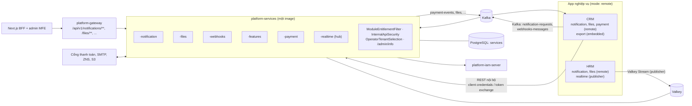
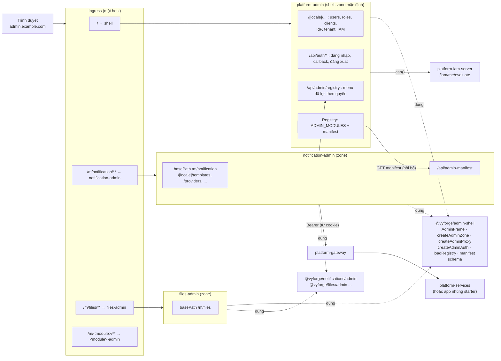
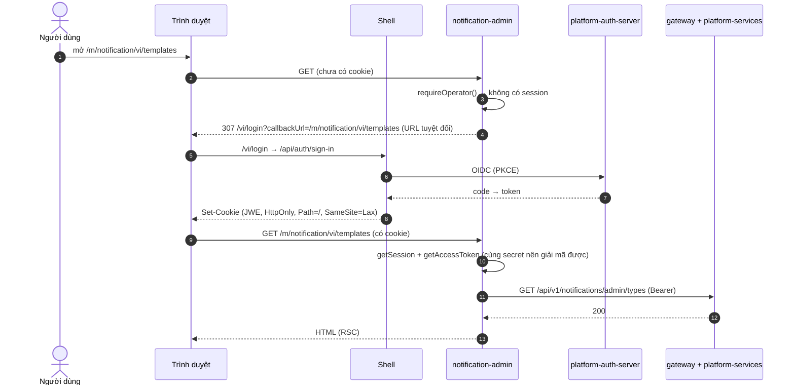

# Thiết kế `platform-services` và khu quản trị microfrontend cho các module dùng chung

> **Trạng thái:** **đã duyệt (27/10/2026)** toàn bộ D1–D10, L1–L5 và mục 10.2, phiên forge-37. Chấp nhận tải lại trang
> khi chuyển module. L2 duyệt kèm ba điều kiện bắt buộc (mục 10.4). Đang triển khai L1/L2 (`@vyforge/admin-shell`,
> workspace `platform-admin`, registry, e2e); P2 (backend) và P5 (gateway) chờ lệnh riêng khi 7 module merge.
>
> **Phạm vi:** cách đóng gói, triển khai và quản trị 7 module P1 (notification, files, export, webhooks, features,
> payment, realtime) và các module sau này:
> - backend: nhúng starter vào app, gộp trong server dùng chung `platform-services`, hoặc chạy thành server riêng;
> - khu quản trị: shell `platform-admin` cùng các **admin microfrontend** theo module, build và deploy riêng, gắn vào
>   shell lúc chạy;
> - vận hành: chart, observability, backup.
>
> **Nền:** module-conventions mục 2, 5 và 6; MODULE_PLAN (nguyên tắc 1–3, "Hai nhóm người quản trị"); ADR-0003 (modular
> monolith), ADR-0006 (BFF), ADR-0009/0010 (IAM, gateway, chế độ local/remote, token exchange), ADR-0011 (tenant),
> ADR-0015 (tenant ở tầng dữ liệu); bảy bản thiết kế module trong `docs/design/` của từng nhánh `docs/design-<module>`.
>
> **Yêu cầu của người dùng:**
> - "các service common cần triển khai hết, cả CMS quản trị và phần server phía sau";
> - "phần cms quản trị cần tách code từng module ra, để có thể triển khai độc lập cho khách hàng theo nhu cầu. có thể
>   triển khai microfrontend".
>
> **Thứ tự viết.** Mục 4 (microfrontend) được chốt trước, vì khoảng 18 module đang chờ quyết định này. Các module chỉ
> cần đọc mục 4 và mục 5.2 (manifest) để làm phần admin của mình.

## Mục lục

0. [Tóm tắt quyết định](#0-tóm-tắt-quyết-định)
1. [Bài toán và phạm vi](#1-bài-toán-và-phạm-vi)
2. [Nghiên cứu](#2-nghiên-cứu)
3. [Kiến trúc backend: `platform-services`](#3-kiến-trúc-backend-platform-services)
4. [Kiến trúc khu quản trị: microfrontend](#4-kiến-trúc-khu-quản-trị-microfrontend)
5. [Hợp đồng: API, manifest, registry, event](#5-hợp-đồng-api-manifest-registry-event)
6. [Khu quản trị của từng module](#6-khu-quản-trị-của-từng-module)
7. [Vận hành](#7-vận-hành)
8. [Bảo mật và tuân thủ](#8-bảo-mật-và-tuân-thủ)
9. [Kế hoạch triển khai và chia việc song song](#9-kế-hoạch-triển-khai-và-chia-việc-song-song)
10. [Lệch quy ước và quyết định cần người dùng chọn](#10-lệch-quy-ước-và-quyết-định-cần-người-dùng-chọn)

---

## 0. Tóm tắt quyết định

| # | Quyết định | Lý do ngắn |
|---|---|---|
| D1 | **Microfrontend bằng Next.js Multi-Zones.** Mỗi module có một app Next.js riêng (`<module>-admin`), `basePath` là `/m/<module>`, chạy cùng origin với shell `platform-admin`. Ingress chuyển `/m/<module>/**` tới đúng app | Giữ nguyên mô hình BFF (ADR-0006): Server Component, Server Action, token chỉ ở server. Là cách Next.js hỗ trợ chính thức. Module Federation cho App Router không được hỗ trợ; Web Components và import map bỏ mất phần server (mục 2.1) |
| D2 | **Gắn lúc chạy bằng registry.** Shell đọc danh sách MFE đã deploy từ cấu hình (`ADMIN_MODULES`), tải manifest của từng MFE qua mạng nội bộ, rồi dựng menu. Bật hay tắt một module không cần build lại shell | Đúng yêu cầu "khách mua module nào bật module đó" |
| D3 | **Phiên đăng nhập dùng chung qua cookie.** Mọi zone dùng `@vyforge/auth` với cùng secret, cùng OIDC client, cùng tên cookie. Đăng nhập, callback và đăng xuất chỉ có ở shell | Cùng origin nên cookie HttpOnly tự đi kèm request. Không thêm token phía trình duyệt, không thêm bước nhảy qua shell |
| D4 | **Khung giao diện dùng chung là package `@vyforge/admin-shell`** (thanh bên, thanh trên, menu người dùng, đổi ngôn ngữ, theme, CSP, cấu hình zone). Mỗi zone tự render khung này; dữ liệu menu lấy từ registry lúc chạy | Multi-zones không chia sẻ JS lúc chạy. Khung là thư viện, còn menu là dữ liệu, nên một module mới hiện trong menu của mọi zone mà không zone nào phải build lại |
| D5 | **Component quản trị nằm ở `@vyforge/<module>/admin`** (platform-web). App MFE `<module>-admin` chỉ là lớp mỏng: route, trang, Server Action ghép từ component đó | Một bộ component dùng cho ba nơi: MFE của người vận hành, MFE ở chế độ tenant admin, và trang `/admin` dựng sẵn trong app nghiệp vụ |
| D6 | **Một image MFE phục vụ hai nhóm người quản trị.** Chế độ lấy theo token: người vận hành (tenant vận hành, role `admin` + MFA) hoặc tenant admin (chỉ tenant của mình) | Không phải duy trì hai bản giao diện. Không màn hình nào giả định người xem có quyền xuyên tenant (MODULE_PLAN) |
| D7 | **Backend: một artifact cho mỗi module, ba cách chạy.** (a) nhúng starter vào app; (b) gộp trong `platform-services`, là một app Spring Boot modular monolith chứa mọi starter P1, bật từng module bằng cấu hình; (c) chạy riêng: vẫn image `platform-services`, chỉ bật một module | Một image thay cho bảy image. "Server riêng" chỉ khác cấu hình, nên không có thêm đơn vị phải release (nguyên tắc 3) |
| D8 | **App gọi module ở xa bằng chế độ `remote` của chính starter** (`vyforge.<module>.mode: embedded \| remote`), giống `vyforge.authz.mode`. Gọi thay người dùng thì đổi token (RFC 8693); việc của hệ thống thì dùng client credentials; việc gửi đi không cần chờ kết quả thì đi qua Kafka | Code nghiệp vụ dùng cùng interface Java ở cả hai chế độ, đổi chế độ không phải sửa code |
| D9 | `platform-services` đặt trong **monorepo `platform-java`** (module `platform-services`, như `platform-iam-server`). Các app MFE đặt trong **repo `platform-admin`**, chuyển repo này thành pnpm workspace (`apps/shell`, `apps/<module>-admin`) | Nguyên tắc 2–3: không thêm repo. Image riêng thì app riêng, nhưng vẫn chung một repo |
| D10 | `export` **luôn nhúng** vào app (nguồn dữ liệu là của app). Các module khác nhúng hoặc chạy ở server đều được. Khi có từ hai app trở lên thì khuyến nghị chạy ở server: realtime (hub), payment (IPN, merchant), webhooks (dispatcher), notification (provider, inbox) | Mục 3.4 |

---

## 1. Bài toán và phạm vi

### 1.1 Bài toán

Bảy module P1 đã thiết kế theo nguyên tắc "thư viện, không phải service": mỗi module là starter nhúng vào app. Cách này
đúng với dự án một backend. Nó chưa trả lời ba câu hỏi:

1. **Nhiều app dùng chung một module.** Khách hàng có CRM, HRM và kho, ba app cùng gửi thông báo, cùng lưu file, cùng
   nhận IPN. Nếu mỗi app nhúng một bản thì có ba bộ cấu hình provider, ba merchant VNPay, ba hub realtime, ba nơi xem
   nhật ký.
2. **Bán theo module.** Khách mua module nào thì cài đúng module đó, cả backend lẫn màn hình quản trị, không kéo theo
   code của module khác.
3. **Màn hình quản trị.** Người vận hành platform cần một console cho mọi module. Tenant admin của khách cần màn hình
   tương tự nhưng chỉ trong tenant của mình.

### 1.2 Phạm vi

| Trong phạm vi | Ngoài phạm vi |
|---|---|
| Server dùng chung `platform-services` và cách tách module ra chạy riêng | Viết lại logic của module (đã có trong thiết kế từng module) |
| Chế độ `embedded`/`remote` của starter, API nội bộ, xác thực service với service | Service mesh, mTLS giữa pod (để `platform-policies` và hạ tầng lo) |
| Kiến trúc microfrontend, `@vyforge/admin-shell`, manifest, registry | Chợ MFE của bên thứ ba |
| Danh sách màn hình quản trị, quyền, component cho từng module | Thiết kế giao diện chi tiết từng màn hình (việc của phiên module) |
| Route qua gateway, quyền, rate limit | Thay đổi kiến trúc gateway (chỉ thêm route và rule) |
| Chart, observability, SLO, backup | Hạ tầng của khách (object storage, Kafka) |

### 1.3 Kịch bản phải đáp ứng

| # | Kịch bản |
|---|---|
| K1 | Khách A chỉ mua notification và files. Bản triển khai có `platform-services` bật hai module, hai MFE, menu chỉ có hai mục. Không có bảng, image hay menu của payment |
| K2 | SaaS nhiều tenant: gói Basic không có payment, gói Pro có. Tenant Basic không thấy menu "Thanh toán", gọi API payment nhận `404 module.not_enabled`. Nâng gói thì có ngay, không deploy lại |
| K3 | Khách on-prem có ba app (CRM, HRM, kho) dùng chung notification, files, realtime trong một `platform-services`. Cả ba gọi cùng interface Java như khi nhúng, chỉ đổi `mode: remote` |
| K4 | Dự án nhỏ một app: nhúng starter, dùng trang `/admin` dựng sẵn trong app (component `@vyforge/<module>/admin`), không cài `platform-services` hay MFE nào |
| K5 | Người vận hành sửa template email mặc định và cấu hình SMTP cấp platform cho mọi tenant trong `platform-admin` |
| K6 | Tenant admin xem nhật ký gửi SMS brandname và Zalo ZNS của tenant mình, gửi lại tin lỗi, gỡ một số điện thoại khỏi danh sách chặn |
| K7 | Kế toán của tenant (quyền `payment:refund:Create`, không có quyền khác) chỉ thấy khu "Thanh toán", tạo hoàn tiền VNPay, xem kết quả đối soát với sao kê SePay |
| K8 | Đối tác của tenant cần webhook: tenant admin tự đăng ký endpoint, xem delivery lỗi, replay, xoay secret, không cần gọi đội vận hành |
| K9 | Realtime vượt 20.000 kết nối: tách module realtime ra deployment riêng (cùng image, chỉ bật `realtime`) mà không đổi code app hay frontend |
| K10 | Kiểm toán yêu cầu payment tách biệt: chạy riêng, database riêng giữ chứng từ 10 năm, NetworkPolicy chỉ cho ra cổng thanh toán |
| K11 | Nâng MFE files lên 0.14 trong khi backend vẫn 0.13: màn hình cần capability mới bị ẩn, phần còn lại chạy bình thường |
| K12 | Khách ngân hàng chạy on-prem không có Internet: không CDN, không dịch vụ Vercel, mọi tài nguyên phục vụ từ cùng origin |
| K13 | Tenant hết trial: features chuyển subscription sang `SUSPENDED`, gói tạm khoá không có `module.payment`. Menu ẩn, API chặn; dữ liệu giữ nguyên |
| K14 | Người vận hành hỗ trợ tenant X: chọn "tenant đang xem" là X để xem cấu hình notification của X. Mỗi request ghi audit với cả tenant của người vận hành lẫn tenant X |
| K15 | Cài thêm module "einvoice" (P2) sau một năm: deploy backend và MFE mới, thêm một dòng `ADMIN_MODULES`. Shell và các MFE khác không build lại |

---

## 2. Nghiên cứu

Nguồn kiểm ngày 26/10/2026.

### 2.1 Microfrontend cho Next.js 16 App Router

| Phương án | Mô hình | Điểm mạnh | Điểm yếu | Nguồn, version, license |
|---|---|---|---|---|
| **Next.js Multi-Zones** | Nhiều app Next.js chung một domain, mỗi app phục vụ một nhóm path. Định tuyến bằng proxy HTTP bất kỳ, `rewrites`, hoặc `proxy.ts` khi cần quyết định lúc chạy. Sang zone khác là hard navigation; link giữa zone phải dùng `<a>`. Server Action cần `serverActions.allowedOrigins` | Chính thức, giữ RSC, Server Action, BFF. Mỗi zone build và deploy riêng. Không chia sẻ runtime nên không có lỗi lệch version kiểu singleton | Chuyển zone tải lại trang. Code dùng chung phải qua package npm, không chia sẻ lúc chạy | [Next.js guide "Multi-zones"](https://nextjs.org/docs/app/guides/multi-zones) (cập nhật 01/06/2026), ví dụ [with-zones](https://github.com/vercel/next.js/tree/canary/examples/with-zones); Next.js MIT |
| `@vercel/microfrontends` | Lớp tiện ích trên multi-zones: file `microfrontends.json` khai báo app và path, `withMicrofrontends()` bọc `next.config`, `Link` prefetch giữa zone | Một file định tuyến; prefetch giữa zone | Định tuyến production dựa vào hạ tầng của Vercel | [Template microfrontends-multi-zones](https://vercel.com/templates/next.js/microfrontends-multi-zones) |
| Module Federation (`@module-federation/nextjs-mf`) | Host nạp "remote entry" của app khác lúc chạy, chia sẻ dependency dạng singleton | Soft navigation, chia sẻ React | Bảo trì từ 11/2024; "App router is entirely unsupported"; Next 16 làm hỏng plugin webpack (18/03/2026); issue đóng "not planned" 26/05/2026; remote phải cùng version dependency với host | [module-federation/core#3153](https://github.com/module-federation/core/issues/3153); MIT |
| single-spa + import map | Root config nạp MFE là ES module trong trình duyệt, chia sẻ thư viện qua import map | Độc lập framework, soft navigation | Chỉ chạy phía client: không có RSC, Server Action; phải đưa API (và token hoặc proxy) về trình duyệt; CSP phải cho import map | [single-spa recommended setup](https://single-spa.js.org/docs/recommended-setup); MIT |
| Web Components (custom element) | Mỗi MFE là một phần tử HTML tự đăng ký | Chuẩn web, độc lập framework | Như single-spa về phía server; Tailwind trong Shadow DOM phải nạp CSS cho từng phần tử | Chuẩn HTML (WHATWG) |

Rút ra: học multi-zones (cách chia path, `assetPrefix`/`basePath`, `allowedOrigins`) và ý tưởng một file khai báo cùng
prefetch giữa zone của `@vercel/microfrontends`. Không dùng phương án nào cần runtime chung trong trình duyệt.

### 2.2 Đóng gói service dùng chung

| Hệ thống | Mô hình | Học theo | Không làm | Nguồn |
|---|---|---|---|---|
| ABP Framework | Module có database, entity, service, API và trang UI riêng. Có template modular monolith và template microservice; khuyên bắt đầu bằng monolith có module rồi tách dần | Module mang cả backend lẫn UI; chọn module theo khách hàng | Bộ khung nặng, sinh nhiều project cho mỗi module | [ABP Microservice Architecture](https://abp.io/docs/4.4/Microservice-Architecture), [ABP Community Talks 2024.6](https://abp.io/blog/Building-Modular-Monolith-Applications) |
| Supabase (self-host) | Nhiều service không trạng thái (Auth, Storage, Realtime, REST, Studio) quanh một PostgreSQL, sau một gateway định tuyến theo path (`/storage/v1/*`, `/realtime/v1/*`) | Một database cho cả cụm service; gateway định tuyến theo tiền tố path; một console (Studio) cho mọi service | Mỗi service một image và một ngôn ngữ (Elixir, Go, TypeScript): quá nhiều đơn vị phải release cho đội nhỏ | [Railway: Self-host Supabase](https://docs.railway.com/guides/supabase), [Pigsty: Supabase trên PostgreSQL](https://pigsty.io/blog/db/supabase/index.md) |
| Spring Modulith | Module trong một app Spring Boot, event giữa module qua bảng `event_publication`, đẩy event ra broker bằng `@Externalized` | Đã là nền của platform (ADR-0003); `platform-services` là một app Modulith ghép nhiều starter | — | [Spring Modulith reference](https://docs.spring.io/spring-modulith/reference/), 2.1.1; Apache-2.0 |
| `platform-iam-server` (của Vyforge) | Một app chỉ gồm starter `-authz` ở chế độ `local` + API nội bộ; app khác dùng chế độ `remote`, cache cục bộ, xoá cache qua Valkey | Mẫu chính cho `platform-services`: server mỏng, logic nằm ở starter, cùng artifact có hai chế độ | — | ADR-0010, `platform-java/platform-iam-server` |

---

## 3. Kiến trúc backend: `platform-services`

### 3.1 Ba cách chạy một module

| Cách | Mô tả | Khi nào |
|---|---|---|
| **Nhúng** (`embedded`, mặc định) | App thêm `platform-starter-<module>`. Bảng nằm trong database của app, API nằm dưới prefix của app | Một app dùng module, hoặc module cần chung transaction với dữ liệu của app (export luôn ở đây) |
| **Gộp trong `platform-services`** | Một app Spring Boot chứa mọi starter P1, bật module bằng cấu hình. App nghiệp vụ đặt starter ở `mode: remote` | Từ hai app trở lên dùng chung module; khách mua bộ service dùng chung |
| **Chạy riêng** | Cùng image `platform-services`, một deployment chỉ bật một module (hoặc một nhóm), database riêng nếu cần | Module cần scale, cách ly mạng hay lưu trữ khác phần còn lại (K9, K10) |

### 3.2 Một server hay nhiều server

| Phương án | Ưu | Nhược |
|---|---|---|
| A. Một server modular monolith, một image, một deployment | Ít đơn vị vận hành nhất; event giữa module trong cùng tiến trình | Module nặng (realtime giữ kết nối, export) ảnh hưởng module khác; không cách ly được payment |
| B. Nhiều server theo nhóm, mỗi nhóm một image (vd. `messaging`: notification + webhooks; `content`: files; `commerce`: payment + features; `realtime`) | Cách ly theo nhóm | 4 image, 4 nhịp release; ranh giới nhóm cố định trong code, khách khác muốn nhóm khác thì phải build lại |
| C. Mỗi module một image | Cách ly tối đa | 7 image và tăng theo số module; trái nguyên tắc 3 |
| **D (chọn).** Một image, nhiều deployment tuỳ cấu hình | Một đơn vị release như A; khi cần thì tách deployment như B/C bằng cấu hình | Image chứa code của mọi module (khoảng thêm 60–90 MB dependency). Chấp nhận: code module không bật thì không khởi tạo bean, không chạy migration |

Mặc định cho khách mới: **một deployment** `platform-services` bật đúng các module khách mua. Gợi ý tách khi vận hành:

| Deployment | Module | Lý do tách |
|---|---|---|
| `platform-services` | notification, files, webhooks, features | Tải vừa, cùng kiểu (API + việc nền) |
| `platform-services-realtime` | realtime (`mode: hub`) | Giữ kết nối lâu, scale theo số kết nối, cần timeout ingress riêng |
| `platform-services-payment` | payment | Cách ly mạng (chỉ ra cổng thanh toán), secret riêng, database riêng giữ chứng từ 10 năm |

Các deployment khác nhau giao tiếp bằng event (Kafka) hoặc API nội bộ, như hai service bất kỳ. Event in-process giữa
module (vd. `PaymentSucceeded` → notification) chỉ có khi hai module chạy cùng deployment; khi tách thì bật
`events.externalize` của module phát và consumer Kafka ở module nhận. Mọi điểm nối giữa module đã được thiết kế qua
event công khai có `TenantAwareEvent` và `schemaVersion`, nên đổi từ in-process sang Kafka không đổi code nghiệp vụ.

### 3.3 Vị trí, cổng, dữ liệu

| Mục | Quyết định |
|---|---|
| Code | Module `platform-services` trong `platform-java` (cùng chỗ với `platform-iam-server`): app Spring Boot, không vào `platform-bom`, `maven.deploy.skip=true`, phát hành dạng image `platform-services` cùng version với `platform-java` |
| Package | `com.vyforge.services`: `ServicesApplication`, `ModuleToggles`, `ModuleEntitlementFilter`, `ServicesFeatureCatalog`, `InternalApiSecurity`, `OperatorTenantSelection`, `AdminInfoController`, cấu hình `@Modulithic` |
| Bật module | `vyforge.services.modules` = danh sách (`SERVICES_MODULES=notification,files,payment`). Module không có trong danh sách: `EnvironmentPostProcessor` đặt `vyforge.<module>.enabled=false`, auto-config của starter không chạy (không bean, không migration, không job) |
| Cổng local | `8087` (management `8088`). Không trùng gateway 8000, auth 9000, iam 8085, app 8080 |
| Database | PostgreSQL, database `services` (một cluster CloudNativePG với các service nền). Một database cho mọi module trong cùng deployment. Deployment tách riêng có database riêng (`services_payment`, …) |
| Schema PostgreSQL | **Không** tách schema theo module (lệch brief, xem mục 10). Bảng của mỗi module đã có tiền tố riêng (`notification_*`, `file_*`, `data_job*`, `webhook_*`, `ff_*`/`ent_*`, `payment_*`/`ledger_*`, `realtime_*`), migration của mỗi module có bảng lịch sử riêng `flyway_schema_history_<module>` (quy ước 5.3). Bảng hạ tầng dùng chung: `vyforge_task`, `event_publication`, `processed_messages`, `audit_log`, `shedlock` |
| Valkey | Một instance chung với các service nền. Key đã có tiền tố theo module và tenant (`vyforge:features:changed`, `t:<tenant>:rt:*`, rate limit). Kênh `vyforge:iam:changed` dùng chung để xoá cache IAM |
| Kafka | Tuỳ chọn. Bắt buộc khi: app dùng payment ở chế độ `remote` (nhận `payment-events`), hoặc các module chạy ở deployment khác nhau cần event của nhau. Topic ở mục 5.5 |
| Authz | `vyforge.authz.mode: remote` (policy ở `platform-iam-server`), mỗi starter đăng ký catalog action của mình qua `PUT /api/v1/iam/internal/catalogs/{service}`. Bản triển khai không có iam-server thì `local` |
| Modulith | `@Modulithic(additionalPackages = "com.vyforge.platform")` để mỗi starter là một application module, `ApplicationModules.verify()` trong test (cú pháp `additionalPackages` kiểm lại lúc code) |



### 3.4 Module nào chạy ở đâu

| Module | Nhúng | Ở server | Gợi ý | Lý do |
|---|---|---|---|---|
| notification | Có | Có | Server khi ≥ 2 app | Một bộ provider, template, inbox, suppression cho cả hệ thống. App gửi qua Kafka `notification-requests` (thiết kế đã có) |
| files | Có | Có | Server khi ≥ 2 app | Một kho file, quota, quét virus. Byte đi thẳng trình duyệt ↔ storage, server chỉ ký. Hạn chế ở chế độ remote: `AttachmentAccessPolicy` theo bản ghi cha của app chưa gọi ngược được; bản đầu chỉ dùng điều kiện IAM (`resource.entityType`, `resource.ownerSub`) |
| export | **Chỉ nhúng** | Không | — | Nguồn xuất và đích nhập là repository của app, cần chung transaction và quyền (thiết kế export §3.1). Kho file kết quả dùng files (nhúng hoặc remote) |
| webhooks (gửi ra) | Có | Có | Server khi ≥ 2 app hoặc cần cách ly egress | Dispatcher, lease theo endpoint, egress policy ở một chỗ. App publish qua outbox của mình ra Kafka `webhooks-messages`, giữ được tính nguyên tử với transaction nghiệp vụ |
| webhooks-inbound | **Chỉ nhúng** | — | — | Thư viện kiểm chữ ký, không có trạng thái |
| features | Có | Có | Server khi ≥ 2 app | Một danh mục gói và subscription cho cả hệ thống. Flag ở app: provider `remote` (snapshot `flagd/flags.json`). Entitlement ở app: `RemoteEntitlements` (mục 3.5) |
| payment | Có | Có | Server (deployment riêng) khi ≥ 2 app hoặc khi kiểm toán yêu cầu | Một bộ merchant, một endpoint IPN, một sổ cái. App tạo intent qua API, nhận kết quả qua Kafka `payment-events` |
| realtime | Có (`hub`) | Có (`hub`) | Server (deployment riêng) khi ≥ 2 app | App khác chạy `mode: publisher`, ghi thẳng vào Valkey Stream chung (thiết kế đã có). Trình duyệt chỉ cần một kết nối cho mọi app |

Không module nào **bắt buộc** chạy ở server: dự án một app nhúng hết vẫn đủ tính năng (K4).

### 3.5 Chế độ `remote` của starter

Cùng artifact, thêm `vyforge.<module>.mode: embedded | remote` (giống `vyforge.authz.mode`). Ở `remote`, auto-config
của starter:

- không chạy migration, không tạo entity, repository, controller, `TaskHandler`, job;
- đăng ký bean cài **cùng interface Java công khai** bằng client HTTP (`@HttpExchange` của `-web`, có timeout, retry cho
  lệnh đọc, circuit breaker) tới `vyforge.<module>.remote.url` (thường là `http://platform-services`);
- đăng ký catalog của app với server khi module có catalog do app khai báo (event type của webhooks, notification type
  của app).

| Module | Interface ở app | Đường gọi ở `remote` | Token |
|---|---|---|---|
| notification | `Notifications.send/sendAll/cancel/cancelByCorrelation/acknowledge/find` | `send*`: mặc định Kafka `notification-requests` qua outbox Modulith của app (`transport: kafka`), hoặc REST sau commit với `idempotencyKey` bắt buộc (`transport: http`). Còn lại: REST nội bộ | Client credentials + `X-Tenant-Id` |
| notification | Khai báo type trong `META-INF/vyforge/notification/types/*.yml` của app | `PUT /api/v1/notifications/internal/catalogs/{service}` lúc khởi động | Client credentials |
| files | `FileService`, `Attachments`, `ShareLinks`, `FileContentReader`, `FileRetention`, `FileErasure` | REST nội bộ; `store`/`open` stream (chunked, không giữ cả file trong RAM) | Thao tác thay người dùng: **token exchange** (`aud: platform-services`), để server kiểm quyền của chính người dùng. Thao tác hệ thống (`store` của job): client credentials |
| webhooks | `WebhookPublisher.publish` | Kafka `webhooks-messages` qua outbox của app (mặc định) hoặc REST `POST /api/v1/webhooks/internal/messages` | Client credentials |
| webhooks | `WebhookEventCatalog` của app | `PUT /api/v1/webhooks/internal/catalogs/{service}` | Client credentials |
| features | `FeatureFlags` | Provider `remote` (đã thiết kế): tải snapshot, làm mới khi nhận `vyforge:features:changed` qua Valkey chung, poll dự phòng | Client credentials, scope `features.sync` |
| features | `Entitlements.hasAccess/get/all/config/require/checkLimit` | Snapshot entitlement theo tenant, cache cục bộ, làm mới cùng kênh trên | Client credentials |
| features | `Entitlements.consume/release/record/setGauge` | REST nội bộ đồng bộ (cần kết quả), `idempotencyKey` bắt buộc | Client credentials + `X-Tenant-Id` |
| payment | `PaymentService`, `RefundService`, `MandateService`, `PaymentScheduleService` | REST nội bộ. Kết quả thanh toán về app qua Kafka `payment-events` (`@Externalized`, đã thiết kế) | Thao tác thay người dùng: token exchange; job của app: client credentials |
| realtime | `RealtimePublisher` | `mode: publisher` (đã thiết kế): ghi Valkey Stream chung, không gọi HTTP | Không cần token; cùng `vyforge.realtime.cluster` |

Đây là việc thêm cho các phiên module (mục 9): mỗi starter có lớp `remote` và bộ test hợp đồng chạy cùng một kịch bản
trên cả hai chế độ (`<Module>ContractTests` với `embedded` và với `remote` trỏ tới `platform-services` chạy bằng
Testcontainers).

### 3.6 Xác thực và tenant giữa app và server

| Đường | Xác thực | Tenant |
|---|---|---|
| Trình duyệt → BFF → gateway → `platform-services` (API công khai `/api/v1/<route>/**`) | JWT của người dùng, `aud` gồm `platform-gateway` và `platform-services` | Claim `tenant_id` (ADR-0015) |
| App → `platform-services`, thay mặt người dùng | Token exchange RFC 8693 bằng `TokenExchangeClient` của `-security`, `audience=platform-services`. Token giữ `sub`, `roles`, `tenant_id`, thêm `act` | Claim `tenant_id` |
| App → `platform-services`, việc của hệ thống (`/api/v1/<route>/internal/**`) | Client credentials, scope `services.internal`, `aud: platform-services` | Header `X-Tenant-Id`. Chỉ nhận ở đường `/internal/**`, chỉ khi token có scope trên, và tenant phải nằm trong `vyforge.services.internal-api.clients.<client_id>.tenants` (không khai báo = mọi tenant), giống API nội bộ của iam-server |
| App → Kafka → `platform-services` | ACL của Kafka: chỉ principal của service nội bộ được ghi topic `*-requests`, `*-messages` | Header `tenant_id` (quy ước), consumer `@RequiresTenant` |
| Cổng thanh toán, provider → `platform-services` (IPN, callback) | Chữ ký của từng cổng/provider (thiết kế payment, notification) | Lấy từ `notify_key`/`providerId` sau khi kiểm chữ ký (đã duyệt trong ADR-0020) |

Gateway chặn `/api/v*/*/internal/**` từ bên ngoài (rule mới, trả 404). Đường nội bộ đi thẳng trong cluster
(`http://platform-services`), không qua gateway. NetworkPolicy chỉ cho namespace của app gọi cổng của `platform-services`.

---

## 4. Kiến trúc khu quản trị: microfrontend

> Mục này được viết và chốt trước các mục khác (yêu cầu của phiên điều phối). Module P1 và các module sau đều làm phần
> admin theo đúng mục này. Không module nào tự chọn kỹ thuật microfrontend riêng (module-conventions mục 6).

### 4.1 Yêu cầu

| # | Yêu cầu | Nguồn |
|---|---|---|
| Y1 | Mỗi module có khu quản trị riêng, **build và deploy độc lập**. Khách hàng không mua module thì không có code, image hay menu của module đó | Người dùng |
| Y2 | Gắn vào shell **lúc chạy**. Thêm hoặc bỏ module không build lại shell hay module khác | module-conventions mục 6 |
| Y3 | Giữ mô hình BFF: token chỉ ở server Next.js, trình duyệt chỉ có cookie HttpOnly. Server Action kiểm quyền ở đầu (B13) | ADR-0006, ADR-0008 |
| Y4 | Hai nhóm người quản trị: người vận hành (xuyên tenant, bắt buộc MFA) và tenant admin (chỉ tenant của mình) | MODULE_PLAN |
| Y5 | Một giao diện thống nhất: `@vyforge/ui`, theme sáng/tối, i18n vi/en, cùng khung điều hướng | Quy ước frontend |
| Y6 | CSP chặt như shell hiện có: nonce cho từng request, `strict-dynamic`, chỉ tải tài nguyên cùng origin, `frame-ancestors 'none'` | `platform-admin/src/proxy.ts` |
| Y7 | Chịu được lệch version: shell và các MFE được deploy vào những thời điểm khác nhau | Hệ quả của Y1 |
| Y8 | Chạy on-prem, không phụ thuộc dịch vụ của Vercel hay CDN bên ngoài | MODULE_PLAN nguyên tắc 6 |

### 4.2 So sánh phương án

Nguồn kiểm ngày 26/10/2026. Chi tiết ở mục 2.1.

| Tiêu chí | **Next.js Multi-Zones** | Module Federation (Next 16) | Web Components / custom element | Import map (single-spa) | iframe |
|---|---|---|---|---|---|
| Hỗ trợ Next 16 App Router | Có, chính thức ([guide multi-zones](https://nextjs.org/docs/app/guides/multi-zones), cập nhật 01/06/2026) | **Không.** `nextjs-mf` vào chế độ bảo trì từ 11/2024; maintainer nói "App router is entirely unsupported"; Next 16 làm hỏng plugin webpack (03/2026); issue đóng "not planned" 26/05/2026 ([module-federation/core#3153](https://github.com/module-federation/core/issues/3153)) | MFE phải render phía client; không dùng được Server Component, Server Action trong phần tử | single-spa nạp ES module trong trình duyệt ([recommended setup](https://single-spa.js.org/docs/recommended-setup)); MFE là SPA phía client, không có RSC | Có (mỗi khung là một app riêng) |
| BFF, token chỉ ở server | Giữ nguyên: mỗi zone là BFF, đọc cùng cookie | Giữ được nếu host làm hết phần server, nhưng remote không có server riêng | Phải đưa token xuống trình duyệt, hoặc mọi gọi API đi qua một proxy của shell | Như Web Components | Giữ được, nhưng cookie trong iframe phức tạp (SameSite, phân vùng cookie bên thứ ba) |
| Deploy độc lập | Có: mỗi zone là một image | Có (remote entry), nhưng remote phải dùng cùng version dependency với host | Có (file JS tĩnh) | Có (file JS tĩnh + import map) | Có |
| Điều hướng | Trong zone là soft navigation; sang zone khác là hard navigation (tải lại trang) | Soft | Soft | Soft | Soft trong khung, nhưng URL, nút back và deep link rất khó làm đúng |
| `@vyforge/ui`, React dùng chung | Mỗi zone có bản riêng, không xung đột lúc chạy | Chia sẻ singleton; lệch version gây lỗi lúc chạy | Phải chia sẻ React qua global hoặc nhúng nhiều bản; Tailwind trong Shadow DOM phải nạp CSS cho từng phần tử | Chia sẻ qua import map; phải giữ đúng một version React cho toàn trang | Mỗi khung một bản |
| CSP nonce + `strict-dynamic` | Giữ nguyên, mỗi zone tự phát nonce | Phải cho phép nạp script của remote | Phải cho phép script của từng MFE | Cần `script-src` cho import map, thường phải nới CSP hoặc dùng hash | Phải mở `frame-src`, bỏ `frame-ancestors 'none'` |
| Lệch version | Nhỏ: hai zone không chạy chung JS. Trong một zone, Next xử lý bằng `deploymentId` | Lớn: host và remote chạy chung runtime | Vừa: hợp đồng là thuộc tính và sự kiện của phần tử | Vừa: phải giữ import map khớp | Nhỏ |
| Công sức cho repo hiện có | Thấp: `platform-admin` đã là Next 16 App Router; tách thư mục `features/*` thành zone | Cao, và không có đường nâng cấp | Cao: viết lại phần server thành API + client | Cao: viết lại thành SPA | Vừa, nhưng trải nghiệm kém |
| On-prem | Ingress bất kỳ, hoặc chính shell làm proxy | Được | Được | Được | Được |

### 4.3 Quyết định: Next.js Multi-Zones

Chọn **Multi-Zones** vì đây là phương án duy nhất giữ nguyên ba thứ đang có: Server Component, Server Action và BFF giữ
token ở server. Đổi lại, sang module khác thì trình duyệt tải lại trang (hard navigation). Với khu quản trị, người dùng
thường làm lâu trong một module rồi mới chuyển, nên cái giá này chấp nhận được. Next.js khuyên đặt các trang hay đi cùng
nhau vào cùng một zone, và cách chia theo module thoả điều này.

Không làm:
- **Module Federation:** không có bản hỗ trợ App Router. Vercel mới thử nghiệm "Federation v2", chưa dùng được.
- **Web Components, import map:** phải viết lại phần server thành SPA, và token hoặc proxy phải đi qua trình duyệt.
- **iframe:** CSP phải nới, deep link và back khó, cookie trong iframe bất ổn.
- **`@vercel/microfrontends`:** gói tiện ích của Vercel cho multi-zones, có file `microfrontends.json` và `Link`
  prefetch giữa các zone. Không dùng vì gắn với hạ tầng định tuyến của Vercel (Y8). Phần đáng học (một file khai báo
  định tuyến, prefetch giữa zone) được làm lại trong registry ở mục 4.6.

Xem lại quyết định khi một trong hai điều sau xảy ra: Next.js có cách chia sẻ layout giữa các zone mà không tải lại
trang, hoặc Module Federation có bản ổn định cho App Router. Hợp đồng (manifest, registry, cookie) ở mục 5 không phụ
thuộc kỹ thuật, nên khi đổi chỉ phải bọc lại các zone.

### 4.4 Sơ đồ thành phần



| Thành phần | Ở đâu | Việc |
|---|---|---|
| Shell `platform-admin` | `platform-admin/apps/shell` (đổi từ gốc repo), image `platform-admin` giữ tên | Zone mặc định: trang chủ, các khu có sẵn (tài khoản, tenant, IdP, IAM), đăng nhập, registry, trang "Module" (tình trạng các MFE) |
| Admin MFE `<module>-admin` | `platform-admin/apps/<module>-admin`, package `@vyforge/<module>-admin` (private), image `platform-admin-<module>` | Một zone: trang và Server Action của module, manifest |
| `@vyforge/admin-shell` | `platform-web/packages/admin-shell` (mới) | Khung giao diện và mọi thứ một zone cần để thành "zone quản trị Vyforge" |
| `@vyforge/<module>/admin` | Subpath trong package của module (platform-web) | Component quản trị, client API quản trị, Server Action dựng sẵn, message vi/en |
| Ingress | Chart `app` của mỗi zone khai báo path của mình trên cùng host | Chuyển request tới đúng zone |

**Khi chạy trong app nghiệp vụ (tenant admin).** App Next.js của dự án (template-nextjs) cũng dùng `@vyforge/admin-shell`
để làm shell cho trang `/admin`. Có hai cách gắn module, cùng dùng một bộ component:

1. **Trang nhúng (mặc định):** app tự có route `/[locale]/admin/<module>/...`, ghép từ `@vyforge/<module>/admin`. Không
   thêm image. Hợp với app tự nhúng starter của module.
2. **Zone:** app thêm path `/m/<module>` vào ingress của mình, trỏ tới image `platform-admin-<module>`. MFE tự chuyển sang
   chế độ tenant admin theo token (mục 4.8). Hợp với khách hàng có nhiều app dùng chung `platform-services`.

### 4.5 Định tuyến

| Việc | Cách làm |
|---|---|
| Path của zone | `basePath: '/m/<module>'`. Sau basePath là tiền tố ngôn ngữ như shell (`localePrefix: 'always'`): `/m/notification/vi/templates`. Tài nguyên của zone tự nằm dưới `/m/<module>/_next/...` nên không trùng với shell |
| Tên module | `[a-z][a-z0-9-]{1,30}`, là tên module như trong thiết kế (`notification`, `files`, `export`, `webhooks`, `features`, `payment`, `realtime`). Không phụ thuộc tên route API (`/api/v1/notifications`): manifest khai báo riêng `api.base` |
| Production | Ingress theo path, cùng một host. Mỗi release của chart `app` cho zone khai báo `ingress.hosts[0].paths: ["/m/<module>"]` trên host của shell. ingress-nginx và Traefik gộp nhiều Ingress cùng host. Không có bước nhảy qua shell |
| Dev và môi trường không có ingress | `proxy.ts` của shell (`createAdminProxy`) có fallback: request `/m/<module>/**` tới shell thì shell rewrite sang `url` của module trong registry (`NextResponse.rewrite`, cách Next.js ghi cho định tuyến động). Production có ingress thì đường này không dùng tới; khi có request đi vào đường này thì ghi log cảnh báo kèm metric |
| Link giữa các zone | Dùng thẻ `<a>`, không dùng `<Link>` của Next (Next sẽ prefetch và soft navigate sai zone). `@vyforge/admin-shell` có `ZoneLink`: cùng zone thì dùng `Link`, khác zone thì dùng `<a>`; zone được xác định theo registry |
| Prefetch giữa zone | `ZoneLink` khác zone thêm `<link rel="prefetch">` tới trang đích khi người dùng hover, để giảm thời gian tải lại |
| Path trùng | Registry từ chối manifest có `name` trùng hoặc `basePath` khác `/m/<name>`; trang "Module" của shell báo lỗi |
| Path không có zone | `/m/<x>` không có trong registry thì shell trả trang 404 của shell |

### 4.6 Đăng nhập và phiên dùng chung



Quy tắc:

- Mọi zone tạo Better Auth bằng `createAdminAuth()` của `@vyforge/admin-shell`. Hàm này chỉ là `createAuth` của
  `@vyforge/auth` với cấu hình chung: `baseURL` là URL công khai của **shell**, `secret` (`BETTER_AUTH_SECRET`),
  `OIDC_CLIENT_ID`/`SECRET` của client `platform-auth-admin`, tên cookie mặc định, `Path=/`. Ba giá trị này đến từ cùng
  một secret trong secret store (`vyforge/<env>/platform-admin`), mọi zone nạp bằng `externalSecret`.
- Chỉ shell mount handler `/api/auth/*`. Zone không có route auth: nó chỉ gọi `auth().api.getSession` và
  `auth().api.getAccessToken` ở server. Callback đăng ký ở auth-server vẫn chỉ có một (`<shell>/api/auth/callback/vyforge`).
- Chuyển hướng đăng nhập từ zone dùng **URL tuyệt đối** tới shell (`PUBLIC_ADMIN_URL + /<locale>/login`), vì `redirect()`
  của Next tự thêm `basePath` cho path tương đối.
- Làm mới token: `getAccessToken` của Better Auth tự refresh và ghi lại cookie `Path=/`, nên zone nào refresh thì mọi
  zone đều thấy token mới. Hai request song song cùng refresh là chuyện đã có trong một app; giảm rủi ro bằng access
  token đủ dài (5–15 phút) và để auth-server chấp nhận refresh token cũ trong một khoảng ngắn sau khi xoay (cần kiểm
  lại trong auth-server, ghi ở mục 10).
- Đăng xuất ở shell xoá cookie `Path=/`, nên mọi zone mất phiên cùng lúc.
- Kiểm quyền vẫn theo B13: đầu mỗi trang và mỗi Server Action gọi `requireOperator()` hoặc `requireModuleAccess()` của
  `@vyforge/admin-shell` (mục 4.8). Backend luôn kiểm lại bằng `Authz`.

### 4.7 Khung giao diện, `@vyforge/ui`, i18n, theme

| Việc | Cách làm |
|---|---|
| Khung | `AdminFrame` (Server Component) trong `@vyforge/admin-shell`: `Sidebar` của `@vyforge/ui`, thanh trên (tenant đang xem, đổi ngôn ngữ, theme, menu người dùng). Nhận `registry` (menu đã lọc quyền) và `current` (zone hiện tại). Shell và mọi zone dùng cùng component, nên chuyển zone không thấy khác biệt ngoài lần tải lại |
| Menu | Không biên dịch vào zone. Zone lấy menu bằng `loadRegistry()`: gọi `GET <SHELL_INTERNAL_URL>/api/admin/registry` kèm cookie của request, cache theo người dùng 60 giây (`unstable_cache` key theo `sub`). Shell không trả lời thì zone vẫn hiện khu của chính nó và một liên kết về trang chủ |
| `@vyforge/ui` | Mỗi zone tự bundle bản của mình. Version giữ đồng bộ bằng nhóm Renovate `vyforge-admin` (mọi app trong repo `platform-admin` nâng cùng lúc) và lockstep version của platform-web từ 1.0.0. Design token nằm trong `@vyforge/ui/theme.css`, mọi zone import cùng file |
| Theme | Cookie `theme` (đã có ở shell) có `Path=/`, nên mọi zone đọc chung và render ở server không nháy |
| i18n | `next-intl`, `locales: ['vi','en']`, `localePrefix: 'always'` như shell. Zone đọc locale từ URL; đổi ngôn ngữ trong `AdminFrame` giữ nguyên path trong zone. Message của zone gộp từ `@vyforge/admin-shell/messages` (khung), `@vyforge/<module>/admin/messages` (component) và message riêng của app. Lỗi backend dịch theo `code` bằng `errorTranslator` của `@vyforge/i18n` |
| Trang lỗi, 404, 403, cần MFA | `@vyforge/admin-shell` có sẵn; trang "cần MFA" và "đăng nhập" luôn chuyển về shell |

### 4.8 Hai nhóm người quản trị trong cùng một MFE

| | Chế độ người vận hành (`operator`) | Chế độ tenant admin (`tenant`) |
|---|---|---|
| Khi nào | Token có `tenant_id` là tenant vận hành (`ADMIN_OPERATOR_TENANT`, mặc định `default`), role `admin`, `amr` có `mfa` | Mọi trường hợp còn lại |
| Phạm vi dữ liệu | Tenant hiện tại của token, cộng các màn hình xuyên tenant mà manifest đánh dấu `audience: operator` (vd. danh sách subscription của mọi tenant). Thao tác lên tenant khác dùng **tenant đang xem** (mục 5.6) | Chỉ tenant của token. Màn hình `operator` không hiện, route trả 404 |
| Hàm kiểm | `requireOperator()` | `requireModuleAccess(module)` |
| Quyền tối thiểu | `minPermission` của manifest, kiểm bằng `can()` (gọi `/api/v1/iam/me/evaluate` qua gateway) | Như bên trái |
| Backend | Vẫn kiểm `Authz` từng thao tác. API xuyên tenant chỉ nhận token của tenant vận hành (cách features đã làm) | |

Bảng màn hình của từng module (mục 6) ghi rõ màn hình nào thuộc nhóm nào.

### 4.9 CSP, header bảo mật, Server Action

- `createAdminProxy()` của `@vyforge/admin-shell` tạo CSP giống `platform-admin/src/proxy.ts` hiện tại: nonce mới cho
  từng request, `script-src 'self' 'nonce-…' 'strict-dynamic'`, `connect-src 'self'`, `frame-ancestors 'none'`,
  `form-action 'self'`. Tài nguyên của zone nằm dưới `/m/<module>/_next/` cùng origin nên `'self'` đã đủ. Không zone nào
  được nới CSP; cần nguồn ngoài thì thêm vào cấu hình chung và qua review.
- `createAdminZone()` (bọc `next.config`) đặt: `basePath`, `output: 'standalone'`, header bảo mật như shell,
  `experimental.serverActions.allowedOrigins: [<host công khai của admin>]` (Next yêu cầu với multi-zones),
  `deploymentId: process.env.DEPLOYMENT_ID` (CI đặt bằng digest của image).
- Cookie phiên dùng chung nên **mọi zone là code tin cậy ngang shell**. Chỉ image do Vyforge build và ký (cosign,
  chart `platform-policies` kiểm chữ ký) mới được gắn vào `/m/*`. Không gắn MFE của bên thứ ba vào cùng origin; nếu
  sau này cần thì dùng origin riêng và đăng nhập riêng.

### 4.10 Lệch version

| Lệch giữa | Cách xử lý |
|---|---|
| Hai lần deploy của cùng zone | `deploymentId`: Next phát hiện client cũ gọi server mới và tải lại trang thay vì lỗi |
| Shell và MFE (hợp đồng) | Manifest có `contract` (số nguyên, bắt đầu `1`). Shell chỉ nhận MFE có `contract` trong tập nó hỗ trợ; MFE khác thì bị ẩn khỏi menu, trang "Module" của shell ghi lý do. Đổi hợp đồng không tương thích thì tăng `contract`, shell hỗ trợ cả bản cũ và bản mới trong ít nhất một minor |
| Khung giao diện giữa các zone | Mỗi zone render `AdminFrame` theo version `@vyforge/admin-shell` của mình. Khác minor chỉ lệch nhỏ về giao diện, chấp nhận được. Trang "Module" hiện version `admin-shell` của từng zone để vận hành thấy lệch |
| MFE và backend của module | MFE gọi `GET /api/v1/<module>/admin/info` → `{ version, apiVersion, capabilities[] }` (cache 5 phút). Manifest khai báo `api.requires` (khoảng semver). Backend cũ hơn yêu cầu: zone hiện banner và chuyển sang chỉ đọc. Màn hình phụ thuộc capability chưa có thì ẩn |
| Registry giữa các replica của shell | Mỗi replica tự tải manifest mỗi 60 giây; lệch tối đa 60 giây |

### 4.11 Cấu trúc một admin MFE

```
platform-admin/
├── apps/
│   ├── shell/                         # platform-admin hiện tại (đổi chỗ, không đổi hành vi)
│   └── notification-admin/
│       ├── admin.manifest.ts          # defineAdminManifest({...}) — mục 5.2
│       ├── next.config.ts             # export default createAdminZone({ module: 'notification' })
│       ├── src/proxy.ts               # export default createAdminProxy()
│       ├── src/app/[locale]/layout.tsx          # <AdminFrame current="notification" …>
│       ├── src/app/[locale]/templates/page.tsx  # ghép <TemplateMatrix/> từ @vyforge/notifications/admin
│       ├── src/app/api/admin-manifest/route.ts  # trả manifest đã build (JSON)
│       ├── src/app/api/health/route.ts
│       └── Dockerfile                 # chung một Dockerfile tham số APP=<tên>
├── packages/                          # (trống lúc đầu; code dùng chung nằm ở platform-web)
├── e2e/                               # Playwright: shell + mọi zone sau một ingress giả (Traefik trong compose)
└── pnpm-workspace.yaml
```

Một trang điển hình:

```tsx
// apps/notification-admin/src/app/[locale]/templates/page.tsx
import { requireModuleAccess } from '@vyforge/admin-shell/server';
import { TemplateMatrix } from '@vyforge/notifications/admin';
import { notificationsAdmin } from '@/shared/api';   // createNotificationAdminClient({ baseUrl: gateway, getAccessToken })

export default async function TemplatesPage() {
  const access = await requireModuleAccess('notification', '/templates');   // B13
  const types = await notificationsAdmin().listTypes();
  return <TemplateMatrix types={types} can={access.can} />;
}
```

### 4.12 Trách nhiệm của từng module (hợp đồng với các phiên module)

Mỗi module làm:

1. Component quản trị trong `@vyforge/<module>/admin` (đã quy định ở module-conventions mục 6). Component nhận dữ liệu
   và Server Action qua props, nhận `can` để ẩn nút, không tự đọc cookie hay env.
2. App `platform-admin/apps/<module>-admin`: route, trang, Server Action, `admin.manifest.ts`. Dựng bằng lệnh
   `pnpm create-admin-zone <module>` (template trong repo `platform-admin`, làm ở bước P2 của mục 9).
3. Endpoint `GET /api/v1/<module>/admin/info` ở backend (mục 5.1).
4. Bảng màn hình, quyền, component theo mục 6 của tài liệu này.

Module **không** làm: đăng nhập, khung giao diện, CSP, cấu hình zone, registry. Những thứ này nằm trong
`@vyforge/admin-shell`.

---

## 5. Hợp đồng: API, manifest, registry, event

### 5.1 API

**Bốn loại đường dẫn**, áp cho mọi module (cả khi nhúng lẫn khi ở server):

| Loại | Path | Ai gọi | Qua gateway |
|---|---|---|---|
| Công khai cho frontend | `/api/v1/<route>/**` (như thiết kế module) | BFF bằng token người dùng | Có |
| Quản trị | `/api/v1/<route>/admin/**` (và các path quản trị module đã đặt, vd. features `/flags`, payment `/merchant-accounts`) | Admin MFE, trang `/admin` của app | Có |
| Nội bộ | `/api/v1/<route>/internal/**` | Starter ở `mode: remote` | **Không** (gateway trả 404) |
| Không cần token | Callback, IPN, link chia sẻ, unsubscribe | Provider, cổng thanh toán, người nhận email | Có, khai báo trong `public-paths` |

**Endpoint mới mà mọi module phải có** (hợp đồng với MFE, mục 4.10):

```yaml
/api/v1/<route>/admin/info:
  get:
    summary: Version và khả năng của backend module; cần đăng nhập, không cần action riêng
    responses:
      '200':
        content:
          application/json:
            schema:
              type: object
              required: [module, version, apiVersion, capabilities]
              properties:
                module: { type: string, example: notification }
                version: { type: string, example: 0.13.0 }
                apiVersion: { type: integer, example: 1 }
                capabilities: { type: array, items: { type: string }, example: [zns, digest, push.webpush] }
                mode: { type: string, enum: [embedded, services] }
```

`capabilities` gồm provider/adapter đang bật và tính năng tuỳ chọn, để MFE ẩn màn hình không dùng được (vd. không có
`zns` thì ẩn "Đồng bộ template ZNS").

**Route qua gateway** (`vyforge.gateway.services`, `strip-prefix: false` như route `iam`):

| Route | Đích | Đường không cần token (`public-paths`) | Rate limit (rule của `-ratelimit`) |
|---|---|---|---|
| `/api/v1/notifications/**` | `platform-services` | `/callbacks/**`, `/unsubscribe`, `/t/c/**` | Chung; `/admin/send`, `test-send` 30/phút/người (ở module); callback 600/phút/IP |
| `/api/v1/files/**` | `platform-services` | `/s/**`, `/blobs/**` | Chung; `/s/**` 60/phút/IP; `/uploads/**` 120/phút/người |
| `/api/v1/webhooks/**` | `platform-services` | — | Chung; `/endpoints/*/test` 10/phút (ở module) |
| `/api/v1/features/**` | `platform-services` | — | OFREP 300/phút/người (chống dò flag) |
| `/api/v1/payments/**` | `platform-services-payment` (hoặc `platform-services`) | `/notify/**`, `/return/**`, `/intents/*/status` | `/notify/**` 1.200/phút/IP (cổng gửi dồn); `/status` 60/phút/IP |
| `/api/v1/realtime/**` | `platform-services-realtime` (hoặc `platform-services`) | `/stream` và `/ws` chỉ khi có `ticket` (module tự kiểm vé) | `GET /stream` rule riêng 10/phút/người, không tính vào bucket chung (thiết kế realtime §3.6) |
| `/api/v1/<app>/exports/**`… | App nghiệp vụ (export nhúng) | — | Chung |
| `/api/v*/*/internal/**` | — | — | Chặn, trả 404 |

Gateway không kiểm quyền (ADR-0010); quyền nằm ở `Authz` của từng module. Việc của gateway gồm: thêm route theo bảng,
rule rate limit, rule chặn `/internal/**`, và sửa timeout cho luồng SSE (thiết kế realtime §3.6, cách a).

### 5.2 Manifest của admin MFE (hợp đồng với shell, `contract: 1`)

Mỗi MFE khai báo manifest bằng TypeScript, kiểm bằng schema zod của `@vyforge/admin-shell` lúc build (lỗi thì build
hỏng), rồi phục vụ dạng JSON tại `GET /m/<module>/api/admin-manifest`. Shell cũng xuất JSON Schema
(`@vyforge/admin-shell/manifest.schema.json`) để công cụ khác kiểm được.

```ts
// apps/notification-admin/admin.manifest.ts
import { defineAdminManifest } from '@vyforge/admin-shell/manifest';
import pkg from './package.json' with { type: 'json' };

export default defineAdminManifest({
  contract: 1,
  name: 'notification',                       // khớp /m/<name>, duy nhất trong registry
  version: pkg.version,                       // version của MFE (semver)
  title: { vi: 'Thông báo', en: 'Notifications' },
  icon: 'bell',                               // tên icon lucide; shell có danh sách cho phép
  order: 100,                                 // vị trí trong thanh bên
  audiences: ['operator', 'tenant'],          // nhóm người quản trị MFE phục vụ (mục 4.8)
  // Quyền tối thiểu để thấy module: có ít nhất một action trong danh sách.
  minPermission: { anyOf: [{ action: 'notification:type:List', resource: 'vrn:notification:type/*' },
                           { action: 'notification:message:List', resource: 'vrn:notification:message/*' }] },
  entitlement: 'admin.notification',          // feature của -features để bật theo tenant (mục 5.4); bỏ trống = không kiểm
  api: {
    base: '/api/v1/notifications',            // đường qua gateway
    requires: '>=0.13.0 <1.0.0',              // khoảng version backend MFE chạy được (mục 4.10)
  },
  menu: [
    { id: 'types', path: '/types', title: { vi: 'Loại thông báo', en: 'Types' },
      permission: { action: 'notification:type:List', resource: 'vrn:notification:type/*' } },
    { id: 'templates', path: '/templates', title: { vi: 'Mẫu', en: 'Templates' },
      permission: { action: 'notification:template:List', resource: 'vrn:notification:template/*' } },
    { id: 'providers', path: '/providers', title: { vi: 'Nhà cung cấp', en: 'Providers' },
      permission: { action: 'notification:provider:List', resource: 'vrn:notification:provider/*' } },
    { id: 'messages', path: '/messages', title: { vi: 'Nhật ký gửi', en: 'Message log' },
      permission: { action: 'notification:message:List', resource: 'vrn:notification:message/*' } },
    { id: 'platform-defaults', path: '/platform', title: { vi: 'Mặc định platform', en: 'Platform defaults' },
      audience: 'operator' },                 // mục chỉ dành cho người vận hành
  ],
  health: '/api/health',
});
```

| Trường | Bắt buộc | Ý nghĩa |
|---|---|---|
| `contract` | Có | Version của hợp đồng shell ↔ MFE. Bản này là `1` |
| `name` | Có | Tên module, `[a-z][a-z0-9-]{1,30}`; path của zone là `/m/<name>` |
| `version` | Có | Version của MFE; hiện ở trang "Module" |
| `title`, `icon`, `order` | `title` có | Hiển thị trong menu; `title` phải có `vi` và `en` |
| `audiences` | Có | `operator`, `tenant` hoặc cả hai |
| `minPermission` | Có | `anyOf` danh sách `{action, resource}`. Không thoả thì không hiện module. Chỉ để ẩn giao diện; trang và backend vẫn kiểm |
| `entitlement` | Không | Khoá feature boolean của `-features` để bật module theo tenant |
| `api.base`, `api.requires` | Có | Đường API qua gateway và khoảng version backend |
| `menu[]` | Có, ≥ 1 | `id`, `path` (sau `/m/<name>/<locale>`), `title`, `permission?`, `audience?`, `children?` (một cấp) |
| `health` | Không | Mặc định `/api/health` |

Thêm trường mới không bắt buộc thì không tăng `contract`. Shell bỏ qua trường lạ.

### 5.3 Registry: bật/tắt theo bản triển khai

Registry trả lời câu hỏi "bản triển khai này có những module quản trị nào". Có hai lớp, không lớp nào cần build lại shell.

**Lớp 1, theo bản triển khai (khách hàng mua module nào).** Shell đọc biến môi trường `ADMIN_MODULES` (JSON), do
platform-infra hoặc infra của khách sinh ra từ danh sách module đã cài:

```yaml
# platform-infra/apps/platform-admin/overlays/prod/values.yaml
env:
  ADMIN_MODULES: >-
    [{"name":"notification","url":"http://platform-admin-notification:3000"},
     {"name":"files","url":"http://platform-admin-files:3000"},
     {"name":"payment","url":"http://platform-admin-payment:3000"}]
```

- Cài module = thêm thư mục `apps/platform-admin-<module>` trong infra (`scripts/add-app.sh`, chart `app` có ingress
  `/m/<module>`) **và** thêm một dòng vào `ADMIN_MODULES`. Gỡ module thì làm ngược lại. Không đụng tới image của shell.
- Shell tải manifest của mọi dòng lúc khởi động và mỗi 60 giây (timeout 2 giây), kiểm schema và `contract`, giữ bản
  hợp lệ cuối cùng khi MFE tạm lỗi. Trạng thái của từng module (`ok`, `unreachable`, `invalid_manifest`,
  `unsupported_contract`, `duplicate_name`) hiện ở trang `/[locale]/modules` của shell và qua metric
  `vyforge_admin_registry_module_up{module}`.
- Biến `ADMIN_MODULES` thay vì tự dò service trên Kubernetes: chạy được ở mọi nơi (compose, VM, K8s), và không cần quyền
  đọc API của cluster.

**Lớp 2, theo tenant và người dùng.** Với mỗi request, `GET /api/admin/registry` của shell trả menu đã lọc:

```
module hiện ra ⇔ module ở trạng thái ok
             ∧ chế độ hiện tại (operator | tenant) ∈ manifest.audiences
             ∧ người dùng thoả minPermission (một lần gọi can() theo lô)
             ∧ (chế độ operator  ∨  manifest.entitlement trống  ∨  tenant được hưởng entitlement)
```

Phản hồi:

```json
{
  "contract": 1,
  "mode": "operator",
  "modules": [
    { "name": "notification", "title": "Thông báo", "icon": "bell", "href": "/m/notification/vi/types",
      "version": "0.13.0", "items": [ { "id": "types", "title": "Loại thông báo", "href": "/m/notification/vi/types" } ] }
  ]
}
```

### 5.4 Bật module theo tenant

- Nguồn sự thật là **entitlement của `-features`** (feature boolean `admin.<module>` và `module.<module>`, khai báo trong
  `FeatureCatalog` của `platform-services`). Gói dịch vụ (`plan`) bao gồm module nào thì tenant có module đó; người vận
  hành bật thêm cho riêng một tenant bằng override hoặc grant (đã có trong thiết kế features).
- Shell hỏi `GET /api/v1/features/me/entitlements` (cache 60 giây theo tenant). Bản triển khai **không cài features**
  thì lớp này coi như cho phép tất cả: khách hàng chỉ có một tenant không cần cấu hình gì thêm.
- **Backend cũng chặn**, không chỉ giao diện: `platform-services` có `ModuleEntitlementFilter` trước controller của mỗi
  module. Tenant không được hưởng `module.<module>` thì API của module trả `404` với `code: module.not_enabled` (404 để
  không lộ module có tồn tại). Đường công khai (IPN, callback, link chia sẻ) không qua filter này; chúng tự xác định tenant.
- Tắt module cho một tenant không xoá dữ liệu. Job nền của module vẫn chạy cho dữ liệu đang dở (vd. delivery đang
  retry), nhưng không nhận việc mới.

### 5.5 Event và topic Kafka

Event công khai giữ nguyên như thiết kế của từng module. Khi các module chạy khác deployment, hoặc app ở `mode: remote`
cần nhận event, bật `events.externalize` của module phát:

| Topic | Hướng | Key | Nội dung | Module |
|---|---|---|---|---|
| `notification-requests` | app → services | `idempotencyKey` | `NotificationRequestMessage` | notification (đã thiết kế) |
| `notification-events` | services → app | `notificationId` | Event công khai của notification | notification |
| `webhooks-messages` | app → services | `idempotencyKey` | `WebhookMessage` (JSON, `schemaVersion`) | webhooks (**mới**, thay cho gọi REST `POST /messages`) |
| `vyforge.files` | services → app | `fileId` | Event công khai của files | files |
| `payment-events` | services → app | `intentId` | Event công khai của payment | payment |
| `vyforge.features` | services → app | `tenantId` | `SubscriptionChanged`, `QuotaExceeded`… | features |

Mọi message có header `tenant_id`; consumer idempotent bằng `ProcessedMessages`. Thay đổi cấu hình cần xoá cache ở app
(flag, entitlement, IAM) đi qua kênh Valkey như hiện nay, không qua Kafka.

### 5.6 Người vận hành thao tác trên tenant khác ("tenant đang xem")

Người vận hành đăng nhập ở tenant vận hành. Để xem hoặc sửa cấu hình của tenant X (K14), API quản trị của
`platform-services` nhận header `X-Vyforge-Tenant: <X>` qua filter `OperatorTenantSelection`:

1. Chỉ áp cho path `/admin/**` và các path quản trị module khai báo trong `AdminPaths` của mình.
2. Token phải thuộc tenant vận hành (`vyforge.services.operator-tenant`, mặc định `default`), có role `platform-admin`
   (ADR-0011) và `amr` có `mfa` (điều kiện duyệt L2-b, mục 10.4).
3. `Authz.check("platform:tenant:Operate", "vrn:platform:tenant/<X>")` phải cho phép.
4. Thoả cả ba thì request chạy trong `TenantContext.run(X, …)`. **Mọi thao tác** (đọc lẫn ghi) qua header này ghi
   `AuditLog` với `actorTenant` và `actingTenant`, kể cả khi bị từ chối.
   Thiếu một điều kiện thì trả `403 services.tenant_selection_forbidden`.

Trong giao diện, `AdminFrame` có ô chọn "tenant đang xem" (chỉ ở chế độ operator). Lựa chọn lưu ở cookie
`vyforge-acting-tenant` (`Path=/`, chung mọi zone); client quản trị của mỗi module tự gắn header khi có cookie. Banner màu
cảnh báo luôn hiện khi đang xem tenant khác.

API theo `{tenantId}` trên path mà features đã thiết kế (`/tenants/{tenantId}/subscription`…) giữ nguyên. Đó là thao tác
lên đối tượng "tenant" chứ không phải chạy trong tenant khác, nên không đổi.

---

## 6. Khu quản trị của từng module

Quy ước cho mọi bảng dưới đây:

- **Nhóm:** `O` = chỉ người vận hành, `T` = tenant admin (và người vận hành khi đang xem tenant đó), `O+T` = cả hai.
- **Action** theo catalog của module (`<module>:<resource>:<Verb>`); quyền tối thiểu của màn hình là action đọc ở cột
  này, thao tác ghi kiểm action ghi tương ứng. Backend luôn kiểm lại.
- **Component** lấy từ `@vyforge/<module>/admin` (đã có tên trong thiết kế module). Component đánh dấu *(mới)* chưa có
  trong thiết kế của module; phiên module bổ sung.
- Component chung trong `@vyforge/admin-shell`: `TaskQueueTable` (việc nền `DurableTaskQueue`: lọc `DEAD`/`FAILED`,
  retry, cancel, backlog), `AuditTrail` (nhật ký thay đổi của một đối tượng, đọc từ `-audit`), `SecretField` (secret chỉ
  ghi), `JsonSchemaForm` (form dựng từ JSON Schema của provider), `TenantPicker`.

### 6.1 notification (`/m/notification`, API `/api/v1/notifications`)

| Màn hình | Nhóm | Action | Component |
|---|---|---|---|
| Tổng quan: số gửi theo kênh/trạng thái, chi phí ước tính, provider lỗi | O+T | `notification:stats:Get` | `DeliveryStats` |
| Loại thông báo và category: bật/tắt, routing, digest, TTL, khôi phục mặc định | O+T | `notification:type:List/Get/Update/Reset` | `NotificationTypeTable`, `NotificationTypeForm` *(mới)* |
| Template: ma trận kênh × ngôn ngữ, soạn Liquid, xem trước vi/en, gửi thử, lịch sử version, publish | O+T | `notification:template:List/Get/Update/Publish/Preview/TestSend` | `TemplateMatrix`, `TemplateEditor` |
| Layout email (MJML) | O+T | `notification:template:Update` | `LayoutEditor` |
| Provider (kênh): SMTP/SES, Zalo ZNS, SMS brandname, FCM/Web Push, chat; kiểm kết nối; đồng bộ template ZNS | O+T (T chỉ khi `tenants-may-override-providers`) | `notification:provider:List/Get/Create/Update/Delete/Test` | `ProviderSettings` (trên `JsonSchemaForm`, `SecretField`), `ExternalTemplateMapper` |
| Nhật ký gửi: tra cứu, chi tiết timeline, huỷ, gửi lại | O+T | `notification:message:List/Get/Cancel/Retry`; xem nội dung đã render `notification:message:GetContent` | `MessageLog`, `MessageTimeline` |
| Gửi thông báo hệ thống từ giao diện | O+T | `notification:message:Send` | `AdminSendForm` *(mới)* |
| Danh sách chặn (suppression): tra theo địa chỉ, thêm, gỡ | O+T | `notification:suppression:List/Create/Delete` | `SuppressionTable` |
| Tuỳ chọn nhận tin của một người (CSKH) | T | `notification:preference:Get/Update` | `PreferencesForm` (chế độ admin) |
| Việc nền queue `notification` | O+T | `notification:message:Retry` | `TaskQueueTable` |
| Mặc định platform: provider dùng chung, khung giờ gửi, nhãn `[QC]`, giới hạn | O | `notification:provider:Update` trên `vrn:notification:provider/platform/*` | `PlatformDefaultsForm` *(mới)* |

### 6.2 files (`/m/files`, API `/api/v1/files`)

| Màn hình | Nhóm | Action | Component |
|---|---|---|---|
| Dung lượng và quota theo bucket | O+T | `files:settings:Get` | `UsageTable` *(mới)*, `QuotaMeter` |
| Bucket: chính sách hiệu lực (kích thước, MIME, quét virus, retention, chia sẻ), ghi đè theo tenant | O+T | `files:settings:Get/Update` | `BucketPolicyTable`, `BucketPolicyForm` *(mới)* |
| Cấu hình tenant (mặc định, residency) | T | `files:settings:Get/Update` | `FilesSettingsForm` *(mới)* |
| Storage riêng của tenant: thêm S3/Azure/GCS, kiểm ghi/đọc/CORS | O+T | `files:storage:Manage` | `StorageForm` *(mới, trên `JsonSchemaForm`, `SecretField`)* |
| File: tìm theo bucket/trạng thái/chủ/bản ghi, xem trước, version, link chia sẻ, thùng rác, khôi phục, xoá vĩnh viễn | O+T | `files:file:List/Get/Download/Delete/Purge`, `files:share:List/Revoke` | `FileTable`, `FilePreview`, `FileStatusBadge`, `ShareLinkDialog` |
| Cách ly (quarantine): file nhiễm virus, chữ ký, người upload; xoá vĩnh viễn | O+T | `files:file:List` (lọc `QUARANTINED`), `files:file:Purge` | `QuarantineTable` *(mới, bọc `FileTable`)* |
| Legal hold: danh sách file đang giữ, đặt/gỡ có lý do | O+T | `files:file:PutLegalHold` | `LegalHoldPanel` *(mới)* |
| Tra cứu theo chủ thể dữ liệu (Luật 91/2025) | T | `files:subject:Get` | `SubjectFilesLookup` *(mới)* |
| Việc nền queue `files` (scan, transform, purge) | O+T | `files:task:Manage` | `TaskQueueTable` |
| Storage mặc định của platform, ClamAV, imgproxy (chỉ xem tình trạng) | O | `files:storage:Manage` trên `vrn:files:storage/platform` | `PlatformStorageStatus` *(mới)* |

### 6.3 export (`/m/export`, API của app nhúng export)

Export luôn nhúng trong app (mục 3.4), nên MFE gọi API của app: manifest đặt `api.base` từ biến `EXPORT_API_BASE`
(vd. `/api/v1/crm`). Bản triển khai có nhiều app dùng export thì `EXPORT_BACKENDS` liệt kê các app, MFE có ô chọn app.

| Màn hình | Nhóm | Action | Component |
|---|---|---|---|
| Job của cả tenant: lọc loại (xuất, nhập, báo cáo), trạng thái, người yêu cầu; huỷ, chạy lại, tải file | T | `export:job:ListAll/Get/Cancel/Retry/Download` | `JobsTable`, `JobStatus` |
| Định nghĩa: danh mục loại xuất/nhập/báo cáo app khai báo, cột, định dạng, action bắt buộc | T | `export:job:ListAll` | `DefinitionCatalog` *(mới)* |
| Lịch báo cáo định kỳ: tạo, sửa, tạm dừng, chạy ngay | T | `export:schedule:Create/List/Update/Delete` | `SchedulesTable`, `ScheduleForm` |
| Template báo cáo: upload version, xem trước PDF, publish (bốn mắt) | T | `export:template:List/Manage/Publish` | `TemplateManager` |
| Cấu hình tenant (retention, giới hạn, ký số) | T | `export:config:Get/Update` | `ExportConfigForm` *(mới)* |
| Việc nền queue `export` | O+T | `export:job:Retry` | `TaskQueueTable` |

### 6.4 webhooks (`/m/webhooks`, API `/api/v1/webhooks`)

| Màn hình | Nhóm | Action | Component |
|---|---|---|---|
| Endpoint: danh sách, trạng thái, tỉ lệ thành công 24 giờ | O+T | `webhooks:endpoint:List/Get` | `EndpointTable` |
| Tạo/sửa endpoint: URL, event type, channel, rate limit, header, chứng chỉ client | O+T | `webhooks:endpoint:Create/Update`, `webhooks:event-type:Subscribe` | `EndpointForm` |
| Secret: hiện (có audit), xoay có thời gian chồng | O+T | `webhooks:endpoint:RevealSecret/RotateSecret` | `SecretPanel` |
| Tạm dừng, bật lại, gửi thử | O+T | `webhooks:endpoint:Pause/Resume/Enable/Test` | `TestSendDialog` |
| Nhật ký gửi (delivery): lọc, chi tiết từng attempt, retry, cancel | O+T | `webhooks:delivery:List/Get/Retry/Cancel` | `DeliveryLog`, `DeliveryDetail`, `AttemptTimeline` |
| Replay theo khoảng thời gian | O+T | `webhooks:endpoint:Replay` | `ReplayDialog` |
| Message: tra cứu, xem payload (quyền riêng) | O+T | `webhooks:message:List/Get/GetPayload` | `MessageTable` *(mới)* |
| Danh mục event type, schema, ví dụ, đoạn code kiểm chữ ký | O+T | `webhooks:event-type:List/Get` | `EventTypeCatalog`, `VerifySnippet` |
| Chứng chỉ client (mTLS) | O+T | `webhooks:certificate:List/Create/Delete` | `ClientCertificateTable` *(mới)* |
| Cấu hình tenant (retention, domain cho phép, event nhạy cảm) | T | `webhooks:settings:Get/Update` | `WebhookSettingsForm` |
| Egress policy của platform (chỉ xem) | O | `webhooks:settings:Get` trên `vrn:webhooks:settings/platform` | `EgressPolicyView` *(mới)* |

### 6.5 features (`/m/features`, API `/api/v1/features`)

| Màn hình | Nhóm | Action | Component |
|---|---|---|---|
| Flag: danh sách, sửa (biến thể, rule, rollout), lịch, lịch sử + rollback, mô phỏng, flag cũ | O | `features:flag:*`, `features:schedule:*` | `FlagTable`, `FlagEditor`, `RuleBuilder`, `ScheduleEditor`, `FlagHistory`, `FlagSimulator`, `StaleFlagReport` |
| Override flag theo tenant | O | `features:override:Put/Delete` | `TenantOverrideManager` |
| Segment | O | `features:segment:*` | `SegmentEditor` |
| Change request (duyệt 4 mắt) | O | `features:change:List/Approve` | `ChangeRequestList` *(mới)* |
| Danh mục feature (catalog) | O | `features:catalog:List/Update` | `FeatureCatalogTable` *(mới)* |
| Gói (plan): version, ma trận feature × gói, publish, chuyển subscriber | O | `features:plan:*` | `PlanTable`, `PlanEditor` |
| Subscription của mọi tenant: trial, đổi gói, kích hoạt, tạm khoá, huỷ | O | `features:subscription:Get/Change` | `SubscriptionPanel`, `TenantSubscriptionTable` *(mới)* |
| Mức dùng theo tenant, điều chỉnh tay có lý do | O | `features:usage:Get/Adjust` | `UsageTable` |
| Grant (tặng hạn mức) | O | `features:grant:Create/Void` | `GrantManager` |
| Gói của tôi, mức dùng, ngưỡng | T | `features:subscription:GetOwn` | `SubscriptionPanel` (chỉ đọc), `UsageMeter`, `QuotaBanner` |
| Tính năng thử nghiệm tenant tự bật (opt-in) | T | `features:optin:Put` | `OptInList` *(mới)* |

Features là module mà **người vận hành dùng nhiều nhất**: bật module theo tenant (mục 5.4) cũng làm ở đây.

### 6.6 payment (`/m/payment`, API `/api/v1/payments`)

| Màn hình | Nhóm | Action | Component |
|---|---|---|---|
| Giao dịch (intent): tìm theo trạng thái, tham chiếu, khách, thời gian; chi tiết attempt, timeline | O+T | `payment:intent:List/Get` | `PaymentTable`, `PaymentDetail` |
| Xử lý tay: đồng bộ với cổng, xem xét (`requires_review`), ghi nhận tiền mặt/CK, ghép tiền chưa khớp | O+T | `payment:intent:Get/Review/RecordManual` | `UnmatchedTransfers`, `ManualPaymentForm` *(mới)* |
| Hoàn tiền: tạo (một phần, toàn phần, tay), danh sách | O+T | `payment:refund:Create/List/Get/RecordManual` | `RefundForm`, `RefundTable` *(mới)* |
| Merchant: thêm cổng (VNPay, MoMo, ZaloPay, payOS, SePay, Stripe), kiểm khoá, xoay `notify_key`, URL dán vào cổng | O+T | `payment:merchant:*` | `MerchantAccountForm` (form từ JSON Schema), `MerchantAccountTable` *(mới)* |
| Event từ cổng (IPN): xem đã che PII, xem payload gốc (quyền riêng), xử lý lại | O+T | `payment:event:List/Get/GetRaw/Reprocess` | `ProviderEventTable` |
| Đối soát: chạy theo kỳ, nhập sao kê, xử lý chênh lệch | O+T | `payment:reconciliation:*` | `ReconciliationRuns`, `ReconItemResolver` *(mới)* |
| Sổ cái: tài khoản, số dư, bút toán, đảo bút toán, bút toán tay | O+T | `payment:ledger:*` | `LedgerAccountTable`, `JournalEntryTable` *(mới)* |
| Liên kết thanh toán (mandate), lịch thu định kỳ | O+T | `payment:mandate:*`, `payment:schedule:*` | `MandateTable`, `PaymentScheduleTable` *(mới)* |
| Tình trạng cổng của platform (mạch, tỉ lệ lỗi, độ trễ IPN) | O | `payment:merchant:List` trên `vrn:payment:merchant/*` | `ProviderHealthBoard` *(mới)* |

Thao tác tiền (hoàn tiền, ghi nhận tay, ghép tay, bút toán tay) yêu cầu MFA ở cả chế độ tenant (`requireStepUp()` của
`@vyforge/admin-shell` kiểm `amr`; thiếu thì chuyển sang shell để đăng nhập lại có MFA).

### 6.7 realtime (`/m/realtime`, API `/api/v1/realtime`)

Thiết kế realtime để màn quản trị "cho bản sau". Với yêu cầu quản trị đầy đủ, phần này đưa vào 0.13 (thêm việc cho phiên
realtime, mục 9).

| Màn hình | Nhóm | Action | Component |
|---|---|---|---|
| Kết nối của tenant: số kết nối, số người, theo transport; danh sách người đang kết nối | T | `realtime:connection:List` | `ConnectionStats` *(mới)* |
| Đóng kết nối của một người dùng | T | `realtime:connection:Disconnect` | `DisconnectUserDialog` *(mới)* |
| Kênh (topic): namespace đang khai báo, tuỳ chọn history/presence; presence của một topic | T | `realtime:presence:List` | `NamespaceTable`, `PresenceViewer` *(mới)* |
| Cấu hình tenant: giới hạn kết nối, topic, bật/tắt namespace | T | `realtime:settings:Get/Update` | `RealtimeSettingsForm` *(mới)* |
| Giám sát toàn hệ thống: kết nối theo tenant và replica, tin/giây, độ trễ fan-out, tin bị bỏ, tình trạng broker | O | `realtime:connection:List` trên `vrn:realtime:connection/platform` | `RealtimeMonitor` *(mới)*; API mới `GET /api/v1/realtime/admin/ops/stats` (xuyên tenant, chỉ tenant vận hành) |

### 6.8 Việc thêm cho các module (tổng hợp)

| Module | Việc thêm do thiết kế này |
|---|---|
| Mọi module | Tôn trọng `vyforge.<module>.enabled=false` (tắt toàn bộ auto-config); `GET /admin/info`; `@vyforge/<module>/admin` theo bảng trên; app `<module>-admin` + manifest; chế độ `remote` (trừ export, webhooks-inbound) và test hợp đồng hai chế độ; tôn trọng `OperatorTenantSelection` ở API quản trị |
| notification | `PUT /internal/catalogs/{service}`; `PlatformDefaultsForm`; `RecipientResolver` mặc định ở server đọc danh bạ của auth-server (ADR-0011) |
| files | API nội bộ dạng stream cho `store`/`open` |
| webhooks | Consumer Kafka `webhooks-messages`; `PUT /internal/catalogs/{service}` |
| features | `RemoteEntitlements` (thiết kế đang để bản sau); khai báo feature `module.<m>` và `admin.<m>` |
| payment | Không thêm API; xác nhận `payment-events` bật mặc định khi chạy ở `platform-services` |
| realtime | API `admin/ops/stats`; các component quản trị ở 6.7 |

---

## 7. Vận hành

### 7.1 Chart và GitOps

Dùng chart `app` có sẵn (`platform-helm-charts`), thêm app vào `platform-infra` bằng `scripts/add-app.sh` như các service
khác.

```yaml
# platform-infra/apps/platform-services/base/values.yaml
image:
  repository: ghcr.io/vyforge/platform-services
containerPort: 8087
managementPort: 8088
env:
  SERVER_PORT: "8087"
  MANAGEMENT_SERVER_PORT: "8088"
  JAVA_TOOL_OPTIONS: -XX:MaxRAMPercentage=75
  SERVICES_MODULES: notification,files,webhooks,features
  DATABASE_URL: jdbc:postgresql://postgres-rw:5432/services
  DATABASE_USERNAME: services
  REDIS_URL: redis://valkey:6379
  OIDC_AUDIENCE: platform-services
  VYFORGE_AUTHZ_MODE: remote
  VYFORGE_AUTHZ_REMOTE_URL: http://platform-iam-server
  # DATABASE_PASSWORD, VYFORGE_CRYPTO_KEYS_*, client secret: externalSecret ở overlay
resources:
  requests: { cpu: 250m, memory: 768Mi }
  limits: { memory: 1536Mi }
podLabels:
  vyforge.io/project: vyforge
```

| App trong `platform-infra/apps/` | Image | Ghi chú |
|---|---|---|
| `platform-services` | `platform-services` | Module dùng chung; HPA theo CPU, 2–5 replica |
| `platform-services-realtime` (tuỳ chọn) | `platform-services` | `SERVICES_MODULES=realtime`; HPA theo số kết nối (metric `vyforge.realtime.connections`); ingress timeout ≥ 60 s, tắt buffering |
| `platform-services-payment` (tuỳ chọn) | `platform-services` | `SERVICES_MODULES=payment`; database `services_payment`; NetworkPolicy egress chỉ tới host của cổng thanh toán |
| `platform-admin` | `platform-admin` | Shell; thêm `ADMIN_MODULES` |
| `platform-admin-<module>` | `platform-admin-<module>` | Một app cho mỗi MFE: ingress path `/m/<module>` trên host admin; dùng chung `externalSecret` `vyforge/<env>/platform-admin` (secret cookie, OIDC client) |
| `platform-gateway` | — | Thêm route ở mục 5.1 |

Hạ tầng: database `services` (và `services_payment` khi tách) trên cluster CloudNativePG đang có; Valkey dùng chung;
Kafka (tuỳ chọn, Strimzi) khi cần các topic ở mục 5.5; object storage, ClamAV, imgproxy cho files (của khách hoặc chart
cộng đồng, như thiết kế files §7.6).

### 7.2 Observability

Metric có sẵn của từng module (`vyforge.<module>.*`) được gắn tag `application` (tên deployment) và `module`. Chart
`platform-observability` thêm:

| Dashboard | Nội dung |
|---|---|
| Platform services: tổng quan | Module đang bật theo deployment, request/giây và lỗi theo module, p95 theo route, backlog `vyforge_task` theo queue, tuổi event chưa gửi trong `event_publication`, kết nối DB/Valkey |
| notification | Gửi theo kênh/provider/trạng thái, độ trễ accept → sent, circuit của provider, hạn token ZNS |
| files | Upload theo bucket, thời gian quét, file cách ly, dung lượng theo tenant |
| webhooks | Delivery theo outcome, endpoint bị tắt, lease, độ trễ tới lần gửi thành công |
| features | Tuổi snapshot, số lần đánh giá, consume bị từ chối, đóng kỳ |
| payment | Intent theo trạng thái, độ trễ IPN, giao dịch treo, chênh lệch đối soát, toàn vẹn sổ cái |
| realtime | Kết nối, tin/giây, độ trễ fan-out, tin bị bỏ, `reset` |
| Admin MFE | Request/lỗi theo zone, thời gian render, trạng thái registry (`vyforge_admin_registry_module_up`), request đi qua đường proxy dự phòng |

SLO (theo tháng, định nghĩa bằng Sloth trong `platform-observability`):

| SLO | Mục tiêu | Chỉ số |
|---|---|---|
| API của `platform-services` sẵn sàng | 99,9% | Tỉ lệ request không phải 5xx trên `/api/v1/**` (trừ `/internal`) |
| Độ trễ API quản trị | 99% request < 1 s | `http_server_requests` của `/admin/**` |
| Thông báo giao dịch được gửi tới provider | 99% trong 60 s sau accept | `vyforge.notification.delivery` (trừ khung giờ cấm gửi) |
| IPN thanh toán được xử lý | 99,9% trong 2 s, không mất | Thời gian từ nhận IPN tới chuyển trạng thái |
| Webhook gửi lần đầu | 99% trong 30 s khi endpoint khoẻ | `vyforge.webhooks.delivery.first_attempt_latency` |
| Kết nối realtime mở thành công | 99,5% | Tỉ lệ `/stream` trả 200 trên tổng (trừ 401/403) |
| Hàng đợi việc nền không ùn | 99% thời gian backlog `DEAD` = 0 và tuổi việc `PENDING` < 5 phút | `vyforge.task.*` |
| Khu quản trị sẵn sàng | 99,5% | Request tới shell và mọi zone không phải 5xx |

Alert theo gợi ý trong thiết kế của từng module, cộng: MFE ở trạng thái khác `ok` quá 5 phút; `ModuleEntitlementFilter`
không đọc được entitlement (mặc định **chặn**, không mở); `OperatorTenantSelection` bị từ chối nhiều lần.

### 7.3 Backup và khôi phục

| Dữ liệu | Cách | RPO / RTO |
|---|---|---|
| Database `services`, `services_payment` | CloudNativePG: WAL archive + base backup hằng ngày lên object storage (đang làm trong `platform-infra`), PITR | RPO ≤ 5 phút, RTO ≤ 1 giờ |
| Sổ cái, payload gốc của payment | Như trên, cộng bản xuất hằng tháng sang kho lưu lâu dài (WORM nếu khách có) để giữ 10 năm (thiết kế payment D5) | — |
| File (object storage) | Versioning và replication của storage của khách; metadata nằm trong database nên khôi phục theo cặp | Theo storage |
| Khoá mã hoá (`vyforge.crypto.keys.*`) | Nằm trong OpenBao/secret store, backup theo secret store. **Mất khoá là mất mọi secret của tenant** (provider, merchant, webhook) | — |
| Valkey | Không backup: chỉ là lớp tăng tốc. Mất Valkey thì realtime gửi `reset`, features poll lại, rate limit đếm lại | — |
| Kafka | Retention 7 ngày; nguồn sự thật nằm ở `event_publication` của bên phát | — |

Diễn tập khôi phục mỗi quý: khôi phục `services` vào namespace tạm, chạy `platform-services` với `SERVICES_MODULES` đầy
đủ, kiểm migration validate, kiểm toàn vẹn sổ cái, giải mã được một secret mỗi module.

---

## 8. Bảo mật và tuân thủ

| Rủi ro | Biện pháp |
|---|---|
| MFE độc hại đọc cookie phiên | Mọi zone dùng chung cookie nên chỉ image do Vyforge build và ký được gắn vào `/m/*` (cosign, `platform-policies` kiểm chữ ký và digest). Không gắn MFE của bên thứ ba vào cùng origin |
| Lộ API nội bộ | Gateway chặn `/internal/**`; API nội bộ đòi scope `services.internal`; `X-Tenant-Id` chỉ nhận ở đường nội bộ và trong danh sách tenant của client; NetworkPolicy |
| Người vận hành lạm quyền ở tenant khác | `OperatorTenantSelection` đòi MFA + `platform:tenant:Operate` theo từng tenant; audit kép; banner trong giao diện |
| Ẩn menu bị coi là phân quyền | Registry chỉ để ẩn giao diện. Trang (B13), Server Action và backend (`Authz`, `ModuleEntitlementFilter`) đều kiểm |
| CSRF Server Action giữa các zone | `serverActions.allowedOrigins` chỉ gồm host admin; cookie `SameSite=Lax` |
| Clickjacking | `frame-ancestors 'none'` ở mọi zone |
| Tập trung dữ liệu nhiều tenant vào một database | Quy ước tenant (ADR-0015), `TenantIsolationTests` của từng module chạy lại trong `platform-services` với mọi module bật cùng lúc |
| Payment trong phạm vi PCI DSS | Chỉ redirect/QR, không chạm số thẻ (thiết kế payment §8.1, SAQ A). Khuyến nghị deployment riêng để thu hẹp phạm vi đánh giá |

**Luật 91/2025/QH15 và NĐ 356/2025/NĐ-CP.** Khi chạy `platform-services`, Vyforge (hoặc đơn vị vận hành) là bên xử lý dữ
liệu cá nhân cho nhiều tenant ở một chỗ. Bổ sung so với thiết kế module:

- Danh mục hoạt động xử lý của bản triển khai liệt kê module đang bật (lấy từ `SERVICES_MODULES`), loại dữ liệu cá nhân
  mỗi module giữ (đã có trong thiết kế module) và thời hạn lưu.
- Yêu cầu của chủ thể dữ liệu (xuất, xoá) chạy qua API của từng module (`FileErasure`, `purgeSubject` của webhooks,
  `anonymizeActor` của features, xoá contact của notification) trong tenant của chủ thể; `-privacy` gọi lần lượt các
  module đang bật.
- Người vận hành xem dữ liệu của tenant khác luôn để lại audit có `actorTenant`, đáp ứng yêu cầu ghi nhận truy cập.
- Dữ liệu ở lại hạ tầng của khách khi chạy on-prem: không CDN, không dịch vụ ngoài trong đường quản trị (K12).

---

## 9. Kế hoạch triển khai và chia việc song song

### 9.1 Điều kiện bắt đầu

- Phần backend (`platform-services`, chế độ `remote`) và MFE của từng module: **sau khi 7 module đã merge** vào
  `platform-java` 0.13.0-SNAPSHOT và `platform-web` (yêu cầu của brief).
- **Đề xuất làm ngay sau khi duyệt, không chờ merge:** `@vyforge/admin-shell` và việc chuyển `platform-admin` thành
  workspace (bước P1 dưới đây). Hai việc này không phụ thuộc code module, và khoảng 18 module đang chờ để làm phần admin.
  Nếu phiên điều phối giữ đúng "chờ merge" thì P1 chạy chung đợt với P2.

### 9.2 Các bước

| Bước | Việc | Repo | Phụ thuộc | Test |
|---|---|---|---|---|
| P1a | `packages/admin-shell` (`@vyforge/admin-shell` 0.1.0): `AdminFrame`, `ZoneLink`, `createAdminZone`, `createAdminProxy`, `createAdminAuth`, `requireOperator`/`requireModuleAccess`/`requireStepUp`, `loadRegistry`, `defineAdminManifest` + zod + JSON Schema, `TaskQueueTable`, `AuditTrail`, `SecretField`, `JsonSchemaForm`, `TenantPicker`, message vi/en | platform-web | — | Vitest: schema manifest (hợp lệ/không), lọc registry theo chế độ/quyền/entitlement, CSP đúng nonce, `ZoneLink` chọn `<a>` khi khác zone; Storybook cho `AdminFrame` |
| P1b | Chuyển `platform-admin` thành pnpm workspace (`apps/shell`), shell dùng `AdminFrame`; registry (`ADMIN_MODULES`, tải manifest, `/api/admin/registry`, trang `/modules`); fallback proxy `/m/*`; template `create-admin-zone`; Dockerfile tham số `APP`; e2e compose với Traefik làm ingress và một zone mẫu `hello-admin` | platform-admin | P1a | Vitest cho registry; Playwright: đăng nhập ở shell → mở zone → Server Action trong zone → đăng xuất ở shell mất phiên ở zone; manifest sai/contract lạ bị ẩn; zone chết không làm hỏng shell |
| P2 | `platform-services` trong `platform-java`: app, `ModuleToggles`, `ModuleEntitlementFilter`, `InternalApiSecurity`, `OperatorTenantSelection`, `AdminInfoController` chung, `ServicesFeatureCatalog`, `@Modulithic`, Dockerfile, compose | platform-java | 7 module đã merge | Testcontainers: khởi động với mọi module và với từng module riêng (7 cấu hình); migration của mọi module trên một database; `ApplicationModules.verify()`; filter entitlement (có/không có features); tenant selection (thiếu MFA, thiếu quyền, đúng); `/internal` từ chối token không có scope và tenant ngoài danh sách |
| P3 (song song, mỗi module một phiên) | Chế độ `remote` của starter + `<Module>ContractTests` hai chế độ + `/admin/info` + việc thêm ở 6.8 | platform-java | P2 (để test remote) | Test hợp đồng chạy trên `embedded` và `remote` (server bằng Testcontainers từ image `platform-services` build cục bộ) |
| P4 (song song, mỗi module một phiên) | `@vyforge/<module>/admin` (phần còn thiếu theo mục 6) + app `apps/<module>-admin` + manifest | platform-web, platform-admin | P1, component của module | Vitest + MSW cho trang và action; Playwright smoke cho mỗi zone trong e2e của `platform-admin` |
| P5 | Gateway: route, `public-paths`, rule rate limit, chặn `/internal/**`, timeout SSE (Apache HttpClient 5) | platform-gateway | — | e2e gateway: route tới stub, 404 cho `/internal`, SSE sống > 2 phút |
| P6 | Template: `template-spring-boot` thêm câu hỏi `services_mode` (embedded/remote) cho từng module; `template-nextjs` dùng `@vyforge/admin-shell` cho `/admin` | template-* | P1, P3 | `copier copy` + build trong CI của template |
| P7 | Hạ tầng: app `platform-services` (+ realtime, payment tuỳ chọn), `platform-admin-<module>`, `ADMIN_MODULES`, database `services`, dashboard và SLO, alert, runbook backup/khôi phục | platform-infra, platform-helm-charts | P2, P4 | Argo CD sync trên dev; diễn tập khôi phục |
| P8 | ADR-0021 "platform-services và admin microfrontend" (hoặc một mục trong ADR-0020 theo hướng dẫn của phiên điều phối); README `platform-services`, README `@vyforge/admin-shell`, hướng dẫn "thêm module vào khu quản trị" | .github/platform-docs | Sau khi duyệt | — |

### 9.3 Chia việc song song

| Luồng | Việc | Bắt đầu khi |
|---|---|---|
| L1 | P1a `@vyforge/admin-shell` | Ngay sau duyệt |
| L2 | P1b `platform-admin` workspace + registry + e2e | Khi P1a có bản 0.1.0-SNAPSHOT (dùng `workspace` link hoặc `pnpm pack`) |
| L3 | P2 `platform-services` | 7 module merge |
| L4–L10 | P3 + P4 cho notification, files, export (chỉ P4), webhooks, features, payment, realtime: mỗi module một phiên, thường là chính phiên đã làm module | L3 xong khung (P3), L2 xong template zone (P4) |
| L11 | P5 gateway | Bất kỳ lúc nào |
| L12 | P6 template | L1, L3 |
| L13 | P7 hạ tầng | L3, L4–L10 có image |

Các phiên module (L4–L10) chỉ sửa trong module của mình và `apps/<module>-admin`; không sửa `@vyforge/admin-shell` (gửi
yêu cầu cho L1). Thứ tự merge: admin-shell → platform-admin (shell) → platform-services → từng module → infra.

### 9.4 Để bản sau

- Prefetch tài nguyên của zone đích khi hover (bản đầu chỉ prefetch HTML).
- Gom các MFE nhỏ vào một zone để giảm số image khi khách mua trọn bộ (chỉ là build khác, hợp đồng không đổi).
- `RemoteTopicAuthorizer` của realtime, callback quyền bản ghi cha của files ở chế độ remote.
- Tách `-api`/`-client` khỏi starter nếu dependency của starter ở chế độ remote thành vấn đề.

---

## 10. Lệch quy ước và quyết định cần người dùng chọn

### 10.1 Lệch quy ước

| # | Quy ước hoặc brief | Thiết kế này | Lý do |
|---|---|---|---|
| L1 | Brief: "database (schema riêng cho từng module)" | Một database mỗi deployment, bảng có tiền tố theo module, lịch sử migration riêng; tách database khi tách deployment | Starter dùng `JdbcClient` với tên bảng không kèm schema và dùng chung `vyforge_task`, `event_publication`, `processed_messages`. Schema riêng sẽ cần `search_path` theo module trên cùng một pool kết nối, không làm được an toàn. Cách ly mạnh hơn thì tách database |
| L2 | ADR-0015: tenant chỉ lấy từ claim | `X-Tenant-Id` ở API nội bộ (client credentials); `X-Vyforge-Tenant` ở API quản trị cho người vận hành | Service gọi service không có người dùng; người vận hành cần hỗ trợ tenant. Cả hai có điều kiện chặt (scope, danh sách tenant, MFA, action riêng) và audit; iam-server đã có tiền lệ (`tenantId` trong body của `/internal/resolve`) |
| L3 | module-conventions mục 2: "chỉ tách service riêng khi chứng minh là cần" | Có `platform-services` | Người dùng yêu cầu server dùng chung. Module vẫn là thư viện; server chỉ ghép starter, không có logic nghiệp vụ |
| L4 | MODULE_PLAN nguyên tắc 2: repo riêng khi có image riêng | App MFE nằm trong repo `platform-admin`, mỗi app một image | Bảy repo mới không đáng; cùng repo thì chung e2e, chung Dockerfile, chung nâng version |
| L5 | Một artifact cho mỗi module, nhẹ | Chế độ `remote` nằm trong starter, kéo theo dependency của chế độ nhúng | Cùng cách với `-authz`; dependency nặng đa số đã `optional`. Tách `-client` để bản sau |

### 10.2 Quyết định đã tự chốt (có thể đổi khi duyệt)

1. Multi-Zones; chuyển giữa module là tải lại trang.
2. Một image `platform-services`, tách deployment bằng cấu hình.
3. `platform-services` trong `platform-java`; MFE trong `platform-admin`.
4. Bật module theo tenant bằng entitlement của features; không có features thì bật cho mọi tenant.
5. Export chỉ nhúng.
6. Thao tác tiền trong khu payment đòi MFA cả với tenant admin.
7. Làm `@vyforge/admin-shell` và workspace `platform-admin` ngay sau duyệt, không chờ 7 module merge.

### 10.3 Cần người dùng hoặc phiên điều phối xác nhận

1. **Chấp nhận tải lại trang khi chuyển module** trong khu quản trị (cái giá của Multi-Zones). Nếu không chấp nhận thì
   không có phương án nào giữ được BFF trên Next 16 hiện nay (mục 4.2).
2. **Refresh token khi nhiều zone cùng refresh:** cần kiểm `platform-auth-server` có cho dùng lại refresh token cũ trong
   một khoảng ngắn sau khi xoay hay không. Nếu không, thêm khoảng ân hạn 30 giây (việc của auth-server).
3. **Phiên features phải làm `RemoteEntitlements` ngay ở 0.13** (thiết kế features đang để bản sau).
4. **Phiên realtime phải làm khu quản trị ở 0.13** (thiết kế realtime đang để bản sau).
5. Số ADR: ADR-0021 riêng hay mục trong ADR-0020.

### 10.4 Kết quả duyệt (27/10/2026)

- Duyệt toàn bộ D1–D10, L1–L5 và các quyết định ở mục 10.2. Chấp nhận tải lại trang khi chuyển module (10.3 mục 1).
- **L2 duyệt kèm điều kiện bắt buộc:**
  - (a) `X-Tenant-Id` chỉ có hiệu lực ở API nội bộ `/api/v1/<route>/internal/**`, chỉ với client có scope
    `services.internal`, và tenant phải nằm trong danh sách cho phép theo client
    (`vyforge.services.internal-api.clients.<client_id>.tenants`), giống API nội bộ của iam-server. Ở mọi đường khác
    header bị bỏ qua.
  - (b) `X-Vyforge-Tenant` chỉ nhận với token có role `platform-admin` (thuộc tenant vận hành) và đã đăng nhập có MFA
    (`amr` có `mfa`), cộng action `platform:tenant:Operate`. Mọi thao tác qua header này ghi audit.
  - (c) `platform-gateway` **luôn gỡ** cả `X-Tenant-Id` lẫn `X-Vyforge-Tenant` khỏi request đến từ bên ngoài (thêm vào
    `HeaderSanitizingFilter`), có test e2e. Hai header chỉ đến được `platform-services` qua mạng nội bộ (app gọi thẳng)
    hoặc do BFF của admin đặt sau gateway… — **lưu ý khi làm P2/P5:** admin MFE gọi qua gateway, nên `X-Vyforge-Tenant`
    của người vận hành cũng bị gỡ. Cách giữ được điều kiện (c): BFF của zone gọi `platform-services` bằng URL nội bộ
    (không qua gateway) cho API quản trị khi đang xem tenant khác, hoặc gateway chỉ cho header này đi qua khi request
    mang token có role `platform-admin` + MFA. Phiên P5 chọn và ghi lại; mặc định chọn cách thứ nhất (gỡ vô điều kiện ở
    gateway, đúng nguyên văn điều kiện).
- `@vyforge/admin-shell` dùng role vận hành mặc định `admin` (role hiện có của platform-admin) cho chế độ `operator`
  ở giao diện; backend áp `platform-admin` theo điều kiện (b). Khi auth-server thống nhất tên role thì đổi cấu hình
  `operatorRoles`, không đổi code.
- P2 (backend `platform-services`) và P5 (gateway) có lệnh riêng khi 7 module merge.
