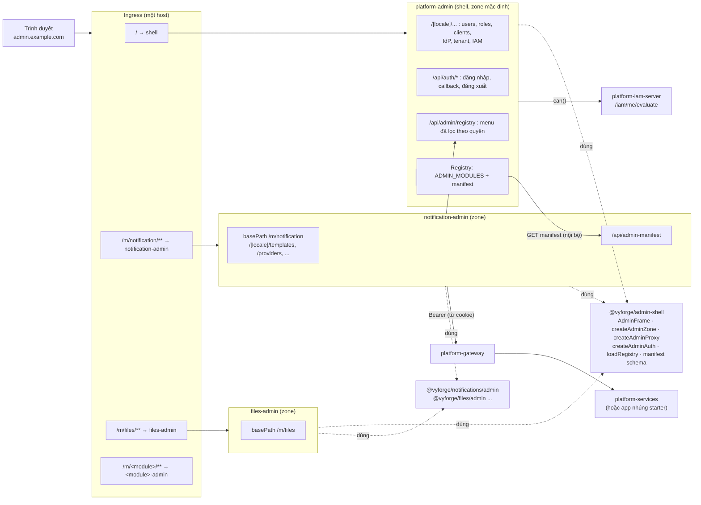
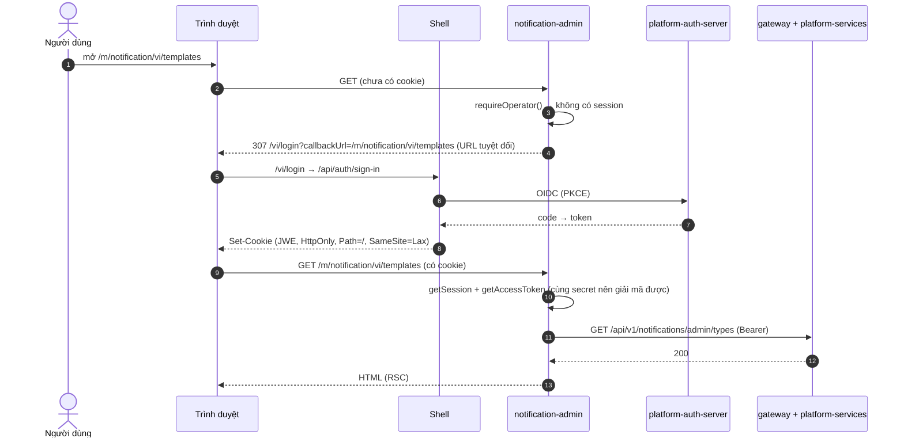

# Thiết kế `platform-services` và khu quản trị microfrontend cho các module dùng chung

> **Trạng thái:** bản thiết kế chờ duyệt (26/10/2026), phiên forge-37. Chưa có code.
>
> **Phạm vi:** cách đóng gói, triển khai và quản trị 7 module P1 (notification, files, export, webhooks, features,
> payment, realtime) và các module sau này:
> - backend: nhúng starter vào app, gộp trong server dùng chung `platform-services`, hoặc chạy thành server riêng;
> - khu quản trị: shell `platform-admin` cùng các **admin microfrontend** theo module, build và deploy riêng, gắn vào
>   shell lúc chạy;
> - vận hành: chart, observability, backup.
>
> **Nền:** module-conventions mục 2, 5 và 6; MODULE_PLAN (nguyên tắc 1–3, "Hai nhóm người quản trị"); ADR-0003 (modular
> monolith), ADR-0006 (BFF), ADR-0009/0010 (IAM, gateway, chế độ local/remote, token exchange), ADR-0011 (tenant),
> ADR-0015 (tenant ở tầng dữ liệu); bảy bản thiết kế module trong `docs/design/` của từng nhánh `docs/design-<module>`.
>
> **Yêu cầu của người dùng:**
> - "các service common cần triển khai hết, cả CMS quản trị và phần server phía sau";
> - "phần cms quản trị cần tách code từng module ra, để có thể triển khai độc lập cho khách hàng theo nhu cầu. có thể
>   triển khai microfrontend".
>
> **Thứ tự viết.** Mục 4 (microfrontend) được chốt trước, vì khoảng 18 module đang chờ quyết định này. Các module chỉ
> cần đọc mục 4 và mục 5.2 (manifest) để làm phần admin của mình.

## Mục lục

0. [Tóm tắt quyết định](#0-tóm-tắt-quyết-định)
1. [Bài toán và phạm vi](#1-bài-toán-và-phạm-vi)
2. [Nghiên cứu](#2-nghiên-cứu)
3. [Kiến trúc backend: `platform-services`](#3-kiến-trúc-backend-platform-services)
4. [Kiến trúc khu quản trị: microfrontend](#4-kiến-trúc-khu-quản-trị-microfrontend)
5. [Hợp đồng: API, manifest, registry, event](#5-hợp-đồng-api-manifest-registry-event)
6. [Khu quản trị của từng module](#6-khu-quản-trị-của-từng-module)
7. [Vận hành](#7-vận-hành)
8. [Bảo mật và tuân thủ](#8-bảo-mật-và-tuân-thủ)
9. [Kế hoạch triển khai và chia việc song song](#9-kế-hoạch-triển-khai-và-chia-việc-song-song)
10. [Lệch quy ước và quyết định cần người dùng chọn](#10-lệch-quy-ước-và-quyết-định-cần-người-dùng-chọn)

---

## 0. Tóm tắt quyết định

| # | Quyết định | Lý do ngắn |
|---|---|---|
| D1 | **Microfrontend bằng Next.js Multi-Zones.** Mỗi module có một app Next.js riêng (`<module>-admin`), `basePath` là `/m/<module>`, chạy cùng origin với shell `platform-admin`. Ingress chuyển `/m/<module>/**` tới đúng app | Giữ nguyên mô hình BFF (ADR-0006): Server Component, Server Action, token chỉ ở server. Là cách Next.js hỗ trợ chính thức. Module Federation cho App Router không được hỗ trợ; Web Components và import map bỏ mất phần server (mục 2.1) |
| D2 | **Gắn lúc chạy bằng registry.** Shell đọc danh sách MFE đã deploy từ cấu hình (`ADMIN_MODULES`), tải manifest của từng MFE qua mạng nội bộ, rồi dựng menu. Bật hay tắt một module không cần build lại shell | Đúng yêu cầu "khách mua module nào bật module đó" |
| D3 | **Phiên đăng nhập dùng chung qua cookie.** Mọi zone dùng `@vyforge/auth` với cùng secret, cùng OIDC client, cùng tên cookie. Đăng nhập, callback và đăng xuất chỉ có ở shell | Cùng origin nên cookie HttpOnly tự đi kèm request. Không thêm token phía trình duyệt, không thêm bước nhảy qua shell |
| D4 | **Khung giao diện dùng chung là package `@vyforge/admin-shell`** (thanh bên, thanh trên, menu người dùng, đổi ngôn ngữ, theme, CSP, cấu hình zone). Mỗi zone tự render khung này; dữ liệu menu lấy từ registry lúc chạy | Multi-zones không chia sẻ JS lúc chạy. Khung là thư viện, còn menu là dữ liệu, nên một module mới hiện trong menu của mọi zone mà không zone nào phải build lại |
| D5 | **Component quản trị nằm ở `@vyforge/<module>/admin`** (platform-web). App MFE `<module>-admin` chỉ là lớp mỏng: route, trang, Server Action ghép từ component đó | Một bộ component dùng cho ba nơi: MFE của người vận hành, MFE ở chế độ tenant admin, và trang `/admin` dựng sẵn trong app nghiệp vụ |
| D6 | **Một image MFE phục vụ hai nhóm người quản trị.** Chế độ lấy theo token: người vận hành (tenant vận hành, role `admin` + MFA) hoặc tenant admin (chỉ tenant của mình) | Không phải duy trì hai bản giao diện. Không màn hình nào giả định người xem có quyền xuyên tenant (MODULE_PLAN) |
| D7 | **Backend: một artifact cho mỗi module, ba cách chạy.** (a) nhúng starter vào app; (b) gộp trong `platform-services`, là một app Spring Boot modular monolith chứa mọi starter P1, bật từng module bằng cấu hình; (c) chạy riêng: vẫn image `platform-services`, chỉ bật một module | Một image thay cho bảy image. "Server riêng" chỉ khác cấu hình, nên không có thêm đơn vị phải release (nguyên tắc 3) |
| D8 | **App gọi module ở xa bằng chế độ `remote` của chính starter** (`vyforge.<module>.mode: embedded \| remote`), giống `vyforge.authz.mode`. Gọi thay người dùng thì đổi token (RFC 8693); việc của hệ thống thì dùng client credentials; việc gửi đi không cần chờ kết quả thì đi qua Kafka | Code nghiệp vụ dùng cùng interface Java ở cả hai chế độ, đổi chế độ không phải sửa code |
| D9 | `platform-services` đặt trong **monorepo `platform-java`** (module `platform-services`, như `platform-iam-server`). Các app MFE đặt trong **repo `platform-admin`**, chuyển repo này thành pnpm workspace (`apps/shell`, `apps/<module>-admin`) | Nguyên tắc 2–3: không thêm repo. Image riêng thì app riêng, nhưng vẫn chung một repo |
| D10 | `export` **luôn nhúng** vào app (nguồn dữ liệu là của app). Các module khác nhúng hoặc chạy ở server đều được. Khi có từ hai app trở lên thì khuyến nghị chạy ở server: realtime (hub), payment (IPN, merchant), webhooks (dispatcher), notification (provider, inbox) | Mục 3.4 |

---

## 4. Kiến trúc khu quản trị: microfrontend

> Mục này được viết và chốt trước các mục khác (yêu cầu của phiên điều phối). Module P1 và các module sau đều làm phần
> admin theo đúng mục này. Không module nào tự chọn kỹ thuật microfrontend riêng (module-conventions mục 6).

### 4.1 Yêu cầu

| # | Yêu cầu | Nguồn |
|---|---|---|
| Y1 | Mỗi module có khu quản trị riêng, **build và deploy độc lập**. Khách hàng không mua module thì không có code, image hay menu của module đó | Người dùng |
| Y2 | Gắn vào shell **lúc chạy**. Thêm hoặc bỏ module không build lại shell hay module khác | module-conventions mục 6 |
| Y3 | Giữ mô hình BFF: token chỉ ở server Next.js, trình duyệt chỉ có cookie HttpOnly. Server Action kiểm quyền ở đầu (B13) | ADR-0006, ADR-0008 |
| Y4 | Hai nhóm người quản trị: người vận hành (xuyên tenant, bắt buộc MFA) và tenant admin (chỉ tenant của mình) | MODULE_PLAN |
| Y5 | Một giao diện thống nhất: `@vyforge/ui`, theme sáng/tối, i18n vi/en, cùng khung điều hướng | Quy ước frontend |
| Y6 | CSP chặt như shell hiện có: nonce cho từng request, `strict-dynamic`, chỉ tải tài nguyên cùng origin, `frame-ancestors 'none'` | `platform-admin/src/proxy.ts` |
| Y7 | Chịu được lệch version: shell và các MFE được deploy vào những thời điểm khác nhau | Hệ quả của Y1 |
| Y8 | Chạy on-prem, không phụ thuộc dịch vụ của Vercel hay CDN bên ngoài | MODULE_PLAN nguyên tắc 6 |

### 4.2 So sánh phương án

Nguồn kiểm ngày 26/10/2026. Chi tiết ở mục 2.1.

| Tiêu chí | **Next.js Multi-Zones** | Module Federation (Next 16) | Web Components / custom element | Import map (single-spa) | iframe |
|---|---|---|---|---|---|
| Hỗ trợ Next 16 App Router | Có, chính thức ([guide multi-zones](https://nextjs.org/docs/app/guides/multi-zones), cập nhật 01/06/2026) | **Không.** `nextjs-mf` vào chế độ bảo trì từ 11/2024; maintainer nói "App router is entirely unsupported"; Next 16 làm hỏng plugin webpack (03/2026); issue đóng "not planned" 26/05/2026 ([module-federation/core#3153](https://github.com/module-federation/core/issues/3153)) | MFE phải render phía client; không dùng được Server Component, Server Action trong phần tử | single-spa nạp ES module trong trình duyệt ([recommended setup](https://single-spa.js.org/docs/recommended-setup)); MFE là SPA phía client, không có RSC | Có (mỗi khung là một app riêng) |
| BFF, token chỉ ở server | Giữ nguyên: mỗi zone là BFF, đọc cùng cookie | Giữ được nếu host làm hết phần server, nhưng remote không có server riêng | Phải đưa token xuống trình duyệt, hoặc mọi gọi API đi qua một proxy của shell | Như Web Components | Giữ được, nhưng cookie trong iframe phức tạp (SameSite, phân vùng cookie bên thứ ba) |
| Deploy độc lập | Có: mỗi zone là một image | Có (remote entry), nhưng remote phải dùng cùng version dependency với host | Có (file JS tĩnh) | Có (file JS tĩnh + import map) | Có |
| Điều hướng | Trong zone là soft navigation; sang zone khác là hard navigation (tải lại trang) | Soft | Soft | Soft | Soft trong khung, nhưng URL, nút back và deep link rất khó làm đúng |
| `@vyforge/ui`, React dùng chung | Mỗi zone có bản riêng, không xung đột lúc chạy | Chia sẻ singleton; lệch version gây lỗi lúc chạy | Phải chia sẻ React qua global hoặc nhúng nhiều bản; Tailwind trong Shadow DOM phải nạp CSS cho từng phần tử | Chia sẻ qua import map; phải giữ đúng một version React cho toàn trang | Mỗi khung một bản |
| CSP nonce + `strict-dynamic` | Giữ nguyên, mỗi zone tự phát nonce | Phải cho phép nạp script của remote | Phải cho phép script của từng MFE | Cần `script-src` cho import map, thường phải nới CSP hoặc dùng hash | Phải mở `frame-src`, bỏ `frame-ancestors 'none'` |
| Lệch version | Nhỏ: hai zone không chạy chung JS. Trong một zone, Next xử lý bằng `deploymentId` | Lớn: host và remote chạy chung runtime | Vừa: hợp đồng là thuộc tính và sự kiện của phần tử | Vừa: phải giữ import map khớp | Nhỏ |
| Công sức cho repo hiện có | Thấp: `platform-admin` đã là Next 16 App Router; tách thư mục `features/*` thành zone | Cao, và không có đường nâng cấp | Cao: viết lại phần server thành API + client | Cao: viết lại thành SPA | Vừa, nhưng trải nghiệm kém |
| On-prem | Ingress bất kỳ, hoặc chính shell làm proxy | Được | Được | Được | Được |

### 4.3 Quyết định: Next.js Multi-Zones

Chọn **Multi-Zones** vì đây là phương án duy nhất giữ nguyên ba thứ đang có: Server Component, Server Action và BFF giữ
token ở server. Đổi lại, sang module khác thì trình duyệt tải lại trang (hard navigation). Với khu quản trị, người dùng
thường làm lâu trong một module rồi mới chuyển, nên cái giá này chấp nhận được. Next.js khuyên đặt các trang hay đi cùng
nhau vào cùng một zone, và cách chia theo module thoả điều này.

Không làm:
- **Module Federation:** không có bản hỗ trợ App Router. Vercel mới thử nghiệm "Federation v2", chưa dùng được.
- **Web Components, import map:** phải viết lại phần server thành SPA, và token hoặc proxy phải đi qua trình duyệt.
- **iframe:** CSP phải nới, deep link và back khó, cookie trong iframe bất ổn.
- **`@vercel/microfrontends`:** gói tiện ích của Vercel cho multi-zones, có file `microfrontends.json` và `Link`
  prefetch giữa các zone. Không dùng vì gắn với hạ tầng định tuyến của Vercel (Y8). Phần đáng học (một file khai báo
  định tuyến, prefetch giữa zone) được làm lại trong registry ở mục 4.6.

Xem lại quyết định khi một trong hai điều sau xảy ra: Next.js có cách chia sẻ layout giữa các zone mà không tải lại
trang, hoặc Module Federation có bản ổn định cho App Router. Hợp đồng (manifest, registry, cookie) ở mục 5 không phụ
thuộc kỹ thuật, nên khi đổi chỉ phải bọc lại các zone.

### 4.4 Sơ đồ thành phần



| Thành phần | Ở đâu | Việc |
|---|---|---|
| Shell `platform-admin` | `platform-admin/apps/shell` (đổi từ gốc repo), image `platform-admin` giữ tên | Zone mặc định: trang chủ, các khu có sẵn (tài khoản, tenant, IdP, IAM), đăng nhập, registry, trang "Module" (tình trạng các MFE) |
| Admin MFE `<module>-admin` | `platform-admin/apps/<module>-admin`, package `@vyforge/<module>-admin` (private), image `platform-admin-<module>` | Một zone: trang và Server Action của module, manifest |
| `@vyforge/admin-shell` | `platform-web/packages/admin-shell` (mới) | Khung giao diện và mọi thứ một zone cần để thành "zone quản trị Vyforge" |
| `@vyforge/<module>/admin` | Subpath trong package của module (platform-web) | Component quản trị, client API quản trị, Server Action dựng sẵn, message vi/en |
| Ingress | Chart `app` của mỗi zone khai báo path của mình trên cùng host | Chuyển request tới đúng zone |

**Khi chạy trong app nghiệp vụ (tenant admin).** App Next.js của dự án (template-nextjs) cũng dùng `@vyforge/admin-shell`
để làm shell cho trang `/admin`. Có hai cách gắn module, cùng dùng một bộ component:

1. **Trang nhúng (mặc định):** app tự có route `/[locale]/admin/<module>/...`, ghép từ `@vyforge/<module>/admin`. Không
   thêm image. Hợp với app tự nhúng starter của module.
2. **Zone:** app thêm path `/m/<module>` vào ingress của mình, trỏ tới image `platform-admin-<module>`. MFE tự chuyển sang
   chế độ tenant admin theo token (mục 4.8). Hợp với khách hàng có nhiều app dùng chung `platform-services`.

### 4.5 Định tuyến

| Việc | Cách làm |
|---|---|
| Path của zone | `basePath: '/m/<module>'`. Sau basePath là tiền tố ngôn ngữ như shell (`localePrefix: 'always'`): `/m/notification/vi/templates`. Tài nguyên của zone tự nằm dưới `/m/<module>/_next/...` nên không trùng với shell |
| Tên module | `[a-z][a-z0-9-]{1,30}`, là tên module như trong thiết kế (`notification`, `files`, `export`, `webhooks`, `features`, `payment`, `realtime`). Không phụ thuộc tên route API (`/api/v1/notifications`): manifest khai báo riêng `api.base` |
| Production | Ingress theo path, cùng một host. Mỗi release của chart `app` cho zone khai báo `ingress.hosts[0].paths: ["/m/<module>"]` trên host của shell. ingress-nginx và Traefik gộp nhiều Ingress cùng host. Không có bước nhảy qua shell |
| Dev và môi trường không có ingress | `proxy.ts` của shell (`createAdminProxy`) có fallback: request `/m/<module>/**` tới shell thì shell rewrite sang `url` của module trong registry (`NextResponse.rewrite`, cách Next.js ghi cho định tuyến động). Production có ingress thì đường này không dùng tới; khi có request đi vào đường này thì ghi log cảnh báo kèm metric |
| Link giữa các zone | Dùng thẻ `<a>`, không dùng `<Link>` của Next (Next sẽ prefetch và soft navigate sai zone). `@vyforge/admin-shell` có `ZoneLink`: cùng zone thì dùng `Link`, khác zone thì dùng `<a>`; zone được xác định theo registry |
| Prefetch giữa zone | `ZoneLink` khác zone thêm `<link rel="prefetch">` tới trang đích khi người dùng hover, để giảm thời gian tải lại |
| Path trùng | Registry từ chối manifest có `name` trùng hoặc `basePath` khác `/m/<name>`; trang "Module" của shell báo lỗi |
| Path không có zone | `/m/<x>` không có trong registry thì shell trả trang 404 của shell |

### 4.6 Đăng nhập và phiên dùng chung



Quy tắc:

- Mọi zone tạo Better Auth bằng `createAdminAuth()` của `@vyforge/admin-shell`. Hàm này chỉ là `createAuth` của
  `@vyforge/auth` với cấu hình chung: `baseURL` là URL công khai của **shell**, `secret` (`BETTER_AUTH_SECRET`),
  `OIDC_CLIENT_ID`/`SECRET` của client `platform-auth-admin`, tên cookie mặc định, `Path=/`. Ba giá trị này đến từ cùng
  một secret trong secret store (`vyforge/<env>/platform-admin`), mọi zone nạp bằng `externalSecret`.
- Chỉ shell mount handler `/api/auth/*`. Zone không có route auth: nó chỉ gọi `auth().api.getSession` và
  `auth().api.getAccessToken` ở server. Callback đăng ký ở auth-server vẫn chỉ có một (`<shell>/api/auth/callback/vyforge`).
- Chuyển hướng đăng nhập từ zone dùng **URL tuyệt đối** tới shell (`PUBLIC_ADMIN_URL + /<locale>/login`), vì `redirect()`
  của Next tự thêm `basePath` cho path tương đối.
- Làm mới token: `getAccessToken` của Better Auth tự refresh và ghi lại cookie `Path=/`, nên zone nào refresh thì mọi
  zone đều thấy token mới. Hai request song song cùng refresh là chuyện đã có trong một app; giảm rủi ro bằng access
  token đủ dài (5–15 phút) và để auth-server chấp nhận refresh token cũ trong một khoảng ngắn sau khi xoay (cần kiểm
  lại trong auth-server, ghi ở mục 10).
- Đăng xuất ở shell xoá cookie `Path=/`, nên mọi zone mất phiên cùng lúc.
- Kiểm quyền vẫn theo B13: đầu mỗi trang và mỗi Server Action gọi `requireOperator()` hoặc `requireModuleAccess()` của
  `@vyforge/admin-shell` (mục 4.8). Backend luôn kiểm lại bằng `Authz`.

### 4.7 Khung giao diện, `@vyforge/ui`, i18n, theme

| Việc | Cách làm |
|---|---|
| Khung | `AdminFrame` (Server Component) trong `@vyforge/admin-shell`: `Sidebar` của `@vyforge/ui`, thanh trên (tenant đang xem, đổi ngôn ngữ, theme, menu người dùng). Nhận `registry` (menu đã lọc quyền) và `current` (zone hiện tại). Shell và mọi zone dùng cùng component, nên chuyển zone không thấy khác biệt ngoài lần tải lại |
| Menu | Không biên dịch vào zone. Zone lấy menu bằng `loadRegistry()`: gọi `GET <SHELL_INTERNAL_URL>/api/admin/registry` kèm cookie của request, cache theo người dùng 60 giây (`unstable_cache` key theo `sub`). Shell không trả lời thì zone vẫn hiện khu của chính nó và một liên kết về trang chủ |
| `@vyforge/ui` | Mỗi zone tự bundle bản của mình. Version giữ đồng bộ bằng nhóm Renovate `vyforge-admin` (mọi app trong repo `platform-admin` nâng cùng lúc) và lockstep version của platform-web từ 1.0.0. Design token nằm trong `@vyforge/ui/theme.css`, mọi zone import cùng file |
| Theme | Cookie `theme` (đã có ở shell) có `Path=/`, nên mọi zone đọc chung và render ở server không nháy |
| i18n | `next-intl`, `locales: ['vi','en']`, `localePrefix: 'always'` như shell. Zone đọc locale từ URL; đổi ngôn ngữ trong `AdminFrame` giữ nguyên path trong zone. Message của zone gộp từ `@vyforge/admin-shell/messages` (khung), `@vyforge/<module>/admin/messages` (component) và message riêng của app. Lỗi backend dịch theo `code` bằng `errorTranslator` của `@vyforge/i18n` |
| Trang lỗi, 404, 403, cần MFA | `@vyforge/admin-shell` có sẵn; trang "cần MFA" và "đăng nhập" luôn chuyển về shell |

### 4.8 Hai nhóm người quản trị trong cùng một MFE

| | Chế độ người vận hành (`operator`) | Chế độ tenant admin (`tenant`) |
|---|---|---|
| Khi nào | Token có `tenant_id` là tenant vận hành (`ADMIN_OPERATOR_TENANT`, mặc định `default`), role `admin`, `amr` có `mfa` | Mọi trường hợp còn lại |
| Phạm vi dữ liệu | Tenant hiện tại của token, cộng các màn hình xuyên tenant mà manifest đánh dấu `audience: operator` (vd. danh sách subscription của mọi tenant). Thao tác lên tenant khác dùng **tenant đang xem** (mục 5.6) | Chỉ tenant của token. Màn hình `operator` không hiện, route trả 404 |
| Hàm kiểm | `requireOperator()` | `requireModuleAccess(module)` |
| Quyền tối thiểu | `minPermission` của manifest, kiểm bằng `can()` (gọi `/api/v1/iam/me/evaluate` qua gateway) | Như bên trái |
| Backend | Vẫn kiểm `Authz` từng thao tác. API xuyên tenant chỉ nhận token của tenant vận hành (cách features đã làm) | |

Bảng màn hình của từng module (mục 6) ghi rõ màn hình nào thuộc nhóm nào.

### 4.9 CSP, header bảo mật, Server Action

- `createAdminProxy()` của `@vyforge/admin-shell` tạo CSP giống `platform-admin/src/proxy.ts` hiện tại: nonce mới cho
  từng request, `script-src 'self' 'nonce-…' 'strict-dynamic'`, `connect-src 'self'`, `frame-ancestors 'none'`,
  `form-action 'self'`. Tài nguyên của zone nằm dưới `/m/<module>/_next/` cùng origin nên `'self'` đã đủ. Không zone nào
  được nới CSP; cần nguồn ngoài thì thêm vào cấu hình chung và qua review.
- `createAdminZone()` (bọc `next.config`) đặt: `basePath`, `output: 'standalone'`, header bảo mật như shell,
  `experimental.serverActions.allowedOrigins: [<host công khai của admin>]` (Next yêu cầu với multi-zones),
  `deploymentId: process.env.DEPLOYMENT_ID` (CI đặt bằng digest của image).
- Cookie phiên dùng chung nên **mọi zone là code tin cậy ngang shell**. Chỉ image do Vyforge build và ký (cosign,
  chart `platform-policies` kiểm chữ ký) mới được gắn vào `/m/*`. Không gắn MFE của bên thứ ba vào cùng origin; nếu
  sau này cần thì dùng origin riêng và đăng nhập riêng.

### 4.10 Lệch version

| Lệch giữa | Cách xử lý |
|---|---|
| Hai lần deploy của cùng zone | `deploymentId`: Next phát hiện client cũ gọi server mới và tải lại trang thay vì lỗi |
| Shell và MFE (hợp đồng) | Manifest có `contract` (số nguyên, bắt đầu `1`). Shell chỉ nhận MFE có `contract` trong tập nó hỗ trợ; MFE khác thì bị ẩn khỏi menu, trang "Module" của shell ghi lý do. Đổi hợp đồng không tương thích thì tăng `contract`, shell hỗ trợ cả bản cũ và bản mới trong ít nhất một minor |
| Khung giao diện giữa các zone | Mỗi zone render `AdminFrame` theo version `@vyforge/admin-shell` của mình. Khác minor chỉ lệch nhỏ về giao diện, chấp nhận được. Trang "Module" hiện version `admin-shell` của từng zone để vận hành thấy lệch |
| MFE và backend của module | MFE gọi `GET /api/v1/<module>/admin/info` → `{ version, apiVersion, capabilities[] }` (cache 5 phút). Manifest khai báo `api.requires` (khoảng semver). Backend cũ hơn yêu cầu: zone hiện banner và chuyển sang chỉ đọc. Màn hình phụ thuộc capability chưa có thì ẩn |
| Registry giữa các replica của shell | Mỗi replica tự tải manifest mỗi 60 giây; lệch tối đa 60 giây |

### 4.11 Cấu trúc một admin MFE

```
platform-admin/
├── apps/
│   ├── shell/                         # platform-admin hiện tại (đổi chỗ, không đổi hành vi)
│   └── notification-admin/
│       ├── admin.manifest.ts          # defineAdminManifest({...}) — mục 5.2
│       ├── next.config.ts             # export default createAdminZone({ module: 'notification' })
│       ├── src/proxy.ts               # export default createAdminProxy()
│       ├── src/app/[locale]/layout.tsx          # <AdminFrame current="notification" …>
│       ├── src/app/[locale]/templates/page.tsx  # ghép <TemplateMatrix/> từ @vyforge/notifications/admin
│       ├── src/app/api/admin-manifest/route.ts  # trả manifest đã build (JSON)
│       ├── src/app/api/health/route.ts
│       └── Dockerfile                 # chung một Dockerfile tham số APP=<tên>
├── packages/                          # (trống lúc đầu; code dùng chung nằm ở platform-web)
├── e2e/                               # Playwright: shell + mọi zone sau một ingress giả (Traefik trong compose)
└── pnpm-workspace.yaml
```

Một trang điển hình:

```tsx
// apps/notification-admin/src/app/[locale]/templates/page.tsx
import { requireModuleAccess } from '@vyforge/admin-shell/server';
import { TemplateMatrix } from '@vyforge/notifications/admin';
import { notificationsAdmin } from '@/shared/api';   // createNotificationAdminClient({ baseUrl: gateway, getAccessToken })

export default async function TemplatesPage() {
  const access = await requireModuleAccess('notification', '/templates');   // B13
  const types = await notificationsAdmin().listTypes();
  return <TemplateMatrix types={types} can={access.can} />;
}
```

### 4.12 Trách nhiệm của từng module (hợp đồng với các phiên module)

Mỗi module làm:

1. Component quản trị trong `@vyforge/<module>/admin` (đã quy định ở module-conventions mục 6). Component nhận dữ liệu
   và Server Action qua props, nhận `can` để ẩn nút, không tự đọc cookie hay env.
2. App `platform-admin/apps/<module>-admin`: route, trang, Server Action, `admin.manifest.ts`. Dựng bằng lệnh
   `pnpm create-admin-zone <module>` (template trong repo `platform-admin`, làm ở bước P2 của mục 9).
3. Endpoint `GET /api/v1/<module>/admin/info` ở backend (mục 5.1).
4. Bảng màn hình, quyền, component theo mục 6 của tài liệu này.

Module **không** làm: đăng nhập, khung giao diện, CSP, cấu hình zone, registry. Những thứ này nằm trong
`@vyforge/admin-shell`.

---

## 5. Hợp đồng: API, manifest, registry, event

<!-- 5.1 API nội bộ app → server: viết ở phần sau -->

### 5.2 Manifest của admin MFE (hợp đồng với shell, `contract: 1`)

Mỗi MFE khai báo manifest bằng TypeScript, kiểm bằng schema zod của `@vyforge/admin-shell` lúc build (lỗi thì build
hỏng), rồi phục vụ dạng JSON tại `GET /m/<module>/api/admin-manifest`. Shell cũng xuất JSON Schema
(`@vyforge/admin-shell/manifest.schema.json`) để công cụ khác kiểm được.

```ts
// apps/notification-admin/admin.manifest.ts
import { defineAdminManifest } from '@vyforge/admin-shell/manifest';
import pkg from './package.json' with { type: 'json' };

export default defineAdminManifest({
  contract: 1,
  name: 'notification',                       // khớp /m/<name>, duy nhất trong registry
  version: pkg.version,                       // version của MFE (semver)
  title: { vi: 'Thông báo', en: 'Notifications' },
  icon: 'bell',                               // tên icon lucide; shell có danh sách cho phép
  order: 100,                                 // vị trí trong thanh bên
  audiences: ['operator', 'tenant'],          // nhóm người quản trị MFE phục vụ (mục 4.8)
  // Quyền tối thiểu để thấy module: có ít nhất một action trong danh sách.
  minPermission: { anyOf: [{ action: 'notification:type:List', resource: 'vrn:notification:type/*' },
                           { action: 'notification:message:List', resource: 'vrn:notification:message/*' }] },
  entitlement: 'admin.notification',          // feature của -features để bật theo tenant (mục 5.4); bỏ trống = không kiểm
  api: {
    base: '/api/v1/notifications',            // đường qua gateway
    requires: '>=0.13.0 <1.0.0',              // khoảng version backend MFE chạy được (mục 4.10)
  },
  menu: [
    { id: 'types', path: '/types', title: { vi: 'Loại thông báo', en: 'Types' },
      permission: { action: 'notification:type:List', resource: 'vrn:notification:type/*' } },
    { id: 'templates', path: '/templates', title: { vi: 'Mẫu', en: 'Templates' },
      permission: { action: 'notification:template:List', resource: 'vrn:notification:template/*' } },
    { id: 'providers', path: '/providers', title: { vi: 'Nhà cung cấp', en: 'Providers' },
      permission: { action: 'notification:provider:List', resource: 'vrn:notification:provider/*' } },
    { id: 'messages', path: '/messages', title: { vi: 'Nhật ký gửi', en: 'Message log' },
      permission: { action: 'notification:message:List', resource: 'vrn:notification:message/*' } },
    { id: 'platform-defaults', path: '/platform', title: { vi: 'Mặc định platform', en: 'Platform defaults' },
      audience: 'operator' },                 // mục chỉ dành cho người vận hành
  ],
  health: '/api/health',
});
```

| Trường | Bắt buộc | Ý nghĩa |
|---|---|---|
| `contract` | Có | Version của hợp đồng shell ↔ MFE. Bản này là `1` |
| `name` | Có | Tên module, `[a-z][a-z0-9-]{1,30}`; path của zone là `/m/<name>` |
| `version` | Có | Version của MFE; hiện ở trang "Module" |
| `title`, `icon`, `order` | `title` có | Hiển thị trong menu; `title` phải có `vi` và `en` |
| `audiences` | Có | `operator`, `tenant` hoặc cả hai |
| `minPermission` | Có | `anyOf` danh sách `{action, resource}`. Không thoả thì không hiện module. Chỉ để ẩn giao diện; trang và backend vẫn kiểm |
| `entitlement` | Không | Khoá feature boolean của `-features` để bật module theo tenant |
| `api.base`, `api.requires` | Có | Đường API qua gateway và khoảng version backend |
| `menu[]` | Có, ≥ 1 | `id`, `path` (sau `/m/<name>/<locale>`), `title`, `permission?`, `audience?`, `children?` (một cấp) |
| `health` | Không | Mặc định `/api/health` |

Thêm trường mới không bắt buộc thì không tăng `contract`. Shell bỏ qua trường lạ.

### 5.3 Registry: bật/tắt theo bản triển khai

Registry trả lời câu hỏi "bản triển khai này có những module quản trị nào". Có hai lớp, không lớp nào cần build lại shell.

**Lớp 1, theo bản triển khai (khách hàng mua module nào).** Shell đọc biến môi trường `ADMIN_MODULES` (JSON), do
platform-infra hoặc infra của khách sinh ra từ danh sách module đã cài:

```yaml
# platform-infra/apps/platform-admin/overlays/prod/values.yaml
env:
  ADMIN_MODULES: >-
    [{"name":"notification","url":"http://platform-admin-notification:3000"},
     {"name":"files","url":"http://platform-admin-files:3000"},
     {"name":"payment","url":"http://platform-admin-payment:3000"}]
```

- Cài module = thêm thư mục `apps/platform-admin-<module>` trong infra (`scripts/add-app.sh`, chart `app` có ingress
  `/m/<module>`) **và** thêm một dòng vào `ADMIN_MODULES`. Gỡ module thì làm ngược lại. Không đụng tới image của shell.
- Shell tải manifest của mọi dòng lúc khởi động và mỗi 60 giây (timeout 2 giây), kiểm schema và `contract`, giữ bản
  hợp lệ cuối cùng khi MFE tạm lỗi. Trạng thái của từng module (`ok`, `unreachable`, `invalid_manifest`,
  `unsupported_contract`, `duplicate_name`) hiện ở trang `/[locale]/modules` của shell và qua metric
  `vyforge_admin_registry_module_up{module}`.
- Biến `ADMIN_MODULES` thay vì tự dò service trên Kubernetes: chạy được ở mọi nơi (compose, VM, K8s), và không cần quyền
  đọc API của cluster.

**Lớp 2, theo tenant và người dùng.** Với mỗi request, `GET /api/admin/registry` của shell trả menu đã lọc:

```
module hiện ra ⇔ module ở trạng thái ok
             ∧ chế độ hiện tại (operator | tenant) ∈ manifest.audiences
             ∧ người dùng thoả minPermission (một lần gọi can() theo lô)
             ∧ (chế độ operator  ∨  manifest.entitlement trống  ∨  tenant được hưởng entitlement)
```

Phản hồi:

```json
{
  "contract": 1,
  "mode": "operator",
  "modules": [
    { "name": "notification", "title": "Thông báo", "icon": "bell", "href": "/m/notification/vi/types",
      "version": "0.13.0", "items": [ { "id": "types", "title": "Loại thông báo", "href": "/m/notification/vi/types" } ] }
  ]
}
```

### 5.4 Bật module theo tenant

- Nguồn sự thật là **entitlement của `-features`** (feature boolean `admin.<module>` và `module.<module>`, khai báo trong
  `FeatureCatalog` của `platform-services`). Gói dịch vụ (`plan`) bao gồm module nào thì tenant có module đó; người vận
  hành bật thêm cho riêng một tenant bằng override hoặc grant (đã có trong thiết kế features).
- Shell hỏi `GET /api/v1/features/me/entitlements` (cache 60 giây theo tenant). Bản triển khai **không cài features**
  thì lớp này coi như cho phép tất cả: khách hàng chỉ có một tenant không cần cấu hình gì thêm.
- **Backend cũng chặn**, không chỉ giao diện: `platform-services` có `ModuleEntitlementFilter` trước controller của mỗi
  module. Tenant không được hưởng `module.<module>` thì API của module trả `404` với `code: module.not_enabled` (404 để
  không lộ module có tồn tại). Đường công khai (IPN, callback, link chia sẻ) không qua filter này; chúng tự xác định tenant.
- Tắt module cho một tenant không xoá dữ liệu. Job nền của module vẫn chạy cho dữ liệu đang dở (vd. delivery đang
  retry), nhưng không nhận việc mới.

<!-- Các mục 1, 2, 3, 5.1, 5.5–10: xem phần tiếp theo. -->
