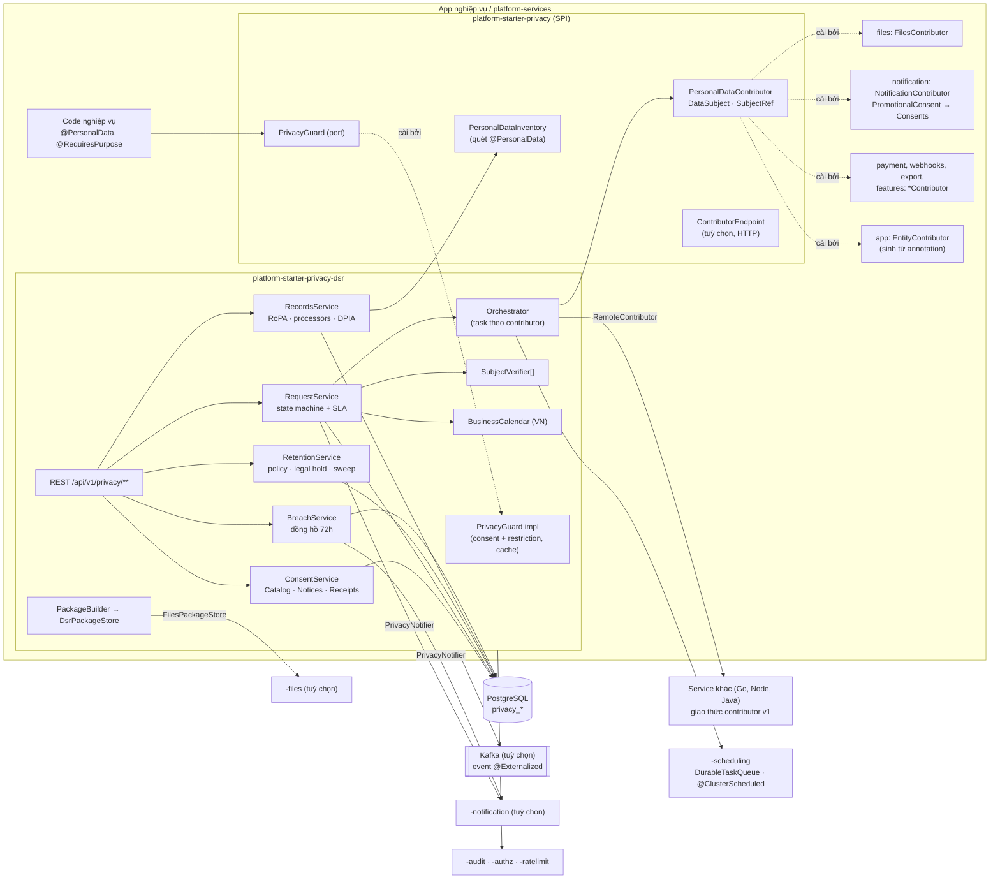
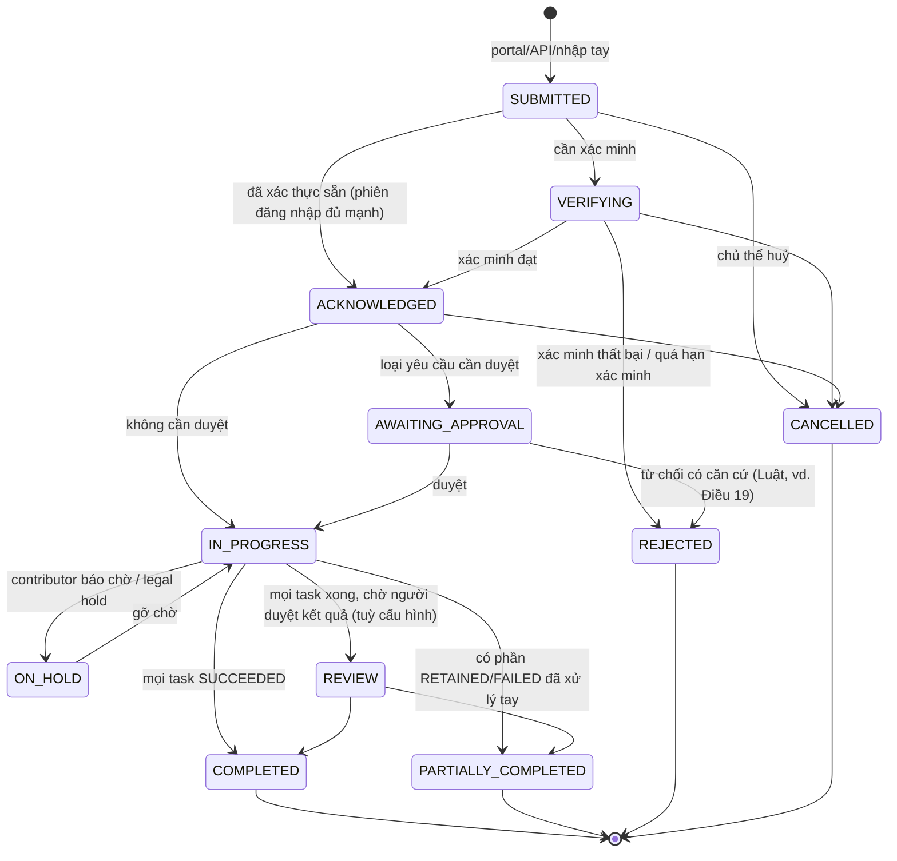
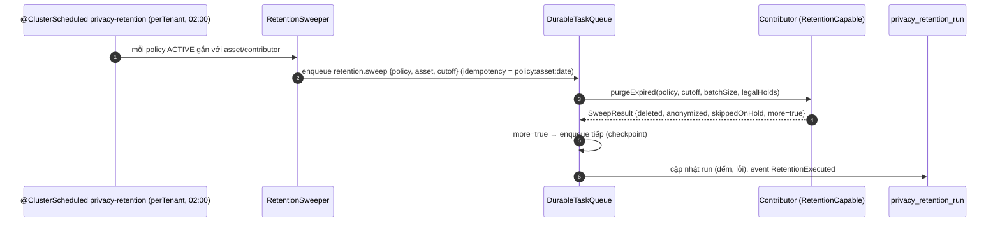
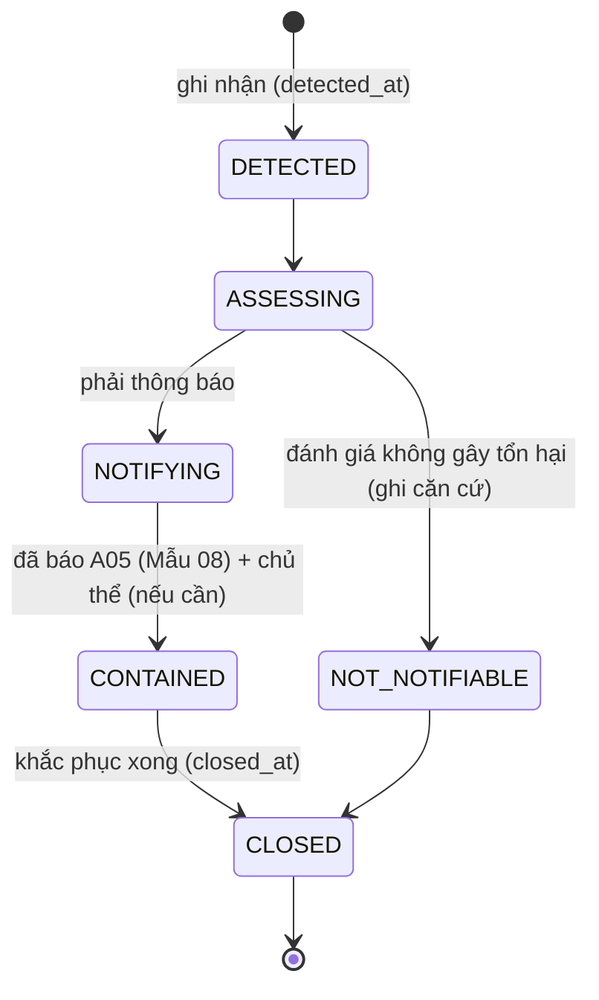
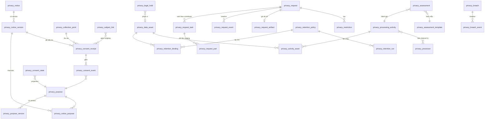

# Thiết kế module privacy-dsr: consent, yêu cầu của chủ thể dữ liệu, retention, hồ sơ tuân thủ

> Module: `platform-starter-privacy` (mở rộng, phần SPI nhẹ) + `platform-starter-privacy-dsr` (mới, phần có dữ liệu) +
> `@vyforge/privacy` (kèm `/admin`) + zone `platform-admin/apps/privacy-admin`. Revision `0.13.0-SNAPSHOT`.
> Căn cứ: Luật Bảo vệ dữ liệu cá nhân 91/2025/QH15, NĐ 356/2025/NĐ-CP, NĐ 330/2026/NĐ-CP (xử phạt).
> Trạng thái: thiết kế, giai đoạn 1 (session forge-44, 26–27/10/2026). Chưa code. Khu quản trị theo kiến trúc đã chốt
> trong `docs/design/platform-services.md` (forge-37).

## Mục lục

1. [Bài toán và phạm vi](#1-bài-toán-và-phạm-vi)
2. [Nghiên cứu](#2-nghiên-cứu)
3. [Kiến trúc](#3-kiến-trúc)
4. [Mô hình dữ liệu](#4-mô-hình-dữ-liệu)
5. [API](#5-api)
6. [Mở rộng](#6-mở-rộng)
7. [Vận hành](#7-vận-hành)
8. [Bảo mật và tuân thủ](#8-bảo-mật-và-tuân-thủ)
9. [Kế hoạch triển khai](#9-kế-hoạch-triển-khai)
10. [Lệch quy ước và quyết định cần người dùng chọn](#10-lệch-quy-ước-và-quyết-định-cần-người-dùng-chọn)
11. [Đóng gói và triển khai độc lập](#11-đóng-gói-và-triển-khai-độc-lập)

---

## 1. Bài toán và phạm vi

### 1.1 Vì sao cần

`platform-starter-privacy` bản tối thiểu (P0, forge-16) mới làm được ba việc: đánh dấu field bằng `@PersonalData`, che PII
trong log và audit, và luật ArchUnit bắt cột PII thiếu annotation. Còn thiếu mọi năng lực mà Luật 91/2025 bắt bên kiểm
soát dữ liệu phải **chứng minh được**:

- **Sự đồng ý kiểm chứng được.** Phải lưu chủ thể, thời điểm và nội dung đồng ý. Khi có tranh chấp, bên kiểm soát chịu
  trách nhiệm chứng minh (NĐ 356 Điều 6 khoản 1–2).
- **Quyền của chủ thể** (Luật Điều 4): xem, chỉnh sửa, cung cấp, xoá, hạn chế, phản đối, rút đồng ý. Mỗi quyền có thời
  hạn luật định (NĐ 356 Điều 5). Dữ liệu của một người nằm rải trong nhiều module (files, notification, payment, webhooks,
  bảng nghiệp vụ của app), nên phải có điều phối chung.
- **Lưu giữ có thời hạn và xoá không khôi phục được** (Luật Điều 14).
- **Hồ sơ:** đánh giá tác động xử lý (Luật Điều 21–22, NĐ 356 Điều 19–20), hồ sơ chuyển dữ liệu ra nước ngoài (Luật Điều 20,
  NĐ 356 Điều 18), thông báo vi phạm trong 72 giờ (Luật Điều 23, NĐ 356 Điều 28–29).
- **Xử phạt đã có hiệu lực.** NĐ 330/2026/NĐ-CP có hiệu lực từ 19/08/2026, Mục 6 (Điều 39–71) phạt riêng từng nhóm vi
  phạm: quyền của chủ thể, sự đồng ý, dữ liệu nhạy cảm, đánh giá tác động, chuyển dữ liệu ra nước ngoài, thông báo vi phạm.

Mỗi dự án tự làm phần này thì tốn 4–6 tuần và mỗi dự án làm một kiểu. Module này cho mọi app Vyforge một bộ chung: kho
consent có bằng chứng, hàng đợi yêu cầu có SLA, điều phối qua SPI `PersonalDataContributor`, retention trung tâm, sổ hoạt
động xử lý (RoPA), DPIA, sổ sự cố, kèm portal cho chủ thể và khu quản trị.

### 1.2 Phạm vi

| Nhóm | Trong phạm vi | Ngoài phạm vi (và ai lo) |
|---|---|---|
| Consent | Danh mục mục đích; văn bản thông báo có version, đa ngôn ngữ; ghi nhận đồng ý/từ chối/rút lại chỉ ghi thêm; biên nhận (receipt) theo cấu trúc ISO/IEC TS 27560; consent của người giám hộ (trẻ em, Luật Điều 24); consent ẩn danh (cookie) và ghép khi đăng nhập; kiểm tra consent nhanh có cache | Banner cookie kiểu IAB TCF/GPP cho quảng cáo quốc tế (bản sau, mục 9.4); quản lý tag marketing |
| DSR | Nhận yêu cầu qua portal, API, nhập tay (thư, điện thoại); xác minh danh tính; SLA theo NĐ 356 Điều 5 với lịch ngày làm việc VN; gia hạn một lần; điều phối qua contributor (local và remote); gói dữ liệu tải về; chỉnh sửa; xoá/ẩn danh có ngoại lệ lưu giữ theo luật; hạn chế và phản đối xử lý; thông báo bên thứ ba | Tự dò tìm dữ liệu trong DB không khai báo (data discovery kiểu Osano/OneTrust): Vyforge dựa trên khai báo trong code (`@PersonalData`, contributor) |
| Retention | Chính sách lưu giữ theo loại dữ liệu/mục đích; mốc bắt đầu theo sự kiện; thực thi theo lô qua contributor; legal hold; báo cáo | Lưu trữ lạnh, archive (module files/hạ tầng) |
| Hồ sơ | Sổ hoạt động xử lý (RoPA) sinh một phần tự động từ code; danh sách bên xử lý/bên thứ ba; DPIA (Mẫu 10) và hồ sơ chuyển ra nước ngoài (Mẫu 09) có version, nhắc cập nhật 6 tháng; sổ sự cố vi phạm có đồng hồ 72 giờ, Mẫu 08 | Nộp hồ sơ điện tử lên cổng A05 (chưa có API công khai; xuất file để nộp tay) |
| Giao diện | Portal chủ thể (trang "Quyền riêng tư của tôi"), form yêu cầu công khai, khu quản trị cho tenant admin/DPO, khu vận hành cho operator | — |
| Kiểm soát lúc chạy | `PrivacyGuard` kiểm "được phép xử lý cho mục đích X không" (consent + hạn chế + phản đối); annotation `@RequiresPurpose` | Chặn ở tầng SQL/RLS theo consent |

### 1.3 Kịch bản nghiệp vụ phải đáp ứng

| # | Kịch bản | Điểm khó | Đáp ứng bằng |
|---|---|---|---|
| K1 | **App bán lẻ:** đăng ký tài khoản, đồng ý "Điều khoản dịch vụ" (bắt buộc) và tách riêng "Nhận khuyến mại qua Zalo/SMS" (tuỳ chọn) | Đồng ý riêng từng mục đích (Luật Điều 9); không tick sẵn (NĐ 356 Điều 6 khoản 3) | Purpose `marketing.zalo`, `marketing.sms`; `ConsentForm` không cho mặc định bật; notification hỏi `PromotionalConsent` → `Consents.check` |
| K2 | **Đổi chính sách:** bản điều khoản v3 thêm mục đích chia sẻ đối tác, cần xin lại đồng ý của 2 triệu khách | Version văn bản; chỉ hỏi lại người bị ảnh hưởng; không chặn đăng nhập vì mục đích tuỳ chọn | `privacy_notice_version` có `change_level` (EDITORIAL/MATERIAL); MATERIAL làm consent cũ của mục đích bị đổi thành `reconsent_required`; `GET /me/consents/pending` |
| K3 | **Bệnh viện/phòng khám:** bệnh nhân đồng ý xử lý dữ liệu sức khoẻ, có thông báo rõ đây là dữ liệu nhạy cảm | NĐ 356 Điều 6 khoản 4; Luật Điều 26 | Purpose có `sensitive=true` → UI hiện cảnh báo bắt buộc, receipt ghi đã hiển thị cảnh báo |
| K4 | **App giáo dục cho học sinh:** phụ huynh đồng ý thay con; con từ đủ 7 tuổi phải cùng đồng ý một số việc | Luật Điều 24; quan hệ giám hộ | `actor_type=GUARDIAN`, `privacy_subject_link` (GUARDIAN_OF); purpose có `requires_minor_assent`; `SubjectProfileResolver` trả tuổi |
| K5 | **Khách gọi tổng đài** xin rút đồng ý nhận quảng cáo; nhân viên CSKH nhập thay | Kênh không phải web; bằng chứng là ghi âm (NĐ 356 Điều 6 khoản 1) | `channel=CALL_CENTER`, `method=RECORDED_CALL`, `evidence.recordingRef`; quyền `privacy:consent:RecordOnBehalf` |
| K6 | **Khách đã xoá app** gửi email đòi bản sao toàn bộ dữ liệu; không còn đăng nhập được | Xác minh danh tính không có phiên; SLA 2 ngày làm việc phản hồi + 10 ngày thực hiện | Form công khai + OTP qua email/SĐT đã lưu (`SubjectVerifier` OTP), hoặc xác minh tay kèm ảnh CCCD (lưu qua files, xoá sau 30 ngày) |
| K7 | **Yêu cầu xoá tài khoản ví điện tử** trong khi luật kế toán bắt giữ chứng từ 10 năm | Xoá một phần; giữ phần có nghĩa vụ pháp lý, ghi căn cứ | Contributor payment trả `RETAINED` kèm `legalBasis=LEGAL_OBLIGATION`, `reference="Luật Kế toán 88/2015 Điều 41"`, `retainUntil`; thư trả lời liệt kê phần giữ lại |
| K8 | **Hệ thống nhiều service** (CRM bằng Java, kho bằng Go, data warehouse): xoá phải chạy ở cả service không nhúng starter | Contributor ngoài process | `RemoteContributor` qua HTTP (giao thức mục 6.3), hoặc service Java nhúng `platform-starter-privacy` bật `contributor-endpoint` |
| K9 | **Hạn chế xử lý** khi khách khiếu nại dữ liệu sai: ngừng dùng cho chấm điểm tín dụng trong lúc xác minh, nhưng vẫn lưu | Không xoá; mọi chỗ dùng phải tôn trọng | `RESTRICT` tạo `privacy_restriction` (purpose = `credit.scoring`); `PrivacyGuard`/`@RequiresPurpose` từ chối; contributor nhận `restrict()` để gắn cờ |
| K10 | **Retention:** CV ứng viên không trúng tuyển xoá sau 12 tháng; log OTP xoá sau 90 ngày; hồ sơ khách hàng ẩn danh 5 năm sau khi đóng tài khoản | Mốc theo sự kiện, hành động khác nhau | Policy `trigger=EVENT` (`relationship.ended`), `action=ANONYMIZE`; job theo tenant; contributor `purgeExpired` |
| K11 | **Vụ lộ dữ liệu vị trí** của tài xế công nghệ: báo A05 và báo từng tài xế trong 72 giờ | Đồng hồ 72 giờ; danh sách người bị ảnh hưởng; lưu hồ sơ 5 năm | `privacy_breach` + mốc `authority_due_at`, `subjects_due_at`; gửi hàng loạt qua notification; xuất Mẫu 08; alert 24/48/66 giờ |
| K12 | **DPIA** cho dịch vụ eKYC (sinh trắc học), nộp trong 60 ngày từ khi bắt đầu xử lý, cập nhật 6 tháng | Nội dung theo Mẫu 10; nhắc hạn; version | `privacy_assessment` kind `PROCESSING`, template Mẫu 10 dạng JSON Schema; job nhắc; liên kết RoPA |
| K13 | **Dùng email gửi qua SaaS nước ngoài** (SendGrid) và log trên cloud Singapore | Chuyển dữ liệu ra nước ngoài, hồ sơ Mẫu 09, không thuộc ưu đãi Điều 38 | `privacy_processor` có `country`, `transfer=true` → bắt buộc có assessment `TRANSFER`; dashboard cảnh báo thiếu |
| K14 | **Doanh nghiệp nhỏ** được chọn không làm DPIA trong 5 năm (Luật Điều 38) nhưng vẫn phải đáp ứng quyền chủ thể | Bật/tắt năng lực theo tenant | Tenant setting `exemption=SMALL_ENTERPRISE` tắt nhắc DPIA, không tắt DSR/consent; tự huỷ miễn trừ nếu có purpose `sensitive` hoặc số chủ thể ≥ ngưỡng cấu hình |
| K15 | **SaaS B2B đa tenant:** mỗi khách hàng doanh nghiệp là bên kiểm soát dữ liệu của người dùng họ; Vyforge/ISV là bên xử lý | Dữ liệu, quy trình, DPO riêng theo tenant; operator không đọc nội dung yêu cầu | Mọi bảng có `tenant_id`; cấu hình theo tenant; operator chỉ thấy số liệu tổng hợp trừ khi được uỷ quyền |
| K16 | **Khách vãng lai đồng ý cookie phân tích** trên web, sau đó đăng ký tài khoản | Chủ thể ẩn danh; ghép lịch sử | Subject `anon:<deviceId>`; `ConsentLinker` khi đăng nhập ghép sang `user:<sub>` có ghi sự kiện `LINKED` |
| K17 | **Phản đối xử lý cho tiếp thị trực tiếp** qua từ khoá "TC" trong SMS | Đầu vào từ module khác | notification `InboundMessageHandler` gọi `Consents.withdraw(...)` với `channel=SMS_KEYWORD` |
| K18 | **Chỉnh sửa dữ liệu:** khách báo sai ngày sinh; nhiều module có bản sao | Rectify lan truyền; có bước duyệt | `RECTIFY` với `corrections` theo `dataType` (`basic.birth_date`); contributor có `rectify()`; thao tác có duyệt 4 mắt tuỳ cấu hình |

### 1.4 Ngoài phạm vi

- Không thay pháp chế. Văn bản thông báo, căn cứ xử lý và thời hạn lưu là quyết định của bên kiểm soát; module cung cấp
  chỗ khai báo, giá trị mặc định có ghi nguồn, và bằng chứng.
- Không tự quét DB tìm PII chưa khai báo. Luật ArchUnit (`PERSONAL_DATA_ANNOTATED`) và danh mục sinh từ code là lớp phòng
  thủ chính.
- Không có engine workflow (BPMN). Luồng DSR là state machine trong code, có hook; dự án cần BPMN thì nối qua event.

---

## 2. Nghiên cứu

### 2.1 Khung pháp lý (kiểm ngày 26/10/2026)

| Văn bản | Tình trạng | Điểm dùng trong thiết kế | Nguồn |
|---|---|---|---|
| Luật Bảo vệ dữ liệu cá nhân 91/2025/QH15 | Thông qua 26/06/2025, hiệu lực 01/01/2026. 39 điều | Điều 4 (quyền), 9 (đồng ý: tự nguyện, từng mục đích, im lặng không là đồng ý), 10 (rút đồng ý, hạn chế; không hồi tố), 13 (chỉnh sửa), 14 (xoá, huỷ, khử nhận dạng; không tái nhận dạng), 19 (không cần đồng ý), 20 (xuyên biên giới), 21–22 (DPIA), 23 (thông báo vi phạm 72 giờ), 24 (trẻ em), 26/27/31 (sức khoẻ, tài chính, vị trí/sinh trắc), 38 (ưu đãi DN nhỏ) | [TVPL](https://thuvienphapluat.vn/van-ban/Bo-may-hanh-chinh/Luat-Bao-ve-du-lieu-ca-nhan-2025-so91-2025-QH15-625628.aspx), [mục lục nhansu.vn](https://nhansu.vn/van-ban-phap-luat/Luat-Bao-ve-du-lieu-ca-nhan-2025-so-91-2025-QH15-625628.html), [tóm tắt LexData](https://lexdata.vn/van-ban-phap-luat/luat-bao-ve-du-lieu-ca-nhan-2025/) |
| NĐ 356/2025/NĐ-CP | Ban hành 31/12/2025, hiệu lực 01/01/2026 (Điều 42), thay NĐ 13/2023 | Điều 3 (dữ liệu cơ bản), 4 (nhạy cảm, khoản 1 điểm a–m), 5 (thời hạn thực hiện quyền), 6 (cách thể hiện đồng ý), 8 khoản 3 (tài chính: 72 giờ), 13–16 (nhân sự/tổ chức bảo vệ dữ liệu), 18 (hồ sơ chuyển ra nước ngoài, Mẫu 09), 19 (DPIA, Mẫu 10, nộp trong 60 ngày), 20 (cập nhật 6 tháng/10 ngày), 28 (Mẫu 08), 29 (vị trí, sinh trắc: báo chủ thể 72 giờ, lưu hồ sơ 5 năm) | [hethongphapluat.com (toàn văn)](https://hethongphapluat.com/nghi-dinh-356-2025-nd-cp-huong-dan-luat-bao-ve-du-lieu-ca-nhan.html), [TVPL](https://thuvienphapluat.vn/van-ban/Quyen-dan-su/Nghi-dinh-356-2025-ND-CP-huong-dan-Luat-Bao-ve-du-lieu-ca-nhan-687428.aspx), [EY](https://www.ey.com/vi_vn/technical/tax/tax-and-law-updates/nghi-dinh-so-356-2025-nd-cp-quy-dinh-chi-tiet-mot-so-dieu-va-bien-phap-thi-hanh-luat-bao-ve-du-lieu-ca-nhan) |
| NĐ 330/2026/NĐ-CP (xử phạt an ninh mạng và bảo vệ dữ liệu cá nhân) | Ký và hiệu lực 19/08/2026. **Mới so với báo cáo nghiên cứu 10/2026**, báo cáo đó ghi "chưa kiểm chứng" | Mục 6 (Điều 39–71): phạt theo từng nghĩa vụ. Mức trong NĐ áp cho tổ chức, cá nhân bằng một nửa. Trần: 3 tỷ đồng; 5% doanh thu (xuyên biên giới); 10 lần khoản thu (mua bán dữ liệu). Biện pháp khắc phục gồm "bảo đảm quyền của chủ thể" và "xoá dữ liệu xử lý trái pháp luật" | [vanban.chinhphu.vn](https://vanban.chinhphu.vn/?pageid=27160&docid=219266), [LuatVietnam](https://luatvietnam.vn/linh-vuc-khac/nghi-dinh-330-2026-nd-cp-quy-dinh-xu-phat-vi-pham-hanh-chinh-trong-linh-vuc-an-ninh-mang-va-bao-ve-du-lieu-ca-nhan-nhu-the-nao-883-113427-article.html) |
| Cổng quốc gia về bảo vệ dữ liệu cá nhân (A05) | Đang hoạt động; thủ tục thông báo vi phạm | Nộp tay; module xuất file | [baovedlcn.gov.vn](https://baovedlcn.gov.vn/thu-tuc-hanh-chinh/thong-bao-vi-pham-quy-dinh-ve-bao-ve-du-lieu-ca-nhan) |

**Thời hạn thực hiện quyền, NĐ 356 Điều 5** (theo toàn văn trên hethongphapluat.com; thuvienphapluat.vn chặn truy cập tự
động nên chưa đối chiếu được trên đó):

| Khoản | Loại yêu cầu | Phản hồi | Thực hiện | Cần bên xử lý/bên thứ ba | Gia hạn (1 lần) |
|---|---|---|---|---|---|
| 2 | Rút đồng ý, hạn chế xử lý, phản đối xử lý | 02 ngày làm việc | 15 ngày | 20 ngày | ≤ 15 ngày |
| 3 | Xem, chỉnh sửa, cung cấp dữ liệu | 02 ngày làm việc | 10 ngày | 15 ngày | ≤ 10 ngày |
| 4 | Xoá dữ liệu | 02 ngày làm việc | 20 ngày | 30 ngày | ≤ 20 ngày |
| 5 | Yêu cầu áp dụng biện pháp bảo vệ dữ liệu | 02 ngày làm việc | 15 ngày | — | ≤ 15 ngày |

> **Chỉnh so với báo cáo nghiên cứu 10/2026 (mục 3.14):** báo cáo ghi "rút lại sự đồng ý hoặc hạn chế xử lý trong 20 ngày".
> Toàn văn ghi **15 ngày**, 20 ngày là khi phải yêu cầu bên xử lý/bên thứ ba ngừng xử lý. Thiết kế dùng số theo toàn văn,
> và mọi con số nằm ở cấu hình (`RequestTypeDefinition`), không viết cứng. "Ngày" (không ghi "làm việc") hiểu là ngày
> lịch; pháp chế xác nhận (mục 10.2).

**Phân loại dữ liệu (NĐ 356 Điều 3, 4).** Cơ bản: họ tên, ngày sinh, giới tính, nơi sinh, nơi cư trú, quốc tịch, hình
ảnh, số điện thoại, số định danh, hộ chiếu, giấy phép lái xe, biển số xe, tình trạng hôn nhân, quan hệ gia đình, tài khoản
số. Nhạy cảm: chủng tộc/dân tộc, quan điểm chính trị/tôn giáo, đời sống riêng tư, sức khoẻ, sinh trắc và di truyền, đời
sống tình dục, dữ liệu tội phạm do cơ quan thực thi thu thập, vị trí qua dịch vụ định vị, tài khoản ngân hàng và tài chính,
dữ liệu theo dõi hành vi trên không gian mạng… Javadoc của `PersonalDataCategory` hiện ghi "chưa kiểm chứng"; bản này cập
nhật theo Điều 3–4 và thêm khoá phân loại chi tiết (mục 4.6).

### 2.2 Hệ thống tham khảo

| Hệ thống | Phiên bản, license | Mô hình dữ liệu | API | Mạnh | Yếu |
|---|---|---|---|---|---|
| **Fides** (Ethyca, OSS) | `ethyca-fides` 2.86.2 (PyPI, 01/06/2026), Apache-2.0. **Repo `ethyca/fides` bị archive 28/08/2026** (read-only); `fideslang` (taxonomy, CC BY 4.0) và `fides-helm` vẫn cập nhật. Python 3.13 | Taxonomy phân cấp: Data Category (`user.contact.email`), Data Use (`provide.service.operations…`), Data Subject (`customer`, `employee`, `patient`…); resource Organization, System, Dataset, Policy. Privacy request + Policy gồm Rule (access/erasure) theo data category, mỗi rule có masking strategy. Consent: Privacy Notice có version (`notice_history_id`), Privacy Experience, consent record bất biến (opt-in/opt-out/acknowledge, gắn version notice), preference `explicit/policy/default` | REST `/api/v1/privacy-request`, `/privacy-experience`, consent v3; Privacy Center (portal) + Admin UI; connector tới DB/SaaS | Taxonomy "privacy as code" rõ; rule theo data category; consent record không ghi đè; tách access và erasure; có bước duyệt, trạng thái `paused` khi webhook trước khi chạy yêu cầu chờ | Python, phải chạy service riêng; connector truy vấn thẳng DB của app (phá ranh giới module, B6); repo chính đã archive → không phụ thuộc | 
| **OneTrust** (SaaS) | Thương mại; developer API cập nhật 2025 (thêm `consentString`, `source` cho consent receipt) | Universal Consent: Collection Point (nơi thu: form, app; có JWT riêng), Purpose (có version), Data Subject theo identifier + identifier type, Consent Receipt (giao dịch đồng ý: purposes[], transaction type, expiry, interaction date, custom payload). DSAR: request type theo luật, workflow có stage, sub-task giao cho system owner | `POST /request/v1/consentreceipts` (khuyến nghị ≤10, tối đa 20 purpose mỗi receipt), bulk 3k/phút; DSAR API | Collection point tách nguồn thu, receipt là đơn vị bằng chứng; purpose có hạn; bulk import cho migrate | Đắt, dữ liệu ra nước ngoài (khó với khách VN); mô hình rất rộng, nhiều khái niệm thừa cho đội nhỏ |
| **Ketch** (SaaS) | Thương mại | Purpose gắn với jurisdiction; mỗi purpose × jurisdiction có legal basis (consent opt-in, consent opt-out, disclosure); rights: access, rectification, restriction, erasure, portability, objection, automated decision; data mapping sinh RoPA; "orchestration" đẩy tín hiệu consent/xoá tới hệ đích | API permits, rights workflows; agent network | Legal basis theo purpose và theo vùng pháp lý; tín hiệu permission lan tới hệ đích là trung tâm | Tài liệu kỹ thuật không công khai (nguồn thứ cấp); SaaS ngoài nước |
| **Osano** (SaaS) | Thương mại | Subject Rights Management: intake, xác minh danh tính, giao task cho phòng ban/data store, tóm tắt và đóng gói tự động; Consent Manager (cookie, 50+ nước); Unified Consent & Preference Hub | Portal + API, webhook | Luồng DSR đơn giản dễ hiểu; tự động tìm dữ liệu khi có yêu cầu; gói trả lời tự động | Bên thứ ba làm tích hợp bằng webhook tự viết (vd. Ory không có connector chính thức) |
| **ISO/IEC TS 27560:2023** (chuẩn) + **W3C DPV** | TS, trả phí; DPV là vocabulary mở có hướng dẫn ánh xạ 27560 | Consent record: thông tin xử lý, notice đã hiển thị, cách thu, sự kiện vòng đời (give, withdraw…); consent receipt là bản trả lại cho chủ thể | — | Cấu trúc chuẩn, di chuyển được giữa hệ thống | Không phải API; chỉ là cấu trúc |

Nguồn: [ethyca/fides](https://github.com/ethyca/fides), [PyPI ethyca-fides](https://pypi.org/project/ethyca-fides/),
[fideslang](https://ethyca.github.io/fideslang/), [Fides request policies](https://ethyca.com/docs/privacy-requests/reference/request-policies),
[Fides execution](https://docs.ethyca.com/docs/dev-docs/privacy-requests/execution),
[Fides consent records](https://www.ethyca.com/docs/consent/concepts/fundamentals/consent-records),
[Fides consent v3](https://www.ethyca.com/docs/consent/guides/consent-v3-setup),
[OneTrust consent receipts](https://developer.onetrust.com/onetrust/reference/createconsentreceiptusingpost.md),
[OneTrust changelog 20250410](https://developer.onetrust.com/onetrust/changelog/onetrust-20250410-released),
[Ketch platform](https://www.ketch.com/platform), [Ketch DPA](https://www.ketch.com/data-processing-addendum),
[bài phân tích Ketch (classmethod)](https://dev.classmethod.jp/articles/dive-deep-into-modern-data-saas-about-ketch/),
[Osano Subject Rights](https://osano.com/products/dsar-srr), [Osano: how Osano does DSARs](https://www.osano.com/articles/how-osano-does-dsars),
[Ory + Osano](https://www.ory.com/docs/integrates-with/consent-privacy/osano),
[ISO/IEC TS 27560:2023](https://www.iso.org/standard/80392.html), [DPV guide 27560](https://w3id.org/dpv/guides/consent-27560).

### 2.3 Học theo và không làm

**Học theo:**

1. **Taxonomy phân cấp, khai báo trong code** (Fides). Khoá dạng `basic.contact.phone`, `sensitive.health` ánh xạ đúng NĐ
   356 Điều 3–4; dự án mở rộng bằng khoá con. Purpose cũng phân cấp (`marketing.zalo` ⊂ `marketing`), rút đồng ý ở cha thì
   áp cho con.
2. **Consent record bất biến, gắn version notice đã hiển thị** (Fides, ISO 27560). Bảng sự kiện chỉ ghi thêm; trạng thái
   hiện tại là projection tính lại được.
3. **Receipt là đơn vị bằng chứng** (OneTrust, ISO 27560): một lần người dùng bấm "Đồng ý" có thể chứa nhiều purpose; mỗi
   receipt có id, thời điểm, collection point, notice version, bằng chứng, và băm chuỗi để phát hiện sửa.
4. **Collection point** (OneTrust): biết consent thu ở form nào, app nào, version giao diện nào.
5. **Legal basis theo purpose** (Ketch): consent chỉ là một căn cứ; purpose `CONTRACT`/`LEGAL_OBLIGATION` không có nút
   bật/tắt nhưng vẫn hiện trong thông báo và RoPA.
6. **Rule theo loại yêu cầu × data category, masking strategy** (Fides): erasure trả về DELETE/ANONYMIZE/PSEUDONYMIZE/RETAIN
   theo từng loại dữ liệu.
7. **Bước duyệt và tạm dừng** (Fides `requires approval`, `paused`): yêu cầu có thể cần người duyệt; contributor có thể
   báo "chờ" (vd. đang có tranh chấp).
8. **Đóng gói và tóm tắt tự động** (Osano): ZIP có README dễ đọc, không chỉ JSON thô.

**Không làm:**

1. **Không chạy Fides hay connector đọc thẳng DB của module.** Fides đã archive repo chính, là Python, và connector SQL phá
   ranh giới module (B6). Vyforge đi đường ngược lại: **module tự khai báo và tự xử lý dữ liệu của mình** qua
   `PersonalDataContributor`.
2. **Không mua/nhúng SaaS consent nước ngoài** làm mặc định (chuyển dữ liệu xuyên biên giới, NĐ 356 Điều 18; khách on-prem).
   Có SPI `ConsentMirror` để đồng bộ sang OneTrust/Ketch nếu khách đã dùng.
3. **Không tự dò PII** trong DB (data discovery). Dựa vào `@PersonalData` + ArchUnit + contributor.
4. **Không BPMN.** State machine cố định với hook và event; đủ cho DSR.
5. **Không IAB TCF trong bản đầu.** Khách VN hiếm khi cần; để bản sau (mục 9.4).

---

## 3. Kiến trúc

### 3.1 Hai artifact: SPI nhẹ và engine có dữ liệu

| Artifact | Chứa gì | Ai phụ thuộc |
|---|---|---|
| `platform-starter-privacy` (đã có, **mở rộng**) | Như cũ: `@PersonalData`, che PII. **Thêm** package `com.vyforge.platform.privacy.spi`: `PersonalDataContributor`, `DataSubject`, `SubjectRef`, kiểu kết quả, `PersonalDataInventory` (quét `@PersonalData`), khoá taxonomy, `PrivacyGuard` (interface) + bản mặc định "cho phép tất cả", `ContributorEndpoint` (tuỳ chọn, phơi contributor qua HTTP cho K8). **Không có bảng, không có Flyway** | Mọi module P1 (files, notification, payment, webhooks, export, features…) và app. Họ đã phụ thuộc `-privacy`, nên cài contributor không thêm phụ thuộc nào |
| `platform-starter-privacy-dsr` (**mới**) | Engine: consent, DSR, retention, RoPA, DPIA, breach, REST, job, migration `privacy` | Chỉ app (hoặc `platform-services`, hoặc server riêng) nào bật quản trị quyền riêng tư |

Lý do tách: nếu đưa bảng và Flyway vào `-privacy`, mọi module P1 và mọi app sẽ phải có schema privacy kể cả khi không dùng.
Theo nguyên tắc 1 của MODULE_PLAN, đây là "người dùng khác nhau" nên được thành artifact riêng.

### 3.2 Sơ đồ thành phần



### 3.3 Gói Java (`platform-starter-privacy-dsr`)

```
com.vyforge.platform.privacy.dsr
├── consent/      ConsentService, Consents (API đọc nhanh), PurposeCatalog, NoticeService, ReceiptHasher, ConsentLinker
├── request/      RequestService, RequestStateMachine, RequestTypeRegistry, SlaCalculator, VerificationService
├── orchestration/ DsrOrchestrator, ContributorRegistry, RemoteContributor, TaskHandlers (queue "privacy")
├── packaging/    PackageBuilder (ZIP), DsrPackageStore, FilesPackageStore, JdbcPackageStore
├── restriction/  RestrictionService, DefaultPrivacyGuard, RequiresPurposeAspect
├── retention/    RetentionPolicyService, RetentionSweeper, LegalHoldService
├── records/      ProcessingActivityService (RoPA), ProcessorRegistry, DataAssetSync, AssessmentService
├── breach/       BreachService, BreachClock
├── calendar/     BusinessCalendar, VnBusinessCalendar
├── settings/     TenantPrivacySettings (JSONB có schema_version)
├── web/          *Controller (me, public, admin), ProblemCodes
└── autoconfigure/ PrivacyDsrAutoConfiguration, PrivacyDsrProperties
```

Quy tắc ArchUnit: chỉ `web` gọi service; service không import `web`; `orchestration` là nơi duy nhất gọi contributor;
không package nào đọc bảng của module khác.

### 3.4 Khái niệm

| Khái niệm | Nghĩa |
|---|---|
| **SubjectRef** | Chuỗi `<type>:<id>` chỉ một chủ thể trong tenant: `user:<sub>` (có tài khoản auth-server), `customer:<id>` (khách của app, không có tài khoản), `anon:<deviceId>`, `employee:<id>`. Cùng dạng với `subjectRef` của files và `subject_refs` của webhooks. Type là chuỗi có kiểm (registry), không phải enum DB |
| **DataSubject** | SubjectRef chính + mọi identifier đã biết (`email`, `phone`, `customerId`, `cccdHash`…) do `SubjectIdentityResolver` mở rộng. Contributor tìm theo identifier mình có |
| **Purpose** | Mục đích xử lý, khoá phân cấp (`marketing.zalo`). Có legal basis, data categories, data subject types, sensitive, retention policy, required/optional |
| **Notice** | Văn bản thông báo xử lý dữ liệu (chính sách, điều khoản, form đồng ý). Có version, nội dung theo locale, hash |
| **Collection point** | Nơi thu consent (form đăng ký web, app mobile, quầy, tổng đài) |
| **Receipt** | Một giao dịch đồng ý (một lần bấm), chứa nhiều quyết định purpose; bằng chứng; băm chuỗi |
| **Request (DSR)** | Một yêu cầu của chủ thể: type, trạng thái, SLA, task theo contributor, kết quả |
| **Contributor** | Thành phần sở hữu dữ liệu cá nhân (module, bảng nghiệp vụ, service ngoài) và tự thực hiện discover/export/erase/rectify/restrict |
| **Restriction** | Lệnh hạn chế/phản đối xử lý theo subject × purpose, có hiệu lực tới khi gỡ |
| **Retention policy** | Thời hạn lưu theo data category/purpose/asset, mốc bắt đầu, hành động khi hết hạn |
| **Legal hold** | Lệnh giữ dữ liệu (tranh chấp, điều tra), chặn xoá và retention |
| **Data asset** | Một nơi chứa dữ liệu cá nhân (entity/bảng/cột hoặc contributor), sinh từ `PersonalDataInventory` + khai báo |
| **Processing activity** | Một dòng trong RoPA |
| **Assessment** | DPIA (Mẫu 10) hoặc hồ sơ chuyển ra nước ngoài (Mẫu 09) |
| **Breach** | Sự cố vi phạm dữ liệu cá nhân, có đồng hồ 72 giờ |

### 3.5 Luồng chính: ghi nhận đồng ý

```mermaid
sequenceDiagram
  autonumber
  participant UI as ConsentForm (@vyforge/privacy)
  participant BFF as Next.js BFF
  participant API as /api/v1/privacy/me/consents
  participant CS as ConsentService
  participant DB as PostgreSQL
  participant EV as Modulith events
  participant N as notification (PromotionalConsent)

  UI->>BFF: GET experience?collectionPoint=signup-web&locale=vi
  BFF->>API: GET /me/consent-experience
  API->>CS: purposes + notice version hiện hành
  CS-->>UI: notice v3 (hash), purposes (required/optional, sensitive), trạng thái hiện tại
  UI->>BFF: POST receipt {noticeVersionId, decisions:[{purpose, GRANTED|DENIED}], uiVersion}
  BFF->>API: POST /me/consents (Idempotency-Key)
  API->>CS: record(receipt) trong TenantContext
  CS->>CS: kiểm: notice PUBLISHED, purpose thuộc notice, không có quyết định ngầm,<br/>purpose sensitive phải có cờ "đã hiển thị cảnh báo"
  CS->>DB: insert privacy_consent_receipt (prev_hash → hash)
  CS->>DB: insert privacy_consent_event × n; upsert privacy_consent_state × n
  CS->>EV: ConsentChanged × n (cùng transaction, outbox)
  CS-->>UI: 201 receipt {id, issuedAt, hash}
  EV-->>N: ConsentChanged → xoá cache PromotionalConsent
```

Luồng lỗi:

| Lỗi | Mã (`ErrorCode`) | Xử lý |
|---|---|---|
| Notice đã RETIRED hoặc không phải bản hiện hành | `privacy.notice.stale` (409) | UI tải lại experience và hiện bản mới |
| Thiếu quyết định cho purpose bắt buộc | `privacy.consent.required_missing` (422) | Không tạo receipt |
| Purpose nhạy cảm thiếu xác nhận cảnh báo | `privacy.consent.sensitive_ack_missing` (422) | — |
| Trùng `Idempotency-Key` | trả lại receipt cũ | — |
| Chủ thể đang có restriction toàn phần | `privacy.subject.restricted` (409) cho GRANTED; WITHDRAWN vẫn nhận | — |

### 3.6 Luồng chính: yêu cầu của chủ thể (DSR)

State machine (trạng thái lưu `varchar`, kiểm ở code):



Mốc SLA trên request (tính bởi `SlaCalculator` + `BusinessCalendar`):

- `ack_due_at` = `received_at` + N ngày làm việc (mặc định 2). Ghi `acknowledged_at` khi gửi phản hồi đầu tiên (thư "đã nhận").
- `due_at` = `received_at` + số ngày theo type (mục 2.1), dùng mức "có bên thứ ba" nếu có contributor khai báo
  `involvesThirdParty=true` tham gia.
- `extended_until` (tối đa một lần, ≤ mức gia hạn; bắt buộc nhập lý do, gửi thông báo cho chủ thể).
- Mốc bắt đầu đếm cấu hình được (`clock-start: RECEIVED | VERIFIED`), mặc định `RECEIVED` (an toàn hơn). Thời gian chờ
  chủ thể bổ sung thông tin xác minh **không** dừng đồng hồ trừ khi tenant bật `pause-while-awaiting-subject` (pháp chế
  quyết, mục 10.2).

```mermaid
sequenceDiagram
  autonumber
  participant S as Chủ thể (portal)
  participant API as RequestService
  participant V as SubjectVerifier
  participant Q as DurableTaskQueue (queue "privacy")
  participant O as DsrOrchestrator
  participant C as Contributor[] (local/remote)
  participant P as PackageBuilder/Store
  participant N as PrivacyNotifier (notification)

  S->>API: POST /me/requests {type: ACCESS, scope}
  API->>API: tạo request SUBMITTED, tính ack_due_at/due_at
  API->>V: phiên đăng nhập có auth_time < 10 phút? (step-up nếu không)
  V-->>API: VERIFIED
  API->>API: ACKNOWLEDGED → IN_PROGRESS; enqueue dsr.plan (cùng transaction)
  API->>N: gửi "đã nhận yêu cầu" (ghi acknowledged_at)
  Q->>O: dsr.plan
  O->>O: resolve DataSubject (identifier), chọn contributor hỗ trợ ACCESS,<br/>tạo privacy_request_task × k
  O->>Q: enqueue dsr.task × k (idempotency = requestId:contributor:action)
  loop mỗi contributor
    Q->>O: dsr.task
    O->>C: export(subject, sink, ctx) theo trang, checkpoint
    C-->>O: record theo dataType (JSON), file đính kèm (ref)
    O->>O: ghi phần vào staging (privacy_request_part), task SUCCEEDED
  end
  O->>Q: enqueue dsr.package khi mọi task xong
  Q->>P: build ZIP (manifest.json, data/*.json, data/*.csv, README.vi.html/en), mã hoá at-rest
  P-->>O: artifactRef, sha256, expiresAt
  O->>API: COMPLETED; ConsentChanged/DataSubjectRequestCompleted (event)
  API->>N: "dữ liệu đã sẵn sàng" (link tới portal, không gắn file)
  S->>API: GET /me/requests/{id}/download (re-auth) → URL ngắn hạn
```

Luồng lỗi và đặc biệt:

| Tình huống | Xử lý |
|---|---|
| Contributor lỗi tạm thời (timeout, DB) | Task retry với backoff của queue `privacy`; hết lượt → `FAILED`, request vẫn `IN_PROGRESS`, alert; admin retry/skip có lý do (`privacy:request:OverrideTask`) |
| Contributor báo `ON_HOLD` (legal hold, tranh chấp) | Request `ON_HOLD`, ghi lý do; đồng hồ SLA **không** dừng; dashboard đỏ khi tới 80% hạn |
| Contributor không hỗ trợ action | Ghi `NOT_APPLICABLE` trong báo cáo, không chặn |
| Erasure có phần phải giữ | Task `SUCCEEDED` với item `RETAINED` (căn cứ, đến ngày); request kết thúc `PARTIALLY_COMPLETED`; thư trả lời liệt kê |
| Sắp quá hạn | Job `privacy-sla` mỗi 15 phút: 50%/80%/100% hạn → event `DataSubjectRequestDueSoon/Overdue`, notification tới DPO |
| Remote contributor không trả lời | Circuit breaker `privacy-remote-<key>`; task retry; quá `remote.max-wait` (mặc định 3 ngày) → `FAILED` + alert |
| Gói quá lớn (> `package.max-size`, mặc định 2 GB) | Chia nhiều phần `part-001.zip…`; file gốc (ảnh, PDF) để dạng link tới files với TTL thay vì nhúng |
| Chủ thể không xác minh trong `verification.ttl` (mặc định 14 ngày) | `REJECTED` (`verification_expired`), báo chủ thể |
| Hai yêu cầu xoá trùng của cùng chủ thể | Request mới tham chiếu request đang chạy (`duplicate_of`), không chạy lại |

### 3.7 Luồng xoá (ERASE) và hạn chế (RESTRICT)

```mermaid
sequenceDiagram
  autonumber
  participant A as DPO/admin
  participant R as RequestService
  participant O as Orchestrator
  participant H as LegalHoldService
  participant C as Contributor
  participant E as Event bus

  R->>O: dsr.plan (ERASE)
  O->>H: subject có legal hold?
  H-->>O: không
  O->>C: erase(subject, ErasurePlan{dryRun=true})
  C-->>O: preview: DELETE n, ANONYMIZE m, RETAIN k (căn cứ)
  alt tenant bật duyệt xoá
    O->>R: AWAITING_APPROVAL (kèm preview)
    A->>R: approve
  end
  O->>C: erase(subject, ErasurePlan{dryRun=false})
  C-->>O: ErasureResult (đã xoá, đã ẩn danh, giữ lại kèm căn cứ)
  O->>E: SubjectErased {subjectRef hash, contributors, retained}
  Note over E: search index, cache, data warehouse<br/>nghe event để dọn bản sao
  O->>R: COMPLETED/PARTIALLY_COMPLETED; ghi "tombstone" chủ thể
```

- Sau xoá, consent của chủ thể được **giữ dạng bằng chứng tối thiểu** (receipt hash, purpose, thời điểm, subject ref thay
  bằng HMAC). Lý do: chứng minh đã có consent hợp pháp trước đó và đã tôn trọng rút lại (NĐ 356 Điều 6 khoản 2). Ghi vào
  RoPA làm căn cứ.
- Tombstone chủ thể (`privacy_subject_tombstone`: HMAC của mọi identifier) cho phép contributor nhận dữ liệu mới từ
  nguồn ngoài (import, đồng bộ) phát hiện "người này đã yêu cầu xoá" nếu dự án bật. Mặc định tắt.
- RESTRICT/OBJECT: tạo `privacy_restriction`, gọi `restrict()` của contributor (để gắn cờ trên bản ghi nếu cần), phát
  `ProcessingRestricted`. `PrivacyGuard` cập nhật trong ≤ TTL cache (mặc định 30 giây, xoá cache theo event ngay trên
  replica nhận event).
- WITHDRAW_CONSENT qua DSR: gọi `Consents.withdraw` cho các purpose, rồi xử lý hệ quả (vd. purpose có
  `on-withdraw: ERASE_DATA` thì tạo request ERASE con).

### 3.8 Retention



- Policy khai báo: `dataType`/`purpose`/asset, `duration` (ISO-8601 `P5Y`), `trigger` (`CREATED`, `EVENT:<name>`,
  `LAST_ACTIVITY`, `CONSENT_WITHDRAWN`, `RELATIONSHIP_ENDED`), `action` (`DELETE`, `ANONYMIZE`, `REVIEW`), `legal_reference`.
- Module có retention riêng (files `retention_until`, export TTL, webhooks partition) vẫn tự thực thi. Privacy giữ **sổ
  trung tâm**: các module báo policy của mình qua `ContributorDescriptor.retention()` để hiện trong RoPA; nếu module cài
  `RetentionCapable` thì policy trung tâm điều khiển được.
- `REVIEW` không xoá: tạo việc cho DPO (danh sách bản ghi hết hạn), quyết định trong UI.
- Mốc `EVENT:<name>`: app gọi `Retention.startClock(subjectRef, "relationship.ended", at)` hoặc phát event
  `RetentionClockStarted`; lưu ở `privacy_retention_clock`.

### 3.9 Sự cố vi phạm (breach)



- `authority_due_at = detected_at + 72h` (Luật Điều 23). `subjects_due_at = detected_at + 72h` khi dữ liệu thuộc
  `sensitive.location`, `sensitive.biometric` (NĐ 356 Điều 29) hoặc `sensitive.financial` (Điều 8 khoản 3). Danh sách
  loại kích hoạt nằm trong cấu hình, không viết cứng.
- Bên xử lý (khi app là processor cho tenant) phải báo bên kiểm soát "kịp thời": tenant setting `controller-contact`;
  breach tạo ở vai trò PROCESSOR sinh việc báo bên kiểm soát với hạn mặc định 24h (cấu hình).
- Hồ sơ giữ ≥ 5 năm từ `closed_at` (NĐ 356 Điều 29 khoản 1); retention của bảng breach không cho đặt ngắn hơn.
- Thông báo chủ thể hàng loạt: `PrivacyNotifier.notifyBreach(subjects, template)` qua notification (kind `SECURITY`, luôn
  gửi); không có notification thì xuất CSV danh sách. Không gửi được cho từng người thì bật "thông báo công khai" (NĐ 356
  Điều 29 khoản 3) bằng trang công khai do `@vyforge/privacy` cung cấp.
- Xuất Mẫu 08 (JSON → DOCX/PDF qua `ReportService` của export nếu có; không có thì HTML in được).

### 3.10 Hồ sơ: RoPA, bên xử lý, DPIA

- **Danh mục tài sản dữ liệu tự động.** Lúc khởi động, `PersonalDataInventory` quét entity/record có `@PersonalData`
  (dùng metamodel JPA nếu có, kèm classpath scan trong package của app) → danh sách `{asset, field, dataType, category}`.
  `DataAssetSync` đồng bộ vào `privacy_data_asset` (đánh dấu `source=CODE`, `last_seen_version`). Contributor bổ sung qua
  `descriptor()`. Không ghi đè phần do DPO chỉnh tay (`source=MANUAL`).
- **RoPA** (`privacy_processing_activity`): tên, vai trò (CONTROLLER/PROCESSOR/JOINT), purpose, legal basis, data
  categories, subject types, nguồn thu, bên nhận, bên xử lý, chuyển ra nước ngoài, thời hạn lưu, biện pháp bảo vệ, hệ thống
  (asset/contributor). Có version: mỗi lần "phát hành" lưu snapshot JSON.
- **Bên xử lý/bên thứ ba** (`privacy_processor`): tên, vai trò, quốc gia, hợp đồng (file ref), DPA, ngày rà. Contributor
  khai báo bên thứ ba mặc định (notification: provider SMS/Email; files: S3 region).
- **Assessment** (`privacy_assessment`): kind `PROCESSING` (Mẫu 10) hoặc `TRANSFER` (Mẫu 09); nội dung là JSON theo
  template có version (`privacy_assessment_template`, JSON Schema); trạng thái DRAFT → IN_REVIEW → APPROVED → SUBMITTED →
  NEEDS_UPDATE. Hạn: `submit_due_at = processing_started_at + 60 ngày`; `next_review_at = approved_at + 6 tháng`; khi RoPA
  liên quan thay đổi (purpose mới, bên xử lý mới) → `NEEDS_UPDATE`, hạn 10 ngày cho các thay đổi thuộc Điều 20. Template
  điền sẵn từ RoPA và danh mục tài sản (đủ ~60% Mẫu 10), phần còn lại người làm hồ sơ nhập.
- **Miễn trừ (Luật Điều 38):** tenant setting `exemption` (`NONE`, `SMALL_ENTERPRISE` có `until`, `MICRO_OR_HOUSEHOLD`).
  Miễn trừ tắt nhắc DPIA và DPO nhưng **không** tắt khi: có purpose sensitive, có contributor khai báo xử lý dữ liệu nhạy
  cảm, số chủ thể ≥ `large-scale-threshold` (cấu hình, pháp chế đặt), hoặc kind `TRANSFER` (không thuộc ưu đãi).

### 3.11 Kiểm soát lúc chạy: `PrivacyGuard`

```java
// Code nghiệp vụ
privacyGuard.require(SubjectRef.user(sub), "marketing.zalo");          // ném ProcessingNotAllowedException
if (privacyGuard.check(subject, "analytics.behavior").allowed()) { ... }

@RequiresPurpose(value = "credit.scoring", subject = "#application.subjectRef()")
public Score score(LoanApplication application) { ... }
```

Quyết định = legal basis của purpose (không phải CONSENT thì bỏ qua consent) + consent hiện tại (nếu basis CONSENT) +
restriction/objection đang hiệu lực + purpose có bị tắt ở tenant. Kết quả có `reason` ổn định (`consent.missing`,
`consent.withdrawn`, `consent.reconsent_required`, `restricted`, `objected`, `purpose.disabled`). Cache theo
`t:<tenant>:privacy:guard:<subjectHash>` (Caffeine cục bộ + xoá theo event; Redis tuỳ chọn), TTL 30 giây. Mất cache thì
đọc DB (bảng state có index), không mở quyền khi lỗi: **lỗi DB = từ chối** với purpose cấu hình `fail-closed` (mặc định với
sensitive), còn lại cấu hình được.

Khi không có `-privacy-dsr`, bean mặc định của `-privacy` là `PermitAllPrivacyGuard` (log cảnh báo một lần lúc khởi động
nếu có `@RequiresPurpose`), để module khác gọi được mà không phụ thuộc cứng.

---

## 4. Mô hình dữ liệu

### 4.1 ERD



### 4.2 Nguyên tắc

- Mọi bảng có `tenant_id varchar(100) not null`, entity kế thừa `TenantEntity`; khoá chính `uuid` (UUIDv7, sắp xếp theo
  thời gian). Luật ArchUnit `TENANT_ISOLATION` áp dụng.
- Không enum nghiệp vụ trong DB: `type`, `status`, `legal_basis`, `channel`, `method`… là `varchar` kiểm ở code (registry);
  thêm giá trị không cần migration.
- JSONB có `schema_version` cho payload tiến hoá (`evidence`, `content`, `result`, `settings`); `attributes jsonb` mở rộng có
  kiểm (giới hạn 16 KB, không PII theo validator pattern của `-privacy`).
- Bảng bằng chứng **chỉ ghi thêm**: `privacy_consent_receipt`, `privacy_consent_event`, `privacy_request_event`,
  `privacy_breach_event`. Quyền DB của app trên các bảng này chỉ cần `INSERT, SELECT` (README hướng dẫn tách role; trigger
  chặn `UPDATE/DELETE` trừ job ẩn danh hoá dùng hàm `SECURITY DEFINER` riêng).
- PII trong bảng của module: `subject_ref` (có thể là `user:<sub>`, không phải PII trực tiếp), `contact` khi người yêu cầu
  không có tài khoản (mã hoá bằng `SecretCipher`, context `privacy:request:<tenant>:<id>`), `subject_hash` = HMAC-SHA256
  (khoá `vyforge.privacy.hash-key`) để tra cứu không cần giải mã.

### 4.3 DDL dự kiến

Migration ở `classpath:META-INF/vyforge/db/privacy` (`V1__privacy_core.sql`, …), bảng lịch sử
`flyway_schema_history_privacy`, chạy qua `StarterSchemaMigrator`; file gộp cho DBA `META-INF/vyforge/sql/privacy.sql`.

```sql
-- ===== Danh mục mục đích và thông báo =====
create table privacy_purpose (
    id               uuid primary key,
    tenant_id        varchar(100) not null,
    key              varchar(120) not null,               -- 'marketing.zalo' (phân cấp bằng dấu chấm)
    parent_key       varchar(120),
    legal_basis      varchar(40)  not null,               -- CONSENT, CONTRACT, LEGAL_OBLIGATION, VITAL_INTEREST, PUBLIC_TASK, OTHER_LAW (Luật Điều 19)
    required         boolean      not null default false, -- bắt buộc để dùng dịch vụ (không có nút tắt)
    sensitive        boolean      not null default false, -- xử lý dữ liệu nhạy cảm → cảnh báo (NĐ 356 Điều 6 khoản 4)
    requires_minor_assent boolean not null default false, -- trẻ từ đủ 7 tuổi cùng đồng ý (Luật Điều 24)
    data_types       text[]       not null default '{}',  -- 'basic.contact.phone', 'sensitive.health'
    subject_types    text[]       not null default '{}',  -- 'user', 'customer', 'employee'
    consent_ttl      interval,                            -- consent hết hạn sau (null = không)
    on_withdraw      varchar(30)  not null default 'STOP', -- STOP | ERASE_DATA | REVIEW
    retention_policy_id uuid,
    status           varchar(20)  not null default 'ACTIVE', -- ACTIVE | DISABLED | RETIRED
    title            jsonb        not null,               -- {"vi": "...", "en": "..."}
    description      jsonb        not null default '{}',
    source           varchar(10)  not null default 'MANUAL', -- CODE (khai báo trong app) | MANUAL
    attributes       jsonb        not null default '{}',
    created_at       timestamptz  not null,
    updated_at       timestamptz  not null,
    version          bigint       not null default 0,
    unique (tenant_id, key)
);

create table privacy_notice (
    id               uuid primary key,
    tenant_id        varchar(100) not null,
    key              varchar(120) not null,               -- 'privacy-policy', 'signup-consent', 'cookie-banner'
    kind             varchar(30)  not null,               -- POLICY | CONSENT_FORM | COOKIE | CHILD | EMPLOYEE
    current_version_id uuid,
    created_at       timestamptz  not null,
    unique (tenant_id, key)
);

create table privacy_notice_version (
    id               uuid primary key,
    tenant_id        varchar(100) not null,
    notice_id        uuid         not null references privacy_notice(id),
    version_no       int          not null,
    change_level     varchar(20)  not null,               -- EDITORIAL | MATERIAL (MATERIAL → hỏi lại consent)
    status           varchar(20)  not null,               -- DRAFT | PUBLISHED | RETIRED
    content          jsonb        not null,               -- {"schema_version":1,"locales":{"vi":{"title","body_md"},"en":{...}}}
    content_sha256   bytea        not null,               -- băm nội dung chuẩn hoá; receipt tham chiếu
    effective_from   timestamptz,
    published_at     timestamptz,
    published_by     varchar(255),
    created_at       timestamptz  not null,
    unique (tenant_id, notice_id, version_no)
);

create table privacy_notice_purpose (
    tenant_id        varchar(100) not null,
    notice_version_id uuid        not null references privacy_notice_version(id),
    purpose_id       uuid         not null references privacy_purpose(id),
    default_state    varchar(10)  not null default 'NONE', -- luôn NONE với CONSENT (cấm tick sẵn); kiểm ở code
    position         int          not null default 0,
    primary key (notice_version_id, purpose_id)
);

create table privacy_collection_point (
    id               uuid primary key,
    tenant_id        varchar(100) not null,
    key              varchar(120) not null,               -- 'signup-web', 'mobile-onboarding', 'store-counter'
    channel          varchar(30)  not null,               -- WEB | MOBILE | CALL_CENTER | PAPER | SMS_KEYWORD | API | IMPORT
    notice_id        uuid         references privacy_notice(id),
    status           varchar(20)  not null default 'ACTIVE',
    attributes       jsonb        not null default '{}',
    created_at       timestamptz  not null,
    unique (tenant_id, key)
);

-- ===== Consent: bằng chứng chỉ ghi thêm =====
create table privacy_consent_receipt (
    id               uuid primary key,
    tenant_id        varchar(100) not null,
    subject_ref      varchar(255) not null,
    subject_hash     bytea        not null,               -- HMAC(subject_ref); giữ lại khi ẩn danh
    actor_type       varchar(20)  not null,               -- SELF | GUARDIAN | AGENT | STAFF | SYSTEM
    actor_ref        varchar(255),                        -- người giám hộ / nhân viên nhập thay
    collection_point_id uuid      references privacy_collection_point(id),
    notice_version_id uuid        references privacy_notice_version(id),
    method           varchar(30)  not null,               -- CHECKBOX | BUTTON | OTP | RECORDED_CALL | SIGNED_PAPER | SMS_REPLY | IMPORT
    locale           varchar(10),
    evidence         jsonb        not null default '{}',  -- {"schema_version":1,"ipHash","userAgent","uiVersion","otpRef","recordingRef","fileId","sensitiveAck":true}
    issued_at        timestamptz  not null,
    idempotency_key  varchar(255),
    prev_hash        bytea,                               -- chuỗi băm theo tenant (phát hiện sửa/xoá)
    hash             bytea        not null,
    anonymized_at    timestamptz,
    unique (tenant_id, idempotency_key)
) partition by range (issued_at);                         -- partition theo tháng (pg_partman hoặc job của module)

create table privacy_consent_event (
    id               uuid         not null,
    tenant_id        varchar(100) not null,
    receipt_id       uuid         not null,
    subject_ref      varchar(255) not null,
    subject_hash     bytea        not null,
    purpose_key      varchar(120) not null,
    purpose_version  int          not null,
    action           varchar(20)  not null,               -- GRANTED | DENIED | WITHDRAWN | EXPIRED | LINKED | RECONSENT_REQUIRED
    expires_at       timestamptz,
    occurred_at      timestamptz  not null,
    primary key (id, occurred_at)
) partition by range (occurred_at);

create table privacy_consent_state (                       -- projection; dựng lại được từ event
    tenant_id        varchar(100) not null,
    subject_ref      varchar(255) not null,
    purpose_key      varchar(120) not null,
    state            varchar(20)  not null,               -- GRANTED | DENIED | WITHDRAWN | EXPIRED | RECONSENT_REQUIRED
    notice_version_id uuid,
    last_receipt_id  uuid         not null,
    expires_at       timestamptz,
    updated_at       timestamptz  not null,
    primary key (tenant_id, subject_ref, purpose_key)
);

create table privacy_subject_link (
    id               uuid primary key,
    tenant_id        varchar(100) not null,
    from_ref         varchar(255) not null,               -- 'user:<sub-phụ-huynh>' hoặc 'anon:<device>'
    to_ref           varchar(255) not null,               -- 'customer:<hs>' hoặc 'user:<sub>'
    kind             varchar(20)  not null,               -- GUARDIAN_OF | MERGED_INTO | AGENT_FOR
    evidence         jsonb        not null default '{}',
    valid_from       timestamptz  not null,
    valid_until      timestamptz,
    created_at       timestamptz  not null
);

-- ===== Yêu cầu của chủ thể =====
create table privacy_request (
    id               uuid primary key,
    tenant_id        varchar(100) not null,
    number           varchar(30)  not null,               -- 'DSR-2026-000123' hiển thị cho chủ thể
    type             varchar(40)  not null,               -- ACCESS | PORTABILITY | RECTIFY | ERASE | RESTRICT | OBJECT | WITHDRAW_CONSENT | PROTECTION_MEASURE | <dự án thêm>
    status           varchar(30)  not null,
    subject_ref      varchar(255),                        -- null khi chưa xác minh được
    subject_hash     bytea,
    requester_kind   varchar(20)  not null,               -- SELF | GUARDIAN | AGENT | STAFF
    contact_enc      text,                                -- email/SĐT người yêu cầu (SecretCipher), cho người không có tài khoản
    channel          varchar(30)  not null,               -- PORTAL | PUBLIC_FORM | EMAIL | CALL_CENTER | PAPER | API
    scope            jsonb        not null default '{}',  -- {"schema_version":1,"purposes":[],"dataTypes":[],"corrections":[...],"note":"..."}
    received_at      timestamptz  not null,
    verified_at      timestamptz,
    acknowledged_at  timestamptz,
    ack_due_at       timestamptz  not null,
    due_at           timestamptz  not null,
    extended_until   timestamptz,
    extension_reason text,
    third_party      boolean      not null default false,
    completed_at     timestamptz,
    outcome          jsonb,                               -- tóm tắt kết quả: contributor, đếm, phần giữ lại + căn cứ
    rejection_code   varchar(60),
    duplicate_of     uuid,
    assignee         varchar(255),
    idempotency_key  varchar(255),
    attributes       jsonb        not null default '{}',
    created_at       timestamptz  not null,
    updated_at       timestamptz  not null,
    version          bigint       not null default 0,
    unique (tenant_id, number),
    unique (tenant_id, idempotency_key)
);
create index privacy_request_open_idx on privacy_request (tenant_id, due_at)
    where status not in ('COMPLETED','PARTIALLY_COMPLETED','REJECTED','CANCELLED');
create index privacy_request_subject_idx on privacy_request (tenant_id, subject_hash, created_at desc);

create table privacy_request_verification (
    id               uuid primary key,
    tenant_id        varchar(100) not null,
    request_id       uuid         not null references privacy_request(id),
    method           varchar(30)  not null,               -- SESSION | STEP_UP | OTP_EMAIL | OTP_SMS | DOCUMENT | GUARDIAN_PROOF
    status           varchar(20)  not null,               -- PENDING | PASSED | FAILED | EXPIRED
    attempts         int          not null default 0,
    secret_hash      bytea,                               -- OTP băm
    evidence         jsonb        not null default '{}',  -- fileId ảnh giấy tờ (xoá theo verification.document-ttl)
    expires_at       timestamptz  not null,
    decided_by       varchar(255),
    created_at       timestamptz  not null
);

create table privacy_request_task (
    id               uuid primary key,
    tenant_id        varchar(100) not null,
    request_id       uuid         not null references privacy_request(id),
    contributor      varchar(120) not null,               -- 'files', 'notification', 'app.customer', 'remote.warehouse'
    action           varchar(20)  not null,               -- DISCOVER | EXPORT | ERASE | RECTIFY | RESTRICT | LIFT | NOTIFY_THIRD_PARTY
    status           varchar(20)  not null,               -- PENDING | RUNNING | WAITING | SUCCEEDED | FAILED | SKIPPED | NOT_APPLICABLE | ON_HOLD
    dry_run          boolean      not null default false,
    checkpoint       jsonb,
    result           jsonb,                               -- {"schema_version":1,"deleted":n,"anonymized":m,"retained":[{"dataType","basis","reference","until"}]}
    task_ref         uuid,                                -- id trong vyforge_task
    attempts         int          not null default 0,
    last_error       text,
    updated_at       timestamptz  not null,
    unique (request_id, contributor, action, dry_run)
);

create table privacy_request_part (                        -- dữ liệu staging cho ACCESS/PORTABILITY; xoá khi gói xong
    id               uuid primary key,
    tenant_id        varchar(100) not null,
    task_id          uuid         not null references privacy_request_task(id) on delete cascade,
    seq              int          not null,
    data_type        varchar(120),
    content_enc      text         not null,               -- JSON trang dữ liệu, SecretCipher context privacy:part:<tenant>:<task>
    created_at       timestamptz  not null
);

create table privacy_request_artifact (
    id               uuid primary key,
    tenant_id        varchar(100) not null,
    request_id       uuid         not null references privacy_request(id),
    store            varchar(20)  not null,               -- FILES | JDBC | <SPI>
    ref              varchar(500) not null,               -- fileId hoặc id dòng blob
    size_bytes       bigint       not null,
    sha256           bytea        not null,
    parts            int          not null default 1,
    expires_at       timestamptz  not null,
    downloaded_count int          not null default 0,
    created_at       timestamptz  not null
);

create table privacy_request_event (                       -- timeline, chỉ ghi thêm
    id               uuid primary key,
    tenant_id        varchar(100) not null,
    request_id       uuid         not null,
    kind             varchar(40)  not null,               -- STATUS_CHANGED | MESSAGE_SENT | NOTE | EXTENDED | ASSIGNED | TASK_FAILED ...
    from_status      varchar(30),
    to_status        varchar(30),
    actor            varchar(255),
    data             jsonb        not null default '{}',
    occurred_at      timestamptz  not null
);
create index privacy_request_event_idx on privacy_request_event (tenant_id, request_id, occurred_at);

create table privacy_restriction (
    id               uuid primary key,
    tenant_id        varchar(100) not null,
    subject_ref      varchar(255) not null,
    purpose_key      varchar(120) not null,               -- '*' = mọi purpose trừ bắt buộc theo luật
    kind             varchar(20)  not null,               -- RESTRICT | OBJECT
    request_id       uuid,
    reason           text,
    effective_from   timestamptz  not null,
    lifted_at        timestamptz,
    lifted_by        varchar(255)
);
create index privacy_restriction_active_idx on privacy_restriction (tenant_id, subject_ref) where lifted_at is null;

create table privacy_subject_tombstone (
    tenant_id        varchar(100) not null,
    identifier_hash  bytea        not null,               -- HMAC của từng identifier (email chuẩn hoá, phone E.164, sub…)
    request_id       uuid         not null,
    erased_at        timestamptz  not null,
    primary key (tenant_id, identifier_hash)
);

-- ===== Retention =====
create table privacy_retention_policy (
    id               uuid primary key,
    tenant_id        varchar(100) not null,
    key              varchar(120) not null,
    duration         interval     not null,
    trigger          varchar(60)  not null,               -- CREATED | LAST_ACTIVITY | RELATIONSHIP_ENDED | CONSENT_WITHDRAWN | EVENT:<name>
    action           varchar(20)  not null,               -- DELETE | ANONYMIZE | REVIEW
    legal_reference  text,
    min_duration     interval,                            -- sàn do luật (vd. breach ≥ 5 năm); không cho đặt thấp hơn
    status           varchar(20)  not null default 'ACTIVE',
    source           varchar(10)  not null default 'MANUAL',
    attributes       jsonb        not null default '{}',
    created_at       timestamptz  not null,
    updated_at       timestamptz  not null,
    unique (tenant_id, key)
);

create table privacy_retention_binding (
    tenant_id        varchar(100) not null,
    policy_id        uuid         not null references privacy_retention_policy(id),
    asset_id         uuid         not null,
    primary key (policy_id, asset_id)
);

create table privacy_retention_clock (
    tenant_id        varchar(100) not null,
    subject_ref      varchar(255) not null,
    trigger          varchar(60)  not null,
    started_at       timestamptz  not null,
    primary key (tenant_id, subject_ref, trigger)
);

create table privacy_retention_run (
    id               uuid primary key,
    tenant_id        varchar(100) not null,
    policy_id        uuid         not null,
    asset_id         uuid,
    cutoff           timestamptz  not null,
    status           varchar(20)  not null,               -- RUNNING | SUCCEEDED | FAILED | PARTIAL
    deleted          bigint       not null default 0,
    anonymized       bigint       not null default 0,
    skipped_on_hold  bigint       not null default 0,
    review_items     bigint       not null default 0,
    last_error       text,
    started_at       timestamptz  not null,
    finished_at      timestamptz
);

create table privacy_legal_hold (
    id               uuid primary key,
    tenant_id        varchar(100) not null,
    scope            varchar(20)  not null,               -- SUBJECT | ASSET | TENANT
    subject_ref      varchar(255),
    asset_id         uuid,
    reason           text         not null,
    reference        varchar(255),                        -- số vụ việc, công văn
    placed_by        varchar(255) not null,
    placed_at        timestamptz  not null,
    released_at      timestamptz,
    released_by      varchar(255)
);

-- ===== Hồ sơ =====
create table privacy_data_asset (
    id               uuid primary key,
    tenant_id        varchar(100) not null,               -- tài sản từ code có tenant_id = '*' (dùng chung) hoặc tenant cụ thể
    key              varchar(200) not null,               -- 'jpa:com.acme.crm.Customer#phone', 'contributor:files'
    kind             varchar(20)  not null,               -- FIELD | ENTITY | CONTRIBUTOR | EXTERNAL
    system           varchar(120),                        -- service/app
    data_type        varchar(120),
    category         varchar(20)  not null,               -- BASIC | SENSITIVE
    location         jsonb        not null default '{}',  -- {"table","column","region","country"}
    source           varchar(10)  not null,               -- CODE | CONTRIBUTOR | MANUAL
    last_seen_at     timestamptz,
    last_seen_version varchar(60),
    attributes       jsonb        not null default '{}',
    unique (tenant_id, key)
);

create table privacy_processor (
    id               uuid primary key,
    tenant_id        varchar(100) not null,
    name             varchar(255) not null,
    role             varchar(20)  not null,               -- PROCESSOR | THIRD_PARTY | JOINT_CONTROLLER | SUB_PROCESSOR
    country          varchar(2),
    cross_border     boolean      not null default false,
    services         text[]       not null default '{}',
    contract         jsonb        not null default '{}',  -- {"fileId","signedAt","dpa":true,"reviewAt"}
    status           varchar(20)  not null default 'ACTIVE',
    source           varchar(10)  not null default 'MANUAL',
    created_at       timestamptz  not null,
    updated_at       timestamptz  not null
);

create table privacy_processing_activity (
    id               uuid primary key,
    tenant_id        varchar(100) not null,
    key              varchar(120) not null,
    name             jsonb        not null,
    role             varchar(20)  not null,               -- CONTROLLER | PROCESSOR | JOINT
    purposes         text[]       not null default '{}',
    data_types       text[]       not null default '{}',
    subject_types    text[]       not null default '{}',
    sources          text[]       not null default '{}',
    recipients       uuid[]       not null default '{}',  -- privacy_processor.id
    retention_policy_id uuid,
    security_measures jsonb       not null default '{}',
    processing_started_at date,
    status           varchar(20)  not null default 'DRAFT', -- DRAFT | ACTIVE | RETIRED
    published_version int         not null default 0,
    snapshot         jsonb,                               -- bản đã phát hành gần nhất
    attributes       jsonb        not null default '{}',
    created_at       timestamptz  not null,
    updated_at       timestamptz  not null,
    unique (tenant_id, key)
);

create table privacy_activity_asset (
    tenant_id        varchar(100) not null,
    activity_id      uuid         not null references privacy_processing_activity(id),
    asset_id         uuid         not null references privacy_data_asset(id),
    primary key (activity_id, asset_id)
);

create table privacy_assessment_template (
    id               uuid primary key,
    tenant_id        varchar(100) not null,               -- '*' cho mẫu của platform
    key              varchar(120) not null,               -- 'nd356-mau-10', 'nd356-mau-09'
    version_no       int          not null,
    kind             varchar(20)  not null,               -- PROCESSING | TRANSFER | CUSTOM
    json_schema      jsonb        not null,
    ui_schema        jsonb        not null default '{}',
    legal_reference  text,
    status           varchar(20)  not null,
    unique (tenant_id, key, version_no)
);

create table privacy_assessment (
    id               uuid primary key,
    tenant_id        varchar(100) not null,
    kind             varchar(20)  not null,
    template_id      uuid         not null references privacy_assessment_template(id),
    activity_id      uuid         references privacy_processing_activity(id),
    title            varchar(255) not null,
    status           varchar(20)  not null,               -- DRAFT | IN_REVIEW | APPROVED | SUBMITTED | NEEDS_UPDATE | ARCHIVED
    content          jsonb        not null,               -- {"schema_version":n, ...theo template}
    risk_level       varchar(20),
    submit_due_at    timestamptz,
    submitted_at     timestamptz,
    submission_ref   varchar(255),                        -- số tiếp nhận của A05
    approved_at      timestamptz,
    approved_by      varchar(255),
    next_review_at   timestamptz,
    revision         int          not null default 1,
    created_at       timestamptz  not null,
    updated_at       timestamptz  not null,
    version          bigint       not null default 0
);

create table privacy_breach (
    id               uuid primary key,
    tenant_id        varchar(100) not null,
    number           varchar(30)  not null,
    role             varchar(20)  not null,               -- CONTROLLER | PROCESSOR
    status           varchar(20)  not null,
    severity         varchar(20),
    detected_at      timestamptz  not null,
    occurred_from    timestamptz,
    occurred_to      timestamptz,
    data_types       text[]       not null default '{}',
    subjects_estimate bigint,
    description      text,
    authority_due_at timestamptz,
    authority_notified_at timestamptz,
    authority_ref    varchar(255),
    subjects_due_at  timestamptz,
    subjects_notified_at timestamptz,
    controller_due_at timestamptz,
    controller_notified_at timestamptz,
    assessment       jsonb        not null default '{}',  -- {"schema_version":1,"harm":..., "notifiable":true, "basis":"..."}
    closed_at        timestamptz,
    retain_until     timestamptz,                         -- ≥ closed_at + 5 năm
    created_at       timestamptz  not null,
    updated_at       timestamptz  not null,
    version          bigint       not null default 0,
    unique (tenant_id, number)
);

create table privacy_breach_event (
    id               uuid primary key,
    tenant_id        varchar(100) not null,
    breach_id        uuid         not null references privacy_breach(id),
    kind             varchar(40)  not null,
    actor            varchar(255),
    data             jsonb        not null default '{}',
    occurred_at      timestamptz  not null
);

create table privacy_tenant_settings (
    tenant_id        varchar(100) primary key,
    settings         jsonb        not null,               -- {"schema_version":1,"sla":{...},"verification":{...},"exemption":...,"dpo":{...},"controller":{...}}
    updated_at       timestamptz  not null,
    version          bigint       not null default 0
);
```

Chỉ mục chính (ngoài các `unique` trên): `privacy_consent_event (tenant_id, subject_hash, occurred_at desc)`,
`privacy_consent_receipt (tenant_id, subject_hash, issued_at desc)`, `privacy_consent_state (tenant_id, purpose_key, state)`
(đếm/đối tượng gửi), `privacy_request_task (status, updated_at) where status in ('RUNNING','WAITING')`,
`privacy_assessment (tenant_id, next_review_at)`, `privacy_breach (tenant_id, status) where closed_at is null`.

### 4.4 Partition, retention, dung lượng

| Bảng | Tăng trưởng | Chiến lược |
|---|---|---|
| `privacy_consent_receipt`, `privacy_consent_event` | Lớn nhất. Cookie consent ẩn danh có thể ~1 receipt/lượt khách mới. 1 triệu người dùng × ~5 purpose ≈ 5–10 triệu event/năm | Partition tháng theo `issued_at`/`occurred_at`. Retention: receipt của `anon:*` không ghép → xoá sau `consent.anonymous-retention` (mặc định 13 tháng); receipt có tài khoản giữ tới hết quan hệ + `consent.evidence-retention` (mặc định 5 năm, pháp chế chốt) rồi ẩn danh (`subject_ref` → null, giữ `subject_hash`) |
| `privacy_consent_state` | = số subject × purpose | Không partition; xoá khi chủ thể bị xoá |
| `privacy_request*` | Nhỏ (hàng trăm/tháng) | Request giữ 5 năm sau `completed_at` (bằng chứng đã thực hiện quyền); `privacy_request_part` xoá ngay khi gói xong; artifact hết hạn sau `package.ttl` (mặc định 14 ngày) |
| `privacy_retention_run` | Mỗi policy × ngày | Giữ 2 năm |
| `privacy_breach*` | Rất nhỏ | ≥ 5 năm sau đóng (sàn cứng) |
| `privacy_request_verification` | Nhỏ | Bằng chứng giấy tờ (`fileId`) xoá sau 30 ngày; dòng giữ cùng request |

Chuỗi băm receipt: `hash = SHA-256(prev_hash || canonical_json(receipt))` theo tenant; job `privacy-consent-verify` hằng tuần
kiểm chuỗi trên partition mới nhất, lệch thì alert. Mỗi tháng ghi hash cuối partition vào audit log
(`AuditLog.success("privacy:consent:Anchor", …)`) để có mốc độc lập. Partition cũ bị ẩn danh hoá thì giữ hash (đã băm trên dữ liệu gốc) và đánh dấu
`anonymized_at` — chuỗi không kiểm lại được nội dung nhưng vẫn kiểm được thứ tự.

### 4.5 Tiến hoá schema

- Migration có version (`V1__`, `V2__`…), bảng lịch sử riêng, không sửa migration đã phát hành. Thay đổi phá vỡ dùng mẫu
  expand/contract qua hai release.
- Payload JSONB có `schema_version`; đọc bằng `PayloadUpgrader` (v1 → v2 khi đọc), ghi luôn version mới.
- Giá trị `type`/`status`/`legal_basis` mới: thêm vào registry trong code; client gặp giá trị lạ thì coi là "khác".
- Template DPIA mới khi luật đổi: thêm `privacy_assessment_template` version mới (seed qua migration `R__privacy_templates.sql`),
  assessment cũ giữ template cũ.
- Purpose/notice khai báo trong code (`source=CODE`) đồng bộ lúc khởi động theo key; không xoá purpose đã có consent, chỉ
  `RETIRED`.

### 4.6 Taxonomy loại dữ liệu

Thêm vào `-privacy` (không đổi hành vi cũ): `@PersonalData(type = "basic.contact.phone")`. `category` suy từ tiền tố
(`basic.*` → BASIC, `sensitive.*` → SENSITIVE) nếu không ghi; ghi cả hai mà mâu thuẫn thì lỗi khởi động. Danh mục gốc:

| Khoá | NĐ 356 | Ví dụ field |
|---|---|---|
| `basic.identity.name`, `.birth_date`, `.gender`, `.nationality`, `.birth_place` | Điều 3 | họ tên, ngày sinh |
| `basic.contact.phone`, `.email`, `.address` | Điều 3 | |
| `basic.id.national_id`, `.passport`, `.driver_license`, `.vehicle_plate`, `.tax_code` | Điều 3 | CCCD, hộ chiếu |
| `basic.image`, `basic.family.marital_status`, `basic.family.relation`, `basic.account.digital` | Điều 3 | ảnh đại diện, tài khoản số |
| `sensitive.origin`, `.political_religious`, `.private_life`, `.health`, `.biometric`, `.genetic`, `.sex_life`, `.criminal`, `.location`, `.financial`, `.online_behavior` | Điều 4 khoản 1 | dữ liệu khám bệnh, vân tay, toạ độ GPS, số tài khoản ngân hàng, lịch sử duyệt web |
| `<dự án>.*` | — | khoá riêng, phải khai báo cha (`basic`/`sensitive`) |

Danh mục này là dữ liệu (`META-INF/vyforge/privacy/taxonomy.yml` + bảng mở rộng của dự án), không phải enum Java. Khi luật đổi
thì sửa YAML.

---

## 5. API

### 5.1 Java: SPI trong `platform-starter-privacy`

```java
package com.vyforge.platform.privacy.spi;

/** Chủ thể trong tenant: "<type>:<id>". type có kiểm qua SubjectTypes. */
public record SubjectRef(String type, String id) {
    public static SubjectRef user(String sub) { return new SubjectRef("user", sub); }
    public static SubjectRef parse(String value) { ... }
    @Override public String toString() { return type + ":" + id; }
}

/** Chủ thể kèm mọi identifier đã biết. Identifier là chuỗi đã chuẩn hoá (email lowercase, phone E.164). */
public record DataSubject(SubjectRef ref, Map<String, Set<String>> identifiers, @Nullable SubjectProfile profile) {
    public Set<String> identifiers(String kind) { ... }      // "email", "phone", "customerId", "sub"
}

/** Thành phần sở hữu dữ liệu cá nhân. Mỗi module P1 và app cài một hoặc nhiều bean. */
public interface PersonalDataContributor {

    /** Khoá ổn định, data type, purpose, bên thứ ba, retention mặc định, các action hỗ trợ. */
    ContributorDescriptor descriptor();

    /** Có dữ liệu của chủ thể không, bao nhiêu, loại gì. Rẻ; dùng cho preview và lập kế hoạch. */
    default Discovery discover(DataSubject subject, ContributorContext ctx) { return Discovery.unknown(); }

    /** Ghi dữ liệu ra sink theo trang; tiếp từ ctx.checkpoint(). Không trả dữ liệu của người khác. */
    default void export(DataSubject subject, ExportSink sink, ContributorContext ctx) {
        throw new UnsupportedActionException(PrivacyAction.EXPORT);
    }

    /** Xoá/ẩn danh theo plan. dryRun=true chỉ tính. Idempotent: gọi lại sau khi đã xoá trả kết quả rỗng. */
    default ErasureResult erase(DataSubject subject, ErasurePlan plan, ContributorContext ctx) {
        throw new UnsupportedActionException(PrivacyAction.ERASE);
    }

    default RectificationResult rectify(DataSubject subject, List<Correction> corrections, ContributorContext ctx) {
        throw new UnsupportedActionException(PrivacyAction.RECTIFY);
    }

    /** Gắn/gỡ cờ hạn chế trên bản ghi (nếu module cần tự chặn ngoài PrivacyGuard). */
    default void restrict(DataSubject subject, Restriction restriction, ContributorContext ctx) {}
    default void lift(DataSubject subject, Restriction restriction, ContributorContext ctx) {}
}

/** Contributor có thể thực thi retention trung tâm. */
public interface RetentionCapable {
    SweepResult purgeExpired(RetentionSweep sweep, ContributorContext ctx);   // theo lô, có checkpoint
}

public record ContributorDescriptor(
        String key,                        // "files", "notification", "app.customer"
        Map<String, String> title,         // vi/en
        Set<String> dataTypes,             // taxonomy
        Set<String> subjectTypes,          // "user", "customer"
        Set<PrivacyAction> actions,
        Set<String> identifierKinds,       // contributor tìm theo identifier nào
        List<ThirdPartyDeclaration> thirdParties,   // provider SMS, S3 region… (RoPA + SLA bên thứ ba)
        List<RetentionDeclaration> retention,       // retention module tự thực thi (để hiện trong RoPA)
        Duration expectedDuration,         // cho lập lịch, mặc định 1 phút
        boolean involvesThirdParty) {}     // true → SLA dùng mức "có bên thứ ba"

public sealed interface ErasureItem {
    record Deleted(String dataType, long count) implements ErasureItem {}
    record Anonymized(String dataType, long count, String method) implements ErasureItem {}
    record Retained(String dataType, long count, String legalBasis, String reference, @Nullable LocalDate until)
            implements ErasureItem {}
    record OnHold(String reason) implements ErasureItem {}
}
public record ErasureResult(List<ErasureItem> items, boolean complete, @Nullable Checkpoint checkpoint) {}
public record ErasurePlan(boolean dryRun, Set<String> dataTypes /* rỗng = tất cả */, @Nullable String reason,
        Set<SubjectRef> legalHolds) {}

/** Sink nhận dữ liệu export; module không tự tạo file. */
public interface ExportSink {
    void record(String dataType, String collection, Map<String, Object> fields);   // một bản ghi
    void file(String dataType, String name, FileRef ref);                          // file gốc (files fileId, hoặc stream)
    void checkpoint(Checkpoint checkpoint);
}

/** Context cấp cho contributor: request id, tenant (đã đặt TenantContext), checkpoint, deadline, clock, logger. */
public interface ContributorContext {
    UUID requestId();
    @Nullable Checkpoint checkpoint();
    Instant deadline();
    boolean cancelled();
}

/** Kiểm được phép xử lý cho mục đích. Bean mặc định của -privacy cho phép tất cả. */
public interface PrivacyGuard {
    GuardDecision check(SubjectRef subject, String purpose);
    default void require(SubjectRef subject, String purpose) { ... }   // ném ProcessingNotAllowedException
}
```

Hợp đồng chung của contributor: chạy trong `TenantContext` và transaction do contributor tự mở; idempotent theo
`requestId`; mỗi lần gọi ≤ `ctx.deadline()` (mặc định 2 phút), dài hơn thì trả checkpoint để engine gọi tiếp; không ghi
PII vào log (dùng `LogSafeJson`); không gọi `-privacy-dsr`.

### 5.2 Java: API của `platform-starter-privacy-dsr`

```java
/** Ghi và đọc consent. */
public interface Consents {
    ConsentReceipt record(RecordConsent command);                    // nhiều purpose trong một receipt
    ConsentReceipt withdraw(SubjectRef subject, Set<String> purposes, ConsentSource source);
    ConsentDecision check(SubjectRef subject, String purpose);       // cache; dùng bởi PrivacyGuard, PromotionalConsent
    Map<String, ConsentStatus> statusOf(SubjectRef subject);
    List<ConsentHistoryEntry> history(SubjectRef subject, Pageable page);
    void link(SubjectRef from, SubjectRef to, LinkKind kind);        // anon → user; giám hộ
    ConsentExperience experience(String collectionPoint, Locale locale, @Nullable SubjectRef subject);
}

public record RecordConsent(SubjectRef subject, ActorType actorType, @Nullable String actorRef,
        String collectionPoint, UUID noticeVersionId, ConsentMethod method, @Nullable Locale locale,
        List<PurposeDecision> decisions, Map<String, Object> evidence, @Nullable String idempotencyKey) {}

/** Yêu cầu của chủ thể. */
public interface DataSubjectRequests {
    RequestView submit(SubmitRequest request);
    RequestView verify(UUID requestId, VerificationInput input);
    RequestView approve(UUID requestId, @Nullable String note);
    RequestView reject(UUID requestId, String code, String reason);
    RequestView extend(UUID requestId, String reason);              // một lần, ≤ mức theo type
    RequestView cancel(UUID requestId, String reason);
    RequestView retryTask(UUID requestId, UUID taskId);
    RequestView overrideTask(UUID requestId, UUID taskId, TaskOverride override);  // SKIPPED/SUCCEEDED tay, có lý do
    Optional<RequestView> find(UUID requestId);
    Page<RequestView> list(RequestQuery query, Pageable page);
    DownloadLink download(UUID requestId);
}

public interface Restrictions {
    Restriction place(SubjectRef subject, String purpose, RestrictionKind kind, @Nullable UUID requestId, String reason);
    void lift(UUID restrictionId, String reason);
    List<Restriction> active(SubjectRef subject);
}

public interface Retention {
    void startClock(SubjectRef subject, String trigger, Instant at);
    LegalHold placeHold(LegalHoldScope scope, String reason, @Nullable String reference);
    void releaseHold(UUID holdId, String reason);
    boolean isOnHold(SubjectRef subject);
}

public interface Breaches {
    BreachView record(RecordBreach command);
    BreachView assess(UUID id, BreachAssessment assessment);
    BreachView markAuthorityNotified(UUID id, Instant at, @Nullable String reference);
    BreachView notifySubjects(UUID id, Set<SubjectRef> subjects, String templateKey);
    BreachView close(UUID id, String summary);
    RenderedDocument renderAuthorityForm(UUID id, Locale locale);   // Mẫu 08
}

public interface ProcessingRecords {   // RoPA + processor + assessment
    ActivityView upsertActivity(ActivityCommand command);
    ActivityView publishActivity(UUID id);
    AssessmentView createAssessment(UUID activityId, String templateKey);
    AssessmentView updateAssessment(UUID id, JsonNode content, long expectedVersion);
    AssessmentView transition(UUID id, AssessmentTransition transition);
    RenderedDocument renderAssessment(UUID id, Locale locale);      // Mẫu 09/10
    RecordsReport complianceReport();                               // thiếu DPIA, bên xử lý chưa có hợp đồng, purpose không có retention…
}
```

**Khai báo trong code của app** (đồng bộ lúc khởi động, `source=CODE`; tenant chỉnh được phần cho phép):

```java
@Bean
PrivacyCatalogCustomizer crmPrivacyCatalog() {
    return catalog -> catalog
        .purpose("service.account", p -> p.legalBasis(CONTRACT).required()
                .dataTypes("basic.identity.name", "basic.contact.email", "basic.contact.phone")
                .title("vi", "Cung cấp tài khoản và dịch vụ", "en", "Provide your account and service"))
        .purpose("marketing.zalo", p -> p.legalBasis(CONSENT).parent("marketing")
                .dataTypes("basic.contact.phone").consentTtl(Period.ofYears(2))
                .title("vi", "Nhận ưu đãi qua Zalo", "en", "Receive offers via Zalo"))
        .purpose("credit.scoring", p -> p.legalBasis(CONSENT).sensitive()
                .dataTypes("sensitive.financial").onWithdraw(ERASE_DATA))
        .retention("customer.closed", r -> r.after(RELATIONSHIP_ENDED, Period.ofYears(5)).anonymize()
                .legalReference("Chính sách lưu trữ nội bộ v2"))
        .collectionPoint("signup-web", WEB, "signup-consent");
}
```

### 5.3 REST (phác thảo OpenAPI)

Prefix `/api/v1/privacy`. JWT, tenant lấy từ token; lỗi là Problem Details có `code`; danh sách trả `PageResponse`;
`Idempotency-Key` cho POST (`-web`).

```yaml
paths:
  # ---- Chủ thể đã đăng nhập ----
  /me/consent-experience:      { get:  { summary: Notice + purpose + trạng thái cho một collection point, params: [collectionPoint, locale] } }
  /me/consents:                { get:  { summary: Trạng thái consent hiện tại }, post: { summary: Ghi receipt (đồng ý/từ chối/rút) } }
  /me/consents/history:        { get:  { summary: Lịch sử receipt, có biên nhận tải về } }
  /me/consents/pending:        { get:  { summary: Purpose cần đồng ý lại (notice MATERIAL mới) } }
  /me/receipts/{id}:           { get:  { summary: Biên nhận (JSON theo ISO 27560 + bản HTML) } }
  /me/requests:                { get:  { summary: Yêu cầu của tôi }, post: { summary: Gửi yêu cầu (type, scope) } }
  /me/requests/{id}:           { get:  { summary: Chi tiết, timeline công khai } , delete: { summary: Huỷ khi chưa xử lý } }
  /me/requests/{id}/download:  { post: { summary: Lấy URL tải ngắn hạn (yêu cầu re-auth < 10 phút) } }
  /me/data-summary:            { get:  { summary: Tóm tắt nhanh "chúng tôi có gì về bạn" (discover, cache 1 giờ) } }

  # ---- Công khai (không đăng nhập), rate limit chặt ----
  /public/{tenant}/notices/{key}:          { get:  { summary: Văn bản thông báo hiện hành (cho trang chính sách) } }
  /public/{tenant}/consents:               { post: { summary: Consent ẩn danh (cookie) với subject anon:<deviceId> } }
  /public/{tenant}/requests:               { post: { summary: Gửi yêu cầu bằng email/SĐT, trả requestId + gửi OTP } }
  /public/{tenant}/requests/{id}/verify:   { post: { summary: Nhập OTP } }
  /public/{tenant}/requests/{id}/status:   { get:  { summary: Trạng thái (cần token tra cứu gửi qua email/SMS) } }
  /public/{tenant}/breach-notices/{id}:    { get:  { summary: Thông báo công khai sự cố (NĐ 356 Điều 29 khoản 3) } }

  # ---- Quản trị (tenant admin/DPO; operator chọn tenant) ----
  /admin/purposes:                  { get: {}, post: {} }
  /admin/purposes/{key}:            { get: {}, put: {}, delete: { summary: RETIRED } }
  /admin/notices:                   { get: {}, post: {} }
  /admin/notices/{key}/versions:    { get: {}, post: { summary: Tạo DRAFT } }
  /admin/notices/{key}/versions/{n}/publish: { post: { summary: Publish (MATERIAL → đánh dấu reconsent) } }
  /admin/collection-points:         { get: {}, post: {}, put: {} }
  /admin/subjects/{subjectRef}/consents:  { get: { summary: Tra cứu consent của một chủ thể (CSKH) }, post: { summary: Ghi thay (kênh tổng đài/giấy) } }
  /admin/consents/stats:            { get: { summary: Đếm theo purpose/trạng thái/kênh } }
  /admin/consents/export:           { post: { summary: Xuất bằng chứng consent (qua export nếu có) } }
  /admin/requests:                  { get: { summary: Hàng đợi yêu cầu, lọc theo trạng thái/hạn/type }, post: { summary: Nhập tay (thư, tổng đài) } }
  /admin/requests/{id}:             { get: {}, patch: { summary: Gán người xử lý, ghi chú } }
  /admin/requests/{id}/{action}:    { post: { summary: "verify | approve | reject | extend | cancel | complete-review" } }
  /admin/requests/{id}/tasks/{taskId}/{action}: { post: { summary: "retry | skip | mark-done" } }
  /admin/requests/{id}/preview:     { get: { summary: Kết quả dry-run xoá } }
  /admin/restrictions:              { get: {}, post: {} }
  /admin/restrictions/{id}/lift:    { post: {} }
  /admin/retention/policies:        { get: {}, post: {}, put: {} }
  /admin/retention/runs:            { get: {} }
  /admin/retention/review-items:    { get: {}, post: { summary: Quyết định REVIEW (xoá/giữ thêm) } }
  /admin/legal-holds:               { get: {}, post: {} }
  /admin/legal-holds/{id}/release:  { post: {} }
  /admin/assets:                    { get: { summary: Danh mục tài sản dữ liệu (từ code + tay) }, post: {} }
  /admin/activities:                { get: {}, post: {} }
  /admin/activities/{id}:           { get: {}, put: {} }
  /admin/activities/{id}/publish:   { post: {} }
  /admin/processors:                { get: {}, post: {}, put: {} }
  /admin/assessments:               { get: {}, post: {} }
  /admin/assessments/{id}:          { get: {}, put: { summary: Lưu nội dung (optimistic lock) } }
  /admin/assessments/{id}/{action}: { post: { summary: "submit-review | approve | mark-submitted | archive" } }
  /admin/assessments/{id}/document: { get: { summary: Xuất Mẫu 09/10 (DOCX/PDF/HTML) } }
  /admin/breaches:                  { get: {}, post: {} }
  /admin/breaches/{id}:             { get: {}, patch: {} }
  /admin/breaches/{id}/{action}:    { post: { summary: "assess | notify-authority | notify-subjects | close" } }
  /admin/breaches/{id}/authority-form: { get: { summary: Mẫu 08 } }
  /admin/contributors:              { get: { summary: Contributor đang đăng ký, health, action hỗ trợ } }
  /admin/settings:                  { get: {}, put: {} }
  /admin/dashboard:                 { get: { summary: Số liệu SLA, yêu cầu quá hạn, hồ sơ thiếu, sự cố đang mở } }
  /admin/calendar/holidays:         { get: {}, put: { summary: Ngày nghỉ lễ theo năm (ghi đè mặc định) } }
```

**Action catalog (authz, `privacy:<resource>:<Verb>`):**

| Action | Tài nguyên | Ghi chú |
|---|---|---|
| `privacy:purpose:List/Get/Create/Update/Retire` | `vrn:privacy:purpose/*` | |
| `privacy:notice:List/Get/Create/Update/Publish` | `vrn:privacy:notice/*` | Publish nên yêu cầu MFA |
| `privacy:consent:Get` | `vrn:privacy:subject/*` | Xem consent của người khác (CSKH) |
| `privacy:consent:RecordOnBehalf` | `vrn:privacy:subject/*` | Ghi thay qua tổng đài/giấy |
| `privacy:consent:Export` | `vrn:privacy:consent/*` | Xuất bằng chứng |
| `privacy:request:List/Get/Create/Assign/Verify/Approve/Reject/Extend/Cancel` | `vrn:privacy:request/*` | |
| `privacy:request:OverrideTask` | `vrn:privacy:request/*` | Đánh dấu tay task, bắt buộc lý do, audit |
| `privacy:request:Download` | `vrn:privacy:request/*` | Admin tải gói thay chủ thể (mặc định không cấp ai) |
| `privacy:restriction:List/Create/Lift` | `vrn:privacy:restriction/*` | |
| `privacy:retention:List/Update`, `privacy:retention:DecideReview` | `vrn:privacy:retention/*` | |
| `privacy:hold:List/Place/Release` | `vrn:privacy:hold/*` | |
| `privacy:record:List/Get/Update/Publish` | `vrn:privacy:record/*` | RoPA, processor, asset |
| `privacy:assessment:List/Get/Update/Approve/Submit` | `vrn:privacy:assessment/*` | |
| `privacy:breach:List/Get/Create/Update/Notify/Close` | `vrn:privacy:breach/*` | |
| `privacy:settings:Get/Update` | `vrn:privacy:settings` | |
| `privacy:dashboard:Get` | `vrn:privacy:dashboard` | |

Role mẫu: `PRIVACY_DPO` (toàn bộ trừ `request:Download`), `PRIVACY_AGENT` (CSKH: `consent:Get`, `consent:RecordOnBehalf`,
`request:List/Get/Create/Verify`), `PRIVACY_AUDITOR` (chỉ `List/Get`). Endpoint `/me/**` chỉ cần đăng nhập, chủ thể =
`user:<sub>` của token; token có claim `act` (token exchange) bị từ chối với `/me/requests` (không cho service khác gửi yêu
cầu thay người dùng).

### 5.4 Event công khai

Spring Modulith event (outbox), `TenantAwareEvent`, có thể `@Externalized` ra Kafka (`vyforge.privacy.events`). **Không chứa
PII**: dùng `subjectRef` (có thể là `user:<sub>`) và `subjectHash`; không có email, nội dung yêu cầu.

| Event | Khi | Ai nghe (ví dụ) |
|---|---|---|
| `ConsentChanged {subjectRef, purpose, state, receiptId, noticeVersionId}` | Mỗi quyết định | notification (xoá cache `PromotionalConsent`), CDP, marketing |
| `ReconsentRequired {purpose, noticeVersionId, subjectsEstimate}` | Publish notice MATERIAL | App hiện banner, notification gửi nhắc |
| `DataSubjectRequestSubmitted/Acknowledged/Completed/Rejected {requestId, type, status}` | Đổi trạng thái | CRM ticket, BI |
| `DataSubjectRequestDueSoon/Overdue {requestId, dueAt, percent}` | 50/80/100% hạn | Alert, notification DPO |
| `SubjectErased {subjectRef, subjectHash, requestId, contributors}` | Xoá xong | Search index, cache, data warehouse, service không có contributor |
| `ProcessingRestricted/RestrictionLifted {subjectRef, purpose, kind}` | Đặt/gỡ | Contributor cache, hệ marketing ngoài |
| `RetentionExecuted {policy, asset, deleted, anonymized}` | Sau mỗi run | Báo cáo |
| `RetentionClockStarted {subjectRef, trigger, at}` (nghe vào) | App phát | privacy ghi `privacy_retention_clock` |
| `BreachRecorded/BreachDeadlineApproaching {breachId, dueAt}` | Ghi nhận, 24/48/66 giờ | Pager, notification |
| `AssessmentReviewDue {assessmentId, dueAt}` | Tới hạn 6 tháng/60 ngày | DPO |

### 5.5 Package frontend `@vyforge/privacy`

- **Client server-only** (qua `@vyforge/api-client`): `getConsentExperience`, `recordConsent`, `listMyRequests`,
  `submitRequest`, `downloadRequest`… và Server Action tương ứng.
- **Component** (`@vyforge/ui`, i18n vi/en):
  - `ConsentForm` (theo collection point; không cho mặc định bật purpose CONSENT; purpose sensitive có hộp cảnh báo bắt
    buộc; `required` hiển thị dạng thông tin, không có nút tắt).
  - `ConsentBanner` (cookie/analytics cho web, lưu `anon:<deviceId>` cookie first-party).
  - `ReconsentDialog` (khi `/me/consents/pending` không rỗng).
  - `PrivacyCenter` (trang "Quyền riêng tư của tôi": consent, lịch sử biên nhận, yêu cầu, tải dữ liệu).
  - `RequestForm` (đăng nhập và công khai, có bước OTP), `RequestStatus` (timeline).
  - `NoticeView` (render Markdown đã làm sạch của notice version, hiện version và ngày hiệu lực).
  - `PublicBreachNotice`.
- **Hook**: `useConsent(purpose)` (client, đọc từ context do server nạp sẵn), `useHasConsent`.
- **Subpath `/admin`**: component cho khu quản trị (mục 11.3), để sau bọc thành MFE.

---

## 6. Mở rộng

### 6.1 Bản đồ điểm mở rộng

| SPI / hook | Ở đâu | Dùng để | Mặc định |
|---|---|---|---|
| `PersonalDataContributor` | `-privacy` | Module/app tự xuất, xoá, sửa, hạn chế dữ liệu của mình | Không có; các module P1 cài (mục 6.2) |
| `RetentionCapable` | `-privacy` | Contributor nhận lệnh retention trung tâm | — |
| `PrivacyGuard` | `-privacy` | Kiểm được phép xử lý | `PermitAllPrivacyGuard`; `-privacy-dsr` thay bằng `DefaultPrivacyGuard` |
| `SubjectIdentityResolver` | `-privacy-dsr` | Mở rộng `SubjectRef` thành identifier (email, phone, customerId) | `DirectorySubjectResolver` (danh bạ auth-server, khi có `user:`); app thêm cho `customer:` |
| `SubjectProfileResolver` | `-privacy-dsr` | Tuổi, người giám hộ (Luật Điều 24) | Không có (coi như người lớn) |
| `SubjectVerifier` | `-privacy-dsr` | Xác minh danh tính | `SessionVerifier` (auth_time, amr), `OtpVerifier` (qua `PrivacyNotifier`), `ManualDocumentVerifier` |
| `PrivacyNotifier` | `-privacy-dsr` | Gửi thư cho chủ thể và DPO | `NotificationPrivacyNotifier` khi có `Notifications`; không có thì `LoggingPrivacyNotifier` + cảnh báo khởi động |
| `DsrPackageStore` | `-privacy-dsr` | Lưu gói tải về | `FilesPackageStore` khi có files; `JdbcPackageStore` (bytea mã hoá, giới hạn 200 MB) |
| `RequestTypeDefinition` | `-privacy-dsr` | Thêm/chỉnh loại yêu cầu (action, SLA, cần duyệt, verifier tối thiểu) | 8 loại ở mục 2.1 |
| `BusinessCalendar` | `-privacy-dsr` | Ngày làm việc | `VnBusinessCalendar`: T7, CN nghỉ + ngày lễ cấu hình theo năm (Tết âm lịch không tự tính) |
| `RequestInterceptor` | `-privacy-dsr` | Hook trước/sau đổi trạng thái (vd. tạo ticket CRM, chặn xoá khi còn nợ) | — |
| `ConsentInterceptor` | `-privacy-dsr` | Hook trước/sau ghi receipt (vd. đồng bộ CDP) | — |
| `ConsentMirror` | `-privacy-dsr` | Đẩy consent sang hệ ngoài (OneTrust, Ketch, CDP) | — |
| `AssessmentRenderer` | `-privacy-dsr` | Xuất Mẫu 08/09/10 | `ExportReportRenderer` khi có `ReportService` (export); `HtmlRenderer` |
| `PrivacyCatalogCustomizer` | `-privacy-dsr` | Khai báo purpose/notice/retention/collection point trong code | — |

### 6.2 Contributor của các module P1 (chốt hợp đồng)

Mỗi module cài contributor **trong chính module đó** (họ đã phụ thuộc `-privacy`), nên `-privacy-dsr` không phụ thuộc
module nào và module không phụ thuộc `-privacy-dsr`.

| Module | Contributor key | Action | Cách làm (dựa trên thiết kế đã duyệt) | Giữ lại |
|---|---|---|---|---|
| files | `files` | DISCOVER, EXPORT, ERASE, RetentionCapable | Bọc `FileErasure.findForSubject` / `eraseForSubject` (files.md §5.1); EXPORT gửi `FileRef` (không copy nội dung, PackageBuilder kéo theo stream hoặc để link) | File có legal hold → `OnHold`; retention chưa hết → `Retained` |
| notification | `notification` | DISCOVER, EXPORT, ERASE | Xoá inbox, preference, contact, recipient; ẩn danh delivery (notification.md §8.1) | Suppression (chỉ hash) để tiếp tục tôn trọng opt-out → `Retained(basis=LEGAL_OBLIGATION, reference="NĐ 91/2020")` |
| notification ↔ consent | — | — | `PromotionalConsent` cài bởi `-privacy-dsr` (`@ConditionalOnClass` notification) gọi `Consents.check(subject, "marketing.<channel>")`; `UnsubscribeKeywordHandler` gọi `Consents.withdraw` | — |
| payment | `payment` | DISCOVER, EXPORT, ERASE | Bọc `PaymentDataSubjectHandler` (payment.md §8.3): xuất intent/refund/mandate theo `customer_ref`; ẩn danh `payer`, `payload` | Số tiền, mã giao dịch → `Retained(LEGAL_OBLIGATION, "Luật Kế toán 88/2015", until)` |
| webhooks | `webhooks` | ERASE | `purgeSubject(subjectRef)` (webhooks.md §5.2) | — |
| export | `export` | ERASE | Ẩn danh `requested_by`/`owner_sub`; file kết quả hết hạn ≤ 7 ngày (export.md §8.2) | — |
| features | `features` | ERASE | `UsageRecords.anonymizeActor(sub)` (features.md §8) | Số liệu tính tiền → ẩn danh, không xoá |
| realtime | — | — | Không có dữ liệu bền về người dùng (realtime.md §8.2); không cần contributor | — |
| audit (`-audit`) | `audit` | EXPORT (tuỳ chọn), ERASE = ANONYMIZE actor | Bản ghi audit là nghĩa vụ chứng minh; chỉ thay actor bằng HMAC sau retention audit, không xoá theo yêu cầu | `Retained(LEGAL_OBLIGATION, "Luật 91/2025 Điều 37 – chứng minh tuân thủ")` |
| auth-server | `auth` (remote) | EXPORT, ERASE | Giao thức remote (mục 6.3): tài khoản, phiên, MFA; xoá = vô hiệu và xoá thuộc tính | Log đăng nhập theo retention bảo mật |

**Về export (lệch so với export.md §3.8):** export.md giả định privacy đăng ký `ExportDefinition` `privacy.subject-data`.
Thiết kế này **không dùng** cách đó: gói DSR gom từ nhiều contributor, mỗi contributor có nhiều loại bản ghi và file, không
phải một nguồn dạng bảng, và cần checkpoint theo contributor. Privacy tự đóng ZIP (`PackageBuilder`); export chỉ được dùng
cho (a) xuất danh sách yêu cầu/consent cho DPO và (b) render Mẫu 08/09/10 qua `ReportService`. Cần phiên điều phối xác
nhận (mục 10.2).

### 6.3 Contributor ngoài process (K8)

**Giao thức `privacy-contributor/v1`** (HTTP, JSON). Privacy gọi service ngoài bằng `RestClient` của `-web` (timeout,
retry, circuit breaker `privacy-remote-<key>`), token `client_credentials` scope `privacy.contributor`, header
`X-Tenant-Id`, `Idempotency-Key = <requestId>:<action>`.

```yaml
GET  {base}/descriptor                         → ContributorDescriptor
POST {base}/discover  {requestId, subject}     → {found, counts:{dataType:n}}
POST {base}/export    {requestId, subject, cursor} → {records:[{dataType, collection, fields}], files:[{name, url, sha256}], nextCursor}
POST {base}/erase     {requestId, subject, plan}   → 200 {items, complete} | 202 {pollAfter} (việc dài)
GET  {base}/operations/{requestId}:{action}    → trạng thái việc dài
POST {base}/rectify   {requestId, subject, corrections} → {items}
POST {base}/restrict  {requestId, subject, restriction} → 204
```

- Đăng ký remote bằng cấu hình (`vyforge.privacy.dsr.remote-contributors[...]`) hoặc theo tenant trong admin.
- Service Java không nhúng engine (hoặc app chạy `-privacy-dsr` ở `mode: remote`, mục 11.1) bật
  `vyforge.privacy.contributor-endpoint.enabled=true` để `-privacy` phơi các contributor local theo giao thức này tại
  `/api/v1/privacy/internal/contributor/v1/**`. Theo quy ước đường nội bộ của platform-services.md §3.6 và §5.1: gateway
  chặn `/internal/**` (404), chỉ gọi trong cluster, token client credentials (`aud` là app, scope
  `privacy.contributor`) kèm `X-Tenant-Id`; tenant phải nằm trong danh sách tenant cho phép của client.
- Service không phải Java: cài 4 endpoint trên; README có JSON Schema và bộ test hợp đồng (Testcontainers + WireMock) để
  tự kiểm.
- Service chỉ cần "biết để dọn bản sao" thì nghe `SubjectErased` qua Kafka thay vì làm contributor; khi đó không có xác
  nhận, nên trong RoPA ghi là "best effort".

### 6.4 Contributor sinh từ annotation (bảng nghiệp vụ của app)

App không cần viết contributor cho entity đơn giản:

```java
@Entity
@PersonalDataOwner(subjectType = "customer", subjectField = "id",          // bản ghi gốc của chủ thể
        onErase = ErasureStrategy.ANONYMIZE, retention = "customer.closed")
class Customer extends TenantEntity {
    @PersonalData(type = "basic.identity.name", erase = ErasureMethod.REPLACE, replacement = "Đã xoá")
    String fullName;
    @PersonalData(type = "basic.contact.phone", erase = ErasureMethod.NULL)
    String phone;
    @PersonalData(type = "basic.id.national_id", erase = ErasureMethod.NULL)
    String cccd;
}

@Entity
@PersonalDataOwner(subjectType = "customer", subjectField = "customerId", onErase = ErasureStrategy.DELETE)
class SupportTicket extends TenantEntity { ... }
```

`EntityContributorFactory` (`-privacy-dsr`, bật khi có JPA) tạo một contributor `app.<entity>` cho mỗi entity có
`@PersonalDataOwner`: export các field `@PersonalData`, erase theo chiến lược (UPDATE theo lô bằng JPQL, có giới hạn), hỗ trợ
`RetentionCapable` khi entity có `retention` và field thời gian (`@RetentionTimestamp`). Entity phức tạp (quan hệ, file,
nghĩa vụ giữ một phần) thì viết contributor tay.

### 6.5 Cấu hình theo tenant

`privacy_tenant_settings.settings` (JSON Schema trong `META-INF/vyforge/privacy/settings.schema.json`), giá trị mặc định
platform lấy từ `application.yml`:

```json
{
  "schema_version": 1,
  "controller": { "name": "Công ty CP ABC", "taxCode": "0101234567", "address": "...", "contactEmail": "privacy@abc.vn" },
  "dpo": { "name": "...", "email": "dpo@abc.vn", "phone": "..." },
  "role": "CONTROLLER",
  "exemption": { "kind": "NONE" },
  "sla": {
    "clockStart": "RECEIVED",
    "pauseWhileAwaitingSubject": false,
    "overrides": { "ERASE": { "executeDays": 15 } }
  },
  "requests": {
    "enabledTypes": ["ACCESS", "PORTABILITY", "RECTIFY", "ERASE", "RESTRICT", "OBJECT", "WITHDRAW_CONSENT", "PROTECTION_MEASURE"],
    "approvalRequired": ["ERASE", "RECTIFY"],
    "reviewBeforeComplete": ["ERASE"],
    "publicFormEnabled": true,
    "verification": { "public": ["OTP_EMAIL", "OTP_SMS"], "fallback": "DOCUMENT", "ttlDays": 14 }
  },
  "package": { "ttlDays": 14, "formats": ["JSON", "CSV"], "maxDownloads": 5 },
  "consent": { "anonymousRetentionMonths": 13, "evidenceRetentionYears": 5 },
  "breach": { "subjectNotifyDataTypes": ["sensitive.location", "sensitive.biometric", "sensitive.financial"], "controllerNotifyHours": 24 },
  "notifications": { "dpoChannels": ["email"], "templatesPrefix": "privacy." }
}
```

Tenant chỉ được **siết** SLA (số ngày nhỏ hơn mặc định luật), không nới; validator chặn. Secret không có trong cấu hình
này.

### 6.6 Ví dụ: thêm loại yêu cầu mới

Luật sửa đổi thêm quyền "không bị quyết định tự động" (giả định):

```java
@Bean
RequestTypeDefinition automatedDecisionReview() {
    return RequestTypeDefinition.builder("AUTOMATED_DECISION_REVIEW")
            .title("vi", "Yêu cầu xem xét lại quyết định tự động", "en", "Review of automated decision")
            .actions(PrivacyAction.DISCOVER)                 // thu thập để người duyệt xem
            .sla(Sla.ackWorkingDays(2).executeDays(15).extensionDays(15))
            .requiresApproval(true)
            .minimumVerification(VerificationLevel.SESSION)
            .handler(ManualReviewHandler.class)              // không có contributor tự động; tạo việc cho DPO
            .build();
}
```

Không cần migration: `type` là `varchar`, UI đọc danh sách type từ `/admin/settings` và `/me/request-types`.

### 6.7 Ví dụ: hook chặn xoá khi khách còn hợp đồng hiệu lực

```java
@Component
class ActiveContractInterceptor implements RequestInterceptor {
    public void beforeExecute(RequestContext ctx) {
        if (ctx.type().equals("ERASE") && contracts.hasActive(ctx.subject())) {
            ctx.retain("contract.*", "CONTRACT", "Hợp đồng số " + contracts.activeNumber(ctx.subject()));
        }
    }
}
```

`ctx.retain` thêm phạm vi giữ lại vào `ErasurePlan` để contributor không xoá phần đó và thư trả lời ghi rõ căn cứ.

---

## 7. Vận hành

### 7.1 Cấu hình chính

```yaml
vyforge:
  privacy:
    hash-key: ${PRIVACY_HASH_KEY}             # đã có; dùng cho subject_hash (bắt buộc khi bật -privacy-dsr)
    contributor-endpoint:
      enabled: false                          # phơi contributor local cho privacy ở service khác
    dsr:
      enabled: true
      schema.migrate: true
      queue: privacy                          # DurableTaskQueue
      task:
        max-attempts: 8
        contributor-timeout: 2m
        concurrency-per-tenant: 4
      sla:
        check-interval: 15m
        warn-at: [0.5, 0.8, 1.0]
      package:
        store: auto                           # auto | files | jdbc
        max-size: 2GB
        ttl: 14d
      guard:
        cache-ttl: 30s
        fail-closed-sensitive: true
      calendar:
        holidays:                             # nghỉ lễ VN; cập nhật hằng năm theo thông báo của Bộ LĐTBXH/Bộ Nội vụ
          2027: [2027-01-01, 2027-02-05, 2027-02-06, ..., 2027-04-30, 2027-05-01, 2027-09-02]
      retention:
        cron: "0 0 2 * * *"
        batch-size: 500
      remote-contributors:
        - key: warehouse
          base-url: https://warehouse.internal/privacy/v1
          actions: [EXPORT, ERASE]
```

### 7.2 Metric (Micrometer, tiền tố `vyforge.privacy`)

| Metric | Loại | Tag |
|---|---|---|
| `vyforge.privacy.consent.recorded` | counter | `tenant`, `action`, `channel`, `purpose` (giới hạn cardinality: chỉ purpose khai báo) |
| `vyforge.privacy.guard.decisions` | counter | `allowed`, `reason` |
| `vyforge.privacy.request.open` | gauge | `tenant`, `type`, `status` |
| `vyforge.privacy.request.overdue` | gauge | `tenant`, `type` |
| `vyforge.privacy.request.duration` | timer | `type`, `outcome` (từ received tới completed) |
| `vyforge.privacy.request.sla.remaining` | distribution | `type` (giờ còn lại của request đang mở) |
| `vyforge.privacy.contributor.calls` | timer | `contributor`, `action`, `outcome` |
| `vyforge.privacy.retention.items` | counter | `policy`, `action` (`deleted`, `anonymized`, `skipped_on_hold`) |
| `vyforge.privacy.breach.open` | gauge | `tenant`, `status` |
| `vyforge.privacy.assessment.due` | gauge | `tenant`, `kind`, `overdue` |
| `vyforge.privacy.consent.chain.violations` | counter | `tenant` |

Span OTel: `privacy.consent.record`, `privacy.request.transition`, `privacy.contributor.<action>` (attribute
`contributor`, `request.id`; không có PII). Log có `tenant_id`, `request_id`, `privacy.request` (id, không phải số hiển thị).
Health: `privacyContributors` (contributor remote: gọi `/descriptor` có cache 5 phút), `privacyQueue` (backlog queue
`privacy`).

### 7.3 Alert gợi ý (PrometheusRule trong `platform-observability`)

| Alert | Điều kiện | Mức |
|---|---|---|
| `PrivacyRequestOverdue` | `vyforge_privacy_request_overdue > 0` | critical (vi phạm có thể bị phạt theo NĐ 330/2026) |
| `PrivacyRequestAckOverdue` | Request chưa `acknowledged_at` sau `ack_due_at` | critical |
| `PrivacyRequestNearDue` | Request đang mở còn < 20% thời gian | warning |
| `PrivacyBreachDeadline` | Breach chưa báo A05 và còn < 24h tới 72h | critical, gửi pager |
| `PrivacyContributorFailing` | Tỉ lệ lỗi contributor > 20% trong 30 phút | warning |
| `PrivacyRetentionFailed` | Run `FAILED` 2 ngày liên tiếp | warning |
| `PrivacyConsentChainBroken` | `vyforge_privacy_consent_chain_violations > 0` | critical (dấu hiệu sửa bằng chứng) |
| `PrivacyAssessmentOverdue` | DPIA quá `next_review_at` hoặc `submit_due_at` | warning |

### 7.4 Chế độ lỗi

| Lỗi | Ảnh hưởng | Xử lý |
|---|---|---|
| DB chậm/mất | Không ghi được consent; guard không đọc được | Ghi consent trả 503, UI cho thử lại (Idempotency-Key giữ an toàn). Guard: sensitive → từ chối; khác → theo `fail-closed` của purpose |
| Contributor local lỗi | Task retry, request chậm | Backoff; quá lượt → FAILED + alert + xử lý tay |
| Remote không đến được | Như trên | Circuit breaker, retry tới `remote.max-wait` |
| notification vắng mặt | Không gửi thư xác nhận/OTP | Khởi động cảnh báo; OTP không khả dụng → form công khai chỉ còn xác minh tay |
| files vắng mặt | Không lưu gói lớn | `JdbcPackageStore` (≤ 200 MB); vượt → gói thành nhiều phần, hoặc admin gửi tay |
| Lịch nghỉ lễ năm sau chưa cấu hình | Ngày làm việc tính sai | Khởi động và job hằng ngày cảnh báo khi năm hiện tại/năm sau chưa có dữ liệu; tính tạm chỉ T7/CN |
| Đồng hồ hệ thống lệch | SLA sai | Dùng `Clock` của platform; mốc lưu `timestamptz` UTC; hiển thị giờ VN |

### 7.5 Giới hạn tải và dung lượng

- **Consent:** ghi ~2 ms/receipt (1 insert receipt + n event + n upsert state trong một transaction). Mục tiêu 500
  receipt/giây/instance; đỉnh lớn (chiến dịch reconsent) đi qua hàng đợi phía client (UI) chứ không batch ở server.
  Chuỗi băm theo tenant cần khoá tuần tự: dùng `pg_advisory_xact_lock(hash(tenant))` → thông lượng mỗi tenant giới hạn
  ~1.000 receipt/giây. Tenant lớn hơn bật `consent.chain.shards=N` (chuỗi theo `subject_hash % N`).
- **Guard check:** cache cục bộ trúng > 95% với TTL 30 giây; trượt = 1 truy vấn PK (`privacy_consent_state`) + 1 index
  restriction.
- **DSR:** tải nhỏ; giới hạn `concurrency-per-tenant=4` task để contributor không đè DB nghiệp vụ. Rate limit `/public/**`:
  5 yêu cầu/giờ/IP, 3 OTP/giờ/request (`@RateLimited`).
- **Dung lượng:** ước tính 1 triệu chủ thể, 6 purpose, 2 lần đổi/năm: ~12 triệu event/năm × ~250 byte ≈ 3 GB/năm + index.

---

## 8. Bảo mật và tuân thủ

### 8.1 Ánh xạ nghĩa vụ → năng lực

| Nghĩa vụ | Căn cứ | Năng lực trong module |
|---|---|---|
| Đồng ý tự nguyện, rõ ràng, từng mục đích; im lặng không là đồng ý | Luật Điều 9 | Purpose riêng; `PurposeDecision` tường minh; validator chặn mặc định bật |
| Đồng ý kiểm chứng được (chủ thể, thời điểm, nội dung); bên kiểm soát chứng minh | NĐ 356 Điều 6 khoản 1–2 | Receipt + notice version + hash nội dung + evidence + chuỗi băm |
| Không thiết lập sẵn đồng ý; không gây nhầm lẫn | NĐ 356 Điều 6 khoản 3 | `default_state` luôn NONE với CONSENT; `ConsentForm` hai nút ngang hàng |
| Thông báo dữ liệu nhạy cảm khi xin đồng ý | NĐ 356 Điều 6 khoản 4 | `sensitive=true` → `sensitiveAck` bắt buộc trong evidence |
| Rút đồng ý, không hồi tố | Luật Điều 10 | Event `WITHDRAWN` không xoá dữ liệu đã xử lý; `on_withdraw` chọn hệ quả |
| Quyền xem, sửa, cung cấp, xoá, hạn chế, phản đối | Luật Điều 4, 13, 14 | 8 loại yêu cầu; contributor |
| Thời hạn thực hiện quyền | NĐ 356 Điều 5 | `SlaCalculator`, alert, dashboard |
| Xoá không khôi phục; không tái nhận dạng dữ liệu đã khử nhận dạng | Luật Điều 14 | Contributor xoá ở DB + file; ẩn danh dùng HMAC khoá riêng, không lưu bảng ánh xạ; README hướng dẫn backup (mục 8.3) |
| Không cần đồng ý trong một số trường hợp | Luật Điều 19 | `legal_basis` ≠ CONSENT; vẫn có trong notice và RoPA |
| Trẻ em, người hạn chế năng lực | Luật Điều 24 | `actor_type=GUARDIAN`, `privacy_subject_link`, `requires_minor_assent` |
| DPIA, cập nhật 6 tháng/10 ngày, nộp trong 60 ngày | Luật Điều 21–22, NĐ 356 Điều 19–20 | `privacy_assessment`, template Mẫu 10, job nhắc |
| Hồ sơ chuyển ra nước ngoài | Luật Điều 20, NĐ 356 Điều 18 | `privacy_processor.cross_border` → bắt buộc assessment TRANSFER (Mẫu 09) |
| Thông báo vi phạm 72 giờ; chủ thể với vị trí/sinh trắc/tài chính; lưu 5 năm | Luật Điều 23, NĐ 356 Điều 8 khoản 3, 28, 29 | `privacy_breach`, đồng hồ, Mẫu 08, sàn retention 5 năm |
| Nhân sự/bộ phận bảo vệ dữ liệu | Luật Điều 33, NĐ 356 Điều 13–16 | Thông tin DPO trong settings; hiện trong notice và thư trả lời |
| Ưu đãi DN nhỏ | Luật Điều 38 | `exemption` có điều kiện tự huỷ |
| Xử phạt | NĐ 330/2026 Mục 6 (Điều 39–71) | Dashboard "rủi ro tuân thủ" liệt kê thiếu sót theo nhóm nghĩa vụ; không tính tiền phạt |

### 8.2 Dữ liệu cá nhân của chính module

| Dữ liệu | Phân loại | Xử lý |
|---|---|---|
| `subject_ref` (`user:<sub>`, `customer:<id>`) | định danh nội bộ (giả danh) | Lưu rõ để tra cứu; `subject_hash` để tra cứu sau ẩn danh |
| `contact_enc` (email/SĐT người yêu cầu không có tài khoản) | BASIC | `SecretCipher`, context theo request; xoá cùng request sau retention |
| `privacy_request.scope` (nội dung chỉnh sửa, ghi chú) | có thể chứa PII | `@PersonalData`; log qua `LogSafeJson`; admin xem cần `privacy:request:Get` |
| `privacy_request_part.content_enc` | mọi loại, có thể SENSITIVE | Mã hoá `SecretCipher`; xoá ngay khi đóng gói |
| Gói tải về | mọi loại | Lưu bucket SENSITIVE của files (không chia sẻ công khai, SSE), TTL 14 ngày, tải tối đa 5 lần, URL 5 phút, cần re-auth; mỗi lần tải ghi audit |
| Ảnh giấy tờ xác minh | BASIC/SENSITIVE (ảnh khuôn mặt) | Files bucket SENSITIVE, xoá sau 30 ngày |
| `evidence.ipHash`, `userAgent` | BASIC | IP chỉ lưu HMAC; user agent cắt gọn |

### 8.3 Đe doạ và biện pháp

| Đe doạ | Biện pháp |
|---|---|
| Kẻ gian gửi yêu cầu ACCESS mạo danh để lấy dữ liệu người khác | Xác minh bắt buộc; phiên đăng nhập cần `auth_time` < 10 phút hoặc step-up MFA; form công khai chỉ gửi OTP tới **liên hệ đã lưu**, không tới liên hệ người yêu cầu tự nhập; gói chỉ tải trong portal sau re-auth; không gửi file qua email |
| Lạm dụng ERASE để phá tài khoản người khác | Như trên + có thể bật duyệt; ERASE gửi thư "nếu không phải bạn" tới mọi liên hệ đã lưu và chờ `erase.cooling-off` (mặc định 0, tenant đặt 24–72 giờ; tính vào SLA) |
| Spam form công khai | `@RateLimited`, captcha tuỳ chọn (SPI `HumanVerifier`), giới hạn request mở trên mỗi liên hệ |
| Sửa bằng chứng consent | Bảng chỉ ghi thêm, trigger chặn UPDATE/DELETE, chuỗi băm, ghi hash cuối mỗi partition vào audit log (`privacy:consent:Anchor`) |
| Nhân viên tra cứu tràn lan | Quyền tách nhỏ; mọi lần xem consent/request của người khác ghi `AuditLog`; dashboard truy cập bất thường (bản sau) |
| Rò rỉ chéo tenant | `TenantEntity` + filter; public endpoint lấy tenant từ path và **chỉ** tạo request trong tenant đó; ArchUnit `TENANT_ISOLATION` |
| Dữ liệu đã xoá còn trong backup | README: backup giữ ≤ 35 ngày (theo `platform-infra`); sau restore phải chạy lại `privacy-reapply-erasures` (đọc `privacy_subject_tombstone` + request ERASE đã xong sau mốc backup và gọi lại contributor). Ghi vào RoPA |
| SSRF qua remote contributor | URL chỉ từ cấu hình operator/tenant admin có quyền; chặn IP nội bộ trừ allowlist (dùng lại bộ chặn SSRF của webhooks khi có, hoặc kiểm tra tối thiểu trong module) |
| Lộ PII trong event | Event chỉ có ref/hash; test kiến trúc kiểm record event không có field `@PersonalData` |

### 8.4 Quy định ngành

- **Ngân hàng, tài chính:** dữ liệu tài chính là nhạy cảm; báo cơ quan và chủ thể trong 72 giờ khi lộ (NĐ 356 Điều 8
  khoản 3); ngoài ra áp quy định riêng của NHNN về an toàn thông tin (dự án tự đối chiếu). Purpose `credit.*` mặc định
  `sensitive` và `fail-closed`.
- **Y tế:** Luật Điều 26; hồ sơ bệnh án có thời hạn lưu theo Luật Khám bệnh, chữa bệnh → contributor y tế trả `Retained`.
- **Lao động/nhân sự:** subject type `employee`; purpose căn cứ hợp đồng lao động; retention theo luật lao động và BHXH
  (pháp chế dự án đặt).
- **Viễn thông/tin nhắn quảng cáo:** NĐ 91/2020 (đã do notification xử lý); consent `marketing.*` là nguồn opt-in.

---

## 9. Kế hoạch triển khai

### 9.1 Phần code và thứ tự (giai đoạn 2, sau "TRIỂN KHAI")

| # | Phần | Artifact | Test |
|---|---|---|---|
| 1 | Mở rộng `-privacy`: package `spi` (SubjectRef, DataSubject, contributor, kết quả, `PrivacyGuard` + `PermitAllPrivacyGuard`), taxonomy YAML, `@PersonalData(type, erase)`, `@PersonalDataOwner`, `PersonalDataInventory`; cập nhật javadoc `PersonalDataCategory` theo NĐ 356 Điều 3–4 | `platform-starter-privacy` | Unit; test tương thích ngược (annotation cũ không đổi hành vi) |
| 2 | Khung `-privacy-dsr`: auto-config, properties, `StarterSchemaMigrator` module `privacy`, migration V1 (bảng mục 4.3), file SQL gộp, settings theo tenant | `platform-starter-privacy-dsr` | Testcontainers PostgreSQL: migrate sạch, `flyway_schema_history_privacy` |
| 3 | Consent: catalog, notice/version/publish, collection point, receipt + chuỗi băm, state projection, `Consents`, `DefaultPrivacyGuard` + cache + `@RequiresPurpose`, ConsentLinker, event | như trên | Unit dạng bảng cho quyết định guard; Testcontainers cho chuỗi băm, trigger chỉ ghi thêm, partition |
| 4 | DSR: request + state machine, `RequestTypeRegistry`, `SlaCalculator` + `VnBusinessCalendar`, verifier (session, OTP, manual), orchestrator trên `DurableTaskQueue`, `PackageBuilder` + `JdbcPackageStore`/`FilesPackageStore`, restriction | như trên | Unit SLA (ngày lễ, cuối tuần, gia hạn); Testcontainers: luồng ACCESS/ERASE end-to-end với 3 contributor giả (một lỗi tạm, một `Retained`, một `OnHold`) |
| 5 | Contributor remote: client + `ContributorEndpoint` trong `-privacy`; JSON Schema + test hợp đồng | cả hai | WireMock; test hợp đồng chạy với chính `ContributorEndpoint` |
| 6 | `EntityContributorFactory` (sinh từ annotation) | `-privacy-dsr` | Testcontainers với entity mẫu |
| 7 | Retention: policy, binding, clock, legal hold, sweeper (`@ClusterScheduled` perTenant), REVIEW | như trên | Testcontainers |
| 8 | Hồ sơ: data asset sync, RoPA, processor, assessment + template Mẫu 09/10 (JSON Schema), job nhắc; breach + đồng hồ + Mẫu 08 (HTML renderer; export renderer khi có) | như trên | Unit + Testcontainers |
| 9 | REST (me, public, admin), ProblemCodes vi/en, action catalog, audit, rate limit | như trên | MockMvc + `TestAuthz`; test không lộ PII trong log |
| 9b | `GET /admin/info` (capabilities theo bean), `vyforge.privacy.dsr.enabled`, `OperatorTenantSelection` ở API quản trị, `PUT /internal/catalogs/{service}` | như trên | MockMvc |
| 9c | Chế độ `remote` (client `@HttpExchange` cho `Consents`, `DataSubjectRequests`, `Restrictions`, `Retention`; `RemotePrivacyGuard` có snapshot), `PrivacyContractTests` hai chế độ | như trên | Testcontainers: `platform-services` giả (app tối thiểu nhúng starter) |
| 10 | Adapter tuỳ chọn: `NotificationPrivacyNotifier`, `PromotionalConsent` cho notification, `FilesPackageStore`, `DirectorySubjectResolver` | như trên, `@ConditionalOnClass/Bean` | Test với bean giả; test khi vắng module |
| 11 | ArchUnit: event không có field PII; chỉ `orchestration` gọi contributor; contributor không phụ thuộc `-privacy-dsr` | `platform-test` | — |
| 12 | Web: `packages/privacy` (`@vyforge/privacy`): client, Server Action, component, hook, i18n; subpath `/admin` với component quản trị mục 11.3 (dữ liệu và Server Action qua props, nhận `can`) | platform-web | Vitest + Testing Library; lint, typecheck, build |
| 12b | Zone `platform-admin/apps/privacy-admin` + `admin.manifest.ts`, dựng bằng `pnpm create-admin-zone privacy` | platform-admin | Sau khi forge-37 xong template; e2e Playwright chung của platform-admin |
| 13 | README (starter, package), mục ADR-0020 (hoặc ADR riêng), checklist vận hành (DPO, lịch nghỉ lễ, backup và xoá, mẫu thư trả lời vi/en) | — | Review |

Contributor của các module P1 (mục 6.2) làm **trong session của từng module** sau khi bước 1 merge (chỉ cần
`-privacy` 0.13.0-SNAPSHOT). Phiên này cung cấp `ContributorTestKit` trong `platform-test` (kiểm idempotent, dry-run không
đổi dữ liệu, không trả dữ liệu của chủ thể khác, tôn trọng legal hold) để mọi module dùng chung.

### 9.2 Phụ thuộc Maven

`-privacy-dsr`: `platform-starter-privacy`, `platform-core` (`SecretCipher`), `-jpa` (`StarterSchemaMigrator`,
`TenantEntity`), `-scheduling` (`DurableTaskQueue`, `@ClusterScheduled`), `-web`, `-messaging` (event), `-audit`; optional:
`-authz`, `-ratelimit`, `platform-starter-notification`, `platform-starter-files`, `platform-starter-export`. Thư viện mới:
không có (ZIP bằng `java.util.zip`, JSON Schema validator đã có trong bom nếu features/notification đưa vào —
`com.networknt:json-schema-validator`, Apache-2.0; nếu chưa thì thêm vào `platform-bom`).

### 9.3 Test hợp đồng với module khác

- `ContributorTestKit` (platform-test) chạy trên contributor của files, notification, payment, webhooks, export, features.
- Test "vắng module": app chỉ có `-privacy-dsr` + `-web` khởi động được, `PrivacyNotifier` log, `JdbcPackageStore`.
- Test giao thức remote: JSON Schema của `privacy-contributor/v1` dùng cho cả client và endpoint.

### 9.4 Để bản sau

- IAB TCF v2.2 / GPP và Global Privacy Control cho web quốc tế.
- Tự sinh nháp RoPA từ OpenAPI và topic Kafka.
- Dashboard truy cập bất thường (nhân viên xem nhiều hồ sơ).
- Nộp điện tử lên cổng A05 khi có API.
- Ký số biên nhận consent (PAdES/XAdES qua module esign) cho ngành cần chứng cứ mạnh.

---

## 10. Lệch quy ước và quyết định cần người dùng chọn

### 10.1 Lệch quy ước

| Quy ước | Lệch | Lý do |
|---|---|---|
| Một module = một starter `platform-starter-<module>` | Hai artifact: mở rộng `-privacy` (SPI, không DB) + `platform-starter-privacy-dsr` (engine) | Để mọi module P1 cài contributor mà không kéo schema privacy (mục 3.1) |
| export.md §3.8: privacy đăng ký `ExportDefinition privacy.subject-data` | Privacy tự đóng gói ZIP; export chỉ dùng cho báo cáo và render mẫu | Gói DSR không phải nguồn dạng bảng; cần checkpoint theo contributor (mục 6.2) |
| Bảng bằng chứng: app có toàn quyền DB | Trigger chặn UPDATE/DELETE trên bảng consent/request/breach event | Nghĩa vụ chứng minh (NĐ 356 Điều 6 khoản 2); ẩn danh qua hàm `SECURITY DEFINER` |
| Entitlement `module.<m>` chặn mọi API của module khi tenant không được hưởng (platform-services.md §5.4) | `/me/**` và `/public/**` của privacy **không** bị chặn khi tenant đã có dữ liệu privacy; chỉ khu quản trị và khai báo mới bị tắt | Quyền của chủ thể (Luật Điều 4) không được phụ thuộc gói dịch vụ |
| Tên frontend `@vyforge/<module>` | `@vyforge/privacy` (component quản trị ở `@vyforge/privacy/admin`), zone `privacy-admin`, `/m/privacy` (không phải `privacy-dsr`) | Khớp MODULE_PLAN (`@vyforge/privacy`); người dùng cuối không cần biết "DSR" |

### 10.2 Quyết định đã tự chốt (đổi được khi duyệt) và điểm cần pháp chế

| # | Quyết định | Chọn | Thay thế |
|---|---|---|---|
| Q1 | "Ngày" trong NĐ 356 Điều 5 (không ghi "làm việc") | Ngày lịch; cấu hình được | Ngày làm việc (dài hơn, rủi ro hơn) — **pháp chế xác nhận** |
| Q2 | Mốc bắt đầu SLA | `RECEIVED` | `VERIFIED` (ngắn hơn cho bên kiểm soát nhưng có thể bị coi là kéo dài) — **pháp chế xác nhận** |
| Q3 | Thời gian giữ bằng chứng consent sau khi hết quan hệ | 5 năm rồi ẩn danh | Theo thời hiệu khởi kiện dân sự — **pháp chế đặt** |
| Q4 | Gói DSR: ZIP JSON + CSV, không mã hoá bằng mật khẩu | Bảo vệ bằng re-auth + URL ngắn hạn | ZIP AES có mật khẩu gửi kênh khác (khó dùng, hỗ trợ kém trên điện thoại) |
| Q5 | Privacy tự đóng gói thay vì dùng export | Tự đóng gói | Mở rộng export với "nguồn nhiều phần" — **phiên điều phối chọn** |
| Q6 | Ngưỡng "xử lý quy mô lớn" cho tự huỷ miễn trừ Điều 38 | Cấu hình, mặc định 100.000 chủ thể (theo báo cáo nghiên cứu) | **Pháp chế đối chiếu** văn bản hướng dẫn |
| Q7 | Lịch nghỉ lễ | Cấu hình tay theo năm, cảnh báo khi thiếu | Thư viện âm lịch tự tính Tết (dễ sai khi Chính phủ đổi lịch nghỉ bù) |

Không có quyết định nào chặn việc code; mọi điểm trên là cấu hình hoặc tách được.

---

## 11. Đóng gói và triển khai độc lập

Theo module-conventions mục 6 và **kiến trúc đã chốt trong `docs/design/platform-services.md`** (forge-37: D1–D10, §4.11–4.12,
§5.1–5.2). Privacy là một đơn vị triển khai độc lập gồm ba phần. Khách hàng không mua privacy vẫn có `-privacy` (P0,
bắt buộc: `@PersonalData`, che PII, SPI) nhưng không có engine, portal hay khu quản trị.

### 11.1 Backend

Một artifact `platform-starter-privacy-dsr`, ba cách chạy (D7):

| Cách chạy | Cách làm | Khi nào |
|---|---|---|
| **(a) Nhúng vào app** | Thêm starter, `vyforge.privacy.dsr.mode: embedded` (mặc định) | Một app là bên kiểm soát; contributor đều local |
| **(b) Trong `platform-services`** | `platform-services` nhúng starter, bật bằng cấu hình. App nghiệp vụ dùng **cùng starter ở `mode: remote`** (D8) | Nhiều app/service, một trung tâm quyền riêng tư cho cả bản triển khai |
| **(c) Server riêng** | Vẫn image `platform-services`, chỉ bật privacy | Tách quyền truy cập của DPO/pháp chế khỏi các module khác |

`vyforge.privacy.dsr.enabled=false` tắt toàn bộ auto-config (§6.8 của platform-services.md).

**Chế độ `remote`** (giống `vyforge.authz.mode`). Ở app, auto-config không chạy migration, không tạo entity, controller,
`TaskHandler`, job; mà đăng ký bean cài cùng interface Java công khai bằng client `@HttpExchange` tới
`vyforge.privacy.dsr.remote.url` (thường `http://platform-services`):

| Interface ở app | Đường gọi ở `remote` | Token |
|---|---|---|
| `Consents.record/withdraw` (thay người dùng) | REST `/api/v1/privacy/internal/consents` | Token exchange (`aud: platform-services`), giữ `sub` để server kiểm chủ thể |
| `Consents.record` từ job/import, `Restrictions`, `Retention.startClock` | REST nội bộ, `idempotencyKey` bắt buộc; `startClock` có thể đi Kafka `privacy-requests` qua outbox của app | Client credentials + `X-Tenant-Id` |
| `Consents.check`, `PrivacyGuard` | **Snapshot cục bộ**: app giữ cache consent-state + restriction theo subject (Caffeine, TTL 30 giây); trượt cache thì `GET /internal/guard?subject=&purpose=`; xoá cache khi nhận `ConsentChanged`/`ProcessingRestricted` qua Kafka `vyforge.privacy` | Client credentials |
| `DataSubjectRequests.submit/find` (app có form riêng) | REST nội bộ | Token exchange |
| `PrivacyCatalogCustomizer` của app (purpose, notice, retention, collection point khai báo trong code) | `PUT /api/v1/privacy/internal/catalogs/{service}` lúc khởi động (giống notification/webhooks) | Client credentials |
| Contributor của app | **Chiều ngược lại:** server gọi app qua `privacy-contributor/v1` tại `/api/v1/privacy/internal/contributor/v1/**` (mục 6.3); app tự đăng ký endpoint của mình trong `PUT /internal/catalogs/{service}` (kèm `baseUrl`) | Client credentials do server cấp, scope `privacy.contributor` |

Có `PrivacyContractTests` chạy cùng kịch bản ở `embedded` và ở `remote` trỏ tới `platform-services` chạy bằng
Testcontainers (§3.5 của platform-services.md).

**Fail-safe ở `remote`:** server không đến được thì `PrivacyGuard` dùng snapshot còn hạn; hết hạn thì áp `fail-closed`
cho purpose sensitive, còn lại theo cấu hình purpose (mục 3.11). Ghi consent trả lỗi cho UI thử lại (không tự xếp hàng
cục bộ, vì bằng chứng phải có thời điểm thật).

**Đường dẫn** (bốn loại theo platform-services.md §5.1):

| Loại | Path | Qua gateway |
|---|---|---|
| Công khai cho frontend | `/api/v1/privacy/me/**` | Có |
| Không cần token | `/api/v1/privacy/public/{tenant}/**` (notice, consent ẩn danh, form yêu cầu, OTP, thông báo sự cố công khai) | Có, khai báo trong `public-paths`; rate limit riêng: `POST /public/*/requests` 5/giờ/IP, `/verify` 10/giờ/IP, `/consents` 60/phút/IP |
| Quản trị | `/api/v1/privacy/admin/**` | Có |
| Nội bộ | `/api/v1/privacy/internal/**` (server) và `/api/v1/privacy/internal/contributor/v1/**` (app) | Không (gateway trả 404) |

Route gateway mới: `/api/v1/privacy/**` → `platform-services` (hoặc app khi nhúng), `strip-prefix: false`.

**Bật theo tenant** (§5.4): feature `module.privacy` và `admin.privacy` trong `FeatureCatalog` của `platform-services`;
`ModuleEntitlementFilter` chặn API khi tenant không được hưởng. Ngoại lệ: đường `/public/**` và `/me/**` vẫn chạy khi
tenant đã có dữ liệu privacy, vì quyền của chủ thể không được tắt theo gói dịch vụ (Luật Điều 4). Tắt module chỉ ẩn khu
quản trị và dừng nhận khai báo mới; ghi chú này đưa vào ADR.

**API quản trị tôn trọng `OperatorTenantSelection`** (tenant đang xem, §5.6): người vận hành thao tác trên tenant khác
chỉ với màn hình được đánh dấu, và mọi lần xem nội dung yêu cầu/consent của tenant khác ghi audit.

**Endpoint bắt buộc `GET /api/v1/privacy/admin/info`** (§5.1):

```json
{
  "module": "privacy",
  "version": "0.13.0",
  "apiVersion": 1,
  "mode": "services",
  "capabilities": ["consent", "dsr", "retention", "records", "breach",
                   "package.files", "notifier.notification", "render.export",
                   "contributors.remote", "contributors.entity"]
}
```

`capabilities` theo bean đang bật: thiếu `notifier.notification` thì MFE ẩn cấu hình OTP và hiện cảnh báo; thiếu
`render.export` thì nút xuất Mẫu chỉ có HTML; thiếu `package.files` thì hiện giới hạn 200 MB.

**Không phụ thuộc cứng:**

| Module khác | Điểm nối | Vắng thì |
|---|---|---|
| notification | `PrivacyNotifier` (OTP, thư); `PromotionalConsent` cài cho notification | Log cảnh báo; OTP không khả dụng; notification dùng opt-in nội bộ |
| files | `DsrPackageStore`; ảnh giấy tờ xác minh | `JdbcPackageStore`; xác minh tay không có ảnh đính kèm |
| export | `AssessmentRenderer`, xuất danh sách (export luôn nhúng ở app, D10 → chỉ dùng khi privacy nhúng cùng app) | `HtmlRenderer`; CSV đơn giản |
| features | Entitlement `module.privacy` | Coi như bật |
| authz, audit, ratelimit | Optional như các module P1 | Không có API admin; không audit; rate limit trong bộ nhớ |
| Module P1 khác | Cài `PersonalDataContributor` (chỉ phụ thuộc `-privacy`) | Không có contributor đó trong kế hoạch DSR |

### 11.2 Package frontend `@vyforge/privacy`

Cho app nghiệp vụ (người dùng cuối): client server-only, Server Action, `ConsentForm`, `ConsentBanner`, `ReconsentDialog`,
`PrivacyCenter`, `RequestForm`, `RequestStatus`, `NoticeView`, `PublicBreachNotice`, hook `useConsent`. Không chứa màn
hình quản trị.

### 11.3 Khu quản trị: `@vyforge/privacy/admin` + zone `privacy-admin`

Theo D1, D5, §4.11–4.12 của platform-services.md:

- **Component** nằm ở `@vyforge/privacy/admin` (platform-web). Component nhận dữ liệu và Server Action qua props, nhận
  `can` để ẩn nút; không tự đọc cookie hay env. Cùng bộ component dùng cho zone của người vận hành, zone ở chế độ tenant
  admin, và trang `/admin/privacy` dựng sẵn trong app nghiệp vụ.
- **App zone** `platform-admin/apps/privacy-admin`, `basePath` `/m/privacy`, dựng bằng `pnpm create-admin-zone privacy`
  khi forge-37 xong: route, trang, Server Action, `admin.manifest.ts`. Module **không** làm đăng nhập, khung giao diện,
  CSP, cấu hình zone, registry.
- Dùng component chung của `@vyforge/admin-shell`: `TaskQueueTable` (queue `privacy`), `AuditTrail`, `JsonSchemaForm`
  (form DPIA Mẫu 09/10 và settings dựng từ JSON Schema), `TenantPicker`.

Màn hình (nhóm: `O` chỉ người vận hành, `T` tenant admin/DPO và người vận hành khi đang xem tenant đó, `O+T` cả hai):

| Màn hình | Nhóm | Action | Component |
|---|---|---|---|
| Tổng quan tuân thủ: SLA, yêu cầu quá hạn, sự cố mở, hồ sơ thiếu, rủi ro theo nhóm nghĩa vụ NĐ 330 | O+T (O xem số tổng hợp mọi tenant) | `privacy:dashboard:Get` | `ComplianceDashboard` |
| Hàng đợi yêu cầu: lọc theo trạng thái/hạn/type, gán, nhập tay (thư, tổng đài) | T | `privacy:request:List/Create/Assign` | `RequestQueue`, `ManualRequestForm` |
| Chi tiết yêu cầu: timeline, xác minh, duyệt, gia hạn, preview xoá, task theo contributor (retry/skip có lý do), soạn thư trả lời | T | `privacy:request:Get/Verify/Approve/Reject/Extend/OverrideTask` | `RequestDetail`, `ErasurePreview`, `ContributorTaskTable` |
| Tra cứu chủ thể: consent, lịch sử biên nhận, yêu cầu, hạn chế; ghi consent thay | T | `privacy:consent:Get/RecordOnBehalf` | `SubjectLookup`, `ConsentHistory`, `RecordConsentForm` |
| Mục đích xử lý (purpose `source=CODE` chỉ sửa tiêu đề/mô tả/tắt) | T | `privacy:purpose:*` | `PurposeTable`, `PurposeForm` |
| Văn bản thông báo: soạn Markdown vi/en, so sánh version, publish EDITORIAL/MATERIAL, collection point | T | `privacy:notice:*` | `NoticeEditor`, `NoticeVersionDiff`, `CollectionPointTable` |
| Thống kê và xuất bằng chứng consent | T | `privacy:consent:Export` | `ConsentStats` |
| Hạn chế/phản đối đang hiệu lực | T | `privacy:restriction:*` | `RestrictionTable` |
| Retention: policy, lần chạy, mục cần duyệt; legal hold | T | `privacy:retention:*`, `privacy:hold:*` | `RetentionPolicyTable`, `RetentionRuns`, `ReviewItems`, `LegalHoldTable` |
| Danh mục dữ liệu, RoPA, bên xử lý | T | `privacy:record:*` | `DataAssetTable`, `ActivityEditor`, `ProcessorTable` |
| DPIA / hồ sơ chuyển ra nước ngoài, xuất Mẫu 09/10 | T | `privacy:assessment:*` | `AssessmentList`, `AssessmentEditor` (trên `JsonSchemaForm`) |
| Sự cố vi phạm: đồng hồ 72h, Mẫu 08, gửi thông báo chủ thể | O+T (O tạo sự cố hạ tầng cho nhiều tenant) | `privacy:breach:*` | `BreachList`, `BreachDetail`, `BreachClock` |
| Contributor: tình trạng, action hỗ trợ, remote | O+T (O cấu hình remote cấp platform) | `privacy:settings:Get` | `ContributorStatus` |
| Việc nền queue `privacy` | O+T | `privacy:request:OverrideTask` | `TaskQueueTable` |
| Cài đặt tenant: bên kiểm soát, DPO, SLA siết thêm, xác minh, miễn trừ | T | `privacy:settings:*` | `PrivacySettingsForm` (trên `JsonSchemaForm`) |
| Mặc định platform: lịch nghỉ lễ, mẫu DPIA, bên xử lý dùng chung (hạ tầng, SaaS) | O | `privacy:settings:Update` trên `vrn:privacy:settings/platform` | `PlatformDefaultsForm`, `HolidayCalendarEditor` |

Người vận hành **không** xem nội dung yêu cầu và consent của tenant khác theo mặc định; chỉ khi đang xem tenant đó qua
`OperatorTenantSelection` và có action tương ứng, mọi lần xem ghi audit (K15).

Manifest (`contract: 1`, §5.2):

```ts
// platform-admin/apps/privacy-admin/admin.manifest.ts
import { defineAdminManifest } from '@vyforge/admin-shell/manifest';
import pkg from './package.json' with { type: 'json' };

export default defineAdminManifest({
  contract: 1,
  name: 'privacy',
  version: pkg.version,
  title: { vi: 'Quyền riêng tư', en: 'Privacy' },
  icon: 'shield-check',
  order: 150,
  audiences: ['operator', 'tenant'],
  minPermission: { anyOf: [
    { action: 'privacy:dashboard:Get', resource: 'vrn:privacy:dashboard' },
    { action: 'privacy:request:List', resource: 'vrn:privacy:request/*' },
  ] },
  entitlement: 'admin.privacy',
  api: { base: '/api/v1/privacy', requires: '>=0.13.0 <1.0.0' },
  menu: [
    { id: 'overview', path: '/', title: { vi: 'Tổng quan', en: 'Overview' },
      permission: { action: 'privacy:dashboard:Get', resource: 'vrn:privacy:dashboard' } },
    { id: 'requests', path: '/requests', title: { vi: 'Yêu cầu của chủ thể', en: 'Subject requests' },
      audience: 'tenant',
      permission: { action: 'privacy:request:List', resource: 'vrn:privacy:request/*' } },
    { id: 'subjects', path: '/subjects', title: { vi: 'Tra cứu chủ thể', en: 'Subject lookup' },
      audience: 'tenant',
      permission: { action: 'privacy:consent:Get', resource: 'vrn:privacy:subject/*' } },
    { id: 'consent', path: '/consent', title: { vi: 'Mục đích và văn bản', en: 'Purposes & notices' },
      audience: 'tenant',
      permission: { action: 'privacy:purpose:List', resource: 'vrn:privacy:purpose/*' },
      children: [
        { id: 'purposes', path: '/consent/purposes', title: { vi: 'Mục đích', en: 'Purposes' } },
        { id: 'notices', path: '/consent/notices', title: { vi: 'Văn bản thông báo', en: 'Notices' } },
        { id: 'stats', path: '/consent/stats', title: { vi: 'Thống kê', en: 'Statistics' } },
      ] },
    { id: 'retention', path: '/retention', title: { vi: 'Lưu giữ', en: 'Retention' },
      audience: 'tenant',
      permission: { action: 'privacy:retention:List', resource: 'vrn:privacy:retention/*' } },
    { id: 'records', path: '/records', title: { vi: 'Hồ sơ xử lý', en: 'Processing records' },
      audience: 'tenant',
      permission: { action: 'privacy:record:List', resource: 'vrn:privacy:record/*' } },
    { id: 'assessments', path: '/assessments', title: { vi: 'Đánh giá tác động', en: 'Impact assessments' },
      audience: 'tenant',
      permission: { action: 'privacy:assessment:List', resource: 'vrn:privacy:assessment/*' } },
    { id: 'breaches', path: '/breaches', title: { vi: 'Sự cố vi phạm', en: 'Breaches' },
      permission: { action: 'privacy:breach:List', resource: 'vrn:privacy:breach/*' } },
    { id: 'settings', path: '/settings', title: { vi: 'Cài đặt', en: 'Settings' },
      permission: { action: 'privacy:settings:Get', resource: 'vrn:privacy:settings' } },
    { id: 'platform-defaults', path: '/platform', title: { vi: 'Mặc định platform', en: 'Platform defaults' },
      audience: 'operator' },
  ],
  health: '/api/health',
});
```

Một trang điển hình:

```tsx
// platform-admin/apps/privacy-admin/src/app/[locale]/requests/[id]/page.tsx
import { requireModuleAccess } from '@vyforge/admin-shell/server';
import { RequestDetail } from '@vyforge/privacy/admin';
import { privacyAdmin } from '@/shared/api';
import { approveRequest, extendRequest, retryTask } from './actions';   // Server Action, truyền qua props

export default async function RequestPage({ params }: { params: Promise<{ id: string }> }) {
  const { id } = await params;
  const access = await requireModuleAccess('privacy', '/requests');
  const request = await privacyAdmin().getRequest(id);
  return <RequestDetail request={request} can={access.can}
                        actions={{ approve: approveRequest, extend: extendRequest, retryTask }} />;
}
```
