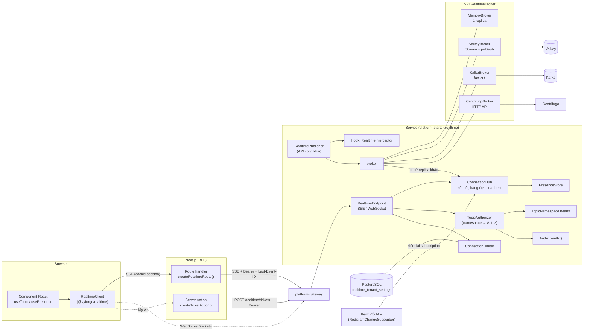
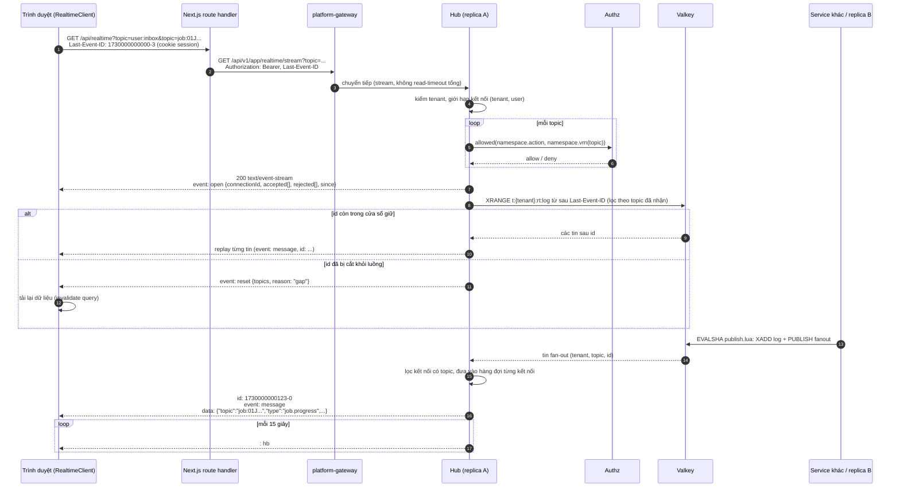
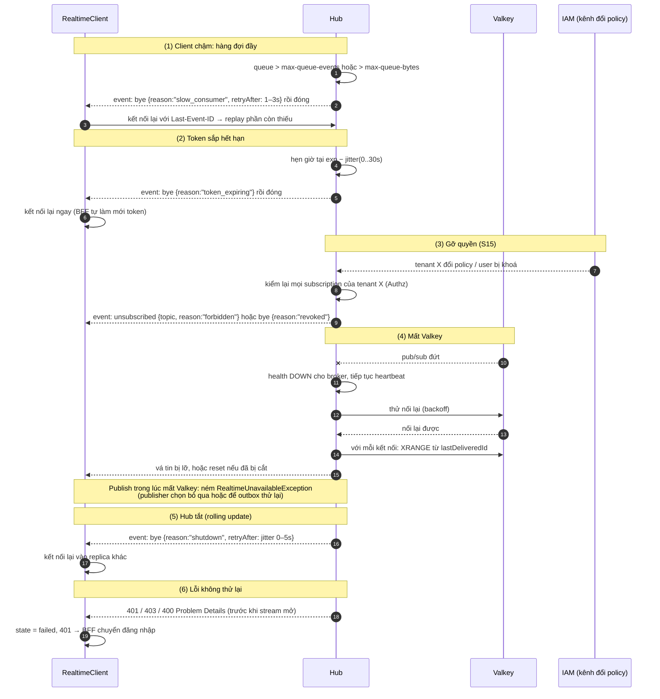
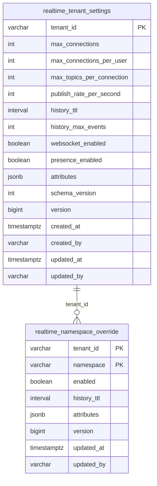

# Thiết kế module realtime (`platform-starter-realtime`, `@vyforge/realtime`)

> **Trạng thái:** bản thiết kế chờ duyệt (26/10/2026). Nền: platform-java 0.12.0, platform-web 0.9.0. Bản triển khai
> đầu tiên nhắm `0.13.0`.
>
> Liên quan: [MODULE_PLAN.md](../MODULE_PLAN.md) (K15: SSE mặc định, WebSocket chỉ khi cần hai chiều),
> [nghiên cứu module thông dụng §3.19](../research/2026-10-module-thong-dung.md), ADR-0009 (IAM), ADR-0010 (gateway),
> ADR-0015 (tenant ở tầng dữ liệu), quy ước module P1.

## Tóm tắt quyết định

| # | Quyết định | Lý do ngắn |
|---|---|---|
| R1 | Realtime là **kênh báo tin, không phải nguồn dữ liệu**. Trạng thái thật luôn nằm ở DB của module nghiệp vụ. Client mất tin thì nhận `reset` và tải lại | Centrifugo, Socket.IO, Ably đều nói rõ recovery không đảm bảo tuyệt đối. Thiết kế quanh điều đó thì đơn giản và đúng |
| R2 | Mặc định **SSE** qua BFF Next.js. **WebSocket** là transport thứ hai dùng cùng hub, cùng mô hình topic, chỉ bật khi cần hai chiều | K15. SSE đi qua gateway WebMVC và route handler Next.js; WebSocket thì chưa (mục 3.6) |
| R3 | **Một kết nối cho mỗi tab**, gộp nhiều topic. Không mở một EventSource cho mỗi component | Tránh giới hạn 6 kết nối HTTP/1.1 mỗi origin, tiết kiệm kết nối ở hub |
| R4 | Topic có **namespace khai báo bằng code**. Namespace quyết định quyền subscribe (IAM action + VRN), history, presence, quyền publish từ client. Tenant **không nằm trong tên topic**: luôn lấy từ token | Học Centrifugo (namespace + tuỳ chọn kênh) và Pusher (tiền tố kiểu kênh). Tenant ngoài tên topic thì không thể đọc chéo tenant bằng cách đoán tên |
| R5 | **Một luồng sự kiện theo tenant** (Valkey Stream, giữ ngắn hạn), `Last-Event-ID` là id trong luồng đó | Học Mercure (id toàn hub): một id cho cả kết nối nhiều topic, không cần vector offset như Centrifugo |
| R6 | Fan-out giữa replica: **Valkey pub/sub** (mặc định), **Kafka** (tuỳ chọn), **bộ nhớ** (một replica). Chọn qua SPI `RealtimeBroker` | Valkey đã là phụ thuộc chung (MODULE_PLAN §Redis) |
| R7 | Vượt ngưỡng thì chuyển sang **Centrifugo** (Apache-2.0) bằng adapter: app vẫn gọi `RealtimePublisher`, frontend đổi transport. **Mercure** chỉ để trong tài liệu, chưa làm adapter | Hub Mercure là AGPL-3.0; Centrifugo có proxy subscribe để giữ authz ở app |
| R8 | Publish trong transaction thì **gửi sau commit**. Việc cần chắc chắn thì publish từ listener outbox của Spring Modulith | Không báo tin cho dữ liệu chưa commit |
| R9 | Kết nối sống tối đa đến `exp` của token (cắt sớm có jitter). Quyền được **kiểm lại** khi IAM đổi policy | Không để kết nối giữ quyền sau khi token hết hạn hoặc bị gỡ quyền (lỗi Supabase ghi rõ trong tài liệu của họ) |
| R10 | Frontend: package riêng **`@vyforge/realtime`**, có cầu nối tuỳ chọn sang TanStack Query (`@vyforge/realtime/query`) | Realtime dùng được cả khi không có TanStack Query; `@vyforge/query` giữ gọn |

---

## 1. Bài toán và phạm vi

### 1.1 Use case

Ứng dụng Vyforge cần đẩy thay đổi từ server tới trình duyệt mà không bắt người dùng tải lại trang, và không để mỗi dự
án tự viết `SseEmitter`, tự giữ danh sách kết nối, tự fan-out giữa replica, tự kiểm quyền theo kiểu riêng. Cách tự làm
thường hỏng ở ba chỗ: chạy nhiều replica thì mất tin, kết nối lại thì mất tin, và kiểm quyền khi subscribe bị quên nên
đọc được dữ liệu của tenant khác.

### 1.2 Kịch bản nghiệp vụ phải đáp ứng

| # | Kịch bản | Topic (ví dụ) | Chiều | Yêu cầu đặc thù |
|---|---|---|---|---|
| S1 | **Inbox thông báo in-app**: badge số chưa đọc, toast khi có thông báo mới (module notification) | `user:inbox` | server → client | Chỉ chủ inbox nhận. Đọc trên tab này thì tab khác giảm badge. Mất tin thì tải lại số đếm |
| S2 | **Tiến độ xuất Excel/PDF lớn** (module export): 0–100%, xong thì có link tải | `job:<jobId>` | server → client | Tin dày (mỗi 1–2 giây), chỉ cần **tin mới nhất** (recovery kiểu cache). Người tạo job hoặc người có quyền đọc job mới xem được |
| S3 | **Tiến độ nhập file** (import danh sách khách hàng, hàng nghìn dòng): số dòng lỗi, dòng xong | `job:<jobId>` | server → client | Như S2, kèm danh sách lỗi theo lô |
| S4 | **Trạng thái thanh toán VNPay/MoMo/VietQR/ZaloPay**: trang "Đang chờ thanh toán" chuyển sang "Thành công" khi IPN về (module payment) | `payment:<intentId>` | server → client | Chỉ đổi trạng thái theo IPN đã kiểm chữ ký (B25). Không tin redirect. Trang phải tự kiểm lại bằng API khi nhận `reset` hoặc khi kết nối lại |
| S5 | **Chuyển khoản VietQR đối soát tự động**: quầy thu ngân thấy "đã nhận 1.250.000 đ" ngay khi ngân hàng báo biến động số dư | `payment:<intentId>`, `tenant:cashier/<storeId>` | server → client | Màn hình quầy là thiết bị dùng chung, đăng nhập tài khoản cửa hàng; kết nối mở suốt ca làm việc (8–12 giờ) |
| S6 | **Kết quả quét virus file upload** (module files): ảnh CCCD vừa tải lên chuyển từ "đang quét" sang "sạch" | `file:<fileId>` | server → client | Tin ít, quan trọng: client phải gọi API kiểm lại nếu nhận `reset` |
| S7 | **Bảng điều phối đơn hàng/giao vận**: đơn mới, đổi trạng thái giao, theo thời gian thực cho nhân viên kho của một chi nhánh | `res:orders:branch/<branchId>` | server → client | Lọc theo chi nhánh bằng điều kiện IAM (`resource.branchId`); nhiều người xem cùng topic |
| S8 | **Thông báo toàn tenant**: "Hệ thống bảo trì lúc 22:00", buộc tải lại khi có bản mới | `tenant:broadcast` | server → client | Mọi người trong tenant; không lộ sang tenant khác |
| S9 | **Presence và khoá mềm khi sửa hồ sơ**: "Chị Lan đang sửa hồ sơ bệnh nhân này", tránh hai người cùng sửa | `doc:patient/<id>` | hai chiều (presence) | Danh sách ai đang xem; join/leave; dữ liệu presence là dữ liệu cá nhân (mục 8) |
| S10 | **Chat hỗ trợ khách hàng / chat nội bộ ca trực**: tin nhắn, "đang gõ…" | `chat:<roomId>` | hai chiều (WebSocket) | Tin "đang gõ" không lưu, tin chat lưu ở module chat của dự án (realtime chỉ báo) |
| S11 | **Cộng tác** (bảng kanban, ghi chú chung): kéo thẻ thì người khác thấy ngay | `doc:board/<id>` | hai chiều | Publish từ client đi qua hook kiểm quyền và validate, rồi app quyết định ghi DB |
| S12 | **Hàng đợi khám bệnh / quầy giao dịch**: màn hình gọi số ở sảnh (thiết bị không có người dùng) | `tenant:queue/<counterId>` | server → client | Thiết bị dùng tài khoản service (client credentials) với quyền chỉ đọc topic; kết nối chạy cả ngày |
| S13 | **Đơn vị hành chính công / ngân hàng chạy on-prem**, chỉ có PostgreSQL + Valkey một node, không Kafka | mọi loại | — | Module chạy được với Valkey một instance; một replica thì chạy được không cần Valkey |
| S14 | **Giờ cao điểm** (flash sale, ngày cuối nộp hồ sơ, kỳ đăng ký tín chỉ): hàng chục nghìn người đang mở trang chờ | `tenant:broadcast`, `job:*` | server → client | Giới hạn kết nối theo tenant, chống một tenant chiếm hết; có ngưỡng chuyển sang Centrifugo |
| S15 | **Thu hồi quyền ngay**: nhân viên nghỉ việc bị khoá tài khoản, hoặc bị gỡ khỏi group "Kho Hà Nội" | — | — | Kết nối bị đóng hoặc topic bị huỷ trong vài giây, không đợi token hết hạn |

Kịch bản tương lai mà thiết kế phải không cản: app mobile (Expo) dùng cùng topic qua SSE hoặc WebSocket; đẩy dữ liệu
dashboard theo kiểu "cache" (giá, chỉ số); bridge từ thay đổi DB (CDC) sang topic; service khác không chứa hub vẫn
publish được.

### 1.3 Ngoài phạm vi

- **Lưu trữ lâu dài.** Inbox, lịch sử chat, log tiến độ thuộc module nghiệp vụ. Realtime chỉ giữ vài phút để kết nối lại.
- **Push notification ra thiết bị** (FCM/APNs/Zalo): thuộc module notification. Realtime chỉ phục vụ client đang mở.
- **CRDT, đồng bộ tài liệu kiểu Google Docs** (Yjs, Automerge): app tự chọn thư viện, có thể chở qua WebSocket của module.
- **Đảm bảo exactly-once.** Client có thể nhận trùng (khi replay chồng với tin live); mỗi tin có `id`, client tự bỏ trùng.

---

## 2. Nghiên cứu

Phiên bản và license kiểm bằng GitHub API (`gh api repos/<repo>/releases`) và npm ngày 26/10/2026. Đặc tính kỹ thuật đọc
từ tài liệu chính thức trong các link dưới.

### 2.1 Hệ thống tham khảo

| Hệ thống | Phiên bản, license | Mô hình dữ liệu | API | Điểm mạnh | Điểm yếu (với Vyforge) |
|---|---|---|---|---|---|
| **Centrifugo** ([repo](https://github.com/centrifugal/centrifugo), [channels](https://centrifugal.dev/docs/server/channels), [history & recovery](https://centrifugal.dev/docs/server/history_and_recovery), [proxy](https://centrifugal.dev/docs/server/proxy), [server API](https://centrifugal.dev/docs/server/server_api)) | v6.10.2 (23/10/2026), Apache-2.0 (bản PRO thương mại). SDK `centrifuge` 5.8.0, MIT | Channel là chuỗi, tạo ngầm. **Namespace** trước dấu `:` mang tuỳ chọn (`presence`, `join_leave`, `history_size` + `history_ttl`, `force_recovery`, `allow_publish_for_client`…). Kênh giới hạn theo user `news#42`. Kênh private `$` cần subscription token. Mỗi kênh là một stream có `offset` + `epoch` | Server API `POST /api/publish` (`channel`, `data`, `idempotency_key`, `tags`), `broadcast`, `presence`, `history`, `disconnect`, `unsubscribe`, `subscribe` (server-side). Proxy connect/subscribe/publish/refresh gọi về backend | Recovery rõ ràng: `recovered: true/false`, không bao giờ trả nửa vời. Hai chế độ `stream` và `cache`. Positioning phát hiện mất tin. Proxy giữ quyền ở backend. Hỗ trợ cả transport một chiều (`uni_sse`, `uni_http_stream`) | Thêm một service cần vận hành (Redis/Valkey engine khi nhiều node). Recovery theo **từng kênh** (client giữ offset từng kênh). Subscribe proxy không áp dụng cho transport một chiều: phải đăng ký kênh lúc connect. Tính năng CEL, batching nằm ở PRO |
| **Mercure** ([repo](https://github.com/dunglas/mercure), [spec](https://mercure.rocks/spec)) | v1.1.5 (25/10/2026). Hub **AGPL-3.0**; spec là IETF draft | Topic là IRI, khớp `exact` hoặc `urlpattern`. Update có `id` toàn hub. Update `private` chỉ gửi cho subscriber có quyền | Subscribe `GET` hub, `Last-Event-ID` (header hoặc `last_event_id`), giá trị `earliest`; hub trả `Mercure-Last-Event-ID` để client biết có mất tin. Publish `POST` form (`topic`, `data`, `private`, `id`, `type`, `retry`). Quyền bằng JWT `authorization_details` (RFC 9396). Subscriptions API cho presence | Thuần SSE, rất hợp với kiến trúc SSE-trước. **Một id cho cả hub** nên một kết nối nhiều topic kết nối lại bằng một `Last-Event-ID`. Cấm token trên query string | AGPL: đóng gói cho khách on-prem cần pháp chế duyệt. Quyền theo topic nằm trong JWT do app ký, nên khó áp policy IAM có `Condition` theo thuộc tính resource. Không có hai chiều |
| **Socket.IO** ([repo](https://github.com/socketio/socket.io), [connection state recovery](https://socket.io/docs/v4/connection-state-recovery)) | 4.8.4 (25/09/2026), MIT | Namespace + room (server gán), event có tên. Adapter (Redis, Postgres…) để fan-out | Server Node.js; `socket.join(room)`, `io.to(room).emit()` | Mô hình room do server gán: client không tự xin vào phòng nên khó lộ dữ liệu. Ack, middleware | Server chỉ có Node.js. Giao thức riêng (Engine.IO). Recovery từ 4.6: giữ trạng thái `maxDisconnectionDuration` mặc định 2 phút, **tài liệu nói rõ không đảm bảo** và app vẫn phải tự đồng bộ lại |
| **Ably** ([connection states](https://ably.com/docs/connect/states)) | SaaS; SDK `ably` 2.30.0, Apache-2.0 | Channel, presence set, history, capability theo channel trong token | Pub/sub, presence enter/leave, history `untilAttach` | Máy trạng thái kết nối rõ (`connecting`, `connected`, `disconnected`, `suspended`, `failed`…). Resume trong ~2 phút; quá hạn thì báo `resumed: false` để app tự tải lại | SaaS nước ngoài, dữ liệu ra khỏi VN (mục 8). Không dùng được on-prem |
| **Pusher Channels** ([channels](https://pusher.com/docs/channels/using_channels/channels/)) | SaaS; `pusher-js` 8.6.0, MIT | Kiểu kênh nằm trong **tiền tố tên**: public, `private-`, `presence-`, `private-encrypted-`; kênh cache giữ tin cuối. Tên ≤ 164 ký tự | Endpoint auth của app ký quyền subscribe kênh private | Quy ước tiền tố dễ hiểu, nhìn tên biết cần kiểm quyền gì. Kênh cache giống chế độ `cache` của Centrifugo | Không có history/replay. SaaS |
| **Supabase Realtime** ([repo](https://github.com/supabase/realtime), [authorization](https://supabase.com/docs/guides/realtime/authorization)) | v2.148.0, Apache-2.0 | Broadcast, presence, Postgres changes. Quyền bằng RLS trên bảng `realtime.messages`, hàm `realtime.topic()` | Join channel `private: true` | Quyền khai báo một chỗ (policy DB) | **Quyền cache suốt kết nối**: bị gỡ quyền vẫn nhận tin tới khi JWT hết hạn. Đây là lỗi thiết kế cần tránh (S15) |
| **Spring WebSocket/STOMP** ([broker relay](https://docs.spring.io/spring-framework/reference/web/websocket/stomp/handle-broker-relay.html)) | Spring Framework 7.0.10 (Boot 4.1), Apache-2.0 | Destination `/topic`, `/queue`, `/user` | `@MessageMapping`, `SimpMessagingTemplate` | Có sẵn trong Spring, có heartbeat của STOMP | Simple broker **không chạy được nhiều node** (tài liệu Spring nói thẳng); muốn cluster phải có RabbitMQ/ActiveMQ làm broker relay. Thêm một hệ message broker chỉ để đẩy tin là không đáng |
| **SSE trong Spring MVC** ([async requests](https://docs.spring.io/spring-framework/reference/web/webmvc/mvc-ann-async.html)) | Spring Framework 7.0.10 | `SseEmitter` | Trả `SseEmitter` từ controller, gửi từ thread khác | Có sẵn, chạy trên Tomcat của template | Servlet **không báo khi client ngắt**: chỉ biết khi ghi lỗi, nên phải có heartbeat. Ghi là blocking; executor mặc định không dùng cho production. Không có fan-out, replay, quyền |

Chuẩn nền: [WHATWG HTML – Server-sent events](https://html.spec.whatwg.org/multipage/server-sent-events.html): trường
`event`, `data`, `id`, `retry`; trình duyệt gửi `Last-Event-ID` khi kết nối lại; status khác 200 hoặc content type khác
`text/event-stream` thì EventSource **dừng hẳn**, không kết nối lại; nên gửi comment `:` khoảng 15 giây một lần để proxy
không cắt. `EventSource` chỉ nhận URL và `withCredentials`, không đặt được header.

### 2.2 Ràng buộc từ hạ tầng hiện có (đã kiểm trong code)

| Chỗ | Phát hiện | Hệ quả |
|---|---|---|
| `platform-gateway` (Spring Cloud Gateway **Server WebMVC**, Spring Cloud 2025.1.4 → gateway 5.0.x) | SSE: `AbstractProxyExchange` flush sau mỗi lần đọc khi content type thuộc `streaming-media-types` (mặc định có `text/event-stream`, so `equalsTypeAndSubtype` từ 5.0.2, [#3948](https://github.com/spring-cloud/spring-cloud-gateway/issues/3948)). Bộ đệm `streaming-buffer-size` 16 KB | SSE đi qua gateway được về mặt flush |
| Gateway gọi service bằng `JdkClientHttpRequestFactory` (image không có Apache HttpClient/Jetty/Reactor Netty) | Trong Spring Framework 7.0.x, `JdkClientHttpRequest.TimeoutHandler` dùng `completeOnTimeout(read-timeout)` rồi **đóng body**: read-timeout là **tổng thời gian**, không phải thời gian chờ giữa hai gói. `UPSTREAM_READ_TIMEOUT` mặc định 30 s | **Mọi luồng SSE qua gateway hiện bị cắt sau 30 giây** dù có heartbeat. Phải sửa ở gateway (mục 3.6) |
| Gateway WebMVC và WebSocket | Hỗ trợ WebSocket cho Server WebMVC mới merge ngày 15/10/2026 ([#4324](https://github.com/spring-cloud/spring-cloud-gateway/pull/4324), sửa [#3442](https://github.com/spring-cloud/spring-cloud-gateway/issues/3442)), milestone **5.1.0** (Spring Cloud 2026.0, hiện mới RC1) | Gateway hiện tại **không proxy được WebSocket**. Transport WebSocket chờ gateway lên Spring Cloud 2026.0 hoặc đi route ingress riêng |
| Gateway rate limit `200/50 req/s` theo `sub` | Một lần mở SSE = một request | Kết nối lại dồn dập vẫn nằm trong hạn mức; client phải backoff có jitter |
| Next.js (BFF, `next` 16.4.3) gọi backend bằng `fetch` (undici 8.x) | undici `bodyTimeout` mặc định 300 s và là **idle timeout** giữa hai chunk ([Client.md](https://github.com/nodejs/undici/blob/main/docs/docs/api/Client.md)) | Heartbeat 15 s giữ được luồng qua BFF. Route handler phải huỷ fetch lên backend khi trình duyệt ngắt (`request.signal`) |
| `platform-starter-authz` | `Authz.allowed(action, vrn)` đọc principal từ `SecurityContext`; `RedisIamChangePublisher` phát sự kiện đổi policy theo tenant trên kênh Redis | Kiểm quyền khi subscribe dùng thẳng `Authz`. Nghe kênh đổi IAM để kiểm lại các subscription đang mở (S15) |
| Valkey | Pub/sub là **at-most-once** ([pubsub](https://valkey.io/topics/pubsub/)); có sharded pub/sub (`SPUBLISH`) cho cluster. Stream có id `ms-seq` luôn tăng, cắt bằng `MAXLEN ~`/`MINID` ([XADD](https://valkey.io/commands/xadd/)). Valkey 9.0.6, BSD-3-Clause | Fan-out bằng pub/sub, replay bằng Stream. Khi subscriber Valkey đứt rồi nối lại, hub tự vá khoảng hở từ Stream (mục 3.4) |

### 2.3 Học theo và không làm

**Học theo:**

- **Namespace mang tuỳ chọn và quyền** (Centrifugo, Pusher): nhìn tên topic biết cách kiểm quyền, history, presence.
- **Recovery hai trạng thái** (Centrifugo `recovered`, Ably `resumed`): hoặc vá đủ, hoặc báo `reset` rõ ràng. Không
  bao giờ vá một phần rồi im lặng.
- **Hai chế độ recovery `stream` và `cache`** (Centrifugo): tiến độ job chỉ cần tin mới nhất, inbox cần đủ chuỗi.
- **Một id cho cả luồng** (Mercure): một kết nối nhiều topic, một `Last-Event-ID`.
- **`Mercure-Last-Event-ID`**: hub trả lại vị trí bắt đầu để client tự biết có mất tin hay không.
- **Không đặt access token trên query string** (Mercure). Khi buộc phải đi qua URL (WebSocket, kết nối thẳng) thì dùng
  vé dùng một lần, sống 30 giây.
- **Quyền giữ ở backend qua proxy** (Centrifugo subscribe proxy): khi chuyển sang Centrifugo, policy IAM vẫn ở app.
- **Máy trạng thái kết nối phía client** (Ably): `connecting → open → reconnecting → closed/failed` để UI hiển thị đúng.
- **Room do server quyết định** (Socket.IO): client xin topic, server kiểm và có thể từ chối từng topic.

**Không làm:**

- **Không dùng STOMP.** Simple broker không chạy nhiều node; broker relay cần RabbitMQ. Giao thức JSON riêng của module
  đủ nhỏ và giống envelope SSE.
- **Không dùng SockJS/long-polling fallback.** Trình duyệt hiện đại đều có SSE và WebSocket.
- **Không cache quyền suốt kết nối** (lỗi Supabase).
- **Không dùng SaaS (Ably, Pusher) làm mặc định**: dữ liệu ra nước ngoài, không chạy được on-prem.
- **Không làm adapter Mercure ở bản đầu**: hub AGPL, quyền trong JWT khó khớp IAM có `Condition`.
- **Không giữ offset theo từng topic ở client** như Centrifugo: phức tạp khi một kết nối có hàng chục topic.
- **Không lưu tin lâu dài trong realtime.**

---

## 3. Kiến trúc

### 3.1 Sơ đồ thành phần



Ba chế độ triển khai, chọn bằng `vyforge.realtime.mode`:

| Chế độ | Mở endpoint kết nối | Publish | Khi nào |
|---|---|---|---|
| `hub` (mặc định) | Có | Có | Service phục vụ trình duyệt |
| `publisher` | Không | Có, ghi thẳng vào broker | Service nền (worker export, consumer IPN) không nhận kết nối; hub là service khác dùng **cùng Valkey và cùng `vyforge.realtime.cluster`** |
| `off` | Không | No-op (ghi log debug) | Test, CLI |

### 3.2 Port và adapter

| Loại | Interface | Cài sẵn | Ghi chú |
|---|---|---|---|
| API công khai | `RealtimePublisher` | `DefaultRealtimePublisher` | Gọi từ code nghiệp vụ. Không phụ thuộc Servlet |
| API công khai | `PresenceService` | `DefaultPresenceService` | Đọc danh sách đang online của topic (server side) |
| API công khai | `RealtimeConnections` | — | Đóng kết nối của user (`disconnectUser(sub)`), đếm kết nối; dùng cho S15 và màn quản trị |
| SPI | `RealtimeBroker` | `memory`, `valkey`, `kafka`, `centrifugo` | Ghi log + fan-out + replay. Chọn bằng `vyforge.realtime.broker` |
| SPI | `PresenceStore` | `memory`, `valkey` | Valkey: ZSET theo topic, điểm là hạn sống |
| SPI | `TopicNamespace` | `user`, `tenant`, `job`, `res` | App khai báo thêm namespace bằng bean |
| SPI | `TopicAuthorizer` | `IamTopicAuthorizer` | Mặc định đọc action + VRN từ namespace rồi gọi `Authz`. Namespace có thể tự cài |
| SPI | `RealtimeTransport` | `sse`, `websocket` | Transport mới (vd. HTTP streaming NDJSON cho app mobile) cài thêm không sửa lõi |
| Hook | `RealtimeInterceptor` | — | `beforePublish`, `afterPublish`, `beforeSubscribe`, `afterSubscribe`, `onClientMessage`, `onDisconnect` |
| Hook | `ClientMessageHandler` | — | Xử lý tin client gửi lên qua WebSocket theo namespace (S10, S11) |
| SPI | `RealtimeSettingsProvider` | `JdbcRealtimeSettingsProvider` (bảng `realtime_tenant_settings`) + mặc định từ cấu hình | Giới hạn theo tenant |

### 3.3 Luồng chính: mở kết nối SSE và nhận tin



### 3.4 Luồng lỗi



Chi tiết từng chế độ lỗi nằm ở mục 7.3.

### 3.5 Mô hình topic

**Cú pháp:** `<namespace>:<path>`

- `namespace`: `^[a-z][a-z0-9-]{1,31}$`
- `path`: `^[A-Za-z0-9._~@=/-]{1,200}$`, không có `..`, không bắt đầu hoặc kết thúc bằng `/`
- Tổng độ dài ≤ 232. Không có wildcard ở bản đầu. Mỗi kết nối tối đa `max-topics-per-connection` topic (mặc định 50).

**Tenant không bao giờ nằm trong tên topic.** Hub luôn ghép `TenantContext.require()` của kết nối. Trong Valkey key có
dạng `t:<tenant>:rt:...` theo quy ước cache của platform-core. Client của tenant A gửi `user:inbox` thì chỉ chạm được
dữ liệu tenant A.

**Namespace dựng sẵn:**

| Namespace | Ví dụ | Ai subscribe được | History | Presence | Client publish |
|---|---|---|---|---|---|
| `user` | `user:inbox`, `user:jobs` | Chỉ chính người dùng. Path **không** chứa `sub`; hub tự gắn `sub` của token (như kênh `#` của Centrifugo nhưng không để client ghi id) | `stream` | Không | Không |
| `tenant` | `tenant:broadcast`, `tenant:cashier/store-12` | Mọi người trong tenant có action `realtime:tenant-topic:Subscribe` trên `vrn:realtime:tenant-topic/<path>` (policy mặc định cho phép `tenant:broadcast`) | `stream` | Tuỳ chọn | Không |
| `job` | `job:01J9Z...` | Người tạo job (khớp `ownerSub` trong metadata job), hoặc có `realtime:job:Subscribe` | `cache` (chỉ tin mới nhất) | Không | Không |
| `res` | `res:orders:branch/hn-01` | Có action `<service>:<type>:Get` trên `vrn:<service>:<type>/<id>` (path chính là VRN bỏ tiền tố `vrn:`) | `stream` | Tuỳ chọn | Không |

App khai báo namespace riêng (S9, S10, S11) bằng bean `TopicNamespace` (mục 6.1). Topic có namespace chưa khai báo bị từ
chối (`realtime.unknown_namespace`), như Centrifugo trả `102: unknown channel`.

`job` cần biết chủ job: `RealtimePublisher.job(jobId).owner(sub)` ghi metadata `t:<tenant>:rt:job:<jobId>` (TTL bằng
history). Module export và files chỉ cần gọi một lần khi tạo job (mục 5.3).

### 3.6 Đường đi qua gateway và BFF

**SSE (mặc định):** trình duyệt → route handler Next.js (cookie session) → gateway (Bearer) → hub.

Lý do đi qua BFF: token chỉ nằm ở server (ADR-0006), `EventSource`/`fetch` của trình duyệt không cần biết token. Route
handler:

- gọi `getAccessToken()`, mở `fetch` lên backend kèm `Authorization`, `Last-Event-ID`, `Accept: text/event-stream`;
- trả `Response(upstream.body)` ngay (không đọc hết rồi mới trả), header `Cache-Control: no-cache, no-transform`,
  `X-Accel-Buffering: no`, `Connection: keep-alive`;
- nối `request.signal` vào `AbortController` của fetch để đóng kết nối lên backend khi tab đóng;
- 401/403/429 từ backend trả nguyên status và Problem Details để client không thử lại sai.

**Việc cần làm ở `platform-gateway`** (ghi vào báo cáo, làm ở branch của gateway, không thuộc module này):

1. **Bắt buộc: bỏ read-timeout tổng cho luồng stream.** Hai cách, chọn cách (a):
   - (a) Thêm `org.apache.httpcomponents.client5:httpclient5`. Boot tự chọn `HttpComponentsClientHttpRequestFactory`,
     khi đó read-timeout là **socket timeout giữa hai gói**, đúng nghĩa với SSE có heartbeat 15 s. Giữ `30s` cho API
     thường. Cần chạy lại e2e của gateway vì đổi HTTP client.
   - (b) Route riêng cho `/api/v*/*/realtime/stream` dùng request factory không có read-timeout.
2. Rate limit: không tính request `GET .../realtime/stream` vào bucket chung, hoặc dùng rule riêng (10/phút theo `sub`)
   để bão kết nối lại không ăn hết hạn mức API.
3. `BodySizeLimitFilter`, `HeaderSanitizingFilter` giữ nguyên; không có filter nào đọc hết response body trên path
   stream (tránh lỗi kiểu [#2275](https://github.com/spring-cloud/spring-cloud-gateway/issues/2275)).
4. **WebSocket:** chờ gateway lên Spring Cloud 2026.0 (gateway 5.1.0 có WebSocket cho WebMVC). Trước đó, route
   ingress `/api/v1/<svc>/realtime/ws` đi thẳng tới service (service tự kiểm vé, vé chỉ cấp cho người đã có JWT hợp lệ
   qua gateway). Ghi trong chart của dự án.
5. Ingress/nginx trước gateway: `proxy_buffering off` (hoặc tôn trọng `X-Accel-Buffering: no`),
   `proxy_read_timeout ≥ 60s`, HTTP/2 tới trình duyệt.
6. Test e2e: luồng SSE sống > 2 phút qua gateway, heartbeat tới đủ, đóng phía client thì service thấy kết nối đóng.

**WebSocket và kết nối thẳng:** Next.js route handler không proxy được WebSocket. Trình duyệt xin **vé** bằng Server
Action (`createTicketAction`, BFF gọi `POST /realtime/tickets` kèm Bearer), rồi mở
`wss://<gateway>/api/v1/<svc>/realtime/ws?ticket=<vé>`. Cùng vé dùng được cho SSE thẳng
(`/realtime/stream?ticket=`) khi muốn giảm tải cho Next.js.

Vé:

- là chuỗi ngẫu nhiên 256 bit, không phải JWT;
- lưu `t:<tenant>:rt:ticket:<sha256(vé)>` → `{claims, exp, topics?}`, **TTL 30 s, dùng một lần** (`GETDEL`);
- hub dựng lại `JwtAuthenticationToken` từ claims đã lưu để `Authz` chạy như request thường; kết nối vẫn sống tối đa
  tới `exp` của token gốc;
- giá trị vé bị che trong access log (`ticket=***`).

### 3.7 Mô hình phân phối và thứ tự

- **Thứ tự:** trong một tenant, tin có thứ tự theo id của Stream (Valkey) hoặc offset partition (Kafka, key = tenant).
  Giữa các tenant không có thứ tự chung.
- **Đảm bảo:** live là at-most-once, cộng replay trong cửa sổ giữ. Hết cửa sổ thì `reset`. Client có thể nhận trùng một
  tin khi replay chồng với tin live; `RealtimeClient` bỏ trùng theo id (giữ 256 id gần nhất).
- **Publish sau commit:** `RealtimePublisher` gọi trong transaction thì đăng ký `TransactionSynchronization.afterCommit`.
  Rollback thì không gửi. Muốn chắc chắn gửi khi app chết ngay sau commit thì publish từ `@ApplicationModuleListener`
  (outbox của Spring Modulith gửi lại).
- **Idempotency:** `RealtimeMessage.dedupKey` (tuỳ chọn). Broker Valkey bỏ tin trùng key trong 5 phút
  (`SET NX` trong script). Dùng khi publish từ listener outbox có thể chạy lại.

---

## 4. Mô hình dữ liệu

### 4.1 Dữ liệu ngắn hạn (Valkey)

Mọi key có tiền tố `t:<tenant>:rt:` (quy ước platform-core) và `vyforge.realtime.cluster` (mặc định
`spring.application.name`) để nhiều app dùng chung một Valkey không đụng nhau: `t:<tenant>:rt:<cluster>:...`.

| Key | Kiểu | Nội dung | Hạn |
|---|---|---|---|
| `…:log` | Stream | Mỗi entry: `topic`, `type`, `v` (schema version), `data` (JSON), `ts`, `dk` (dedup key), `ps` (publisher sub/system) | `XADD … MINID ~ <now − history.ttl>` và `MAXLEN ~ history.max-events`; key `PEXPIRE` = ttl × 2 |
| `…:last:<topic>` | String | Tin cuối của topic namespace kiểu `cache` (JSON + id) | `history.ttl` |
| `…:dedup:<dk>` | String | id đã cấp | 5 phút |
| `…:presence:<topic>` | ZSET | member = `connectionId`, score = hạn sống (ms) | Làm mới mỗi heartbeat; member quá hạn bị xoá khi đọc |
| `…:presence:<topic>:info` | Hash | `connectionId` → `{sub, displayName?, meta}` (đã lọc qua `PresenceInfoMapper`) | Theo ZSET |
| `…:conn:tenant` | ZSET | `connectionId` → hạn sống; đếm kết nối của tenant | Như presence |
| `…:conn:user:<sub>` | ZSET | như trên, theo user | Như presence |
| `…:job:<jobId>` | Hash | `ownerSub`, `kind`, `createdAt` | `history.ttl` sau tin cuối |
| `…:ticket:<sha256>` | String | claims + topics xin trước | 30 s, `GETDEL` |
| Kênh pub/sub `rt:<cluster>:fanout:{<shard>}` | channel | Envelope: `tenant`, `id`, `topic`, `type`, `v`, `data`, `ts`, `userSub?` | — |

Fan-out dùng **N shard cố định** (mặc định 16, `hash(tenant) mod N`), mỗi replica subscribe đủ N kênh. Valkey cluster
dùng `SPUBLISH/SSUBSCRIBE` (sharded pub/sub) để tin không đi khắp cluster bus. Mọi replica nhận mọi tin rồi lọc tại chỗ:
đơn giản, hợp tier 0–2 (đến vài nghìn tin/giây). Vượt ngưỡng thì chuyển sang Centrifugo (mục 7.5), không tối ưu thêm.

**Publish là một script Lua** (một round-trip, nguyên tử): kiểm `dedup`, `XADD` có cắt, ghi `last` nếu là `cache`,
`PUBLISH` envelope có id vừa cấp. Nhờ cùng script nên thứ tự trên pub/sub khớp thứ tự trong Stream.

**Tin cho một user** (`user:*`) lưu `userSub` trong envelope; hub chỉ giao cho kết nối có `sub` đó. Replay lọc theo cả
topic lẫn `sub`.

**Kafka broker:** topic Kafka `vyforge.realtime.<cluster>` (12 partition, key = tenant, retention 1 giờ). Mỗi replica
dùng consumer group riêng (`<cluster>-<podId>`), bắt đầu từ `latest`, không commit offset. Id tin =
`k<partition>-<offset>`. Replay đọc lại partition của tenant từ offset (Kafka giữ được theo retention). Kafka chỉ đáng
dùng khi dự án đã có Kafka mà không có Valkey; presence và giới hạn kết nối khi đó chạy trong bộ nhớ từng replica (ghi
rõ là xấp xỉ).

### 4.2 Dữ liệu bền (PostgreSQL)

Chỉ cấu hình theo tenant. Tin nhắn không bao giờ vào PostgreSQL.



DDL dự kiến: `classpath:META-INF/vyforge/db/realtime/R__vyforge_realtime.sql`. Migration loại lặp lại như
scheduling, viết idempotent (`create table if not exists`, `add column if not exists`). Lý do không dùng dải số
riêng: version cao (vd. `V1300`) nằm chung bảng lịch sử Flyway với migration của dự án, nên migration `V5` dự án thêm
sau đó bị coi là out-of-order và Flyway từ chối. Đổi schema về sau thì sửa file `R__` theo kiểu cộng thêm (thêm cột
nullable, thêm bảng), không đổi tên hay xoá cột; Flyway chạy lại file khi checksum đổi.

```sql
-- Giới hạn và tuỳ chọn realtime theo tenant. Không có dòng → dùng mặc định vyforge.realtime.defaults.*.
create table if not exists realtime_tenant_settings (
    tenant_id                  varchar(63) primary key,
    max_connections            integer      check (max_connections is null or max_connections >= 0),
    max_connections_per_user   integer      check (max_connections_per_user is null or max_connections_per_user >= 0),
    max_topics_per_connection  integer      check (max_topics_per_connection is null or max_topics_per_connection between 1 and 500),
    publish_rate_per_second    integer      check (publish_rate_per_second is null or publish_rate_per_second >= 0),
    history_ttl                interval     check (history_ttl is null or history_ttl <= interval '1 hour'),
    history_max_events         integer      check (history_max_events is null or history_max_events between 0 and 100000),
    websocket_enabled          boolean,
    presence_enabled           boolean,
    attributes                 jsonb        not null default '{}'::jsonb,
    schema_version             integer      not null default 1,
    version                    bigint       not null default 0,
    created_at                 timestamptz  not null default now(),
    created_by                 varchar(255) not null,
    updated_at                 timestamptz  not null default now(),
    updated_by                 varchar(255) not null
);

-- Tắt hoặc chỉnh một namespace cho một tenant (vd. tenant không mua gói cộng tác → tắt namespace doc).
create table if not exists realtime_namespace_override (
    tenant_id    varchar(63)  not null,
    namespace    varchar(32)  not null,          -- kiểm bằng code (namespace phải được khai báo), không FK, không enum
    enabled      boolean      not null default true,
    history_ttl  interval,
    attributes   jsonb        not null default '{}'::jsonb,
    version      bigint       not null default 0,
    updated_at   timestamptz  not null default now(),
    updated_by   varchar(255) not null,
    primary key (tenant_id, namespace)
);
```

- Khoá chính bắt đầu bằng `tenant_id`, nên không cần index thêm. Bảng nhỏ (một dòng mỗi tenant).
- Entity kế thừa `TenantEntity`; đọc qua cache `realtime-settings` (TTL 60 s, xoá khi sửa qua API, xoá mọi replica qua
  kênh đổi cấu hình `rt:<cluster>:settings`).
- `attributes` chỉ nhận khoá đã đăng ký (`RealtimeSettingsAttributes`), validate bằng code. `schema_version` cho phép
  đổi cấu trúc `attributes` sau này bằng migration dữ liệu có version.
- Không có partition/retention: bảng cấu hình. Không lưu secret: provider (Centrifugo key) là cấu hình cấp deployment
  (mục 10).
- Hai bảng có RLS mẫu như README platform-core (tier 2 bật).

### 4.3 Envelope và tiến hoá schema

Mọi tin, mọi transport, cùng một envelope:

```json
{
  "id": "1730000000123-0",
  "topic": "job:01J9ZQ7S6Y",
  "type": "job.progress",
  "v": 1,
  "ts": "2026-10-26T08:00:00.123Z",
  "data": { "percent": 42, "processed": 4200, "total": 10000 }
}
```

- `type`: `<miền>.<sự kiện>` chữ thường (`notification.created`, `job.progress`, `payment.status_changed`). Không có
  enum toàn cục; mỗi module tự công bố danh sách type của mình trong README.
- `v`: version schema của `data` theo từng `type`. Thêm field là tương thích ngược (giữ `v`). Đổi nghĩa hoặc xoá field
  thì tăng `v`; publisher gửi cả hai version trong giai đoạn chuyển nếu cần (`RealtimeMessage.alternate(v, data)`), client
  lấy version cao nhất nó hiểu.
- `data` ≤ `max-message-bytes` (mặc định 16 KB). Tin lớn hơn bị từ chối khi publish (`realtime.message_too_large`):
  realtime chở **tín hiệu và tóm tắt**, client gọi API để lấy chi tiết.
- **SSE wire format:**

  ```text
  id: 1730000000123-0
  event: message
  data: {"topic":"job:01J9ZQ7S6Y","type":"job.progress","v":1,"ts":"...","data":{...}}

  ```

  Trường `event` của SSE chỉ dùng cho tin điều khiển: `open`, `message`, `presence`, `reset`, `unsubscribed`, `bye`.
  Client không phải `addEventListener` theo từng type nghiệp vụ. Tin điều khiển không có `id` để không đè vị trí
  `Last-Event-ID`.
- **WebSocket:** một frame text JSON mỗi tin, cùng envelope, thêm `"op"` (`message`, `presence`, `reset`, `ack`…).
  Client gửi `{"op":"subscribe","topics":[...]}`, `{"op":"unsubscribe",...}`, `{"op":"publish","topic":...,"type":...,
  "data":...,"ref":"c-17"}`, `{"op":"presence.update","meta":{...}}`, `{"op":"ping"}`. Server trả `ack`/`error` theo
  `ref`. Giao thức có tên con `vyforge.realtime.v1` (`Sec-WebSocket-Protocol`) để đổi version sau này.

---

## 5. API

### 5.1 Java

```java
package com.vyforge.platform.realtime;

/** Gửi tin realtime. Gọi trong transaction thì gửi sau commit; rollback thì bỏ. Tenant lấy từ TenantContext. */
public interface RealtimePublisher {

    /** Topic của tenant hiện tại, vd. publish("res:orders:branch/hn-01", "order.created", dto). */
    PublishResult publish(String topic, String type, Object data);

    PublishResult publish(RealtimeMessage message);

    /** Topic user:<path> của một người dùng cụ thể (không cần là người đang đăng nhập). */
    PublishResult toUser(String sub, String path, String type, Object data);

    /** Topic job:<jobId>; owner() đăng ký chủ job để namespace job kiểm quyền. */
    JobChannel job(String jobId);

    /** Gửi cùng tin cho nhiều topic trong một round-trip (như broadcast của Centrifugo). */
    List<PublishResult> broadcast(Collection<String> topics, String type, Object data);
}

public interface JobChannel {
    JobChannel owner(String sub);
    PublishResult progress(int percent, Map<String, ?> details);   // type job.progress
    PublishResult completed(Map<String, ?> result);                // type job.completed
    PublishResult failed(String errorCode, Map<String, ?> params); // type job.failed (code ổn định, dịch ở client)
}

/** Builder; topic, type bắt buộc. */
public record RealtimeMessage(
        String topic,
        String type,
        int schemaVersion,
        Object data,
        @Nullable String userSub,
        @Nullable String dedupKey,
        Map<String, String> attributes) {
    public static Builder builder(String topic, String type) { ... }
}

/** {@code id} rỗng khi gửi đã hoãn tới sau commit hoặc bị interceptor chặn. */
public record PublishResult(Optional<String> id, Status status) {
    public enum Status { SENT, DEFERRED_AFTER_COMMIT, DUPLICATE, VETOED }
}

public interface PresenceService {
    List<PresenceEntry> list(String topic);         // tenant hiện tại
    PresenceStats stats(String topic);              // số kết nối, số user
}

public interface RealtimeConnections {
    int disconnectUser(String sub, DisconnectReason reason);   // trong tenant hiện tại, mọi replica
    int disconnectTenant(DisconnectReason reason);             // bảo trì, khoá tenant
    ConnectionStats stats();                                   // tenant hiện tại
}

/** Khai báo một namespace. Bean. */
public interface TopicNamespace {
    String name();
    NamespaceOptions options();                        // history, presence, clientPublish, recovery mode
    SubscribeDecision authorize(TopicRef topic, RealtimePrincipal principal); // mặc định: Authz theo action/vrn
}

public record NamespaceOptions(
        RecoveryMode recovery,            // STREAM | CACHE | NONE
        Duration historyTtl,
        boolean presence,
        boolean joinLeave,
        boolean clientPublish,
        @Nullable String subscribeAction,         // vd. "crm:order:Get"
        @Nullable Function<TopicRef, String> vrn) {}  // vd. t -> "vrn:crm:order/" + t.path()

/** Hook. Mọi method có mặc định rỗng. */
public interface RealtimeInterceptor {
    default RealtimeMessage beforePublish(RealtimeMessage m) { return m; }   // trả null để chặn
    default void afterPublish(RealtimeMessage m, PublishResult r) {}
    default SubscribeDecision beforeSubscribe(TopicRef t, RealtimePrincipal p) { return SubscribeDecision.ABSTAIN; }
    default void afterSubscribe(TopicRef t, RealtimePrincipal p) {}
    default void onDisconnect(ConnectionInfo c, DisconnectReason r) {}
}

/** Tin client gửi lên qua WebSocket cho namespace có clientPublish = true. */
public interface ClientMessageHandler {
    String namespace();
    ClientMessageResult handle(TopicRef topic, ClientMessage message, RealtimePrincipal principal);
}
```

Tiện ích kiểu annotation cho trường hợp đơn giản:

```java
@RealtimeEvent(topic = "'res:orders:branch/' + branchId()", type = "order.created")
public record OrderCreated(String tenantId, UUID orderId, String branchId) implements TenantAwareEvent {}
```

Event Spring có `@RealtimeEvent` được tự publish sau commit (listener `@TransactionalEventListener(AFTER_COMMIT)`;
`data` là chính record trừ khi có `dataMapper`). Đây là cách nối với module khác mà không cần code realtime biết module
đó.

Mã lỗi (Problem Details, `platform-errors` vi/en): `realtime.unknown_namespace`, `realtime.invalid_topic`,
`realtime.forbidden_topic`, `realtime.too_many_topics`, `realtime.connection_limit` (429, `Retry-After`),
`realtime.ticket_invalid`, `realtime.message_too_large`, `realtime.unavailable` (503), `realtime.transport_disabled`.

### 5.2 REST (phác thảo OpenAPI)

```yaml
paths:
  /api/v1/realtime/stream:
    get:
      summary: Mở luồng SSE
      parameters:
        - { name: topic, in: query, required: true, schema: { type: array, items: { type: string } }, style: form, explode: true }
        - { name: Last-Event-ID, in: header, schema: { type: string } }
        - { name: last_event_id, in: query, schema: { type: string }, description: dùng khi không đặt được header }
        - { name: ticket, in: query, schema: { type: string }, description: thay cho Bearer khi kết nối thẳng }
      responses:
        '200': { description: text/event-stream, headers: { Realtime-Last-Event-ID: { schema: { type: string } } } }
        '400': { $ref: '#/components/responses/Problem' }   # realtime.invalid_topic, too_many_topics
        '401': { $ref: '#/components/responses/Problem' }
        '403': { $ref: '#/components/responses/Problem' }   # khi MỌI topic bị từ chối; từ chối một phần nằm trong event open
        '429': { $ref: '#/components/responses/Problem' }   # realtime.connection_limit + Retry-After
  /api/v1/realtime/ws:
    get: { summary: Nâng cấp WebSocket (subprotocol vyforge.realtime.v1), parameters: [ticket] }
  /api/v1/realtime/tickets:
    post:
      summary: Cấp vé dùng một lần (30 s) cho WebSocket hoặc SSE thẳng
      requestBody: { content: { application/json: { schema: { properties: { topics: { type: array } } } } } }
      responses: { '201': { content: { application/json: { schema: { properties: { ticket: {}, expiresAt: {} } } } } } }
  /api/v1/realtime/presence:
    get: { summary: Danh sách presence của topic (cần quyền subscribe topic), parameters: [topic] }
  /api/v1/realtime/admin/settings:
    get: { summary: Cấu hình realtime của tenant hiện tại, x-action: "realtime:settings:Get" }
    put: { summary: Sửa (If-Match theo version), x-action: "realtime:settings:Update" }
  /api/v1/realtime/admin/connections:
    get: { summary: Thống kê kết nối của tenant, x-action: "realtime:connection:List" }
  /api/v1/realtime/admin/connections/users/{sub}:
    delete: { summary: Đóng mọi kết nối của user, x-action: "realtime:connection:Disconnect" }
```

Path có thể đổi tiền tố bằng `vyforge.realtime.base-path` (mặc định `/api/v1/realtime`). Qua gateway thì là
`/api/v1/<service>/realtime/...`.

**Action catalog** (`RealtimeActions`, bean `ActionCatalog`):

| Action | Resource | Ý nghĩa |
|---|---|---|
| `realtime:tenant-topic:Subscribe` | `vrn:realtime:tenant-topic/<path>` | Subscribe topic `tenant:*` |
| `realtime:tenant-topic:Publish` | như trên | Publish từ client vào namespace cho phép |
| `realtime:job:Subscribe` | `vrn:realtime:job/<jobId>` | Xem tiến độ job không phải của mình (admin, hỗ trợ) |
| `realtime:presence:List` | `vrn:realtime:presence/<topic>` | Gọi REST presence |
| `realtime:settings:Get` / `Update` | `vrn:realtime:settings/current` | Quản trị cấu hình tenant |
| `realtime:connection:List` / `Disconnect` | `vrn:realtime:connection/*` | Thống kê, đá kết nối |

Policy mặc định của tenant admin (iam-server, `vyforge:TenantAdministrator`) thêm `realtime:*`. Người dùng thường có
`realtime:tenant-topic:Subscribe` trên `vrn:realtime:tenant-topic/broadcast`.

### 5.3 Điểm nối với module khác (chốt hợp đồng)

Các module P1 khác làm song song, nên realtime **không phụ thuộc code của chúng** và chúng **không bắt buộc phụ thuộc
realtime**. Hợp đồng là topic, type và schema dưới đây. Module nào có realtime trên classpath thì dùng
`ObjectProvider<RealtimePublisher>` (vắng thì bỏ qua), hoặc đánh dấu event công khai của mình bằng `@RealtimeEvent` ở
app.

| Module | Topic | Type | `data` (v1) | Ai publish |
|---|---|---|---|---|
| notification | `user:inbox` (`toUser(sub, "inbox", …)`) | `notification.created` | `{ id, category, title, unreadCount }` (title đã render theo locale người nhận; không chứa PII nhạy cảm) | Kênh in-app của notification, sau khi lưu inbox |
| notification | `user:inbox` | `notification.read`, `notification.unread_count` | `{ ids[] }`, `{ unreadCount }` | Khi đánh dấu đã đọc (đồng bộ nhiều tab) |
| export | `job:<exportJobId>` | `job.progress` / `job.completed` / `job.failed` | `{ percent, processed, total }` / `{ fileId, downloadUrlExpiresAt }` / `{ code, params }` | Worker export; `job(id).owner(sub)` lúc tạo job |
| files | `file:<fileId>` (namespace do files khai báo, quyền `files:file:Get`) | `file.scan_completed` | `{ fileId, status: CLEAN\|INFECTED\|FAILED }` | Sau khi quét virus |
| payment | `payment:<intentId>` (namespace do payment khai báo, quyền `payment:intent:Get`) | `payment.status_changed` | `{ intentId, status, amount, currency }` | Sau khi IPN đã kiểm chữ ký và đổi trạng thái (B25). Client vẫn gọi API xác nhận trạng thái cuối |
| webhooks | (không dùng) | — | — | — |
| features | `tenant:features` | `features.changed` | `{ keys[] }` | Khi đổi cờ, để frontend tải lại evaluation |

Namespace `file` và `payment` do starter files/payment khai báo bằng bean `TopicNamespace` khi có realtime trên
classpath (`@ConditionalOnClass(TopicNamespace.class)`). Cho tới khi họ làm, realtime có sẵn namespace `res` dùng được
ngay: `res:payment:intent/<id>` với action `payment:intent:Get`.

### 5.4 Event công khai của realtime

Spring application event (không ra Kafka mặc định; app tự `@Externalized` nếu cần):

| Event | Khi | Dùng để |
|---|---|---|
| `RealtimeConnectionOpened(tenantId, connectionId, sub, transport, topics)` | Mở kết nối | Thống kê, "last seen" |
| `RealtimeConnectionClosed(tenantId, connectionId, sub, reason, duration)` | Đóng | Như trên |
| `RealtimeSubscriptionRejected(tenantId, sub, topic, code)` | Từ chối topic | Phát hiện dò topic (audit `realtime.subscribe.denied` khi vượt ngưỡng) |
| `PresenceChanged(tenantId, topic, connectionId, sub, JOIN\|LEAVE)` | Join/leave | Khoá mềm (S9) |
| `RealtimeSettingsChanged(tenantId, version)` | Sửa cấu hình | Xoá cache |

### 5.5 Frontend: `@vyforge/realtime`

Package riêng trong platform-web. Không có peer dependency bắt buộc ngoài React; `@tanstack/react-query` là peer
tuỳ chọn cho entry `./query`; `centrifuge` là peer tuỳ chọn cho entry `./centrifugo`.

| Entry | Nội dung |
|---|---|
| `@vyforge/realtime` | `createRealtimeClient({ url, transport?, backoff?, onStateChange? })`: một kết nối gộp topic, đếm tham chiếu subscription, gộp thay đổi topic trong 50 ms rồi mở lại kết nối với `Last-Event-ID`, bỏ trùng theo id, backoff mũ có jitter đầy đủ (1 s → 30 s, tôn trọng `retry:` và `Retry-After`), dừng khi 401/403, tạm dừng khi `offline`, nối lại khi `online`/`visibilitychange`. Parser SSE dùng `eventsource-parser` 4.1.3 (MIT) trên `fetch`, không dùng `EventSource` (để đọc status, Problem Details, `Retry-After`) |
| `@vyforge/realtime/react` | `RealtimeProvider`, `useTopic(topic, onMessage, { types? })`, `useLatest(topic)` (cho namespace `cache`, trả tin cuối), `usePresence(topic)`, `useConnectionState()`; nhãn trạng thái vi/en (`realtimeLabels`) và `ConnectionIndicator` dùng `@vyforge/ui` |
| `@vyforge/realtime/query` | `useInvalidateOnEvent(topic, queryKey \| (msg) => queryKey)`: nhận tin hoặc `reset` thì `invalidateQueries`. Đây là cách dùng khuyến nghị: realtime báo, TanStack Query tải dữ liệu thật |
| `@vyforge/realtime/server` | `createRealtimeRoute({ baseUrl, path, getAccessToken, allowedNamespaces? })` cho route handler Next.js (mục 3.6); `createTicketAction({ baseUrl, getAccessToken, authorize })` |
| `@vyforge/realtime/websocket` | Transport WebSocket (cùng `RealtimeClient`), tự xin vé qua Server Action, có `publish()` và `presence.update()` |
| `@vyforge/realtime/centrifugo` | Transport dùng `centrifuge` 5.8.0 khi backend chuyển sang Centrifugo (mục 6.4) |

Ví dụ:

```tsx
// app/api/realtime/route.ts
import { createRealtimeRoute } from '@vyforge/realtime/server';
export const dynamic = 'force-dynamic';
export const { GET } = createRealtimeRoute({ baseUrl: () => env().API_BASE_URL, path: '/api/v1/app/realtime/stream', getAccessToken });

// component client
const { data: count } = useQuery(unreadCountQuery);
useInvalidateOnEvent('user:inbox', ['notifications', 'unread-count']);
useTopic('user:inbox', (m) => m.type === 'notification.created' && toast(m.data.title));

const progress = useLatest<JobProgress>(`job:${jobId}`);   // { percent, processed, total } | undefined
```

Hook tên `useEventStream` trong MODULE_PLAN đổi thành `useTopic` (giữ `useEventStream` làm alias): một kết nối nhiều
topic, nên tên theo topic rõ hơn tên theo stream.

---

## 6. Mở rộng

### 6.1 Thêm namespace (ví dụ khoá mềm hồ sơ bệnh nhân, S9)

```java
@Bean
TopicNamespace patientDocNamespace() {
    return TopicNamespace.builder("doc")
            .recovery(RecoveryMode.NONE)                     // presence không cần replay
            .presence(true).joinLeave(true)
            .clientPublish(true)                             // tin "đang sửa trường X"
            .subscribeAction("emr:patient:Get", t -> "vrn:emr:patient/" + t.pathAfter("patient/"))
            .build();
}

@Bean
ClientMessageHandler patientEditing(PatientLocks locks) {
    return ClientMessageHandler.of("doc", (topic, msg, principal) -> {
        if (!msg.type().equals("doc.editing")) return ClientMessageResult.reject("realtime.type_not_allowed");
        locks.touch(topic.pathAfter("patient/"), principal.sub());   // app quyết định ghi gì
        return ClientMessageResult.broadcast(msg.withData(Map.of("field", msg.data().get("field"))));
    });
}
```

### 6.2 Hook (ví dụ che dữ liệu, chặn theo gói dịch vụ)

```java
@Component
class PlanGate implements RealtimeInterceptor {
    public SubscribeDecision beforeSubscribe(TopicRef t, RealtimePrincipal p) {
        return t.namespace().equals("doc") && !features.isEnabled("collaboration")
                ? SubscribeDecision.deny("realtime.feature_disabled") : SubscribeDecision.ABSTAIN;
    }
}
```

Thứ tự quyết định khi subscribe: namespace tồn tại và bật cho tenant (override) → interceptor (`DENY` thắng) →
`TopicNamespace.authorize` (mặc định `Authz`). `ABSTAIN` từ mọi interceptor thì theo namespace.

### 6.3 Cấu hình theo tenant

Mặc định cấp platform ở `vyforge.realtime.defaults.*`; tenant ghi đè bằng bảng `realtime_tenant_settings` qua API quản
trị. Ví dụ: tenant "benh-vien-a" tăng `max_connections` lên 3.000 cho màn gọi số; tenant gói Basic tắt namespace `doc`
bằng `realtime_namespace_override`.

### 6.4 Thêm broker / provider (ví dụ Centrifugo)

`CentrifugoBroker implements RealtimeBroker`:

- **Publish:** `POST <centrifugo>/api/publish` (`X-API-Key`), channel `<ns>:<tenant>.<path>` (tenant thành phần đầu path
  vì namespace của Centrifugo nằm trước `:`). `idempotency_key` = `dedupKey`. Kênh `user:*` dùng `user:<tenant>.<path>#<sub>`
  (kênh giới hạn theo user của Centrifugo).
- **Kết nối:** endpoint `POST /realtime/centrifugo/token` của app cấp connection JWT (HMAC, `sub`, `exp` = exp của token
  gốc, `info` tenant), frontend dùng transport `@vyforge/realtime/centrifugo`.
- **Quyền subscribe:** bật subscribe proxy của Centrifugo trỏ về `POST /realtime/centrifugo/subscribe` của app, endpoint
  này chạy **cùng `TopicAuthorizer`**. Policy IAM không đổi. Kiểm lại định kỳ qua sub-refresh proxy (≤ 1 phút).
- **Recovery:** dùng history của Centrifugo (`history_size`, `history_ttl`, `force_recovery`; `force_recovery_mode:
  cache` cho `job`); `reset` của client map từ `recovered: false`.
- **Gỡ quyền:** `RealtimeConnections.disconnectUser` gọi API `disconnect`.

Thêm broker mới: cài `RealtimeBroker` (+ `PresenceStore` nếu có), khai báo `RealtimeBrokerFactory` qua
`META-INF/spring/...AutoConfiguration.imports` hoặc bean, chọn bằng `vyforge.realtime.broker=<tên>`. Bộ test hợp đồng
`RealtimeBrokerContractTests` (trong `platform-test`) chạy cho mọi broker: thứ tự trong tenant, replay sau id, `reset`
khi id quá cũ, cách ly tenant, dedup.

### 6.5 Thêm transport

`RealtimeTransport` nhận `ConnectionHandle` (gửi envelope, đóng, đọc tin client). Ví dụ transport NDJSON cho app mobile
không có parser SSE: một class, một bean, không sửa hub.

---

## 7. Vận hành

### 7.1 Cấu hình

```yaml
vyforge:
  realtime:
    mode: hub                       # hub | publisher | off
    broker: auto                    # auto: valkey nếu có spring.data.redis, ngược lại memory; valkey | kafka | memory | centrifugo
    cluster: ${spring.application.name}
    base-path: /api/v1/realtime
    transports:
      sse: { enabled: true }
      websocket: { enabled: false, allowed-origins: [] }
    heartbeat: 15s                  # comment SSE / ping WebSocket
    max-connection-lifetime: 1h     # cắt sớm hơn exp của token nếu exp xa hơn; có jitter 10%
    token-expiry-jitter: 30s
    ticket-ttl: 30s
    fanout-shards: 16
    queue:
      max-events: 256               # mỗi kết nối
      max-bytes: 1MB
    defaults:                       # tenant không có dòng trong realtime_tenant_settings
      max-connections: 2000
      max-connections-per-user: 10
      max-topics-per-connection: 50
      publish-rate-per-second: 200  # mỗi tenant, chống một tenant làm ngập fan-out
      history-ttl: 5m
      history-max-events: 5000
      max-message-bytes: 16KB
    presence:
      ttl: 45s                      # 3 × heartbeat
    recheck-on-iam-change: true
    centrifugo:
      api-url: http://centrifugo:8000/api
      api-key: ${CENTRIFUGO_API_KEY:}
      token-hmac-secret: ${CENTRIFUGO_TOKEN_SECRET:}
```

Cần thêm ở app: `spring.mvc.async.request-timeout: -1` cho path stream (hub đặt timeout riêng trên `SseEmitter` bằng
`max-connection-lifetime`, không dựa vào mặc định của container); Tomcat `server.tomcat.max-connections` (mặc định
8192) cộng kết nối HTTP thường, tính khi đặt `max-connections` của tenant.

### 7.2 Metric, span, log, health

| Metric (`vyforge.realtime.*`) | Loại | Tag |
|---|---|---|
| `connections.active` | gauge | `transport`, `tenant`* |
| `connections.opened` / `connections.closed` | counter | `transport`, `reason` (`client`, `token_expiring`, `slow_consumer`, `revoked`, `shutdown`, `error`) |
| `subscriptions.rejected` | counter | `namespace`, `code` |
| `messages.published` | counter | `namespace`, `broker`, `result` |
| `messages.delivered` | counter | `namespace`, `transport` |
| `messages.dropped` | counter | `reason` (`queue_full`, `too_large`, `vetoed`) |
| `publish.latency` | timer | `broker` |
| `delivery.lag` | timer (ts publish → ghi ra socket) | `transport` |
| `replay.events` / `replay.resets` | counter | `reason` (`gap`, `unknown_id`) |
| `queue.depth` | distribution summary | — |
| `broker.reconnects` | counter | `broker` |

\* `tenant` chỉ bật bằng `vyforge.realtime.metrics.tenant-tag=true` (tránh bùng cardinality khi nhiều tenant).

- **Span OTel:** `realtime.publish` (attribute `realtime.namespace`, `realtime.type`, không có `data`),
  `realtime.subscribe`; trace id của request publish đi trong envelope nội bộ (không gửi xuống client) để nối span giao
  tin.
- **Log:** MDC `tenant_id`, `request_id`, `connection_id`; không log `data` (có thể chứa PII), chỉ log topic và type.
- **Health:** `realtimeBroker` (Valkey/Kafka/Centrifugo thật sự nhận và giao được tin: publish ping vào kênh riêng và
  chờ nhận). Mặc định **không** nằm trong readiness: mất Valkey thì hub vẫn giữ kết nối và heartbeat, không nên bị rút
  khỏi load balancer (giống gateway với rate limit).

### 7.3 Chế độ lỗi

| Lỗi | Hành vi | Client thấy |
|---|---|---|
| Valkey mất | Publish ném `RealtimeUnavailableException` (code `realtime.unavailable`); `publishQuietly()` chỉ log + metric. Hub giữ kết nối, thử nối lại có backoff; nối lại được thì vá từ Stream cho từng kết nối | Không nhận tin trong lúc mất; sau đó nhận bù hoặc `reset` |
| Valkey mất dữ liệu (restart không persistence) | Stream mất, id cũ không còn | `reset` khi kết nối lại (`unknown_id`) |
| Client chậm, hàng đợi đầy | Đóng kết nối đó (`slow_consumer`); không chặn thread fan-out | Kết nối lại, replay |
| Token hết hạn | Đóng trước `exp` | Kết nối lại trong suốt |
| Gỡ quyền / khoá user | Kiểm lại hoặc đóng trong vài giây (kênh đổi IAM; `disconnectUser` từ auth-server webhook hoặc admin) | `unsubscribed` / `bye revoked` |
| Hub rolling update | `SmartLifecycle.stop`: gửi `bye shutdown` có `retryAfter` ngẫu nhiên 0–5 s, chờ tối đa 5 s | Kết nối lại rải đều, không dồn |
| Vượt giới hạn kết nối | 429 `realtime.connection_limit`, `Retry-After` | Backoff, hiển thị "quá nhiều tab" khi do giới hạn theo user |
| Gateway cắt luồng (timeout cấu hình sai) | — | Kết nối lại mỗi lần cắt; metric `connections.closed{reason=client}` tăng bất thường → alert |
| Một tenant publish dồn dập | Vượt `publish-rate-per-second` → `RateLimitException` (dùng `-ratelimit`, bucket `t:<tenant>:rt:publish`) | Không ảnh hưởng tenant khác |

### 7.4 Alert gợi ý

- `connections.closed{reason="slow_consumer"}` > 1% số kết nối trong 10 phút.
- `replay.resets` / `connections.opened` > 5% trong 15 phút (cửa sổ history quá ngắn hoặc Valkey mất dữ liệu).
- `delivery.lag` p99 > 2 s trong 5 phút.
- `broker.reconnects` > 3 trong 5 phút; health `realtimeBroker` DOWN > 1 phút.
- `connections.active` > 80% `server.tomcat.max-connections` của pod.

### 7.5 Giới hạn tải và dung lượng

Ước lượng cho hub nhúng trong app Spring Boot (Tomcat + virtual thread, JDK 25):

| Thành phần | Ước lượng | Cơ sở |
|---|---|---|
| Bộ nhớ mỗi kết nối SSE | ~20–40 KB (socket, buffer Tomcat, `SseEmitter`, hàng đợi rỗng) + tối đa `queue.max-bytes` khi chậm | Đo lại bằng k6 trong bản triển khai |
| Thread | Một virtual thread ghi cho mỗi kết nối (đọc hàng đợi rồi ghi blocking); fan-out không bao giờ ghi trực tiếp lên socket | Ghi Servlet là blocking (tài liệu Spring) |
| Một pod 1 vCPU / 1 GB | Mục tiêu 5.000 kết nối, 500 tin/giây giao | Kiểm bằng k6 (`vyforge-ci load-test`) |
| Valkey Stream | 5.000 tin × ~1 KB × số tenant hoạt động; 100 tenant ≈ 500 MB tối đa, thực tế thấp hơn nhiều vì `MINID` 5 phút | Cắt theo cả thời gian và số lượng |
| Fan-out | Mỗi replica nhận mọi tin của cluster | Hợp đến ~2.000 tin/giây tổng |

**Ngưỡng chuyển sang Centrifugo** (ghi ADR khi chạm): > 20.000 kết nối đồng thời, hoặc > 2.000 tin/giây tổng, hoặc
cần cộng tác hai chiều tần suất cao cho nhiều người, hoặc cần SDK mobile native có recovery. Chuyển bằng
`vyforge.realtime.broker=centrifugo` + đổi transport frontend; code nghiệp vụ không đổi.

---

## 8. Bảo mật và tuân thủ

### 8.1 Bảo mật

- **Xác thực:** endpoint stream/ws dùng resource server của `-security` (JWT, `aud`). Vé chỉ cấp cho JWT hợp lệ, dùng
  một lần, 30 s, không phải token, bị che trong log.
- **Cách ly tenant:** tenant không có trong tên topic; mọi key Valkey/Kafka có tenant; envelope fan-out có tenant và hub
  so với tenant của kết nối trước khi giao (phòng thủ hai lớp). `TenantIsolationTests` cho Stream và presence. Luật
  ArchUnit `TENANT_ISOLATION` áp cho entity cấu hình.
- **Kiểm quyền mỗi topic khi subscribe**, kiểm lại khi IAM đổi (S15), đóng kết nối ở `exp`. Từ chối không tiết lộ topic
  có tồn tại hay không (cùng một `realtime.forbidden_topic`).
- **Chống dò topic:** từ chối nhiều lần (mặc định 20/phút/kết nối) thì đóng kết nối và ghi audit
  `realtime.subscribe.denied`.
- **WebSocket:** kiểm `Origin` theo `allowed-origins` (chống Cross-Site WebSocket Hijacking); giới hạn kích thước frame
  (64 KB) và tốc độ tin client (`@RateLimited` theo connection); tin client luôn qua `ClientMessageHandler` của app,
  không bao giờ fan-out thẳng.
- **Không lộ secret:** API quản trị không trả `centrifugo.api-key`; vé lưu dạng hash.
- **CSRF:** SSE là GET không đổi trạng thái; vé tạo bằng Server Action (Next.js đã kiểm Origin).
- **DoS:** giới hạn kết nối theo tenant và user, giới hạn topic mỗi kết nối, giới hạn kích thước tin, rate limit
  publish theo tenant, hàng đợi có trần.

### 8.2 Luật 91/2025/QH15 và NĐ 356/2025/NĐ-CP

Realtime chạm dữ liệu cá nhân ở ba chỗ: nội dung tin (`data`), presence (ai đang online, đang xem hồ sơ nào: dữ liệu về
hoạt động của người dùng), và log kết nối (sub, IP).

| Yêu cầu | Cách đáp ứng |
|---|---|
| Tối thiểu hoá | Envelope chỉ chở tín hiệu và tóm tắt; khuyến nghị (và lint trong README) không đưa CCCD, số điện thoại, chẩn đoán vào `data`, client gọi API có kiểm quyền để lấy chi tiết. `max-message-bytes` 16 KB củng cố việc này |
| Thời hạn lưu | Tin chỉ giữ trong Valkey tối đa `history-ttl` (mặc định 5 phút, trần 1 giờ ở DB check). Presence hết hạn sau 45 s khi rời. Không ghi tin vào PostgreSQL hay log |
| Dữ liệu nhạy cảm (sức khoẻ, tài chính) | Namespace có thể đặt `sensitive=true`: `data` không được ghi vào Stream (recovery `NONE` hoặc chỉ lưu `type` + id tham chiếu), chỉ giao live |
| Presence | `PresenceInfoMapper` quyết định trường nào lộ ra (mặc định `sub` + `displayName`, không email). App có thể tắt presence theo tenant. Ghi vào danh mục hoạt động xử lý dữ liệu của dự án |
| Log và audit | Log qua `LogSafeJson` của `-privacy`; không log `data`; IP chỉ ở access log theo chính sách chung |
| Chuyển dữ liệu ra nước ngoài | Mặc định tự host. Dùng SaaS (Ably/Pusher) là quyết định của dự án, phải qua đánh giá tác động chuyển dữ liệu ra nước ngoài; platform không cài adapter SaaS |
| Quyền của chủ thể dữ liệu | Không có dữ liệu bền nào về người dùng trong realtime ngoài cấu hình tenant, nên yêu cầu xoá/xuất không cần xử lý riêng; tin đã hết hạn tự mất |

Ngành: thanh toán (S4, S5) theo B25 — realtime **không bao giờ** là căn cứ đổi trạng thái, chỉ báo cho UI sau khi IPN
đã kiểm chữ ký. Y tế (S9): bật `sensitive` cho namespace chứa hồ sơ bệnh án.

---

## 9. Kế hoạch triển khai

### 9.1 Java: `platform-starter-realtime` (0.13.0-SNAPSHOT)

Thứ tự:

1. **Lõi không phụ thuộc Servlet:** `Topic`/`TopicRef` (parse, validate), `TopicNamespace` + 4 namespace dựng sẵn,
   `RealtimeMessage`, envelope JSON, `RealtimePublisher` (sau commit, dedup, rate limit tenant), `RealtimeInterceptor`.
2. **`ConnectionHub`:** đăng ký kết nối, hàng đợi có trần, virtual thread ghi, heartbeat, cắt theo `exp`/lifetime,
   shutdown nhẹ nhàng, bỏ trùng.
3. **Broker `memory`** (ring buffer theo tenant) + bộ test hợp đồng broker.
4. **Transport SSE** (`SseEmitter`), endpoint `/stream`, `TopicAuthorizer` qua `Authz`, Problem Details + i18n.
5. **Broker `valkey`:** script Lua publish, Stream replay, fan-out pub/sub có shard, vá khoảng hở khi nối lại;
   `PresenceStore` và `ConnectionLimiter` trên Valkey.
6. **Cấu hình tenant:** bảng, entity, cache, API quản trị, action catalog.
7. **Kiểm lại quyền khi IAM đổi:** nghe `IamChangePublisher.CHANNEL`; `RealtimeConnections.disconnectUser`.
8. **Vé + transport WebSocket** (Spring WebSocket thuần `TextWebSocketHandler`, subprotocol `vyforge.realtime.v1`),
   `ClientMessageHandler`, presence update.
9. **`@RealtimeEvent`**, metric, span, health.
10. **Broker `kafka`** (fan-out broadcast, replay theo offset).
11. README, mục ADR-0020.

Test:

| Loại | Nội dung |
|---|---|
| Unit | Parse/validate topic; namespace authorize; dedup; backoff cắt `exp`; hàng đợi đầy → `slow_consumer`; envelope versioning |
| Hợp đồng broker | `RealtimeBrokerContractTests` chạy với memory, Valkey (Testcontainers `RedisTestcontainer` với image Valkey), Kafka (`KafkaTestcontainer`) |
| Tích hợp SSE | `@SpringBootTest(webEnvironment = RANDOM_PORT)` + `java.net.http.HttpClient` đọc stream thật: nhận tin, `Last-Event-ID` replay, `reset` khi id quá cũ, 403 topic, từ chối một phần trong `open` |
| Hai replica | Hai `ApplicationContext` chung một Valkey: publish ở A, nhận ở B; giết pub/sub của B rồi nối lại → vá đủ tin |
| Cách ly tenant | User tenant A subscribe `user:inbox`, `tenant:broadcast` không nhận tin của tenant B; `TenantIsolationTests` cho cấu hình |
| Mất Valkey | Dừng container giữa chừng: hub sống, publish báo `realtime.unavailable`, nối lại thì vá (yêu cầu MODULE_PLAN §Redis) |
| IAM | Gỡ policy → `unsubscribed` trong < 5 s; token hết hạn → `bye token_expiring` |
| WebSocket | Vé dùng một lần, vé hết hạn, Origin sai, publish client qua handler |
| Kiến trúc | `PlatformArchitectureRules` + `TENANT_ISOLATION`, `ModularityAssertions` |

### 9.2 Web: `packages/realtime` (`@vyforge/realtime`)

1. Parser + `RealtimeClient` (máy trạng thái, backoff, dedup, gộp topic).
2. `@vyforge/realtime/react`, `@vyforge/realtime/query`.
3. `@vyforge/realtime/server` (`createRealtimeRoute`, `createTicketAction`).
4. Transport WebSocket.
5. Ví dụ trong `examples/next-app` (badge inbox giả lập + tiến độ job).

Test: Vitest với `ReadableStream` giả (tin, heartbeat, đứt giữa chừng, 401/429 + `Retry-After`, `Last-Event-ID` gửi
đúng, bỏ trùng); test route handler (abort upstream khi client đóng, chuyển tiếp status); lint, typecheck, build.

### 9.3 Để bản sau

- Broker `centrifugo` + transport `@vyforge/realtime/centrifugo` (làm khi có dự án chạm ngưỡng mục 7.5; thiết kế đã chốt
  ở 6.4 để không phải đổi API).
- Chia sẻ một kết nối giữa nhiều tab (BroadcastChannel + bầu leader). HTTP/2 đã giảm vấn đề giới hạn kết nối.
- Wildcard topic (`res:orders:branch/*`).
- `RemoteTopicAuthorizer`: hub ở service A kiểm quyền topic thuộc service B bằng cách gọi `/iam/me/evaluate` của B
  (đường đi đã có ở gateway).
- Broker PostgreSQL `LISTEN/NOTIFY` cho dự án không có Valkey mà chạy nhiều replica (payload ≤ 8000 byte, gửi lúc commit).
- Màn quản trị trong `platform-admin` (thống kê kết nối, cấu hình tenant).
- Adapter Mercure (nếu pháp chế chấp nhận AGPL cho hub chạy riêng).

---

## 10. Lệch quy ước và quyết định cần người dùng chọn

### 10.1 Lệch quy ước

| Quy ước | Lệch | Lý do |
|---|---|---|
| Provider chọn **theo tenant** | Broker/provider chọn **theo deployment** (`vyforge.realtime.broker`), không theo tenant | Kết nối của mọi tenant nằm trên cùng hub; hai tenant dùng hai broker khác nhau thì fan-out và replay không còn nhất quán. Tenant chỉ chỉnh giới hạn và bật/tắt namespace |
| Secret mã hoá at-rest trong DB | Không có secret trong DB; khoá Centrifugo là cấu hình deployment (ESO/OpenBao) | Hệ quả của dòng trên |
| Việc gọi ra ngoài đi qua outbox | Publish realtime **không** đi qua outbox mặc định (gửi sau commit, best-effort) | Realtime là tín hiệu, mất tin thì client tự đồng bộ qua `reset`. Outbox cho mỗi tin tiến độ (S2) làm phình `event_publication`. Ai cần chắc chắn thì publish từ listener outbox (mục 3.7) |
| State machine rõ ràng cho mọi trạng thái | Có state machine cho **kết nối** (server và client); tin không có trạng thái (không lưu bền) | Không có thực thể bền nào cần vòng đời |
| Migration `V__` hoặc dải số riêng | Dùng `R__` idempotent | Tránh xung đột version với migration của dự án (mục 4.2) |
| Dead-letter + API retry/cancel | Không có | Tin không lưu bền; không có gì để retry tay |
| Hook `useEventStream` trong `@vyforge/query` (MODULE_PLAN, nghiên cứu §3.19) | Package riêng `@vyforge/realtime`, hook chính `useTopic` (giữ alias `useEventStream`); cầu nối TanStack ở `@vyforge/realtime/query` | Realtime cần cả transport, route handler server, WebSocket; nhét vào `@vyforge/query` làm package đó phình và kéo theo phụ thuộc không liên quan |

### 10.2 Quyết định đã tự chốt (theo hướng an toàn, có thể đổi khi duyệt)

1. Gateway sửa timeout bằng cách thêm Apache HttpClient 5 (mục 3.6, cách a).
2. WebSocket tắt mặc định; chỉ bật khi gateway lên Spring Cloud 2026.0 hoặc có route ingress riêng.
3. Lịch sử mặc định 5 phút / 5.000 tin mỗi tenant; trần 1 giờ.
4. Không làm adapter Mercure (AGPL).

### 10.3 Cần người dùng chọn

Không có câu hỏi chặn việc triển khai. Hai điểm nên xác nhận khi duyệt:

1. Đồng ý thêm Apache HttpClient 5 vào `platform-gateway` (đổi HTTP client của toàn bộ route, cần chạy lại e2e).
2. Ngưỡng chuyển sang Centrifugo ở mục 7.5 (20.000 kết nối hoặc 2.000 tin/giây) có hợp với quy mô pilot dự kiến không.
