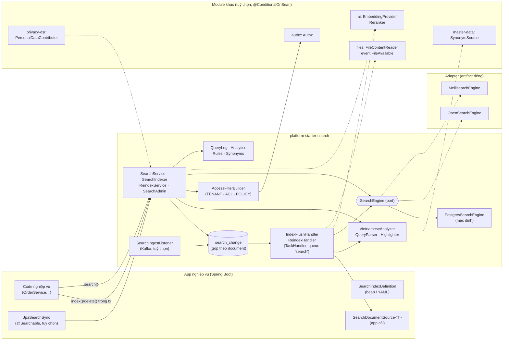
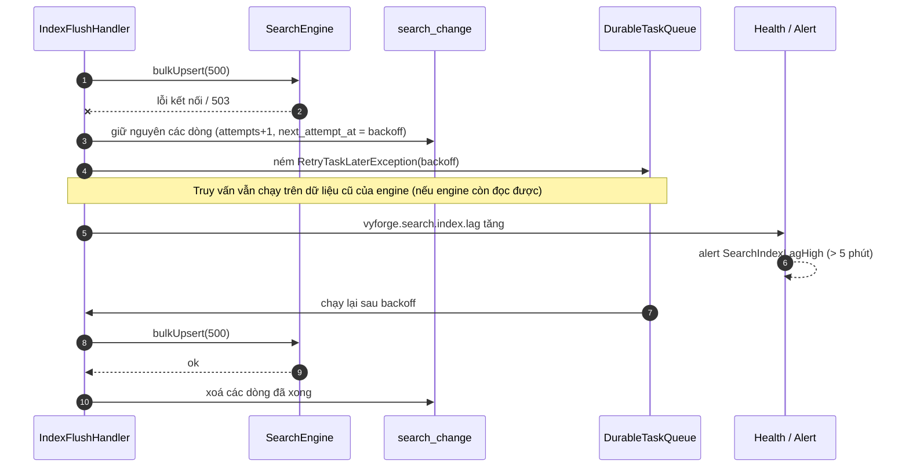
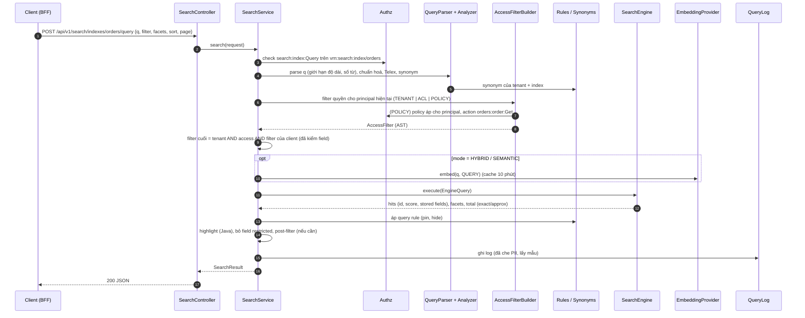
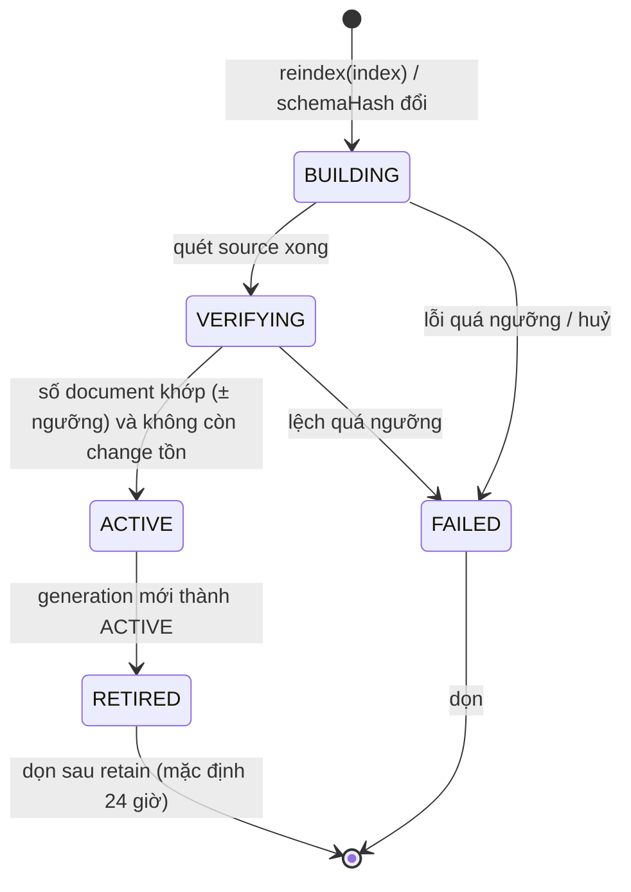
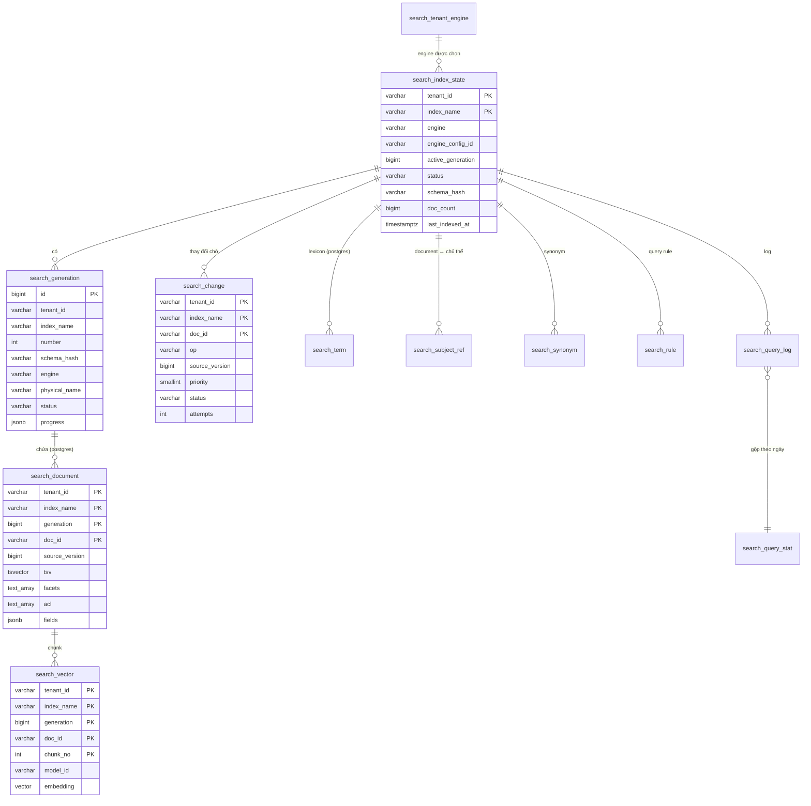

# Thiết kế module search: `platform-starter-search` + `@vyforge/search`

> **Trạng thái:** bản thiết kế chờ duyệt (26/10/2026), phiên forge-41. Chưa có code.
>
> **Phạm vi:** tìm kiếm dùng chung cho mọi dự án Vyforge:
> - tìm toàn văn tiếng Việt (có dấu, không dấu, gõ Telex/VNI dở, sai chính tả), facet, filter, sort, highlight, gợi ý;
> - lọc kết quả theo tenant và theo quyền (ACL, policy IAM);
> - đánh chỉ mục từ event (outbox, Kafka, CDC) và reindex hàng loạt không gián đoạn;
> - tìm ngữ nghĩa bằng vector và tìm lai (hybrid).
>
> Backend mặc định là PostgreSQL. OpenSearch và Meilisearch là adapter cho quy mô lớn.
>
> **Nền:** platform-java 0.12.1 (`SecretCipher`, `DurableTaskQueue`, `StarterSchemaMigrator`), platform-web 0.9.0.
> Theo module-conventions mục 1–6, MODULE_PLAN (K16, nguyên tắc 4–5), ADR-0009 (IAM), ADR-0015 (tenant ở tầng dữ liệu).
> Phần admin theo `docs/design/platform-services.md` mục 4 của forge-37 (Next.js Multi-Zones).
>
> **Đọc kèm:** [báo cáo module thông dụng §3.6](../research/2026-10-module-thong-dung.md) (bản nghiên cứu đầu, kết luận
> "PostgreSQL trước, engine riêng khi có ADR"). Tài liệu này giữ kết luận đó và đi xa hơn: một port chung, ba adapter.

Mục lục:
1. [Bài toán và phạm vi](#1-bài-toán-và-phạm-vi)
2. [Nghiên cứu](#2-nghiên-cứu)
3. [Kiến trúc](#3-kiến-trúc)
4. [Mô hình dữ liệu](#4-mô-hình-dữ-liệu)
5. [API](#5-api)
6. [Mở rộng](#6-mở-rộng)
7. [Vận hành](#7-vận-hành)
8. [Bảo mật và tuân thủ](#8-bảo-mật-và-tuân-thủ)
9. [Kế hoạch triển khai](#9-kế-hoạch-triển-khai)
10. [Lệch quy ước và quyết định cần người dùng chọn](#10-lệch-quy-ước-và-quyết-định-cần-người-dùng-chọn)
11. [Đóng gói và triển khai độc lập](#11-đóng-gói-và-triển-khai-độc-lập)

## Tóm tắt quyết định

| # | Quyết định | Lý do ngắn |
|---|---|---|
| S1 | **Index là bản chiếu (projection), không phải nơi lưu gốc.** Dữ liệu gốc ở bảng nghiệp vụ. Index nào cũng dựng lại được từ `SearchDocumentSource` của app | Mất index không mất dữ liệu (cùng tinh thần nguyên tắc 8 về Redis). Đổi engine, đổi analyzer, đổi model embedding chỉ là reindex |
| S2 | **Một port `SearchEngine`, ba adapter:** `postgres` (mặc định, có sẵn trong starter), `opensearch`, `meilisearch` (artifact riêng) | K16 giữ nguyên: PostgreSQL mặc định. Engine riêng chỉ là cấu hình, có capability rõ ràng. Không tự viết engine (nguyên tắc 4) |
| S3 | **Chuẩn hoá tiếng Việt làm ở Java (`VietnameseAnalyzer`), chạy giống nhau cho mọi engine.** Dữ liệu gửi vào engine gồm bản gốc và bản đã bỏ dấu | Không engine nào trong ba engine có analyzer tiếng Việt kèm sẵn mà vừa đúng vừa có license dùng được (mục 2.3). Kết quả giống nhau khi đổi engine, test một chỗ |
| S4 | **Không tách từ (word segmentation) mặc định.** Đánh chỉ mục theo âm tiết. Xếp hạng ưu tiên cụm liền nhau (phrase, proximity). Có SPI `WordSegmenter` cho dự án cần | Tách từ tiếng Việt tốt nhất hiện có là GPL-3.0 (VnCoreNLP), LGPL-3.0 C++ (CocCoc) hoặc Python (underthesea). Tìm theo âm tiết cộng phrase đủ cho tên, địa chỉ, sản phẩm, hồ sơ |
| S5 | **Lọc quyền nằm trong truy vấn, không lọc sau.** Tenant luôn là điều kiện bắt buộc do adapter gắn. Quyền theo bản ghi có ba chế độ: `TENANT` (ai có quyền index thì thấy mọi bản ghi trong tenant), `ACL` (token người/nhóm/role lưu trong document, kiểu `visible_by` của Algolia), `POLICY` (biên dịch policy IAM thành filter trên thuộc tính đã index, kiểu partial evaluation của OPA). Lọc sau bằng `Authz` chỉ là lớp kiểm cuối | Lọc sau làm sai tổng số, sai facet và rò rỉ qua thời gian phản hồi. Lọc trong truy vấn thì facet và phân trang đúng |
| S6 | **Đánh chỉ mục bất đồng bộ qua bảng `search_change` (gộp theo document) và `DurableTaskQueue`**, ghi cùng transaction nghiệp vụ. Riêng engine `postgres` có chế độ `SYNC` (ghi index ngay trong transaction) | Không mất thay đổi, không phụ thuộc engine còn sống. Gộp nhiều lần sửa một bản ghi thành một lần ghi index |
| S7 | **Reindex blue/green theo "generation".** Dựng generation mới bên cạnh, ghi kép trong lúc dựng, kiểm số lượng, rồi chuyển con trỏ `active_generation` | Đổi mapping, analyzer, model embedding mà không ngừng tìm kiếm |
| S8 | **Vector qua SPI `EmbeddingProvider`.** Module ai cài provider (`@ConditionalOnBean`). Search không phụ thuộc ai | Đúng mục 6 của module-conventions: không phụ thuộc cứng giữa module |
| S9 | **Hybrid mặc định là RRF (k = 60)**, có trọng số `semanticRatio` | RRF không cần chuẩn hoá điểm giữa BM25 và cosine. OpenSearch (2.19+), Meilisearch, Typesense, pgvector đều dùng hoặc khuyên dùng cách này (mục 2.1) |
| S10 | **Highlight trả về đoạn và vị trí, không trả HTML** | Chống XSS. Frontend tự tô bằng component |
| S11 | **Không dùng Elasticsearch, Typesense, ParadeDB, Manticore làm adapter của Vyforge** | License AGPL/SSPL/ELv2/GPL-3.0 (mục 2.2). Dự án nào cần thì tự viết adapter qua SPI |

---

## 1. Bài toán và phạm vi

### 1.1 Vì sao cần một module riêng

Dự án nào cũng có ô tìm kiếm: tìm khách hàng, đơn hàng, sản phẩm, hồ sơ, tài liệu. Mỗi dự án tự làm thì lặp lại các lỗi
sau:

- `ILIKE '%nguyen van a%'`: không tìm được "Nguyễn Văn A" khi gõ không dấu. Thêm `unaccent()` thì không dùng được index,
  vì hàm này là `STABLE` ([PostgreSQL 18 unaccent](https://www.postgresql.org/docs/current/unaccent.html)), nên quét cả
  bảng.
- "Hoà" và "Hòa", "Thuỷ" và "Thủy" (đặt dấu kiểu cũ, kiểu mới); chữ dựng sẵn (NFC) và chữ tổ hợp (NFD, hay gặp khi dán
  từ macOS hoặc PDF). Nhìn giống nhau nhưng so byte thì khác, nên tìm không ra.
- Gõ Telex chưa xong ("nguyeenx"), gõ sai một chữ ("nguyn"), gõ tắt ("tp hcm", "q1").
- Lọc quyền sau khi tìm: trang 1 có 3 kết quả thay vì 20, tổng số sai, facet đếm cả bản ghi người dùng không được xem.
- Quên lọc tenant trong một truy vấn native SQL hay một truy vấn Elasticsearch. Đây là lỗi rò rỉ dữ liệu nặng nhất của
  hệ thống đa tenant.
- Index lệch với dữ liệu: sửa bản ghi mà index không đổi, xoá bản ghi mà kết quả vẫn còn, đổi mapping thì phải ngừng
  dịch vụ để reindex.
- Index chứa dữ liệu cá nhân (tên, số điện thoại, CCCD) nhưng khi chủ thể yêu cầu xoá thì không ai nhớ xoá trong index.
  Log truy vấn chứa số điện thoại người khác gõ vào.

### 1.2 Phạm vi

| Nhóm | Trong phạm vi (bản 0.13.0) | Để bản sau |
|---|---|---|
| Truy vấn | Toàn văn, filter (AST có kiểu), facet (giá trị, khoảng số), sort, phân trang offset và cursor, highlight, gợi ý (autocomplete), sửa lỗi gõ, synonym, tìm nhiều index một lúc (federated, ô "tìm mọi thứ") | Geo (khoảng cách), tìm theo ảnh, cá nhân hoá, learning-to-rank |
| Tiếng Việt | Chuẩn hoá NFC, đặt dấu chuẩn, bỏ dấu, `đ → d`, khôi phục Telex/VNI, mã (số điện thoại, CCCD, mã đơn) tìm được dù có hay không có dấu gạch, synonym địa danh và viết tắt | Tách từ bằng mô hình (SPI có sẵn, adapter để sau) |
| Quyền | Tenant bắt buộc, quyền theo index, ACL theo bản ghi, biên dịch policy IAM thành filter, field bị hạn chế | Quyền theo quan hệ (ReBAC kiểu OpenFGA) |
| Đánh chỉ mục | Ghi trong transaction, gộp thay đổi, Kafka ingress cho service khác, CDC (Debezium outbox) tương thích, reindex blue/green, đồng bộ JPA tự động cho entity có `@Searchable` | Đồng bộ hai chiều với engine bên thứ ba |
| Ngữ nghĩa | Vector theo chunk, `EmbeddingProvider` SPI, hybrid RRF, đổi model bằng reindex | Rerank bằng cross-encoder (SPI có sẵn, adapter ở module ai) |
| Engine | `postgres` (FTS + `pg_trgm` + `unaccent`; pgvector khi có; BM25 của `pg_textsearch` khi có), `opensearch` 3.x, `meilisearch` 1.5x | Elasticsearch, Typesense (do dự án tự viết adapter) |
| Vận hành | Log truy vấn có che PII, thống kê truy vấn không có kết quả, click, query rule (ghim/ẩn kết quả), API quản trị, metric, health | A/B test cấu hình xếp hạng |
| Frontend | `@vyforge/search`: client server-only, `SearchBox` có gợi ý, `FacetPanel`, `ResultList`, `Highlight`, `CommandPalette` (⌘K), đồng bộ URL; `@vyforge/search/admin` | Giao diện tìm kiếm cho mobile (`template-expo`) |

### 1.3 Kịch bản nghiệp vụ phải đáp ứng

| # | Kịch bản | Yêu cầu rút ra | Khối đáp ứng |
|---|---|---|---|
| K1 | **CRM: tìm khách hàng theo tên, số điện thoại, email.** Gõ "nguyen van an", "0912 345 678", "+84912345678", "an.nguyen@" đều ra đúng người | Bỏ dấu; chuẩn hoá số điện thoại VN (0/+84, khoảng trắng); prefix trên email; field mã có trọng số cao | `VietnameseAnalyzer`, kiểu field `PHONE`, `KEYWORD`, `EMAIL` (§3.4) |
| K2 | **Thương mại điện tử: "áo khoác nữ" có facet thương hiệu, size, khoảng giá; sort theo giá, bán chạy; gợi ý khi gõ "ao kh"** | Facet giá trị và khoảng số; sort theo field; tín hiệu xếp hạng (lượt bán); autocomplete prefix | Facet, `rankSignals`, `suggest` (§3.5, §3.7) |
| K3 | **Danh sách admin: lọc đơn hàng theo trạng thái, khoảng ngày, chi nhánh, kèm ô tìm.** Nhân viên chi nhánh chỉ thấy đơn của chi nhánh mình | Filter có kiểu; quyền `POLICY`: điều kiện `resource.branchId = ${principal.branchId}` của IAM thành filter | `PolicyFilterCompiler` (§3.6) |
| K4 | **Ô "tìm mọi thứ" (⌘K) trong app:** khách hàng, đơn hàng, sản phẩm, tài liệu cùng lúc; ai không có quyền index nào thì index đó không xuất hiện | Federated search; kiểm quyền từng index; gộp kết quả bằng RRF | `SearchService.multi` (§3.5) |
| K5 | **Hồ sơ bệnh án / hồ sơ nhân sự:** bác sĩ chỉ thấy bệnh nhân mình phụ trách; tên bệnh nhân không hiện trong gợi ý cho người khác; log truy vấn không lưu tên | ACL theo bản ghi (`u:<sub>`, `g:<nhóm>`); gợi ý cũng lọc quyền; field `restricted`; log che PII | Chế độ `ACL`, `QueryLogSanitizer` (§3.6, §8) |
| K6 | **Dịch vụ công / một cửa: tra cứu hồ sơ theo mã hồ sơ, CCCD, tên người nộp** cho cán bộ; công dân tra theo mã + số điện thoại | Mã tìm chính xác (không typo), CCCD là dữ liệu cá nhân, tra cứu công khai có giới hạn tốc độ | Kiểu `IDENTIFIER` (không typo, không prefix), `@RateLimited`, index công khai riêng (§3.4, §8) |
| K7 | **Thư viện tài liệu, văn bản pháp luật nội bộ:** tìm "nghị định bảo vệ dữ liệu cá nhân" ra cả tài liệu không chứa đúng các chữ đó; trích dẫn đoạn khớp | Chunk nội dung dài; hybrid keyword + vector; highlight theo đoạn | Vector theo chunk, RRF (§3.8) |
| K8 | **Tìm trong file đính kèm (module files):** PDF, DOCX đã upload tìm được theo nội dung | Lấy text khi file sẵn sàng (event `FileAvailable`), quyền theo bản ghi cha | `FilesContentSource` tuỳ chọn (§3.3, §6) |
| K9 | **Địa chỉ sau sắp xếp đơn vị hành chính 2025** (Nghị quyết 202/2025/QH15: còn 34 tỉnh, thành; cấp xã sắp xếp lại): người dùng gõ tên tỉnh cũ ("Bình Dương", "Hà Giang") vẫn ra bản ghi đã chuyển sang tên mới, và ngược lại | Synonym có nguồn dữ liệu (module master-data), không viết cứng; viết tắt "tp", "q.", "p." | `SynonymSource` SPI, synonym theo tenant (§6.3) |
| K10 | **SaaS nhiều tenant cỡ khác nhau:** tenant nhỏ dùng chung PostgreSQL; một tenant lớn (5 triệu sản phẩm) cần OpenSearch riêng; tenant ngân hàng đòi dữ liệu ở trong nước, không dùng SaaS nước ngoài | Engine và nơi đặt (placement) chọn theo tenant; cấu hình endpoint theo tenant, secret mã hoá; chặn engine ngoài VN khi `dataResidency=VN` | `search_tenant_engine`, §6.2, §8.3 |
| K11 | **Chủ thể dữ liệu yêu cầu xoá** (Luật 91/2025/QH15, NĐ 356/2025/NĐ-CP): document trong mọi index và vector chứa dữ liệu của người đó phải xoá; log truy vấn có tên họ cũng phải xoá | Tra document theo chủ thể; xoá cả vector; báo cáo phần đã xoá | `PersonalDataContributor` của privacy-dsr, `search_subject_ref` (§8.2) |
| K12 | **Đổi cấu hình tìm kiếm khi đang chạy:** thêm field facet, đổi trọng số, đổi model embedding; không được ngừng tìm kiếm | Reindex blue/green, ghi kép, chuyển generation nguyên tử | `ReindexService` (§3.9) |
| K13 | **Nhập 200.000 sản phẩm từ Excel (module export/import):** index phải theo kịp mà không làm chậm request của người dùng | Gộp thay đổi, ghi theo lô, ưu tiên thấp hơn thay đổi lẻ | `search_change` + queue `search` (§3.3) |
| K14 | **Service khác (Go, Node) hoặc hệ thống cũ muốn đưa dữ liệu vào tìm kiếm** | Kafka ingress với envelope có version; tương thích outbox router của Debezium | `SearchIngestListener` (§3.3) |
| K15 | **Quản trị nội dung:** marketing muốn ghim sản phẩm khuyến mãi lên đầu khi gõ "tết", ẩn sản phẩm ngừng bán; xem truy vấn nào không có kết quả để bổ sung synonym | Query rule (pin/hide), thống kê zero-result, synonym do tenant admin sửa | `search_rule`, analytics (§3.7, §5.2) |

Kịch bản đặc thù Việt Nam: K1 (tên người có dấu, số điện thoại VN), K6 (CCCD, dịch vụ công), K9 (sắp xếp đơn vị hành
chính 2025), K10 (dữ liệu ở trong nước), K11 (Luật 91/2025). Riêng tiếng Việt cần làm đúng là yêu cầu xuyên suốt, có bộ
dữ liệu test thật (mục 9.2).

### 1.4 Ngoài phạm vi

- Tìm log và trace: thuộc chart `platform-observability` (Loki, Tempo).
- Tìm trong dữ liệu không thuộc tenant nào (catalog hệ thống): app tự truy vấn.
- Search engine dạng service riêng cho người ngoài dùng (Algolia tự host). Module là thư viện nhúng (mục 11).
- RAG (ghép ngữ cảnh rồi gọi LLM): module ai làm. Module ai **dùng** `SearchService` của search để truy xuất có phân
  quyền (mục 3.8).

---

## 2. Nghiên cứu

Phiên bản, license và ngày phát hành kiểm ngày 26/10/2026 bằng GitHub API (`repos/<repo>`, `releases/latest`), Maven
Central (`maven-metadata.xml`) và tài liệu chính thức (link ở từng dòng). GitHub ghi `NOASSERTION` thì đã đọc file
LICENSE gốc.

### 2.1 Hệ thống tham khảo

| Hệ thống | Phiên bản, license | Mô hình dữ liệu và API | Điểm mạnh | Điểm yếu với Vyforge |
|---|---|---|---|---|
| **PostgreSQL FTS** + `unaccent` + `pg_trgm` | PostgreSQL 18.6 (bản hiện hành của tài liệu; 19 đang RC1), PostgreSQL License | `tsvector`/`tsquery`, cấu hình text search gồm parser + chuỗi dictionary; `setweight` A–D; `ts_rank_cd`; `ts_headline`. `unaccent` là dictionary lọc, chèn được vào cấu hình (`ALTER MAPPING … WITH unaccent, <dict>`), còn hàm `unaccent()` là `STABLE` nên muốn đưa vào index phải bọc hàm `IMMUTABLE` và chấp nhận `REINDEX` khi đổi rule ([unaccent](https://www.postgresql.org/docs/current/unaccent.html)). `pg_trgm`: `similarity`, `word_similarity`, `strict_word_similarity`, toán tử `%`, `<%`, `<<%`; ngưỡng mặc định 0,3 / 0,6 / 0,5; GIN/GiST tăng tốc `LIKE`, `ILIKE`, regex ([pg_trgm](https://www.postgresql.org/docs/current/pgtrgm.html)). File `unaccent.rules` (2.662 dòng) có đủ chữ Việt: `đ→d`, `ơ→o`, `ư→u`, `ạ→a`, `ự→u`, `ỹ→y` (đã kiểm file trên nhánh master) | Không thêm hạ tầng; transaction cùng dữ liệu nghiệp vụ; RLS; backup chung | Không có cấu hình tiếng Việt; `ts_rank` không phải BM25 (không có IDF); facet phải tự `GROUP BY`; typo phải tự làm bằng trigram |
| **pg_textsearch** (Tiger Data, trước là Timescale) | v1.5.1 (02/10/2026), PostgreSQL License ([GitHub](https://github.com/timescale/pg_textsearch)); v1.0 GA 03/04/2026 ([tin PostgreSQL](https://www.postgresql.org/about/news/pg_textsearch-v10-3264)) | Index `USING bm25(col) WITH (text_config='…')`, toán tử `<@>` (điểm âm, nhỏ là tốt), `to_bm25query`; index trên một cột hoặc một biểu thức `IMMUTABLE`; partial index được; PG 17 và 18, 19 thử nghiệm; thống kê BM25 tính riêng từng partition | BM25 thật trong Postgres, license thoáng; dùng được `text_config` tuỳ chỉnh (ví dụ zhparser) nên ghép được cấu hình bỏ dấu của Vyforge | Mới (GA 04/2026); kết hợp filter với BM25 không phải một lần quét index; điểm giữa các partition không so được. Dùng làm capability tuỳ chọn, không bắt buộc |
| **pgvector** | v0.8.7 (tag), license PostgreSQL ([GitHub](https://github.com/pgvector/pgvector)); `com.pgvector:pgvector` 0.1.6 (MIT) | Kiểu `vector`, `halfvec`; HNSW (`m` 16, `ef_construction` 64, `hnsw.ef_search` 40) và IVFFlat; HNSW index được `halfvec` tới 4.000 chiều; **iterative index scan** từ 0.8.0 (`strict_order`, `relaxed_order`, `hnsw.max_scan_tuples` 20.000) để filter không làm hụt kết quả; README khuyên ghép với FTS và gộp bằng RRF hoặc cross-encoder | Vector cùng database, cùng transaction, cùng filter tenant | HNSW tốn RAM; filter chọn lọc mạnh vẫn phải tăng `max_scan_tuples` |
| **Meilisearch** | v1.56.0 (26/10/2026), `MIT AND BUSL-1.1`: phần Enterprise Edition (file đánh dấu EE, thư mục `enterprise_editions`) theo BUSL-1.1, sau 4 năm chuyển MIT ([LICENSE](https://github.com/meilisearch/meilisearch/blob/main/LICENSE), [LICENSE-EE](https://github.com/meilisearch/meilisearch/blob/main/LICENSE-EE)); client `com.meilisearch.sdk:meilisearch-java` 0.22.1 (MIT) | Index chứa document JSON; settings: `searchableAttributes` (thứ tự là trọng số), `filterableAttributes`, `sortableAttributes`, `rankingRules`, `synonyms`, `typoTolerance` (mặc định 1 lỗi khi từ ≥ 5 ký tự, 2 lỗi khi ≥ 9; tắt theo từ, theo field, theo số) ([typo](https://www.meilisearch.com/docs/learn/relevancy/typo_tolerance_settings)); hybrid bằng `embedders` + tham số `hybrid.semanticRatio` ([AI search](https://www.meilisearch.com/docs/learn/ai_powered_search/getting_started_with_ai_search)); tenant token (JWT ký từ API key, nhúng filter, chỉ áp cho endpoint search) ([multitenancy](https://www.meilisearch.com/docs/learn/security/multitenancy_tenant_tokens)) | Typo, prefix, facet, highlight tốt sẵn; vận hành một binary; hybrid sẵn | Pipeline Latin: chuẩn hoá "decomposition, lowercase, nonspacing-marks removal"; tài liệu **không nêu tiếng Việt** ([language](https://www.meilisearch.com/docs/learn/resources/language)). Không ghi rõ tính năng nào là EE: phải kiểm từng tính năng trước khi dùng. Một node, không có HA trong bản cộng đồng **(chưa kiểm chứng phạm vi EE)** |
| **OpenSearch** | 3.9.0 (29/09/2026), Apache-2.0; client `org.opensearch.client:opensearch-java` 3.10.0 (Apache-2.0) | Index + mapping + analyzer (Lucene); `bool` query, aggregation (facet), highlight, `search_after`; k-NN plugin; **hybrid query + search pipeline**: `normalization-processor` hoặc `score-ranker-processor` RRF (từ 2.19, `rank_constant` mặc định 60, có `weights`) ([score ranker](https://docs.opensearch.org/latest/search-plugins/search-pipelines/score-ranker-processor/)) | Mạnh nhất về quy mô, aggregation, HA; Apache-2.0 | Vận hành nặng (JVM, shard, snapshot). Plugin tiếng Việt `duydo/elasticsearch-analysis-vietnamese` (v9.3.0, Apache-2.0, dựa trên tokenizer CocCoc) chỉ ghi tương thích Elasticsearch, không có bản OpenSearch ([GitHub](https://github.com/duydo/elasticsearch-analysis-vietnamese)) |
| **Typesense** | v30.2 (19/04/2026), **GPL-3.0**; client Java 2.1.0 (Apache-2.0) | Collection có schema; `query_by`, `num_typos` (0–2, mặc định 2), `prefix`, `facet_by`, `filter_by`, `sort_by` (tối đa 3 field) ([search](https://typesense.org/docs/30.1/api/search.html)); scoped API key nhúng `filter_by`; hybrid bằng rank fusion, mặc định 0,7 keyword / 0,3 vector, chỉnh bằng `alpha`; embed tự động (`ts/e5-small`, OpenAI, ONNX của mình) ([vector search](https://typesense.org/docs/30.1/api/vector-search.html)) | Schema rõ, API gọn, hybrid đơn giản | GPL-3.0 cho server (chạy riêng thì không lây, nhưng khách hàng doanh nghiệp hay cấm); dữ liệu nằm trong RAM |
| **Elasticsearch** | v9.5.5 (06/10/2026); mặc định ba license **AGPL-3.0 / SSPL-1 / Elastic License 2.0**, thư mục `x-pack` chỉ ELv2 (file LICENSE.txt); client `elasticsearch-java` 9.5.4 (Apache-2.0) | Như OpenSearch; retriever `rrf` | Hệ sinh thái lớn nhất, có plugin tiếng Việt | Theo một bài thực nghiệm, retriever RRF bị chặn ở bản Basic ("non-compliant license", cần Enterprise) ([DEV](https://dev.to/u11d/reciprocal-rank-fusion-on-free-elasticsearch-licensing-workarounds-and-the-opensearch-alternative-56jk)) **(chưa đối chiếu bảng subscription chính thức)** |
| **ParadeDB `pg_search`** | v0.26.3 (22/10/2026), **AGPL-3.0** | BM25 (Tantivy) trong Postgres, facet, fuzzy | BM25 + facet trong Postgres | AGPL-3.0: không đưa vào bản phân phối của Vyforge (đã chốt ở báo cáo module thông dụng) |
| **Algolia** (SaaS, chỉ học mô hình) | dịch vụ | Record trong index; `searchableAttributes` có thứ tự, cùng mức thì ngang trọng số; giới hạn 65 thuộc tính ([searchable attributes](https://www.algolia.com/doc/guides/managing-results/must-do/searchable-attributes/)); **secured API key** sinh ở backend có filter nhúng; quyền theo bản ghi bằng thuộc tính `visible_by` (`group/Everybody` cho mọi người), khai `filterOnly(visible_by)` để khỏi đếm facet, đưa vào `unretrievableAttributes` để người dùng không thấy ai khác có quyền, đổi quyền thì partial update riêng thuộc tính đó ([user-restricted access](https://www.algolia.com/doc/guides/security/api-keys/how-to/user-restricted-access-to-data/)) | Mô hình xếp hạng (tie-breaking), query rule, analytics là chuẩn ngành | SaaS nước ngoài: không hợp yêu cầu dữ liệu ở trong nước (K10) |

Tham khảo thêm cho phần quyền và đánh chỉ mục:

| Nguồn | Phiên bản | Rút ra |
|---|---|---|
| OPA data filtering ([docs](https://www.openpolicyagent.org/docs/filtering)) | — | Đánh giá từng phần (partial evaluation) policy, coi cột dữ liệu là ẩn số, sinh ra filter SQL (`WHERE employees.department = 'engineering'`). Vyforge làm điều tương tự với policy IAM của mình (ADR-0009) |
| Debezium Outbox Event Router ([docs 3.7](https://debezium.io/documentation/reference/stable/transformations/outbox-event-router.html)) | 3.7.0.Final, Apache-2.0 | Bảng outbox có `id`, `aggregatetype`, `aggregateid`, `type`, `payload` jsonb; topic mặc định `outbox.event.<aggregatetype>`. Envelope ingress của search đọc được định dạng này (K14) |

### 2.2 Engine được chọn

| Engine | Vai trò trong Vyforge | Lý do |
|---|---|---|
| **PostgreSQL** (FTS + `unaccent` + `pg_trgm`, pgvector khi có, `pg_textsearch` khi có) | Mặc định, có sẵn trong `platform-starter-search` | K16; tier 0–1; cùng backup, cùng RLS, cùng transaction |
| **OpenSearch 3.x** | Adapter `platform-search-opensearch` cho dữ liệu lớn, nhiều facet, HA | Apache-2.0; hybrid RRF sẵn có |
| **Meilisearch 1.5x** | Adapter `platform-search-meilisearch` cho dự án vừa cần typo, gợi ý tốt mà không muốn vận hành OpenSearch | Lõi MIT. Adapter chỉ dùng tính năng thuộc phần MIT; CI chạy với image cộng đồng |
| Elasticsearch, Typesense, ParadeDB, Manticore (GPL-3.0) | Không có adapter của Vyforge | License (S11). SPI mở để dự án tự viết |

### 2.3 Tiếng Việt: thư viện và dữ liệu

| Thành phần | Phiên bản, license | Đánh giá |
|---|---|---|
| VnCoreNLP (tách từ, Java) | v1.2 (02/2023), **GPL-3.0** (LICENSE.md) | Tách từ tốt nhưng GPL-3.0 không nhúng được vào thư viện phân phối cho khách. Repo không cập nhật từ 2023 |
| CocCoc tokenizer | LGPL-3.0, C++, cập nhật cuối 04/2021 | Cần JNI, lâu không bảo trì |
| underthesea | v9.5.0, Apache-2.0, Python | Tốt, license thoáng, nhưng là Python: chỉ dùng được dưới dạng service phụ qua SPI `WordSegmenter` |
| pyvi | MIT, Python, cập nhật cuối 09/2024 | Như trên |
| Plugin `analysis-vietnamese` | v9.3.0, Apache-2.0 | Chỉ Elasticsearch |
| Lucene (cho OpenSearch) | 10.5.2 trên Maven Central | `icu_tokenizer` + `icu_folding` + `shingle` có sẵn trong plugin `analysis-icu` của OpenSearch: tách âm tiết, bỏ dấu, tạo cặp âm tiết |

**Kết luận.** Âm tiết tiếng Việt cách nhau bằng khoảng trắng, nên tách theo âm tiết luôn đúng. Cái thiếu khi không tách
từ là phân biệt "học sinh" (một từ) với "học" + "sinh" (hai từ). Thiếu sót này bù được bằng xếp hạng cụm liền nhau
(phrase, proximity) và cặp âm tiết (shingle). Vyforge làm phần chuẩn hoá ở Java để ba engine cho cùng kết quả. Tách từ
bằng mô hình để thành SPI.

**Mô hình embedding cho tiếng Việt** (để module ai chọn, search chỉ ghi `model` cùng vector). Benchmark VN-MTEB (41
tập dữ liệu, 6 loại tác vụ; EACL 2026 Findings) ([arXiv 2507.21500](https://arxiv.org/html/2507.21500v1)):

| Model | Retrieval | Trung bình |
|---|---|---|
| gte-Qwen2-7B-instruct | **46,05** | 65,84 |
| e5-Mistral-7B-instruct | 41,73 | 67,67 |
| multilingual-e5-large-instruct | 40,88 | **67,99** |
| bge-m3 | 39,84 | 64,90 |
| gte-multilingual-base | 38,38 | 65,22 |

Model 7B tốt nhất về retrieval nhưng nặng. Mặc định đề xuất cho module ai: `multilingual-e5-large-instruct` (trung bình
cao nhất, cỡ "large") hoặc `bge-m3`. License của từng model do module ai kiểm khi chọn.

### 2.4 Học theo và không làm

**Học theo:**

1. **Thứ tự field là trọng số** (Algolia `searchableAttributes`, Meilisearch): định nghĩa index khai field theo mức
   `A`–`D`, dịch sang `setweight` của PostgreSQL, `boost` của OpenSearch, thứ tự của Meilisearch.
2. **Xếp hạng theo bậc** (tie-breaking của Algolia, `rankingRules` của Meilisearch): mức khớp văn bản trước, rồi
   tín hiệu nghiệp vụ (`rankSignals`: lượt bán, mới cập nhật), rồi sort phụ.
3. **Quyền bằng token trong document** (`visible_by` của Algolia): token không trả ra API, đổi quyền thì chỉ cập nhật
   phần ACL.
4. **Filter nhúng không sửa được** (secured key của Algolia, tenant token của Meilisearch, scoped key của Typesense):
   ở Vyforge filter tenant và filter quyền do server gắn, client không gửi được.
5. **Typo tolerance theo độ dài từ** (Meilisearch 5/9 ký tự; Typesense `num_typos`), tắt cho mã và số.
6. **Hybrid bằng RRF** (OpenSearch, pgvector README, Typesense rank fusion).
7. **Embedding theo template field** (`documentTemplate` của Meilisearch, `embed.from` của Typesense): định nghĩa
   index khai field nào đi vào embedding; chỉ embed lại khi field đó đổi.
8. **Đánh giá policy từng phần ra filter** (OPA).
9. **Envelope ingress kiểu outbox của Debezium** cho nguồn không phải Java.

**Không làm:**

1. **Không cho trình duyệt gọi thẳng engine** (InstantSearch + secured key). Vyforge dùng BFF (ADR-0006). Mọi truy
   vấn đi qua backend để lọc quyền theo policy, ghi log có che PII và đổi engine không ảnh hưởng client. Chế độ gọi
   thẳng Meilisearch bằng tenant token có thể làm sau cho trang công khai cần độ trễ thấp (mục 9.3).
2. **Không dùng analyzer tiếng Việt của từng engine** (S3).
3. **Không lọc quyền sau khi tìm làm cơ chế chính** (S5).
4. **Không để index thành nơi lưu dữ liệu gốc** (S1). Không có API "lưu document" cho dữ liệu không có nguồn.
5. **Không đưa ParadeDB, Typesense, Elasticsearch vào bản phân phối** (S11).
6. **Không tự viết engine BM25, HNSW** (nguyên tắc 4). BM25 trong PostgreSQL chỉ khi có `pg_textsearch`.
7. **Không lưu HTML highlight** (S10).

---

## 3. Kiến trúc

### 3.1 Thành phần



Vai trò từng khối:

| Khối | Việc |
|---|---|
| `SearchIndexDefinition` | Khai báo index: tên, field (kiểu, vai trò, trọng số), chế độ quyền, embedding, synonym, xếp hạng. Có `schemaHash`; đổi định nghĩa thì cần generation mới (§3.9) |
| `SearchDocumentSource<T>` | App cài: nạp bản ghi theo id, quét toàn bộ theo cursor (reindex), chuyển bản ghi thành `SearchDocument`. Đây là "nguồn sự thật" của index (S1) |
| `SearchIndexer` | Ghi nhận thay đổi (`index(ref)`, `delete(ref)`, `touchAcl(ref)`), chạy trong transaction nghiệp vụ, chỉ ghi `search_change` |
| `IndexFlushHandler` | Việc nền: lấy lô thay đổi, gọi source nạp bản mới nhất, phân tích tiếng Việt, gọi embedding nếu cần, ghi vào engine |
| `SearchService` | Truy vấn: parse, chuẩn hoá, gắn filter tenant và quyền, gọi engine, áp query rule, highlight, ghi log |
| `AccessFilterBuilder` | Tạo filter quyền cho người dùng hiện tại theo chế độ của index (§3.6) |
| `SearchEngine` | Port engine. Adapter khai báo `EngineCapabilities` (facet, typo, vector, hybrid, highlight, suggest, bm25) |
| `ReindexService` | Dựng generation mới, ghi kép, kiểm, chuyển (§3.9) |
| `SearchIngestListener` | Nhận envelope từ Kafka cho nguồn ngoài JVM (§3.3) |

### 3.2 Gói Java

```
com.vyforge.platform.search
├── (API công khai) SearchService, SearchIndexer, ReindexService, SearchAdmin, SearchIndexes,
│   SearchRequest, SearchResult, SearchHit, Filter, Facet*, Sort, Highlight, Suggest*,
│   SearchIndexDefinition, FieldDef, FieldType, AccessMode, DocumentRef, SearchDocument,
│   SearchDocumentSource, event record, SearchErrors, SearchActions
├── analysis        VietnameseAnalyzer (trên VietnameseText của -jpa), TelexRecovery, PhoneNormalizer, QueryParser, Highlighter,
│                   WordSegmenter (SPI), SynonymSource (SPI), StopwordSource (SPI)
├── access          AccessFilterBuilder, PrincipalTokens, AclTokenResolver (SPI), PolicyFilterCompiler, PostFilter
├── indexing        SearchChangeRepository, IndexFlushHandler, ChangeCoalescer, IngestEnvelope, SearchIngestListener,
│                   JpaSearchSync, @Searchable
├── reindex         ReindexService impl, ReindexHandler, GenerationRepository
├── engine          SearchEngine (SPI), EngineCapabilities, EngineQuery (đã chuẩn hoá), EngineRegistry,
│                   EngineResolver (chọn engine theo tenant + index)
├── engine.postgres PostgresSearchEngine, PgQueryBuilder, PgFacetCounter, PgLexicon, PgVectorSupport, PgBm25Support
├── semantic        EmbeddingProvider (SPI), Reranker (SPI), Chunker, EmbeddingCache, HybridFusion (RRF)
├── admin           controller REST admin, QueryLog, Analytics, Rules, Synonyms, TenantEngineConfig
├── web             controller REST truy vấn
└── autoconfigure   SearchAutoConfiguration, SearchProperties
```

ArchUnit: `engine.*` không phụ thuộc `admin`, `web`; chỉ `engine` chạm tới driver engine; code ngoài `engine.postgres`
không viết SQL vào bảng `search_document`.

### 3.3 Luồng đánh chỉ mục

Có ba đường vào, cùng đổ về `search_change`:

| Đường vào | Ai dùng | Ghi chú |
|---|---|---|
| `SearchIndexer.index(DocumentRef)` | Code Java trong app | Gọi trong transaction nghiệp vụ. Chỉ ghi `(tenant, index, docId, op, sourceVersion)` |
| `JpaSearchSync` | Entity có `@Searchable(index = "customers")` | Listener `PostInsert/PostUpdate/PostDelete` của Hibernate gọi `SearchIndexer` trong cùng transaction. Không cần viết code đồng bộ |
| Event của module khác | `FileAvailable` (files), `ImportCommitted` (export) | App khai báo mapping event → `DocumentRef` (một dòng cấu hình hoặc một listener) |
| `SearchIngestListener` (Kafka) | Service ngoài JVM, hệ thống cũ, Debezium | Envelope `vyforge.search.ingest.v1` (§5.3); tenant lấy từ header `tenant_id` (`@RequiresTenant`) |

`search_change` có khoá duy nhất `(tenant_id, index_name, doc_id)`. Ghi bằng `INSERT … ON CONFLICT DO UPDATE` và chỉ
cập nhật khi `source_version` mới hơn, nên 50 lần sửa một đơn hàng trong 1 giây chỉ còn một dòng. Sau khi ghi, starter
enqueue việc `search/flush` vào `DurableTaskQueue` với `idempotencyKey = flush:<index>:<khung 2 giây>`, nên mỗi tenant
và index chỉ có một việc flush trong mỗi khung thời gian. `enqueue` chạy trong transaction nghiệp vụ, nên việc chỉ
tồn tại khi transaction commit.

```mermaid
sequenceDiagram
    autonumber
    participant B as OrderService
    participant I as SearchIndexer
    participant DB as PostgreSQL (tx nghiệp vụ)
    participant Q as DurableTaskQueue
    participant F as IndexFlushHandler
    participant S as SearchDocumentSource
    participant A as VietnameseAnalyzer
    participant E as EmbeddingProvider (ai)
    participant G as SearchEngine

    B->>DB: update orders …
    B->>I: index(orders, id, version=7)
    I->>DB: upsert search_change (v=7 > v cũ)
    I->>Q: enqueue search/flush (idem: flush:orders:<khung>)
    B->>DB: COMMIT
    Q->>F: handle (TenantContext = tenant)
    F->>DB: claim ≤ 500 dòng search_change (FOR UPDATE SKIP LOCKED)
    F->>S: load(ids)
    S-->>F: bản ghi mới nhất (thiếu id = đã xoá)
    F->>A: analyze(document)
    alt index có embedding và field embed đổi
        F->>E: embed(chunks, DOCUMENT)
        E-->>F: vectors
    end
    F->>G: bulkUpsert / bulkDelete (generation active + generation đang dựng)
    G-->>F: kết quả từng document
    F->>DB: xoá dòng đã xong; dòng lỗi tăng attempts, giữ lại
```

Quy tắc:

- **Luôn nạp lại bản mới nhất từ source**, không dùng payload của thay đổi (trừ ingress Kafka chế độ `inline`). Nhờ vậy
  thứ tự thay đổi không quan trọng, và không có chuyện bản cũ ghi đè bản mới.
- **Chống ghi lùi ở engine:** document lưu `sourceVersion`. Engine `postgres` ghi có điều kiện
  `WHERE excluded.source_version >= search_document.source_version`. OpenSearch dùng `version_type=external_gte`.
  Meilisearch không có ghi có điều kiện, nên flush cho cùng một `(tenant, index)` chạy tuần tự (giới hạn đồng thời của
  queue theo khoá) và luôn nạp bản mới nhất.
- **Chế độ `SYNC`** (chỉ engine `postgres`, khai theo index): `SearchIndexer` ghi thẳng `search_document` trong
  transaction nghiệp vụ. Hợp với danh sách admin cần thấy ngay bản vừa sửa. Embedding vẫn đi bất đồng bộ.
- **Lỗi:** một document lỗi (source ném lỗi, engine từ chối) không chặn cả lô. Dòng đó tăng `attempts`, ghi
  `last_error`, thử lại với backoff. Quá `max-attempts` (mặc định 10) thì `status = DEAD`, phát event
  `SearchDocumentRejected`, admin xem và retry (§5.2).
- **Ưu tiên:** thay đổi lẻ có `priority = 10`, thay đổi theo lô (import, `touchAll`) có `priority = 0`. Thay đổi người
  dùng vừa sửa không phải chờ sau 200.000 dòng import (K13).

Luồng lỗi của engine:



### 3.4 Phân tích tiếng Việt

`VietnameseAnalyzer` chạy ở Java, cho cả document (lúc index) và câu truy vấn. Bước 1–3 và 5 (chuẩn hoá, bỏ dấu)
**không tự viết**: gọi `VietnameseText` của `-jpa` (jpa-extras), cùng nguồn quy tắc với hàm SQL `immutable_unaccent()`
(§3.11). Search chỉ thêm phần riêng của tìm kiếm: tách âm tiết, shingle, mã và số, Telex/VNI, synonym. Kết quả là một
`AnalyzedText` gồm các dạng của cùng một chuỗi:

| Bước | Ví dụ vào → ra | Ghi chú |
|---|---|---|
| 1. Chuẩn hoá Unicode NFC | `Nguyễn` (NFD) → `Nguyễn` | `java.text.Normalizer` |
| 2. Đặt dấu thanh chuẩn | `hoà` → `hòa`, `thuỷ` → `thủy`, `khoẻ` → `khỏe` | Bảng quy tắc cho `oa`, `oe`, `uy` (kiểu "mới"). Làm ở cả hai phía nên kiểu đặt dấu nào cũng khớp |
| 3. Chữ thường theo locale `vi` | `ĐÀ NẴNG` → `đà nẵng` | |
| 4. Tách âm tiết | `Đà Nẵng, 2026` → `đà` `nẵng` `2026` | Theo khoảng trắng và dấu câu (Unicode word boundary). Giữ nguyên email, URL |
| 5. Bỏ dấu (folded) | `đà nẵng` → `da nang` | `VietnameseText.fold` của `-jpa`: `đ → d`, cho cùng kết quả với `immutable_unaccent()` (test hợp đồng của `-jpa`) |
| 6. Cặp âm tiết (shingle) | `da nang`, `nang 2026` | Tăng điểm khi các âm tiết đứng liền nhau |
| 7. Mã và số | `0912-345-678` → `0912345678`, `84912345678`; `DH-2026-0001` → `dh20260001`, `dh` `2026` `0001` | Theo kiểu field (bảng dưới) |

Dạng lưu trong engine:

- `exact`: âm tiết có dấu, chữ thường (`đà nẵng`). Dùng để thưởng điểm khi người dùng gõ có dấu.
- `folded`: âm tiết không dấu (`da nang`). Dùng để tìm (recall).
- `shingle`: cặp âm tiết không dấu. Dùng để xếp hạng.

**Câu truy vấn:**

- Người dùng gõ **có dấu** ("Hà Nội"): tìm theo `folded`, thưởng điểm khi khớp `exact`. "Hà Nội" đứng trên "Hạ Nội".
- Người dùng gõ **không dấu** ("ha noi"): tìm theo `folded`, mọi biến thể dấu ngang điểm nhau. Thứ tự sau đó theo
  `rankSignals`.
- **Telex, VNI chưa xong** (`nguyeenx`, `tieesng vieejt`, `nguye6n4`): `TelexRecovery` thử dịch âm tiết không hợp lệ
  theo Telex rồi VNI. Nếu ra âm tiết hợp lệ thì thêm vào truy vấn như một phương án (OR), không thay hẳn.
- **Sai chính tả** (`nguyn`, `phong` thay cho `phòng`): §3.5 (typo).
- **Từ cuối là tiền tố** (đang gõ): `ao kh` → `ao` AND `kh*`.

Kiểu field và cách phân tích:

| `FieldType` | Phân tích | Typo | Prefix | Ví dụ |
|---|---|---|---|---|
| `TEXT` | Đủ 7 bước | Có (từ ≥ 4 ký tự không dấu) | Có ở từ cuối | Tên, tiêu đề, mô tả, nội dung |
| `NAME` | Như `TEXT`, thêm biến thể đảo họ tên ("an nguyen van") | Có | Có | Họ tên người |
| `KEYWORD` | Chuẩn hoá, bỏ dấu, không tách âm tiết | Không | Có | Thương hiệu, trạng thái, tag |
| `IDENTIFIER` | Bỏ ký tự phân cách, chữ thường | **Không** | Tuỳ (`prefix: false` mặc định) | Mã đơn, mã hồ sơ, số CCCD (K6) |
| `PHONE` | Số điện thoại VN: bỏ ký tự lạ, `+84`/`84`/`0` thành cả hai dạng `0…` và `84…` | Không | Có (≥ 4 chữ số) | K1 |
| `EMAIL` | Chữ thường, tách phần trước `@` theo `.`, `_`, `-` | Không | Có | K1 |
| `NUMBER`, `DATE`, `BOOLEAN`, `GEO_POINT` | Không phân tích văn bản | — | — | Filter, facet, sort |

Vai trò của field (kết hợp được): `searchable(weight A–D)`, `filterable`, `facetable`, `sortable`, `stored` (trả về trong
kết quả), `embed` (đưa vào template embedding), `restricted(action)` (chỉ người có quyền mới thấy và tìm được),
`personalData(BASIC | SENSITIVE)`.

### 3.5 Luồng truy vấn



**Xếp hạng.** Bậc mặc định (đổi được theo index):

1. Mức khớp văn bản: điểm engine (PostgreSQL: `ts_rank_cd` có trọng số A–D trên `folded`, cộng thưởng `exact`, cộng
   thưởng shingle và phrase; OpenSearch: BM25 + `boost`; Meilisearch: `rankingRules`).
2. Query rule: bản ghi được ghim lên đầu.
3. `rankSignals` (số, đã chuẩn hoá về 0–1 ở lúc index): độ phổ biến, độ mới. Công thức
   `score × (1 + Σ wᵢ·signalᵢ)`, `wᵢ` khai trong định nghĩa index.
4. Sort phụ theo yêu cầu (`sort`), cuối cùng là `docId` để thứ tự ổn định giữa các trang.

Khi client gửi `sort` (vd. `price:asc`), sort đó đứng trước điểm văn bản, như Typesense và Meilisearch.

**Typo (sửa lỗi gõ).** Mỗi `(tenant, index)` có một lexicon: các âm tiết `folded` đã xuất hiện, kèm số document chứa
nó.

- PostgreSQL: bảng `search_term` có index GIN `gin_trgm_ops`. Âm tiết trong truy vấn không có trong lexicon thì lấy tối
  đa 3 âm tiết gần nhất (`similarity ≥ 0,4`, ưu tiên `doc_freq` cao), thêm vào truy vấn như OR, điểm nhân 0,7.
- OpenSearch: `fuzziness: AUTO` trên field `folded`.
- Meilisearch: `typoTolerance` có sẵn; tắt cho field `IDENTIFIER`, `PHONE`.
- Quy tắc chung: không sửa từ < 4 ký tự (sau khi bỏ dấu), không sửa mã và số, chỉ sửa khi kết quả với từ gốc ít hơn
  `typo.min-hits` (mặc định 3). `SearchResult.correctedQuery` báo cho client hiện dòng "Có phải bạn muốn tìm…".

**Gợi ý (`suggest`).** Ba nguồn, gộp và loại trùng:

1. Tiền tố trên field có `suggest: true` của document (tên khách hàng, tên sản phẩm), **đã lọc quyền** như truy vấn
   thường (K5).
2. Truy vấn phổ biến của tenant (`search_query_stat`, có kết quả, ≥ `min-count` người dùng khác nhau), không lấy truy
   vấn chứa PII.
3. Âm tiết trong lexicon (hoàn thành từ đang gõ).

Mục tiêu độ trễ gợi ý p95 < 80 ms ở engine `postgres` với 1 triệu document mỗi tenant **(ước lượng, cần benchmark)**.

**Facet.**

- PostgreSQL: mỗi document có cột `facets text[]` dạng `field=value`. Đếm bằng `unnest` + `GROUP BY` trên tập đã lọc, giới
  hạn `facet.max-candidates` (mặc định 100.000 dòng). Vượt ngưỡng thì đếm trên mẫu, trả `approximate: true`. Facet khoảng
  số (`price` 0–500k, 500k–1tr…) tính bằng `width_bucket` hoặc `CASE` trên cột số.
- OpenSearch: `terms` và `range` aggregation.
- Meilisearch: `facets` + `facetStats`.
- Facet có thể "disjunctive" (đếm mỗi facet khi bỏ filter của chính nó, để chọn nhiều thương hiệu cùng lúc): bật theo
  facet, tốn thêm một truy vấn mỗi facet.

**Phân trang.** `page/size` cho tới `max-offset` (mặc định 10.000). Sâu hơn thì dùng `cursor` (giá trị sort của hit
cuối, mã hoá base64url và ký HMAC để client không sửa được), như `search_after` của OpenSearch.

**Tìm nhiều index (`multi`).** Mỗi index được kiểm quyền riêng. Index không có quyền thì bị bỏ, không báo lỗi. Kết quả
gộp bằng RRF theo thứ hạng trong từng index, hoặc trả theo nhóm (`groupBy: index`, mặc định cho ⌘K: 5 kết quả mỗi
loại).

### 3.6 Phân quyền trong tìm kiếm

Ba lớp, từ ngoài vào trong:

| Lớp | Cơ chế | Không thể bỏ qua vì |
|---|---|---|
| **Tenant** | `EngineQuery` luôn có `tenantId` lấy từ `TenantContext.require()`. Adapter tự thêm điều kiện tenant (PostgreSQL: `tenant_id = ?` và partition; OpenSearch: `routing` + filter `term tenant_id`; Meilisearch: filter `_tenant = …`). Client không gửi được tenant | Filter tenant không nằm trong AST của client. Test hợp đồng chung chạy với mọi adapter (§9.2). Luật ArchUnit `TENANT_ISOLATION` cho repository JDBC |
| **Index** | `search:index:Query` trên `vrn:search:index/<tên>`; cộng action riêng của nghiệp vụ nếu định nghĩa index khai (`requires: crm:customer:List`) | Kiểm trong `SearchService` trước khi gọi engine |
| **Bản ghi** | Chế độ quyền của index (bảng dưới) | Filter quyền ghép bằng AND, client không bỏ được |

Chế độ quyền theo bản ghi (`AccessMode`):

| Chế độ | Dữ liệu trong document | Filter lúc truy vấn | Dùng cho |
|---|---|---|---|
| `TENANT` | Không có gì thêm | Không có | Sản phẩm, bài viết, danh mục: ai qua được lớp index thì thấy hết trong tenant |
| `ACL` | `acl: ["u:<sub>", "g:<groupId>", "r:<role>", "t:*"]`. Source trả về, hoặc `AclTokenResolver` tính. Không bao giờ trả ra API (giống `unretrievableAttributes` của Algolia) | `acl && principalTokens(principal)`: `u:<sub>`, `g:` từng group, `r:` từng role, `t:*` | Hồ sơ bệnh án (K5), tài liệu chia sẻ theo người/nhóm |
| `POLICY` | Thuộc tính dùng trong `Condition` của policy, khai trong định nghĩa index (`accessAttributes: [branchId, ownerSub, amount]`) | `PolicyFilterCompiler` biên dịch policy IAM áp cho principal (action `<docAction>`, mặc định `<service>:<resource>:Get`) thành AST filter | Đơn hàng theo chi nhánh (K3), dữ liệu theo người phụ trách |

`PolicyFilterCompiler` (cùng ý với partial evaluation của OPA):

1. Lấy mọi statement có `Action` khớp `docAction` của principal (cùng nguồn policy với `Authz`, có cache).
2. Mỗi statement thành một điều kiện:
   - `Resource` dạng `vrn:crm:order/*` → đúng; dạng `vrn:crm:order/<id>` → `docId = <id>`.
   - `Condition` trên `resource.<thuộc tính>` → điều kiện trên field (`StringEquals` → `=`, `StringLike` → wildcard,
     `Numeric*` → khoảng, `Bool`, `Null` → `exists`, `ForAnyValue:` → `in`).
   - `${principal.*}` thay bằng giá trị thật của principal.
   - `request.*` (thời gian, IP) không phụ thuộc document: đánh giá ngay.
3. Ghép: `(OR các Allow) AND NOT (OR các Deny)`. Deny không điều kiện → không có kết quả.
4. Statement có điều kiện **không biên dịch được** (thuộc tính chưa index, toán tử chưa hỗ trợ):
   - với Allow: bỏ statement đó (an toàn: thấy ít hơn);
   - với Deny: chuyển sang **post-filter** bằng `Authz.allowed(action, vrn)` trên từng hit. Engine được yêu cầu lấy dư
     (`size × 3`, tối đa 300), `total` trả `approximate: true`, metric `vyforge.search.access.postfilter` tăng, log
     cảnh báo một lần mỗi index.
5. Kết quả cache theo `(tenant, principal, docAction, phiên bản policy)` 60 giây. Đổi policy thì `IamChangePublisher`
   xoá cache (cùng cơ chế với authz).

**Lớp kiểm cuối.** Với index `POLICY` và `ACL`, `vyforge.search.access.verify-hits` (mặc định `true` ở `POLICY` có
post-filter, `false` ở trường hợp còn lại) gọi `Authz` cho các hit trên trang trả về. Hit không qua thì bị bỏ và metric
`vyforge.search.access.mismatch` tăng. Số này khác 0 nghĩa là filter biên dịch sai hoặc index lệch, cần alert.

**Field hạn chế.** Field `restricted("crm:customer:GetSensitive")`: người không có quyền thì field không có trong kết
quả, không được highlight, và **không tìm được theo field đó** (bị bỏ khỏi danh sách field tìm). Nếu không bỏ, người
dùng dò được số CCCD bằng cách xem có kết quả hay không.

**Đổi quyền không cần reindex cả index:**

- Group thêm hay bớt thành viên: document lưu `g:<groupId>`, token của principal đổi theo, không ghi lại document.
- Bản ghi đổi người phụ trách hoặc đổi chi nhánh: thay đổi thường của bản ghi, đi qua `search_change`.
- Chia sẻ tài liệu cho thêm người: `SearchIndexer.touchAcl(ref)` chỉ cập nhật `acl` (partial update ở mọi engine).
- Thêm thuộc tính mới vào `accessAttributes`: cần generation mới (§3.9).

### 3.7 Quản trị nội dung tìm kiếm

- **Synonym** theo `(tenant, index)` hoặc cả tenant: hai chiều (`tp hcm, thành phố hồ chí minh, sài gòn`) hoặc một
  chiều (`laptop → máy tính xách tay`). Mặc định của platform: viết tắt hành chính (`tp`, `q.`, `p.`, `tx.`), lấy từ
  `SynonymSource`. Module master-data cài `SynonymSource` cho tên đơn vị hành chính cũ và mới (K9).
- **Query rule** (K15): điều kiện (truy vấn khớp chính xác, chứa từ, hoặc filter), hành động (`pin` danh sách docId
  vào vị trí, `hide`, `boost` filter, thay truy vấn), thời gian hiệu lực. Áp sau khi engine trả kết quả (pin lấy bản
  ghi bằng id, **vẫn qua filter quyền**).
- **Stopword:** mặc định rỗng. Tiếng Việt bỏ stopword dễ làm hỏng tên ngắn ("Của Ngon", "Và Em").
- **Log truy vấn và thống kê:** truy vấn (đã che PII), số kết quả, thời gian, click (vị trí). Thống kê theo ngày: top
  truy vấn, truy vấn không có kết quả, tỉ lệ click. Dùng cho gợi ý (§3.5) và cho tenant admin bổ sung synonym.

### 3.8 Tìm ngữ nghĩa và hybrid

- Định nghĩa index khai `embedding`: field nào ghép vào template (`"{{name}}. {{description}}"`), cách chia chunk
  (`maxTokens`, `overlap`), model (tên logic, vd. `default`). Không khai thì index không có vector.
- `EmbeddingProvider` (module ai cài) trả vector và `modelId` thật (vd. `multilingual-e5-large-instruct@v1`, 1.024
  chiều). Search lưu vector cùng `modelId`. Query vector phải cùng `modelId` với generation đang active; đổi model là
  dựng generation mới (§3.9).
- Phân biệt mục đích `QUERY` và `DOCUMENT` (model họ e5 cần tiền tố `query:` / `passage:`; provider lo).
- Long document (nội dung file, bài viết): mỗi chunk một vector. Lúc truy vấn lấy top-k chunk, gộp theo document (lấy
  điểm chunk cao nhất), và trả `SearchHit.passages` (đoạn khớp, để module ai trích dẫn nguồn).
- **Hybrid:** chạy keyword top-N và vector top-N (N = `max(50, size × 5)`) với **cùng filter tenant và quyền**, gộp bằng
  RRF: `score = w_k / (60 + rank_k) + w_v / (60 + rank_v)`, `w_v = semanticRatio` (mặc định 0,5), `w_k = 1 − w_v`.
  PostgreSQL làm trong một câu SQL (hai CTE rồi `FULL JOIN`). OpenSearch dùng `hybrid` query + `score-ranker-processor`.
  Meilisearch dùng tham số `hybrid` có sẵn (`embedder` kiểu `userProvided`, Vyforge gửi vector tự tính, để model giống
  nhau ở mọi engine).
- **Rerank** (tuỳ chọn): SPI `Reranker` (module ai cài cross-encoder). Chỉ chạy trên top 50, có timeout 800 ms; hết giờ
  thì trả thứ tự RRF.
- Không có `EmbeddingProvider` thì `mode = SEMANTIC` trả lỗi `search.semantic_unavailable`, còn `HYBRID` lùi về
  `KEYWORD` và báo `SearchResult.degraded = ["semantic"]`.
- **Module ai dùng search để truy xuất cho RAG:** gọi `SearchService.search(...)` với `mode = HYBRID`,
  `passages = true` trong ngữ cảnh người dùng. Quyền của người dùng đi theo tự nhiên; RAG không thấy tài liệu người dùng
  không được thấy.

### 3.9 Generation và reindex

Mỗi `(tenant, index)` có một generation **active**, và tối đa một generation **building**. Generation ứng với một
`schemaHash` (định nghĩa index + cấu hình analyzer + model embedding) và một chỗ lưu vật lý (PostgreSQL: giá trị cột
`generation`; OpenSearch: index `vf_<index>_<gen>` + alias; Meilisearch: index `<prefix>_<index>_<gen>` + `swap-indexes`).

State machine của generation:



Luồng:

1. Tạo generation `BUILDING` (engine tạo chỗ lưu với mapping mới).
2. Từ lúc này `IndexFlushHandler` **ghi kép**: mọi thay đổi ghi vào cả active lẫn building.
3. `ReindexHandler` (việc `search/reindex`, chạy theo từng trang, lưu cursor vào payload để chạy tiếp được sau khi app
   khởi động lại) gọi `source.scan(cursor, 1.000)` và ghi vào building. Ghi có điều kiện theo `sourceVersion`, nên bản
   do flush ghi trước không bị scan đè bằng bản cũ hơn.
4. Quét xong → `VERIFYING`: so `count` của source (nếu source hỗ trợ) với số document trong building, ngưỡng lệch
   mặc định 0,1 %. Có thể chạy thêm truy vấn mẫu (golden query) để so.
5. Chuyển: trong một transaction, `search_index_state.active_generation = building`, generation cũ `RETIRED`. Truy
   vấn sau thời điểm này đọc generation mới. OpenSearch đổi alias, Meilisearch swap index, cũng nguyên tử.
6. Khi `schemaHash` của định nghĩa trong code khác của generation active lúc app khởi động:
   - `vyforge.search.reindex.on-schema-change=auto` (mặc định): tự tạo generation mới, truy vấn vẫn chạy trên bản cũ
     tới khi bản mới xong;
   - `manual`: chỉ cảnh báo, chờ admin bấm reindex;
   - thay đổi chỉ là trọng số hoặc synonym (không đổi dữ liệu lưu) thì không cần generation mới.

Reindex có thể theo một tenant, mọi tenant (lặp `TenantDirectory`, mỗi tenant một việc, giới hạn đồng thời
`reindex.max-concurrent-tenants`, mặc định 2), hoặc một phần (`filter` trên source, vd. sản phẩm của một danh mục).

### 3.10 Chọn engine theo tenant

`EngineResolver` chọn engine cho mỗi `(tenant, index)`:

1. Cấu hình của tenant trong `search_tenant_engine` (tenant admin đặt nếu được phép, hoặc người vận hành đặt).
2. Cấu hình của index trong code (`engine: opensearch`).
3. `vyforge.search.default-engine` (mặc định `postgres`).

Chỗ đặt (`placement`) trong engine bên ngoài:

- `shared`: chung index vật lý với tenant khác, phân biệt bằng `tenant_id` (OpenSearch thêm `routing=tenant_id`, nên dữ
  liệu một tenant nằm trên một shard).
- `dedicated`: index vật lý riêng cho tenant (`vf_<tenant>_<index>_<gen>`).
- Endpoint riêng: tenant có cluster riêng (K10). Thông tin kết nối mã hoá bằng `SecretCipher`, context
  `search:engine:<tenant>:<id>`.

Đổi engine của một tenant là một lần reindex: generation mới dựng trên engine mới, chuyển xong thì dọn bản cũ.

### 3.11 Phần dùng chung với `-jpa` (jpa-extras, forge-57)

Gap analysis (mục 2.19 và 3) chốt: `unaccent` + trigram nằm trong `-jpa`, search dùng lại, để cả platform chỉ có một
cách tìm không dấu. Thiết kế jpa-extras chưa viết xong lúc viết tài liệu này, nên dưới đây là **những gì search cần từ
`-jpa`**. Đây là đề xuất hợp đồng gửi forge-57. Tên cuối cùng theo thiết kế jpa-extras; lúc triển khai search chỉnh
theo tên đó.

| Search cần | Đề xuất ở `-jpa` | Search dùng vào |
|---|---|---|
| Extension `unaccent`, `pg_trgm` | Migration của `-jpa` (bật bằng `vyforge.jpa.vietnamese-search`) | Mọi bảng của engine `postgres` |
| Hàm SQL `IMMUTABLE` bỏ dấu, có schema rõ ràng | `immutable_unaccent(text)` (tên trong MODULE_PLAN), bọc `unaccent('unaccent', …)`, `PARALLEL SAFE` | Truy vấn SQL của app vào bảng search; lớp an toàn cho dữ liệu đi thẳng vào SQL |
| Cấu hình text search bỏ dấu | `vyforge_vi` = `simple` + `unaccent` | `to_tsquery('vyforge_vi', …)`, `text_config` của `pg_textsearch` |
| Hàm Java cho cùng kết quả với hàm SQL | `VietnameseText.normalize(s)` (NFC, đặt dấu thanh chuẩn, chữ thường `vi`) và `VietnameseText.fold(s)` (bỏ dấu, `đ → d`) | Bước 1–3 và 5 của `VietnameseAnalyzer` (§3.4) |
| Test hợp đồng Java ↔ SQL | Bộ dữ liệu tiếng Việt chạy qua cả `fold()` và `immutable_unaccent()` trên PostgreSQL thật, kết quả phải bằng nhau | Search chạy lại bộ test này trong CI của mình |
| Helper `searchVietnamese` cho danh sách đơn giản (`Specification`, cột sinh sẵn + GIN trigram) | `-jpa` | **Không** dùng trong search. Hai thứ cho hai nhu cầu (bảng dưới) |

Ranh giới giữa hai công cụ:

| | `-jpa` `searchVietnamese` | `platform-starter-search` |
|---|---|---|
| Dữ liệu | Cột của chính bảng nghiệp vụ | Bản chiếu riêng (index), có thể ở engine khác |
| Hợp với | Ô lọc trong danh sách admin, tìm theo tên/mã trên một bảng | Xếp hạng, facet, gợi ý, typo, nhiều bảng hay nhiều service, quyền theo bản ghi, vector |
| Hạ tầng | Không thêm gì | Bảng `search_*`, hàng đợi, có thể thêm engine |

Search phụ thuộc `-jpa` (đã cần cho `StarterSchemaMigrator`), nên không thêm phụ thuộc mới. Khi `-jpa` chưa có phần
này lúc triển khai search, search **không tự viết bản thứ hai**: làm cùng forge-57 hoặc chờ (mục 9.1).

---

## 4. Mô hình dữ liệu

Bảng có tiền tố `search_`, migration ở `classpath:META-INF/vyforge/db/search`, lịch sử riêng
`flyway_schema_history_search` (`StarterSchema.of("search")`), file gộp cho DBA ở `META-INF/vyforge/sql/search.sql`.
Bảng thuộc tenant có `tenant_id varchar(63) not null` và mọi index bắt đầu bằng `tenant_id` (ADR-0015).

Nhóm bảng:

- **Điều khiển** (mọi engine): `search_index_state`, `search_generation`, `search_change`, `search_subject_ref`,
  `search_tenant_engine`, `search_synonym`, `search_rule`, `search_query_log`, `search_query_stat`.
- **Dữ liệu của engine `postgres`** (chỉ tạo khi bật engine này, migration riêng `V100+` trong cùng location, chạy khi
  `vyforge.search.engines.postgres.enabled=true`): `search_document`, `search_vector`, `search_term`.

### 4.1 ERD



### 4.2 DDL dự kiến

Bảng điều khiển:

```sql
-- V1__search_core.sql

create table search_index_state (
    tenant_id          varchar(63)  not null,
    index_name         varchar(63)  not null,                 -- [a-z][a-z0-9_-]{1,62}, khai trong code
    engine             varchar(32)  not null,                 -- postgres | opensearch | meilisearch | <adapter>
    engine_config_id   uuid,                                  -- null = endpoint mặc định của platform
    active_generation  bigint,                                -- null = chưa có generation nào ACTIVE
    status             varchar(16)  not null default 'EMPTY', -- EMPTY | READY | REINDEXING | DEGRADED | DISABLED
    schema_hash        varchar(64),                           -- của generation active
    doc_count          bigint       not null default 0,
    last_indexed_at    timestamptz,
    attributes         jsonb        not null default '{}'::jsonb,
    created_at         timestamptz  not null default now(),
    updated_at         timestamptz  not null default now(),
    version            bigint       not null default 0,
    primary key (tenant_id, index_name)
);

create table search_generation (
    id                 bigint generated always as identity primary key,
    tenant_id          varchar(63)  not null,
    index_name         varchar(63)  not null,
    number             int          not null,                 -- 1, 2, 3… theo (tenant, index)
    schema_hash        varchar(64)  not null,
    definition         jsonb        not null,                 -- bản chụp định nghĩa index lúc tạo (schema_version bên trong)
    engine             varchar(32)  not null,
    engine_config_id   uuid,
    physical_name      varchar(255) not null,                 -- postgres: 'gen:<id>'; opensearch: vf_orders_000012; meili: …
    status             varchar(16)  not null,                 -- BUILDING | VERIFYING | ACTIVE | RETIRED | FAILED
    reason             varchar(32)  not null,                 -- INITIAL | SCHEMA_CHANGE | MANUAL | ENGINE_CHANGE | REPAIR
    progress           jsonb        not null default '{}'::jsonb, -- {cursor, scanned, written, failed, sourceCount}
    started_by         varchar(255),                          -- sub hoặc 'system'
    started_at         timestamptz  not null default now(),
    finished_at        timestamptz,
    retire_after       timestamptz,
    last_error         text,
    unique (tenant_id, index_name, number)
);
create index search_generation_status_idx on search_generation (tenant_id, index_name, status);
-- Tối đa một BUILDING/VERIFYING mỗi (tenant, index)
create unique index search_generation_one_building
    on search_generation (tenant_id, index_name) where status in ('BUILDING', 'VERIFYING');

create table search_change (
    tenant_id          varchar(63)  not null,
    index_name         varchar(63)  not null,
    doc_id             varchar(255) not null,
    op                 varchar(8)   not null,                 -- UPSERT | DELETE | ACL | EMBED
    source_version     bigint       not null,                 -- @Version, hoặc epoch micro của updated_at
    payload            jsonb,                                 -- chỉ có với ingress 'inline' (§5.3)
    priority           smallint     not null default 10,
    status             varchar(8)   not null default 'PENDING', -- PENDING | DEAD
    attempts           int          not null default 0,
    next_attempt_at    timestamptz  not null default now(),
    last_error         varchar(2000),
    enqueued_at        timestamptz  not null default now(),
    primary key (tenant_id, index_name, doc_id)
);
create index search_change_ready_idx
    on search_change (tenant_id, index_name, priority desc, next_attempt_at) where status = 'PENDING';

-- Document nào chứa dữ liệu của chủ thể nào (để xoá theo yêu cầu, K11). Giá trị là HMAC, không lưu định danh gốc.
create table search_subject_ref (
    tenant_id          varchar(63)  not null,
    index_name         varchar(63)  not null,
    doc_id             varchar(255) not null,
    subject_hash       varchar(64)  not null,                 -- HMAC-SHA256(khoá của tenant, subjectRef)
    primary key (tenant_id, subject_hash, index_name, doc_id)
);
create index search_subject_ref_doc_idx on search_subject_ref (tenant_id, index_name, doc_id);

create table search_tenant_engine (
    id                 uuid         primary key,              -- UUID v7
    tenant_id          varchar(63)  not null,
    name               varchar(63)  not null,
    engine             varchar(32)  not null,
    settings           jsonb        not null,                 -- endpoint, region, placement… (không có secret)
    secret             text,                                  -- SecretCipher, context search:engine:<tenant>:<id>
    data_location      varchar(8),                            -- VN | <mã ISO quốc gia> | null = không rõ
    schema_version     int          not null default 1,
    created_at         timestamptz  not null default now(),
    updated_at         timestamptz  not null default now(),
    version            bigint       not null default 0,
    unique (tenant_id, name)
);

create table search_synonym (
    id                 uuid         primary key,
    tenant_id          varchar(63)  not null,
    index_name         varchar(63),                           -- null = mọi index của tenant
    kind               varchar(16)  not null,                 -- EQUIVALENT | ONE_WAY
    terms              text[]       not null,                 -- đã chuẩn hoá (NFC, chữ thường); ONE_WAY: terms[1] → còn lại
    enabled            boolean      not null default true,
    source             varchar(32)  not null default 'TENANT', -- TENANT | PLATFORM | <SynonymSource>
    created_by         varchar(255),
    created_at         timestamptz  not null default now(),
    updated_at         timestamptz  not null default now(),
    version            bigint       not null default 0
);
create index search_synonym_idx on search_synonym (tenant_id, index_name) where enabled;

create table search_rule (
    id                 uuid         primary key,
    tenant_id          varchar(63)  not null,
    index_name         varchar(63)  not null,
    name               varchar(200) not null,
    condition          jsonb        not null,                 -- {"query": {"is"|"contains": "tết"}, "filter": {...}}
    actions            jsonb        not null,                 -- [{"pin": ["sku-1","sku-2"], "position": 1}, {"hide": [...]}, {"boost": {...}}]
    schema_version     int          not null default 1,
    priority           int          not null default 0,
    valid_from         timestamptz,
    valid_until        timestamptz,
    enabled            boolean      not null default true,
    created_by         varchar(255),
    created_at         timestamptz  not null default now(),
    updated_at         timestamptz  not null default now(),
    version            bigint       not null default 0
);
create index search_rule_idx on search_rule (tenant_id, index_name) where enabled;

-- Log truy vấn: partition theo tháng, giữ 90 ngày (cấu hình được). Không lưu sub gốc.
create table search_query_log (
    tenant_id          varchar(63)  not null,
    id                 uuid         not null,                 -- UUID v7, cũng là queryId trả cho client (gắn click)
    occurred_at        timestamptz  not null,
    index_name         varchar(255) not null,                 -- 'orders' hoặc 'multi:customers,orders'
    query_text         varchar(256),                          -- đã che PII (§8.2); null khi index đặt log-query=false
    query_norm         varchar(256),                          -- dạng folded, dùng để gộp thống kê
    filter_fields      text[],                                -- tên field có filter, không lưu giá trị
    mode               varchar(8)   not null,
    hits               int          not null,
    took_ms            int          not null,
    actor_hash         varchar(64),                           -- HMAC(sub) theo tenant, để đếm người dùng khác nhau
    clicked_doc_id     varchar(255),
    clicked_position   int,
    primary key (tenant_id, occurred_at, id)
) partition by range (occurred_at);

create table search_query_stat (
    tenant_id          varchar(63)  not null,
    index_name         varchar(255) not null,
    day                date         not null,
    query_norm         varchar(256) not null,
    searches           int          not null,
    users              int          not null,
    zero_hits          int          not null,
    clicks             int          not null,
    primary key (tenant_id, index_name, day, query_norm)
);
```

Dữ liệu của engine `postgres`:

```sql
-- V100__search_postgres.sql (chỉ chạy khi engine postgres bật)
-- Extension unaccent, pg_trgm, hàm immutable_unaccent() và cấu hình text search vyforge_vi do -jpa tạo
-- (jpa-extras, forge-57; §3.11). Search không tạo lại. Migration này chỉ kiểm chúng đã có:
do $$
begin
    if to_regprocedure('immutable_unaccent(text)') is null
       or not exists (select 1 from pg_ts_config where cfgname = 'vyforge_vi') then
        raise exception 'search: thiếu immutable_unaccent()/vyforge_vi của platform-starter-jpa (bật vyforge.jpa.vietnamese-search)';
    end if;
end $$;

create table search_document (
    tenant_id          varchar(63)  not null,
    index_name         varchar(63)  not null,
    generation         bigint       not null,
    doc_id             varchar(255) not null,
    source_version     bigint       not null,
    doc_type           varchar(63),                           -- loại con trong index (multi-type), tuỳ chọn
    tsv                tsvector     not null,                 -- folded + shingle, có trọng số A–D (dựng ở Java)
    tsv_exact          tsvector,                              -- âm tiết có dấu (thưởng điểm khi truy vấn có dấu)
    suggest_text       text,                                  -- chuỗi folded của field suggest (trigram + prefix)
    facets             text[]       not null default '{}',    -- 'brand=nike', 'size=m'…
    acl                text[],                                -- chế độ ACL
    access             jsonb,                                 -- thuộc tính cho chế độ POLICY
    filters            jsonb        not null default '{}'::jsonb, -- field filterable/sortable dạng có kiểu
    signals            jsonb        not null default '{}'::jsonb, -- rankSignals đã chuẩn hoá 0..1
    fields             jsonb        not null,                 -- field stored (trả về) + văn bản gốc cho highlight
    indexed_at         timestamptz  not null default now(),
    primary key (tenant_id, index_name, generation, doc_id)
) partition by hash (tenant_id);
-- 16 partition mặc định (vyforge.search.engines.postgres.partitions); tạo bằng migration sinh sẵn:
-- create table search_document_p00 partition of search_document for values with (modulus 16, remainder 0); …

create index search_document_tsv_idx    on search_document using gin (tsv);
create index search_document_facets_idx on search_document using gin (facets);
create index search_document_acl_idx    on search_document using gin (acl) where acl is not null;
create index search_document_filters_idx on search_document using gin (filters jsonb_path_ops);
create index search_document_suggest_idx on search_document using gin (suggest_text gin_trgm_ops);
-- Index sort/khoảng cho field 'sortable' được tạo động, mỗi index định nghĩa một partial index (§4.3)

create table search_term (
    tenant_id          varchar(63)  not null,
    index_name         varchar(63)  not null,
    generation         bigint       not null,
    term               varchar(64)  not null,                 -- âm tiết folded
    doc_freq           int          not null,
    primary key (tenant_id, index_name, generation, term)
);
create index search_term_trgm_idx on search_term using gin (term gin_trgm_ops);
```

Vector (migration `V110__search_pgvector.sql`, chỉ chạy khi có extension `vector`, tức
`vyforge.search.engines.postgres.vector=auto` và `pg_available_extensions` có `vector`):

```sql
create extension if not exists vector;

create table search_vector (
    tenant_id          varchar(63)  not null,
    index_name         varchar(63)  not null,
    generation         bigint       not null,
    doc_id             varchar(255) not null,
    chunk_no           int          not null,
    model_id           varchar(128) not null,
    content_hash       varchar(64)  not null,                 -- SHA-256 của chunk: không embed lại khi chunk không đổi
    passage            jsonb,                                 -- {field, start, end} để trích dẫn; không lặp lại văn bản
    embedding          vector       not null,                 -- không cố định số chiều; index theo model (§4.3)
    primary key (tenant_id, index_name, generation, doc_id, chunk_no)
) partition by hash (tenant_id);
```

BM25 (tuỳ chọn, khi có extension `pg_textsearch` và `vyforge.search.engines.postgres.bm25=auto`): mỗi generation một
partial index `using bm25 (bm25_text) with (text_config='vyforge_vi')` trên cột `bm25_text` (chuỗi folded có lặp field
theo trọng số). Khi có index này, bậc 1 của xếp hạng dùng điểm BM25 thay `ts_rank_cd`.

### 4.3 Index động theo định nghĩa

Định nghĩa index biết field nào cần sort, khoảng hoặc vector. Lúc tạo generation, `PgIndexManager` tạo partial index
(`create index concurrently`, ngoài transaction) cho riêng `(index_name, generation)` đó:

```sql
-- sort theo giá, chỉ cho generation 12 của index products
create index concurrently sd_products_g12_price
    on search_document_p00 (tenant_id, ((filters->>'price')::numeric))
    where index_name = 'products' and generation = 12;

-- HNSW cho model 1.024 chiều, dùng halfvec để giảm một nửa RAM
create index concurrently sv_products_g12_hnsw
    on search_vector_p00 using hnsw ((embedding::halfvec(1024)) halfvec_cosine_ops)
    where index_name = 'products' and generation = 12;
```

Tạo trên từng partition (PostgreSQL không cho `create index concurrently` trên bảng cha phân vùng), rồi dọn khi
generation `RETIRED`. Tên index dài quá 63 ký tự thì rút gọn bằng hash. Mặc định chỉ tạo index sort cho field có
`sortable(indexed = true)`; sort trên field khác vẫn chạy được bằng sort trong bộ nhớ trên tập đã lọc (giới hạn
`sort.max-unindexed-candidates`, mặc định 50.000).

### 4.4 Dữ liệu trong engine ngoài

| | OpenSearch | Meilisearch |
|---|---|---|
| Đơn vị vật lý | Index `vf_<index>_<gen>` (shared) hoặc `vf_<tenant>_<index>_<gen>` (dedicated), alias `vf_<index>` | Index `<prefix>_<index>_<gen>` hoặc `<prefix>_<tenant>_<index>_<gen>` |
| Khoá document | `<tenant>:<docId>`, `routing = tenant` | `_key` = base64url(`<tenant>:<docId>`) (Meilisearch chỉ nhận `[a-zA-Z0-9-_]`) |
| Tenant | Field `_tenant` (keyword), filter bắt buộc | Field `_tenant` filterable, filter bắt buộc |
| Văn bản | `<field>.exact` (analyzer `whitespace` + `lowercase`), `<field>.folded` (`whitespace` + `lowercase`, dữ liệu đã bỏ dấu ở Java), `<field>.shingle` (`shingle` 2) | `<field>` (gốc) và `<field>__f` (folded); `searchableAttributes` theo trọng số, `__f` ngay sau bản gốc |
| ACL | `_acl` (keyword), không `_source` trả về (`_source.excludes`) | `_acl` filterable, nằm trong `attributesToRetrieve` loại trừ |
| Thuộc tính POLICY | `_access.*` (keyword/number) | `_access_<attr>` filterable |
| Vector | `knn_vector` (`dimension` theo model), method HNSW (engine `lucene` hoặc `faiss`) | `_vectors.<embedder>` với embedder `userProvided` |
| Version | `version_type=external_gte`, version = `sourceVersion` | Không có: dựa vào flush tuần tự (§3.3) |

### 4.5 Partition, retention, dung lượng

| Bảng | Chiến lược |
|---|---|
| `search_document`, `search_vector` | Hash 16 partition theo `tenant_id` (đổi số partition = migration + reindex). Generation `RETIRED` xoá bằng `delete … where generation = ?` theo lô 10.000 dòng, sau `retire-after` (24 giờ) |
| `search_change` | Dòng xong thì xoá ngay. `DEAD` giữ 30 ngày rồi xoá. Bảng nhỏ, cần autovacuum mạnh (`autovacuum_vacuum_scale_factor = 0.01` cho bảng này) |
| `search_query_log` | Partition theo tháng, tạo trước 2 tháng bằng `@ClusterScheduled`. Giữ 90 ngày (`vyforge.search.query-log.retention`), drop partition cũ |
| `search_query_stat` | Giữ 13 tháng |
| `search_term` | Dựng lại theo generation; cập nhật `doc_freq` theo lô khi flush (tăng/giảm), làm lại đầy đủ mỗi đêm |

Ước lượng dung lượng engine `postgres` (cần benchmark ở §9.2): document 1 KB văn bản tạo khoảng 1,5–2,5 KB
(`tsv` + `fields` + index GIN). Vector 1.024 chiều `vector` là 4 KB mỗi chunk, index HNSW `halfvec` khoảng 2–3 KB mỗi
chunk **(ước lượng)**. 1 triệu sản phẩm, mỗi sản phẩm một chunk: khoảng 2,5 GB văn bản + 6–7 GB vector.

### 4.6 Tiến hoá schema

- **Định nghĩa index** nằm trong code. `schemaHash` = SHA-256 của dạng chuẩn hoá (field, kiểu, vai trò, analyzer
  version, model embedding, `accessAttributes`). Trọng số, synonym, rule, `rankSignals.weights` **không** nằm trong hash
  (đổi không cần reindex).
- `search_generation.definition` lưu bản chụp có `schemaVersion`, để generation cũ vẫn đọc được khi code đã đổi.
- **Analyzer có version** (`VietnameseAnalyzer.VERSION`, vd. `vi-1`). Sửa quy tắc chuẩn hoá thì tăng version, tức
  mọi index cần generation mới. Lúc chuyển, truy vấn vẫn phân tích theo version của generation active.
- `fields` và `filters` là JSONB nên thêm field không cần đổi DDL. Cột mở rộng `attributes` có ở bảng điều khiển.
- Enum nghiệp vụ (`status`, `op`, `kind`) là `varchar` kiểm ở code, không dùng enum của PostgreSQL.
- Envelope ingress và event có `schemaVersion` (§5.3).

---

## 5. API

### 5.1 Java

**Khai báo index** (bean, hoặc YAML ở `META-INF/vyforge/search/indexes/*.yml` với cùng cấu trúc):

```java
@Bean
SearchIndexDefinition customersIndex() {
    return SearchIndexDefinition.builder("customers")
            .field("fullName", FieldType.NAME, f -> f.searchable(Weight.A).suggest().stored().personalData(BASIC))
            .field("phone", FieldType.PHONE, f -> f.searchable(Weight.A).stored().personalData(BASIC))
            .field("email", FieldType.EMAIL, f -> f.searchable(Weight.B).stored().personalData(BASIC))
            .field("nationalId", FieldType.IDENTIFIER,
                    f -> f.searchable(Weight.A).restricted("crm:customer:GetSensitive").personalData(SENSITIVE))
            .field("address", FieldType.TEXT, f -> f.searchable(Weight.C).stored())
            .field("province", FieldType.KEYWORD, f -> f.filterable().facetable())
            .field("segment", FieldType.KEYWORD, f -> f.filterable().facetable())
            .field("createdAt", FieldType.DATE, f -> f.filterable().sortable(true))
            .rankSignal("orders90d", 0.2)                          // càng nhiều đơn 90 ngày càng lên trên
            .access(AccessMode.POLICY, a -> a.action("crm:customer:Get").attributes("branchId", "ownerSub"))
            .requires("crm:customer:List")                         // thêm vào search:index:Query
            .subjectRef(doc -> doc.id())                           // document này là dữ liệu của chính khách hàng
            .build();
}
```

**Nguồn dữ liệu:**

```java
/** App cài cho mỗi index. Là nguồn sự thật: index dựng lại được hoàn toàn từ đây. */
public interface SearchDocumentSource {

    String index();

    /** Bản mới nhất của các id; id không còn (đã xoá, hết hiệu lực) thì không có trong kết quả → document bị xoá. */
    List<SearchDocument> load(Collection<String> ids);

    /** Quét toàn bộ trong tenant hiện tại theo cursor (thứ tự ổn định, thường theo id). Dùng khi reindex. */
    ScanPage scan(@Nullable String cursor, int limit, ScanScope scope);

    /** Số bản ghi để kiểm sau reindex; trả OptionalLong.empty() nếu đếm tốn kém. */
    default OptionalLong count(ScanScope scope) { return OptionalLong.empty(); }
}

public record SearchDocument(
        String id,
        long sourceVersion,
        Map<String, Object> fields,           // theo tên field của định nghĩa; field lạ bị từ chối khi validate
        @Nullable Set<String> acl,            // chế độ ACL
        Map<String, Object> access,           // chế độ POLICY: thuộc tính trong accessAttributes
        Map<String, Double> signals,
        Set<String> subjectRefs,              // chủ thể dữ liệu có trong document (sub, customerId…)
        @Nullable String locale) {}
```

Cho entity JPA đơn giản, không cần tự viết source:

```java
@Entity
@Searchable(index = "products", mapper = ProductSearchMapper.class)   // source + đồng bộ tự động sinh từ entity
class Product extends TenantEntity { ... }
```

**Ghi nhận thay đổi:**

```java
public interface SearchIndexer {
    void index(String index, String id, long sourceVersion);    // trong transaction nghiệp vụ
    void delete(String index, String id, long sourceVersion);
    void touchAcl(String index, String id, long sourceVersion); // chỉ cập nhật acl/access
    void indexAll(String index, Collection<String> ids);        // ưu tiên thấp, cho import
    /** Bỏ qua hàng đợi (chỉ engine postgres + index có consistency SYNC). */
    void indexNow(String index, String id);
}
```

**Truy vấn:**

```java
public interface SearchService {
    SearchResult search(SearchRequest request);
    MultiSearchResult multi(MultiSearchRequest request);       // ô "tìm mọi thứ" (K4)
    SuggestResult suggest(SuggestRequest request);
    void recordClick(UUID queryId, String index, String docId, int position);
}

SearchResult r = search.search(SearchRequest.of("orders")
        .q("nguyen van an")
        .filter(Filter.and(
                Filter.eq("status", "PAID"),
                Filter.range("createdAt", from, to)))
        .facets(Facet.terms("branch").size(20), Facet.range("total", 0, 1_000_000, 5_000_000))
        .sort(Sort.desc("createdAt"))
        .highlight("customerName", "items")
        .page(0, 20));

r.hits();          // List<SearchHit>: id, score, fields (đã bỏ field restricted), highlights, passages
r.total();         // Total(value, exact)
r.facets();        // Map<String, FacetResult>
r.correctedQuery();// Optional<String> "Có phải bạn muốn tìm…"
r.degraded();      // vd. ["semantic"] khi không có EmbeddingProvider
r.queryId();       // để gửi click
```

`Filter` là AST có kiểu (`eq`, `in`, `range`, `exists`, `prefix`, `and`, `or`, `not`). REST nhận thêm dạng chuỗi
`status = "PAID" AND total >= 1000000 AND branch IN ["hn", "hcm"]`, parse ra cùng AST. Field không `filterable` hoặc
`restricted` mà người dùng không có quyền → lỗi `search.filter_field_not_allowed` (400).

**Quản trị:**

```java
public interface ReindexService {
    GenerationInfo reindex(String index, ReindexOptions options);   // tenant hiện tại
    void reindexAllTenants(String index, ReindexOptions options);   // chỉ người vận hành
    void cancel(long generationId);
    Optional<GenerationInfo> building(String index);
}

public interface SearchAdmin {
    List<IndexInfo> indexes();
    IndexInfo index(String name);                                   // trạng thái, generation, doc count, lag
    Page<ChangeInfo> deadChanges(String index, Pageable page);
    void retryChange(String index, String docId);
    DocumentInspection inspect(String index, String docId);          // document trong engine, phân tích, ACL (đã che)
    Explanation explain(SearchRequest request, String docId);       // vì sao xếp hạng này, vì sao không ra
}
```

### 5.2 REST (OpenAPI phác thảo)

Đường gốc `/api/v1/search` (mục 5.1 của platform-services). Lỗi là Problem Details có `code`.

| Method | Path | Action | Ghi chú |
|---|---|---|---|
| `POST` | `/indexes/{index}/query` | `search:index:Query` (+ `requires`) | Body = `SearchRequest`. POST vì filter có thể dài |
| `GET` | `/indexes/{index}/query?q=&filter=&facets=&sort=&page=&size=` | như trên | Cho link chia sẻ được, URL ≤ 2.000 ký tự |
| `POST` | `/multi` | như trên, theo từng index | Index không có quyền bị bỏ, `skipped[]` liệt kê tên |
| `GET` | `/indexes/{index}/suggest?q=&size=` | như trên | Tối đa 10 |
| `POST` | `/clicks` | đăng nhập | `{queryId, index, docId, position}`; bỏ qua nếu `queryId` không thuộc người gửi |
| `GET` | `/admin/info` | đăng nhập | Hợp đồng MFE (platform-services §5.1): `capabilities` như `engine.postgres`, `engine.opensearch`, `vector`, `hybrid`, `bm25`, `rerank`, `ingest.kafka` |
| `GET` | `/admin/indexes`, `/admin/indexes/{index}` | `search:index:List`, `:Get` | Trạng thái, generation, số document, lag, engine |
| `POST` | `/admin/indexes/{index}/reindex` | `search:index:Reindex` | `Idempotency-Key`; body `{scope?, reason}` → 202 + `GenerationInfo` |
| `POST` | `/admin/generations/{id}/cancel` | `search:index:Reindex` | |
| `GET` | `/admin/indexes/{index}/generations` | `search:index:Get` | |
| `GET` | `/admin/indexes/{index}/changes?status=DEAD` | `search:index:Get` | |
| `POST` | `/admin/indexes/{index}/changes/{docId}/retry` | `search:index:Reindex` | |
| `GET` | `/admin/indexes/{index}/documents/{docId}` | `search:document:Inspect` | ACL và PII đã che; field `SENSITIVE` cần thêm `search:document:InspectSensitive` |
| `POST` | `/admin/indexes/{index}/explain` | `search:document:Inspect` | `{request, docId}` |
| `GET/POST/PUT/DELETE` | `/admin/synonyms[/{id}]` | `search:synonym:List`, `:Create`, `:Update`, `:Delete` | |
| `GET/POST/PUT/DELETE` | `/admin/rules[/{id}]` | `search:rule:*` | `POST /admin/rules/preview` xem trước kết quả có rule |
| `GET` | `/admin/analytics/queries?index=&from=&to=&zeroHits=` | `search:analytics:Get` | Top truy vấn, truy vấn không có kết quả, CTR |
| `GET/PUT` | `/admin/engines[/{id}]`, `POST /admin/engines/{id}/test` | `search:engine:List`, `:Update` | Secret chỉ ghi, không đọc lại |
| `PUT` | `/admin/indexes/{index}/engine` | `search:engine:Update` | Đổi engine của index cho tenant → reindex |
| `PUT` | `/internal/catalogs/{service}` | client credentials, scope `services.internal` | Chế độ remote: app đăng ký định nghĩa index (§11.1) |

Phác thảo một schema:

```yaml
SearchRequest:
  type: object
  properties:
    q: { type: string, maxLength: 256 }
    filter: { oneOf: [ { $ref: '#/components/schemas/FilterNode' }, { type: string, maxLength: 2000 } ] }
    facets: { type: array, maxItems: 20, items: { $ref: '#/components/schemas/FacetRequest' } }
    sort: { type: array, maxItems: 3, items: { type: string, pattern: '^[a-zA-Z0-9_.]+:(asc|desc)$' } }
    page: { type: integer, minimum: 0 }
    size: { type: integer, minimum: 1, maximum: 100, default: 20 }
    cursor: { type: string }
    highlight: { type: array, items: { type: string } }
    mode: { type: string, enum: [KEYWORD, SEMANTIC, HYBRID], default: KEYWORD }
    semanticRatio: { type: number, minimum: 0, maximum: 1 }
    typo: { type: string, enum: [AUTO, OFF], default: AUTO }
    passages: { type: boolean, default: false }
SearchHit:
  type: object
  properties:
    id: { type: string }
    score: { type: number }
    fields: { type: object, additionalProperties: true }
    highlights:
      type: object
      additionalProperties:
        type: array
        items:
          type: object              # một đoạn: văn bản gốc + vị trí khớp, KHÔNG có HTML
          properties:
            text: { type: string }
            matches: { type: array, items: { type: array, items: { type: integer }, minItems: 2, maxItems: 2 } }
    passages: { type: array, items: { type: object, properties: { field: {type: string}, start: {type: integer}, end: {type: integer}, text: {type: string} } } }
```

Mã lỗi (`search.*`, message vi/en trong `platform-errors*.properties` của starter):

| Code | HTTP | Khi nào |
|---|---|---|
| `search.index_not_found` | 404 | Index không có, hoặc không có quyền (không phân biệt, để không dò được tên index) |
| `search.query_too_long` | 400 | `q` > 256 ký tự hoặc > 32 âm tiết |
| `search.filter_invalid` | 400 | Cú pháp filter sai (`params.position`) |
| `search.filter_field_not_allowed` | 400 | Field không filterable hoặc bị hạn chế |
| `search.sort_field_not_allowed` | 400 | |
| `search.offset_too_deep` | 400 | Vượt `max-offset`, dùng `cursor` |
| `search.cursor_invalid` | 400 | Chữ ký cursor sai hoặc cursor của generation đã retired |
| `search.semantic_unavailable` | 422 | `mode=SEMANTIC` khi không có `EmbeddingProvider` |
| `search.unavailable` | 503 | Engine không trả lời, có `Retry-After` |
| `search.timeout` | 504 | Vượt `query-timeout` |
| `search.reindex_in_progress` | 409 | Đã có generation đang dựng |
| `search.engine_location_not_allowed` | 422 | Engine ngoài VN cho tenant có `dataResidency=VN` |

### 5.3 Event công khai và ingress

Event là record Java `implements TenantAwareEvent`, có `schemaVersion`, publish qua outbox Spring Modulith. Ra Kafka
khi `vyforge.search.events.externalize=true` (topic `vyforge.search`). Không chứa nội dung document hay PII.

| Event | Khi nào | Trường |
|---|---|---|
| `SearchGenerationStarted` | Tạo generation | `index`, `generationId`, `reason` |
| `SearchGenerationActivated` | Chuyển generation | `index`, `generationId`, `previousId`, `docCount` |
| `SearchGenerationFailed` | `FAILED` | `index`, `generationId`, `error` |
| `SearchDocumentRejected` | Change sang `DEAD` | `index`, `docId`, `code` |
| `SearchIndexDegraded` / `SearchIndexRecovered` | Engine lỗi kéo dài / hồi phục | `index`, `engine` |

Notification báo admin khi `SearchGenerationFailed`; realtime đẩy tiến độ reindex tới màn hình admin; webhooks có thể
chuyển tiếp.

**Ingress Kafka** (`vyforge.search.ingest.enabled`, topic mặc định `search-ingest`, `@RequiresTenant`):

```json
{
  "schemaVersion": 1,
  "index": "products",
  "op": "UPSERT",
  "id": "sku-123",
  "sourceVersion": 1761456000123456,
  "mode": "reference",
  "document": null
}
```

- `mode: reference`: chỉ báo "đã đổi", search gọi `SearchDocumentSource` (source có thể là HTTP tới service nguồn,
  `HttpDocumentSource`).
- `mode: inline`: `document` là `SearchDocument` đầy đủ (nguồn không có API đọc). Chế độ này bắt buộc khi app ở
  `mode: remote` (§11.1).
- Đọc được bản ghi theo định dạng outbox router của Debezium: `aggregatetype` → `index`, `aggregateid` → `id`, `type`
  → `op`, `payload` → `document` (`vyforge.search.ingest.format=debezium-outbox`).
- Envelope sai schema → `search-ingest-dlt` ngay, không thử lại (lỗi 4xx của `-messaging`).

### 5.4 Action catalog (authz)

| Action | Resource | Ghi chú |
|---|---|---|
| `search:index:Query` | `vrn:search:index/<index>` | Mặc định cấp cho mọi người dùng trong tenant qua policy dựng sẵn `vyforge:SearchUser` (`Resource: *`), app thu hẹp khi cần |
| `search:index:List`, `search:index:Get` | `vrn:search:index/*` | Xem trạng thái |
| `search:index:Reindex` | `vrn:search:index/<index>` | |
| `search:document:Inspect`, `search:document:InspectSensitive` | `vrn:search:index/<index>` | Xem document trong engine |
| `search:synonym:List|Create|Update|Delete` | `vrn:search:synonym/*` | |
| `search:rule:List|Create|Update|Delete` | `vrn:search:rule/*` | |
| `search:analytics:Get` | `vrn:search:index/<index>` | Log truy vấn đã che PII |
| `search:engine:List|Update` | `vrn:search:engine/*` | Tenant admin chỉ có khi `vyforge.search.tenants-may-configure-engines=true` |

Policy dựng sẵn: `vyforge:SearchUser` (Query), `vyforge:SearchAdministrator` (mọi action trừ `search:engine:*` và
`InspectSensitive`).

### 5.5 Package frontend `@vyforge/search`

| Export | Nội dung |
|---|---|
| `@vyforge/search/server` | `createSearchClient({ baseUrl, getAccessToken })` (server-only, qua `@vyforge/api-client`): `query`, `multi`, `suggest`, `click`; `parseSearchParams(searchParams, definition)` đọc `q`, filter, facet, sort, trang từ URL; `createSuggestRoute()` (route handler BFF cho gợi ý, có cache ngắn theo người dùng) |
| `@vyforge/search` (client) | `SearchBox` (combobox Radix, debounce 150 ms, phím lên/xuống, IME tiếng Việt: không gửi khi đang soạn `compositionstart…end`), `FacetPanel` (checkbox, khoảng số, "xem thêm"), `ActiveFilters`, `ResultList`, `Highlight` (tô bằng `<mark>` từ `matches`, không dùng `dangerouslySetInnerHTML`), `SearchPagination`, `CommandPalette` (⌘K / Ctrl+K, nhóm theo index), `useSearchState()` (đồng bộ URL bằng `router.replace`), `DidYouMean` |
| `@vyforge/search/admin` | Component quản trị (§11.3) |

i18n vi/en (nhãn, "Không tìm thấy kết quả cho…", "Có phải bạn muốn tìm…"). Component dùng `@vyforge/ui`.

---

## 6. Mở rộng

### 6.1 Bản đồ điểm mở rộng

| Điểm | Kiểu | Mặc định | Ví dụ thay |
|---|---|---|---|
| `SearchEngine` | SPI (bean, chọn theo tên) | `postgres` | `opensearch`, `meilisearch`, adapter do dự án viết (Typesense, Elasticsearch, Vespa) |
| `SearchDocumentSource` | bean theo index | sinh từ `@Searchable` | Nguồn qua HTTP (`HttpDocumentSource`), nguồn ghép nhiều bảng |
| `AclTokenResolver` | bean theo index | đọc `acl` từ document | Tính ACL từ bảng chia sẻ của app |
| `PrincipalTokensResolver` | bean | `u:<sub>`, `g:<group>`, `r:<role>`, `t:*` | Thêm token phòng ban từ module organization (`o:<unitId>` cộng mọi đơn vị cha) |
| `WordSegmenter` | SPI | không tách từ | Gọi service underthesea qua HTTP |
| `SynonymSource` | SPI, nhiều bean | viết tắt hành chính của platform | master-data: tên đơn vị hành chính cũ ↔ mới (K9); danh mục sản phẩm |
| `EmbeddingProvider`, `Reranker` | SPI | không có | Module ai |
| `QueryInterceptor` | hook trước/sau truy vấn | — | Thêm filter theo gói dịch vụ; ghi telemetry; chặn truy vấn trong giờ bảo trì |
| `DocumentInterceptor` | hook trước khi ghi index | — | Bỏ field theo cấu hình tenant; thêm `rankSignals` từ module analytics |
| `RankingFunction` | SPI theo index | công thức §3.5 | Tăng điểm sản phẩm còn hàng, giảm điểm hết hạn |
| `HitEnricher` | hook sau truy vấn | — | Gắn giá hiện tại, tồn kho thời gian thực (không nằm trong index) |

### 6.2 Cấu hình theo tenant

| Cấu hình | Lưu ở | Ai sửa |
|---|---|---|
| Engine và endpoint của tenant | `search_tenant_engine` (secret mã hoá) | Người vận hành; tenant admin khi `tenants-may-configure-engines=true` |
| Engine của từng index | `search_index_state.engine` | Người vận hành |
| Synonym, query rule | `search_synonym`, `search_rule` | Tenant admin |
| Trọng số field, `semanticRatio` mặc định, bật/tắt typo | `search_index_state.attributes` (ghi đè giá trị trong định nghĩa) | Tenant admin |
| Giới hạn (QPS, số document, có vector hay không) | Entitlement của module features khi có (`search.documents.max`, `search.semantic`), không có thì `vyforge.search.limits.*` | Gói dịch vụ |
| Ghi log truy vấn | `search_index_state.attributes.logQueries` | Tenant admin (tắt được để giảm dữ liệu cá nhân) |

### 6.3 Ví dụ

**Thêm engine mới (Typesense, do dự án tự viết):**

```java
@Component
class TypesenseEngine implements SearchEngine {
    public String name() { return "typesense"; }
    public EngineCapabilities capabilities() {
        return EngineCapabilities.of(FACETS, TYPO, HIGHLIGHT, SUGGEST, VECTOR, HYBRID);
    }
    public void createGeneration(GenerationSpec spec) { /* tạo collection theo spec.definition() */ }
    public BulkResult bulk(GenerationRef gen, List<EngineDocument> docs, List<String> deletes) { … }
    public EngineResult execute(EngineQuery query) {
        // query.tenantId() và query.accessFilter() luôn có; adapter BẮT BUỘC đưa vào filter_by
    }
    public void activate(GenerationRef next, @Nullable GenerationRef previous) { /* đổi alias */ }
    public void drop(GenerationRef gen) { … }
    public Health health(EngineEndpoint endpoint) { … }
}
```

Adapter mới phải qua `SearchEngineContractTests` (§9.2), gồm bài test tenant và quyền. Engine thiếu capability thì
`SearchService` báo lỗi rõ khi định nghĩa index cần tính năng đó (vd. index có `embedding` trên engine không có `VECTOR`
→ app không khởi động).

**Synonym từ master-data (K9):**

```java
@Component
@ConditionalOnBean(AdministrativeUnits.class)
class AdministrativeUnitSynonyms implements SynonymSource {
    public List<Synonym> synonyms(String tenant, String index) {
        return units.renamedSince(LocalDate.of(2025, 6, 12)).stream()  // tên cũ → tên mới sau Nghị quyết 202/2025/QH15
                .map(u -> Synonym.equivalent(u.oldName(), u.newName()))
                .toList();
    }
}
```

**Custom fields theo tenant** (gap analysis §3: field tuỳ biến đánh dấu "lọc được" phải vào index): định nghĩa index
khai `dynamicFields("custom", provider)`. `provider` (module custom-fields cài) trả danh sách field của tenant (tên,
kiểu, filterable, facetable). Field động nằm dưới tiền tố `custom.` trong `filters` và `facets`, không đổi `schemaHash`
khi chỉ thêm field filter. Thêm field có `searchable` thì cần generation mới **cho riêng tenant đó**.

**Tìm trong nội dung file (K8):**

```java
@Bean
SearchIndexDefinition documentsIndex() {
    return SearchIndexDefinition.builder("documents")
            .field("title", FieldType.TEXT, f -> f.searchable(Weight.A).suggest().stored())
            .field("content", FieldType.TEXT, f -> f.searchable(Weight.C).embed())   // nội dung trích từ file
            .embedding(e -> e.template("{{title}}\n{{content}}").chunk(400, 60))
            .access(AccessMode.ACL)
            .build();
}

@ApplicationModuleListener
void on(FileAvailable e) {          // event của module files
    if (e.attachTo() != null) indexer.index("documents", e.fileId().toString(), e.versionNo());
}
```

Source của index `documents` lấy văn bản bằng `FileContentReader` (files) và Apache Tika ở app. Trích text là việc của
app hoặc của files (bản sau); search không kéo Tika.

**Hook che dữ liệu theo gói:**

```java
@Component
class PlanLimitInterceptor implements QueryInterceptor {
    public SearchRequest before(SearchRequest r, QueryContext ctx) {
        if (!entitlements.hasAccess("search.semantic")) return r.withMode(SearchMode.KEYWORD);
        return r;
    }
}
```

### 6.4 Cấu hình ứng dụng (`application.yml`)

```yaml
vyforge:
  search:
    mode: embedded                    # embedded | remote (§11.1)
    default-engine: postgres
    engines:
      postgres:
        enabled: true
        partitions: 16
        vector: auto                  # auto | on | off (pgvector)
        bm25: off                     # auto | off (pg_textsearch)
        statement-timeout: 2s
      opensearch:
        enabled: false
        uris: [https://opensearch:9200]
        username: ${OPENSEARCH_USER:}
        password: ${OPENSEARCH_PASSWORD:}
        index-prefix: vf
        shards: 1
        replicas: 1
      meilisearch:
        enabled: false
        url: http://meilisearch:7700
        api-key: ${MEILI_MASTER_KEY:}
        index-prefix: vf
    indexing:
      flush-window: 2s
      batch-size: 500
      max-attempts: 10
      consistency: ASYNC              # mặc định của index; ghi đè theo index (SYNC chỉ với postgres)
    reindex:
      on-schema-change: auto          # auto | manual
      page-size: 1000
      max-concurrent-tenants: 2
      verify-tolerance: 0.001
      retire-after: 24h
    query:
      timeout: 2s
      max-query-length: 256
      max-terms: 32
      max-size: 100
      max-offset: 10000
      facet-max-candidates: 100000
    typo:
      min-length: 4
      min-hits: 3
    access:
      verify-hits: auto
      postfilter-overfetch: 3
    query-log:
      enabled: true
      sample-rate: 1.0
      retention: 90d
    ingest:
      enabled: false
      topic: search-ingest
      format: vyforge             # vyforge | debezium-outbox
    events:
      externalize: false
    tenants-may-configure-engines: false
```

---

## 7. Vận hành

### 7.1 Metric (Micrometer, tiền tố `vyforge.search`)

| Metric | Kiểu | Tag | Ý nghĩa |
|---|---|---|---|
| `vyforge.search.query` | timer | `index`, `engine`, `mode`, `outcome` (`ok`, `zero_hits`, `timeout`, `error`) | Độ trễ và số truy vấn |
| `vyforge.search.suggest` | timer | `index`, `engine` | |
| `vyforge.search.index.lag` | gauge (giây) | `index` | Tuổi của `search_change` PENDING cũ nhất (lấy mẫu mỗi 30 giây, gộp mọi tenant) |
| `vyforge.search.index.pending` | gauge | `index` | Số change đang chờ |
| `vyforge.search.index.writes` | counter | `index`, `engine`, `op`, `outcome` | |
| `vyforge.search.index.dead` | gauge | `index` | Change `DEAD` |
| `vyforge.search.reindex.progress` | gauge (0–1) | `index` | Generation đang dựng |
| `vyforge.search.reindex.duration` | timer | `index`, `outcome` | |
| `vyforge.search.embedding` | timer | `index`, `model`, `outcome` | Thời gian gọi `EmbeddingProvider` |
| `vyforge.search.access.postfilter` | counter | `index` | Truy vấn phải lọc sau |
| `vyforge.search.access.mismatch` | counter | `index` | Hit bị lớp kiểm cuối loại; phải bằng 0 |
| `vyforge.search.engine.errors` | counter | `engine`, `kind` | |

Tag không có `tenant` (cardinality). Thống kê theo tenant nằm ở `search_query_stat` và API analytics. Span OTel:
`search.query` (con: `search.parse`, `search.access`, `search.engine`, `search.embed`), `search.flush`,
`search.reindex.page`; thuộc tính `search.index`, `search.engine`, `search.hits`, không ghi câu truy vấn. Log có
`tenant_id`, `request_id`, `queryId`; câu truy vấn chỉ ghi ở mức DEBUG và đã che PII.

Health indicator `search` theo từng engine đang bật (PostgreSQL: có extension cần thiết; OpenSearch: `_cluster/health`
không `red`; Meilisearch: `/health`). Engine ngoài lỗi thì health `DOWN` cho nhóm `search` nhưng **không** đưa vào
readiness của app (app vẫn phục vụ phần khác).

### 7.2 Alert gợi ý (PrometheusRule trong chart `platform-observability`)

| Alert | Điều kiện | Mức |
|---|---|---|
| `SearchIndexLagHigh` | `vyforge_search_index_lag_seconds > 300` trong 10 phút | warning |
| `SearchIndexStuck` | lag > 1.800 giây | critical |
| `SearchDeadChanges` | `vyforge_search_index_dead > 0` | warning |
| `SearchLatencyHigh` | p95 `vyforge.search.query` > 800 ms trong 10 phút | warning |
| `SearchErrorRate` | tỉ lệ `outcome=error|timeout` > 2 % trong 5 phút | critical |
| `SearchAccessMismatch` | `increase(vyforge_search_access_mismatch_total[15m]) > 0` | critical (có thể là lỗi quyền) |
| `SearchReindexFailed` | event `SearchGenerationFailed` hoặc `reindex.duration{outcome="failed"}` tăng | warning |

### 7.3 Chế độ lỗi

| Lỗi | Hành vi | Xử lý tay |
|---|---|---|
| Engine ngoài không trả lời khi truy vấn | Circuit breaker mở sau 50 % lỗi trong 20 lần; trả `search.unavailable` (503). Tuỳ chọn `fallback: postgres-basic` theo index: chạy `searchVietnamese` của `-jpa` trên bảng nghiệp vụ nếu source khai `fallbackQuery`, trả `degraded: ["engine"]` (không facet, không typo) | Kiểm engine |
| Engine không ghi được | Change giữ trong `search_change`, retry backoff; truy vấn vẫn đọc bản cũ | Không cần; theo dõi lag |
| Source ném lỗi cho một document | Document đó retry, tới `DEAD` | `POST …/changes/{docId}/retry` sau khi sửa |
| `EmbeddingProvider` lỗi khi index | Document vẫn ghi phần văn bản, vector đánh dấu `pending` và có change `EMBED` riêng retry sau. Hybrid vẫn chạy, document thiếu vector chỉ có điểm keyword | Không cần |
| `EmbeddingProvider` lỗi khi truy vấn | `HYBRID` lùi về `KEYWORD`, `degraded: ["semantic"]` | Không cần |
| Reindex chết giữa chừng (app khởi động lại) | Việc `search/reindex` chạy lại từ cursor đã lưu | Hoặc `cancel` |
| Generation mới lệch số lượng | `FAILED`, generation cũ vẫn active | Xem `progress`, sửa source, reindex lại |
| Định nghĩa trong code khác generation active và `on-schema-change=manual` | Chạy tiếp bằng generation cũ; field mới chưa tìm được; health báo `schemaOutdated` | Bấm reindex |
| PostgreSQL thiếu `pgvector` mà index có `embedding` | App không khởi động, trừ khi `vector: auto` (lúc đó index chạy không có vector, log cảnh báo, `capabilities` không có `vector`) | Cài extension |
| Mất toàn bộ index (engine hỏng) | Reindex mọi tenant từ source (S1) | `reindexAllTenants` |

### 7.4 Giới hạn tải và dung lượng

| Giới hạn | Mặc định | Lý do |
|---|---|---|
| `q` | 256 ký tự, 32 âm tiết | Truy vấn dài làm `tsquery` và trigram chậm theo cấp số |
| `size` | 100; offset tối đa 10.000 | Sâu hơn dùng `cursor` |
| Facet | 20 facet mỗi truy vấn, 100 giá trị mỗi facet | |
| Thời gian truy vấn | 2 giây (`SET LOCAL statement_timeout` ở PostgreSQL; `timeout` ở OpenSearch) | |
| Rate limit | Rule `-ratelimit` mẫu: 30 truy vấn/phút/người cho `/query`, 120/phút cho `/suggest`; trang tra cứu công khai (K6) 10/phút/IP | Chống dò dữ liệu |
| Flush | lô 500, mỗi `(tenant, index)` một flush cùng lúc | |
| Kích thước document | 1 MB sau phân tích (`fields` + văn bản); nội dung dài hơn thì cắt và chỉ embed theo chunk | |

Ngưỡng nên chuyển từ `postgres` sang engine ngoài (**ước lượng, phải kiểm bằng benchmark §9.2**):

| Tình huống | Gợi ý |
|---|---|
| ≤ 2 triệu document mỗi tenant-index, ≤ 50 truy vấn/giây, facet ít | `postgres` |
| Facet nhiều trên hàng triệu document, gợi ý dưới 50 ms, typo mạnh, dữ liệu vừa RAM | `meilisearch` |
| > 10 triệu document, nhiều tenant lớn, cần HA, aggregation phức tạp | `opensearch` |

### 7.5 Hạ tầng đi kèm

- `platform-infra/dev` (compose): image PostgreSQL có `pgvector` (`pgvector/pgvector:pg18`); profile `search` thêm
  `opensearchproject/opensearch:3.9.0` (một node, tắt security plugin chỉ ở dev) và `getmeili/meilisearch:v1.56.0`.
- Chart: không có chart riêng cho search. OpenSearch dùng chart chính thức hoặc dịch vụ của cloud; Meilisearch dùng
  chart chính thức. `template-infra` có values mẫu.
- CloudNativePG (`template-infra`): image có `pgvector`; bật `pg_textsearch` cần image tự build (để bản sau).

---

## 8. Bảo mật và tuân thủ

### 8.1 Mối đe doạ và biện pháp

| Đe doạ | Biện pháp |
|---|---|
| Rò dữ liệu giữa tenant | Tenant chỉ từ `TenantContext`; adapter bắt buộc thêm filter tenant; PostgreSQL có thể bật RLS cho `search_document` (tier 2); test hợp đồng tenant cho mọi adapter; luật `TENANT_ISOLATION` |
| Thấy bản ghi không có quyền | Filter quyền trong truy vấn (§3.6); lớp kiểm cuối; alert `SearchAccessMismatch` |
| Dò dữ liệu qua số lượng, facet, gợi ý, thời gian phản hồi | Facet và total tính trên tập đã lọc quyền; gợi ý cũng lọc quyền; field `restricted` không tìm được; `index_not_found` cho cả trường hợp không có quyền; rate limit |
| Injection vào truy vấn engine | AST có kiểu, field theo whitelist của định nghĩa; PostgreSQL dùng tham số bind, `tsquery` dựng bằng `to_tsquery` với lexeme đã lọc ký tự đặc biệt; OpenSearch dùng client có kiểu, không ghép chuỗi JSON; Meilisearch: giá trị filter escape theo cú pháp của Meilisearch, tên field từ whitelist |
| XSS qua highlight | Trả vị trí, không trả HTML (S10) |
| DoS bằng truy vấn nặng | Giới hạn §7.4; regex và wildcard đầu chuỗi không có trong API |
| Lộ secret của engine | `SecretCipher`, API chỉ ghi; OpenSearch/Meilisearch dùng key quyền tối thiểu (Meilisearch: key có `actions` giới hạn theo index prefix, không dùng master key ở app) |
| Cursor bị sửa để đọc ngoài phạm vi | Cursor ký HMAC, gắn tenant và generation |
| Engine ngoài bị truy cập trực tiếp | Chỉ mở trong mạng nội bộ; TLS; NetworkPolicy trong chart mẫu |

### 8.2 Luật Bảo vệ dữ liệu cá nhân 91/2025/QH15, NĐ 356/2025/NĐ-CP, NĐ 330/2026/NĐ-CP

Hiện trạng văn bản (kiểm 27/10/2026; nguồn thứ cấp, **pháp chế đối chiếu toàn văn** trước khi cam kết với khách):

- Luật 91/2025/QH15 thông qua 26/06/2025, hiệu lực 01/01/2026. NĐ 356/2025/NĐ-CP ban hành 31/12/2025, hiệu lực
  01/01/2026, thay NĐ 13/2023/NĐ-CP ([thuvienphapluat.vn](https://thuvienphapluat.vn/van-ban/Quyen-dan-su/Nghi-dinh-356-2025-ND-CP-huong-dan-Luat-Bao-ve-du-lieu-ca-nhan-687428.aspx),
  [PwC 01/2026](https://www.pwc.com/vn/vn/publications/2026/20260128-new-rules-personal-data-protection.pdf)). Chưa
  thấy văn bản sửa đổi.
- **Mới:** NĐ 330/2026/NĐ-CP xử phạt vi phạm hành chính trong lĩnh vực an ninh mạng và bảo vệ dữ liệu cá nhân, hiệu lực
  19/08/2026, 4 chương 82 điều ([PwC 09/2026](https://www.pwc.com/vn/vn/publications/news-brief/260915-decree-330-pdpl-violations.html),
  [GV Lawyers](https://gvlawyers.com.vn/wp-content/uploads/2026/08/VN_Legal-alert_-PDP-under-Decree-No.-330.2026-1.pdf)).
  Các bản thiết kế P1 viết trước ngày này chưa nhắc tới nghị định này; nên bổ sung vào ADR chung.

Áp vào search:

| Yêu cầu | Cách làm |
|---|---|
| **Index là một nơi xử lý dữ liệu cá nhân** (bản sao) | Định nghĩa index đánh dấu field `personalData(BASIC|SENSITIVE)`. `SearchAdmin.indexes()` liệt kê field PII của từng index cho sổ đăng ký hoạt động xử lý (module privacy-dsr) |
| **Hạn chế dữ liệu** | Chỉ đưa vào index field cần tìm hoặc cần hiện. Field chỉ cần lọc thì dùng dạng hash (`FieldType.IDENTIFIER` + `hashed()`: tìm chính xác CCCD bằng HMAC, không lưu số gốc trong engine) |
| **Xoá theo yêu cầu chủ thể** (K11) | Search cài `PersonalDataContributor` (SPI của privacy-dsr) khi có bean đó: tìm `search_subject_ref` theo HMAC của chủ thể → xoá document (mọi generation), vector, dòng `search_change`; xoá `search_query_log` có `actor_hash` của người đó. Báo cáo số document đã xoá theo index. Nguồn gốc cũng bị xoá ở bảng nghiệp vụ, nên reindex sau đó không đưa lại |
| **Dữ liệu nhạy cảm** (sức khoẻ, sinh trắc, tài chính… theo Luật 91) | Index có field `SENSITIVE` thì: bắt buộc `AccessMode.ACL` hoặc `POLICY`; không có trong gợi ý; không gửi sang `EmbeddingProvider` ngoài VN trừ khi tenant cho phép (module ai kiểm); `inspect` cần `InspectSensitive` và ghi audit |
| **Log truy vấn** | Câu truy vấn có thể chứa PII (người dùng gõ số điện thoại, CCCD, tên). `QueryLogSanitizer` dùng bộ che của `-privacy` (email, số di động VN, CCCD) và che thêm mọi token khớp field `personalData` của index (tra lexicon). Không lưu `sub`, chỉ HMAC theo tenant. Giữ 90 ngày, tenant tắt được |
| **Chuyển dữ liệu ra nước ngoài** | Engine SaaS ở nước ngoài và embedding API nước ngoài là chuyển dữ liệu ra nước ngoài. `search_tenant_engine.data_location` + tenant `dataResidency=VN` → từ chối (`search.engine_location_not_allowed`) |
| **Audit** | Đổi engine, reindex, xem document, xem log truy vấn, sửa synonym/rule ghi `AuditLog` khi có `-audit` |

### 8.3 Quy định ngành

- **Y tế** (hồ sơ bệnh án, K5): quyền theo người phụ trách bằng `ACL`; không index nội dung chẩn đoán chi tiết nếu
  không cần tìm theo nó.
- **Ngân hàng, chứng khoán**: thường yêu cầu dữ liệu ở trong nước và hạ tầng riêng; dùng `postgres` hoặc OpenSearch
  tự host (`dedicated` hoặc endpoint riêng, K10).
- **Dịch vụ công** (K6): trang tra cứu công khai là index riêng chỉ chứa field công khai, xác thực bằng mã hồ sơ + yếu
  tố thứ hai (số điện thoại), rate limit theo IP và theo mã.

### 8.4 Kiểm thử bảo mật bắt buộc

- Tenant A không bao giờ thấy document của tenant B: chạy với mọi adapter, cả qua `multi`, `suggest`, facet, cursor.
- Người không có quyền: total, facet, gợi ý không phản ánh bản ghi bị ẩn.
- Field `restricted`: tìm theo giá trị của field đó không ra kết quả với người không có quyền.
- Injection: bộ chuỗi tấn công (`'`, `:*`, `&`, `|`, `!`, JSON, cú pháp filter Meilisearch) không làm lỗi 500 và không
  vượt filter.
- Highlight không trả HTML; component `Highlight` không render HTML từ dữ liệu.

---

## 9. Kế hoạch triển khai

### 9.1 Phần code và thứ tự (giai đoạn 2, sau "TRIỂN KHAI")

Java, platform-java `0.13.0-SNAPSHOT`:

| # | Phần | Artifact | Phụ thuộc |
|---|---|---|---|
| 1 | Mô hình công khai: định nghĩa index, `SearchDocument`, `SearchRequest`, AST filter + parser chuỗi, lỗi, action catalog | `platform-starter-search` | — |
| 2 | `VietnameseAnalyzer` trên `VietnameseText` của `-jpa`: tách âm tiết, shingle, `PHONE`, `IDENTIFIER`, `EMAIL`, Telex/VNI, highlight | như trên | `-jpa` jpa-extras (forge-57). Chưa có thì làm cùng forge-57 phần `VietnameseText` + `immutable_unaccent()` trong `-jpa`, không viết bản riêng trong search |
| 3 | Migration bảng điều khiển, `search_change`, `SearchIndexer`, `IndexFlushHandler` trên `DurableTaskQueue`, `JpaSearchSync` | như trên | `-scheduling` 0.12.1 |
| 4 | Engine `postgres`: document, tsvector có trọng số, facet, sort, typo (lexicon), suggest, cursor | như trên | |
| 5 | Quyền: `TENANT`, `ACL`, `PolicyFilterCompiler`, lớp kiểm cuối, field restricted | như trên | `-authz` (optional) |
| 6 | Generation và reindex | như trên | |
| 7 | Vector + hybrid RRF trên pgvector; `EmbeddingProvider`, `Reranker` SPI | như trên | pgvector (optional) |
| 8 | Query log, thống kê, synonym, query rule, API admin, `admin/info` | như trên | `-privacy` |
| 9 | Ingress Kafka (định dạng vyforge + Debezium outbox), chế độ `remote` | như trên | `-messaging` |
| 10 | Adapter OpenSearch | `platform-search-opensearch` | `opensearch-java` 3.10.0 |
| 11 | Adapter Meilisearch | `platform-search-meilisearch` | `meilisearch-java` 0.22.1 |
| 12 | `PersonalDataContributor` | starter | privacy-dsr (optional, `@ConditionalOnBean`) |

Web, platform-web: `packages/search` (`@vyforge/search`, gồm subpath `/server` và `/admin`).

Thêm vào `platform-bom`: `platform-starter-search`, `platform-search-opensearch`, `platform-search-meilisearch`,
`org.opensearch.client:opensearch-java`, `com.meilisearch.sdk:meilisearch-java`, `com.pgvector:pgvector`.

### 9.2 Test

| Loại | Nội dung |
|---|---|
| Unit | Analyzer với bộ dữ liệu tiếng Việt thật: 500 họ tên (có dấu, không dấu, đặt dấu kiểu cũ/mới, NFD), địa danh trước/sau sắp xếp 2025, tên sản phẩm, số điện thoại các dạng, mã đơn; Telex/VNI; parser filter; `PolicyFilterCompiler` (mỗi toán tử `Condition`, Allow/Deny, statement không biên dịch được) |
| Testcontainers PostgreSQL 18 + pgvector | Toàn bộ engine `postgres`, flush, reindex chuyển generation khi đang ghi, `SYNC`, RLS bật/tắt |
| `SearchEngineContractTests` | Một bộ kịch bản chạy với mọi adapter: `postgres`, OpenSearch (`opensearchproject/opensearch:3.9.0`), Meilisearch (`getmeili/meilisearch:v1.56.0`). Gồm tenant, ACL, POLICY, facet, sort, cursor, typo, highlight, hybrid, ghi lùi version, xoá |
| Chất lượng tìm kiếm | Bộ truy vấn vàng (khoảng 200 truy vấn tiếng Việt kèm kết quả mong đợi) cho từng engine; đo nDCG@10 và recall@20; ngưỡng tối thiểu đặt sau lần đo đầu; chạy trong CI, báo khi giảm |
| Bảo mật | §8.4 |
| Hợp đồng `remote` | `SearchContractTests` chạy cùng kịch bản ở `embedded` và `remote` (platform-services §3.5) |
| Kiến trúc | `TENANT_ISOLATION`, `PERSONAL_DATA_ANNOTATED`, ranh giới gói §3.2, `ModularityAssertions` |
| Benchmark (không chạy trong CI) | 1, 5, 10 triệu document trên `postgres`: p50/p95 truy vấn, facet, gợi ý, thời gian reindex, dung lượng. Kết quả ghi vào README để chốt ngưỡng §7.4 |
| Frontend | Vitest cho `Highlight`, `SearchBox` (IME, phím), `useSearchState`; MSW giả backend |

### 9.3 Để bản sau

- `pg_textsearch` BM25 (capability đã thiết kế, cần image PostgreSQL có extension).
- Gọi thẳng Meilisearch từ trình duyệt bằng tenant token cho trang công khai.
- Geo search, cá nhân hoá, learning-to-rank, A/B test cấu hình xếp hạng.
- Adapter `WordSegmenter` gọi underthesea.
- Quyền theo quan hệ (ReBAC) khi IAM có.
- Trích text từ file (thuộc files, bản sau của files).

### 9.4 Điểm nối với module khác

| Module | Điểm nối | Chiều phụ thuộc |
|---|---|---|
| `-jpa` (jpa-extras) | `VietnameseText`, `immutable_unaccent()`, `vyforge_vi`, extension (§3.11) | search → `-jpa` (bắt buộc) |
| authz | `Authz`, nguồn policy cho `PolicyFilterCompiler`, `IamChangePublisher` | search → authz (optional) |
| ai | Cài `EmbeddingProvider`, `Reranker`; dùng `SearchService` cho RAG | ai → search (optional), search không biết ai |
| files | Event `FileAvailable`, `FilePurged`; `FileContentReader` cho source của app | app nối, search không phụ thuộc files |
| export | Event `ImportCommitted` → `indexAll` | app nối |
| master-data | Cài `SynonymSource` | master-data → search (optional) |
| custom-fields | Cài provider cho `dynamicFields` | custom-fields → search (optional) |
| organization | Cài `PrincipalTokensResolver` (token đơn vị) | organization → search (optional) |
| privacy-dsr | Search cài `PersonalDataContributor` | search → privacy-dsr (optional, `@ConditionalOnBean`) |
| features | Entitlement `search.*` | search → features (optional) |
| notification, realtime, webhooks | Nghe event §5.3 | họ → event record |
| cms-content | Cài `SearchDocumentSource` cho nội dung đã xuất bản | cms-content → search (optional) |

---

## 10. Lệch quy ước và quyết định cần người dùng chọn

### 10.1 Lệch quy ước

| # | Quy ước hoặc kế hoạch | Thiết kế này | Lý do |
|---|---|---|---|
| L1 | MODULE_PLAN §4: "Tìm kiếm không cần module riêng… nằm trong `-jpa`"; K16: search engine riêng phải có ADR | Có module `platform-starter-search`. Phần không dấu cơ bản vẫn ở `-jpa` (§3.11); mặc định vẫn là PostgreSQL | Brief forge-41 (yêu cầu của người dùng) cần facet, typo, gợi ý, quyền theo bản ghi, reindex, vector: vượt phạm vi một helper. Cần một mục ADR (ADR-0020 hoặc ADR riêng) ghi việc có module search và hai adapter OpenSearch, Meilisearch, thay cho điều kiện "phải có ADR" của K16 |
| L2 | Module-conventions §2: mọi việc nền dùng `DurableTaskQueue` | Thay đổi lẻ nằm ở bảng riêng `search_change` (gộp theo document), `DurableTaskQueue` chỉ chạy việc flush và reindex | Mỗi lần sửa bản ghi một task thì bảng `vyforge_task` phình to và không gộp được. Retry, DEAD, API retry của từng document vẫn có, ở `search_change` |
| L3 | Platform-services §3.5: ở `mode: remote` starter không chạy migration, không có `TaskHandler` | Ở `remote`, app vẫn có một phần nhỏ: listener sau commit nạp document từ source và gửi envelope `inline` qua outbox Modulith ra Kafka; nghe lệnh reindex từ server. Không có bảng `search_*` ở app | `SearchDocumentSource` nằm trong app (dữ liệu của app), server không đọc được database của app |
| L4 | Module-conventions §1: secret qua `SecretCipher` | Giống. Ngoài ra khoá HMAC cho `subject_hash`, `actor_hash`, cursor lấy từ keyring của `SecretCipher` (dẫn xuất theo context) | Không thêm cơ chế khoá mới |
| L5 | Quy ước metric có tag tenant ở vài module | Không gắn tag `tenant` | Cardinality; thống kê theo tenant qua API analytics |

### 10.2 Quyết định đã tự chốt (đổi được khi duyệt)

1. Engine mặc định `postgres`; adapter Vyforge là OpenSearch và Meilisearch. Không làm Elasticsearch, Typesense,
   ParadeDB (license).
2. Không tách từ tiếng Việt mặc định; tìm theo âm tiết + shingle + phrase.
3. Lọc quyền trong truy vấn (`TENANT`, `ACL`, `POLICY`); lọc sau chỉ là lớp dự phòng.
4. Hybrid RRF k = 60, `semanticRatio` 0,5.
5. Truy vấn luôn qua backend (BFF), không gọi engine từ trình duyệt.
6. Log truy vấn bật mặc định, che PII, giữ 90 ngày, tenant tắt được.
7. `on-schema-change: auto`.
8. Adapter OpenSearch và Meilisearch là hai artifact riêng (phụ thuộc ngoài khác nhau, nguyên tắc 1).

### 10.3 Cần người dùng chọn

| # | Câu hỏi | Đề xuất |
|---|---|---|
| Q1 | Chấp nhận lệch L1 (có module search riêng, ghi ADR) | Chấp nhận; ghi vào ADR-0020 (mục "search") |
| Q2 | Adapter thứ ba cho dự án vừa: Meilisearch (MIT + phần EE BUSL-1.1, phải tránh tính năng EE) hay Typesense (GPL-3.0) | Meilisearch |
| Q3 | Làm adapter OpenSearch và Meilisearch ngay trong 0.13.0 hay để khi có dự án | Làm ngay (nguyên tắc 5 "platform đi trước nhu cầu"); nếu cần cắt thời gian thì Meilisearch để 0.14 |
| Q4 | Bật `pg_textsearch` khi image PostgreSQL của khách có extension | Để capability tuỳ chọn, mặc định tắt tới khi có image CloudNativePG kèm extension |

---

## 11. Đóng gói và triển khai độc lập

Theo module-conventions §6 và `docs/design/platform-services.md` (D1–D10, §4.11–4.12, §5.1–5.2), search là một đơn vị
triển khai độc lập gồm ba phần, mỗi phần cài hay bỏ riêng được.

### 11.1 Backend

| Cách chạy | Cách làm | Khi nào |
|---|---|---|
| **Starter nhúng vào app** | `platform-starter-search` (+ adapter nếu dùng engine ngoài) | Mặc định. Source, index và truy vấn cùng một app |
| **Trong `platform-services`** | Server nhúng starter, `vyforge.search.mode: embedded`. App nghiệp vụ đặt `vyforge.search.mode: remote` | Nhiều app dùng chung một search (ô "tìm mọi thứ" xuyên CRM, HRM, kho); chung engine, synonym, analytics |
| **Server riêng** | Image `platform-services` chỉ bật module search (D7) | Lưu lượng tìm kiếm lớn, scale riêng |

Chế độ `remote` ở app (D8, L3):

| Interface ở app | Đường gọi | Token |
|---|---|---|
| `SearchService.search/multi/suggest/recordClick` | REST `/api/v1/search/**` của server | Token exchange (`aud: platform-services`): server kiểm `Authz` và lọc quyền theo chính người dùng |
| `SearchIndexer.index/delete/touchAcl/indexAll` | Listener sau commit nạp document từ `SearchDocumentSource` của app, phân tích phía server; gửi envelope `inline` qua outbox Modulith ra Kafka `search-ingest` | ACL Kafka (principal service nội bộ), header `tenant_id` |
| Định nghĩa index của app | `PUT /api/v1/search/internal/catalogs/{service}` lúc khởi động; tên index có tiền tố service (`crm.customers`) | Client credentials, scope `services.internal` |
| Reindex | Server phát lệnh `ReindexRequested{index, generationId, scope}` trên topic `search-control`; app quét source và gửi `inline` có `generationId`, cuối cùng gửi `ReindexScanCompleted{count}` | Như trên |
| `indexNow` (`SYNC`) | Không hỗ trợ ở `remote` (lỗi khởi động nếu index khai `SYNC`) | — |

**Không phụ thuộc cứng vào module khác.** Phụ thuộc bắt buộc chỉ là nền: `platform-core`, `-web`, `-jpa`,
`-scheduling`, `-privacy`. Mọi module khác là optional (§9.4), bật bằng `@ConditionalOnBean` hoặc
`@ConditionalOnClass`:

| Vắng | Thì |
|---|---|
| authz | Chỉ chế độ `TENANT` và `ACL`; API admin tắt; index khai `POLICY` làm app không khởi động |
| ai | Không có vector; `HYBRID` lùi về `KEYWORD` |
| `-messaging` / Kafka | Không có ingress, không có `remote` |
| `-audit` | Không ghi audit |
| features | Giới hạn lấy từ `vyforge.search.limits.*` |
| privacy-dsr | Không cài `PersonalDataContributor`; `SearchErasure.eraseForSubject(...)` vẫn gọi được bằng code |

### 11.2 Package frontend `@vyforge/search`

Cho app nghiệp vụ: client server-only, route handler gợi ý, `SearchBox`, `FacetPanel`, `ResultList`, `Highlight`,
`CommandPalette`, `useSearchState` (§5.5). Không chứa màn hình quản trị.

### 11.3 Admin microfrontend `@vyforge/search-admin`

Theo platform-services D1, D5, §4.11–4.12:

- Component quản trị nằm ở **`@vyforge/search/admin`** (platform-web). Component nhận dữ liệu và Server Action qua
  props, nhận `can` để ẩn nút, không tự đọc cookie hay env.
- App zone `platform-admin/apps/search-admin` (`basePath` `/m/search`) chỉ là lớp mỏng: route, trang, Server Action,
  `admin.manifest.ts`. Dựng bằng `pnpm create-admin-zone search` khi forge-37 xong.
- Backend có `GET /api/v1/search/admin/info` (§5.2).
- Module không làm đăng nhập, khung giao diện, CSP, cấu hình zone, registry (thuộc `@vyforge/admin-shell`).

Màn hình, quyền và API (`operator` = người vận hành, `tenant` = tenant admin, theo platform-services §4.8):

| Màn hình | Component (`@vyforge/search/admin`) | Action IAM tối thiểu | API | `tenant` | `operator` |
|---|---|---|---|---|---|
| Tổng quan: index, engine, số document, lag, generation đang dựng, change DEAD | `IndexOverview`, `IndexStatusBadge` | `search:index:List` | `GET /admin/indexes` | Có | Có, chọn tenant |
| Chi tiết index: field (đánh dấu PII), generation, reindex, huỷ, tiến độ (realtime nếu có) | `IndexDetail`, `GenerationTimeline`, `ReindexDialog` | `search:index:Get`, `:Reindex` | `GET /admin/indexes/{i}`, `/generations`, `POST …/reindex`, `POST /admin/generations/{id}/cancel` | Có | Có |
| Change lỗi: danh sách, lỗi, retry | `DeadChangeTable` | `search:index:Get`, `:Reindex` | `GET …/changes?status=DEAD`, `POST …/retry` | Có | Có |
| Thử tìm kiếm và giải thích xếp hạng (chọn người dùng giả lập chỉ ở `operator`) | `SearchPlayground`, `ExplainPanel` | `search:index:Query`, `search:document:Inspect` | `POST /indexes/{i}/query`, `POST /admin/indexes/{i}/explain` | Có (với quyền của chính mình) | Có |
| Xem document trong index | `DocumentInspector` | `search:document:Inspect` (+ `InspectSensitive`) | `GET /admin/indexes/{i}/documents/{id}` | Có | Có |
| Synonym (nhập/xuất CSV) | `SynonymEditor` | `search:synonym:*` | `/admin/synonyms` | Có | Có, gồm synonym cấp platform (chỉ đọc với tenant) |
| Query rule: ghim, ẩn, tăng điểm; xem trước | `RuleEditor`, `RulePreview` | `search:rule:*` | `/admin/rules`, `POST /admin/rules/preview` | Có | Có |
| Analytics: top truy vấn, không có kết quả, CTR; từ truy vấn không kết quả tạo synonym | `QueryAnalytics`, `ZeroResultList` | `search:analytics:Get` | `GET /admin/analytics/queries` | Có | Có |
| Engine của tenant: endpoint, secret chỉ ghi, kiểm kết nối, vị trí dữ liệu; đổi engine của index | `EngineConfigForm`, `EngineTestButton` | `search:engine:List`, `:Update` | `/admin/engines`, `PUT /admin/indexes/{i}/engine` | Chỉ khi `tenants-may-configure-engines=true` | Có |
| Reindex mọi tenant, sức khoẻ engine dùng chung | `PlatformIndexOverview` | `search:index:Reindex` trên tenant vận hành | `GET /admin/indexes?allTenants=true` (chỉ nhận token tenant vận hành) | Không | Có (`audience: operator`) |

i18n vi/en cho mọi nhãn, thông báo lỗi theo `code` (`errorTranslator`). Component dùng `@vyforge/ui`
(`Table`, `Tabs`, `Dialog`, `Badge`, `Progress`, `StatCard`).

Manifest (`contract: 1`, platform-services §5.2):

```ts
// platform-admin/apps/search-admin/admin.manifest.ts
import { defineAdminManifest } from '@vyforge/admin-shell/manifest';
import pkg from './package.json' with { type: 'json' };

export default defineAdminManifest({
  contract: 1,
  name: 'search',
  version: pkg.version,
  title: { vi: 'Tìm kiếm', en: 'Search' },
  icon: 'search',
  order: 300,
  audiences: ['operator', 'tenant'],
  minPermission: { anyOf: [{ action: 'search:index:List', resource: 'vrn:search:index/*' },
                           { action: 'search:analytics:Get', resource: 'vrn:search:index/*' }] },
  entitlement: 'admin.search',
  api: { base: '/api/v1/search', requires: '>=0.13.0 <1.0.0' },
  menu: [
    { id: 'indexes', path: '/indexes', title: { vi: 'Chỉ mục', en: 'Indexes' },
      permission: { action: 'search:index:List', resource: 'vrn:search:index/*' } },
    { id: 'playground', path: '/playground', title: { vi: 'Thử tìm kiếm', en: 'Playground' },
      permission: { action: 'search:index:Query', resource: 'vrn:search:index/*' } },
    { id: 'synonyms', path: '/synonyms', title: { vi: 'Từ đồng nghĩa', en: 'Synonyms' },
      permission: { action: 'search:synonym:List', resource: 'vrn:search:synonym/*' } },
    { id: 'rules', path: '/rules', title: { vi: 'Luật kết quả', en: 'Query rules' },
      permission: { action: 'search:rule:List', resource: 'vrn:search:rule/*' } },
    { id: 'analytics', path: '/analytics', title: { vi: 'Thống kê', en: 'Analytics' },
      permission: { action: 'search:analytics:Get', resource: 'vrn:search:index/*' } },
    { id: 'engines', path: '/engines', title: { vi: 'Engine', en: 'Engines' },
      permission: { action: 'search:engine:List', resource: 'vrn:search:engine/*' } },
    { id: 'platform', path: '/platform', title: { vi: 'Toàn platform', en: 'Platform-wide' },
      audience: 'operator' },
  ],
  health: '/api/health',
});
```

`capabilities` của `admin/info` dùng để ẩn màn hình: không có `vector` thì ẩn tuỳ chọn `semanticRatio` trong
playground; không có `engine.opensearch`/`engine.meilisearch` thì form engine chỉ có `postgres`.
