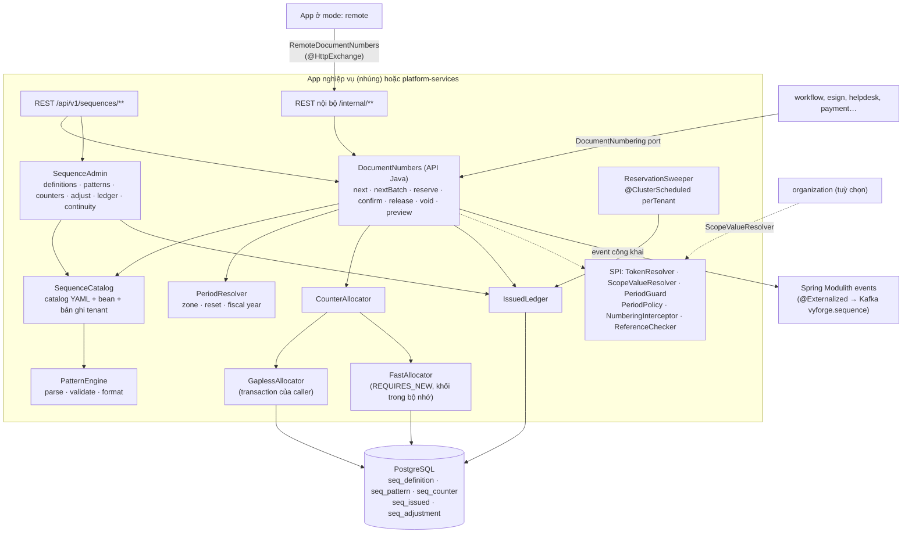
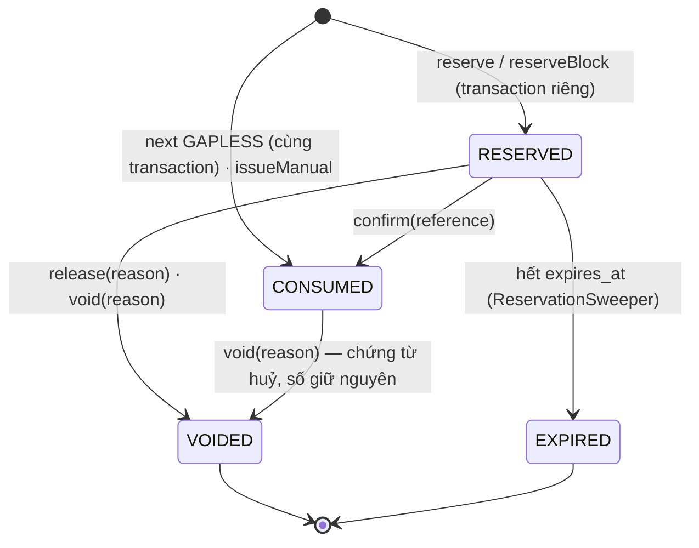
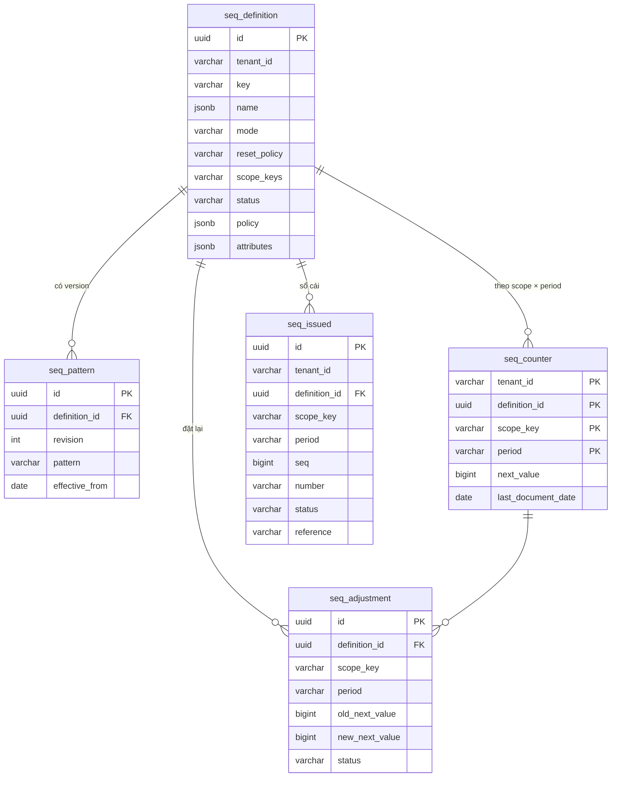

# Thiết kế module sequence: đánh số chứng từ (`platform-starter-sequence` + `@vyforge/sequence`)

> **Trạng thái:** bản thiết kế chờ duyệt (27/10/2026), phiên forge-54.
> **Phạm vi:** cấp số hiệu đọc được cho chứng từ và hồ sơ nghiệp vụ (phiếu thu, phiếu chi, đề nghị thanh toán, hợp đồng,
> số văn bản đi, mã hồ sơ một cửa, mã ticket, mã nhân viên…). Mẫu số có token ngày, chi nhánh, kỳ; reset theo năm,
> tháng, ngày hoặc năm tài chính, theo múi giờ của tenant; hai chế độ `FAST` và `GAPLESS`; đặt trước số, xác nhận, huỷ số
> có lý do (số đã huỷ vẫn được giữ), sổ cái số đã cấp, báo cáo tính liên tục, đặt lại bộ đếm cần quyền cao.
> **Không làm:** số hoá đơn điện tử (do nhà cung cấp HĐĐT và cơ quan thuế quản lý, thuộc `billing`/`einvoice`), khoá chính
> kỹ thuật (đã có UUID v7 trong `-jpa`).
> **Nền:** platform-java 0.12.1 (`StarterSchemaMigrator`, `DurableTaskQueue`, `@ClusterScheduled`), platform-web 0.9.0.
> Theo quy ước chung của các module P1 (mục 1–6) và kiến trúc `platform-services` (D1–D10, mục 4.11–4.12, 5).
> **Bên dùng đã chốt hợp đồng:** workflow (port `DocumentNumbering`, thiết kế workflow §6.2). Bên sẽ dùng: helpdesk,
> esign, payment, collaboration, forms, records, các sản phẩm ERP xây trên vyforge.

Mục lục:
0. [Tóm tắt quyết định](#0-tóm-tắt-quyết-định)
1. [Bài toán và phạm vi](#1-bài-toán-và-phạm-vi)
2. [Nghiên cứu](#2-nghiên-cứu)
3. [Kiến trúc](#3-kiến-trúc)
4. [Mô hình dữ liệu](#4-mô-hình-dữ-liệu)
5. [API](#5-api)
6. [Mở rộng](#6-mở-rộng)
7. [Vận hành](#7-vận-hành)
8. [Bảo mật và tuân thủ](#8-bảo-mật-và-tuân-thủ)
9. [Kế hoạch triển khai](#9-kế-hoạch-triển-khai)
10. [Lệch quy ước và quyết định cần người dùng chọn](#10-lệch-quy-ước-và-quyết-định-cần-người-dùng-chọn)
11. [Đóng gói và triển khai độc lập](#11-đóng-gói-và-triển-khai-độc-lập)

---

## 0. Tóm tắt quyết định

| # | Quyết định | Lý do ngắn |
|---|---|---|
| S1 | **Starter riêng** `platform-starter-sequence`, bảng tiền tố `seq_`, migration `META-INF/vyforge/db/sequence`, lịch sử `flyway_schema_history_sequence` | Gap analysis §2.6 và mục 6 module-conventions: cài, bỏ độc lập |
| S2 | **Không dùng `SEQUENCE` của PostgreSQL cho bộ đếm nghiệp vụ.** Mọi bộ đếm là một dòng trong `seq_counter`, khoá chính `(tenant, sequence, scope, period)`, tạo lười bằng một câu `INSERT … ON CONFLICT DO UPDATE … RETURNING` | Bộ đếm sinh động theo tenant × chi nhánh × kỳ (hàng nghìn); tạo `SEQUENCE` là DDL lúc chạy, không theo RLS, khó backup/khôi phục từng tenant. Odoo phải tạo một `SEQUENCE` cho mỗi `date_range` vì lý do này |
| S3 | **Hai chế độ.** `FAST`: tăng bộ đếm trong transaction riêng, ngắn, cấp theo khối (`blockSize`), cho phép nhảy số. `GAPLESS`: tăng bộ đếm **trong transaction nghiệp vụ**, khoá dòng tới khi commit; rollback thì số quay về | Đúng hai cách mà Odoo (`standard`/`no_gap`), SAP (buffer/không buffer), D365 (non-continuous/continuous) đều có |
| S4 | **Sổ cái số đã cấp** (`seq_issued`): mỗi số `GAPLESS` có một dòng `CONSUMED`/`RESERVED`/`VOIDED`/`EXPIRED`. Số đã cấp **không bao giờ tái sử dụng**; chứng từ huỷ giữ số, ghi lý do | Yêu cầu của kế toán VN là **mọi số phải giải trình được**, không phải "không bao giờ có số huỷ". D365 "continuous" tái sử dụng số bị bỏ: không làm, vì số đã in, đã gửi khách thì không được cấp lại cho chứng từ khác |
| S5 | **Đặt trước số** (`reserve` → `confirm` hoặc `void`, có hạn giữ) làm trên nền `GAPLESS`: cấp số trong transaction ngắn riêng, ghi `RESERVED` vào sổ cái; hết hạn mà chưa xác nhận thì job chuyển `EXPIRED` | Cho các luồng dài (in hợp đồng có số trước khi lưu, cấp số hồ sơ cho công dân ngay khi tiếp nhận), cấp số theo lô cho thiết bị offline, và cho chế độ `remote` |
| S6 | **Mẫu số là chuỗi token** `{prefix}-{branch}-{yyyy}-{seq:6}`, có version theo ngày hiệu lực (`seq_pattern`). Kỳ và ngày lấy từ **ngày chứng từ** do app truyền, quy về múi giờ của tenant (mặc định `Asia/Ho_Chi_Minh`) | Ngày chứng từ quyết định kỳ (chứng từ lập ngày 31/12 nhưng lưu lúc 00:10 ngày 01/01 vẫn thuộc năm cũ). Đổi mẫu giữa năm không phá số cũ |
| S7 | **Phạm vi bộ đếm** (`scopeKeys`, vd. `branch`, `cashbox`) tách khỏi **giá trị chỉ để hiển thị** (`{ctx.docType}`) | Số văn bản theo NĐ 30/2020: một dãy số chung cho mọi loại văn bản, ký hiệu khác nhau (`12/QĐ-UBND`, `13/TB-UBND`). Phiếu thu theo chi nhánh: mỗi chi nhánh một dãy |
| S8 | **Khai báo sequence bằng catalog** của module/app (`META-INF/vyforge/sequence/*.yml`), tenant ghi đè mẫu, prefix, chế độ trong giới hạn catalog cho phép; dòng định nghĩa của tenant được tạo lười khi cấp số đầu tiên | Giống catalog type của notification, event type của webhooks. Module dùng sequence không phải chạy migration dữ liệu |
| S9 | **Đặt lại bộ đếm** chỉ qua `adjust` có lý do, MFA, audit, event; không cho đặt thấp hơn số lớn nhất đã cấp; tuỳ chọn hai người duyệt (`FOUR_EYES`) cho sequence đánh dấu `regulated` | Đặt lại sai là cách phổ biến nhất gây trùng số chứng từ |
| S10 | **Chế độ `remote`**: `FAST` và `reserve/confirm/void` chạy qua API nội bộ. `GAPLESS` theo nghĩa "cùng transaction" **chỉ có khi nhúng**; ở `remote` gọi `next(GAPLESS)` được chuyển thành đặt trước + xác nhận trước commit + huỷ khi rollback (ngữ nghĩa `ACCOUNTED`, mục 3.12) | Không có transaction phân tán giữa app và `platform-services`. Khuyến nghị: nhúng (giống `export`) |
| S11 | **Đo chi phí khoá**: timer `vyforge.sequence.lock.wait` (thời gian chờ khoá dòng) và `vyforge.sequence.lock.hold` (từ lúc cấp số tới lúc transaction kết thúc), cảnh báo khi giữ khoá lâu; `lock_timeout` có giới hạn | Brief yêu cầu đo; giữ khoá lâu là nguyên nhân chính làm nghẽn GAPLESS |
| S12 | Admin MFE `sequence-admin` (`/m/sequence`), API `/api/v1/sequences`, component ở `@vyforge/sequence/admin` | D1, D5 của platform-services |

---

## 1. Bài toán và phạm vi

### 1.1 Vì sao cần một module riêng

- Gần như mọi sản phẩm nghiệp vụ VN cần số hiệu chứng từ đọc được, theo mẫu do khách quy định, reset theo năm, theo chi
  nhánh. Không có module chung thì mỗi module tự làm: billing đã có `bill_sequence`, workflow có `LocalNumbering` dựa
  trên `wf_instance_seq`, helpdesk, esign, payment sẽ làm tiếp. Mỗi bản tự làm lại mắc cùng lỗi: dùng `SEQUENCE` của
  PostgreSQL rồi bị kế toán phản ánh nhảy số; reset theo giờ UTC nên chứng từ lúc 0h–7h sáng 01/01 vào nhầm năm; đặt lại
  bộ đếm bằng SQL tay không có audit.
- Gap analysis (§1.2) ghi nhận ABP, JHipster, Supabase, Appwrite, Directus, Strapi đều **không có** năng lực này; chỉ
  Odoo và Frappe có. Đây là khối nền mà các sản phẩm ERP, e-office, một cửa xây trên vyforge cần (gap analysis §2 "không
  làm": `sequence` là phần nền của các sản phẩm đó).

### 1.2 Trong phạm vi

| Nhóm | Nội dung |
|---|---|
| Định nghĩa | Khai báo bằng catalog (code) hoặc tạo trong admin (tenant). Tên vi/en, chế độ, kỳ reset, năm tài chính, phạm vi bộ đếm, mẫu có version, độ dài tối thiểu, giá trị tối đa, chính sách lùi ngày, sổ cái, hạn giữ số |
| Cấp số | `next` (FAST/GAPLESS), `nextBatch` (nhiều số liên tiếp cho một lô chứng từ), `reserve`/`reserveBlock`, `confirm`, `release`, `void`, `issueManual` (nhập số từ sổ giấy hoặc hệ thống cũ), `preview` |
| Quản trị | Xem giá trị hiện tại theo phạm vi và kỳ, đặt lại có lý do, sổ cái số đã cấp, báo cáo tính liên tục theo kỳ (dãy đã dùng, đã huỷ, đang giữ, lỗ số), xuất CSV |
| Tích hợp | Port cho workflow; adapter lấy phạm vi từ `organization` (tuỳ chọn); event công khai; chế độ `remote` |

### 1.3 Kịch bản nghiệp vụ phải đáp ứng

| # | Kịch bản | Yêu cầu rút ra | Cách đáp ứng |
|---|---|---|---|
| K1 | **Phiếu thu/phiếu chi** của công ty có 3 chi nhánh: `PT-HN-2026-000123`, mỗi chi nhánh một dãy, reset đầu năm, **không nhảy số** vì kế toán đối chiếu sổ quỹ | Phạm vi theo chi nhánh; GAPLESS; reset năm | `scopeKeys: [branch]`, `mode: GAPLESS`, `reset: YEARLY` |
| K2 | **Đề nghị thanh toán** `DNTT-HN-2026-000123` cấp khi trình duyệt qua workflow; hồ sơ bị rút lại vẫn giữ số | Cấp trong transaction `start` của workflow; huỷ giữ số | Port `DocumentNumbering` của workflow → `DocumentNumbers.next` GAPLESS; workflow gọi `void(reason=withdrawn)` khi rút |
| K3 | **Số văn bản đi** theo NĐ 30/2020: số đánh từ 01 ngày 01/01 đến 31/12, một dãy chung cho mọi loại văn bản của cơ quan, ký hiệu theo loại: `12/QĐ-UBND`, `13/TB-UBND` | Bộ đếm chung, ký hiệu hiển thị khác nhau; độ dài tối thiểu 2 | Mẫu `{seq:2}/{ctx.docType}-{org}`, `scopeKeys: []`, token `ctx.docType` không vào khoá bộ đếm |
| K4 | **Mã hồ sơ một cửa** cấp ngay khi tiếp nhận, kể cả khi hồ sơ còn thiếu giấy tờ; công dân nhận giấy hẹn có mã | Cấp trước khi bản ghi hoàn chỉnh; mã theo mẫu của hệ thống một cửa (mã cơ quan + ngày + số thứ tự) | `reserve` với hạn giữ dài, `confirm` khi lưu hồ sơ; mẫu `{agency}-{yy}{mm}{dd}-{seq:4}`, reset ngày. Cấu trúc chính xác lấy từ Điều 28 NĐ 118/2025 (mục 2.2) |
| K5 | **Số hợp đồng** `HĐ-2026/0045` phải in lên bản PDF gửi khách ký trước khi hợp đồng được lưu chính thức; khách không ký thì số bị huỷ, ghi lý do | Đặt trước, xác nhận hoặc huỷ có lý do | `reserve(ttl=30d)` khi tạo bản nháp gửi ký (esign), `confirm` khi hoàn tất, `void(customer_declined)` khi khách từ chối |
| K6 | **Mã ticket CSKH** `TK-26-104223`, vài nghìn ticket mỗi giờ từ form công khai, Zalo, email; nhảy số không sao | Thông lượng cao, không giữ khoá | `FAST`, `blockSize: 50` |
| K7 | **Mã nhân viên** `NV00001`, không bao giờ reset, nhập 2.000 nhân viên cũ với mã sẵn có | Không reset; nhập số tay; bộ đếm tiếp nối sau số lớn nhất | `reset: NEVER`, `issueManual` khi import, `adjust(nextValue=2001)` |
| K8 | Doanh nghiệp có **năm tài chính bắt đầu 01/04**: chứng từ ngày 15/03/2027 thuộc năm tài chính 2026, số `PC-FY2026-…` | Kỳ theo năm tài chính | `reset: FISCAL_YEAR`, `fiscalYearStart: --04-01`, token `{fy}` |
| K9 | Chứng từ lập lúc **23:50 ngày 31/12** (giờ VN) nhưng transaction chạy lúc 00:02 ngày 01/01, hoặc server đặt UTC | Kỳ tính theo ngày chứng từ và múi giờ tenant, không theo đồng hồ server | `documentDate` trong request; `zone` của tenant |
| K10 | Kế toán **lập chứng từ lùi ngày** vào tháng trước khi đã khoá sổ tháng đó | Chặn cấp số vào kỳ đã khoá; tuỳ chọn bắt số tăng theo ngày | `backdating: DENY_CLOSED_PERIOD` + SPI `PeriodGuard` (module kế toán của sản phẩm cài); `chronology: STRICT` |
| K11 | **Chứng từ khấu trừ thuế TNCN điện tử** do tổ chức tự lập: ký hiệu `CT/26E`, số tối đa 7 chữ số, bắt đầu từ 1 mỗi năm | Giá trị tối đa; hết dãy thì báo lỗi rõ, cảnh báo trước | `maxValue: 9999999`, `overflow: FAIL`, alert khi dùng 80% |
| K12 | Cửa hàng **POS mất mạng** vẫn phải in số hoá đơn bán lẻ nội bộ | Cấp trước một dải số cho thiết bị | `reserveBlock(n=200, holder=device:POS-07, ttl=7d)`; số không dùng hết được trả về sổ cái dưới dạng `VOIDED(unused_block)` |
| K13 | Một tenant có **hai pháp nhân** (hai MST), mỗi pháp nhân một dãy phiếu xuất kho | Phạm vi theo pháp nhân | `scopeKeys: [legalEntity, warehouse]` |
| K14 | Dự án chuyển hệ thống **giữa năm**: phiếu thu cũ đã tới `PT-HN-2026-001234`; số mới phải bắt đầu từ 1235 | Gieo giá trị bộ đếm cho kỳ hiện tại | `adjust(scope, period=2026, nextValue=1235, reason=migration)` |
| K15 | Kiểm toán viên yêu cầu **bảng kê số phiếu chi tháng 10**: dãy đã dùng, số bị huỷ kèm lý do, số còn trống | Báo cáo tính liên tục | `GET …/continuity?period=2026-10` từ sổ cái |
| K16 | Khách đổi mẫu từ `PT-{yyyy}-{seq:5}` sang `PT{yy}{mm}-{seq:4}` từ 01/07 mà không reset dãy | Mẫu có version theo ngày hiệu lực, bộ đếm không đổi | `seq_pattern` với `effective_from = 2026-07-01` |
| K17 | Hai người cùng bấm "Ghi sổ" 200 phiếu chi cùng lúc ở cùng chi nhánh | Không trùng, không lỗ, không deadlock; thời gian chờ có giới hạn | Khoá một dòng, `lock_timeout`, metric `lock.wait`; cấp số ở cuối transaction |
| K18 | Cổng thanh toán cần **mã tham chiếu chuyển khoản** ngắn có số kiểm tra để giảm gõ sai | Check digit | Token `{check:mod97}` hoặc `{check:luhn}` |
| K19 | Bệnh viện cấp **số thứ tự khám theo ngày, theo phòng khám**: `P03-027` | Reset ngày, phạm vi phòng | `reset: DAILY`, `scopeKeys: [room]`, FAST `blockSize: 1` |
| K20 | Chứng từ bị **điều chỉnh** (bản sửa thay bản cũ) muốn số `PC-2026-000123-1` thay vì số mới | Số phụ cho bản sửa | Không làm trong lõi; app tạo số phụ từ số gốc. Ghi chú ở mục 6.6 (học Frappe "Amended Document Naming") |

### 1.4 Ngoài phạm vi

| Không làm | Thuộc về |
|---|---|
| Số hoá đơn điện tử, ký hiệu hoá đơn | Nhà cung cấp HĐĐT và cơ quan thuế; module `einvoice` (thiết kế billing §2112: "billing không tự đánh số HĐĐT") |
| Số hoá đơn billing nội bộ | Billing giữ `bill_sequence` ở 0.13 (đã thiết kế, không phụ thuộc cứng). Có thể chuyển sang sequence ở bản sau qua `InvoiceNumberFormat` |
| Khoá chính, id kỹ thuật | UUID v7 (`-jpa`). Số hiệu **không** dùng làm khoá truy cập |
| Khoá sổ kế toán theo kỳ | Sản phẩm kế toán; sequence chỉ hỏi qua SPI `PeriodGuard` |
| Sổ đăng ký văn bản đi/đến đầy đủ | Gói e-office dựng trên `workflow` + `esign` + `sequence` + `records` |

---

## 2. Nghiên cứu

> Kiểm ngày 27/10/2026. Mã nguồn đọc trực tiếp từ GitHub (nhánh 19.0 của Odoo, `version-16` của Frappe); version qua
> GitHub Releases API. Tài liệu SaaS đọc từ trang chính thức. Văn bản pháp lý VN lấy từ cổng thông tin và trang tra cứu
> pháp luật; chỗ chưa đối chiếu toàn văn ghi **(chưa kiểm chứng toàn văn)**.

### 2.1 Hệ thống tham khảo

| Hệ thống | Version, license | Mô hình dữ liệu và API | Điểm mạnh | Điểm yếu |
|---|---|---|---|---|
| **Odoo `ir.sequence`** ([ir_sequence.py, 19.0](https://github.com/odoo/odoo/blob/19.0/odoo/addons/base/models/ir_sequence.py)) | Odoo 19 Community, LGPL-3.0 | `ir.sequence` (`code`, `prefix`, `suffix`, `padding`, `number_increment`, `implementation` = `standard`/`no_gap`, `use_date_range`, `company_id`); `ir.sequence.date_range` (`date_from`, `date_to`, `number_next`). `standard` dùng `SEQUENCE` PostgreSQL riêng cho mỗi sequence và mỗi date range (`ir_sequence_%03d_%03d`); `no_gap` dùng `SELECT number_next … FOR UPDATE NOWAIT` rồi `UPDATE`. Prefix nội suy `%(year)s`, `%(range_year)s`, `%(month)s`, `%(doy)s`, `%(isoweek)s`…; `next_by_code(code, sequence_date)` chọn sequence của công ty hiện tại | Hai chế độ rõ ràng; kỳ là bảng con tự tạo theo năm; tách ngày chứng từ (`sequence_date`) khỏi ngày hiện tại; theo công ty | Mỗi kỳ một `SEQUENCE` (DDL lúc chạy); `NOWAIT` làm người dùng gặp lỗi khi tranh chấp thay vì chờ; tài liệu tự nhận "no gap" vẫn có lỗ khi xoá bản ghi; không có sổ cái, không có lý do huỷ |
| **Odoo `sequence.mixin`** (kế toán) ([sequence_mixin.py, 19.0](https://github.com/odoo/odoo/blob/19.0/addons/account/models/sequence_mixin.py)) | Odoo 19, LGPL-3.0 | Không có bảng bộ đếm: số tiếp theo **suy ra từ số cuối cùng** của bút toán đã ghi sổ (regex `_sequence_yearly_regex`, `_sequence_monthly_regex`, `year_range`…). Khoá bằng chính unique index: `UPDATE` cột số trong savepoint, gặp `UniqueViolation` thì tăng và thử lại; sau khi giữ được khoá thì dùng cache trong transaction cho các số kế tiếp. Kiểm số khớp ngày (`_constrains_date_sequence`), chỉ cho xoá nếu là số cuối chuỗi (`_is_end_of_seq_chain`) | Người dùng sửa số đầu tiên của năm là đổi luôn mẫu; số tăng theo ngày; không cho xoá giữa chuỗi; ghi chú kỹ về chi phí savepoint ("subtransactions considered harmful") | Gắn chặt với một bảng nghiệp vụ; suy mẫu bằng regex dễ nhầm; không dùng chung được cho module khác |
| **Frappe Naming Series** ([naming.py, version-16](https://github.com/frappe/frappe/blob/version-16/frappe/model/naming.py)) | Frappe v16.53.0 (22/10/2026), MIT | Bảng `tabSeries(name, current)`; khoá là **prefix đã nội suy** (vd. `SINV-26-`), nên reset theo năm là tự nhiên: năm mới → prefix mới → dòng mới. `getseries` dùng `SELECT … FOR UPDATE` rồi `UPDATE current = current + 1`. Mẫu `SINV-.YY.-.####`, `format:LOG-{MM}-{fieldname}-{#####}`, biến tuỳ biến qua hook `naming_series_variables`. `revert_series_if_last` lùi bộ đếm khi xoá bản ghi cuối. "Amended Document Naming" đặt tên bản sửa `SINV-0001-1` | Khoá bộ đếm theo prefix: đơn giản, không cần khái niệm kỳ; mẫu dùng giá trị field của bản ghi; hook cho token riêng; xem trước (`get_preview`) | Luôn khoá trong transaction (không có chế độ nhanh); prefix đổi là dãy mới (đổi mẫu giữa năm reset luôn); lùi bộ đếm khi xoá dễ gây cấp lại số đã in |
| **Microsoft Dynamics 365 Finance** ([Number sequences overview](https://learn.microsoft.com/en-us/dynamics365/fin-ops-core/fin-ops/organization-administration/number-sequence-overview), cập nhật 03/2026) | SaaS thương mại | Number sequence gắn với *reference* (loại chứng từ); **scope** `Shared`, `Company`, `Legal entity`, `Operating unit`, kết hợp `Fiscal calendar period`; segment `Constant`, `Alphanumeric` (`#` số, `&` chữ), segment theo scope. **Continuous** (không lỗ, tái sử dụng số bị bỏ, có job cleanup) và **non-continuous** (có thể lỗ, có preallocation trong bộ nhớ). Từ 10.0.36: continuous có preallocation 5 số lưu trong DB | Khái niệm scope và kỳ tài chính rất khớp với nhu cầu VN; tài liệu khuyên "dùng non-continuous trừ khi luật bắt buộc" | Tái sử dụng số bị bỏ (không hợp với chứng từ đã in/gửi); cleanup chạy batch giờ thấp điểm |
| **SAP number range** (SNRO/NRIV) ([SAP blog: Buffering number ranges and legal framework](https://blogs.sap.com/t5/technology-blogs-by-sap/buffering-number-ranges-and-legal-framework/ba-p/12953573), [KBA 1843002](https://userapps.support.sap.com/sap/support/knowledge/en/1843002)) | SaaS/on-prem thương mại | Number range object, interval theo năm; bộ đếm trong bảng `NRIV`; buffer: không buffer, main memory, parallel. Main memory nhanh nhất nhưng số không tăng dần và có lỗ (rollback làm mất số); không buffer thì không lỗ nhưng khoá `NRIV` và có thể timeout. SAP khuyên không buffer cho dãy cần liên tục như số hoá đơn | Khối số trong bộ nhớ theo từng server; tài liệu nêu rõ đánh đổi pháp lý | Cấu hình phức tạp; số không tăng dần theo thời gian khi buffer |
| **PostgreSQL 18 `SEQUENCE`** ([functions-sequence](https://www.postgresql.org/docs/current/functions-sequence.html), [CREATE SEQUENCE](https://www.postgresql.org/docs/current/sql-createsequence.html), bản 18.6) | PostgreSQL License | `nextval` không hoàn lại khi transaction huỷ; `INSERT … ON CONFLICT` cũng có thể đốt số; tài liệu viết rõ "sequence objects cannot be used to obtain gapless sequences". `CACHE n > 1`: mỗi session giữ một khối, số chưa dùng mất khi session đóng, thứ tự giữa các session không đảm bảo | Nhanh nhất, không khoá | Không lỗ là không làm được; một object cho mỗi bộ đếm |
| Mẫu bộ đếm một dòng (`UPDATE … RETURNING`) ([pgsql-general 2006](https://www.postgresql.org/message-id/legacy/pgsql-general/2006-08/msg00744.php), [thảo luận 2008](https://postgrespro.com/list/thread-id/1472964)) | — | `UPDATE counter SET v = v + 1 RETURNING v` trong transaction nghiệp vụ; câu `UPDATE` tự giữ khoá dòng, không cần `SELECT FOR UPDATE` trước | Đơn giản, không lỗ | "Sẽ chịu thiệt về đồng thời nếu transaction còn làm nhiều việc khác"; gợi ý: lưu bản ghi trước, gán số ở bước sau |

### 2.2 Văn bản pháp lý VN (kiểm ngày 27/10/2026)

| Văn bản | Nội dung liên quan | Áp vào thiết kế |
|---|---|---|
| **Luật Kế toán 88/2015/QH13**, sửa bởi **Luật 56/2024/QH15** (hiệu lực 01/01/2025) | Điều 16: chứng từ kế toán phải có tên và **số hiệu**, ngày lập… (Luật 56/2024 bãi bỏ điểm d khoản 1 về tên, địa chỉ bên nhận). Điều 17: chứng từ điện tử. Điều 18: lập chứng từ rõ ràng, không tẩy xoá; viết sai thì huỷ bằng cách gạch chéo, giữ lại chứng từ huỷ ([luatvietnam](https://luatvietnam.vn/thue-phi-le-phi/chung-tu-ke-toan-la-gi-565-94687-article.html), [ĐH Duy Tân](https://kketoan.duytan.edu.vn/uploads/b76ae416-7c27-44ae-9dcb-1ba76e0a0b28_tambaiwebthang12025.docx)) **(chưa kiểm chứng toàn văn Điều 18)** | Số hiệu là nội dung bắt buộc của chứng từ; chứng từ huỷ giữ lại kèm số → trạng thái `VOIDED` giữ số, không tái sử dụng (S4) |
| **Thông tư 99/2025/TT-BTC** chế độ kế toán doanh nghiệp, ký 27/10/2025, hiệu lực 01/01/2026, **thay Thông tư 200/2014** ([KPMG](https://kpmg.com/vn/vi/home/phan-tich-chuyen-sau/2025/11/key-changes-in-vietnamese-accounting-system-for-enterprises.html), [thuvienphapluat](https://thuvienphapluat.vn/ma-so-thue/phap-luat-thue/thong-tu-992025ttbtc-ve-che-do-ke-toan-thay-the-nhung-thong-tu-nao-213915.html)) | Điều 9: biểu mẫu chứng từ ở Phụ lục I là **hướng dẫn**, doanh nghiệp được thiết kế, sửa đổi biểu mẫu nhưng phải đủ nội dung Điều 16 Luật Kế toán. Điều 10: mỗi nghiệp vụ chỉ lập chứng từ một lần | Mẫu số do doanh nghiệp tự quyết → mẫu phải cấu hình được theo tenant, không cố định trong code. "Lập một lần" → `idempotencyKey` khi cấp số |
| **NĐ 30/2020/NĐ-CP** về công tác văn thư, Điều 15 ([hethongphapluat](https://hethongphapluat.com/nghi-dinh-30-2020-nd-cp-ve-cong-tac-van-thu/dieu-15), [thuvienphapluat](https://thuvienphapluat.vn/hoi-dap-phap-luat/co-duoc-cap-so-van-ban-lui-ngay-cap-van-ban-di-khong-323056.html)) | Số văn bản cấp theo thứ tự ban hành trong năm, bắt đầu từ 01 ngày 01/01, kết thúc 31/12; số và ký hiệu là duy nhất trong năm, thống nhất giữa bản giấy và bản điện tử; không thêm ký tự a, b, c sau số (tư vấn của thuvienphapluat). Chưa thấy văn bản thay thế (tìm kiếm 27/10/2026) **(chưa kiểm chứng toàn văn)** | K3: `seq:2`, reset năm, một bộ đếm chung, ký hiệu qua `ctx`; không có "số phụ" kiểu `12a` |
| **NĐ 118/2025/NĐ-CP** thủ tục hành chính một cửa, một cửa liên thông (thay NĐ 61/2018, hiệu lực 01/07/2025), sửa bởi **NĐ 367/2025/NĐ-CP** ([luatvietnam](https://luatvietnam.vn/hanh-chinh/nghi-dinh-118-2025-nd-cp-cua-chinh-phu-ve-thuc-hien-thu-tuc-hanh-chinh-theo-co-che-mot-cua-mot-cua-lien-thong-tai-bo-phan-mot-cua-va-cong-dich-vu-cong-quoc-gia-402528-d1.html), [hcc.nghean.gov.vn](https://hcc.nghean.gov.vn/laws/detail/Nghi-dinh-so-367-2025-ND-CP-cua-Chinh-phu-Nghi-dinh-sua-doi-bo-sung-mot-so-dieu-cua-Nghi-dinh-so-118-2025-ND-CP-ngay-09-thang-6-nam-2025-cua-Chinh-phu-ve-thuc-hien-thu-tuc-hanh-chinh-theo-co-che-mot-cua-mot-cua-lien-thong-tai-Bo-phan-Mot-cua-va-Co-2049/)) | Khoản 2 Điều 28: mã số hồ sơ do hệ thống giải quyết TTHC cấp tự động, dùng thống nhất giữa các cơ quan; thành phần đầu là mã định danh của cơ quan có thẩm quyền. Các thành phần còn lại và việc NĐ 367/2025 có sửa Điều 28 hay không **chưa kiểm chứng toàn văn** | K4: cần token tuỳ biến `{agency}` (mã định danh cơ quan) qua `TokenResolver`, reset ngày; mẫu cụ thể là dữ liệu cấu hình, đối chiếu lại khi có dự án một cửa |
| **NĐ 70/2025/NĐ-CP**, Thông tư 32/2025/TT-BTC: chứng từ khấu trừ thuế TNCN điện tử ([meinvoice](https://www.meinvoice.vn/?p=34983), [lsvn](https://lsvn.vn/cuc-thue-huong-dan-su-dung-chung-tu-khau-tru-thue-thu-nhap-ca-nhan-a160933.html)) | Ký hiệu 7 ký tự `CT/26E`; số tối đa 7 chữ số, bắt đầu từ 1 ngày 01/01 (hoặc ngày bắt đầu dùng), kết thúc 31/12; không trùng trong năm (nguồn thứ cấp) **(chưa kiểm chứng toàn văn)** | K11: `maxValue`, cảnh báo dung lượng. Nếu tổ chức dùng phần mềm chứng từ của nhà cung cấp thì số do nhà cung cấp cấp, như HĐĐT |
| **NĐ 123/2020/NĐ-CP** sửa bởi **NĐ 70/2025/NĐ-CP** (hoá đơn) | Số hoá đơn do hệ thống lập hoá đơn cấp theo ký hiệu, tối đa 8 chữ số, liên tục trong năm (thiết kế billing §8.2 đã kiểm) | Ranh giới: sequence không cấp số HĐĐT |
| Lưu trữ chứng từ kế toán: Luật Kế toán 2015 Điều 41, NĐ 174/2016/NĐ-CP | Chứng từ dùng trực tiếp để ghi sổ kế toán lưu tối thiểu 10 năm **(chưa kiểm chứng toàn văn; billing §8.3 dùng cùng mốc)** | `retentionYears` của sổ cái theo sequence, mặc định 10 với sequence `regulated` |

### 2.3 Học theo và không làm

| Học theo | Từ | Trong thiết kế |
|---|---|---|
| Hai chế độ nhanh/không lỗ, và lời khuyên "chỉ dùng không lỗ khi luật bắt buộc" | Odoo, SAP, D365 | S3; catalog mặc định `FAST`, sequence kế toán khai báo `GAPLESS` |
| Ngày chứng từ quyết định kỳ, tách khỏi "bây giờ" | Odoo (`sequence_date`, `range_*` vs `current_*`) | `documentDate`; token `{yyyy}` theo ngày chứng từ, `{now.yyyy}` theo thời điểm cấp |
| Scope theo pháp nhân/đơn vị + kỳ tài chính | D365 | `scopeKeys`, `reset: FISCAL_YEAR` |
| Khoá bộ đếm theo giá trị đã nội suy, tạo dòng lười | Frappe (`tabSeries` theo prefix) | Khoá `(scope, period)` tạo lười bằng `ON CONFLICT` |
| Cấp khối số trong bộ nhớ cho chế độ nhanh | SAP main memory buffer, D365 preallocation, Hibernate pooled | `FAST` + `blockSize` |
| Xem trước số | Frappe `get_preview` | `preview` |
| Token tuỳ biến qua hook | Frappe `naming_series_variables` | SPI `TokenResolver` |
| Kiểm số tăng theo ngày | Odoo `_constrains_date_sequence` | `chronology: STRICT` (tuỳ chọn) |
| Ghi chú chi phí savepoint, chỉ dùng một câu lệnh | Odoo `_locked_increment` | Một câu `INSERT … ON CONFLICT DO UPDATE … RETURNING`, không savepoint, không retry vòng |

| Không làm | Lý do |
|---|---|
| `SEQUENCE` PostgreSQL cho mỗi bộ đếm | DDL lúc chạy, không theo RLS và tenant, khó khôi phục từng tenant (S2) |
| `NOWAIT` khi tranh khoá | Đẩy lỗi cho người dùng khi tải cao; dùng `lock_timeout` có giới hạn (mặc định 5 giây) |
| Tái sử dụng số bị bỏ (D365 continuous) và lùi bộ đếm khi xoá bản ghi cuối (Frappe) | Số có thể đã in, đã gửi đi; cấp lại cho chứng từ khác là sai lệch chứng từ. Số bị bỏ thành `VOIDED`/`EXPIRED` có lý do |
| Suy số tiếp theo từ dữ liệu nghiệp vụ bằng regex (Odoo `sequence.mixin`) | Gắn với bảng của app; module dùng chung không đọc bảng của app |
| Đổi prefix là bắt đầu dãy mới (Frappe) | K16: đổi mẫu không được reset ngầm; mẫu có version, bộ đếm theo `(scope, period)` |
| Cấp số hoá đơn điện tử | Ranh giới với billing/einvoice |

---

## 3. Kiến trúc

### 3.1 Khái niệm

| Khái niệm | Ý nghĩa | Bảng |
|---|---|---|
| **Sequence** (định nghĩa) | Một loại số hiệu của tenant, khoá `key` (vd. `finance.cash-receipt`). Có chế độ, kỳ reset, phạm vi, chính sách | `seq_definition` |
| **Pattern** (mẫu) | Chuỗi token, có `revision` và `effective_from` | `seq_pattern` |
| **Scope** (phạm vi) | Bộ giá trị của các `scopeKeys` (vd. `branch=HN`). Mỗi giá trị phạm vi một dãy riêng | phần của khoá `seq_counter` |
| **Period** (kỳ) | Khoảng reset: `all`, `2026`, `2026-10`, `2026-10-27`, `FY2026` | phần của khoá `seq_counter` |
| **Counter** (bộ đếm) | Giá trị kế tiếp cho một `(sequence, scope, period)` | `seq_counter` |
| **Issued number** | Một số đã cấp, có trạng thái và tham chiếu tới chứng từ | `seq_issued` (sổ cái) |
| **Adjustment** | Một lần đặt lại/gieo bộ đếm, có lý do, người làm, người duyệt | `seq_adjustment` |
| **Catalog** | Định nghĩa mặc định khai báo trong code của module/app | `META-INF/vyforge/sequence/*.yml` |

### 3.2 Thành phần



### 3.3 Gói Java

```
com.vyforge.platform.sequence
├── DocumentNumbers, SequenceAdmin, SequenceCatalog          # API công khai
├── model/        NumberRequest, IssuedNumber, Reservation, NumberingMode, ResetPolicy, SequenceSpec,
│                 PatternRevision, CounterView, ContinuityReport, VoidReason, …
├── pattern/      PatternEngine, Token, PatternValidation, CheckDigits (luhn, mod97, mod11)
├── period/       PeriodResolver, PeriodKey, FiscalYear
├── alloc/        CounterAllocator, GaplessAllocator, FastAllocator, BlockCache, LockMetrics
├── ledger/       IssuedLedger, ReservationSweeper, ContinuityQuery
├── catalog/      YamlCatalogLoader, TenantDefinitionStore
├── spi/          TokenResolver, ScopeValueResolver, PeriodPolicy, PeriodGuard, NumberingInterceptor, ReferenceChecker
├── web/          SequenceController, SequenceAdminController, SequenceInternalController, ErrorCodes
├── remote/       RemoteDocumentNumbers, RemoteSequenceAdmin (mode: remote)
├── event/        SequenceNumberVoided, SequenceReservationExpired, SequenceCounterAdjusted, …
└── autoconfigure/ SequenceAutoConfiguration, SequenceProperties, SequenceAuthzCatalog
```

Bộ đếm và sổ cái dùng `JdbcClient` (câu lệnh cố định, cần kiểm soát chính xác khoá); định nghĩa và mẫu dùng JPA
(`TenantEntity`). Luật ArchUnit `TENANT_ISOLATION`: mọi câu SQL tới `seq_*` có `tenant_id = :tenant` lấy từ
`TenantContext.require()`.

### 3.4 Mẫu số

Ngữ pháp: văn bản thường là hằng; token nằm trong `{…}`; `{{` và `}}` là dấu ngoặc thật.

| Token | Ý nghĩa | Ví dụ (ngày chứng từ 27/10/2026) |
|---|---|---|
| `{seq}`, `{seq:N}` | Số thứ tự, đệm 0 tới N chữ số. **Bắt buộc, đúng một lần** | `{seq:6}` → `000123` |
| `{prefix}` | Giá trị `prefix` của định nghĩa (tenant đổi được mà không sửa mẫu) | `PT` |
| `{yyyy}` `{yy}` `{mm}` `{dd}` `{q}` | Ngày chứng từ, theo múi giờ tenant | `2026` `26` `10` `27` `4` |
| `{fy}` `{fyy}` | Năm tài chính chứa ngày chứng từ (theo `fiscalYearStart`); `{fy}` là năm bắt đầu | `2026`, `26` |
| `{now.yyyy}`… | Thời điểm cấp số (hiếm dùng) | |
| `{<scopeKey>}` | Giá trị phạm vi (vào khoá bộ đếm) | `{branch}` → `HN` |
| `{ctx.<name>}` | Giá trị chỉ để hiển thị, **không** vào khoá bộ đếm; phải khai báo trong `displayKeys` | `{ctx.docType}` → `QĐ` |
| `{<resolver>}` | Token từ `TokenResolver` (vd. `{agency}`, `{org}`) | `{agency}` → `000.00.12.H29` |
| `{check:luhn}` `{check:mod97}` `{check:mod11}` | Số kiểm tra tính trên phần số của chuỗi đứng trước nó | |
| `…\|upper`, `…\|lower` | Biến đổi chữ | `{branch\|lower}` |

Luật kiểm khi lưu mẫu (`PatternValidation`, lỗi `sequence.pattern_invalid` kèm vị trí):

1. Có đúng một `{seq…}`; token đều biết; `{ctx.*}` có trong `displayKeys`; `{<scopeKey>}` có trong `scopeKeys`.
2. **Tính duy nhất:** với `uniqueness: GLOBAL` (mặc định), mẫu phải phân biệt được kỳ reset (reset `YEARLY` cần
   `{yyyy}`/`{yy}`/`{fy}`; `MONTHLY` cần thêm `{mm}`; `DAILY` cần thêm `{dd}`) và phân biệt được mọi `scopeKey`. Nếu không,
   hai chứng từ khác nhau có cùng chuỗi số. Trường hợp như NĐ 30/2020 (số văn bản không có năm, duy nhất trong năm) thì
   khai báo `uniqueness: PERIOD`; chuỗi số chỉ duy nhất trong `(scope, period)`.
3. Độ dài chuỗi kết quả tối đa 64 (khớp `number varchar(64)` của workflow). Giá trị phạm vi và `ctx` phải khớp
   `[\p{L}\p{N}._/-]{1,32}` (cho phép chữ có dấu như `Đ` trong `HĐ`); không có khoảng trắng đầu cuối.
4. `{seq:N}` với `maxValue` có nhiều chữ số hơn N: cảnh báo (số sẽ dài ra), chặn nếu `overflow: FAIL`.

**Version của mẫu.** Mỗi lần sửa mẫu tạo `seq_pattern` mới với `effective_from` (ngày theo múi giờ tenant). Số cho
ngày chứng từ D dùng mẫu có `effective_from` lớn nhất ≤ D. Bộ đếm không đổi khi đổi mẫu (K16). Muốn bắt đầu lại dãy thì
dùng `adjust` (có quyền và lý do).

### 3.5 Kỳ đánh số

| `reset` | Khoá kỳ | Ghi chú |
|---|---|---|
| `NEVER` | `all` | Mã nhân viên, mã khách hàng |
| `YEARLY` | `2026` | Năm dương lịch theo múi giờ tenant |
| `MONTHLY` | `2026-10` | |
| `DAILY` | `2026-10-27` | Số thứ tự khám, mã hồ sơ một cửa |
| `FISCAL_YEAR` | `FY2026` | `fiscalYearStart` dạng `--MM-DD` (mặc định `--01-01`). Năm tài chính VN có thể bắt đầu đầu quý |
| `CUSTOM:<id>` | do `PeriodPolicy` trả | Kỳ kế toán 4-4-5, kỳ học… |

- **Ngày chứng từ:** `NumberRequest.documentDate` (`LocalDate`). Không truyền thì lấy `LocalDate.now(zone)`. Không
  bao giờ tính kỳ từ `Instant` theo UTC (K9).
- **Múi giờ:** `seq_definition.zone` → cấu hình tenant (`vyforge.sequence.tenant-defaults.zone`, sau này đọc từ
  `settings`) → `Asia/Ho_Chi_Minh`.
- **Lùi ngày** (`backdating`): `ALLOW` (mặc định), `CURRENT_PERIOD_ONLY` (chỉ kỳ hiện tại), `DENY_CLOSED_PERIOD` (hỏi
  `PeriodGuard.isClosed(sequenceKey, period, scope)`; không có bean nào thì coi như mở). Vi phạm: `sequence.period_closed`.
- **Tăng theo ngày** (`chronology`): `NONE` (mặc định) hoặc `STRICT`: ngày chứng từ không được trước
  `seq_counter.last_document_date` (lỗi `sequence.chronology_violation`). Chỉ có nghĩa với `GAPLESS`.

### 3.6 Chế độ `FAST`

```sql
-- Chạy trong transaction riêng (REQUIRES_NEW), commit ngay; :n = blockSize
insert into seq_counter (tenant_id, definition_id, scope_key, period, next_value, updated_at)
values (:tenant, :def, :scope, :period, :start + :n, now())
on conflict (tenant_id, definition_id, scope_key, period)
do update set next_value = seq_counter.next_value + :n, updated_at = now()
returning next_value - :n as block_start;
```

- Node giữ khối `[block_start, block_start + n)` trong bộ nhớ (`BlockCache`, khoá `(tenant, def, scope, period)`), cấp
  dần không cần DB. Hết khối thì lấy khối mới. Khối chưa dùng hết khi node tắt thì mất (lỗ số), giống `CACHE` của
  PostgreSQL.
- `blockSize: 1` (mặc định của platform) cho số tăng đúng thứ tự, chỉ lỗ khi transaction nghiệp vụ rollback. Tăng
  `blockSize` khi thông lượng cao (K6); khi đó số giữa các node không tăng theo thời gian (tài liệu PostgreSQL và SAP
  nêu cùng hệ quả).
- Khoá dòng chỉ giữ trong transaction ngắn (một câu lệnh), nên không làm nghẽn transaction nghiệp vụ.
- Sổ cái mặc định tắt với `FAST` (`ledger: OFF`). Bật được (`ledger: ON`) khi cần tra số → chứng từ; khi đó dòng
  `CONSUMED` được ghi trong transaction nghiệp vụ.
- `adjust` của bộ đếm `FAST` phát tín hiệu xoá `BlockCache` ở mọi node (kênh Valkey `vyforge:sequence:changed` nếu có,
  nếu không thì khối hiện tại dùng nốt rồi mới thấy giá trị mới; admin hiển thị cảnh báo này).

### 3.7 Chế độ `GAPLESS`

```sql
-- Chạy trong transaction của caller (propagation MANDATORY)
select set_config('lock_timeout', :lockTimeout, true);          -- vd. '5s'; khôi phục giá trị cũ ngay sau câu dưới
insert into seq_counter (tenant_id, definition_id, scope_key, period, next_value, last_document_date, updated_at)
values (:tenant, :def, :scope, :period, :start + 1, :docDate, now())
on conflict (tenant_id, definition_id, scope_key, period)
do update set next_value = seq_counter.next_value + 1,
              last_document_date = greatest(seq_counter.last_document_date, excluded.last_document_date),
              updated_at = now()
returning next_value - 1 as seq, last_document_date;
```

- Không có transaction đang chạy → `sequence.transaction_required` (500, lỗi lập trình). Kiểm bằng
  `TransactionSynchronizationManager.isActualTransactionActive()`.
- Câu `INSERT … ON CONFLICT DO UPDATE` giữ khoá dòng tới khi transaction kết thúc. Rollback thì giá trị tăng cũng
  rollback: không lỗ. Transaction khác cùng bộ đếm phải chờ.
- Hết `lock_timeout` → `sequence.lock_timeout` (503, `Retry-After: 1`). Transaction nghiệp vụ phải rollback (PostgreSQL
  đã huỷ câu lệnh).
- `chronology: STRICT`: câu lệnh viết thành CTE, đọc `last_document_date` **cũ** của dòng (`select … for update`) trước
  khi tăng; `documentDate` nhỏ hơn giá trị cũ thì ném lỗi trước khi trả số. Transaction phải rollback nên số không bị đốt.
- Sổ cái bật mặc định (`ledger: ON`): ghi dòng `CONSUMED` cùng transaction, cùng `reference`.
- **Nhiều số trong một transaction** (vd. ghi sổ 200 phiếu chi một lúc): dùng `nextBatch(request, count)` để tăng
  một lần `+count` (một khoá, một round trip). Cấp số ở nhiều bộ đếm khác nhau trong cùng transaction: allocator sắp
  theo `(definition_id, scope_key, period)` trong `nextBatch` đa khoá để tránh deadlock; tài liệu README khuyên app
  cũng cấp theo thứ tự đó.
- **Khuyến nghị cách dùng** (README, và cảnh báo qua metric `lock.hold`): cấp số **ở cuối transaction**, ngay trước khi
  commit (như Odoo cấp số khi "ghi sổ", không phải khi tạo nháp). Không gọi API ngoài, không gửi email trong khoảng giữ
  khoá.

### 3.8 Đặt trước, xác nhận, huỷ



- `reserve`: cấp số bằng **cùng câu lệnh GAPLESS** nhưng trong transaction riêng ngắn, rồi ghi dòng `RESERVED`
  (`expires_at = now + ttl`, `holder`, `idempotency_key`) trong cùng transaction ngắn đó. Trả `Reservation(id, number,
  expiresAt)`. Không giữ khoá dòng bộ đếm sau khi trả.
- `confirm(reservationId, reference)`: trong transaction nghiệp vụ; `RESERVED → CONSUMED`. Đã `CONSUMED` với cùng
  `reference` thì trả lại kết quả cũ (idempotent). Đã `EXPIRED`/`VOIDED` → `sequence.reservation_expired` (409); app phải
  xin số mới.
- `release(reservationId, reason)`: người dùng bỏ bản nháp; `RESERVED → VOIDED`.
- `void(numberId | (sequenceKey, number), reason, note)`: chứng từ đã lập bị huỷ; `CONSUMED → VOIDED`. Lý do bắt buộc
  (mã trong danh mục, mục 6.5), ghi chú tối đa 500 ký tự.
- `reserveBlock(n, holder, ttl)`: K12; cấp `n` số liên tiếp bằng `+n`, ghi `n` dòng `RESERVED` (insert theo lô).
  Thiết bị báo số đã dùng bằng `confirm`, số thừa bằng `release(unused_block)`.
- `ReservationSweeper` (`@ClusterScheduled(name = "sequence-reservation-sweep", fixedDelay = "1m", perTenant = true)`):
  `update … set status = 'EXPIRED' where status = 'RESERVED' and expires_at < now() … for update skip locked limit 500`;
  phát `SequenceReservationExpired`.
- **Không bao giờ tái sử dụng** số `VOIDED`/`EXPIRED` (S4). Báo cáo tính liên tục liệt kê chúng kèm lý do, nên dãy vẫn
  "đủ", đúng với yêu cầu giải trình của kế toán.

### 3.9 Luồng chính: cấp số GAPLESS trong transaction nghiệp vụ

```mermaid
sequenceDiagram
  autonumber
  participant App as Service nghiệp vụ (@Transactional)
  participant DN as DocumentNumbers
  participant CAT as SequenceCatalog
  participant PR as PeriodResolver
  participant SV as ScopeValueResolver
  participant IC as NumberingInterceptor
  participant GA as GaplessAllocator
  participant DB as PostgreSQL
  App->>DB: insert phiếu chi (chưa có số)
  App->>DN: next(NumberRequest(key=finance.cash-payment, documentDate, scope{branch:HN}, reference, idempotencyKey))
  DN->>CAT: resolve(tenant, key) (cache; tạo seq_definition lười từ catalog)
  DN->>SV: bổ sung scope còn thiếu (vd. branch của người dùng)
  DN->>PR: period(documentDate, zone, reset) → "2026"; PeriodGuard.isClosed?
  DN->>IC: beforeIssue(ctx) (có thể chặn)
  DN->>DB: idempotency: tìm seq_issued theo (tenant, idempotency_key)
  DN->>GA: allocate(def, scope=branch=HN, period=2026, n=1)
  GA->>DB: INSERT … ON CONFLICT DO UPDATE … RETURNING (khoá dòng, đo lock.wait)
  GA-->>DN: seq=123 (đăng ký TransactionSynchronization để đo lock.hold)
  DN->>DN: format theo seq_pattern hiệu lực → "PC-HN-2026-000123"
  DN->>DB: insert seq_issued (CONSUMED, reference)
  DN->>IC: afterIssue(ctx, issued)
  DN-->>App: IssuedNumber(id, "PC-HN-2026-000123", seq=123, period=2026)
  App->>DB: update phiếu chi set number = …
  Note over App,DB: Commit: khoá nhả, lock.hold ghi nhận. Rollback: bộ đếm và seq_issued cùng rollback, không lỗ số
```

### 3.10 Luồng lỗi

| Tình huống | Hành vi | Mã lỗi |
|---|---|---|
| Sequence không tồn tại, cả catalog lẫn tenant | Ném lỗi, không tạo | `sequence.not_found` (404) |
| Sequence bị tắt | Ném lỗi | `sequence.disabled` (409) |
| Thiếu giá trị phạm vi và `ScopeValueResolver` không bổ sung được | Ném lỗi, liệt kê khoá thiếu | `sequence.scope_missing` (400) |
| Giá trị phạm vi/ctx sai định dạng | Ném lỗi | `sequence.scope_invalid` (400) |
| Yêu cầu `GAPLESS` trên định nghĩa `FAST` | Ném lỗi (không tự hạ chế độ) | `sequence.mode_mismatch` (409) |
| `GAPLESS` ngoài transaction | Ném lỗi | `sequence.transaction_required` (500) |
| Hết `lock_timeout` | Ném lỗi, transaction phải rollback | `sequence.lock_timeout` (503) |
| Kỳ đã khoá / lùi ngày không cho phép / ngày trước số trước (`STRICT`) | Ném lỗi trước khi trả số | `sequence.period_closed`, `sequence.backdating_denied`, `sequence.chronology_violation` (409) |
| Vượt `maxValue` | `overflow: FAIL` → lỗi; `EXPAND` → số dài ra (chỉ khi không có `maxValue`) | `sequence.exhausted` (409) |
| `idempotencyKey` đã dùng với request khác | Ném lỗi | `sequence.idempotency_conflict` (409) |
| `confirm` số đã hết hạn/đã huỷ | Ném lỗi | `sequence.reservation_expired` (409) |
| `void` số đã huỷ | Trả kết quả cũ nếu cùng lý do; khác lý do thì lỗi | `sequence.already_voided` (409) |
| `adjust` xuống thấp hơn số lớn nhất đã cấp | Ném lỗi | `sequence.adjust_below_issued` (409) |
| Unique `(tenant, def, number)` vi phạm khi format (mẫu đổi làm trùng với số cũ) | Transaction rollback; alert | `sequence.number_conflict` (409) |
| `remote`: platform-services không trả lời | Circuit breaker; `next` FAST/`reserve` lỗi ngay | `sequence.unavailable` (503) |

### 3.11 Chi phí khoá và cách đo

Thông lượng tối đa của một bộ đếm `GAPLESS` xấp xỉ `1 / thời gian giữ khoá`, vì các transaction cùng bộ đếm chạy tuần
tự từ lúc cấp số tới lúc commit. Ước tính (phải đo lại bằng benchmark ở mục 9.2, ghi số thật vào README):

| Thời gian giữ khoá (cấp số → commit) | Thông lượng tối đa một bộ đếm | Ghi chú |
|---|---|---|
| ~2 ms (cấp số ngay trước commit) | ~500 số/giây | Đủ cho phiếu thu/chi của doanh nghiệp lớn |
| ~20 ms | ~50 số/giây | Transaction còn ghi nhiều bảng sau khi cấp số |
| ~500 ms (gọi API ngoài khi giữ khoá) | ~2 số/giây | Sai cách dùng; alert `lock.hold` |

Giảm tranh chấp: chia phạm vi (`branch`, `cashbox`) nếu nghiệp vụ cho phép; cấp số muộn; dùng `nextBatch` cho lô;
chứng từ không bắt buộc liên tục thì dùng `FAST`; với luồng dài dùng `reserve`.

Đo:

- `vyforge.sequence.lock.wait` (timer, tag `sequence`, `mode`): thời gian câu lệnh tăng bộ đếm (gần bằng thời gian chờ
  khoá).
- `vyforge.sequence.lock.hold` (timer, tag `sequence`, `outcome=commit|rollback`): từ lúc cấp số tới
  `afterCompletion` của transaction. Vượt `vyforge.sequence.lock.hold-warn` (mặc định 200 ms) thì log WARN kèm
  `sequence`, `tenant`, stack rút gọn của caller (lấy mẫu 1/100 để không ngập log).
- `vyforge.sequence.lock.timeouts` (counter).

### 3.12 Chế độ `remote`

| Thao tác | Ở `remote` | Ngữ nghĩa |
|---|---|---|
| `next` FAST | `POST /internal/numbers/next` | Như nhúng. `blockSize` áp ở server |
| `next` GAPLESS | `reserve` (REST) → đăng ký `TransactionSynchronization` của app: `beforeCommit` gọi `confirm`; `afterCompletion(ROLLED_BACK)` gọi `release(reason=rollback)` | **`ACCOUNTED`**: không có lỗ "im lặng", nhưng rollback tạo số `VOIDED(rollback)` hiển thị trong sổ cái. App chết giữa `confirm` và commit: số `CONSUMED` mà không có chứng từ; báo cáo tính liên tục đánh dấu nếu app cài `ReferenceChecker` |
| `nextBatch`, `reserve*`, `confirm`, `release`, `void`, `preview` | REST nội bộ tương ứng | Như nhúng |
| `SequenceAdmin` | REST quản trị qua gateway | Như nhúng |

Định nghĩa khai báo `remotePolicy: ACCOUNTED_OK | EMBEDDED_ONLY` (mặc định `ACCOUNTED_OK`). Sequence `regulated` mặc
định `EMBEDDED_ONLY`: app ở `remote` gọi `next(GAPLESS)` bị từ chối (`sequence.gapless_requires_embedded`) lúc
**khởi động** (kiểm catalog) chứ không đợi tới lúc chạy. Khuyến nghị chung: nhúng sequence vào app (giống `export`),
chỉ để ở server khi nhiều app cần chung một dãy số.

---

## 4. Mô hình dữ liệu

### 4.1 ERD



### 4.2 DDL dự kiến

`V1__sequence.sql` trong `classpath:META-INF/vyforge/db/sequence`, lịch sử `flyway_schema_history_sequence`; bản gộp
cho DBA ở `META-INF/vyforge/sql/sequence.sql`.

```sql
create table seq_definition (
    id                  uuid primary key,                    -- UUID v7
    tenant_id           varchar(63)  not null,
    key                 varchar(100) not null,               -- 'finance.cash-payment'; [a-z0-9][a-z0-9._-]*
    name                jsonb        not null,               -- LocalizedText {"vi": "...", "en": "..."}
    source              varchar(16)  not null,               -- CATALOG | TENANT (catalog: tenant chỉ ghi đè phần cho phép)
    catalog_owner       varchar(63),                         -- module/app khai báo ('workflow', 'crm'); null nếu TENANT
    mode                varchar(16)  not null,               -- FAST | GAPLESS (kiểm ở code)
    reset_policy        varchar(40)  not null,               -- NEVER | YEARLY | MONTHLY | DAILY | FISCAL_YEAR | CUSTOM:<id>
    fiscal_year_start   varchar(7),                          -- '--04-01'
    zone                varchar(40),                         -- null = mặc định tenant
    prefix              varchar(32),
    scope_keys          varchar(200) not null default '',    -- 'legalEntity,branch' (thứ tự cố định)
    display_keys        varchar(200) not null default '',    -- 'docType'
    start_value         bigint       not null default 1,
    max_value           bigint,                              -- null = không giới hạn
    overflow            varchar(8)   not null default 'EXPAND', -- EXPAND | FAIL
    block_size          int          not null default 1 check (block_size between 1 and 10000),
    uniqueness          varchar(8)   not null default 'GLOBAL', -- GLOBAL | PERIOD
    ledger              boolean      not null,               -- mặc định: GAPLESS=true, FAST=false
    regulated           boolean      not null default false, -- chứng từ kế toán/pháp lý: retention, FOUR_EYES, EMBEDDED_ONLY
    policy              jsonb        not null default '{}',  -- {backdating, chronology, reservationTtl, adjustApproval, remotePolicy, retentionYears}
    status              varchar(16)  not null default 'ACTIVE', -- ACTIVE | DISABLED | ARCHIVED
    attributes          jsonb        not null default '{}',  -- mở rộng của app, có schema (mục 6.7)
    schema_version      int          not null default 1,
    created_at timestamptz not null, created_by varchar(255),
    updated_at timestamptz not null, updated_by varchar(255),
    version             bigint       not null default 0,
    unique (tenant_id, key)
);

create table seq_pattern (
    id                  uuid primary key,
    tenant_id           varchar(63)  not null,
    definition_id       uuid         not null references seq_definition (id),
    revision            int          not null,
    pattern             varchar(200) not null,
    effective_from      date         not null,               -- theo múi giờ của sequence
    note                varchar(500),
    created_at timestamptz not null, created_by varchar(255),
    unique (definition_id, revision),
    unique (definition_id, effective_from)
);

-- Dòng nóng: giữ hẹp, không jsonb, fillfactor thấp để UPDATE dạng HOT
create table seq_counter (
    tenant_id           varchar(63)  not null,
    definition_id       uuid         not null references seq_definition (id),
    scope_key           varchar(200) not null,               -- 'branch=HN' (sắp theo scope_keys, giá trị đã chuẩn hoá); '' nếu không có
    period              varchar(16)  not null,               -- 'all' | '2026' | '2026-10' | '2026-10-27' | 'FY2026'
    next_value          bigint       not null,
    last_document_date  date,
    updated_at          timestamptz  not null,
    primary key (tenant_id, definition_id, scope_key, period)
) with (fillfactor = 70);

create table seq_issued (
    id                  uuid         not null,               -- UUID v7
    tenant_id           varchar(63)  not null,
    definition_id       uuid         not null,
    scope_key           varchar(200) not null,
    period              varchar(16)  not null,
    seq                 bigint       not null,
    number              varchar(64)  not null,               -- chuỗi đã format
    pattern_revision    int          not null,
    document_date       date         not null,
    status              varchar(10)  not null check (status in ('RESERVED','CONSUMED','VOIDED','EXPIRED')),
    source              varchar(10)  not null default 'AUTO', -- AUTO | MANUAL | BLOCK
    reference           varchar(255),                        -- VRN của chứng từ: 'vrn:finance:cash-payment/0192…'
    holder              varchar(100),                        -- 'device:POS-07', 'user:<sub>' khi đặt trước
    idempotency_key     varchar(100),
    expires_at          timestamptz,
    void_reason         varchar(40),                         -- mã lý do (mục 6.5)
    void_note           varchar(500),                        -- @PersonalData: có thể chứa tên người
    issued_at           timestamptz  not null,
    issued_by           varchar(255),
    confirmed_at        timestamptz,
    voided_at           timestamptz,
    voided_by           varchar(255),
    primary key (id, issued_at)
) partition by range (issued_at);
-- Partition theo năm: seq_issued_2026, seq_issued_2027… tạo trước 2 năm bằng job; partition default để an toàn.

create unique index seq_issued_seq_uq    on seq_issued (tenant_id, definition_id, scope_key, period, seq, issued_at);
create index        seq_issued_number_ix on seq_issued (tenant_id, definition_id, number);
create index        seq_issued_ref_ix    on seq_issued (tenant_id, reference) where reference is not null;
create index        seq_issued_idem_ix   on seq_issued (tenant_id, idempotency_key) where idempotency_key is not null;
create index        seq_issued_resv_ix   on seq_issued (expires_at) where status = 'RESERVED';

create table seq_adjustment (
    id                  uuid primary key,
    tenant_id           varchar(63)  not null,
    definition_id       uuid         not null references seq_definition (id),
    scope_key           varchar(200) not null,
    period              varchar(16)  not null,
    old_next_value      bigint,                              -- null nếu bộ đếm chưa có (gieo)
    new_next_value      bigint       not null,
    max_issued_seq      bigint,                              -- số lớn nhất trong sổ cái lúc yêu cầu
    reason              varchar(40)  not null,               -- migration | correction | new_register | other
    note                varchar(500) not null,
    status              varchar(10)  not null check (status in ('PENDING','APPLIED','REJECTED','CANCELLED')),
    requested_at timestamptz not null, requested_by varchar(255) not null,
    decided_at   timestamptz,          decided_by   varchar(255),        -- FOUR_EYES: phải khác requested_by
    applied_at   timestamptz
);
create index seq_adjustment_def_ix on seq_adjustment (tenant_id, definition_id, requested_at desc);
```

Ghi chú:

- **Vì sao unique của sổ cái có `issued_at`:** PostgreSQL yêu cầu unique index trên bảng partition chứa cột partition.
  Tính duy nhất thật của `(tenant, def, scope, period, seq)` đã do bộ đếm bảo đảm (mỗi giá trị chỉ được trả một lần);
  index này là lưới an toàn trong cùng partition năm. Test đồng thời (mục 9.2) kiểm tính duy nhất trên toàn bảng.
- **Tính duy nhất của chuỗi số** (`uniqueness: GLOBAL`) được bảo đảm bằng luật mẫu (mục 3.4), không bằng unique index
  trên `number` (bảng partition). `seq_issued_number_ix` dùng để tra cứu; job đối soát hằng đêm tìm trùng và alert.
- **RLS tuỳ chọn** như các starter khác: policy `tenant_id = current_setting('vyforge.tenant_id')` trên mọi bảng `seq_*`.
- **Định nghĩa từ catalog** được tạo lười bằng `insert … on conflict (tenant_id, key) do nothing` khi cấp số đầu tiên
  hoặc khi admin mở danh sách. Mẫu khởi tạo là `revision 1`, `effective_from = 0001-01-01`.

### 4.3 Chỉ mục và truy vấn nóng

| Truy vấn | Chỉ mục |
|---|---|
| Tăng bộ đếm | PK `seq_counter` (một dòng; fillfactor 70 cho HOT update) |
| Idempotency khi cấp | `seq_issued_idem_ix` |
| Tìm chứng từ theo số | `seq_issued_number_ix` |
| Số của một chứng từ | `seq_issued_ref_ix` |
| Quét đặt trước hết hạn | `seq_issued_resv_ix` (partial, nhỏ) |
| Báo cáo liên tục một kỳ | `seq_issued_seq_uq` (quét theo `seq` tăng dần, tìm lỗ bằng `seq - lag(seq)`) |

### 4.4 Partition, retention, dung lượng

- `seq_issued` partition theo năm của `issued_at`. Job `sequence-partition-maintenance` (`@ClusterScheduled`, hằng
  tháng) tạo partition 2 năm tới.
- Retention theo sequence: `policy.retentionYears` (mặc định 10 nếu `regulated`, 2 nếu không). Job `sequence-retention`
  xoá theo lô dòng `issued_at < now - retentionYears` của từng định nghĩa; partition trống thì `detach` + `drop`.
  Không xoá sổ cái của sequence `regulated` sớm hơn 10 năm dù tenant đặt thấp hơn (mức sàn ở cấu hình platform).
- `seq_counter`: một dòng cho mỗi `(scope, period)`; DAILY với 50 phòng khám là ~18.000 dòng/năm. Job dọn dòng kỳ
  `DAILY` cũ hơn 400 ngày (không cần nữa vì kỳ không quay lại), giữ `YEARLY`/`MONTHLY`.
- Dung lượng sổ cái: ~250 byte/dòng gồm index; 1 triệu số/năm/tenant ≈ 250 MB/năm.

### 4.5 Tiến hoá schema

- Migration có version, chỉ thêm cột/bảng; không đổi nghĩa cột. Đổi lớn thì thêm cột mới, ghi song song một bản.
- `policy` và `attributes` là JSONB có `schema_version` ở dòng; đọc bằng record Java có giá trị mặc định cho trường
  thiếu, nên thêm trường chính sách không cần migration.
- `mode`, `reset_policy`, `void_reason` là `varchar` kiểm ở code (quy ước 2); chỉ `status` của sổ cái và adjustment có
  `check` vì là state machine kỹ thuật cố định.
- Payload event có `schemaVersion`.

---

## 5. API

### 5.1 Java (API công khai)

```java
package com.vyforge.platform.sequence;

/** Cấp số. Mọi thao tác chạy trong TenantContext hiện tại. */
public interface DocumentNumbers {

    /** Cấp một số. GAPLESS: phải gọi trong transaction; khoá bộ đếm tới khi transaction kết thúc. */
    IssuedNumber next(NumberRequest request);

    /** Cấp {@code count} số liên tiếp cho một lô chứng từ, một lần khoá. */
    List<IssuedNumber> nextBatch(NumberRequest request, int count);

    /** Đặt trước (transaction riêng). Dùng cho luồng dài, chế độ remote. */
    Reservation reserve(NumberRequest request, Duration ttl, @Nullable String holder);

    /** Đặt trước một dải số liên tiếp cho thiết bị offline. */
    List<Reservation> reserveBlock(NumberRequest request, int count, Duration ttl, String holder);

    IssuedNumber confirm(UUID reservationId, String reference);
    void release(UUID reservationId, VoidReason reason, @Nullable String note);

    /** Huỷ số đã dùng: chứng từ huỷ, số giữ nguyên trong sổ cái. */
    IssuedNumber voidNumber(NumberRef number, VoidReason reason, @Nullable String note);

    /** Nhập số có sẵn (sổ giấy, hệ thống cũ). Chỉ khi policy cho phép. */
    IssuedNumber issueManual(ManualNumberRequest request);

    /** Xem trước N số tiếp theo, không cấp. FAST: gần đúng. */
    List<String> preview(NumberRequest request, int count);

    Optional<IssuedNumber> findByReference(String reference);
    Optional<IssuedNumber> findByNumber(String sequenceKey, String number);
}

public record NumberRequest(
        String sequenceKey,
        @Nullable LocalDate documentDate,            // null = hôm nay theo zone
        Map<String, String> scope,                   // khoá trong scopeKeys
        Map<String, String> display,                 // khoá trong displayKeys ({ctx.*})
        @Nullable NumberingMode requiredMode,        // null = theo định nghĩa; khác định nghĩa → mode_mismatch
        @Nullable String reference,                  // VRN của chứng từ
        @Nullable String idempotencyKey) {

    public static Builder of(String sequenceKey) { … }
}

public record IssuedNumber(UUID id, String sequenceKey, String number, long seq, String scopeKey, String period,
                           LocalDate documentDate, IssuedStatus status, @Nullable String reference, Instant issuedAt) {}

public record Reservation(UUID id, String number, long seq, Instant expiresAt) {}

public enum NumberingMode { FAST, GAPLESS }
public enum IssuedStatus { RESERVED, CONSUMED, VOIDED, EXPIRED }
public record VoidReason(String code) {                // danh mục mở, mục 6.5
    public static final VoidReason WRONG_DATA = new VoidReason("wrong_data");
    public static final VoidReason DOCUMENT_CANCELLED = new VoidReason("document_cancelled");
    public static final VoidReason CUSTOMER_DECLINED = new VoidReason("customer_declined");
    public static final VoidReason WITHDRAWN = new VoidReason("withdrawn");
    public static final VoidReason ROLLBACK = new VoidReason("rollback");
    public static final VoidReason UNUSED_BLOCK = new VoidReason("unused_block");
    public static final VoidReason OTHER = new VoidReason("other");
}

/** Quản trị. Mọi method kiểm Authz; thao tác ghi có audit. */
public interface SequenceAdmin {
    Page<SequenceView> list(SequenceQuery q);
    SequenceView get(String key);
    SequenceView create(SequenceSpec spec);                              // source TENANT
    SequenceView update(String key, SequenceUpdate update, long version); // trong giới hạn catalog
    SequenceView setStatus(String key, SequenceStatus status, String reason);
    PatternRevision addPattern(String key, String pattern, LocalDate effectiveFrom, @Nullable String note);
    PatternValidation validate(String key, String pattern);
    Page<CounterView> counters(String key, CounterQuery q);
    Adjustment requestAdjust(String key, AdjustRequest req);              // APPLIED ngay, hoặc PENDING nếu FOUR_EYES
    Adjustment decideAdjust(UUID adjustmentId, boolean approve, String note);
    Page<IssuedNumber> ledger(String key, LedgerQuery q);
    ContinuityReport continuity(String key, String period, @Nullable String scopeKey);
}

/** Catalog: module/app khai báo; workflow dùng ensure() khi publish định nghĩa có numbering inline. */
public interface SequenceCatalog {
    Optional<SequenceSpec> find(String key);
    /** Khai báo nếu chưa có ở tenant; đã có thì giữ bản của tenant và trả cảnh báo khác biệt. */
    EnsureResult ensure(SequenceSpec spec);
}
```

**Hợp đồng với workflow** (thiết kế workflow §6.2, port do workflow định nghĩa). Adapter `SequenceDocumentNumbering`
nằm trong starter workflow, bật bằng `@ConditionalOnBean(DocumentNumbers.class)`:

```java
// trong platform-starter-workflow, package integration.sequence
@Override
public String next(String sequenceKey, Map<String, String> context, NumberingMode mode) {
    var def = catalog.find(sequenceKey).orElseThrow();      // workflow đã ensure() lúc publish
    var req = NumberRequest.of(sequenceKey)
            .scope(pick(context, def.scopeKeys()))           // context: branch, …
            .display(pick(context, def.displayKeys()))
            .documentDate(parseDate(context.get("documentDate")))
            .requiredMode(mode)
            .reference(context.get("reference"))             // vrn:workflow:instance/<id>
            .build();
    return numbers.next(req).number();
}
```

Workflow gọi `voidNumber(…, WITHDRAWN)` khi hồ sơ bị rút (K2). Đề nghị phiên workflow đổi enum `NumberingMode` của port thành
type của sequence khi có, hoặc giữ enum riêng và ánh xạ (hai giá trị trùng tên).

### 5.2 REST (phác thảo OpenAPI)

Base `/api/v1/sequences`. Quản trị dưới `/admin/**` theo platform-services §5.1.

```yaml
paths:
  /api/v1/sequences/numbers:
    post:
      summary: Cấp một số (FAST) hoặc đặt trước (GAPLESS) cho frontend; GAPLESS cùng transaction chỉ có trong Java
      requestBody:
        content:
          application/json:
            schema:
              type: object
              required: [sequenceKey]
              properties:
                sequenceKey: { type: string, example: helpdesk.ticket }
                documentDate: { type: string, format: date }
                scope: { type: object, additionalProperties: { type: string } }
                display: { type: object, additionalProperties: { type: string } }
                reserve: { type: boolean, default: false }
                ttl: { type: string, example: PT30M }
                reference: { type: string }
      parameters: [ { name: Idempotency-Key, in: header, required: true, schema: { type: string } } ]
      responses: { '201': { description: IssuedNumber hoặc Reservation } }
  /api/v1/sequences/numbers/{id}/confirm:  { post: { summary: Xác nhận số đặt trước, body {reference} } }
  /api/v1/sequences/numbers/{id}/release:  { post: { summary: Bỏ số đặt trước, body {reason, note} } }
  /api/v1/sequences/numbers/{id}/void:     { post: { summary: Huỷ số đã dùng (giữ số), body {reason, note} } }
  /api/v1/sequences/numbers/preview:       { post: { summary: Xem trước N số, không cấp } }

  /api/v1/sequences/admin/info:            { get: { summary: Version, capabilities (platform-services §5.1) } }
  /api/v1/sequences/admin/definitions:
    get:  { summary: Danh sách; lọc q, owner, mode, status }
    post: { summary: Tạo sequence của tenant }
  /api/v1/sequences/admin/definitions/{key}:
    get:  { summary: Chi tiết + mẫu hiệu lực + revision }
    put:  { summary: Sửa (If-Match = version); trường bị catalog khoá trả sequence.field_locked }
  /api/v1/sequences/admin/definitions/{key}/status:   { post: { summary: ACTIVE/DISABLED/ARCHIVED, có lý do } }
  /api/v1/sequences/admin/definitions/{key}/patterns:
    get:  { summary: Lịch sử mẫu }
    post: { summary: Thêm revision {pattern, effectiveFrom, note} }
  /api/v1/sequences/admin/definitions/{key}/patterns/validate: { post: { summary: Kiểm mẫu + ví dụ kết quả } }
  /api/v1/sequences/admin/definitions/{key}/counters:
    get:  { summary: Giá trị hiện tại theo scope, period; kèm maxIssuedSeq, tỷ lệ dùng maxValue }
  /api/v1/sequences/admin/definitions/{key}/adjustments:
    get:  { summary: Lịch sử đặt lại }
    post: { summary: Yêu cầu đặt lại {scopeKey, period, newNextValue, reason, note}; cần MFA (amr có mfa) }
  /api/v1/sequences/admin/adjustments/{id}/decision: { post: { summary: Duyệt/từ chối (FOUR_EYES), người khác người yêu cầu } }
  /api/v1/sequences/admin/definitions/{key}/ledger:
    get:  { summary: Sổ cái; lọc period, scope, status, number, reference, khoảng ngày; phân trang theo seq }
  /api/v1/sequences/admin/definitions/{key}/continuity:
    get:  { summary: Báo cáo liên tục một kỳ; Accept text/csv để tải }
  /api/v1/sequences/admin/void-reasons:    { get: { summary: Danh mục lý do (vi/en) } }
  /api/v1/sequences/admin/settings:        { get: { }, put: { summary: zone mặc định, TTL mặc định, retention } }
  /api/v1/sequences/admin/tasks/**:        { summary: Việc nền (partition, retention, sweep) — TaskQueueTable }

  # Nội bộ, chỉ cho starter ở mode: remote (gateway trả 404)
  /api/v1/sequences/internal/numbers/next:      { post: { } }
  /api/v1/sequences/internal/numbers/batch:     { post: { } }
  /api/v1/sequences/internal/numbers/reserve:   { post: { } }
  /api/v1/sequences/internal/numbers/{id}/confirm: { post: { } }
  /api/v1/sequences/internal/numbers/{id}/release: { post: { } }
  /api/v1/sequences/internal/numbers/{id}/void: { post: { } }
  /api/v1/sequences/internal/catalogs/{service}: { put: { summary: App đăng ký catalog YAML của mình lúc khởi động } }
```

Ví dụ báo cáo liên tục (`GET …/finance.cash-payment/continuity?period=2026-10&scope=branch=HN`):

```json
{
  "sequenceKey": "finance.cash-payment", "period": "2026-10", "scopeKey": "branch=HN", "mode": "GAPLESS",
  "first": 1, "last": 412, "nextValue": 413,
  "counts": { "CONSUMED": 405, "VOIDED": 6, "RESERVED": 1, "EXPIRED": 0, "missing": 0 },
  "voided": [ { "seq": 37, "number": "PC-HN-2026-000037", "reason": "wrong_data", "note": "Sai số tiền", "voidedAt": "…", "voidedBy": "…" } ],
  "missing": [],
  "referenceMismatches": []
}
```

`missing` (lỗ thật) chỉ có thể xuất hiện với `FAST`, với `GAPLESS` khi có ai sửa DB tay, hoặc khi `adjust` nhảy lên;
khi đó báo cáo kèm `adjustmentId` giải thích khoảng nhảy.

### 5.3 Event công khai

`TenantAwareEvent`, có `schemaVersion: 1`, `@Externalized("vyforge.sequence::#{tenantId}")` khi bật
`vyforge.sequence.events.externalize`.

| Event | Khi nào | Nội dung chính |
|---|---|---|
| `SequenceNumberVoided` | Số `CONSUMED`/`RESERVED` bị huỷ | `sequenceKey`, `number`, `seq`, `period`, `reference`, `reason` |
| `SequenceReservationExpired` | Sweeper chuyển `EXPIRED` | `sequenceKey`, `number`, `holder`, `reservedAt` |
| `SequenceCounterAdjusted` | Adjustment `APPLIED` | `sequenceKey`, `scopeKey`, `period`, `old`, `new`, `reason`, `requestedBy`, `decidedBy` |
| `SequenceDefinitionChanged` | Tạo, sửa, đổi trạng thái, thêm mẫu | `sequenceKey`, `changeType`, `version` |
| `SequenceCapacityWarning` | Dùng ≥ 80% (cấu hình) của `maxValue` trong một kỳ | `sequenceKey`, `scopeKey`, `period`, `used`, `max` |
| `SequenceNumberIssued` | **Tắt mặc định** (`events.issued=true` để bật); mỗi số cấp | `sequenceKey`, `number`, `reference` |

### 5.4 Action catalog (authz)

Service `sequence`, resource VRN `vrn:sequence:<type>/<key>`.

| Action | Resource | Ai thường có | Ghi chú |
|---|---|---|---|
| `sequence:definition:List`, `Get` | `vrn:sequence:definition/*` | Kế toán trưởng, tenant admin | |
| `sequence:definition:Create`, `Update`, `SetStatus` | `vrn:sequence:definition/<key>` | Tenant admin | |
| `sequence:pattern:Update` | `vrn:sequence:definition/<key>` | Tenant admin | |
| `sequence:counter:List` | `vrn:sequence:counter/<key>` | Kế toán trưởng | |
| `sequence:counter:Adjust` | `vrn:sequence:counter/<key>` | Tenant admin, **cần MFA** | Quyền cao |
| `sequence:counter:ApproveAdjust` | `vrn:sequence:counter/<key>` | Kế toán trưởng | Người duyệt ≠ người yêu cầu |
| `sequence:number:Issue` | `vrn:sequence:definition/<key>` | Service account, người dùng nghiệp vụ (REST) | API Java nhúng không kiểm (app tự kiểm nghiệp vụ); REST và `internal` kiểm |
| `sequence:number:Void` | `vrn:sequence:definition/<key>` | Kế toán | |
| `sequence:ledger:List`, `Export` | `vrn:sequence:definition/<key>` | Kế toán, kiểm toán viên | |
| `sequence:settings:Get`, `Update` | `vrn:sequence:settings/*` | Tenant admin | |
| `sequence:task:Manage` | `vrn:sequence:task/*` | Người vận hành | |

### 5.5 Mã lỗi

`sequence.not_found`, `sequence.disabled`, `sequence.scope_missing`, `sequence.scope_invalid`, `sequence.mode_mismatch`,
`sequence.transaction_required`, `sequence.lock_timeout`, `sequence.period_closed`, `sequence.backdating_denied`,
`sequence.chronology_violation`, `sequence.exhausted`, `sequence.idempotency_conflict`, `sequence.reservation_expired`,
`sequence.already_voided`, `sequence.adjust_below_issued`, `sequence.adjust_self_approval`, `sequence.number_conflict`,
`sequence.pattern_invalid`, `sequence.field_locked`, `sequence.gapless_requires_embedded`, `sequence.unavailable`.
Message vi/en trong `platform-errors-sequence*.properties`.

### 5.6 Package frontend `@vyforge/sequence`

| Subpath | Nội dung |
|---|---|
| `@vyforge/sequence` | Type (`IssuedNumber`, `Reservation`, `SequenceView`…), client server-only `createSequenceClient({ baseUrl, getAccessToken })` qua `@vyforge/api-client` |
| `@vyforge/sequence/react` | `<DocumentNumberBadge>` (số + trạng thái, gạch ngang khi `VOIDED`), `useReservedNumber()` (đặt trước khi mở form nháp, tự `release` khi rời trang bằng Server Action) |
| `@vyforge/sequence/admin` | Component quản trị (mục 11.3) |

---

## 6. Mở rộng

### 6.1 Khai báo catalog (module/app)

```yaml
# src/main/resources/META-INF/vyforge/sequence/finance.yml
sequences:
  - key: finance.cash-payment
    name: { vi: Phiếu chi, en: Cash payment voucher }
    mode: GAPLESS
    reset: YEARLY
    scopeKeys: [branch]
    prefix: PC
    pattern: "{prefix}-{branch}-{yyyy}-{seq:6}"
    regulated: true
    policy: { backdating: DENY_CLOSED_PERIOD, chronology: STRICT, adjustApproval: FOUR_EYES }
    tenantMayOverride: [prefix, pattern, scopeKeys, reset]   # mode và regulated bị khoá
  - key: helpdesk.ticket
    name: { vi: Mã yêu cầu hỗ trợ, en: Ticket number }
    mode: FAST
    blockSize: 50
    reset: YEARLY
    pattern: "TK-{yy}-{seq:6}"
```

Bean `SequenceSpec` của app cũng được (cho định nghĩa sinh từ code). Trùng `key` giữa hai nguồn: lỗi lúc khởi động.
Ở `remote`, starter của app gửi catalog lên `PUT /internal/catalogs/{service}` lúc khởi động (như notification, webhooks).

### 6.2 SPI

```java
/** Token tuỳ biến: {agency}, {org}, {warehouse.code}… */
public interface TokenResolver {
    String token();                                           // "agency"
    String resolve(TokenContext ctx);                         // ctx: tenant, sequence, scope, display, documentDate
    default boolean affectsCounter() { return false; }       // true → giá trị vào scope_key (như scopeKey)
}

/** Bổ sung giá trị phạm vi còn thiếu (vd. chi nhánh của người dùng hiện tại). */
public interface ScopeValueResolver {
    Optional<String> resolve(String scopeKey, ScopeContext ctx);
}

/** Kỳ tuỳ biến (4-4-5, kỳ học…). */
public interface PeriodPolicy {
    String id();                                              // dùng trong reset: CUSTOM:<id>
    PeriodKey periodOf(LocalDate documentDate, SequenceSpec spec);
}

/** Kỳ đã khoá sổ chưa (do sản phẩm kế toán cài). */
public interface PeriodGuard {
    boolean isClosed(String sequenceKey, String period, String scopeKey);
}

/** Hook quanh cấp số và huỷ số. */
public interface NumberingInterceptor {
    default void beforeIssue(IssueContext ctx) {}             // ném NumberingVetoException(code) để chặn
    default void afterIssue(IssueContext ctx, IssuedNumber n) {}
    default void beforeVoid(VoidContext ctx) {}               // vd. chặn huỷ chứng từ đã ghi sổ
}

/** Kiểm chứng từ còn tồn tại (cho báo cáo liên tục, phát hiện số CONSUMED mà không có chứng từ). */
public interface ReferenceChecker {
    boolean supports(String reference);                       // theo tiền tố VRN
    Map<String, Boolean> exists(Collection<String> references);
}
```

### 6.3 Ví dụ: phạm vi theo chi nhánh từ module `organization`

Khi có `organization` (forge-53, chưa chốt API), adapter `OrganizationScopeValueResolver` (trong starter sequence,
`@ConditionalOnBean(OrgDirectory-tương-ứng)`) trả mã chi nhánh của đơn vị chính của người dùng hiện tại cho `scopeKey`
`branch`. Mã lấy là **mã đơn vị** (ổn định), không phải tên. Không có `organization` thì app phải truyền `scope.branch`.

### 6.4 Ví dụ: token `{agency}` cho mã hồ sơ một cửa

```java
@Component
class AgencyCodeToken implements TokenResolver {
    private final AgencyRegistry agencies;                    // của gói một cửa
    public String token() { return "agency"; }
    public boolean affectsCounter() { return true; }          // mỗi cơ quan một dãy
    public String resolve(TokenContext ctx) { return agencies.identifierOf(ctx.display().get("agencyId")); }
}
```

```yaml
- key: onestop.dossier
  mode: GAPLESS
  reset: DAILY
  pattern: "{agency}-{yy}{mm}{dd}-{seq:4}"      # đối chiếu cấu trúc với Điều 28 NĐ 118/2025 khi làm dự án
  policy: { reservationTtl: P30D }
```

### 6.5 Danh mục lý do huỷ

Mã cố định của platform (`wrong_data`, `document_cancelled`, `customer_declined`, `withdrawn`, `duplicate`, `rollback`,
`unused_block`, `reservation_expired`, `other`) cộng mã của tenant trong `settings.voidReasons` (`code` + tên vi/en).
`other` bắt buộc có ghi chú.

### 6.6 Số phụ cho bản điều chỉnh (K20)

Không đưa vào lõi. App muốn `PC-2026-000123-1` thì dùng một sequence `FAST`, `reset: NEVER`, `scopeKeys: [origin]`,
mẫu `{ctx.origin}-{seq}`, truyền `scope.origin = PC-2026-000123`. Cách này giống "Amended Document Naming" của Frappe
nhưng không cần code riêng.

### 6.7 `attributes`

Cho app gắn dữ liệu riêng vào định nghĩa (vd. `{"accountingVoucherType": "PC", "printTemplate": "finance/pc"}`). App
khai báo JSON Schema cho `attributes` trong catalog (`attributesSchema`); admin dựng form bằng `JsonSchemaForm` của
`@vyforge/admin-shell`; server kiểm schema khi lưu.

### 6.8 Cấu hình theo tenant

| Mục | Nơi lưu | Mặc định platform |
|---|---|---|
| Múi giờ | `seq_definition.zone` → settings tenant | `Asia/Ho_Chi_Minh` |
| Năm tài chính | `fiscal_year_start` → settings tenant | `--01-01` |
| TTL đặt trước | `policy.reservationTtl` → settings | `PT30M` |
| Retention sổ cái | `policy.retentionYears` | 10 (`regulated`), 2 |
| Duyệt đặt lại | `policy.adjustApproval` | `FOUR_EYES` nếu `regulated`, ngược lại `NONE` |
| Lý do huỷ thêm | settings tenant | — |

Khi module `settings` có, các mục "→ settings" đọc qua đó; trước đó lưu ở `vyforge.sequence.tenant-defaults` và bảng
`seq_definition`.

### 6.9 Nối với module khác

| Module | Cách nối | Bắt buộc? |
|---|---|---|
| workflow | Port `DocumentNumbering` (mục 5.1); `ensure()` khi publish định nghĩa có `numbering` | Không; vắng sequence thì workflow dùng `LocalNumbering` |
| esign | `reserve` khi tạo phong bì có số hợp đồng; `confirm`/`void(customer_declined)` theo event của esign | Không |
| helpdesk, booking, payment | `FAST` cho mã ticket, mã lịch hẹn, mã tham chiếu chuyển khoản (`{check:mod97}`) | Không |
| billing | Giữ `bill_sequence` ở 0.13; bản sau có thể cài `InvoiceNumberFormat` dựa trên sequence | Không |
| organization | `ScopeValueResolver` cho `branch`, `legalEntity` | Không |
| settings | Giá trị mặc định theo tenant | Không |
| export | Xuất sổ cái/báo cáo liên tục ra Excel qua `ExportSource` (khi app nhúng export) | Không |
| privacy-dsr | `PersonalDataProvider`: `issued_by`, `voided_by`, `void_note` (mục 8.2) | Không |

---

## 7. Vận hành

### 7.1 Cấu hình chính

```yaml
vyforge:
  sequence:
    enabled: true
    mode: embedded                 # embedded | remote
    remote:
      url: http://platform-services
      timeout: 2s
    schema:
      migrate: true
    lock-timeout: 5s               # GAPLESS: lock_timeout cho câu tăng bộ đếm
    lock:
      hold-warn: 200ms             # log WARN (lấy mẫu) khi giữ khoá lâu hơn
      hold-warn-sample-rate: 0.01
    fast:
      default-block-size: 1
      max-block-size: 10000
    reservation:
      default-ttl: PT30M
      max-ttl: P90D
      sweep-interval: 1m
    ledger:
      retention-floor-regulated: P10Y
    capacity-warn-ratio: 0.8
    events:
      externalize: false
      issued: false
    metrics:
      tag-tenant: false            # true chỉ khi số tenant nhỏ (cardinality)
    tenant-defaults:
      zone: Asia/Ho_Chi_Minh
      fiscal-year-start: --01-01
```

### 7.2 Metric, trace, log

| Metric | Loại | Tag |
|---|---|---|
| `vyforge.sequence.issue` | timer | `sequence`, `mode`, `outcome` (ok, error code) |
| `vyforge.sequence.lock.wait` | timer | `sequence` |
| `vyforge.sequence.lock.hold` | timer | `sequence`, `outcome` |
| `vyforge.sequence.lock.timeouts` | counter | `sequence` |
| `vyforge.sequence.fast.block.alloc` | counter | `sequence` |
| `vyforge.sequence.reservations.active` | gauge | `sequence` |
| `vyforge.sequence.reservations.expired` | counter | `sequence` |
| `vyforge.sequence.voided` | counter | `sequence`, `reason` |
| `vyforge.sequence.capacity.ratio` | gauge (bộ đếm gần đầy nhất) | `sequence` |
| `vyforge.sequence.adjustments` | counter | `sequence`, `status` |

Span OTel `sequence.issue` (thuộc tính `sequence.key`, `sequence.mode`, `sequence.period`; không ghi số đã cấp nếu
sequence đánh dấu `sensitiveNumbers`). Log có `tenant_id`, `request_id` từ MDC.

### 7.3 Alert gợi ý (PrometheusRule trong `platform-observability`)

| Alert | Điều kiện | Mức |
|---|---|---|
| `SequenceLockHoldHigh` | p95 `lock.hold` > 500 ms trong 10 phút | warning |
| `SequenceLockTimeouts` | `lock.timeouts` tăng > 5 trong 5 phút | critical |
| `SequenceCapacity` | `capacity.ratio` > 0,8 | warning; > 0,95 critical |
| `SequenceReservationsPiling` | `reservations.active` tăng liên tục 1 giờ | warning |
| `SequenceDuplicateNumber` | Job đối soát tìm thấy chuỗi số trùng | critical |

### 7.4 Chế độ lỗi

| Lỗi | Ảnh hưởng | Xử lý |
|---|---|---|
| DB chậm/khoá lâu | Chứng từ GAPLESS chờ tới `lock_timeout` | Alert; tìm transaction giữ khoá bằng `pg_stat_activity` (README có truy vấn mẫu) |
| Node chết khi giữ khối FAST | Mất phần còn lại của khối (lỗ số, đúng thiết kế) | Không cần xử lý |
| Sweeper không chạy | Số đặt trước không hết hạn | `@ClusterScheduled` + metric job; chạy tay qua `/admin/tasks` |
| Platform-services không tới được (`remote`) | Không cấp được số | Circuit breaker, lỗi `sequence.unavailable`; app hiển thị thử lại |
| Ai đó sửa `seq_counter` bằng SQL | Có thể trùng số | Trigger `seq_counter_guard` chặn giảm `next_value` ngoài hàm `seq_adjust` (đặt `vyforge.sequence.adjusting` trong session); job đối soát hằng đêm |

### 7.5 Giới hạn tải và dung lượng

- REST cấp số: rule `-ratelimit` 600/phút/người dùng; `preview` 60/phút.
- GAPLESS: giới hạn thực tế theo mục 3.11. FAST `blockSize: 50`: hàng chục nghìn số/giây mỗi node (chủ yếu là chi phí
  format).
- `reserveBlock`: tối đa 1.000 số mỗi lần, `max-ttl` 90 ngày.
- Sổ cái: mục 4.4.

---

## 8. Bảo mật và tuân thủ

### 8.1 Mối đe doạ và biện pháp

| Mối đe doạ | Biện pháp |
|---|---|
| Đặt lại bộ đếm để tạo số trùng, che chứng từ | `sequence:counter:Adjust` + MFA; không cho giảm dưới số đã cấp; `FOUR_EYES` cho `regulated`; audit + event; trigger chặn giảm ngoài hàm adjust |
| Đoán số chứng từ để xem dữ liệu | Số không phải khoá truy cập; API tra theo số vẫn kiểm `sequence:ledger:List` và quyền của app trên chứng từ |
| Đốt cạn dãy số (`maxValue`) qua REST công khai | REST cần đăng nhập + `sequence:number:Issue`; rate limit; `reserve` có TTL tối đa; alert dung lượng |
| Chèn ký tự lạ vào số qua `scope`/`ctx` | Regex giới hạn ký tự và độ dài; mẫu chỉ chứa token đã khai báo |
| Tenant này xem/đặt lại sequence của tenant khác | `tenant_id` trong mọi câu SQL, RLS tuỳ chọn, `TENANT_ISOLATION`; người vận hành chỉ qua `X-Vyforge-Tenant` theo điều kiện L2-b của platform-services, có audit |
| Huỷ số để che chứng từ | Huỷ không xoá: số vẫn trong sổ cái với người huỷ, lý do, thời điểm; `NumberingInterceptor.beforeVoid` cho app chặn huỷ chứng từ đã ghi sổ |

### 8.2 Luật Bảo vệ dữ liệu cá nhân 91/2025/QH15 và NĐ 356/2025/NĐ-CP

- Module không nhận dữ liệu cá nhân của khách: `reference` là VRN, `scope`/`ctx` là mã (chi nhánh, loại văn bản). README
  cấm đưa CCCD, số điện thoại vào `scope`/`ctx` (sẽ nằm trong chuỗi số và sổ cái lâu năm).
- Dữ liệu cá nhân có trong module: `issued_by`, `voided_by`, `requested_by`, `decided_by` (định danh người dùng) và
  `void_note`/`note` (văn bản tự do). Đánh dấu `@PersonalData`; log dùng `LogSafeJson`.
- Yêu cầu xoá của chủ thể (privacy-dsr): các trường trên thuộc **chứng từ kế toán phải lưu theo Luật Kế toán**, nên
  không xoá trong thời hạn lưu; `PersonalDataProvider` của sequence trả các dòng liên quan khi xuất dữ liệu và trả căn cứ
  "nghĩa vụ pháp lý" khi từ chối xoá. Sau thời hạn lưu, job retention xoá cả dòng.

### 8.3 Quy định kế toán, văn thư

| Quy định | Đáp ứng |
|---|---|
| Chứng từ có số hiệu, lập một lần cho mỗi nghiệp vụ (Luật Kế toán Điều 16; TT 99/2025 Điều 10) | GAPLESS + `idempotencyKey`; sổ cái liên kết số ↔ chứng từ |
| Chứng từ viết sai huỷ và giữ lại (Luật Kế toán Điều 18) | `VOIDED` giữ số, lý do, người huỷ; không tái sử dụng |
| Lưu chứng từ ≥ 10 năm | Retention sổ cái `regulated` có mức sàn 10 năm |
| Số văn bản từ 01 ngày 01/01, duy nhất trong năm, không thêm a/b/c (NĐ 30/2020 Điều 15) | `reset: YEARLY`, `{seq:2}`, `uniqueness: PERIOD`; không hỗ trợ hậu tố chữ cho cùng số |
| Mẫu chứng từ do doanh nghiệp tự thiết kế (TT 99/2025 Điều 9) | Mẫu cấu hình theo tenant, có version |

---

## 9. Kế hoạch triển khai

### 9.1 Phần code và thứ tự (giai đoạn 2, sau "TRIỂN KHAI")

| Bước | Nội dung | Test |
|---|---|---|
| 1 | Module `platform-starter-sequence` (`0.13.0-SNAPSHOT`), thêm vào `pom.xml` gốc và `platform-bom`; `SequenceProperties`, auto-config, `vyforge.sequence.enabled` | Context test bật/tắt |
| 2 | Migration V1 + `StarterSchemaMigrator`, SQL gộp cho DBA | Testcontainers PostgreSQL: migrate, `migrate=false` |
| 3 | `PatternEngine` (parse, validate, format, check digit), `PeriodResolver` (zone, fiscal year) | Unit: ngữ pháp, lỗi vị trí; biên 31/12 23:59 ICT = 16:59 UTC; năm tài chính 01/04; năm nhuận; luhn/mod97 với vector chuẩn |
| 4 | Catalog YAML + bean, tạo định nghĩa lười, `ensure()` | Unit + PostgreSQL: trùng key, ghi đè trường bị khoá |
| 5 | `GaplessAllocator`, `FastAllocator` + `BlockCache`, `nextBatch`, metric khoá | **Đồng thời** (mục 9.2) |
| 6 | Sổ cái: CONSUMED, reserve/confirm/release/void, `reserveBlock`, `issueManual`, idempotency, sweeper, partition/retention job | PostgreSQL: state machine đầy đủ, sweeper hai node |
| 7 | `SequenceAdmin`: định nghĩa, mẫu, counters, adjust (+FOUR_EYES, trigger guard), ledger, continuity, CSV | PostgreSQL + authz test |
| 8 | REST công khai, admin, internal; Problem Details; action catalog; `admin/info` | MockMvc + contract OpenAPI |
| 9 | Chế độ `remote` (`RemoteDocumentNumbers`, ngữ nghĩa ACCOUNTED, kiểm `EMBEDDED_ONLY` lúc khởi động) | `SequenceContractTests` chạy cùng kịch bản ở `embedded` và `remote` |
| 10 | Event, `@Externalized`, `PersonalDataProvider`, README (cách dùng GAPLESS, truy vấn tìm khoá, kết quả benchmark) | Modulith `Scenario` |
| 11 | platform-web: `packages/sequence` (`@vyforge/sequence`, `/react`, `/admin`), i18n vi/en | Vitest + Testing Library; lint, typecheck, build |
| 12 | Zone `platform-admin/apps/sequence-admin` khi `pnpm create-admin-zone` sẵn sàng (forge-37) | Playwright qua shell |

### 9.2 Test bắt buộc

| Test | Nội dung |
|---|---|
| GAPLESS đồng thời | 64 luồng × 500 lần cấp trên cùng bộ đếm, 20% transaction rollback ngẫu nhiên → tập số đã commit là `1..N` liền, không trùng, sổ cái khớp |
| GAPLESS nhiều bộ đếm | `nextBatch` đa khoá ngược thứ tự từ hai luồng → không deadlock |
| `lock_timeout` | Một transaction giữ khoá 10 giây → transaction khác lỗi `sequence.lock_timeout` sau ~5 giây; `lock_timeout` của session được khôi phục |
| FAST hai "node" | Hai `ApplicationContext` cùng DB, `blockSize` 10 → không trùng; lỗ chỉ ở phần khối chưa dùng |
| Kỳ | Chứng từ ngày 31/12 cấp lúc 01/01 (giờ VN) vào kỳ năm cũ; `FISCAL_YEAR`; `DAILY` |
| Đặt trước | Hết hạn → `EXPIRED`; `confirm` sau hạn lỗi; `reserveBlock` + `release(unused_block)` |
| Adjust | Không giảm dưới số đã cấp; FOUR_EYES cùng người bị từ chối; trigger chặn `UPDATE` tay |
| Tenant | `TenantIsolationTests`: tenant B không thấy, không đặt lại được bộ đếm của A |
| Benchmark | Đo thông lượng GAPLESS với thời gian giữ khoá 0/5/50 ms, FAST `blockSize` 1/50; ghi bảng kết quả thật vào README (thay ước tính ở mục 3.11) |

### 9.3 Phụ thuộc Maven

Cứng: `platform-core`, `platform-starter-jpa` (`StarterSchemaMigrator`, `TenantEntity`, UUID v7),
`platform-starter-scheduling` (`@ClusterScheduled`), `platform-starter-web`, `platform-starter-authz`,
`platform-starter-audit`. Tuỳ chọn: `platform-starter-messaging` (externalize), `platform-starter-privacy`,
`platform-starter-observability`. Không thư viện ngoài mới.

### 9.4 Điểm nối với module khác (chốt hợp đồng)

| Module | Hợp đồng | Việc của phiên kia |
|---|---|---|
| workflow (forge-39) | `DocumentNumbering.next(key, context, mode)` → `DocumentNumbers.next`; `context` có thể chứa `documentDate`, `reference`; `ensure()` khi publish; `voidNumber(WITHDRAWN)` khi rút | Viết `SequenceDocumentNumbering` khi có starter; ánh xạ `NumberingMode` |
| organization (forge-53) | Cần API lấy mã đơn vị chính của người dùng | Sequence viết `OrganizationScopeValueResolver` khi API chốt |
| esign (forge-47) | Event phong bì hoàn tất/huỷ để `confirm`/`void` số đặt trước | App nối; không cần sửa esign |
| settings | Đọc zone, năm tài chính, lý do huỷ của tenant | Khi settings có |
| billing (forge-45) | Không đổi ở 0.13 | — |

### 9.5 Để bản sau

- Đánh số trễ theo lô (deferred numbering): bản ghi lưu không số, job gán số theo thứ tự tạo trong một transaction.
  Giảm tranh chấp cho tải rất cao.
- Segment chữ tăng dần (`&` của D365: `AA`, `AB`…).
- Lịch kỳ kế toán dùng chung với module kế toán của sản phẩm.
- Ký số sổ cái theo kỳ (hash chain) để chứng minh không sửa.

---

## 10. Lệch quy ước và quyết định cần người dùng chọn

### 10.1 Lệch quy ước

| # | Quy ước | Thiết kế này | Lý do |
|---|---|---|---|
| L1 | Mục 2: "Mọi trạng thái có state machine rõ ràng; có idempotency key; việc gọi ra ngoài qua outbox/job" | GAPLESS cấp số **đồng bộ trong transaction của caller**, không qua job | Không lỗ số chỉ đạt được khi tăng bộ đếm cùng transaction với chứng từ |
| L2 | Mục 6/platform-services: module chạy nhúng hoặc ở server như nhau | `GAPLESS` cùng transaction chỉ có khi nhúng; ở `remote` thành `ACCOUNTED`; sequence `regulated` mặc định `EMBEDDED_ONLY` | Không có transaction phân tán |
| L3 | Mục 2: bảng có `attributes` JSONB | `seq_counter` không có `attributes`, `policy` | Dòng nóng, cần hẹp để UPDATE nhanh (HOT) |
| L4 | Quy ước 1: dùng JPA/`TenantEntity` | Bộ đếm và sổ cái dùng `JdbcClient` | Cần kiểm soát chính xác câu lệnh và khoá; vẫn theo `TENANT_ISOLATION` |

### 10.2 Quyết định đã tự chốt (đổi được khi duyệt)

| # | Câu hỏi | Đã chọn | Phương án khác |
|---|---|---|---|
| Q1 | Starter riêng hay gói trong `-jpa` | Starter riêng `platform-starter-sequence` | Gói `sequence` trong `-jpa` (ít artifact, nhưng không bật/tắt riêng được) |
| Q2 | `blockSize` mặc định của FAST | 1 (số tăng đúng thứ tự, lỗ chỉ khi rollback) | 20–50 (nhanh hơn, số không theo thời gian giữa các node) |
| Q3 | Số bị bỏ có tái sử dụng không | Không bao giờ; `VOIDED`/`EXPIRED` có lý do | Tái sử dụng như D365 continuous |
| Q4 | Ngữ nghĩa GAPLESS ở `remote` | `ACCOUNTED` (đặt trước + xác nhận trước commit), chặn với `regulated` | Cấm hẳn GAPLESS ở `remote` |
| Q5 | Duyệt hai người khi đặt lại | Bật mặc định cho `regulated`, tắt cho loại khác | Bắt buộc mọi sequence |
| Q6 | Billing chuyển sang sequence | Không ở 0.13 | Chuyển ngay để có một chỗ đánh số |
| Q7 | Kỳ tính theo ngày chứng từ hay thời điểm cấp | Ngày chứng từ (app truyền), mặc định hôm nay theo zone tenant | Thời điểm cấp |

### 10.3 Cần người dùng hoặc phiên điều phối xác nhận

1. Q4 và L2: chấp nhận `ACCOUNTED` cho GAPLESS ở `remote`.
2. Phiên workflow có đổi port `DocumentNumbering` để nhận thêm `documentDate`/`reference` riêng (thay vì nhét trong
   `context`) không. Thiết kế này chạy được cả hai cách.
3. Các văn bản đánh dấu **(chưa kiểm chứng toàn văn)** ở mục 2.2 cần đối chiếu khi có dự án kế toán, văn thư, một cửa
   thật; module không cố định các quy tắc đó trong code (đều là cấu hình).

---

## 11. Đóng gói và triển khai độc lập

Theo mục 6 của quy ước module và thiết kế `platform-services` (D1–D10, mục 4.11–4.12, 5.1–5.2).

### 11.1 Backend

| Cách chạy | Nội dung | Khi nào |
|---|---|---|
| **Nhúng (mặc định, khuyến nghị)** | `platform-starter-sequence`, `vyforge.sequence.mode: embedded`. Bảng `seq_*` trong DB của app | Mọi app có chứng từ GAPLESS; một app dùng |
| Trong `platform-services` | `SERVICES_MODULES=…,sequence`; app đặt `mode: remote`, `remote.url` | Nhiều app cần chung một dãy số (vd. mã khách hàng dùng chung CRM và billing) và chấp nhận FAST/ACCOUNTED |
| Deployment riêng | Cùng image, chỉ bật `sequence` | Hiếm khi cần; module nhẹ |

Chế độ `remote`:

| Interface ở app | Đường gọi | Token |
|---|---|---|
| `DocumentNumbers.next` (FAST), `nextBatch`, `reserve*`, `confirm`, `release`, `voidNumber`, `preview`, `find*` | REST nội bộ `/api/v1/sequences/internal/**` | Thay người dùng (REST từ BFF): token exchange; job của app: client credentials + `X-Tenant-Id` |
| `DocumentNumbers.next` (GAPLESS) | `reserve` + `confirm` ở `beforeCommit` + `release(rollback)` (mục 3.12) | Như trên |
| `SequenceCatalog` | `PUT /internal/catalogs/{service}` lúc khởi động | Client credentials |
| Event | Kafka `vyforge.sequence` (`events.externalize=true`) | Header `tenant_id` |

Route gateway: `/api/v1/sequences/**` → app nhúng hoặc `platform-services`; không có đường công khai không token;
`/internal/**` bị chặn. Không phụ thuộc cứng module P1 nào; mọi điểm nối ở mục 6.9 tắt được bằng
`@ConditionalOnBean`/`@ConditionalOnClass`. `vyforge.sequence.enabled=false` tắt toàn bộ (không bean, không migration,
không job). Entitlement `module.sequence` (platform-services §5.4) khi chạy ở server.

`GET /api/v1/sequences/admin/info`:

```json
{
  "module": "sequence",
  "version": "0.13.0",
  "apiVersion": 1,
  "mode": "embedded",
  "capabilities": ["mode.fast", "mode.gapless", "reservation", "ledger", "four-eyes", "period.fiscal-year",
                   "token.agency", "scope.organization", "period-guard"]
}
```

MFE dùng `capabilities` để ẩn phần không dùng được (vd. không có `scope.organization` thì ô chọn chi nhánh là ô nhập).

### 11.2 Package frontend `@vyforge/sequence`

Cho app nghiệp vụ: client server-only, `<DocumentNumberBadge>`, `useReservedNumber()` (mục 5.6). Không phụ thuộc phần
admin.

### 11.3 Admin: component `@vyforge/sequence/admin` + zone `sequence-admin`

Theo D5 và mục 4.12 của platform-services: component nhận dữ liệu và Server Action qua props, nhận `can` để ẩn nút, không
tự đọc cookie hay env. Zone `platform-admin/apps/sequence-admin` (`basePath` `/m/sequence`) dựng bằng
`pnpm create-admin-zone sequence`. Một image cho người vận hành (O) và tenant admin (T).

| Màn hình | Route | Nhóm | Action | API | Component |
|---|---|---|---|---|---|
| Danh sách sequence: lọc theo module khai báo, chế độ, trạng thái; số hiện tại kỳ này | `/definitions` | T (+O khi xem tenant) | `sequence:definition:List` | `GET /admin/definitions` | `SequenceTable` |
| Chi tiết + sửa: tên vi/en, chế độ (khoá nếu catalog khoá), kỳ, phạm vi, chính sách; trình soạn mẫu có **xem trước trực tiếp** và cảnh báo trùng | `/definitions/:key` | T | `sequence:definition:Get/Update`, `sequence:pattern:Update` | `GET/PUT /admin/definitions/{key}`, `POST …/patterns`, `POST …/patterns/validate` | `SequenceForm`, `PatternEditor`, `PatternPreview`, `PatternHistory` |
| Tạo sequence của tenant | `/definitions/new` | T | `sequence:definition:Create` | `POST /admin/definitions` | `SequenceForm` |
| Bộ đếm: giá trị hiện tại theo phạm vi và kỳ, số lớn nhất đã cấp, % dung lượng; nút "Đặt lại" | `/definitions/:key/counters` | T | `sequence:counter:List`, `Adjust` | `GET …/counters`, `POST …/adjustments` | `CounterTable`, `AdjustCounterDialog` (lý do bắt buộc, `requireStepUp()`) |
| Yêu cầu đặt lại chờ duyệt | `/adjustments` | T | `sequence:counter:ApproveAdjust` | `GET …/adjustments?status=PENDING`, `POST /admin/adjustments/{id}/decision` | `AdjustmentQueue`, `AuditTrail` |
| Sổ cái số đã cấp: tìm theo số, tham chiếu, trạng thái; huỷ số có lý do | `/definitions/:key/ledger` | T | `sequence:ledger:List`, `sequence:number:Void` | `GET …/ledger`, `POST /numbers/{id}/void` | `LedgerTable`, `VoidNumberDialog` |
| Báo cáo liên tục theo kỳ; tải CSV | `/definitions/:key/continuity` | T | `sequence:ledger:Export` | `GET …/continuity` | `ContinuityReportView` |
| Cài đặt tenant: múi giờ, năm tài chính, TTL, retention, lý do huỷ riêng | `/settings` | T | `sequence:settings:Get/Update` | `/admin/settings`, `/admin/void-reasons` | `SequenceSettingsForm` |
| Việc nền (partition, retention, sweep) | `/tasks` | O | `sequence:task:Manage` | `/admin/tasks/**` | `TaskQueueTable` (`@vyforge/admin-shell`) |

Đặt lại bộ đếm và duyệt yêu cầu đặt lại đòi MFA cả ở chế độ tenant. API quản trị nhận `X-Vyforge-Tenant` theo
`OperatorTenantSelection` (điều kiện L2-b), audit ghi `actorTenant` và `actingTenant`.

```tsx
// apps/sequence-admin/src/app/[locale]/definitions/[key]/counters/page.tsx
import { requireModuleAccess } from '@vyforge/admin-shell/server';
import { CounterTable } from '@vyforge/sequence/admin';
import { sequenceAdmin } from '@/shared/api';
import { requestAdjust } from './actions';

export default async function CountersPage({ params }: { params: Promise<{ key: string }> }) {
  const { key } = await params;
  const access = await requireModuleAccess('sequence', '/definitions');
  const counters = await sequenceAdmin().listCounters(key, { period: 'current' });
  return <CounterTable sequenceKey={key} counters={counters} can={access.can} onAdjust={requestAdjust} />;
}
```

**Manifest** (`contract: 1`):

```ts
// apps/sequence-admin/admin.manifest.ts
import { defineAdminManifest } from '@vyforge/admin-shell/manifest';
import pkg from './package.json' with { type: 'json' };

export default defineAdminManifest({
  contract: 1,
  name: 'sequence',
  version: pkg.version,
  title: { vi: 'Đánh số chứng từ', en: 'Document numbering' },
  icon: 'list-ordered',
  order: 250,
  audiences: ['operator', 'tenant'],
  minPermission: { anyOf: [{ action: 'sequence:definition:List', resource: 'vrn:sequence:definition/*' },
                           { action: 'sequence:ledger:List', resource: 'vrn:sequence:definition/*' }] },
  entitlement: 'admin.sequence',
  api: { base: '/api/v1/sequences', requires: '>=0.13.0 <1.0.0' },
  menu: [
    { id: 'definitions', path: '/definitions', title: { vi: 'Mẫu đánh số', en: 'Sequences' },
      permission: { action: 'sequence:definition:List', resource: 'vrn:sequence:definition/*' } },
    { id: 'adjustments', path: '/adjustments', title: { vi: 'Duyệt đặt lại', en: 'Reset approvals' },
      permission: { action: 'sequence:counter:ApproveAdjust', resource: 'vrn:sequence:counter/*' } },
    { id: 'settings', path: '/settings', title: { vi: 'Cài đặt', en: 'Settings' },
      permission: { action: 'sequence:settings:Get', resource: 'vrn:sequence:settings/*' } },
    { id: 'tasks', path: '/tasks', title: { vi: 'Việc nền', en: 'Background tasks' }, audience: 'operator' },
  ],
  health: '/api/health',
});
```

i18n vi/en nằm trong `@vyforge/sequence` (component) và zone (tiêu đề trang). Module không làm đăng nhập, khung giao
diện, CSP, cấu hình zone hay registry; các phần đó thuộc `@vyforge/admin-shell`.
