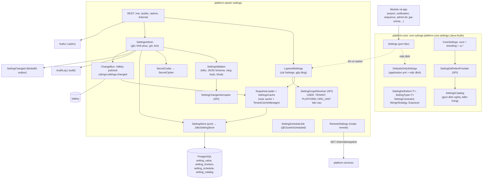
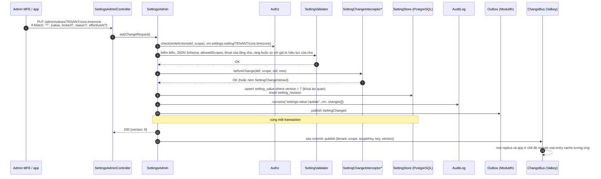
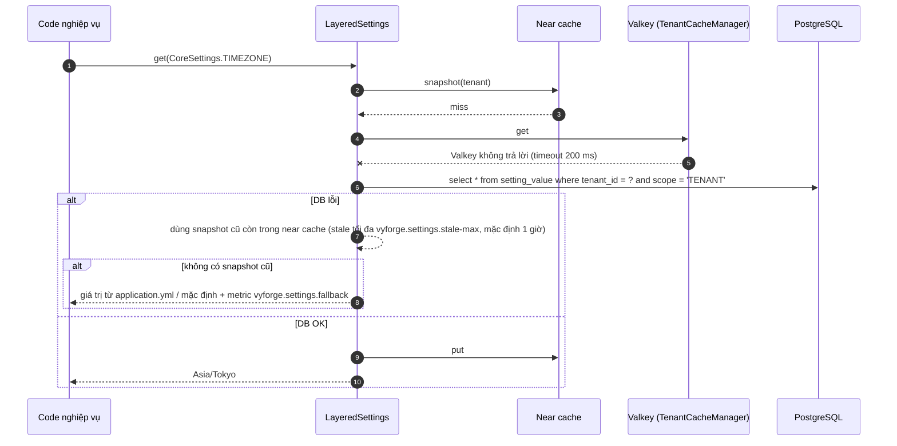
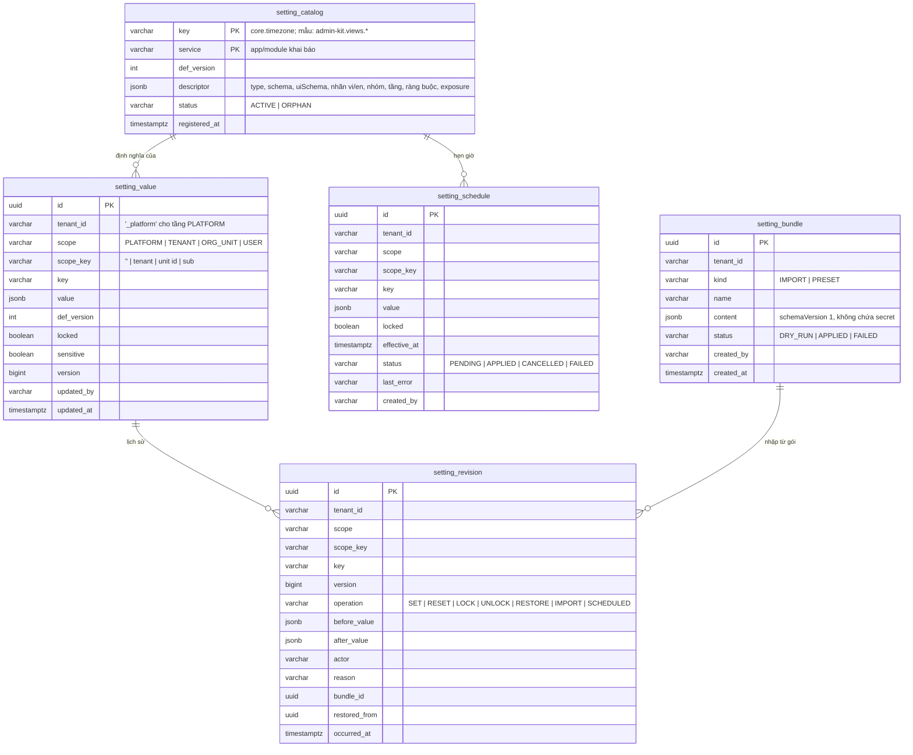

# Thiết kế module settings: cài đặt phân tầng platform → tenant → người dùng (`platform-starter-settings` + `@vyforge/settings`)

> **Trạng thái:** bản thiết kế chờ duyệt (27/10/2026), phiên forge-50.
> **Phạm vi:** giá trị cài đặt **có kiểu**, **khai báo bằng code**, ghi đè theo tầng platform → tenant → người dùng
> (để sẵn chỗ cho tầng đơn vị tổ chức), đọc nhiều và rẻ, sửa qua API/UI có kiểm quyền, audit, lịch sử và khôi phục. Gồm cả
> tuỳ chọn cá nhân (ngôn ngữ, múi giờ, mật độ bảng) và view đã lưu của `DataTable` (admin-kit D12). UI tự sinh từ JSON
> Schema: bản người vận hành, bản tenant admin, trang "Tuỳ chọn của tôi".
> **Không làm:** feature flag có targeting và rollout (`-features`), secret hạ tầng (ESO/OpenBao, biến môi trường),
> cấu hình triển khai (`application.yml`), cấu hình phức tạp có vòng đời riêng của module (provider của notification,
> merchant của payment, storage của files, chính sách IAM).
> **Nền:** platform-java 0.12.1 (`SecretCipher`, `StarterSchemaMigrator`, `@ClusterScheduled`, `TenantCacheManager`),
> platform-web 0.9.0. Theo module-conventions mục 1–6, kiến trúc `platform-services` (D1–D10, mục 4.11–4.12, 5),
> admin-kit (D6, D12, §3.10, §6.6), jpa-extras (`LocaleChain`, `RetentionPolicyResolver`), forms (`@vyforge/forms/renderer`).
> **Bên đã chốt hợp đồng với settings:** admin-kit (view đã lưu, `ui.*`), jpa-extras (hai SPI), sequence (múi giờ, năm
> tài chính, lý do huỷ), organization (múi giờ; tầng theo đơn vị ở bản sau), translations (P2, ghi đè message).

Mục lục:
0. [Tóm tắt quyết định](#0-tóm-tắt-quyết-định)
1. [Bài toán và phạm vi](#1-bài-toán-và-phạm-vi)
2. [Nghiên cứu](#2-nghiên-cứu)
3. [Kiến trúc](#3-kiến-trúc)
4. [Mô hình dữ liệu](#4-mô-hình-dữ-liệu)
5. [API](#5-api)
6. [Mở rộng](#6-mở-rộng)
7. [Vận hành](#7-vận-hành)
8. [Bảo mật và tuân thủ](#8-bảo-mật-và-tuân-thủ)
9. [Kế hoạch triển khai](#9-kế-hoạch-triển-khai)
10. [Lệch quy ước và quyết định cần người dùng chọn](#10-lệch-quy-ước-và-quyết-định-cần-người-dùng-chọn)
11. [Đóng gói và triển khai độc lập](#11-đóng-gói-và-triển-khai-độc-lập)

---

## 0. Tóm tắt quyết định

| # | Quyết định | Lý do ngắn |
|---|---|---|
| G1 | **Tách hai lớp.** API đọc và khai báo (`SettingDefinition<T>`, `Settings`, `SettingsCatalog`) nằm trong **`platform-core`**, package `com.vyforge.platform.core.settings`, Java thuần, có cài đặt mặc định chỉ đọc `application.yml` và giá trị mặc định trong code. **`platform-starter-settings`** thêm lưu DB theo tầng, ghi, audit, lịch sử, cache phân tán, REST, chế độ `remote` | Module nào cũng khai báo và đọc setting được mà **không phụ thuộc cứng** vào starter (mục 6 module-conventions). Cài starter thì cùng code đó tự có giá trị theo tenant và người dùng. Đây là cách ABP tách `ISettingProvider` (framework) khỏi Setting Management (module) |
| G2 | **Định nghĩa khai báo bằng code**, qua bean `SettingDefinitionProvider` (giống ABP). Mỗi định nghĩa có: key, kiểu (`SettingType<T>`), mặc định, phạm vi cho phép, mức lộ (`exposure`), nhạy cảm, ràng buộc, chiến lược gộp, nhóm, nhãn vi/en, version. JSON Schema **sinh từ kiểu** (cho đối tượng JSON thì khai báo kèm) | Một nguồn sự thật; kiểm kiểu lúc biên dịch ở chỗ đọc (`settings.get(CoreSettings.TIMEZONE)` trả `ZoneId`); UI và kiểm phía server dùng cùng schema |
| G3 | **Thứ tự đọc:** `USER` → (`ORG_UNIT`, bản sau) → `TENANT` → `PLATFORM` → `application.yml` (`vyforge.settings.defaults.<key>`) → mặc định trong code. Giá trị đầu tiên có thì thắng (chiến lược `OVERRIDE`) | Đúng brief, khớp ABP (D→C→G→T→U) và hierarchy custom settings của Salesforce (org → profile → user, tầng thấp nhất thắng) |
| G4 | **Khoá và ràng buộc theo tầng cha.** Giá trị ở một tầng có thể `locked` (tầng con không ghi đè được, vd. người vận hành ép 2FA cho mọi tenant, tenant ép ngôn ngữ cho mọi nhân viên). Định nghĩa có `SettingConstraint<T>` kiểm giá trị con **so với giá trị hiệu lực của tầng cha**: `narrowOnly` (chỉ thu hẹp tập), `atMost`/`atLeast` (kẹp trong trần của platform), `oneOf` | Bảy module P1 đều tự viết luật "tenant chỉ được thu hẹp những gì liên quan an toàn, nới trong trần platform" (files §6.2, webhooks §6.4, collaboration §6.3). Gom về một chỗ, khai báo thay vì viết lại |
| G5 | **Ba chiến lược gộp:** `OVERRIDE` (mặc định), `COLLECT` (gộp danh sách từ mọi tầng, vd. view đã lưu của tôi + view chia sẻ của tenant, lý do huỷ của platform + của tenant), `DEEP_MERGE` (đối tượng JSON: tầng con chỉ ghi khoá muốn đổi, như `settings` của export §4.4) | View đã lưu (admin-kit D12) không phải "ghi đè" mà là "cộng". Cấu hình dạng đối tượng mà buộc tenant ghi cả đối tượng thì mất giá trị mặc định mới của platform khi nâng version |
| G6 | **Một bảng giá trị** `setting_value` cho mọi tầng (khoá `(tenant_id, scope, scope_key, key)`), `value jsonb`, `def_version`, `version` (khoá lạc quan). Tầng platform dùng `tenant_id = '_platform'`. **Bảng lịch sử** `setting_revision` chỉ thêm, giữ giá trị cũ và mới (bản mã với setting nhạy cảm) | Mô hình EAV một bảng như `AbpSettings` (Name, Value, ProviderName, ProviderKey) và `tabSingles` của Frappe; khác ở chỗ value là JSONB có kiểu, có version, có lịch sử để khôi phục (ABP, Frappe, Directus đều không có lịch sử cho settings) |
| G7 | **Đọc theo snapshot**: một lần đọc nạp **toàn bộ** giá trị của tầng platform, của tenant, của người dùng hiện tại (mỗi tầng một entry cache), gộp trong bộ nhớ. Cache theo quy ước `platform-core` (TTL bắt buộc, mặc định 10 phút), **near cache trong tiến trình** (Caffeine) trước backend Valkey. Xoá cache qua Valkey pub/sub kênh `vyforge:settings:changed`, nghe lại kênh thì xoá hết (giống `RedisIamChangeSubscriber`) | Setting đọc ở mọi request (múi giờ, ngôn ngữ, mật độ bảng), mỗi lần một truy vấn là không chấp nhận được. Số giá trị mỗi tenant nhỏ (vài trăm) nên nạp cả tầng rẻ hơn nạp từng khoá |
| G8 | **Giá trị nhạy cảm** (`sensitive`) mã hoá bằng `SecretCipher`, `context = "settings:<tenant>:<scope>:<scopeKey>:<key>"` (AAD). API **không bao giờ** trả bản rõ hay bản mã: chỉ `{configured, updatedAt, updatedBy}`. Code đọc bằng `settings.secret(DEF)` trả `SecretValue` (giải mã lúc dùng, không cache bản rõ). Job xoay khoá gọi `needsRotation` | Brief; khớp ABP `IsEncrypted` nhưng chặt hơn: ABP mặc định trả lại bản mã khi giải mã lỗi, ở đây lỗi là lỗi |
| G9 | **Mức lộ** của từng định nghĩa: `PUBLIC` (đọc không cần đăng nhập, vd. logo, tên sản phẩm cho trang đăng nhập), `MEMBER` (mọi người dùng của tenant, vd. múi giờ, định dạng số), `ADMIN` (chỉ người có quyền đọc cài đặt). Nhạy cảm thì không bao giờ lộ ra client | ABP có `IsVisibleToClients`; một cờ không đủ cho trang công khai của tenant |
| G10 | **Mọi thay đổi ở tầng platform và tenant có audit** (`AuditLog`, quy ước `details.changes[]` của admin-kit D9) và có revision; **khôi phục** là ghi một revision mới bằng giá trị cũ. Tầng user: không audit mặc định (tuỳ chọn cá nhân, nhiều và ít rủi ro), vẫn có revision ngắn hạn (30 ngày) | Brief: "audit, version, khôi phục". Audit tuỳ chọn cá nhân chỉ sinh nhiễu và thêm dữ liệu cá nhân phải giữ |
| G11 | **Event `SettingChanged`** (`TenantAwareEvent`, `schemaVersion: 1`, outbox Modulith, `@Externalized` khi bật) mang key, tầng, version, ai đổi; **không mang giá trị** (consumer đọc lại qua `Settings`). Hook đồng bộ `SettingChangeInterceptor` để **chặn** thay đổi (vd. kiểm SMTP trước khi lưu) | Giá trị có thể nhạy cảm và có thể lớn; consumer đọc lại thì luôn đúng thứ tự cuối |
| G12 | **Ghi theo lịch** (`effectiveAt`): thay đổi có thể hẹn giờ có hiệu lực (vd. 00:00 01/01/2027 đổi mẫu tiêu đề hoá đơn, đổi giờ làm việc mùa hè). Lưu ở `setting_schedule`, job `@ClusterScheduled` mỗi phút áp vào; đường đọc không đổi | Đường đọc giữ đơn giản (không tính "giá trị nào hiệu lực lúc này" ở mỗi lần đọc). Trễ tối đa 1 phút là chấp nhận được với cài đặt |
| G13 | **Danh mục định nghĩa dùng chung** `CoreSettings` (trong `platform-core`): `core.locale`, `core.timezone`, `core.currency`, `core.date-format`, `core.number-format`, `core.week-start`, `core.fiscal-year-start`, `branding.*`, `ui.*`. Module **đọc các khoá này thay vì tự giữ** múi giờ, định dạng, thương hiệu | Hiện export, notification, organization, sequence, admin-kit mỗi nơi có một "múi giờ của tenant" và "thương hiệu" riêng (mục 1.1) |
| G14 | **Chế độ `remote`** (`vyforge.settings.mode`): app đọc snapshot qua API nội bộ của `platform-services`, cache cục bộ, xoá cache bằng cùng kênh Valkey. Định nghĩa của app gửi lên `PUT /internal/catalogs/{service}` lúc khởi động để UI quản trị ở server dựng được form | Giống features (`remote` provider) và notification (catalog); settings là dữ liệu đọc nhiều, ghi ít nên rất hợp chạy ở server dùng chung |
| G15 | **UI tự sinh**: backend trả JSON Schema + `uiSchema` đã dịch theo locale; frontend render bằng `SchemaForm` của `@vyforge/forms/renderer` qua chế độ schema của `ResourceForm` (admin-kit D6). Nhóm có thể thay bằng component viết tay (`SettingGroupRenderer`) khi form tự sinh không đủ | Không có engine form thứ hai; nhóm phức tạp (xem trước logo, thử gửi email) vẫn làm được |
| G16 | Admin MFE `settings-admin` (`/m/settings`, API `/api/v1/settings`), component ở `@vyforge/settings/admin`. Trang "Tuỳ chọn của tôi" là component `MyPreferences` để app và shell nhúng, không nằm trong MFE quản trị | D1, D5 của platform-services; tuỳ chọn cá nhân không phải chức năng quản trị |

---

## 1. Bài toán và phạm vi

### 1.1 Vì sao cần một module riêng

Đọc mục "cấu hình theo tenant" của các thiết kế đã có cho thấy cùng một loại giá trị bị giữ ở nhiều nơi:

| Giá trị | Đang nằm ở |
|---|---|
| Múi giờ của tenant | `export` (`locale.zone`), `notification` (`defaults.timezone`), `organization` (`settings.timezone`), `sequence` (`zone` → "settings tenant"), `admin-kit` (`ui.timezone` → "từ settings khi có") |
| Ngôn ngữ mặc định | `export` (`locale.default`), `notification` (`defaults.locale`), jpa-extras (`LocaleChain` → "module settings") |
| Định dạng ngày, số, tiền | `export` (`format.*`) |
| Thương hiệu (tên công ty, MST, địa chỉ, logo) | `export` (`branding.*`), auth-server (`Branding`: tên sản phẩm, màu, email hỗ trợ; toàn platform), cms-content (`site-settings`) |
| Hạn giữ dữ liệu do tenant chọn | `export` (`retention.*`), files (`retention.period`), jpa-extras (thùng rác, `RetentionPolicyResolver` → "module settings") |
| Năm tài chính | `sequence` (`fiscal_year_start` → "settings tenant") |
| Tuỳ chọn cá nhân, view đã lưu | admin-kit D12: "settings đã nhận" |

Mỗi module tự có bảng `<module>_tenant_settings` (JSONB, `schema_version`), tự viết API `GET/PUT /admin/settings`, tự
viết luật "tenant chỉ được thu hẹp", tự viết cache, tự viết form. Không có chỗ để: (a) tenant admin đặt múi giờ **một lần**
cho mọi module; (b) người dùng chọn ngôn ngữ, mật độ bảng; (c) người vận hành xem "tenant này đang lệch mặc định ở đâu".

### 1.2 Trong phạm vi

- Khai báo định nghĩa bằng code (Java), có kiểu, có JSON Schema, có nhãn vi/en, nhóm hiển thị.
- Đọc theo tầng `USER → TENANT → PLATFORM → application.yml → mặc định`; tầng `ORG_UNIT` để sẵn SPI.
- Khoá giá trị ở tầng cha; ràng buộc so với tầng cha; ba chiến lược gộp.
- Ghi qua API Java và REST: kiểm kiểu, schema, ràng buộc, khoá lạc quan, quyền; hẹn giờ hiệu lực.
- Giá trị nhạy cảm mã hoá, không đọc lại được qua API.
- Audit, revision, khôi phục, so sánh, event `SettingChanged`, hook chặn thay đổi.
- Cache nhiều lớp, xoá cache phân tán.
- Xuất/nhập gói cài đặt (chuyển từ môi trường thử sang thật, mẫu cài đặt cho tenant mới).
- Tuỳ chọn cá nhân, view đã lưu của `DataTable`.
- UI: trang cài đặt theo nhóm (bản người vận hành, bản tenant admin), "Tuỳ chọn của tôi", lịch sử, "giá trị này đến từ đâu".
- Chế độ nhúng và `remote`; admin MFE.

### 1.3 Kịch bản nghiệp vụ phải đáp ứng

| # | Kịch bản | Đáp ứng bằng | Mục |
|---|---|---|---|
| K1 | **Tenant ở Nhật Bản** (khách của công ty phần mềm VN xuất khẩu): múi giờ `Asia/Tokyo`, tiền `JPY`, ngôn ngữ mặc định `en`; mọi email, PDF, số chứng từ theo múi giờ đó | `core.timezone`, `core.currency`, `core.locale` ở tầng TENANT; export, notification, sequence đọc qua `Settings` | 3.4, 6.6 |
| K2 | **Nhân viên người Hàn trong tenant VN** chọn giao diện tiếng Anh và múi giờ Seoul; tenant vẫn là `vi`, `Asia/Ho_Chi_Minh` | Tầng USER của `ui.locale`, `ui.timezone` | 3.4 |
| K3 | **Logo, tên công ty, MST, địa chỉ, hotline** dùng chung cho email, PDF xuất ra, trang đăng nhập, footer site | `branding.*`, `exposure: PUBLIC` cho phần công khai; `FileRef` của `-files` cho logo | 6.6 |
| K4 | **Người vận hành ép mọi tenant bật xác thực hai lớp cho tài khoản quản trị**; tenant không tắt được | `locked: true` ở tầng PLATFORM | 3.5 |
| K5 | **Tenant chỉ được rút ngắn hạn link chia sẻ file** (tối đa 30 ngày do platform đặt), không được kéo dài | Ràng buộc `atMost(parent)` | 3.5 |
| K6 | **Hạn thùng rác**: platform mặc định 30 ngày, bệnh viện chọn 90 ngày cho hồ sơ bệnh án (nhưng không quá trần 365 ngày) | `jpa.trash.retention.<type>` + `atMost` + `RetentionPolicyResolver` cài bằng settings | 6.7 |
| K7 | **Nhân viên kinh doanh lưu view "Khách VIP Hà Nội"**, trưởng nhóm chia sẻ view cho cả tenant; người dùng thấy cả view của mình và view chung | `admin-kit.views.<module>.<resource>`, chiến lược `COLLECT`, quyền ghi tầng TENANT = `<service>:view:Share` | 6.8 |
| K8 | **Năm tài chính bắt đầu 01/04** (công ty có vốn Nhật) thay vì 01/01; sequence reset số theo năm tài chính | `core.fiscal-year-start` | 6.6 |
| K9 | **Đổi mẫu hoá đơn từ 00:00 01/01/2027** (thay đổi chính sách thuế); tenant admin đặt trước từ tháng 12 | Ghi hẹn giờ (`effectiveAt`) | 3.8 |
| K10 | **Tenant admin đặt sai giờ làm việc**, ca đêm không nhận thông báo; cần xem ai đổi, lúc nào, và quay về bản trước | Revision + audit + khôi phục | 3.9 |
| K11 | **Khách on-prem chuyển cấu hình từ môi trường UAT sang PROD** (cơ quan nhà nước, không cho sửa tay trên PROD) | Xuất/nhập gói cài đặt (YAML), bỏ giá trị nhạy cảm, chạy thử (`dryRun`) | 5.2 |
| K12 | **Tenant mới theo ngành** (phòng khám, trường học) được áp sẵn bộ cài đặt mẫu khi khởi tạo | Gói cài đặt mẫu (`preset`), `tenant-lifecycle` (đợt C) gọi `SettingsAdmin.applyBundle` | 6.9 |
| K13 | **SMTP riêng đơn giản cho tenant nhỏ** (máy chủ, cổng, tài khoản, mật khẩu): mật khẩu nhập được nhưng không ai xem lại được; kiểm kết nối trước khi lưu | `sensitive` + `SettingChangeInterceptor` (kiểm kết nối); provider phức tạp vẫn ở notification | 3.6, 6.3 |
| K14 | **Giờ yên lặng (22:00–07:00)** không gửi SMS/push quảng cáo; tenant đặt mặc định, người dùng tự đặt riêng | `notification.quiet-hours` (khai báo bởi notification) ở TENANT + USER | 6.6 |
| K15 | **Định dạng VN**: ngày `dd/MM/yyyy`, số `1.234.567,89`, tiền `₫` không phần lẻ, tuần bắt đầu thứ Hai | `CoreSettings` mặc định theo `vi-VN` | 6.6 |
| K16 | **Chi nhánh miền Nam của ngân hàng làm việc thứ Bảy, chi nhánh miền Bắc không** (cài đặt theo đơn vị) | Tầng `ORG_UNIT` qua SPI `SettingScopeResolver`, organization trả tổ tiên (bản sau, hợp đồng đã chốt với organization) | 6.2 |
| K17 | **Ứng dụng di động** cần ngôn ngữ, múi giờ, định dạng của người dùng ngay khi mở app, không gọi nhiều API | `GET /me/effective` trả mọi giá trị `MEMBER` đã gộp, có `ETag` | 5.2 |
| K18 | **Thuật ngữ riêng của tenant** ("Khách hàng" → "Bệnh nhân") cho bước đầu của `translations` (P2) | Định nghĩa `COLLECT`/`DEEP_MERGE` kiểu `map<string, LocalizedText>` khai báo bởi `@vyforge/i18n` | 6.6 |
| K19 | **Người vận hành hỗ trợ khách**: "tại sao tenant X thấy múi giờ sai?" → xem chuỗi giá trị từ mặc định tới người dùng, biết tầng nào thắng | `explain` (API và UI "giá trị này đến từ đâu") | 3.4, 5.2 |
| K20 | **Tắt module settings** (khách chỉ cần app một tenant, cấu hình bằng file): code module vẫn chạy, đọc `application.yml` | G1: cài đặt mặc định trong `platform-core` | 3.2 |

### 1.4 Ngoài phạm vi

| Không làm | Ở đâu | Ranh giới |
|---|---|---|
| Flag bật dần, targeting theo thuộc tính, A/B, entitlement theo gói | `-features` | Settings không có rule, không có %; giá trị là của một tầng cụ thể. Câu hỏi "người này có được dùng X không" là features; "giá trị cấu hình X của tenant là gì" là settings |
| Secret hạ tầng (mật khẩu DB, khoá ký, token Kafka) | ESO/OpenBao, biến môi trường | Settings chỉ giữ secret **do tenant nhập trên UI** và đơn giản (mật khẩu SMTP, API key một dịch vụ) |
| Cấu hình triển khai (URL, pool, cổng) | `application.yml`, Helm values | Settings **đọc** `application.yml` như một tầng mặc định, không thay |
| Cấu hình có vòng đời riêng: nhiều bản ghi, trạng thái, kiểm tra kết nối, xoay khoá | Module (notification providers, payment merchants, files storages, webhooks endpoints) | Module giữ bảng riêng. Settings giữ giá trị đơn giản; module có thể dùng setting kiểu đối tượng (mục 6.5) |
| Mật khẩu, MFA, chính sách đăng nhập | `platform-auth-server` | Auth-server là app riêng, không nhúng starter. Bản sau: auth-server đọc `security.*` của settings qua API nội bộ (mục 9.5) |
| Quyền | `-authz`/IAM | Settings dùng IAM, không lưu quyền |
| Bản dịch, quy trình dịch | `translations` (P2) | Settings chỉ giữ ghi đè thuật ngữ đơn giản (K18) |

---

## 2. Nghiên cứu

Kiểm ngày 27/10/2026. Version và license lấy qua `gh api repos/<repo>/releases/latest` và `.../license`; tài liệu đọc
trực tiếp bằng WebFetch.

### 2.1 Hệ thống tham khảo

| Hệ thống | Version, license | Mô hình dữ liệu | API | Điểm mạnh | Điểm yếu |
|---|---|---|---|---|---|
| **ABP Framework**: Settings + Setting Management ([settings](https://abp.io/docs/latest/framework/infrastructure/settings), [setting management](https://abp.io/docs/latest/modules/setting-management)) | 10.7.0 (06/10/2026), LGPL-3.0 | `SettingDefinition` (Name, DefaultValue, DisplayName, Description, `IsVisibleToClients`, `IsInherited`, `IsEncrypted`, `Providers`, `Properties`) khai báo trong `SettingDefinitionProvider.Define()`. Giá trị trong bảng `AbpSettings` (tên, giá trị chuỗi, tên provider, khoá provider). Định nghĩa động trong `AbpSettingDefinitions` | `ISettingProvider.GetOrNullAsync/GetAsync<T>/IsTrueAsync` để đọc; `ISettingManager` để ghi theo tầng (`SetForUser`, `SetForTenant`, `SetGlobal`, `fallback: false`). Value provider: Default "D" → Configuration "C" → Global "G" → Tenant "T" → User "U", thêm provider tự viết bằng `SettingValueProvider` | Tách đọc (framework) và lưu (module): không cài module vẫn đọc được từ `appsettings.json`. Provider tầng mở rộng được. Cache phân tán. UI theo nhóm (`SettingPageContributor`, kiểm quyền và feature) | Giá trị là chuỗi, kiểu chỉ ở chỗ đọc. Không có schema, UI mỗi nhóm viết tay. Không có lịch sử, khôi phục. `ReturnOriginalValueIfDecryptFailed` mặc định trả lại bản mã khi giải mã lỗi. Không có khoá tầng cha, không ràng buộc so với cha |
| **Frappe Framework**: Single DocType ([single doctype](https://docs.frappe.io/framework/user/en/basics/doctypes/single-doctype), [database API](https://docs.frappe.io/framework/user/en/api/database)) | v16.53.0 (22/10/2026), MIT | Single DocType (vd. `System Settings`) là một DocType chỉ có một bản ghi; mỗi field lưu một dòng `tabSingles(doctype, field, value)` | `frappe.get_doc('System Settings')`, `frappe.db.get_single_value(doctype, field)` | Cài đặt là DocType nên **form tự sinh** từ định nghĩa field, có quyền theo DocType, có version tracking như mọi DocType. Nhóm cài đặt theo module tự nhiên | Không phân tầng: một giá trị cho cả site (tầng người dùng là cơ chế khác: user defaults/user settings). Không có khái niệm tenant trong một DB |
| **Directus**: Settings, Presets ([settings API](https://directus.com/docs/api/settings), [presets](https://directus.com/docs/api/presets)) | v12.5.1 (23/10/2026), MSCL-1.0 (không phải OSI) | `directus_settings`: **một dòng, mỗi cài đặt một cột** (`project_name`, `project_color`, `project_logo`, `auth_password_policy`, `storage_asset_presets`, khoá AI…). `directus_presets`: view đã lưu (`bookmark`, `user`, `role`, `collection`, `search`, `filters`, `layout`, `layout_query`, `layout_options`) | `GET/PATCH /settings` (chỉ admin); presets CRUD | Presets là mô hình view đã lưu tốt: theo người dùng, theo role (khi `user` null), có bookmark tên; tách query và tuỳ chọn hiển thị | Thêm cài đặt là thêm cột (migration). Một tầng duy nhất. License không phải OSI → chỉ tham khảo |
| **Spring Boot**: configuration metadata ([format](https://docs.spring.io/spring-boot/specification/configuration-metadata/format.html)) | 4.1.2 (22/10/2026), Apache-2.0 | `META-INF/spring-configuration-metadata.json`: `groups`, `properties` (`name`, `type`, `description`, `defaultValue`, `deprecation{level, reason, replacement, since}`), `hints` (`values`, `providers`). Sinh lúc biên dịch bởi `spring-boot-configuration-processor` | Đọc qua `@ConfigurationProperties` | Metadata **sinh từ code**, có deprecation với `replacement` (đổi tên khoá không làm vỡ), hint giá trị cho IDE | Chỉ cấu hình tĩnh lúc khởi động; không tầng, không UI, không ghi lúc chạy |
| **Salesforce**: hierarchy custom settings ([Apex custom settings](https://developer.salesforce.com/docs/atlas.en-us.apexref.meta/apexref/apex_methods_system_custom_settings.htm)) | SaaS | Bản ghi ở ba tầng: org, profile, user | `getInstance()` trả bản ghi ở tầng thấp nhất có dữ liệu; `getOrgDefaults()`; `getValues()` trả null cho field không đặt ở tầng đó | Có **tầng giữa theo nhóm người** (profile), cache ở platform, đọc không tính vào giới hạn truy vấn | Theo bản ghi chứ không theo field: tầng user có bản ghi thì field không đặt bị null thay vì kế thừa, một bẫy được tài liệu nêu rõ |
| **Odoo**: `res.config.settings` + `ir.config_parameter` ([hướng dẫn Odoo 19](https://www.cybrosys.com/blog/how-to-add-custom-fields-to-configuration-settings-in-odoo-19), [OCA multi-company](https://odoo-community.org/shop/ir-config-parameter-multi-company-715646)) | 19.0, LGPL-3.0 (Community) | Form cài đặt là `TransientModel`; field khai báo `config_parameter='module.key'` thì giá trị lưu ở `ir.config_parameter` (khoá → chuỗi). Giá trị theo công ty nằm ở `res.company` hoặc field `company_dependent` | `get_param`/`set_param` | Một form cài đặt chung cho mọi module, mỗi module "góp" field vào cùng trang | Hai nơi lưu (tham số hệ thống và bản ghi công ty), phải xem từng field lưu ở đâu. `ir.config_parameter` không theo công ty, phải dùng module OCA bổ sung. Đọc field của form có thể ra giá trị `default` thay vì giá trị đã lưu ([PR 105991](https://github.com/odoo/odoo/pull/105991)) |

### 2.2 Học theo và không làm

| Học theo | Từ | Trong thiết kế |
|---|---|---|
| Tách API đọc (framework) khỏi module lưu | ABP | G1 |
| Chuỗi value provider mở rộng được | ABP | `SettingScopeResolver` (6.2), tầng `ORG_UNIT` |
| Tầng configuration (`appsettings.json`) đứng giữa mặc định và DB | ABP | `vyforge.settings.defaults.<key>` (3.4) |
| Định nghĩa trong code, `Properties` tuỳ ý | ABP | `SettingDefinition.attributes` |
| Form tự sinh từ định nghĩa | Frappe | JSON Schema sinh từ kiểu (G2, G15) |
| Một trang cài đặt, module góp nhóm vào | Odoo, ABP `SettingPageContributor` | `SettingGroup` (3.3), admin MFE (11.3) |
| Metadata sinh từ code, deprecation có `replacement` | Spring Boot | `deprecatedKeys` + đổi tên khoá (4.5) |
| View đã lưu theo người dùng và theo nhóm | Directus presets | `admin-kit.views.*`, `COLLECT` (6.8) |
| Kế thừa theo **từng giá trị**, không theo bản ghi | Bài học từ Salesforce (field null) | Mỗi khoá một dòng; đối tượng dùng `DEEP_MERGE` |

| Không làm | Lý do |
|---|---|
| Giá trị là chuỗi, parse ở chỗ đọc (ABP, Odoo) | Lỗi kiểu chỉ lộ lúc chạy; JSONB có kiểu + schema |
| Mỗi cài đặt một cột (Directus) | Thêm cài đặt phải migration, không hợp module cài độc lập |
| Trả lại bản mã khi giải mã lỗi (ABP mặc định) | Lỗi ngầm; ở đây giải mã lỗi là lỗi rõ ràng, có metric |
| Tầng theo role/profile (Salesforce) | Dễ xung đột khi người có nhiều role. Nhu cầu thật (theo chi nhánh) dùng `ORG_UNIT`, một cây, không mơ hồ |
| Định nghĩa động tạo từ UI (ABP dynamic definitions) | Định nghĩa là hợp đồng của code; tenant cần trường tuỳ biến thì dùng `custom-fields` |
| Spring Cloud Config | MODULE_PLAN mục 5 đã loại; không có tầng tenant/user |

---

## 3. Kiến trúc

### 3.1 Khái niệm

| Khái niệm | Nghĩa |
|---|---|
| **Định nghĩa** (`SettingDefinition<T>`) | Hợp đồng của một khoá: kiểu, mặc định, tầng cho phép, ràng buộc, mức lộ, nhãn. Khai báo bằng code, bất biến lúc chạy |
| **Tầng** (`SettingScope`) | `PLATFORM`, `TENANT`, `ORG_UNIT` (bản sau), `USER`. Mỗi giá trị thuộc một tầng và một `scopeKey` (tenant id, id đơn vị, `sub`) |
| **Giá trị** | JSON hợp lệ theo schema của định nghĩa, có `locked`, `version`, ai sửa, lúc nào |
| **Giá trị hiệu lực** | Kết quả gộp các tầng cho một ngữ cảnh (tenant, người dùng, đơn vị) |
| **Nhóm** (`SettingGroup`) | Gom định nghĩa để hiển thị: `core.regional`, `branding`, `notification.delivery`… Có thứ tự, icon, quyền |
| **Gói cài đặt** (`SettingsBundle`) | Tập giá trị xuất/nhập được, dùng cho chuyển môi trường và mẫu tenant |

### 3.2 Thành phần



### 3.3 Gói Java

```
platform-core
└── com.vyforge.platform.core.settings
    ├── SettingDefinition, SettingType, SettingTypes, SettingScope, Exposure, MergeStrategy
    ├── SettingConstraint, Constraints, SettingGroup, LocalizedLabel
    ├── SettingDefinitionProvider, SettingsCatalog, SettingsContext
    ├── Settings, SecretValue, EffectiveValue, ValueSource
    ├── DefaultsOnlySettings, CoreSettings
    └── SettingsException (code: settings.*)

platform-starter-settings
└── com.vyforge.platform.settings
    ├── config      SettingsAutoConfiguration, PlatformSettingsProperties, SettingsCacheConfiguration
    ├── read        LayeredSettings, SnapshotLoader, Snapshot, SettingsCache, ScopeChain
    ├── write       SettingsAdmin, DefaultSettingsAdmin, SettingValidator, SecretCodec, ChangeRequest, BundleService
    ├── schedule    SettingScheduleJob
    ├── store       SettingStore, JdbcSettingStore, SettingRevisionStore
    ├── change      SettingChanged, SettingChangeInterceptor, ChangeBus, RedisChangeBus, LocalChangeBus
    ├── scope       SettingScopeResolver, UserScopeResolver, TenantScopeResolver, PlatformScopeResolver
    ├── web         MySettingsController, PublicSettingsController, SettingsAdminController,
    │               SettingsInternalController, SettingsActions (catalog authz)
    ├── remote      RemoteSettings, SettingsInternalClient, CatalogRegistrar
    ├── privacy     UserSettingsPersonalData (PersonalDataContributor, khi có privacy-dsr)
    └── bridge      SettingsLocaleChain, SettingsRetentionPolicyResolver (khi có -jpa extras)
```

### 3.4 Đọc giá trị

Thứ tự (G3), với ngữ cảnh lấy từ `TenantContext` và `RequestContext` (`sub`):

```
USER(sub) → ORG_UNIT(units của sub, gần nhất trước) → TENANT(tenant) → PLATFORM → application.yml → mặc định
```

- Tầng nào không nằm trong `allowedScopes` của định nghĩa thì bỏ qua (vd. `core.fiscal-year-start` không có tầng USER).
- **Khoá tầng cha:** đi từ trên xuống (mặc định → platform → tenant → …); gặp giá trị `locked` thì dừng, các tầng dưới
  bị bỏ qua. Vì vậy thực tế thuật toán là: lấy chuỗi từ trên xuống, cắt ở tầng khoá đầu tiên, rồi chọn tầng thấp nhất có
  giá trị trong phần còn lại.
- **`OVERRIDE`:** giá trị của tầng thấp nhất còn lại.
- **`DEEP_MERGE`:** gộp đối tượng JSON từ trên xuống (RFC 7396 JSON Merge Patch: khoá `null` ở tầng con xoá khoá của cha).
- **`COLLECT`:** nối danh sách từ trên xuống, mỗi phần tử gắn `source` (tầng); trùng `id` thì tầng thấp thắng.
- Kết quả cuối được kiểm lại bằng schema; không hợp lệ (vd. định nghĩa vừa đổi mà dữ liệu cũ chưa nâng) thì dùng giá
  trị của tầng trên hợp lệ, ghi metric `vyforge.settings.invalid` và log WARN một lần cho mỗi khoá. Không ném lỗi ở
  đường đọc.

`explain(key, ctx)` trả toàn bộ chuỗi (mỗi tầng: có giá trị không, có khoá không, giá trị đã che nếu nhạy cảm, version,
ai sửa) và tầng thắng. Dùng cho K19 và cho UI hiện nhãn "Mặc định / Platform / Tenant / Của tôi" cạnh mỗi field.

**Snapshot và cache (G7):**

| Entry | Key | Nội dung | TTL mặc định |
|---|---|---|---|
| `settings-platform` | `_platform` | mọi giá trị tầng PLATFORM | 10 phút |
| `settings-tenant` | `t:<tenant>:` (tiền tố của `TenantCacheManager`) | mọi giá trị tầng TENANT | 10 phút |
| `settings-user` | `t:<tenant>:<sub>` | mọi giá trị tầng USER của người dùng | 5 phút |
| `settings-unit` (bản sau) | `t:<tenant>:u:<unit>` | giá trị tầng ORG_UNIT | 10 phút |

- Lớp 1: near cache trong tiến trình (Caffeine, tối đa 10.000 entry, TTL ngắn hơn TTL backend một nửa). Lớp 2: backend
  của `TenantCacheManager` (Valkey khi có, Caffeine khi không). Lớp 3: DB.
- Giá trị nhạy cảm nằm trong snapshot **dưới dạng bản mã**; giải mã khi gọi `secret()`.
- Đọc cho người dùng khác (`forUser`) hoặc tenant khác (`forTenant`) dùng cùng snapshot, cùng cache.
- Không có `RequestContext.sub` (job, consumer) thì chuỗi bắt đầu từ TENANT.
- Mỗi request web có `RequestScopedSettings` giữ snapshot đã gộp để nhiều lần đọc trong cùng request không chạm cache.

### 3.5 Ghi giá trị



- Ghi giá trị **giống hệt giá trị hiệu lực của tầng cha** thì vẫn lưu (khác ABP, nơi giá trị bằng fallback bị xoá): người
  quản trị chủ động "ghim" giá trị để không đổi theo platform. Muốn kế thừa thì dùng `reset` (xoá giá trị ở tầng đó).
- `locked` chỉ đặt được ở tầng có quyền `settings:value:Lock` và chỉ khi định nghĩa cho phép (`lockable`, mặc định `true`
  cho PLATFORM và TENANT).
- **Khoá làm hỏng giá trị con đang có:** khi tầng cha khoá hoặc đổi trần, giá trị con không bị xoá (vẫn có lịch sử), chỉ
  bị bỏ qua lúc đọc hoặc bị kẹp. Màn quản trị hiện "N tenant đang có giá trị bị khoá/vượt trần" để người vận hành biết.
- Ghi nhiều khoá một lần (`PUT /admin/values/{scope}` với danh sách) là một transaction: một khoá lỗi thì không khoá nào
  được ghi; lỗi trả theo từng khoá (Problem Details `errors[]`, admin-kit đổ về field).

### 3.6 Giá trị nhạy cảm

| Việc | Cách làm |
|---|---|
| Lưu | `value = {"$secret": "v1:<kid>:…"}` (bản mã `SecretCipher`), AAD `settings:<tenant>:<scope>:<scopeKey>:<key>` nên chép bản mã sang dòng khác thì giải mã lỗi |
| Đọc ở code | `SecretValue s = settings.secret(SMTP_PASSWORD)`; `s.reveal()` giải mã mỗi lần gọi, không cache bản rõ |
| Đọc qua API | `{ "configured": true, "updatedAt": "…", "updatedBy": "…" }`. Không có endpoint nào trả bản rõ hay bản mã |
| Ghi qua API | `value` là bản rõ; bỏ trống trường thì giữ nguyên giá trị cũ (như ABP Email); `"$clear": true` để xoá |
| Revision, audit | Revision giữ bản mã (để khôi phục được); audit ghi `{"field": key, "masked": true}` |
| Xuất gói | Không bao giờ xuất; gói ghi `"$secret": "<omitted>"`, nhập thì bỏ qua và báo "cần nhập lại" |
| Xoay khoá | Job `settings-maintenance` (mỗi giờ, theo lô 500 dòng) gọi `needsRotation`, mã hoá lại; đếm bằng metric |
| Giải mã lỗi | Ném `SettingsException(settings.secret_unreadable)`, metric `vyforge.settings.secret.errors`, alert |
| Ràng buộc | Nhạy cảm thì `exposure` buộc là `ADMIN`, không có `COLLECT`/`DEEP_MERGE`, không có tầng USER |

### 3.7 Luồng lỗi



| Lỗi | Hành vi |
|---|---|
| Valkey mất | Đọc thẳng DB, near cache vẫn chạy; kênh pub/sub thử nghe lại theo chu kỳ, nghe lại được thì xoá toàn bộ near cache |
| Lỡ tin xoá cache | TTL là giới hạn trên; người dùng thấy giá trị cũ tối đa bằng TTL near cache (mặc định 5 phút) |
| DB mất khi đọc | Dùng snapshot cũ (stale), rồi mặc định; **không ném lỗi** ở đường đọc |
| DB mất khi ghi | Lỗi 503, không gì thay đổi (một transaction) |
| Ghi đồng thời | `412 settings.version_conflict` với version hiện tại; UI tải lại và hiện diff |
| Giá trị trong DB sai schema | Bỏ qua tầng đó khi đọc (3.4); màn "Sức khoẻ cài đặt" liệt kê, job không tự sửa |
| Định nghĩa bị xoá khỏi code | Giá trị còn trong DB, không đọc; đánh dấu `orphan` ở `setting_catalog`; sau `vyforge.settings.orphan-retention` (mặc định 180 ngày) job xoá (giữ revision) |

### 3.8 Ghi theo lịch

- `ChangeRequest.effectiveAt` trong tương lai → ghi `setting_schedule` (trạng thái `PENDING`), kiểm hợp lệ ngay lúc tạo;
  audit `settings:value:Schedule`.
- Job `settings-schedule` (`@ClusterScheduled`, mỗi phút, `perTenant = false`, lấy theo lô `FOR UPDATE SKIP LOCKED`) áp
  các mục tới hạn bằng chính `SettingsAdmin.set` (kiểm lại hợp lệ, ràng buộc lúc áp; lỗi thì `FAILED` + lý do + thông báo
  người tạo qua event `SettingScheduleFailed`).
- Huỷ trước giờ: `DELETE /admin/schedules/{id}`. Một khoá ở một tầng có thể có nhiều mục hẹn; áp theo thứ tự thời gian.

### 3.9 Revision và khôi phục

- Mỗi thay đổi (set, reset, lock, unlock, restore, import, áp lịch) thêm một dòng `setting_revision`: giá trị trước và sau,
  `locked` trước và sau, `operation`, người, lý do, `request_id`, `bundle_id` nếu đến từ gói.
- **Khôi phục** một revision = `set` giá trị `before` (hoặc `after`) của revision đó, với `operation = RESTORE` và
  `restored_from`. Kiểm hợp lệ như ghi thường (giá trị cũ có thể không còn hợp lệ với định nghĩa mới).
- **Khôi phục theo thời điểm** cho cả nhóm (vd. "đưa nhóm `notification.delivery` của tenant về như 09:00 hôm qua"):
  tính từ revision, xem trước diff, áp như một gói.
- Giữ revision: PLATFORM, TENANT 2 năm (`vyforge.settings.revision.retention`), USER 30 ngày; luôn giữ tối thiểu 20
  revision gần nhất mỗi khoá.

### 3.10 Chế độ `remote`

| Việc | Ở app (`mode: remote`) | Ở `platform-services` |
|---|---|---|
| Đọc | `RemoteSettings` cài `Settings`: snapshot qua `GET /api/v1/settings/internal/snapshot?scope=TENANT&tenant=…` (client credentials, `X-Tenant-Id` theo L2 đã duyệt), snapshot USER qua token exchange `GET /me/snapshot`; cache cục bộ cùng cấu trúc | Đọc từ DB/cache |
| Xoá cache | Nghe cùng kênh Valkey `vyforge:settings:changed` (Valkey dùng chung, platform-services §3.3) | Phát sau commit |
| Định nghĩa của app | `CatalogRegistrar` gửi định nghĩa (JSON: key, type, schema, nhãn, nhóm, tầng, ràng buộc) lên `PUT /internal/catalogs/{service}` lúc khởi động | Lưu `setting_catalog`, UI quản trị đọc từ đây |
| Ghi | `SettingsAdmin` cài bằng REST nội bộ (job của app ghi giá trị) | Kiểm hợp lệ theo catalog đã đăng ký |
| Hook `SettingChangeInterceptor` của app | Không chạy ở server. Định nghĩa có interceptor ở app phải chạy `embedded` hoặc app lắng nghe `SettingChanged` (kiểm sau) | Ghi chú trong 10.1 |
| Server không trả lời | Snapshot cũ (stale-max), rồi mặc định | — |

Ràng buộc `SettingConstraint` có thể là code Java; ở chế độ `remote` chỉ những ràng buộc **khai báo được** (atMost,
atLeast, narrowOnly, oneOf, pattern, maxItems) được gửi lên server; ràng buộc viết tay (lambda) đánh dấu
`localOnly` và chỉ kiểm khi ghi qua app.

---

## 4. Mô hình dữ liệu

### 4.1 ERD



### 4.2 DDL dự kiến

`META-INF/vyforge/db/settings/V1__settings.sql`, bảng lịch sử `flyway_schema_history_settings`, chạy bằng
`StarterSchemaMigrator` (quy ước 5.3). File gộp cho DBA: `META-INF/vyforge/sql/settings.sql`.

```sql
create table setting_value (
    id            uuid         primary key,
    tenant_id     varchar(64)  not null,                 -- '_platform' cho tầng PLATFORM
    scope         varchar(16)  not null,                 -- PLATFORM | TENANT | ORG_UNIT | USER (kiểm ở code)
    scope_key     varchar(128) not null default '',      -- '' (PLATFORM, TENANT), id đơn vị, sub
    key           varchar(200) not null,
    value         jsonb        not null,
    def_version   integer      not null default 1,
    locked        boolean      not null default false,
    sensitive     boolean      not null default false,
    version       bigint       not null default 1,
    updated_by    varchar(128) not null,
    updated_at    timestamptz  not null default now(),
    constraint setting_value_uk unique (tenant_id, scope, scope_key, key),
    constraint setting_value_key_ck check (key ~ '^[a-z][a-z0-9-]*(\.[a-z0-9][a-z0-9-]*)+$'),
    constraint setting_value_size_ck check (octet_length(value::text) <= 65536)
);
-- Nạp snapshot một tầng: (tenant_id, scope, scope_key) là tiền tố của unique index, không cần index thêm.
-- "Tenant nào đang ghi đè khoá X" (màn người vận hành, job orphan):
create index setting_value_key_idx on setting_value (key, scope);

create table setting_revision (
    id             uuid         primary key,
    tenant_id      varchar(64)  not null,
    scope          varchar(16)  not null,
    scope_key      varchar(128) not null,
    key            varchar(200) not null,
    version        bigint       not null,
    operation      varchar(16)  not null,
    before_value   jsonb,
    after_value    jsonb,
    before_locked  boolean,
    after_locked   boolean,
    actor          varchar(128) not null,
    actor_tenant   varchar(64),                          -- người vận hành thao tác qua "tenant đang xem"
    reason         varchar(500),
    request_id     varchar(64),
    bundle_id      uuid,
    restored_from  uuid,
    occurred_at    timestamptz  not null default now()
);
create index setting_revision_key_idx on setting_revision (tenant_id, scope, scope_key, key, occurred_at desc);
create index setting_revision_time_idx on setting_revision (tenant_id, occurred_at desc);

create table setting_schedule (
    id            uuid         primary key,
    tenant_id     varchar(64)  not null,
    scope         varchar(16)  not null,
    scope_key     varchar(128) not null,
    key           varchar(200) not null,
    value         jsonb,                                 -- null = reset
    locked        boolean      not null default false,
    effective_at  timestamptz  not null,
    status        varchar(16)  not null default 'PENDING',
    last_error    varchar(1000),
    reason        varchar(500),
    created_by    varchar(128) not null,
    created_at    timestamptz  not null default now(),
    applied_at    timestamptz
);
create index setting_schedule_due_idx on setting_schedule (effective_at) where status = 'PENDING';

create table setting_catalog (
    service        varchar(64)  not null,
    key            varchar(200) not null,
    def_version    integer      not null,
    descriptor     jsonb        not null,
    status         varchar(16)  not null default 'ACTIVE',
    registered_at  timestamptz  not null default now(),
    primary key (service, key)
);

create table setting_bundle (
    id          uuid         primary key,
    tenant_id   varchar(64)  not null,
    kind        varchar(16)  not null,
    name        varchar(200) not null,
    content     jsonb        not null,
    status      varchar(16)  not null,
    result      jsonb,                                  -- số khoá áp, bỏ qua, lỗi theo khoá
    created_by  varchar(128) not null,
    created_at  timestamptz  not null default now()
);
create index setting_bundle_tenant_idx on setting_bundle (tenant_id, created_at desc);
```

**Tenant và RLS.** `setting_value`, `setting_revision`, `setting_schedule`, `setting_bundle` có `tenant_id` nhưng
**không dùng `@TenantId` filter của Hibernate**, vì một lần đọc cần cả dòng `'_platform'` và dòng của tenant (giống
master-data mục 10.1). Store dùng `JdbcClient`, mọi câu truy vấn có `tenant_id in (:tenant, '_platform')` hoặc
`tenant_id = :tenant`, kiểm bằng test `TENANT_ISOLATION` riêng (mỗi phương thức của `JdbcSettingStore` có test chứng
minh không đọc được tenant khác). RLS tuỳ chọn: policy `tenant_id = current_setting('vyforge.tenant') or tenant_id =
'_platform'` cho `select`, và chỉ tenant vận hành ghi được `'_platform'`.

### 4.3 Truy vấn nóng

| Truy vấn | Chỉ mục | Tần suất |
|---|---|---|
| Nạp snapshot tầng (`tenant_id, scope, scope_key`) | `setting_value_uk` (tiền tố) | Khi miss cache: vài chục/giây toàn hệ thống |
| Ghi một khoá (`… and key = ? and version = ?`) | `setting_value_uk` | Thấp |
| Lịch sử một khoá | `setting_revision_key_idx` | Thấp |
| Mục hẹn tới hạn | `setting_schedule_due_idx` (partial) | Mỗi phút |
| Tenant đang ghi đè khoá X | `setting_value_key_idx` | Màn người vận hành |

### 4.4 Partition, retention, dung lượng

| Bảng | Ước lượng (10.000 tenant, 1 triệu người dùng) | Chiến lược |
|---|---|---|
| `setting_value` | Tenant: 10.000 × 50 = 500 nghìn dòng. User: 1 triệu × 8 (locale, timezone, density, page size, giờ yên lặng, 3 khoá view) ≈ 8 triệu dòng, phần lớn < 1 KB; view đã lưu vài KB | Không partition. 8,5 triệu dòng với truy vấn theo unique index là nhỏ với PostgreSQL. Giới hạn 64 KB/giá trị |
| `setting_revision` | Tenant: thay đổi hiếm (vài nghìn/ngày). User: nhiều hơn nhưng giữ 30 ngày | Không partition ở bản đầu; job xoá theo lô 1.000 dòng mỗi 10 phút. Vượt 50 triệu dòng thì partition theo tháng `occurred_at` (ghi trong runbook) |
| `setting_schedule`, `setting_bundle` | Rất nhỏ | Xoá mục `APPLIED`/`CANCELLED` sau 1 năm |

Người dùng bị xoá (event `UserDeleted` của auth-server, hoặc yêu cầu xoá của privacy-dsr): xoá giá trị và revision tầng
USER của `sub` đó (mục 8).

### 4.5 Tiến hoá schema

- **Định nghĩa có `version`.** Đổi cấu trúc giá trị thì tăng version và khai báo `SettingMigration<T>` (`from`, `to`,
  hàm biến đổi `JsonNode → JsonNode`). Đọc giá trị có `def_version` cũ thì nâng trong bộ nhớ (upcaster); ghi luôn ghi bản
  mới. Job `settings-maintenance` nâng dần dòng cũ (tuỳ chọn, `vyforge.settings.upgrade-stored=true`).
- **Đổi tên khoá:** khai báo `deprecatedKeys("notification.default-locale")` trên định nghĩa mới (học Spring Boot
  `deprecation.replacement`). Đọc khoá mới mà không có giá trị thì đọc khoá cũ; ghi luôn vào khoá mới; job chuyển dần.
- **JSON công khai** (gói cài đặt, snapshot qua API) có `schemaVersion`. Thêm trường không bắt buộc thì không tăng.
- Bảng: thêm cột bằng migration version mới trong dải của settings (`V2__…`); không đổi kiểu cột đang có.

---

## 5. API

### 5.1 Java (API công khai)

**Trong `platform-core`** (`com.vyforge.platform.core.settings`):

```java
/** Hợp đồng của một khoá. Bất biến; khai báo một lần, dùng làm hằng số ở chỗ đọc. */
public final class SettingDefinition<T> {
    public static <T> Builder<T> of(String key, SettingType<T> type) { ... }

    public String key();
    public SettingType<T> type();
    public T defaultValue();                       // bắt buộc, trừ type nullable
    public Set<SettingScope> allowedScopes();      // mặc định {PLATFORM, TENANT}
    public Exposure exposure();                    // PUBLIC | MEMBER | ADMIN (mặc định ADMIN)
    public boolean sensitive();
    public MergeStrategy merge();                  // OVERRIDE | COLLECT | DEEP_MERGE
    public List<SettingConstraint<T>> constraints();
    public boolean lockable();
    public String group();                         // "core.regional"
    public int order();
    public LocalizedLabel label();                 // vi, en (bắt buộc cả hai)
    public @Nullable LocalizedLabel description();
    public int version();
    public List<SettingMigration> migrations();
    public List<String> deprecatedKeys();
    public @Nullable WriteActions writeActions();  // ghi đè action IAM theo tầng (6.4)
    public Map<String, String> attributes();       // tuỳ ý, như Properties của ABP
    public JsonNode jsonSchema();                  // sinh từ type + constraints, hoặc khai báo
    public @Nullable JsonNode uiSchema();
    public boolean keyPattern();                   // true: key là mẫu "admin-kit.views.*"
}

public sealed interface SettingType<T> permits ... {
    // SettingTypes: STRING, TEXT, BOOLEAN, INT, LONG, DECIMAL, DURATION, PERIOD, LOCAL_TIME, ZONE_ID, LOCALE,
    // CURRENCY, COLOR, EMAIL, URL, PHONE_VN, MONTH_DAY, TIME_RANGE, FILE_REF (id file của -files), LOCALIZED_TEXT,
    // enumOf(Class<E>), oneOfStrings(String...), listOf(SettingType<E>), mapOf(SettingType<V>),
    // object(Class<R> record, JsonNode schema)   // record Java, schema khai báo hoặc sinh bằng victools
}

public enum SettingScope { PLATFORM, TENANT, ORG_UNIT, USER }

public interface SettingConstraint<T> {
    /** parentEffective: giá trị hiệu lực của tầng cha (null ở tầng PLATFORM). */
    Optional<Violation> check(T value, @Nullable T parentEffective, SettingScope scope);
    /** Mô tả khai báo được (gửi sang server ở chế độ remote, đưa vào JSON Schema/uiSchema); null = chỉ kiểm cục bộ. */
    @Nullable JsonNode descriptor();
}
// Constraints: atMost(), atLeast() so với cha; max(v), min(v); narrowOnly() cho tập/danh sách;
// noLaterThan()/noEarlierThan() cho thời lượng; pattern(regex); maxItems(n); custom(name, fn) -> localOnly

/** Đọc giá trị hiệu lực. Không ném lỗi vì hạ tầng; xem mục 3.7. */
public interface Settings {
    <T> T get(SettingDefinition<T> def);                         // theo TenantContext + RequestContext
    <T> EffectiveValue<T> resolve(SettingDefinition<T> def);      // giá trị + tầng nguồn + locked
    SecretValue secret(SettingDefinition<String> def);
    Settings forTenant(String tenantId);                          // ngữ cảnh khác (job, người vận hành)
    Settings forUser(String tenantId, String sub);
    Settings withUnits(List<String> unitIds);                     // tầng ORG_UNIT (bản sau)
    Map<String, Object> effective(Exposure maxExposure, @Nullable String groupPrefix);  // cho /me/effective
}

public interface SettingDefinitionProvider {
    void define(SettingsCatalog.Registrar registrar);
}
```

Ví dụ khai báo và đọc trong module:

```java
// platform-starter-notification
@Bean
SettingDefinitionProvider notificationSettings() {
    return r -> {
        r.group("notification.delivery", LocalizedLabel.of("Gửi thông báo", "Delivery"), 200);
        r.add(NotificationSettings.QUIET_HOURS);
        r.add(NotificationSettings.DIGEST_TIME);
    };
}

public final class NotificationSettings {
    public static final SettingDefinition<TimeRange> QUIET_HOURS = SettingDefinition
            .of("notification.quiet-hours", SettingTypes.TIME_RANGE)
            .defaultValue(TimeRange.parse("22:00-07:00"))
            .scopes(SettingScope.PLATFORM, SettingScope.TENANT, SettingScope.USER)
            .exposure(Exposure.MEMBER)
            .group("notification.delivery").order(10)
            .label("Giờ yên lặng", "Quiet hours")
            .description("Không gửi tin quảng cáo trong khoảng này; tin quan trọng vẫn gửi",
                         "Promotional messages are held during this window; critical ones still go out")
            .build();
}

// Ở chỗ dùng:
TimeRange quiet = settings.forUser(tenantId, recipientSub).get(NotificationSettings.QUIET_HOURS);
```

**Trong `platform-starter-settings`** (`com.vyforge.platform.settings`):

```java
public interface SettingsAdmin {
    <T> ChangeResult set(ChangeRequest<T> request);               // scope, scopeKey, key, value, locked, expectedVersion, reason, effectiveAt
    ChangeResult reset(ResetRequest request);                     // xoá giá trị ở một tầng → kế thừa
    BatchResult setAll(List<ChangeRequest<?>> requests);          // một transaction
    ChangeResult restore(UUID revisionId, RestoreSide side, String reason);
    BundlePreview previewBundle(SettingsBundle bundle, BundleTarget target);   // dryRun
    BundleResult applyBundle(SettingsBundle bundle, BundleTarget target, String reason);
    SettingsBundle exportBundle(BundleQuery query);               // không chứa secret
    Page<SettingRevision> revisions(RevisionQuery query);
    Explanation explain(String key, ExplainContext ctx);
    Page<OverrideInfo> overrides(String key, PageRequest page);   // tenant nào đang ghi đè (người vận hành)
    void cancelSchedule(UUID scheduleId, String reason);
}

/** Chặn hoặc kiểm thêm trước khi lưu. Chạy trong transaction ghi; ném SettingChangeVetoed để từ chối. */
public interface SettingChangeInterceptor {
    boolean supports(String key);
    default void beforeChange(SettingChangeContext ctx) {}
}

/** Nguồn tầng. Starter có USER, TENANT, PLATFORM; organization cài ORG_UNIT (bản sau). */
public interface SettingScopeResolver {
    SettingScope scope();
    /** Danh sách scopeKey theo thứ tự ưu tiên (gần nhất trước) cho ngữ cảnh hiện tại; rỗng = bỏ qua tầng. */
    List<String> keysFor(ScopeContext ctx);
}
```

### 5.2 REST (phác thảo OpenAPI)

Prefix `/api/v1/settings` (nhúng: dưới prefix của app; ở `platform-services`: route gateway `/api/v1/settings/**`).

```yaml
paths:
  # --- Người dùng hiện tại ---
  /api/v1/settings/me/effective:
    get:
      summary: Giá trị hiệu lực exposure ≥ MEMBER của tôi (đã gộp mọi tầng); ETag theo version các tầng
      parameters: [{ name: group, in: query }, { name: If-None-Match, in: header }]
      responses: { '200': { schema: { $ref: '#/components/schemas/EffectiveSettings' } }, '304': {} }
  /api/v1/settings/me/definitions:
    get: { summary: Định nghĩa có tầng USER (JSON Schema + uiSchema đã dịch theo Accept-Language) }
  /api/v1/settings/me/values/{key}:
    put:    { summary: Đặt tuỳ chọn của tôi, body {value, expectedVersion?} }
    delete: { summary: Bỏ tuỳ chọn của tôi (dùng giá trị của tenant) }
  /api/v1/settings/me/snapshot:
    get: { summary: Snapshot tầng USER (chế độ remote, token exchange) }

  # --- Công khai (không cần token, khai báo trong public-paths) ---
  /api/v1/settings/public:
    get:
      summary: Giá trị exposure = PUBLIC của tenant (logo, tên, màu, hotline) cho trang đăng nhập, footer
      parameters: [{ name: tenant, in: query, required: true }]
      responses: { '200': { headers: { Cache-Control: 'public, max-age=300' } } }

  # --- Quản trị ---
  /api/v1/settings/admin/info:        { get: { summary: Hợp đồng MFE (platform-services §5.1) } }
  /api/v1/settings/admin/groups:      { get: { summary: Nhóm + định nghĩa (đã lọc theo quyền và audience) } }
  /api/v1/settings/admin/values/{scope}:
    get:
      summary: Giá trị của một tầng + giá trị hiệu lực + nguồn, cho một nhóm
      parameters: [{ name: group, in: query }, { name: scopeKey, in: query }]
    put:
      summary: Ghi nhiều khoá trong một transaction
      requestBody: { schema: { type: object, properties: { changes: { type: array, items: { $ref: '#/components/schemas/Change' } }, reason: { type: string } } } }
      responses: { '200': {}, '400': { description: 'errors[] theo khoá' }, '412': { description: settings.version_conflict } }
  /api/v1/settings/admin/values/{scope}/{key}:
    put:    { summary: Ghi một khoá (If-Match = version) }
    delete: { summary: Reset (kế thừa tầng cha) }
  /api/v1/settings/admin/values/{scope}/{key}:lock:   { post: {}, delete: {} }
  /api/v1/settings/admin/explain/{key}:
    get: { summary: Chuỗi tầng và tầng thắng, parameters: [user?, unit?] }
  /api/v1/settings/admin/overrides/{key}:
    get: { summary: Tenant đang ghi đè khoá (chỉ người vận hành), có cờ "bị khoá/vượt trần" }
  /api/v1/settings/admin/revisions:
    get: { summary: Lịch sử (lọc key, scope, actor, khoảng thời gian; cursor) }
  /api/v1/settings/admin/revisions/{id}:restore:
    post: { summary: Khôi phục, body {side: BEFORE|AFTER, reason} }
  /api/v1/settings/admin/schedules:
    get: {}
  /api/v1/settings/admin/schedules/{id}:
    delete: {}
  /api/v1/settings/admin/bundles:export:
    post: { summary: Xuất gói (YAML hoặc JSON) theo nhóm/khoá/tầng; không chứa secret }
  /api/v1/settings/admin/bundles:preview:
    post: { summary: Nhập thử: diff theo khoá, lỗi theo khoá, khoá cần nhập lại secret }
  /api/v1/settings/admin/bundles:apply:
    post: { summary: Áp gói (một transaction), trả bundleId }
  /api/v1/settings/admin/health:
    get: { summary: Giá trị sai schema, orphan, bị khoá/vượt trần, secret cần xoay }

  # --- Nội bộ (chế độ remote; gateway chặn /internal/**) ---
  /api/v1/settings/internal/snapshot:
    get: { summary: Snapshot PLATFORM hoặc TENANT (X-Tenant-Id), client credentials scope services.internal }
  /api/v1/settings/internal/catalogs/{service}:
    put: { summary: App đăng ký định nghĩa lúc khởi động }
  /api/v1/settings/internal/values:
    put: { summary: Ghi từ job của app (SettingsAdmin remote) }

components:
  schemas:
    EffectiveSettings:
      type: object
      properties:
        schemaVersion: { const: 1 }
        values: { type: object, additionalProperties: true }     # key → value
        sources: { type: object, additionalProperties: { enum: [DEFAULT, CONFIG, PLATFORM, TENANT, ORG_UNIT, USER] } }
        locked: { type: array, items: { type: string } }
    Change:
      type: object
      required: [key]
      properties:
        key: { type: string }
        value: {}                       # bỏ qua cho secret = giữ nguyên
        clear: { type: boolean }        # secret: xoá
        locked: { type: boolean }
        expectedVersion: { type: integer }
        effectiveAt: { type: string, format: date-time }
```

Người vận hành sửa tầng TENANT của tenant khác bằng "tenant đang xem" (`X-Vyforge-Tenant`, platform-services §5.6 và
điều kiện L2-b); tầng PLATFORM chỉ ghi được từ tenant vận hành.

**Gói cài đặt (YAML):**

```yaml
schemaVersion: 1
kind: vyforge.settings/bundle
name: phong-kham-mac-dinh
scope: TENANT                         # áp vào tầng nào của tenant đích
values:
  core.timezone: Asia/Ho_Chi_Minh
  core.fiscal-year-start: --01-01
  jpa.trash.retention.medical-record: P90D
  notification.quiet-hours: { from: "21:00", to: "07:00" }
  notification.smtp.password: { $secret: <omitted> }    # không xuất; nhập sẽ báo cần nhập lại
locked: [core.timezone]
```

### 5.3 Event công khai

Record Java `implements TenantAwareEvent`, `schemaVersion: 1`, publish qua outbox Modulith; ra Kafka (topic
`vyforge.settings`, key `tenantId`) khi bật `vyforge.settings.events.externalize`.

| Event | Trường | Khi nào |
|---|---|---|
| `SettingChanged` | `tenantId`, `scope`, `scopeKey` (tầng USER: không có, chỉ có cờ `userScope`), `key`, `version`, `operation`, `actor`, `occurredAt`, `bundleId?` | Mọi thay đổi đã commit (kể cả áp lịch, khôi phục, nhập gói). Thay đổi tầng USER **không** phát event mặc định (`vyforge.settings.events.user-scope=false`) |
| `SettingsBundleApplied` | `tenantId`, `bundleId`, `kind`, `keys[]`, `actor` | Áp gói xong |
| `SettingScheduleFailed` | `tenantId`, `scheduleId`, `key`, `code` | Áp lịch lỗi |

Event không mang giá trị (G11). Consumer gọi `settings.forTenant(tenantId).get(def)` để đọc giá trị mới.

### 5.4 Action catalog (authz)

Service `settings`; resource `vrn:settings:setting/<scope>/<key>`; thuộc tính cho `Condition`: `resource.key`,
`resource.group`, `resource.module` (phần đầu của key), `resource.scope`, `resource.sensitive`.

| Action | Resource | Ai |
|---|---|---|
| `settings:value:Get` | `vrn:settings:setting/*` | Tenant admin, người vận hành (đọc giá trị ADMIN) |
| `settings:value:Update` | như trên | Tenant admin (TENANT), người vận hành (PLATFORM) |
| `settings:value:Lock` | như trên | Người vận hành, tenant admin (khoá tầng USER) |
| `settings:secret:Update` | `vrn:settings:setting/*` có `sensitive` | Tách riêng để có thể yêu cầu MFA (`requireStepUp`) |
| `settings:revision:List`, `settings:revision:Restore` | `vrn:settings:setting/*` | |
| `settings:bundle:Export`, `settings:bundle:Apply` | `vrn:settings:bundle/*` | Áp gói yêu cầu MFA |
| `settings:override:List` | `vrn:settings:setting/platform` | Chỉ người vận hành (xuyên tenant) |

Tầng USER của chính mình: chỉ cần đăng nhập và định nghĩa có `USER` trong `allowedScopes` (không cần action). Định nghĩa
có thể **ghi đè action theo tầng** (`writeActions`), vd. view chia sẻ: tầng TENANT cần `<service>:view:Share` (admin-kit
§3.10), cài đặt của notification dùng `notification:settings:Update` để quyền khớp với quyền module đã có.

### 5.5 Mã lỗi

| `code` | HTTP | Ý nghĩa |
|---|---|---|
| `settings.unknown_key` | 404 | Không có định nghĩa |
| `settings.scope_not_allowed` | 400 | Tầng không nằm trong `allowedScopes` |
| `settings.invalid_value` | 400 | Sai kiểu/schema; `errors[]` theo JSON pointer |
| `settings.constraint_violated` | 400 | Vi phạm ràng buộc so với cha (`params.parent`, `params.constraint`) |
| `settings.locked` | 409 | Tầng cha đã khoá (`params.lockedAt`) |
| `settings.version_conflict` | 412 | Khoá lạc quan |
| `settings.change_vetoed` | 422 | Interceptor từ chối (`params.reason` đã dịch) |
| `settings.secret_unreadable` | 500 | Giải mã lỗi |
| `settings.bundle_invalid` | 400 | Gói sai định dạng/version |
| `settings.value_too_large` | 413 | > 64 KB |

Message vi/en trong `platform-errors*.properties` của starter.

### 5.6 Package frontend `@vyforge/settings`

| Entry | Nội dung |
|---|---|
| `@vyforge/settings` (server-only) | `createSettingsClient({ baseUrl, getAccessToken })`; `getMySettings()` (gọi `/me/effective`, cache theo request bằng `React.cache`, `unstable_cache` theo `sub` + ETag); `getSetting(key)`; `getPublicSettings(tenant)`; `createSetMyPreferenceAction()`; kiểu TS sinh từ OpenAPI |
| `@vyforge/settings/client` | `SettingsProvider` (nhận giá trị từ server, không fetch ở client), `useSetting(key)`, `useLocalePreferences()` (locale, timezone, định dạng số/ngày cho `Intl`) |
| `@vyforge/settings/admin` | `SettingsPage` (cây nhóm bên trái, form bên phải), `SettingGroupForm` (bọc `ResourceForm` chế độ schema → `SchemaForm` của `@vyforge/forms/renderer`), `SettingSourceBadge` (Mặc định/Platform/Tenant/Của tôi, có khoá), `LockToggle`, `SecretSettingField` (dùng `SecretField` của admin-shell), `SettingHistory` (dùng `AuditTimeline` của admin-kit + nút khôi phục), `ExplainDrawer`, `OverridesTable`, `BundleImportWizard` (xem diff trước khi áp), `ScheduleList`, `SettingsHealthPanel`, `MyPreferences`; `registerSettingGroupRenderer(group, Component)` |
| `@vyforge/settings/admin-kit` | `settingsViewStore` cài `SavedViewStore` của admin-kit (D12) |
| `@vyforge/settings/next` | `withUserLocale()` cho proxy next-intl: ưu tiên `ui.locale` của người dùng khi URL không có locale |

---

## 6. Mở rộng

### 6.1 Khai báo định nghĩa (module, app)

- Bean `SettingDefinitionProvider`; `SettingsCatalog` gom lúc khởi động, kiểm: key hợp lệ, không trùng, nhãn có vi và en,
  mặc định hợp lệ với schema, ràng buộc khai báo được với `remote`. Lỗi thì app **không khởi động** (như kiểm cache
  `CacheDeclarationCheck` của platform-core).
- Quy ước key: `<module>.<nhóm con>.<tên>` (kebab-case), module dùng tên starter (`notification`, `files`, `jpa`…); app dùng
  tên service (`crm.invoice.default-due-days`). Khoá `core.*`, `branding.*`, `ui.*` chỉ do `CoreSettings` khai báo.
- `spring-boot-configuration-processor` không dùng được (định nghĩa không phải `@ConfigurationProperties`); thay bằng
  task Maven `settings:metadata` sinh `META-INF/vyforge/settings/<service>.json` (để tài liệu, IDE, `platform-admin` xem
  offline). Bản đầu: sinh từ test (`SettingsCatalogSnapshotTest`), không cần plugin.

### 6.2 Tầng mới: `ORG_UNIT` (hợp đồng với organization)

```java
// trong platform-starter-organization (bản sau của settings, hợp đồng đã chốt: organization §11 "settings gọi ancestors")
@Bean
@ConditionalOnBean(SettingsAdmin.class)
SettingScopeResolver orgUnitScope(OrgUnits units) {
    return new SettingScopeResolver() {
        public SettingScope scope() { return SettingScope.ORG_UNIT; }
        public List<String> keysFor(ScopeContext ctx) {
            return ctx.sub() == null ? List.of()
                 : units.primaryUnitOf(ctx.sub(), ctx.at()).map(u -> units.ancestorsAndSelf(u)).orElse(List.of());
        }
    };
}
```

Đơn vị gần nhất thắng. Một người thuộc nhiều đơn vị thì chỉ dùng đơn vị chính (không gộp nhiều nhánh, tránh mơ hồ).
Snapshot đơn vị cache theo `t:<tenant>:u:<unit>`; organization phát `OrgUnitMoved` thì settings xoá cache tầng đơn vị.
Bản đầu **không làm** resolver này, chỉ chốt SPI và chỗ trong thứ tự.

### 6.3 Hook: kiểm SMTP trước khi lưu (K13)

```java
@Component
class SmtpSettingsCheck implements SettingChangeInterceptor {
    public boolean supports(String key) { return key.startsWith("notification.smtp."); }
    public void beforeChange(SettingChangeContext ctx) {
        var host = ctx.proposed(NotificationSettings.SMTP_HOST);
        var port = ctx.proposed(NotificationSettings.SMTP_PORT);
        if (!smtpProbe.canConnect(host, port, Duration.ofSeconds(5))) {
            throw new SettingChangeVetoed("notification.smtp_unreachable", Map.of("host", host));
        }
    }
}
```

`ctx.proposed()` trả giá trị sẽ có hiệu lực **sau** thay đổi, kể cả các khoá khác trong cùng lô ghi.

### 6.4 Quyền theo tầng của một định nghĩa

```java
SettingDefinition.of("admin-kit.views.crm.customer", SettingTypes.listOf(SAVED_VIEW))
    .scopes(TENANT, USER).merge(MergeStrategy.COLLECT).exposure(Exposure.MEMBER)
    .writeActions(WriteActions.of(TENANT, "crm:view:Share"))
    ...
```

### 6.5 Module chuyển "cấu hình theo tenant" sang settings

Nguyên tắc tách (theo yêu cầu của brief):

| Loại | Ở đâu | Ví dụ |
|---|---|---|
| Giá trị dùng chung nhiều module | `CoreSettings` | múi giờ, ngôn ngữ, định dạng, tiền, năm tài chính, thương hiệu |
| Giá trị đơn giản của một module (một số, một khoảng, một danh sách ngắn, bật/tắt) | settings, module khai báo | retention, giới hạn, giờ yên lặng, `csvDelimiter`, lý do huỷ thêm |
| Cấu hình dạng đối tượng của module, sửa cùng nhau | settings, kiểu `object(Record.class)` + `DEEP_MERGE` (giống Single DocType của Frappe) | `privacy.sla`, `collaboration.moderation` |
| Nhiều bản ghi có vòng đời, kiểm kết nối, xoay khoá, tham chiếu từ dữ liệu khác | **giữ ở module** | provider của notification, merchant của payment, storage của files, endpoint của webhooks, profile ký của export |

Đề xuất cho từng thiết kế đã có (mỗi phiên module quyết định lúc triển khai; settings không sửa module khác):

| Module | Chuyển sang settings | Giữ ở module |
|---|---|---|
| export (§4.4) | `locale.*` → `core.locale`/`core.timezone`; `format.*` → `core.*`; `branding.*` → `branding.*`; `limits.*`, `retention.*`, `format.csv*` → `export.*` | `signing.profiles` (secret, vòng đời), `definitions.<tên>.enabled` (gắn với catalog) |
| notification (§6.2) | `defaults.locale/timezone` → `core.*`; giờ yên lặng, giờ gửi digest → `notification.*` | provider, template, category, preference của người nhận |
| files (§6.2) | `max-size`, `share-max-ttl`, `download-ttl`, `retention.period` (với `atMost`/`narrowOnly`) | bucket policy, storage riêng của tenant, quota |
| webhooks (§6.4) | `defaults.*` có kẹp trong `limits.*` | thuộc tính của endpoint |
| payment (§6.4) | thời hạn intent, method cho phép, tiền tố mã chuyển khoản | merchant account, `DuplicatePaymentPolicy` (gắn với logic đối soát; tuỳ phiên payment) |
| realtime (§6.3) | `max_connections` (với `atMost`) | `realtime_namespace_override` |
| organization (§6.2) | `timezone` → `core.timezone`; phần còn lại kiểu object | cây, quy tắc mã (gắn sequence) |
| sequence (§6.8) | múi giờ, năm tài chính → `core.*`; `reservationTtl`, `voidReasons` (`COLLECT`) → `sequence.*` | định nghĩa, mẫu số |
| admin-kit (§6.6) | `ui.timezone`, `ui.locale`, `ui.table.density`, `ui.table.page-size`, view đã lưu | — |
| jpa-extras | `LocaleChain`, `RetentionPolicyResolver` (6.7) | — |
| collaboration, privacy-dsr, master-data, billing, ekyc, api-access, ai, cms-content | Thiết kế dạng `*_tenant_settings` JSONB một dòng mỗi tenant: chuyển được sang một setting `object` + `DEEP_MERGE` mà không đổi mô hình | Phần có secret và vòng đời |

Module đã code với bảng riêng **không bắt buộc đổi** ở 0.13. Cách đổi an toàn: đọc qua `Settings` trước, fallback về bảng
riêng; job một lần chép giá trị sang `setting_value` (`SettingsAdmin.applyBundle` với `operation = IMPORT`); bản sau bỏ
bảng.

### 6.6 `CoreSettings`

| Khoá | Kiểu | Mặc định | Tầng | Exposure | Ghi chú |
|---|---|---|---|---|---|
| `core.locale` | `LOCALE` (`vi`, `en`, mở rộng được) | `vi` | P, T | MEMBER | Ngôn ngữ mặc định cho email, PDF, người chưa chọn |
| `core.timezone` | `ZONE_ID` | `Asia/Ho_Chi_Minh` | P, T | MEMBER | Múi giờ nghiệp vụ (kỳ chứng từ, báo cáo theo ngày) |
| `core.currency` | `CURRENCY` | `VND` | P, T | MEMBER | |
| `core.date-format` | `oneOfStrings` | `dd/MM/yyyy` | P, T | MEMBER | |
| `core.number-format` | `oneOfStrings` (`vi-VN`, `en-US`…) | `vi-VN` | P, T | MEMBER | `1.234.567,89` |
| `core.week-start` | `enumOf(DayOfWeek)` | `MONDAY` | P, T | MEMBER | |
| `core.fiscal-year-start` | `MONTH_DAY` | `--01-01` | P, T | MEMBER | K8 |
| `branding.product-name` | `STRING` (≤ 60) | `Vyforge` | P, T | PUBLIC | |
| `branding.logo` | `FILE_REF` | — | P, T | PUBLIC | Ảnh trong `-files` (bucket public), có URL ký sẵn trong `/public` |
| `branding.primary-color` | `COLOR` | `#1d4ed8` | P, T | PUBLIC | |
| `branding.legal-name`, `branding.tax-code`, `branding.address`, `branding.hotline`, `branding.support-email`, `branding.website` | `STRING`/`EMAIL`/`URL`/`PHONE_VN` | — | P, T | PUBLIC | Footer, email, PDF (Luật TMĐT 122/2025 yêu cầu công khai thông tin chủ sở hữu trên site TMĐT; cms-content K16) |
| `ui.locale` | `LOCALE` | theo `core.locale` | P, T, U | MEMBER | Giá trị mặc định là "theo `core.locale`" (tham chiếu, không chép) |
| `ui.timezone` | `ZONE_ID` | theo `core.timezone` | P, T, U | MEMBER | Múi giờ hiển thị của người dùng (K2), khác múi giờ nghiệp vụ |
| `ui.theme` | `oneOfStrings(system, light, dark)` | `system` | P, T, U | MEMBER | |
| `ui.table.density` | `oneOfStrings(comfortable, compact)` | `comfortable` | P, T, U | MEMBER | admin-kit §6.6 |
| `ui.table.page-size` | `INT` (10–200) | 50 | P, T, U | MEMBER | |

Giá trị mặc định "theo khoá khác" (`defaultFrom(CoreSettings.LOCALE)`) được giải quyết trong lúc gộp, nên đổi
`core.locale` của tenant thì người dùng chưa chọn `ui.locale` đổi theo.

### 6.7 Cầu nối với jpa-extras

| SPI của jpa-extras | Cài bằng settings | Khoá |
|---|---|---|
| `LocaleChain` | `[ui.locale (người dùng), core.locale (tenant), fallback của -jpa]` | `ui.locale`, `core.locale` |
| `RetentionPolicyResolver.retentionFor(type, tenantId)` | `settings.forTenant(tenantId).get(def)` với định nghĩa sinh theo mẫu `jpa.trash.retention.*` (`keyPattern`), kiểu `DURATION`, ràng buộc `atMost` so với platform | `jpa.trash.retention.<type>` |

Bean `@ConditionalOnClass` + `@ConditionalOnBean`, không phụ thuộc cứng hai chiều.

### 6.8 View đã lưu (admin-kit D12)

- Định nghĩa mẫu `admin-kit.views.*` (`keyPattern`), kiểu `listOf(SavedView)` theo JSON Schema của admin-kit §4.2
  (`schemaVersion: 1`), `COLLECT`, tầng TENANT + USER, `maxItems(50)` mỗi tầng, ≤ 64 KB.
- `settingsViewStore` (`@vyforge/settings/admin-kit`) cài `SavedViewStore`: đọc bằng `getMySettings({ group })`, ghi
  bằng `PUT /me/values/{key}` (view của tôi) hoặc `PUT /admin/values/TENANT/{key}` (view chia sẻ, cần `<service>:view:Share`).
- Hai người cùng sửa view của tenant: khoá lạc quan theo version của cả danh sách; UI tải lại và gộp theo `id`.
- `isDefault` ở tầng USER thắng `isDefault` ở tầng TENANT.

### 6.9 Gói mẫu cho tenant mới (K12)

Module và app khai báo preset trong `META-INF/vyforge/settings/presets/*.yml` (định dạng gói 5.2). `tenant-lifecycle`
(đợt C) hoặc người vận hành gọi `applyBundle(preset, TENANT của tenant mới)`. Preset là dữ liệu tĩnh, có version theo
artifact; tenant đã tạo không bị đổi khi preset đổi.

---

## 7. Vận hành

### 7.1 Cấu hình chính

```yaml
vyforge:
  settings:
    enabled: true
    mode: embedded                  # embedded | remote
    remote:
      url: http://platform-services
      timeout: 2s
    schema:
      migrate: true                 # false: DBA chạy META-INF/vyforge/sql/settings.sql
    defaults:                       # tầng application.yml (cả khi không cài starter, platform-core vẫn đọc)
      core.timezone: Asia/Ho_Chi_Minh
      branding.product-name: "CRM Ánh Dương"
    cache:
      near-max-size: 10000
      stale-max: 1h                 # dùng snapshot cũ khi DB/remote lỗi
    revision:
      retention: P2Y
      user-retention: P30D
      keep-min: 20
    orphan-retention: P180D
    events:
      externalize: false
      user-scope: false
    upgrade-stored: false
  cache:
    caches:
      settings-platform: { ttl: 10m }
      settings-tenant:   { ttl: 10m, max-size: 20000 }
      settings-user:     { ttl: 5m,  max-size: 100000 }
```

### 7.2 Metric, trace, log

| Metric | Loại | Tag |
|---|---|---|
| `vyforge.settings.read` | counter | `source` (near, cache, db, remote, stale, fallback) |
| `vyforge.settings.snapshot.load` | timer | `scope`, `source` |
| `vyforge.settings.write` | counter | `scope`, `operation`, `outcome` |
| `vyforge.settings.invalid` | counter | `key` (giới hạn: chỉ khoá đã khai báo) |
| `vyforge.settings.secret.errors` | counter | |
| `vyforge.settings.secret.rotation.pending` | gauge | |
| `vyforge.settings.invalidation.lag` | timer | thời gian từ commit tới khi replica nhận tin |
| `vyforge.settings.bus.listening` | gauge | 0/1 |
| `vyforge.settings.schedule.pending`, `.failed` | gauge, counter | |

Span OTel cho `snapshot.load`, ghi và áp gói. Log có `tenant_id`, `request_id`; không bao giờ log giá trị nhạy cảm;
giá trị khác log ở DEBUG, đi qua `LogSafeJson`.

Health indicator `settings`: DOWN khi không đọc được DB **và** không có snapshot; DEGRADED (`UNKNOWN`) khi kênh Valkey
không nghe được.

### 7.3 Alert gợi ý (PrometheusRule trong `platform-observability`)

| Alert | Điều kiện | Mức |
|---|---|---|
| `SettingsSecretUnreadable` | `increase(vyforge_settings_secret_errors_total[10m]) > 0` | critical |
| `SettingsBusDown` | `vyforge_settings_bus_listening == 0` 10 phút | warning |
| `SettingsReadingStale` | `rate(vyforge_settings_read_total{source=~"stale\|fallback"}[5m]) > 0` 10 phút | warning |
| `SettingsScheduleFailed` | `increase(vyforge_settings_schedule_failed_total[1h]) > 0` | warning |
| `SettingsInvalidValues` | `increase(vyforge_settings_invalid_total[1h]) > 0` | info |

### 7.4 Chế độ lỗi

Đã nêu ở 3.7. Thêm: tắt starter (`enabled=false`) thì `Settings` của platform-core (chỉ mặc định + yml) được dùng, mọi
module vẫn chạy (K20); API quản trị không có, admin MFE ẩn theo `/admin/info`.

### 7.5 Giới hạn tải và dung lượng

| Mục | Giới hạn | Lý do |
|---|---|---|
| Kích thước một giá trị | 64 KB | View đã lưu là lớn nhất (~3 KB/view × 50) |
| Số giá trị một tầng của một tenant/người dùng | 2.000 | Snapshot nạp cả tầng |
| Ghi tầng USER | 60 lần/phút/người (`@RateLimited`) | Chống vòng lặp client lưu liên tục |
| `/public` | 300/phút/IP ở gateway, `Cache-Control: max-age=300` | Trang công khai |
| Gói cài đặt | ≤ 2.000 khoá, ≤ 2 MB | |
| Đọc | Mục tiêu p99 < 50 µs khi trúng near cache; < 5 ms khi nạp từ Valkey | |

---

## 8. Bảo mật và tuân thủ

### 8.1 Mối đe doạ và biện pháp

| Đe doạ | Biện pháp |
|---|---|
| Tenant đọc/ghi cài đặt của tenant khác | Mọi truy vấn có `tenant_id` lấy từ `TenantContext`; test cách ly cho từng phương thức store; RLS tuỳ chọn; tầng PLATFORM chỉ ghi từ tenant vận hành |
| Lộ secret qua API, log, gói xuất, event | Không endpoint nào trả; event không mang giá trị; gói bỏ secret; log không ghi; AAD gắn vị trí |
| Người dùng tự nâng quyền qua tầng USER | Định nghĩa an ninh (2FA, giới hạn) không có tầng USER; tầng cha khoá được |
| Tenant nới giới hạn platform (dung lượng, rate limit) | Ràng buộc so với cha kiểm ở server; đọc cũng kẹp (giá trị cũ vượt trần mới) |
| Gói cài đặt độc hại (nhập từ file) | Kiểm schema từng khoá, chỉ khoá đã khai báo, `dryRun` bắt buộc trên UI, quyền + MFA, audit |
| `/public` bị dò thông tin | Chỉ khoá `PUBLIC`; rate limit; không trả gì khi tenant không tồn tại (cùng phản hồi rỗng) |
| XSS qua giá trị (tên sản phẩm, footer) | Kiểu `STRING` không chứa HTML; `TEXT` render như văn bản; `COLOR`, `URL` kiểm định dạng (URL chỉ `https:`) |
| Người vận hành sửa tenant khác không để lại dấu | `X-Vyforge-Tenant` theo L2-b; revision có `actor_tenant`; audit cả khi bị từ chối |

### 8.2 Luật Bảo vệ dữ liệu cá nhân 91/2025/QH15 và NĐ 356/2025/NĐ-CP

Luật 91/2025/QH15 có hiệu lực từ 01/01/2026; NĐ 356/2025/NĐ-CP (ban hành 31/12/2025, thay NĐ 13/2023) hướng dẫn chi
tiết; xử phạt theo NĐ 330/2026/NĐ-CP (hiệu lực 19/08/2026) ([TVPL NĐ 356](https://thuvienphapluat.vn/van-ban/Quyen-dan-su/Nghi-dinh-356-2025-ND-CP-huong-dan-Luat-Bao-ve-du-lieu-ca-nhan-687428.aspx),
[PwC VN](https://www.pwc.com/vn/vn/publications/2026/20260128-new-rules-personal-data-protection.pdf); căn cứ chi
tiết đã kiểm trong thiết kế privacy-dsr §2).

| Dữ liệu | Có phải dữ liệu cá nhân | Xử lý |
|---|---|---|
| Tầng TENANT, PLATFORM | Thường không. Ngoại lệ: `branding.hotline`, `branding.support-email` có thể là số/email cá nhân của chủ hộ kinh doanh | Định nghĩa đánh dấu `attributes.personalData=true` để privacy-dsr thấy trong hồ sơ xử lý; audit che bằng `LogSafeJson` |
| Tầng USER (ngôn ngữ, múi giờ, giao diện, view đã lưu) | Có: gắn với `sub` | Giữ tối thiểu (chỉ khoá đã khai báo); revision 30 ngày; không audit mặc định; xoá khi xoá tài khoản; **`UserSettingsPersonalData implements PersonalDataContributor`** (khi có privacy-dsr): `export` trả giá trị tầng USER, `erase` xoá giá trị + revision của `sub` |
| View đã lưu | Có thể chứa giá trị lọc là dữ liệu cá nhân | admin-kit không lưu bộ lọc `sensitive` (D14); settings kiểm thêm: khoá `admin-kit.views.*` từ chối giá trị có trường `sensitive: true` |
| Secret do tenant nhập | Không phải dữ liệu cá nhân, nhưng là bí mật | Mã hoá at-rest (mục 3.6) |

Không chuyển dữ liệu ra nước ngoài: settings không gọi dịch vụ ngoài.

---

## 9. Kế hoạch triển khai

### 9.1 Phần code và thứ tự (giai đoạn 2, sau "TRIỂN KHAI")

| # | Phần | Repo | Kiểm |
|---|---|---|---|
| 1 | `platform-core`: `com.vyforge.platform.core.settings` (định nghĩa, kiểu, ràng buộc, gộp, `DefaultsOnlySettings`, `CoreSettings`), JSON Schema sinh từ kiểu | platform-java | Unit: gộp ba chiến lược, khoá, ràng buộc, `defaultFrom`, mẫu key; snapshot JSON Schema |
| 2 | Starter: auto-config, properties, `StarterSchemaMigrator` module `settings`, V1, file SQL gộp | platform-java | Testcontainers PostgreSQL: migrate, `migrate=false` |
| 3 | Store JDBC, snapshot, cache hai lớp, `LayeredSettings`, `RequestScopedSettings` | | Testcontainers PostgreSQL + Valkey; test cách ly tenant cho từng phương thức |
| 4 | `SettingsAdmin`: ghi, reset, khoá, lô, khôi phục, revision, audit, event, interceptor, secret (`SecretCipher`) | | Unit + Testcontainers; khoá lạc quan đồng thời; secret không lộ (test quét phản hồi và log) |
| 5 | `ChangeBus` Valkey + local, nghe lại xoá hết | | Hai context Spring cùng Valkey: ghi ở một bên, bên kia thấy trong < 1 s |
| 6 | Lịch, job maintenance (xoay khoá, orphan, retention, nâng giá trị) | | Testcontainers; job chạy trong `TenantContext` |
| 7 | REST (`/me`, `/public`, `/admin`, `/internal`), action catalog, mã lỗi vi/en, `/admin/info` | | MockMvc + `platform-test`; OpenAPI snapshot |
| 8 | Gói: xuất, xem trước, áp; preset | | Round-trip xuất → nhập không đổi; secret bị bỏ |
| 9 | Chế độ `remote`: `RemoteSettings`, `CatalogRegistrar`, API nội bộ | | `SettingsContractTests` chạy trên `embedded` và `remote` (Testcontainers) |
| 10 | Cầu nối jpa-extras, `PersonalDataContributor` | | Test có/không có bean bên kia |
| 11 | `@vyforge/settings` (server, client, admin, admin-kit, next) | platform-web | Vitest + MSW; lint, typecheck, build |
| 12 | Zone `settings-admin` + manifest; `MyPreferences` gắn vào shell và template-nextjs | platform-admin | Playwright e2e theo khung platform-admin |
| 13 | README, mục ADR (theo phiên điều phối), PrometheusRule | | `./mvnw -s $MVN_SETTINGS clean install` toàn repo xanh |

### 9.2 Test bắt buộc

- Bảng chân trị cho gộp: mỗi tổ hợp {có/không giá trị} × {khoá/không khoá} × 4 tầng × 3 chiến lược.
- Ràng buộc so với cha: tenant ghi vượt trần → lỗi; platform hạ trần → giá trị tenant cũ bị kẹp khi đọc, hiện ở `health`.
- Secret: không xuất hiện trong mọi phản hồi REST, log (appender kiểm), event, gói, audit.
- Cache: TTL, xoá theo kênh, nghe lại kênh → xoá hết, Valkey chết → đọc DB, DB chết → stale.
- Hiệu năng: JMH hoặc test đơn giản đo `get` khi trúng near cache.
- Cách ly tenant (ArchUnit `TENANT_ISOLATION` + test truy vấn).

### 9.3 Phụ thuộc Maven

`platform-core` (đã có), `platform-starter-jpa` (`StarterSchemaMigrator`), `-audit`, `-authz`, `-web`, `-scheduling`,
`-messaging` (outbox, `optional`), `spring-boot-starter-data-redis` (`optional`), `com.networknt:json-schema-validator`
3.0.8 (Apache-2.0, Maven Central 27/10/2026; cùng thư viện và version với forms §2), `com.github.victools:jsonschema-generator`
5.0.0 (Apache-2.0, Maven Central 27/10/2026; sinh schema từ record). `platform-core`
**không thêm phụ thuộc** (JSON Schema dựng bằng Jackson có sẵn).

### 9.4 Điểm nối với module khác (chốt hợp đồng)

| Module | Hợp đồng | Bên làm |
|---|---|---|
| admin-kit | `SavedViewStore` adapter `settingsViewStore`; `ui.*` | settings |
| forms | `SchemaForm` của `@vyforge/forms/renderer` (qua `ResourceForm` chế độ schema) | settings dùng |
| jpa-extras | `LocaleChain`, `RetentionPolicyResolver` | settings |
| organization | `SettingScopeResolver` ORG_UNIT | organization (bản sau) |
| sequence, export, notification, files, webhooks, payment, realtime, organization | Đọc `CoreSettings`; tuỳ chọn chuyển khoá đơn giản (6.5) | phiên module |
| privacy-dsr | `PersonalDataContributor` cho tầng USER | settings |
| tenant-lifecycle | `applyBundle(preset)` khi khởi tạo tenant | tenant-lifecycle (đợt C) |
| features | Không phụ thuộc. Nhóm cài đặt có thể khai báo `entitlement` để ẩn khi tenant không có module (như manifest) | settings |
| platform-services | Bật `settings` trong `vyforge.services.modules`; route gateway `/api/v1/settings/**`, `public-paths: /public` | phiên platform-services |

### 9.5 Để bản sau

- Tầng `ORG_UNIT` (resolver ở organization).
- Auth-server đọc `branding.*` và `security.*` qua API nội bộ (bỏ `Branding` riêng của auth-server).
- So sánh cài đặt giữa hai tenant; "đưa tenant về mặc định" theo nhóm.
- Duyệt bốn mắt cho thay đổi nhạy cảm (dùng mô hình change request của features).
- Plugin Maven sinh metadata (`settings:metadata`).
- Kênh realtime đẩy thay đổi cài đặt tới trình duyệt đang mở (khi realtime có): hiện "cài đặt đã đổi, tải lại".

---

## 10. Lệch quy ước và quyết định cần người dùng chọn

### 10.1 Lệch quy ước

| # | Quy ước | Thiết kế này | Lý do |
|---|---|---|---|
| L1 | Module là starter; không thêm vào platform-core | Thêm package `com.vyforge.platform.core.settings` (API đọc, định nghĩa, `CoreSettings`) vào **platform-core** | Để module khai báo và đọc setting mà không phụ thuộc cứng vào starter (mục 6 module-conventions). Package Java thuần, không thêm dependency Maven cho core |
| L2 | Bảng có `@TenantId` | Không dùng `@TenantId` filter; `JdbcClient` với `tenant_id in (:tenant, '_platform')` | Một lần đọc cần cả dòng platform và tenant (giống master-data) |
| L3 | Hook chạy ở mọi chế độ | `SettingChangeInterceptor` của app không chạy khi settings ở `platform-services` | Không gọi ngược từ server vào app; định nghĩa cần hook phải nhúng, hoặc kiểm sau qua event |
| L4 | `attributes jsonb` trên bảng | Không có cột `attributes` ở `setting_value` | Giá trị đã là JSON tuỳ ý theo schema; thuộc tính mở rộng nằm ở định nghĩa (`attributes`) |

### 10.2 Quyết định đã tự chốt (đổi được khi duyệt)

1. Tầng USER không audit, không phát event mặc định.
2. Ghi giá trị bằng giá trị của cha vẫn lưu (ghim), khác ABP.
3. Một người nhiều đơn vị: chỉ đơn vị chính ở tầng ORG_UNIT.
4. Không có tầng theo role.
5. Ghi theo lịch qua job mỗi phút (trễ ≤ 1 phút).
6. Giới hạn 64 KB/giá trị, 2.000 giá trị/tầng.
7. Giá trị sai schema ở DB thì bỏ qua khi đọc, không ném lỗi.

### 10.3 Cần người dùng hoặc phiên điều phối xác nhận

1. **L1: thêm API settings vào `platform-core`** (thay vì artifact riêng `platform-settings-api`). Phương án thay thế:
   module nhỏ `platform-settings-api` trong BOM, module nào dùng thì thêm dependency.
2. **Ưu tiên chuyển các khoá chung** (`core.timezone`, `core.locale`, `branding.*`) ngay ở 0.13 cho export, notification,
   sequence, organization, admin-kit, hay để mỗi phiên module tự quyết (đề xuất: bắt buộc cho `core.*`, tuỳ chọn cho phần
   còn lại).
3. Số ADR: mục trong ADR-0020 hay ADR riêng (thiết kế thêm code vào platform-core).

---

## 11. Đóng gói và triển khai độc lập

### 11.1 Backend

| Cách chạy | Mô tả |
|---|---|
| Không cài | `platform-core` đọc mặc định + `application.yml`; mọi module chạy bình thường (K20) |
| Nhúng | App thêm `platform-starter-settings`; bảng trong DB của app; API dưới prefix của app |
| Trong `platform-services` | `SERVICES_MODULES=…,settings`; app đặt `vyforge.settings.mode=remote`; route gateway `/api/v1/settings/**`; `public-paths: /api/v1/settings/public` |
| Chạy riêng | Cùng image `platform-services`, chỉ bật `settings` (hiếm khi cần: tải đọc chủ yếu ở cache của app) |

Không phụ thuộc cứng vào module khác: cầu nối jpa-extras, privacy-dsr, organization, features đều
`@ConditionalOnBean`/`@ConditionalOnClass`.

### 11.2 Package frontend `@vyforge/settings`

Như 5.6. Phụ thuộc: `@vyforge/api-client`, `@vyforge/i18n`, `@vyforge/ui`; peer tuỳ chọn: `@vyforge/admin-kit`,
`@vyforge/forms` (chỉ entry `/admin`), `@vyforge/admin-shell`.

### 11.3 Admin: component `@vyforge/settings/admin` + zone `settings-admin`

| Màn hình | Nhóm | Action | Route | Component |
|---|---|---|---|---|
| Cài đặt theo nhóm (cây nhóm, form tự sinh, nhãn nguồn, khoá, hẹn giờ, lý do) | T | `settings:value:Get/Update/Lock`, `settings:secret:Update` | `/groups/[group]` | `SettingsPage`, `SettingGroupForm`, `SettingSourceBadge`, `LockToggle`, `SecretSettingField` |
| Mặc định platform (cùng màn, tầng PLATFORM) | O | như trên trên `vrn:settings:setting/PLATFORM/*` | `/platform/[group]` | như trên |
| Tenant đang ghi đè một khoá; giá trị bị khoá/vượt trần | O | `settings:override:List` | `/platform/overrides/[key]` | `OverridesTable` |
| Lịch sử, so sánh, khôi phục | O+T | `settings:revision:List/Restore` | `/history` | `SettingHistory` |
| "Giá trị này đến từ đâu" (theo người dùng) | O+T | `settings:value:Get` | drawer | `ExplainDrawer` |
| Hẹn giờ | O+T | `settings:value:Update` | `/schedules` | `ScheduleList` |
| Xuất/nhập gói, preset | O+T | `settings:bundle:Export/Apply` (Apply cần MFA) | `/bundles` | `BundleImportWizard` |
| Sức khoẻ (sai schema, orphan, secret cần xoay) | O | `settings:value:Get` trên PLATFORM | `/health` | `SettingsHealthPanel` |
| Tuỳ chọn của tôi | mọi người dùng | — | **không trong MFE**: shell `/[locale]/me/preferences` và app (template-nextjs `/settings/preferences`) | `MyPreferences` |

Nhóm do module khác khai báo hiện trong cùng trang cài đặt (vd. nhóm `notification.delivery`). Nhóm có `entitlement`
(vd. `module.notification`) bị ẩn khi tenant không được hưởng module đó (platform-services §5.4). Module có MFE riêng có
thể nhúng `SettingGroupForm group="notification.delivery"` vào trang cài đặt của mình thay vì để người dùng sang
`/m/settings`.

Manifest:

```ts
// platform-admin/apps/settings-admin/admin.manifest.ts
export default defineAdminManifest({
  contract: 1,
  name: 'settings',
  version: pkg.version,
  title: { vi: 'Cài đặt', en: 'Settings' },
  icon: 'settings',
  order: 900,
  audiences: ['operator', 'tenant'],
  minPermission: { anyOf: [{ action: 'settings:value:Get', resource: 'vrn:settings:setting/*' }] },
  api: { base: '/api/v1/settings', requires: '>=0.13.0 <1.0.0' },
  menu: [
    { id: 'groups', path: '/groups', title: { vi: 'Cài đặt', en: 'Settings' },
      permission: { action: 'settings:value:Get', resource: 'vrn:settings:setting/*' } },
    { id: 'history', path: '/history', title: { vi: 'Lịch sử thay đổi', en: 'Change history' },
      permission: { action: 'settings:revision:List', resource: 'vrn:settings:setting/*' } },
    { id: 'schedules', path: '/schedules', title: { vi: 'Thay đổi đã hẹn', en: 'Scheduled changes' },
      permission: { action: 'settings:value:Update', resource: 'vrn:settings:setting/*' } },
    { id: 'bundles', path: '/bundles', title: { vi: 'Xuất/nhập', en: 'Import/export' },
      permission: { action: 'settings:bundle:Export', resource: 'vrn:settings:bundle/*' } },
    { id: 'platform', path: '/platform', title: { vi: 'Mặc định platform', en: 'Platform defaults' },
      audience: 'operator' },
    { id: 'health', path: '/health', title: { vi: 'Tình trạng', en: 'Health' }, audience: 'operator' },
  ],
  health: '/api/health',
});
```

i18n vi/en: nhãn định nghĩa đến từ backend (đã dịch theo `Accept-Language`); khung và nút trong
`@vyforge/settings/admin/messages`. Toàn bộ dùng `@vyforge/ui` và khối của admin-kit.
