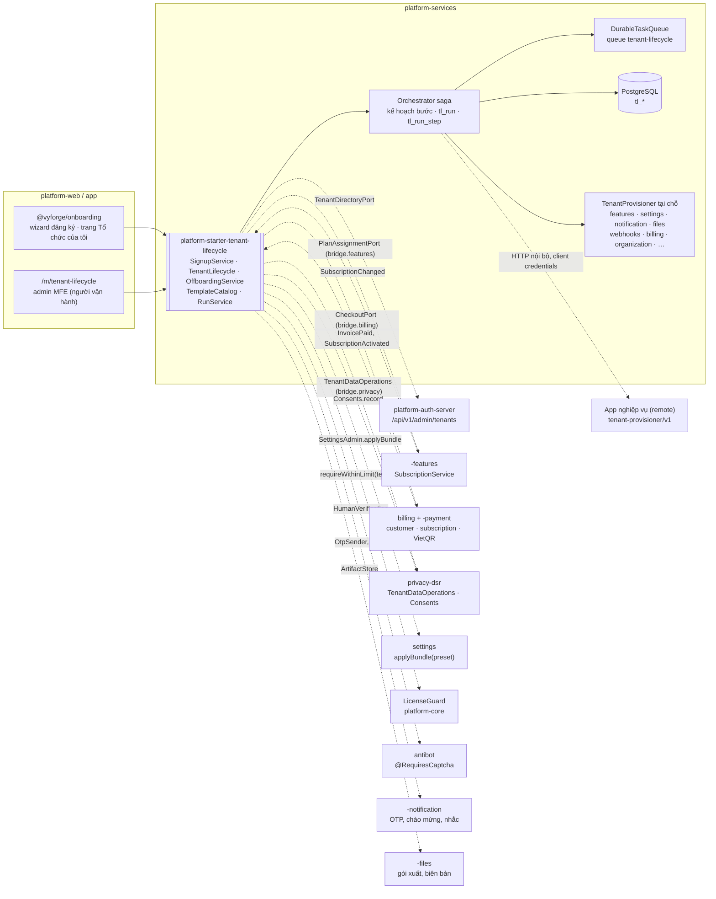
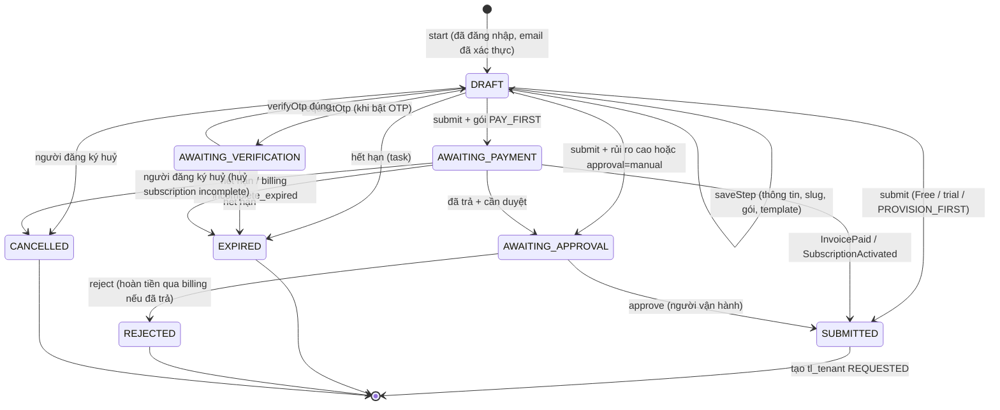
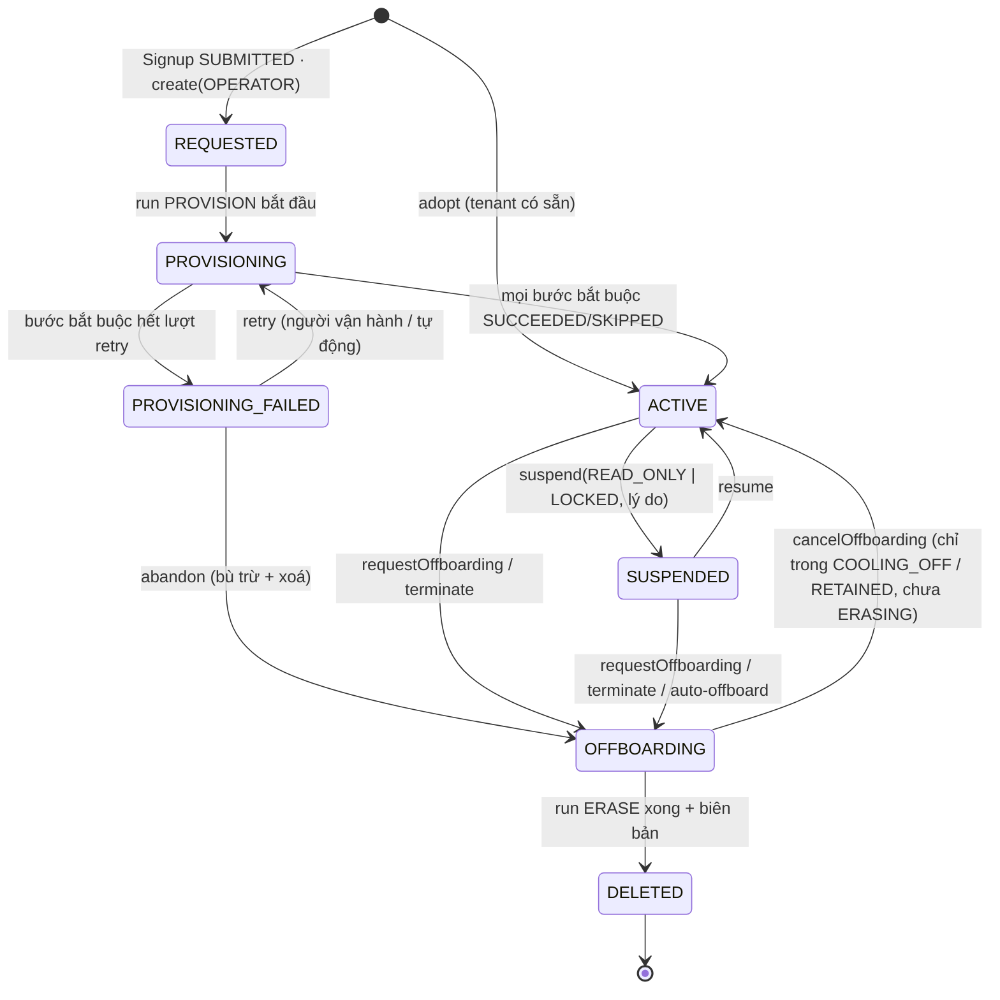
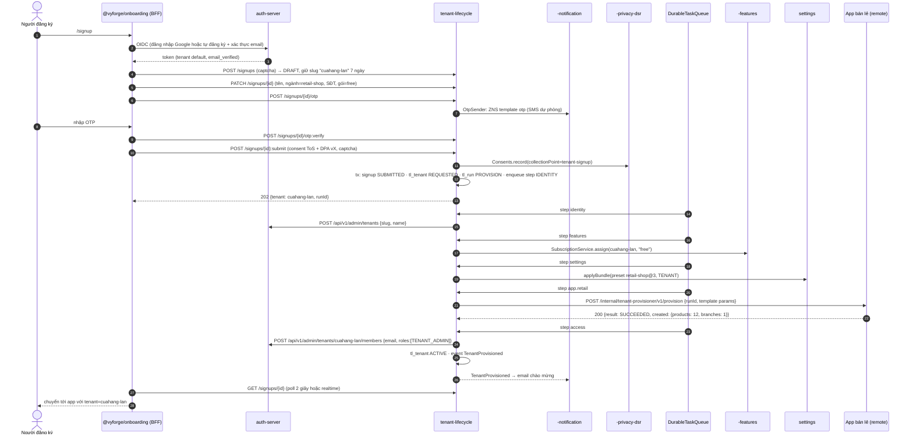
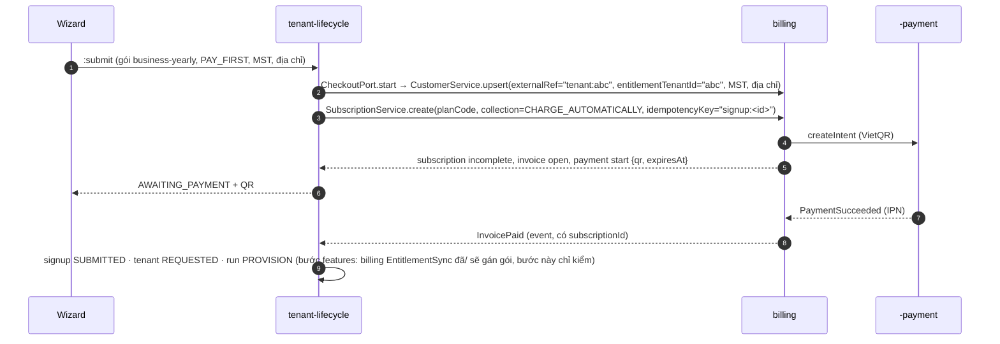
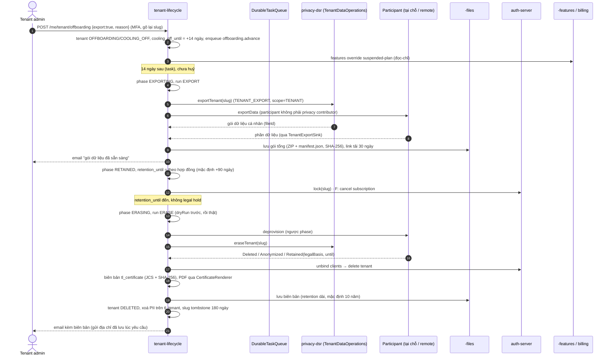
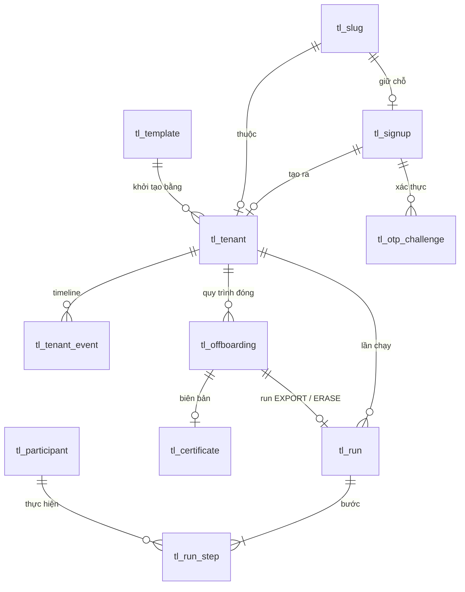

# Thiết kế module `tenant-lifecycle`: tự đăng ký, khởi tạo, chọn gói, tạm ngừng, offboarding

> **Trạng thái:** bản thiết kế giai đoạn 1 (27/10/2026), phiên forge-72, chờ review.
> **Sản phẩm:** `platform-starter-tenant-lifecycle` (platform-java 0.13.0); `@vyforge/onboarding` (wizard đăng ký, trang
> "đóng tổ chức" cho tenant admin), admin MFE `@vyforge/tenant-lifecycle-admin` (`/m/tenant-lifecycle`) trong platform-web /
> platform-admin.
> **Dùng khối chung** của platform-java 0.12.1: `DurableTaskQueue`, `StarterSchemaMigrator`, `SecretCipher` (phụ lục §5 của
> quy ước module).
> **Nối với** thiết kế đã có: [ADR-0011](../adr/0011-tenant-and-user-directory.md) (tenant ở auth-server),
> [features](../../../gh--d-features/docs/design/features.md) (gói, entitlement, subscription quyền dùng),
> [billing](billing.md) (giá, hoá đơn, thu tiền), [privacy-dsr](privacy-dsr.md) (xuất/xoá cấp tenant, consent),
> [platform-services](platform-services.md) (nơi chạy, MFE, chọn tenant của người vận hành), [settings](settings.md)
> (preset cho tenant mới), [licensing](licensing.md) (`block-new-tenants`, giới hạn `tenants`), [admin-kit](admin-kit.md),
> [ops-console](ops-console.md), [organization](organization.md). Đường dẫn `gh--d-features` là worktree thiết kế; khi
> merge thì cùng nằm trong `docs/design/`.

Tóm tắt trong tám dòng:

1. **Module là "control plane" của tenant.** auth-server vẫn là nơi giữ tenant, membership, khoá/mở (ADR-0011). Module này
   giữ **vòng đời** quanh nó: đơn đăng ký, trạng thái, lần chạy khởi tạo, offboarding, biên bản xoá. Không tạo bảng tenant
   thứ hai cạnh `tenant_tenants`; `tl_tenant` chỉ mang thông tin vòng đời và trỏ tới slug.
2. **Hai aggregate, hai state machine.** `Signup` (đơn của người đăng ký: xác thực, chọn gói, thanh toán, duyệt) tách khỏi
   `Tenant` (`REQUESTED → PROVISIONING → ACTIVE → SUSPENDED → OFFBOARDING → DELETED`). Đơn chưa trả tiền hay chưa duyệt
   không chiếm tài nguyên của tenant nào.
3. **SPI `TenantProvisioner`** mỗi module cài: `provision`, `suspend`/`resume` (tuỳ chọn), `exportData` (tuỳ chọn),
   `deprovision`. Module có mặt thì tham gia (`@ConditionalOnBean`); app nghiệp vụ ở xa tham gia qua HTTP
   `tenant-provisioner/v1`, đúng mẫu contributor của privacy-dsr.
4. **Saga ngắn, không engine.** Mỗi lần chạy (`tl_run`) là một kế hoạch bước theo thứ tự phụ thuộc, mỗi bước là một task
   `DurableTaskQueue` có khoá idempotent `run:<id>:<participant>:<phase>`. Bước lỗi retry có backoff; hết lượt thì run
   `FAILED`, người vận hành retry/bỏ qua/huỷ. Bù trừ (compensation) chỉ khi người vận hành chọn huỷ khởi tạo.
5. **Không làm lại việc của module khác.** Gói và quyền dùng: `-features`. Giá, hoá đơn, thu tiền VietQR: `billing` +
   `-payment`. Xuất/xoá dữ liệu cá nhân cấp tenant: `TenantDataOperations` của privacy-dsr. Cài đặt mẫu: `settings`
   `applyBundle`. Captcha: `antibot` (`@RequiresCaptcha` trong `-ratelimit`). Gửi OTP: `-notification`.
6. **Template tenant** (`retail-shop`, `clinic`, `school`…) gom: preset settings, gói mặc định, dữ liệu mẫu cho từng module,
   có version. Tenant đã tạo không đổi khi template đổi.
7. **Offboarding có hợp đồng và có biên bản.** Yêu cầu đóng → thời gian hối hận → xuất gói dữ liệu → giữ (read-only/khoá)
   tới `retention_until` theo hợp đồng → xoá qua mọi participant → biên bản xoá có băm SHA-256, ghi phần **được giữ lại theo
   luật** (hoá đơn 10 năm…), đúng Luật 91/2025 Điều 14 khoản 1 điểm b, đ và khoản 3.
8. **Chạy trong `platform-services`** (cần client credentials quản trị auth-server, không để app nghiệp vụ giữ). Vẫn là
   starter: bản cài một app duy nhất nhúng được.

---

## Mục lục

1. [Bài toán và phạm vi](#1-bài-toán-và-phạm-vi)
2. [Nghiên cứu](#2-nghiên-cứu)
3. [Kiến trúc](#3-kiến-trúc)
4. [Mô hình dữ liệu](#4-mô-hình-dữ-liệu)
5. [API](#5-api)
6. [Mở rộng](#6-mở-rộng)
7. [Vận hành](#7-vận-hành)
8. [Bảo mật và tuân thủ](#8-bảo-mật-và-tuân-thủ)
9. [Kế hoạch triển khai](#9-kế-hoạch-triển-khai)
10. [Lệch quy ước và quyết định cần chọn](#10-lệch-quy-ước-và-quyết-định-cần-chọn)
11. [Đóng gói và triển khai độc lập](#11-đóng-gói-và-triển-khai-độc-lập)

---

## 1. Bài toán và phạm vi

### 1.1 Vì sao cần

Gap analysis 10/2026 (mục 2.10) ghi: auth-server tạo được tenant (người vận hành làm tay qua `POST /api/v1/admin/tenants`)
và cho tự đăng ký **tài khoản**, nhưng:

- không có luồng **tạo tổ chức tự phục vụ** (thông tin tổ chức, chọn gói, thanh toán, có ngay tenant dùng được);
- không có cơ chế để **từng module khởi tạo dữ liệu** khi tenant mới ra đời (cài đặt mẫu, đơn vị gốc của cơ cấu tổ chức,
  danh mục, lịch làm việc, dữ liệu mẫu), nên mỗi dự án tự viết script seed;
- không có đường **ra** có kiểm soát: khách ngừng dùng thì xuất dữ liệu, giữ theo hợp đồng, xoá hết ở mọi module, có biên
  bản. Hiện xoá tenant ở auth-server chỉ xoá bản ghi tenant (ADR-0011 §5), dữ liệu của tenant trong các module vẫn nằm lại.

Đây cũng là điểm còn hở của "SaaS hoá" (gap analysis §1.3 ý 2) và là điều kiện để billing có khách tự vào mua gói.

### 1.2 Trong phạm vi

| Nhóm | Nội dung |
|---|---|
| Đăng ký tự phục vụ | Wizard nhiều bước: tài khoản (đăng nhập hoặc tự đăng ký ở auth-server, email đã xác thực), thông tin tổ chức, slug, ngành/template, xác thực số điện thoại bằng OTP (tuỳ chọn), chọn gói, đồng ý điều khoản + thoả thuận xử lý dữ liệu (DPA), thanh toán khi gói yêu cầu, theo dõi tiến độ khởi tạo |
| Chống lạm dụng | Captcha (antibot), rate limit theo IP/tài khoản, giới hạn số tổ chức mỗi tài khoản, email dùng một lần, slug cấm/đã giữ, chấm điểm rủi ro → duyệt tay |
| Khởi tạo | Tạo tenant ở auth-server, gắn gói (features/billing), áp preset settings, gọi `TenantProvisioner` của mọi module theo thứ tự, gán owner `TENANT_ADMIN`, gửi chào mừng |
| Vòng đời | State machine tenant; tạm ngừng (đọc-chỉ hoặc khoá hẳn) và mở lại; đồng bộ với trạng thái subscription; nhập tenant đã có (do người vận hành tạo trước) |
| Template | Template tenant theo ngành có version, khai báo trong code hoặc do người vận hành tạo; dữ liệu mẫu tuỳ chọn |
| Offboarding | Tenant admin yêu cầu đóng hoặc người vận hành chấm dứt; thời gian hối hận; xuất gói dữ liệu cấp tenant; retention theo hợp đồng; legal hold; xoá ở mọi participant; biên bản xoá |
| Quản trị | Admin MFE cho người vận hành (hàng đợi đơn, tenant lỗi khởi tạo, offboarding, template); trang tenant admin "Tổ chức của tôi" (gói, xuất dữ liệu, đóng tổ chức) |

### 1.3 Kịch bản nghiệp vụ phải đáp ứng

| # | Kịch bản | Đặc thù | Khối đáp ứng | Bản |
|---|---|---|---|---|
| T1 | **Hộ kinh doanh** vào trang đăng ký, đăng nhập Google, nhập tên cửa hàng và số điện thoại, nhận OTP qua Zalo ZNS (SMS dự phòng), chọn gói Free, có ngay tenant kèm dữ liệu mẫu (vài sản phẩm, một chi nhánh) | VN | Wizard + `OtpSender` → `-notification` (ZNS/SMS); template `retail-shop`; `PROVISION_FIRST` | Hiện tại |
| T2 | Chủ cửa hàng ở T1 dùng 2 tuần rồi **nâng lên Pro**, trả bằng VietQR | VN | Không thuộc module này: billing `changePlan` + `-payment`. Module chỉ hiện nút "Nâng gói" dẫn tới cổng billing | Hiện tại |
| T3 | **Công ty TNHH** đăng ký gói Business trả trước năm, không có trial: phải trả xong hoá đơn đầu (VietQR hoặc chuyển khoản) mới khởi tạo; cần MST, tên pháp nhân, địa chỉ để xuất HĐĐT | VN | Chính sách `PAY_FIRST`; `CheckoutPort` → billing customer (MST, địa chỉ) + subscription `incomplete`; `InvoicePaid` mở đơn | Hiện tại |
| T4 | Dùng thử 14 ngày không cần thẻ; hết trial chưa trả thì tenant còn đó ở chế độ đọc-chỉ; 60 ngày sau tự chuyển sang offboarding | Chung | features `startTrial` → `EXPIRED`/`suspended-plan`; policy `auto-offboard-after` theo `SubscriptionChanged` | Hiện tại |
| T5 | **SaaS phòng khám**: template `clinic` áp preset settings ngành y (giờ làm, mẫu phiếu), cơ cấu tổ chức mặc định (Tiếp đón, Khám, Dược), danh mục dịch vụ mẫu; module eKYC không cài thì bước đó tự bỏ qua | VN | `TenantTemplate` + participant `settings`, `organization`, app `clinic` (remote); participant không có mặt → `SKIPPED` | Hiện tại |
| T6 | Khởi tạo lỗi ở bước app nghiệp vụ (app đang deploy, 503): người đăng ký thấy "đang hoàn tất, sẽ báo qua email"; retry tự động có backoff; hết lượt thì vào hàng "Lỗi khởi tạo" của người vận hành, người vận hành bấm thử lại sau khi app lên | Chung | `tl_run_step` + `DurableTaskQueue` retry; `TenantProvisioningFailed` → notification cho người vận hành; API `runs/{id}:retry` | Hiện tại |
| T7 | **Đơn vị sự nghiệp/cơ quan** không được tự đăng ký: người vận hành tạo tenant hộ, chọn template, gói theo hợp đồng, mời người phụ trách làm owner | VN | `TenantLifecycle.create(source=OPERATOR)`; cùng saga; owner mời qua auth-server | Hiện tại |
| T8 | Tài khoản đăng ký 30 tổ chức trong 1 giờ từ cùng dải IP, email `@mailinator`: bị chặn hoặc vào hàng duyệt tay | Chung | Rate limit + `SignupRiskEvaluator` (email dùng một lần của antibot, số đơn theo IP/tài khoản) → `AWAITING_APPROVAL` | Hiện tại |
| T9 | Khách **quá hạn thanh toán**: billing/features chuyển subscription sang `SUSPENDED` (đọc-chỉ); module hiện banner, không khoá đăng nhập. Người vận hành phát hiện lạm dụng (spam qua ZNS): **khoá hẳn** tenant ngay | Chung | Phân biệt `SUSPENDED/READ_ONLY` (theo features) và `SUSPENDED/LOCKED` (auth-server `lock`); lý do có mã | Hiện tại |
| T10 | **Tenant admin đóng tổ chức**: chọn "Xuất dữ liệu trước khi đóng", xác nhận bằng MFA và gõ lại slug; có 14 ngày hối hận để huỷ; tải gói ZIP trong 30 ngày; sau 90 ngày (theo hợp đồng) dữ liệu bị xoá, nhận email kèm biên bản xoá | VN (Luật 91/2025) | `requestOffboarding` → `OFFBOARDING/COOLING_OFF → EXPORTING → RETAINED → ERASING` → `DELETED`; `TenantDataOperations` + `exportData`; biên bản `tl_certificate` | Hiện tại |
| T11 | Khi xoá: hoá đơn và chứng từ kế toán phải giữ 10 năm (Luật Kế toán 88/2015 Điều 41); HĐĐT XML giữ theo luật thuế. Biên bản ghi rõ phần giữ lại, căn cứ, hạn | VN | Participant trả `Retained(legalBasis, reference, until)` (dùng chung kiểu với privacy-dsr) | Hiện tại |
| T12 | Tenant đang có tranh chấp/điều tra: cơ quan có thẩm quyền yêu cầu giữ dữ liệu. Người vận hành đặt **legal hold**: offboarding dừng trước bước xoá cho tới khi gỡ | VN | `tl_offboarding.legal_hold` (và `privacy_legal_hold` nếu có privacy-dsr) | Hiện tại |
| T13 | Bản on-prem cho tập đoàn: giấy phép giới hạn 20 tenant; tạo tenant thứ 21 bị từ chối rõ ràng; hết hạn giấy phép thì `block-new-tenants` | VN (licensing) | `LicenseGuard.requireWithinLimit("tenants", n+1)`, `actionActive("block-new-tenants")` trước khi nhận đơn | Hiện tại |
| T14 | Đăng ký một tổ chức đã có tên miền email riêng (`@abc.vn`): đề nghị thành viên cùng tên miền tự xin vào thay vì tạo tổ chức thứ hai | Chung | Tương lai: domain đã xác minh (học WorkOS/Keycloak/Clerk), cần auth-server hỗ trợ | Tương lai |
| T15 | Chuyển tenant giữa các cụm/region (data residency), hoặc sang database riêng (silo) cho khách lớn | Chung | `TenantPlacement` SPI để sẵn; bản đầu chỉ có pool dùng chung | Tương lai |
| T16 | **Sáp nhập hai tổ chức** (khách mua lại công ty khác) hoặc tách một chi nhánh thành tenant riêng | VN (Luật 91 Điều 17 khoản c: chuyển giao khi chia, tách, sáp nhập) | Tương lai: `exportData` + `importData` theo participant | Tương lai |
| T17 | Người vận hành **nhập tenant cũ** (đã tạo tay ở auth-server trước khi có module) để quản lý vòng đời, không chạy lại khởi tạo | Chung | `adopt(slug)` tạo `tl_tenant` ở `ACTIVE`, `source=IMPORT` | Hiện tại |
| T18 | Người đăng ký bỏ giữa chừng ở bước thanh toán; 24 giờ sau nhận nhắc; 7 ngày sau đơn hết hạn, slug được trả lại, PII của đơn bị xoá sau 30 ngày | Chung | `Signup.expires_at`, task `signup.remind`/`signup.expire`; retention `tl_signup` | Hiện tại |

### 1.4 Ngoài phạm vi

| Không làm | Lý do / nơi làm |
|---|---|
| Tài khoản, mật khẩu, MFA, xác thực email, IdP ngoài | auth-server (ADR-0008, ADR-0011). Module dùng tài khoản đã đăng nhập |
| Gói, entitlement, hạn mức | `-features` |
| Giá, hoá đơn, coupon, dunning, thu tiền | `billing` + `-payment`; module chỉ mở checkout lần đầu |
| Mời thành viên, phân quyền trong tenant | auth-server `/api/v1/tenant-admin/**` (ADR-0011 §8), `@vyforge/iam` |
| Xuất/xoá dữ liệu cá nhân của một chủ thể (DSR) | privacy-dsr |
| Captcha, danh sách email dùng một lần | `antibot` (mở rộng `-ratelimit`) |
| Tạo hạ tầng riêng cho từng tenant (database, namespace) | Bản đầu chỉ có mô hình pool (ADR-0015); để `TenantPlacement` SPI cho bản sau |
| Thương hiệu, tên miền riêng theo tenant | Ngoài module (ADR-0011 "Chưa làm"); template có thể mang preset settings thương hiệu |

---

## 2. Nghiên cứu

Kiểm ngày 27/10/2026 bằng WebSearch/WebFetch. Hệ thương mại chỉ đọc tài liệu công khai, không xem mã.

### 2.1 Hệ thống tham khảo

| Hệ thống | Phiên bản, license | Mô hình dữ liệu | API, luồng | Mạnh | Yếu |
|---|---|---|---|---|---|
| **ABP SaaS module** ([docs](https://abp.io/docs/latest/modules/saas)) | Tài liệu dòng 10.7; module **Pro**, cần giấy phép ABP Team trở lên | `Tenant` có `ActivationState` (`Active`, `ActiveWithLimitedTime` + `ActivationEndDate`, `Passive`), `EditionId` + `EditionEndDateUtc` (hết hạn thì `GetActiveEditionId()` trả null nhưng giữ edition cũ), `TenantConnectionString` theo tenant; `Edition` = bộ giá trị feature | `TenantAppService.CreateAsync` phát `TenantCreatedEto` (kèm email/mật khẩu admin trong `Properties`), `ApplyDatabaseMigrationsEto`; nhận `SubscriptionCreated/Updated/CanceledEto` của Payment module; `CreateTenantEto` để tạo từ bên ngoài | Tách rõ tenant ↔ edition ↔ payment qua event; trạng thái kích hoạt có hạn; connection string theo tenant cho silo | Payload event chứa mật khẩu và connection string (chính tài liệu cảnh báo); connection string lưu không mã hoá; không có offboarding/xuất dữ liệu; thương mại |
| **Clerk Organizations** ([overview](https://clerk.com/docs/organizations/overview), [webhooks](https://clerk.dev/docs/reference/webhooks)) | SaaS; tính theo "Monthly Retained Organizations" (free 100 MRO ở production) | Organization (profile, metadata), membership có role, invitation, **verified domain** (tự vào hoặc gợi ý xin vào), role/permission khai báo một lần cho cả app | Tạo qua dashboard, component dựng sẵn hoặc API; `<OrganizationSwitcher/>`; webhook `organization.created/updated/deleted`, `organizationMembership.*`, `organizationDomain.*` qua Svix (có retry, handler phải idempotent); payload `deleted` khác hình dạng | Trải nghiệm tạo tổ chức ngay trong app; tên miền đã xác minh; tổ chức đang chọn theo từng tab | Xoá là xoá ngay, tài liệu không nói gì về xuất dữ liệu hay giữ; dữ liệu ở nước ngoài |
| **WorkOS Organizations** ([API](https://workos.com/docs/reference/organization)) | SaaS | Organization: `name` (không cần duy nhất), `domain_data` (`pending`/`verified`, xác minh DNS), `external_id` (tra theo id của hệ thống mình), `metadata`, `stripe_customer_id` | `POST/PUT/DELETE /organizations`, `GET …/external_id/{id}`; xoá là vĩnh viễn | `external_id` để nối với hệ thống chủ; tách tổ chức khỏi user; gắn sẵn customer của billing | Không có khởi tạo dữ liệu, không có offboarding |
| **Keycloak Organizations** ([Server Admin Guide 26.8.1](https://www.keycloak.org/docs/latest/server_admin/index.html#_managing_organizations)) | OSS, Apache-2.0 | Organization: `name` duy nhất, **`alias` URL-friendly không đổi được**, redirect URL sau đăng ký/nhận lời mời, domain (exact/wildcard, gắn IdP), member managed/unmanaged | Tắt organization: thành viên không đăng nhập được (unmanaged vẫn đăng nhập realm nhưng token không còn metadata tổ chức); xoá organization: xoá mọi dữ liệu gắn với nó kể cả member managed | Alias bất biến giống slug của ADR-0011; tắt ≠ xoá; tên miền | Chỉ là phần danh tính; không có gói, billing, khởi tạo dữ liệu |
| **MakerKit** Next.js Supabase Turbo ([recipe onboarding + checkout](https://makerkit.dev/docs/next-supabase-turbo/recipes/onboarding-checkout)) | Bộ khởi đầu thương mại; tài liệu không ghi version | Bảng `onboarding` (`account_id` unique, `data` JSONB, `completed`), cờ `app_metadata.onboarded` | Profile → tên team → chọn gói → server action tạo team account + checkout session → webhook thanh toán thành công (`source: 'onboarding'`) mới gán owner, đặt cờ, xoá dòng onboarding; trang `/onboarding/complete` poll tới khi xong | Đơn đăng ký tách khỏi tài khoản; **chỉ hoàn tất khi webhook thanh toán về**; middleware chặn người chưa xong onboarding | Tạo team trước khi trả tiền (team rác khi bỏ ngang); logic gắn với Stripe |
| **SBT-AWS** (SaaS Builder Toolkit, [repo](https://github.com/awslabs/sbt-aws), [developer guide](https://github.com/awslabs/sbt-aws/blob/main/docs/public/README.md)) | OSS, Apache-2.0; tự nhận là "sample code"; nhánh `main` đọc 27/10/2026, chưa có release | Control plane giữ tenant + **tenant registration** (`registrationStatus`); application plane chạy job | Control plane phát `onboardingRequest`/`offboardingRequest` qua EventBridge; `ProvisioningScriptJob`/`DeprovisioningScriptJob` chạy rồi phát `provisionSuccess`/`deprovisionSuccess` kèm `jobOutput` | Tách control plane / application plane; offboarding là sự kiện ngang hàng với onboarding; kết quả job đổ ngược vào registration | Gắn AWS (EventBridge, Step Functions, CodeBuild); không có thứ tự giữa các thành phần, không có biên bản |
| **supastarter** ([organizations](https://supastarter.dev/docs/nextjs/organizations/overview)) | Bộ khởi đầu thương mại | Organization qua better-auth, dữ liệu trong DB của mình | Tài liệu công khai không mô tả onboarding/xoá | Toàn quyền dữ liệu | Không đủ tài liệu để học thêm |

Bullet Train (gem MIT trên RubyGems) và gap analysis §1.2 đã ghi các bộ khởi đầu này giống nhau ở "onboarding tạo team đầu
tiên"; không tra thêm vì không có gì khác MakerKit.

### 2.2 Văn bản pháp lý VN

| Văn bản | Đã kiểm | Áp vào thiết kế |
|---|---|---|
| **Luật Bảo vệ dữ liệu cá nhân 91/2025/QH15** (hiệu lực 01/01/2026), đọc toàn văn từ [Công báo số 971+972 ngày 24/07/2025](https://congbaocdn.chinhphu.vn/CongBaoCP/VanBan/2025/6/45578/57730-1-2025971-97291-2025-qh15.pdf) | **Điều 14 khoản 1**: xoá, huỷ khi b) đã hoàn thành mục đích xử lý; c) hết thời hạn lưu trữ; đ) theo thoả thuận. **Khoản 3**: xoá, huỷ phải bằng biện pháp an toàn, ngăn khôi phục trái phép. **Khoản 5**: không xoá được vì lý do chính đáng thì phải thông báo. **Điều 37 khoản 2**: bên xử lý chỉ nhận dữ liệu khi có thoả thuận/hợp đồng và xử lý đúng hợp đồng. **Điều 17 khoản 1 điểm c**: chuyển giao dữ liệu khi chia, tách, sáp nhập tổ chức | Với dữ liệu nghiệp vụ của tenant, **tenant là bên kiểm soát, nhà vận hành platform là bên xử lý** → bắt buộc có DPA khi đăng ký (consent `tenant-signup` ghi version DPA); xoá theo hợp đồng khi offboarding (Điều 14.1.đ) và khi hết hạn giữ (14.1.c); xoá không khôi phục (14.3) → biên bản ghi cả backup (mục 8.3); phần không xoá được phải ghi căn cứ (14.5) → `Retained` |
| **NĐ 356/2025/NĐ-CP** (ký 31/12/2025, hiệu lực 01/01/2026, thay NĐ 13/2023), kiểm qua [EY](https://www.ey.com/vi_vn/technical/tax/tax-and-law-updates/nghi-dinh-so-356-2025-nd-cp-quy-dinh-chi-tiet-mot-so-dieu-va-bien-phap-thi-hanh-luat-bao-ve-du-lieu-ca-nhan) và thiết kế privacy-dsr §2 | Điều 5: thời hạn thực hiện quyền của chủ thể; Điều 8: phải nêu thời gian lưu trữ khi xin đồng ý | Thông báo khi đăng ký nêu thời gian giữ dữ liệu của người đăng ký và chính sách giữ khi offboarding |
| **Luật Kế toán 88/2015/QH13 Điều 41** (đã trích ở privacy-dsr K7 và billing §8.3) | Chứng từ kế toán dùng ghi sổ giữ tối thiểu 10 năm | Participant billing/einvoice/payment trả `Retained` khi xoá tenant; biên bản liệt kê |
| **NĐ 147/2024/NĐ-CP** (gap analysis §3, mục collaboration) | Tài khoản dịch vụ mạng xã hội phải xác thực số điện thoại | Không áp trực tiếp cho tổ chức SaaS; OTP số điện thoại để **tuỳ chọn theo cấu hình**, bật mặc định cho profile hộ kinh doanh (chống lạm dụng, liên hệ) |

### 2.3 Học theo gì, không làm gì

**Học theo:**

1. **Đơn đăng ký tách khỏi tenant, hoàn tất bằng sự kiện thanh toán** (MakerKit). Khác MakerKit ở chỗ tenant chỉ được tạo
   **sau** khi đơn đủ điều kiện, nên đơn bỏ ngang không để lại tenant rác.
2. **Slug bất biến, URL-friendly** (Keycloak `alias`, ADR-0011 slug). Thêm: slug đã xoá bị giữ một thời gian (tombstone) để
   không ai chiếm lại đường dẫn và lời mời cũ.
3. **Tắt khác xoá** (Keycloak, ABP `Passive`). Ở đây có hai mức tắt: đọc-chỉ (features `suspended-plan`) và khoá đăng nhập
   (auth-server `lock`).
4. **Control plane / application plane, onboarding và offboarding là hai sự kiện ngang hàng có kết quả đổ ngược**
   (SBT-AWS). Ở đây là `tl_run` với từng `tl_run_step` có kết quả.
5. **Tổ chức trỏ tới customer của billing** (WorkOS `stripe_customer_id`, `external_id`): `tl_tenant.billing_customer_id`;
   billing `bill_customer.entitlement_tenant_id` = slug.
6. **Trạng thái có hạn** (ABP `ActiveWithLimitedTime`): `retention_until`, `suspended_until`.
7. **Webhook/event idempotent, payload không chứa bí mật** (bài học ngược từ ABP `TenantCreatedEto` chứa mật khẩu; Clerk
   qua Svix có retry).

**Không làm:**

1. Không gửi mật khẩu hay bí mật trong event (ABP). Owner đặt mật khẩu ở auth-server, module không bao giờ thấy.
2. Không xoá ngay khi khách bấm (Clerk, WorkOS xoá vĩnh viễn ngay): luôn có thời gian hối hận và xuất dữ liệu trước.
3. Không dựa vào nền tảng định tuyến/hàng đợi của một đám mây (SBT-AWS, EventBridge): dùng Modulith event + `DurableTaskQueue`
   chạy được on-prem (git-host/cloud agnostic).
4. Không dùng workflow engine (Temporal, Step Functions, hay module `workflow` của vyforge) cho saga này: số bước ít (≤ 20),
   thứ tự tĩnh, không có bước chờ người ngoài "duyệt đơn" (đã là trạng thái của `Signup`). `workflow` là module tuỳ chọn,
   không được thành phụ thuộc cứng (mục 6 quy ước).
5. Không làm verified domain ở bản đầu (Clerk, WorkOS, Keycloak đều có): cần auth-server khớp email ↔ tenant lúc đăng nhập;
   ghi vào T14.
6. Không tạo bảng tenant thứ hai làm nguồn sự thật cho danh tính: auth-server vẫn là nguồn của slug, tên, khoá/mở, member.

---

## 3. Kiến trúc

### 3.1 Vị trí giữa các module



Nét đứt là điểm nối tuỳ chọn: bean trong `bridge.<module>` có `@ConditionalOnBean`/`@ConditionalOnClass`, phụ thuộc Maven
`optional`. Riêng `TenantDirectoryPort` là bắt buộc (không có auth-server thì không có tenant), nhưng có adapter `noop` cho
bản cài một tenant và cho test.

### 3.2 Khái niệm

| Khái niệm | Nghĩa |
|---|---|
| **Signup** (`tl_signup`) | Đơn đăng ký của một tài khoản: thông tin tổ chức, slug giữ chỗ, gói, template, xác thực, consent, thanh toán, rủi ro. Có hạn. Thuộc tenant vận hành |
| **Tenant record** (`tl_tenant`) | Bản ghi vòng đời của một tenant (khoá là slug): trạng thái, lý do, gói ban đầu, template, owner, thông tin pháp lý, mốc thời gian. Danh tính (tên, khoá/mở, member) vẫn ở auth-server |
| **Participant** | Một thành phần tham gia vòng đời: bean `TenantProvisioner` tại chỗ, hoặc app ở xa khai báo qua `tenant-provisioner/v1`. Có `key`, `phase`, `dependsOn`, các khả năng |
| **Run** (`tl_run`) | Một lần chạy saga cho một tenant: `PROVISION`, `SUSPEND`, `RESUME`, `EXPORT`, `ERASE`. Có kế hoạch bước đã chốt lúc tạo |
| **Step** (`tl_run_step`) | Một participant × một run, chạy bằng một task `DurableTaskQueue`; có checkpoint, kết quả, lỗi |
| **Template** (`TenantTemplate`) | Bộ khởi tạo theo ngành: preset settings, gói mặc định, tham số theo participant, có/không dữ liệu mẫu. Có version |
| **Offboarding** (`tl_offboarding`) | Một quy trình đóng tenant: lý do, người yêu cầu, thời gian hối hận, xuất, retention, legal hold, run xoá, biên bản |
| **Certificate** (`tl_certificate`) | Biên bản xoá: nội dung JSON chuẩn hoá (JCS) + PDF tuỳ chọn, SHA-256, kết quả từng participant, phần giữ lại có căn cứ |

### 3.3 Ranh giới package

```
com.vyforge.platform.tenantlifecycle
├── (gốc)            SignupService, TenantLifecycle, OffboardingService, RunService, TemplateCatalog, TenantQuery;
│                    record lệnh/kết quả; TenantLifecycleErrors; TenantLifecycleActions
├── event            Event công khai (record, TenantAwareEvent + IntegrationEvent, schemaVersion)
├── spi              TenantProvisioner, ProvisionContext, ProvisionResult, ErasureOutcome (dùng ErasureItem của -privacy),
│                    TenantDirectoryPort, PlanAssignmentPort, CheckoutPort, OtpSender, HumanVerification,
│                    SignupRiskEvaluator, SlugPolicy, ArtifactStore, CertificateRenderer, LifecycleInterceptor,
│                    TenantPlacement (để sẵn, bản đầu chỉ "shared")
├── participant      Đăng ký participant tại chỗ + ở xa; client/endpoint HTTP tenant-provisioner/v1
├── bridge.auth      AuthServerTenantDirectory (RestClient tới auth-server)
├── bridge.features  FeaturesPlanAssignment; nghe SubscriptionChanged                    (@ConditionalOnBean)
├── bridge.billing   BillingCheckout; nghe InvoicePaid, SubscriptionActivated, ...       (@ConditionalOnBean)
├── bridge.privacy   PrivacyTenantData (TenantDataOperations), SignupConsent (Consents)  (@ConditionalOnBean)
├── bridge.settings  SettingsProvisioner (participant "settings" áp preset của template)   (@ConditionalOnBean)
├── bridge.notification NotificationOtpSender; khai báo notification type              (@ConditionalOnBean)
├── bridge.files     FilesArtifactStore                                                   (@ConditionalOnBean)
├── bridge.antibot   AltchaHumanVerification, DisposableEmailRisk                         (@ConditionalOnClass)
├── bridge.license   LicenseTenantLimit                                                   (@ConditionalOnBean LicenseGuard)
├── internal         entity, repository (JdbcClient), state machine, orchestrator, task handler
└── web              REST controller, DTO, Problem Details
```

Luật ArchUnit: `spi..` không phụ thuộc Spring; `bridge.<m>..` là package duy nhất được import class của module `<m>`;
`internal..` không bị gói khác ngoài `web` và auto-config dùng.

### 3.4 State machine của `Signup`



- `submit` kiểm lại mọi điều kiện trong một transaction: slug còn trống (unique trên `tl_slug`), giới hạn giấy phép, số tổ
  chức của tài khoản, OTP đã xác thực (nếu bắt buộc), consent đã ghi, captcha (ở request `submit`).
- `SUBMITTED` là trạng thái cuối của đơn. Cùng transaction đó tạo `tl_tenant` ở `REQUESTED` và `enqueue` run `PROVISION`.
- Thanh toán (`AWAITING_PAYMENT`) đi qua billing: module tạo customer + subscription `incomplete` (billing §3.4); billing
  phát `InvoicePaid`; listener trong `bridge.billing` chuyển đơn sang `SUBMITTED`. Billing tự hết hạn subscription sau
  `incomplete_expiry` (23 giờ); module nhận `SubscriptionCanceled`/hết hạn và chuyển đơn sang `EXPIRED` nếu chưa trả.

### 3.5 State machine của `Tenant`



Pha con của `OFFBOARDING` (`tl_offboarding.phase`):

```
COOLING_OFF ──hết hạn hối hận──▶ EXPORTING ──gói xong (hoặc không xuất)──▶ RETAINED ──retention_until, không legal hold──▶ ERASING ──▶ (Tenant DELETED)
     │                                                                          │
     └──────────── cancelOffboarding ◀──────────────────────────────────────────┘ (trước ERASING)
```

| Trạng thái | auth-server | features | App/module |
|---|---|---|---|
| `REQUESTED`, `PROVISIONING` | Tenant đã tạo (`ACTIVE`) nhưng **chưa có member** (owner gán ở bước cuối), nên chưa ai đăng nhập được | Subscription đã gắn | Participant đang khởi tạo |
| `PROVISIONING_FAILED` | Như trên | Như trên | Bước đã xong giữ nguyên; người đăng ký thấy trang "đang hoàn tất" |
| `ACTIVE` | `ACTIVE`, owner có `TENANT_ADMIN` | Theo subscription | Bình thường |
| `SUSPENDED/READ_ONLY` | `ACTIVE` | Override `suspended-plan` (chỉ đọc) | Banner; ghi bị chặn bởi entitlement |
| `SUSPENDED/LOCKED` | `LOCKED` (không cấp token mới, ADR-0011 §4) | Giữ nguyên | Job nền của tenant vẫn chạy cho việc dở (platform-services §5.4) |
| `OFFBOARDING` (`COOLING_OFF`, `EXPORTING`) | `ACTIVE`, chỉ tenant admin đăng nhập được (gỡ quyền ghi bằng `suspended-plan`) | `suspended-plan` | Đọc-chỉ, tải gói xuất |
| `OFFBOARDING` (`RETAINED`, `ERASING`) | `LOCKED` | Subscription `CANCELED` | Không ai vào; dữ liệu còn tới `ERASING` |
| `DELETED` | Tenant đã xoá (gỡ client → khoá → xoá, ADR-0011 §5) | Đã huỷ | Hết dữ liệu, trừ phần `Retained`. `tl_tenant` còn là tombstone không PII |

**Không đồng bộ hai chiều với subscription.** Hết tiền là việc của features/billing (đọc-chỉ tự động qua `suspended-plan`).
Module chỉ nghe `SubscriptionChanged` để (1) hiện trạng thái trong admin, (2) áp policy `auto-offboard-after` (mặc định tắt;
ví dụ T4: 60 ngày sau `EXPIRED`/`CANCELED` thì mở offboarding với lý do `subscription_ended`). `SUSPENDED` của module là
quyết định của con người (người vận hành, lạm dụng, pháp lý), có mã lý do.

### 3.6 SPI `TenantProvisioner` và kế hoạch bước

```java
public interface TenantProvisioner {
    ParticipantDescriptor descriptor();                        // key, phase, dependsOn, capabilities, required, timeout

    /** Khởi tạo dữ liệu cho tenant mới. Idempotent theo ctx.runId(): gọi lại sau khi đã xong không tạo trùng. */
    ProvisionResult provision(ProvisionContext ctx);

    /** Tuỳ chọn: phản ứng khi tạm ngừng/mở lại (dừng job riêng, ngắt kết nối realtime...). */
    default void suspend(LifecycleContext ctx, SuspendMode mode) {}
    default void resume(LifecycleContext ctx) {}

    /** Tuỳ chọn: xuất dữ liệu không phải dữ liệu cá nhân (cấu hình, danh mục, template...) ra sink. */
    default ExportOutcome exportData(LifecycleContext ctx, TenantExportSink sink) { return ExportOutcome.unsupported(); }

    /** Xoá mọi dữ liệu của tenant mà module giữ. dryRun=true chỉ đếm. Trả cả phần giữ lại có căn cứ. */
    ErasureOutcome deprovision(LifecycleContext ctx, DeprovisionPlan plan);
}
```

**Phase** cố định để thứ tự dễ đoán, trong cùng phase thì theo `dependsOn` rồi theo `key`:

| Phase (provision) | Ai | Ví dụ |
|---|---|---|
| `IDENTITY` (10) | Lõi (không phải participant cài được) | Tạo tenant ở auth-server; gắn client nếu template yêu cầu |
| `COMMERCIAL` (20) | features, billing | Gắn gói/trial (`startTrial`, `assign`); với `PAY_FIRST` subscription đã có từ đơn |
| `FOUNDATION` (30) | settings, organization, master-data, calendar, sequence, privacy-dsr | Preset settings; đơn vị gốc của cơ cấu tổ chức; lịch làm việc VN; consent purpose mặc định |
| `MODULES` (40) | notification, files, webhooks, workflow, forms, cms… | Template thông báo, quota files, quy trình mẫu |
| `APPLICATION` (50) | App nghiệp vụ (remote) | Danh mục sản phẩm mẫu, kho mặc định |
| `ACCESS` (90) | Lõi | Gán owner `TENANT_ADMIN`; phát `TenantProvisioned`; gửi chào mừng |

Deprovision chạy **ngược** thứ tự phase (`APPLICATION` trước, `IDENTITY` cuối). `suspend`/`resume` chạy song song (không phụ
thuộc thứ tự).

`ParticipantDescriptor`:

| Trường | Nghĩa |
|---|---|
| `key` | Ổn định, duy nhất (`settings`, `organization`, `app.crm`) |
| `phase`, `dependsOn` | Thứ tự |
| `required` | `true`: lỗi hết lượt thì tenant `PROVISIONING_FAILED`. `false`: lỗi thì bước `FAILED` nhưng tenant vẫn `ACTIVE` kèm cảnh báo (dữ liệu mẫu, webhook mẫu) |
| `capabilities` | `PROVISION`, `SUSPEND`, `EXPORT`, `DEPROVISION` |
| `timeout` | Mỗi lần gọi; mặc định 2 phút. Lâu hơn thì trả `ProvisionResult.continueFrom(checkpoint)` |
| `privacyContributorKey` | Nếu module đã là `PersonalDataContributor` có `TENANT_EXPORT`/`TENANT_ERASE`, khai key đó để orchestrator **không xuất/xoá hai lần** (mục 3.9) |

Hợp đồng: mọi lời gọi chạy trong `TenantContext.run(slug, …)`; module tự mở transaction; idempotent theo `runId` (gợi ý
dùng `ProcessedMessages` hoặc kiểm "đã có chưa"); không gọi lại `tenant-lifecycle`; không log PII.

### 3.7 Luồng chính: hộ kinh doanh tự đăng ký gói Free (T1)



Ghi chú:

- Bước `identity` gặp `409` (slug đã có ở auth-server) thì `GET` lại: tenant đó có `createdBy` là client của module và
  `tl_tenant` trỏ đúng run thì coi là đã xong (idempotent); khác thì bước `FAILED` mã `tenant_lifecycle.slug_conflict`
  (không ghi đè tenant của người khác).
- Owner gán **cuối cùng**, nên trong lúc khởi tạo không ai đăng nhập vào tenant dở dang. Người đăng ký chỉ thấy trang tiến độ.
- Bản cài không có realtime: wizard poll `GET /signups/{id}` (rate limit riêng). Có `-realtime` thì đẩy event
  `TenantRunProgress` theo kênh `user:<sub>`.

### 3.8 Luồng trả trước (T3)



- Customer nằm ở tenant vận hành (người bán = `default`, billing §3.2) với `entitlement_tenant_id` là slug đã giữ. Billing
  gọi features sau khi tenant tồn tại hay chưa đều được, vì features khoá subscription theo `tenant_id` dạng chuỗi.
- Nếu đơn bị từ chối sau khi đã trả (T8 + duyệt tay): module gọi `CheckoutPort.refund` (billing credit note + hoàn tiền qua
  `-payment`), ghi lý do.

### 3.9 Luồng offboarding (T10, T11, T12)



**Tránh xuất/xoá hai lần.** Orchestrator lập kế hoạch như sau:

1. Có `TenantDataOperations` (privacy-dsr cài): một bước `privacy` gọi `exportTenant`/`eraseTenant`. Privacy tự gọi mọi
   `PersonalDataContributor` có `TENANT_EXPORT`/`TENANT_ERASE` (privacy-dsr §3.14).
2. Mỗi `TenantProvisioner` có `EXPORT`/`DEPROVISION` thành một bước, **trừ phần mà `privacyContributorKey` đã lo**:
   participant khai `privacyContributorKey` thì orchestrator gọi `exportData`/`deprovision` với cờ
   `ctx.privacyHandled()=true`, module chỉ xuất/xoá phần **không** thuộc contributor (cấu hình, danh mục).
3. Không có privacy-dsr: orchestrator gọi trực tiếp `PersonalDataContributor` có `TENANT_*` (SPI nằm ở `-privacy`, luôn có)
   qua cùng cơ chế bước, không có SLA, không có gói của privacy; module tự gom vào gói của mình.
4. **Bảng không ai nhận:** trước `ERASE`, bước `inventory` quét `information_schema` tìm bảng có cột `tenant_id` trong
   database của platform-services mà không participant nào khai trong `ParticipantDescriptor.tables`. Có bảng như vậy thì
   run dừng ở `AWAITING_DECISION` (người vận hành chọn xoá bằng `JdbcTenantPurger` hoặc đánh dấu "không có dữ liệu") và biên
   bản ghi lại quyết định. Ở app ở xa, việc này là trách nhiệm của app (endpoint trả danh sách bảng đã xoá).

### 3.10 Luồng lỗi

| Tình huống | Xử lý |
|---|---|
| Participant tại chỗ ném lỗi tạm (timeout DB, 5xx của auth-server) | Task retry theo backoff của queue (`max_attempts` 8, 30 s → 30 phút, jitter). Bước `RUNNING` → `RETRYING`, `last_error` đã che PII |
| Participant ném `PermanentProvisionException` (dữ liệu template sai, thiếu cấu hình) | Không retry. Bước `FAILED`; `required=true` thì tenant `PROVISIONING_FAILED`, event `TenantProvisioningFailed` → notification người vận hành |
| App ở xa không trả lời / 503 | Như lỗi tạm. Hết lượt: `FAILED`, hiện ở hàng "Lỗi khởi tạo" với nút Thử lại/Bỏ qua |
| App ở xa đã khai participant rồi gỡ (không còn đăng ký) | Run mới không có bước đó. Run đang chạy: bước `SKIPPED` với lý do `participant_gone` (người vận hành xác nhận) |
| Người vận hành **huỷ khởi tạo** (`abandon`) | Run `PROVISION` → `CANCELLED`; tenant → `OFFBOARDING` với `phase=ERASING`, không cooling-off, không export (chưa có dữ liệu của khách); billing hoàn tiền nếu đã thu |
| Bước `identity` thành công nhưng transaction ghi kết quả lỗi | Task chạy lại; `identity` idempotent (mục 3.7) |
| Hai run cùng lúc cho một tenant | Partial unique index: mỗi tenant tối đa một run `RUNNING` mỗi loại xung khắc; tạo run thứ hai trả `409 tenant_lifecycle.run_in_progress` |
| `eraseTenant` của privacy trả `OnHold` (legal hold ở privacy) | Run `ERASE` dừng ở `AWAITING_DECISION`; offboarding giữ `RETAINED`; alert |
| Xoá tenant ở auth-server bị từ chối `tenant.has_clients` | Bước `identity` (deprovision) tự gọi gỡ client trước (`DELETE …/clients/{id}`) rồi khoá, rồi xoá (ADR-0011 §5) |
| Giấy phép hết chỗ (`license.limit_reached`) lúc `submit` | `403` cho người đăng ký, mã ổn định; đơn giữ `DRAFT`; event `SignupBlockedByLicense` cho người vận hành |
| `InvoicePaid` tới sau khi đơn đã `EXPIRED` | Đơn mở lại sang `SUBMITTED` nếu slug còn trống; slug đã bị người khác lấy thì `AWAITING_APPROVAL` với lý do `slug_taken_after_payment` để người vận hành đổi slug hoặc hoàn tiền |

---

## 4. Mô hình dữ liệu

### 4.1 ERD



Mọi bảng có `tenant_id` = **tenant vận hành** (`vyforge.tenant-lifecycle.operator-tenant`, mặc định `default`), giống
`bill_customer` của billing: đây là dữ liệu của nhà vận hành về khách hàng của họ. Slug của tenant khách hàng là cột
nghiệp vụ `slug`, không phải `tenant_id`. Luật `TENANT_ISOLATION` vẫn áp: mọi truy vấn lọc theo tenant vận hành; API của
tenant admin (`/me/tenant/**`) đọc bản ghi có `slug = TenantContext` qua một repository riêng có kiểm tra rõ.

### 4.2 DDL dự kiến

Migration ở `classpath:META-INF/vyforge/db/tenant-lifecycle`, bảng lịch sử `flyway_schema_history_tenant_lifecycle`
(phụ lục 5.3). File gộp cho DBA ở `META-INF/vyforge/sql/tenant-lifecycle.sql`.

```sql
-- V1__tenant_lifecycle_core.sql

-- Slug: một chỗ duy nhất để chống trùng giữa đơn đang giữ chỗ, tenant đang sống và tombstone.
create table tl_slug (
    tenant_id     varchar(64)  not null,               -- tenant vận hành
    slug          varchar(63)  not null,               -- ^[a-z0-9][a-z0-9-]{1,62}$ (ADR-0011)
    kind          varchar(20)  not null,               -- RESERVED_WORD | SIGNUP_HOLD | TENANT | TOMBSTONE (kiểm ở code)
    signup_id     uuid,
    held_until    timestamptz,                         -- SIGNUP_HOLD, TOMBSTONE
    created_at    timestamptz  not null default now(),
    primary key (tenant_id, slug)
);
create index tl_slug_expiry on tl_slug (held_until) where held_until is not null;

create table tl_signup (
    id                  uuid         primary key,
    tenant_id           varchar(64)  not null,
    applicant_sub       varchar(255) not null,             -- sub ở auth-server
    applicant_email     text         not null,             -- @PersonalData, email đã xác thực lúc start
    status              varchar(30)  not null,             -- DRAFT … CANCELLED (mục 3.4), kiểm ở code
    slug                varchar(63),
    display_name        varchar(200),
    template_key        varchar(80),
    template_version    int,
    plan_key            varchar(80),
    plan_policy         varchar(20),                       -- FREE | TRIAL | PAY_FIRST | PROVISION_FIRST
    org_kind            varchar(20),                       -- COMPANY | HOUSEHOLD | INDIVIDUAL | PUBLIC_UNIT | OTHER
    data                jsonb        not null default '{}', -- thông tin tổ chức, câu trả lời wizard (PII đánh dấu)
    schema_version      int          not null default 1,
    phone_e164          text,                              -- @PersonalData
    phone_verified_at   timestamptz,
    consent_receipt_id  uuid,                              -- privacy-dsr, nếu có
    consent_snapshot    jsonb,                             -- version ToS/DPA đã đồng ý (khi không có privacy-dsr)
    billing_customer_id uuid,
    billing_subscription_id uuid,
    billing_invoice_id  uuid,
    risk_score          int,
    risk_reasons        jsonb,
    client_ip_hash      bytea,                             -- HMAC(ip), không lưu IP thô
    decided_by          varchar(255),
    decision_note       text,
    tenant_slug         varchar(63),                       -- sau SUBMITTED
    idempotency_key     varchar(120),
    expires_at          timestamptz  not null,
    attributes          jsonb        not null default '{}',
    version             bigint       not null default 0,
    created_at          timestamptz  not null default now(),
    updated_at          timestamptz  not null default now()
);
create index tl_signup_status on tl_signup (tenant_id, status, created_at desc);
create index tl_signup_applicant on tl_signup (tenant_id, applicant_sub, created_at desc);
create index tl_signup_expiry on tl_signup (expires_at) where status in ('DRAFT','AWAITING_VERIFICATION','AWAITING_PAYMENT');
create unique index tl_signup_idem on tl_signup (tenant_id, applicant_sub, idempotency_key) where idempotency_key is not null;

create table tl_otp_challenge (
    id            uuid         primary key,
    tenant_id     varchar(64)  not null,
    signup_id     uuid         not null references tl_signup(id) on delete cascade,
    channel       varchar(20)  not null,                   -- ZNS | SMS | EMAIL
    target_hash   bytea        not null,                   -- HMAC(số điện thoại)
    code_hash     bytea        not null,                   -- HMAC(code, khoá riêng); không lưu code
    attempts      int          not null default 0,
    max_attempts  int          not null default 5,
    expires_at    timestamptz  not null,
    verified_at   timestamptz,
    created_at    timestamptz  not null default now()
);
create index tl_otp_signup on tl_otp_challenge (signup_id, created_at desc);

create table tl_tenant (
    tenant_id           varchar(64)  not null,
    slug                varchar(63)  not null,
    display_name        varchar(200),                      -- xoá khi DELETED
    status              varchar(30)  not null,             -- REQUESTED … DELETED (mục 3.5)
    suspend_mode        varchar(20),                       -- READ_ONLY | LOCKED
    status_reason       varchar(80),                       -- mã: operator_request, abuse, legal, subscription_ended, ...
    status_note         text,
    source              varchar(20)  not null,             -- SIGNUP | OPERATOR | IMPORT
    signup_id           uuid,
    template_key        varchar(80),
    template_version    int,
    initial_plan_key    varchar(80),
    owner_sub           varchar(255),
    org_kind            varchar(20),
    legal               jsonb        not null default '{}', -- tên pháp nhân, MST, địa chỉ (PII nếu cá nhân/hộ) — xoá khi DELETED
    contact             jsonb        not null default '{}', -- email, SĐT liên hệ (@PersonalData)
    placement           varchar(40)  not null default 'shared',
    billing_customer_id uuid,
    contract_ref        varchar(120),                      -- số hợp đồng (T7)
    retention_days      int,                               -- ghi đè theo hợp đồng; null = mặc định cấu hình
    activated_at        timestamptz,
    suspended_at        timestamptz,
    suspended_until     timestamptz,
    deleted_at          timestamptz,
    attributes          jsonb        not null default '{}',
    version             bigint       not null default 0,
    created_at          timestamptz  not null default now(),
    updated_at          timestamptz  not null default now(),
    primary key (tenant_id, slug)
);
create index tl_tenant_status on tl_tenant (tenant_id, status, updated_at desc);
create index tl_tenant_owner on tl_tenant (tenant_id, owner_sub);

create table tl_tenant_event (
    id            bigint generated always as identity primary key,
    tenant_id     varchar(64)  not null,
    slug          varchar(63)  not null,
    from_status   varchar(30),
    to_status     varchar(30)  not null,
    reason        varchar(80),
    actor         varchar(255),                            -- sub hoặc client_id; "system"
    actor_tenant  varchar(64),
    details       jsonb        not null default '{}',      -- không PII
    occurred_at   timestamptz  not null default now()
);
create index tl_tenant_event_slug on tl_tenant_event (tenant_id, slug, occurred_at desc);

create table tl_run (
    id            uuid         primary key,
    tenant_id     varchar(64)  not null,
    slug          varchar(63)  not null,
    kind          varchar(20)  not null,                   -- PROVISION | SUSPEND | RESUME | EXPORT | ERASE
    status        varchar(30)  not null,                   -- PENDING | RUNNING | AWAITING_DECISION | SUCCEEDED | FAILED | CANCELLED
    plan          jsonb        not null,                   -- danh sách bước đã chốt (participant, phase, required)
    params        jsonb        not null default '{}',      -- template, gói, dryRun...
    schema_version int         not null default 1,
    requested_by  varchar(255) not null,
    started_at    timestamptz,
    finished_at   timestamptz,
    last_error    text,
    created_at    timestamptz  not null default now()
);
create unique index tl_run_one_active on tl_run (tenant_id, slug)
    where status in ('PENDING','RUNNING','AWAITING_DECISION');
create index tl_run_status on tl_run (tenant_id, status, created_at desc);

create table tl_run_step (
    run_id        uuid         not null references tl_run(id) on delete cascade,
    participant   varchar(80)  not null,
    phase         int          not null,
    seq           int          not null,
    required      boolean      not null,
    status        varchar(20)  not null,                   -- PENDING | RUNNING | RETRYING | SUCCEEDED | SKIPPED | FAILED | CANCELLED
    attempts      int          not null default 0,
    task_id       uuid,                                    -- vyforge_task.id
    checkpoint    jsonb,
    result        jsonb,                                   -- ProvisionResult / ErasureOutcome (không PII)
    last_error    text,
    started_at    timestamptz,
    finished_at   timestamptz,
    primary key (run_id, participant)
);

create table tl_participant (
    tenant_id     varchar(64)  not null,
    key           varchar(80)  not null,
    service       varchar(80)  not null,                   -- tên service (app.crm) hoặc "local"
    base_url      text,                                    -- null với participant tại chỗ
    protocol      varchar(40)  not null,                   -- local | tenant-provisioner/v1
    descriptor    jsonb        not null,                   -- phase, dependsOn, capabilities, required, tables, privacyContributorKey
    status        varchar(20)  not null,                   -- ACTIVE | DISABLED | GONE
    registered_at timestamptz  not null default now(),
    last_seen_at  timestamptz,
    primary key (tenant_id, key)
);

create table tl_template (
    tenant_id     varchar(64)  not null,
    key           varchar(80)  not null,
    version       int          not null,
    status        varchar(20)  not null,                   -- DRAFT | PUBLISHED | RETIRED
    source        varchar(10)  not null,                   -- CODE | DB
    title         jsonb        not null,                   -- LocalizedText vi/en
    spec          jsonb        not null,                   -- TemplateSpec (mục 6.3)
    schema_version int         not null default 1,
    content_hash  bytea        not null,
    created_by    varchar(255),
    created_at    timestamptz  not null default now(),
    primary key (tenant_id, key, version)
);
create unique index tl_template_published on tl_template (tenant_id, key) where status = 'PUBLISHED';

create table tl_offboarding (
    id                 uuid         primary key,
    tenant_id          varchar(64)  not null,
    slug               varchar(63)  not null,
    phase              varchar(20)  not null,              -- COOLING_OFF | EXPORTING | RETAINED | ERASING | DONE | CANCELLED
    reason             varchar(80)  not null,              -- customer_request, contract_end, subscription_ended, abuse, abandon
    requested_by       varchar(255) not null,
    requested_by_kind  varchar(20)  not null,              -- TENANT_ADMIN | OPERATOR | SYSTEM
    notify_email       text,                               -- @PersonalData; nơi gửi biên bản
    export_requested   boolean      not null,
    cooling_off_until  timestamptz,
    export_run_id      uuid,
    export_file_id     varchar(80),                        -- -files
    export_sha256      bytea,
    export_expires_at  timestamptz,
    retention_until    timestamptz,
    legal_hold         boolean      not null default false,
    legal_hold_reason  text,
    erase_run_id       uuid,
    certificate_id     uuid,
    cancelled_by       varchar(255),
    cancelled_at       timestamptz,
    version            bigint       not null default 0,
    created_at         timestamptz  not null default now(),
    updated_at         timestamptz  not null default now()
);
create unique index tl_offboarding_open on tl_offboarding (tenant_id, slug) where phase not in ('DONE','CANCELLED');
create index tl_offboarding_due on tl_offboarding (phase, retention_until) where phase = 'RETAINED';

create table tl_certificate (
    id             uuid         primary key,
    tenant_id      varchar(64)  not null,
    slug           varchar(63)  not null,
    kind           varchar(20)  not null,                  -- ERASURE | EXPORT
    content        jsonb        not null,                  -- JCS: participant, Deleted/Anonymized/Retained, thời điểm, người duyệt
    sha256         bytea        not null,
    file_id        varchar(80),                            -- PDF (nếu có renderer + files)
    issued_at      timestamptz  not null default now(),
    issued_by      varchar(255) not null
);
create index tl_certificate_slug on tl_certificate (tenant_id, slug);
```

Dải version: `V1`…`V99` riêng cho module (bảng lịch sử riêng nên không trùng với starter khác). Dữ liệu tham chiếu (danh
sách slug cấm mặc định) nạp bằng `R__tl_reserved_slugs.sql` (`ON CONFLICT DO NOTHING`).

### 4.3 Retention, dung lượng

| Bảng | Giữ | Cách dọn |
|---|---|---|
| `tl_signup` đã `EXPIRED`/`CANCELLED`/`REJECTED` | 30 ngày rồi xoá hẳn (PII của người chưa thành khách) | `@ClusterScheduled` hằng ngày, theo lô 1.000 |
| `tl_signup` `SUBMITTED` | Xoá PII (`applicant_email`, `phone_e164`, `data` PII) sau 30 ngày; giữ khung đơn để thống kê | Cùng job |
| `tl_otp_challenge` | 7 ngày | Cùng job |
| `tl_tenant` `DELETED` | Tombstone vĩnh viễn, không PII (slug, mốc thời gian, lý do, id biên bản) | Lúc chuyển `DELETED` |
| `tl_tenant_event` | 5 năm (chứng minh tuân thủ, Luật 91 Điều 37) | Job năm |
| `tl_run`, `tl_run_step` | 1 năm sau `finished_at`; run `ERASE` giữ cùng biên bản | Job tháng |
| `tl_certificate` | 10 năm (mặc định, cấu hình) | Không tự xoá trước hạn |
| `tl_slug` `TOMBSTONE` | 180 ngày | Job ngày |

Ước lượng: 100.000 tenant, mỗi tenant ~15 bước khởi tạo → 1,5 triệu `tl_run_step` (vài trăm MB). Không cần partition.
`tl_tenant_event` ~20 dòng/tenant/năm. Gói xuất nằm ở `-files`, không ở DB.

### 4.4 Tiến hoá schema

- `tl_signup.data`, `tl_run.plan`, `tl_template.spec` có `schema_version`; đọc qua upcaster trong `internal.json`.
- Trạng thái, `org_kind`, `reason` là `varchar` kiểm ở code (quy ước 2), thêm giá trị không cần migration.
- `attributes` JSONB cho dự án gắn thêm trường (ví dụ "mã đại lý giới thiệu"), khai báo schema trong
  `vyforge.tenant-lifecycle.signup.attributes-schema` để wizard render và server kiểm (dùng `@vyforge/forms` nếu có).

---

## 5. API

### 5.1 Java

```java
package com.vyforge.platform.tenantlifecycle;

public interface SignupService {
    SignupView start(StartSignup command);                         // người gọi đã đăng nhập; giữ slug nếu có
    SignupView update(UUID id, UpdateSignup command, long expectedVersion);
    SlugCheck checkSlug(String slug);                              // AVAILABLE | TAKEN | RESERVED | INVALID + gợi ý
    OtpChallengeView requestOtp(UUID id, OtpChannel channel);       // rate limit theo đơn và theo số
    SignupView verifyOtp(UUID id, String code);
    SignupView submit(UUID id, SubmitSignup command);              // consent, captcha đã kiểm ở web; idempotent
    PaymentStart payment(UUID id);                                 // QR/link của hoá đơn đầu (PAY_FIRST)
    SignupView cancel(UUID id);
    SignupView approve(UUID id, @Nullable String note);            // người vận hành
    SignupView reject(UUID id, String code, String note);          // người vận hành; hoàn tiền nếu đã trả
    Optional<SignupView> find(UUID id);
    Page<SignupView> search(SignupQuery query, Pageable page);
}

public interface TenantLifecycle {
    TenantView create(CreateTenant command);                       // người vận hành (T7): slug, tên, template, gói, owner email
    TenantView adopt(String slug, AdoptTenant command);            // tenant có sẵn ở auth-server (T17)
    TenantView suspend(String slug, SuspendTenant command);        // READ_ONLY | LOCKED, reason, until?
    TenantView resume(String slug, String note);
    TenantView updateProfile(String slug, UpdateProfile command);  // legal, contact, contract_ref, retention_days
    Optional<TenantView> find(String slug);
    Page<TenantView> search(TenantQuery query, Pageable page);
    List<TenantEventView> timeline(String slug);
}

public interface OffboardingService {
    OffboardingView request(String slug, RequestOffboarding command);  // tenant admin hoặc người vận hành
    OffboardingView cancel(String slug, String note);                  // trước ERASING
    OffboardingView placeLegalHold(String slug, String reason);
    OffboardingView liftLegalHold(String slug, String reason);
    OffboardingView extendRetention(String slug, Instant until, String reason);
    OffboardingView eraseNow(String slug, String reason);              // người vận hành, duyệt 4 mắt, bỏ phần retention còn lại
    DownloadLink exportDownload(String slug);                          // link ký ngắn hạn của -files
    Optional<OffboardingView> current(String slug);
    CertificateView certificate(String slug);
}

public interface RunService {
    RunView startProvision(String slug, @Nullable String templateKey); // chạy lại khởi tạo (thêm module mới cho tenant cũ)
    RunView retry(UUID runId);                                         // các bước FAILED
    RunView retryStep(UUID runId, String participant);
    RunView skipStep(UUID runId, String participant, String reason);   // chỉ bước required=false hoặc người vận hành có quyền Override
    RunView cancel(UUID runId, String reason);
    RunView abandonProvisioning(String slug, String reason);           // huỷ khởi tạo → OFFBOARDING/ERASING
    RunView dryRunErase(String slug);                                  // xem trước biên bản
    Optional<RunView> find(UUID runId);
    Page<RunView> search(RunQuery query, Pageable page);
}

public interface TemplateCatalog {
    List<TemplateSummary> published(Locale locale);                // cho wizard
    TemplateView get(String key, @Nullable Integer version);
    TemplateView draft(String key, TemplateSpec spec);             // DB template
    TemplateView publish(String key, int version);
    TemplateView retire(String key, int version);
}
```

SPI (package `spi`, Java thuần):

```java
public record ParticipantDescriptor(
        String key, Phase phase, Set<String> dependsOn, Set<Capability> capabilities, boolean required,
        Duration timeout, Set<String> tables /* bảng có tenant_id module sở hữu, cho bước inventory */,
        @Nullable String privacyContributorKey, Map<String, String> title /* vi/en */) {}

public interface ProvisionContext extends LifecycleContext {
    TemplateParams template();                 // tham số của template cho participant này (JSON → record của module)
    String planKey();
    boolean sampleData();                      // người đăng ký chọn "có dữ liệu mẫu"
    OwnerInfo owner();                         // sub, displayName, locale; KHÔNG có email trừ khi module khai cần
    OrgProfile organization();                 // tên, loại tổ chức, ngành, tỉnh/thành (không MST cá nhân)
}

public interface LifecycleContext {
    UUID runId();
    String tenant();                           // slug; TenantContext đã đặt
    @Nullable Checkpoint checkpoint();
    Instant deadline();
    boolean cancelled();
    boolean privacyHandled();                  // mục 3.9
}

public sealed interface ProvisionResult {
    record Done(Map<String, Long> created) implements ProvisionResult {}
    record Continue(Checkpoint checkpoint) implements ProvisionResult {}
    record Skipped(String reason) implements ProvisionResult {}
}

public record DeprovisionPlan(boolean dryRun, @Nullable String reason, Set<String> legalHolds) {}

/** Dùng lại ErasureItem của -privacy (Deleted, Anonymized, Retained, OnHold) để biên bản có một định dạng. */
public record ErasureOutcome(List<ErasureItem> items, boolean complete, @Nullable Checkpoint checkpoint,
        Set<String> tablesCleared) {}

public interface TenantDirectoryPort {      // adapter: auth-server; noop cho bản một tenant
    DirectoryTenant create(String slug, String name);                  // idempotent theo slug + người tạo
    void addOwner(String slug, String email, Set<String> roles);
    void lock(String slug);  void unlock(String slug);
    void releaseClients(String slug);                                  // gỡ mọi client gắn tenant
    void delete(String slug);
    Optional<DirectoryTenant> find(String slug);
}

public interface PlanAssignmentPort {       // adapter: -features
    void assign(String tenant, String planKey, PlanPolicy policy, @Nullable Duration trial);
    void restrict(String tenant, String reason);                       // override suspended-plan
    void unrestrict(String tenant);
    void cancel(String tenant);
}

public interface CheckoutPort {             // adapter: billing
    CheckoutSession start(CheckoutRequest request);                    // customer + subscription + hoá đơn đầu
    PaymentStart paymentFor(CheckoutSession session);                  // QR/link (-payment)
    void abandon(CheckoutSession session);                             // huỷ subscription incomplete
    void refund(CheckoutSession session, String reason);               // credit note + hoàn tiền
    void anonymizeCustomer(UUID customerId);                           // khi xoá tenant, giữ hoá đơn
}

public interface OtpSender { OtpDelivery send(OtpRequest request); }   // adapter: -notification; log ở profile dev
public interface HumanVerification { void verify(String token, String action, String clientIp); }  // antibot
public interface SignupRiskEvaluator { RiskAssessment assess(SignupView signup, RequestSignals signals); }
public interface SlugPolicy { SlugCheck check(String slug); List<String> suggest(String displayName); }
public interface ArtifactStore { StoredArtifact store(String name, InputStream content, Duration retention); }
public interface CertificateRenderer { byte[] renderPdf(CertificateView certificate, Locale locale); }

/** Hook trước/sau mỗi chuyển trạng thái; ném LifecycleVetoed để chặn. */
public interface LifecycleInterceptor {
    default void beforeSubmit(SignupView signup) {}
    default void beforeTransition(TenantView tenant, TenantStatus to, String reason) {}
    default void afterTransition(TenantView tenant, TenantStatus from, TenantStatus to) {}
}
```

### 5.2 REST (OpenAPI phác thảo)

Prefix `/api/v1/tenant-lifecycle` (route gateway mới, đích `platform-services`). Lỗi theo Problem Details, mã `tenant_lifecycle.*`.

| Method | Path | Ai | Action | Ghi chú |
|---|---|---|---|---|
| `GET` | `/public/templates`, `/public/plans` | Không cần token | — | Template và gói công khai cho trang đăng ký (cache 5 phút). `public-paths` |
| `GET` | `/public/slugs/{slug}` | Không cần token | — | Kiểm slug; rate limit 30/phút/IP; trả `AVAILABLE/TAKEN/INVALID`, không lộ ai giữ |
| `POST` | `/signups` | Người đã đăng nhập (tenant `default`) | `tenant-lifecycle:signup:Create` (mặc định cấp cho mọi người dùng đã xác thực email) | `@RequiresCaptcha("signup")`, `Idempotency-Key`; 3 đơn mở/tài khoản |
| `GET`, `PATCH` | `/signups/{id}` | Chủ đơn | (chủ đơn) | `If-Match` theo version |
| `POST` | `/signups/{id}/otp`, `/signups/{id}/otp:verify` | Chủ đơn | — | 3 lần gửi/15 phút, 5 lần nhập/mã |
| `POST` | `/signups/{id}:submit` | Chủ đơn | — | `@RequiresCaptcha`; body: `consents[]` (noticeVersionId, purposes) |
| `GET` | `/signups/{id}/payment` | Chủ đơn | — | QR VietQR/link, hạn |
| `POST` | `/signups/{id}:cancel` | Chủ đơn | — | |
| `GET` | `/me/tenant` | Tenant admin (tenant trong token) | `tenant-lifecycle:self:Get` | Trạng thái, gói ban đầu, offboarding đang mở, link tải |
| `POST` | `/me/tenant/offboarding` | Tenant admin, MFA | `tenant-lifecycle:self:Offboard` | Body `{confirmSlug, exportData, reason}` |
| `POST` | `/me/tenant/offboarding:cancel` | Tenant admin, MFA | `tenant-lifecycle:self:Offboard` | Chỉ trước `ERASING` |
| `GET` | `/me/tenant/offboarding/export` | Tenant admin, MFA | `tenant-lifecycle:self:Export` | 302 tới link ký của `-files` |
| `GET` | `/me/tenant/certificate` | Owner cũ qua link email có chữ ký, hoặc người vận hành | — | Biên bản sau khi xoá (tenant không còn để đăng nhập) |
| `GET` | `/admin/signups?status=&q=` | Người vận hành | `tenant-lifecycle:signup:List` | |
| `POST` | `/admin/signups/{id}:{approve,reject}` | Người vận hành | `tenant-lifecycle:signup:Decide` | |
| `GET`, `POST` | `/admin/tenants`, `/admin/tenants/{slug}` | Người vận hành | `tenant-lifecycle:tenant:{List,Get,Create}` | `POST` = T7 |
| `POST` | `/admin/tenants/{slug}:{suspend,resume,adopt}` | Người vận hành, MFA | `tenant-lifecycle:tenant:{Suspend,Resume,Adopt}` | |
| `POST` | `/admin/tenants/{slug}/offboarding[:cancel,:legal-hold,:lift-hold,:extend,:erase-now]` | Người vận hành, MFA | `tenant-lifecycle:offboarding:{Start,Cancel,LegalHold,Extend,EraseNow}` | `erase-now` cần duyệt 4 mắt (ChangeApprovalPolicy như features) |
| `GET` | `/admin/runs?status=FAILED` | Người vận hành | `tenant-lifecycle:run:List` | Hàng "lỗi khởi tạo" |
| `POST` | `/admin/runs/{id}:{retry,cancel}`, `/admin/runs/{id}/steps/{p}:{retry,skip}` | Người vận hành | `tenant-lifecycle:run:{Retry,Cancel,Skip}` | |
| `POST` | `/admin/tenants/{slug}/erase:dry-run` | Người vận hành | `tenant-lifecycle:offboarding:Start` | Xem trước biên bản |
| `GET`, `POST` | `/admin/templates[/{key}/versions[/{v}:publish,:retire]]` | Người vận hành | `tenant-lifecycle:template:{List,Manage}` | |
| `GET` | `/admin/participants` | Người vận hành | `tenant-lifecycle:participant:List` | Có mặt, version, lần cuối thấy |
| `GET` | `/admin/info` | Đã đăng nhập | — | Hợp đồng MFE (platform-services §5.1); `capabilities`: `billing`, `privacy`, `otp.zns`, `otp.sms`, `captcha`, `realtime` |
| `PUT` | `/internal/participants/{service}` | App (client credentials, `services.internal`) | — | App khai participant + `baseUrl` lúc khởi động |

Không có API theo `{tenantId}` trong path cho tenant admin: tenant luôn là claim của token (như ADR-0011 §8).

**Giao thức `tenant-provisioner/v1`** (chiều ngược: platform-services gọi app), mount ở app tại
`/api/v1/<app-route>/internal/tenant-provisioner/v1`, client credentials của `platform-services` (scope
`tenant-lifecycle.participant`), header `X-Tenant-Id`:

```yaml
/provision:   { post: { body: {runId, tenant, template, planKey, sampleData, owner, organization, checkpoint?},
                        responses: { '200': {status: DONE|CONTINUE|SKIPPED, created?, checkpoint?, reason?} } } }
/suspend:     { post: { body: {runId, tenant, mode} } }
/resume:      { post: { body: {runId, tenant} } }
/export:      { post: { body: {runId, tenant, checkpoint?, uploadUrl}, responses: { '200': {status, parts[], checkpoint?} } } }
/deprovision: { post: { body: {runId, tenant, dryRun, legalHolds, checkpoint?},
                        responses: { '200': {items[], complete, checkpoint?, tablesCleared[]} } } }
```

App dùng `platform-starter-tenant-lifecycle` ở `mode: participant` thì endpoint này tự có, chỉ cần khai bean
`TenantProvisioner`. Phần xuất của app upload thẳng vào `-files` qua `uploadUrl` ký sẵn, không đi qua platform-services.

### 5.3 Event công khai

Record trong `…tenantlifecycle.event`, `TenantAwareEvent` + `IntegrationEvent`, `schemaVersion`, outbox Modulith,
`@Externalized("tenant-lifecycle-events::#{slug()}")` khi bật `vyforge.tenant-lifecycle.events.topic`. `tenantId()` của
event là **slug của tenant khách hàng** (để consumer chạy trong đúng tenant), trường `operatorTenant` mang tenant vận hành.
Không PII (không email, SĐT, MST).

| Event | Khi nào | Ai nghe |
|---|---|---|
| `SignupSubmitted(signupId, slug, planKey, templateKey, source)` | Đơn thành `SUBMITTED` | analytics, telemetry |
| `SignupAwaitingApproval(signupId, riskReasons)` | Vào hàng duyệt | notification (người vận hành) |
| `SignupExpired`, `SignupRejected` | | telemetry |
| `TenantRequested(slug, templateKey, planKey, source)` | `REQUESTED` | — |
| `TenantProvisioned(slug, ownerSub, templateKey, planKey, warnings)` | `ACTIVE` lần đầu | notification (chào mừng), webhooks, CRM của nhà vận hành |
| `TenantProvisioningFailed(slug, runId, failedSteps)` | `PROVISIONING_FAILED` | notification (người vận hành), ops |
| `TenantRunProgress(slug, runId, done, total, currentStep)` | Mỗi bước xong | realtime (trang tiến độ) — không `@Externalized` |
| `TenantSuspended(slug, mode, reason, until)`, `TenantResumed(slug)` | | notification, app |
| `TenantOffboardingRequested(slug, reason, coolingOffUntil, exportRequested)` | | notification (gửi xác nhận + cách huỷ), billing (huỷ gia hạn), CRM |
| `TenantOffboardingCancelled(slug)` | | notification |
| `TenantDataExported(slug, fileId, sha256, expiresAt)` | Gói xong | notification (email link tải) |
| `TenantErased(slug, certificateId, retainedSummary)` | `DELETED` | notification (gửi biên bản), mọi cache/projection ngoài |

### 5.4 Package frontend

**`@vyforge/onboarding`** (platform-web, server-only client qua `@vyforge/api-client`, component bằng `@vyforge/ui`, i18n vi/en):

| Export | Nội dung |
|---|---|
| `createOnboardingClient({ baseUrl, getAccessToken })` | Toàn bộ API `/signups/**`, `/public/**`, `/me/tenant/**` |
| `@vyforge/onboarding/wizard`: `<SignupWizard steps config>` | Các bước: `OrgStep` (tên, slug có kiểm trực tiếp, loại tổ chức, MST tuỳ chọn, tỉnh/thành từ `master-data` nếu có), `TemplateStep`, `PhoneStep` (OTP), `PlanStep` (`PlanPicker`, mã khuyến mại của billing), `ConsentStep` (`@vyforge/privacy` `ConsentForm` nếu có, không thì checkbox ToS/DPA có version), `PaymentStep` (QR VietQR của `@vyforge/payment` nếu có), `ProgressStep` (poll/realtime). Dự án thêm/bỏ/đổi thứ tự bước bằng props |
| `<ProvisioningProgress runId>` | Thanh tiến độ theo bước, thông báo "đang hoàn tất" khi có bước retry |
| `@vyforge/onboarding/self`: `<MyOrganizationPage>` | Trang tenant admin: trạng thái, gói (link sang cổng billing), xuất dữ liệu, đóng tổ chức (`ConfirmDangerDialog` của admin-kit, gõ lại slug), huỷ đóng |
| `@vyforge/onboarding/admin` | Component quản trị cho MFE (mục 11.3) |
| `middleware` helper `requireOnboarded()` | Người đã đăng nhập ở `default` mà chưa thuộc tenant nào → chuyển tới `/signup` (như MakerKit chặn bằng cờ `onboarded`) |

---

## 6. Mở rộng

### 6.1 Bản đồ điểm mở rộng

| Điểm | Loại | Mặc định | Ví dụ thay |
|---|---|---|---|
| `TenantProvisioner` | SPI bean / HTTP `tenant-provisioner/v1` | Các bridge có sẵn (settings, features) + module tự cài | App CRM tạo pipeline bán hàng mẫu |
| `TenantDirectoryPort` | Port | `AuthServerTenantDirectory` | `NoopTenantDirectory` (bản một tenant), adapter Keycloak cho dự án dùng Keycloak |
| `PlanAssignmentPort` | Port | `FeaturesPlanAssignment` | Không có features: noop, gói chỉ để hiển thị |
| `CheckoutPort` | Port | `BillingCheckout` | Không có billing: gói `PAY_FIRST` bị tắt (wizard ẩn gói trả phí); dự án tự viết adapter Stripe |
| `OtpSender` | Port | `NotificationOtpSender` (ZNS → SMS → email theo cấu hình) | Gửi qua tổng đài riêng |
| `HumanVerification` | Port | ALTCHA qua antibot; không có antibot thì noop + cảnh báo khởi động ở profile prod | Turnstile (theo SPI của antibot) |
| `SignupRiskEvaluator` | SPI, nhiều bean, cộng điểm | Email dùng một lần, số đơn theo IP/tài khoản/ngày, slug giống thương hiệu lớn | Kiểm MST với danh bạ doanh nghiệp (dự án tự cài) |
| `SlugPolicy` | SPI | Regex ADR-0011 + danh sách cấm + tombstone | Bắt buộc slug theo mã khách hàng nội bộ |
| `TemplateSource` | SPI | `classpath:META-INF/vyforge/tenant-templates/*.yml` + bảng `tl_template` | Đọc từ CMS |
| `CertificateRenderer` | SPI | Có `-export`: Thymeleaf → PDF; không thì HTML tĩnh | Ký số biên bản qua `esign` (bản sau) |
| `ArtifactStore` | Port | `-files` | Thư mục cục bộ (dev) |
| `LifecycleInterceptor` | Hook | — | Chặn `submit` khi MST nằm trong danh sách đen; gọi CRM tạo lead |
| Event công khai | Modulith/Kafka | — | `automation`: "khi `TenantProvisioned` gói Pro thì giao việc gọi chào cho sales" |

### 6.2 Ví dụ: module `organization` cài `TenantProvisioner`

```java
@Component
@ConditionalOnBean(OrganizationAdmin.class)
class OrganizationTenantProvisioner implements TenantProvisioner {
    private final OrganizationAdmin admin;
    private final JdbcTenantPurger purger;

    public ParticipantDescriptor descriptor() {
        return ParticipantDescriptor.builder("organization")
                .phase(Phase.FOUNDATION).dependsOn("settings")
                .capabilities(PROVISION, EXPORT, DEPROVISION).required(true)
                .tables("org_unit", "org_position", "org_assignment", "org_unit_closure")
                .title("vi", "Cơ cấu tổ chức").title("en", "Organization structure")
                .build();
    }

    public ProvisionResult provision(ProvisionContext ctx) {
        var params = ctx.template().as(OrgTemplateParams.class);              // units: [Tiếp đón, Khám, Dược]
        if (admin.root().isPresent()) return new ProvisionResult.Done(Map.of()); // idempotent
        var root = admin.createRoot(ctx.organization().name());
        params.units().forEach(u -> admin.createUnit(root.id(), u));
        return new ProvisionResult.Done(Map.of("units", (long) params.units().size() + 1));
    }

    public ErasureOutcome deprovision(LifecycleContext ctx, DeprovisionPlan plan) {
        return purger.purge(ctx, plan, List.of("org_assignment", "org_position", "org_unit_closure", "org_unit"));
    }
}
```

`JdbcTenantPurger` (trong starter, dùng được từ module khác qua `@ConditionalOnBean`): xoá theo lô 5.000 dòng
`where tenant_id = ?`, theo thứ tự bảng đưa vào, checkpoint theo bảng, đếm `Deleted`, chạy được `dryRun` (đếm).

### 6.3 Template tenant

```yaml
# META-INF/vyforge/tenant-templates/clinic.yml
key: clinic
version: 3
title: { vi: Phòng khám, en: Clinic }
description: { vi: "Phòng khám tư nhân 1–5 bác sĩ", en: "Private clinic, 1–5 doctors" }
industries: [healthcare]
orgKinds: [COMPANY, HOUSEHOLD]
defaultPlan: clinic-starter
allowedPlans: [clinic-starter, clinic-pro]
sampleData: optional                    # none | optional | always
participants:
  settings:
    preset: clinic@2                    # settings §6.9 applyBundle
  organization:
    units: [Tiếp đón, Khám bệnh, Dược, Thu ngân]
  calendar:
    calendar: VN                         # lịch làm việc quốc gia
    workweek: MON-SAT
  notification:
    enableTypes: [appointment.reminder, invoice.issued]
  app.clinic:                            # participant ở xa: tham số chuyển nguyên
    services: [kham-tong-quat, xet-nghiem-mau]
    sampleData: { patients: 5 }
requires: [settings, organization]      # thiếu participant bắt buộc → template không hiện trong wizard
```

- Template mã nguồn được seed vào `tl_template` (`source=CODE`) khi `content_hash` đổi, như prompt của `ai`. Người vận hành
  tạo template DB, sao chép từ template code, có version, publish/retire.
- Tenant ghi `template_key` + `template_version`; template đổi sau đó không ảnh hưởng tenant cũ. Muốn áp phần mới cho tenant
  cũ thì người vận hành chạy `RunService.startProvision(slug, template)` (mỗi participant idempotent nên chỉ phần còn thiếu
  được tạo).
- Tham số của participant được kiểm bằng JSON Schema mà participant khai (`descriptor().paramsSchema()`, tuỳ chọn) lúc
  publish template.

### 6.4 Cấu hình theo tenant

Module là control plane nên phần lớn cấu hình ở **cấp platform** (tenant vận hành). Theo tenant khách hàng chỉ có:
`retention_days` (theo hợp đồng), `contract_ref`, `suspended_until`, legal hold, `placement`. Cấu hình wizard (bước nào bật,
gói nào hiện, chính sách duyệt) đặt qua `settings` nếu có (`tenant-lifecycle.signup.*` ở tầng PLATFORM), không thì
`application.yml`.

### 6.5 Thêm một participant ở app nghiệp vụ

1. App thêm `platform-starter-tenant-lifecycle` với `vyforge.tenant-lifecycle.mode: participant`.
2. Khai bean `TenantProvisioner` như 6.2.
3. Lúc khởi động, starter gọi `PUT /api/v1/tenant-lifecycle/internal/participants/{service}` với descriptor và `baseUrl`.
4. Từ run kế tiếp, app có trong kế hoạch. Tenant cũ muốn có dữ liệu khởi tạo của app thì người vận hành chạy
   `startProvision` cho từng tenant hoặc theo lô (bản sau: run hàng loạt có giới hạn đồng thời).

---

## 7. Vận hành

### 7.1 Cấu hình

```yaml
vyforge:
  tenant-lifecycle:
    enabled: true
    mode: embedded                       # embedded | participant
    operator-tenant: default
    schema.migrate: true
    auth-server:
      url: http://platform-auth-server
      client-id: platform-services       # client credentials, scope auth.admin (mục 8.1, Q2)
    signup:
      enabled: true
      require-verified-email: true
      otp: { required: false, channels: [ZNS, SMS], ttl: 5m, max-attempts: 5, resend-per-15m: 3 }
      captcha: required                  # required | off
      approval: risk-based               # auto | risk-based | manual
      risk-threshold: 60
      max-open-signups-per-account: 3
      max-tenants-per-account: 5         # tenant mà tài khoản là owner (đếm tl_tenant không DELETED)
      hold-slug-for: 7d
      expire-after: 7d
      remind-after: 24h
      paid-plan-policy: PAY_FIRST        # PAY_FIRST | PROVISION_FIRST
      reserved-slugs: [default, admin, api, www, app, platform, vyforge, support, status, mail, auth, iam]
      legal:
        terms-notice: tos                # key notice của privacy-dsr
        dpa-notice: dpa
    provisioning:
      queue: tenant-lifecycle
      max-attempts: 8
      backoff: { initial: 30s, max: 30m, multiplier: 2, jitter: 0.2 }
      step-timeout: 2m
      max-concurrent-runs: 20            # toàn bản triển khai
      stuck-after: 15m
    offboarding:
      cooling-off: 14d
      export-link-ttl: 30d
      default-retention: 90d             # sau cooling-off + export, ghi đè theo hợp đồng (retention_days)
      auto-offboard-after: off           # vd 60d sau subscription EXPIRED/CANCELED
      tombstone: 180d
      certificate-retention: 3650d
      erase-now-requires-approval: true
    events.topic: ""                     # bật để đẩy ra Kafka
```

### 7.2 Metric, trace, log

| Metric | Loại | Tag |
|---|---|---|
| `vyforge.tenant_lifecycle.signups` | counter | `status` (chuyển vào), `plan_policy`, `source` |
| `vyforge.tenant_lifecycle.signup.funnel` | counter | `step` (start, otp, plan, submit, paid, active) |
| `vyforge.tenant_lifecycle.otp` | counter | `channel`, `result` (sent, failed, verified, exhausted) |
| `vyforge.tenant_lifecycle.tenants` | gauge | `status` |
| `vyforge.tenant_lifecycle.run.duration` | timer | `kind`, `result` |
| `vyforge.tenant_lifecycle.step.duration` | timer | `kind`, `participant`, `result` |
| `vyforge.tenant_lifecycle.step.failures` | counter | `participant`, `error_code` |
| `vyforge.tenant_lifecycle.offboarding.overdue` | gauge | — (RETAINED quá `retention_until` mà chưa ERASING, không legal hold) |

Span OTel: `tenant-lifecycle.run` (thuộc tính `run.kind`, `tenant`), con là `tenant-lifecycle.step` theo participant; lời
gọi HTTP tới app ở xa mang traceparent. Log có `tenant` (slug khách), `operator_tenant`, `run_id`, request id. Health
indicator: kết nối auth-server (`GET /api/v1/admin/tenants?size=1`), số participant `GONE`.

### 7.3 Alert gợi ý

| Alert | Điều kiện | Mức |
|---|---|---|
| `TenantProvisioningStuck` | Run `PROVISION` `RUNNING` > `stuck-after` | warning |
| `TenantProvisioningFailed` | Có tenant `PROVISIONING_FAILED` > 30 phút | critical (khách đã trả tiền đang chờ) |
| `TenantErasureOverdue` | `offboarding.overdue` > 0 trong 24 giờ | critical (rủi ro tuân thủ: giữ quá hợp đồng) |
| `SignupSpike` | `signups{status=DRAFT}` > 5× trung bình 7 ngày cùng giờ | warning (bot) |
| `OtpDeliveryFailing` | tỷ lệ `otp{result=failed}` > 20% trong 15 phút | warning |
| `ParticipantGone` | participant `GONE` mà còn tenant ACTIVE | info |

### 7.4 Chế độ lỗi và xử lý tay

| Lỗi | Thấy ở đâu | Xử lý |
|---|---|---|
| Bước khởi tạo hết lượt | Admin MFE "Lỗi khởi tạo", ops-console (queue `tenant-lifecycle`) | Thử lại bước/run; bỏ qua bước không bắt buộc; huỷ khởi tạo |
| auth-server không gọi được | Health `DOWN`, bước `identity`/`access` retry | Không làm gì; tự hội tụ khi auth-server lên |
| Đơn trả tiền mà không mở được (slug bị lấy) | Hàng duyệt, lý do `slug_taken_after_payment` | Đổi slug cho khách (API `approve` nhận `newSlug`) hoặc từ chối + hoàn tiền |
| Xoá dừng ở `AWAITING_DECISION` (bảng không ai nhận, `OnHold`) | Admin MFE "Offboarding" | Chọn purge bảng/ghi "không có dữ liệu"; gỡ hold |
| Gói xuất quá lớn (> giới hạn `-files`) | Bước `EXPORT` lỗi `artifact_too_large` | Chia nhiều phần (`manifest.json` liệt kê); cấu hình quota riêng cho queue |

### 7.5 Giới hạn tải và dung lượng

- Đăng ký: mục tiêu 50 đơn/phút toàn hệ thống (đợt khuyến mại); bottleneck là OTP (ZNS) và captcha, không phải DB.
- Khởi tạo: `max-concurrent-runs` 20; mỗi run 10–20 bước, thời gian mục tiêu p95 < 60 giây khi không có dữ liệu mẫu lớn.
  `DurableTaskQueue` giới hạn đồng thời theo queue và theo tenant (phụ lục 5.2) nên một tenant lỗi không chặn tenant khác.
- Xoá: một tenant lớn (10 triệu dòng) mất cỡ giờ; purge theo lô có checkpoint, `deadline` mỗi lần gọi 2 phút, không giữ
  transaction dài. Chạy xoá vào giờ thấp điểm (cấu hình `erase-window`, mặc định 00:00–05:00 giờ VN).

---

## 8. Bảo mật và tuân thủ

### 8.1 Bảo mật

- **Quyền quản trị auth-server nằm ở platform-services**, không ở app nghiệp vụ (gap analysis §4.1). Hiện auth-server chỉ có
  scope `auth.admin` (toàn quyền). Đề xuất auth-server thêm scope hẹp `auth.tenant.provision` chỉ cho: tạo tenant, thêm
  owner, khoá/mở, gỡ client, xoá tenant mà **chính client đó tạo** (Q2). Trong lúc chờ, client của platform-services dùng
  `auth.admin`, token chỉ ở server, có audit `auth:tenant:*` ở auth-server.
- Người đăng ký chỉ thao tác đơn của mình (`applicant_sub = sub`), 404 với đơn của người khác.
- Tenant admin chỉ thấy tenant trong token; đóng tổ chức cần MFA (`amr` có `mfa`), gõ lại slug, và chỉ owner hoặc
  `TENANT_ADMIN` mới gọi được. Email xác nhận đi tới **mọi** tenant admin (chống một admin bị chiếm tài khoản đóng tổ chức).
- Người vận hành: `platform-admin` + MFA ở tenant vận hành, action `tenant-lifecycle:*`; `erase-now` và `skipStep` bước
  bắt buộc cần duyệt 4 mắt. Mọi thao tác `@Audited` (`tenant-lifecycle:<resource>:<Verb>`, resource `tenant/<slug>`), kể
  cả bị từ chối.
- Participant ở xa: chỉ nhận lời gọi có client credentials của platform-services (scope `tenant-lifecycle.participant`),
  `X-Tenant-Id` khớp `tenant` trong body; gateway chặn `/internal/**` (platform-services §3.6).
- Link tải gói xuất: link ký ngắn hạn (15 phút) của `-files`, cấp lại qua API sau MFA; gói có `manifest.json` + SHA-256.
- Link biên bản sau khi xoá: token một lần trong email, hết hạn 30 ngày, không cần đăng nhập (tenant đã mất).
- OTP: 6 số, HMAC với khoá riêng, so sánh hằng thời gian, 5 lần sai thì huỷ mã, 3 lần gửi/15 phút/đơn và giới hạn theo số
  điện thoại (chống bơm SMS — "SMS pumping"); OTP không xuất hiện trong log/event.
- IP lưu dạng HMAC (chỉ để chấm rủi ro), không lưu user agent thô.

### 8.2 Dữ liệu cá nhân (Luật 91/2025, NĐ 356/2025)

| Dữ liệu | Vai trò của nhà vận hành | Cơ sở | Giữ |
|---|---|---|---|
| Thông tin người đăng ký (email, SĐT, tên) trong `tl_signup` | Bên kiểm soát | Thực hiện hợp đồng (đăng ký dịch vụ) | Mục 4.3; đánh dấu `@PersonalData`; contributor `tenant-lifecycle` cho DSR (EXPORT, ERASE: xoá đơn chưa thành tenant, ẩn danh đơn đã thành) |
| Thông tin liên hệ, pháp lý của khách (`tl_tenant.contact`, `legal`) | Bên kiểm soát | Hợp đồng; nghĩa vụ hoá đơn | Tới khi tenant `DELETED`; hoá đơn giữ ở billing (Retained) |
| **Dữ liệu nghiệp vụ trong tenant** (khách của khách, nhân viên…) | **Bên xử lý** (Luật Điều 37 khoản 2), tenant là bên kiểm soát | Hợp đồng + DPA ký lúc đăng ký | Theo hợp đồng; offboarding là việc thực hiện Điều 14 khoản 1 điểm đ |

Áp vào thiết kế:

1. **DPA bắt buộc trước khi nhận dữ liệu** (Điều 37 khoản 2 điểm a): `submit` từ chối nếu chưa có consent cho notice `dpa`
   version hiện hành. Version DPA lưu ở `consent_receipt_id` (privacy-dsr) hoặc `consent_snapshot`.
2. **Xoá theo thoả thuận, an toàn, không khôi phục** (Điều 14 khoản 1 điểm đ, khoản 3): offboarding xoá ở mọi participant,
   bảng không ai nhận phải có quyết định, biên bản liệt kê. Backup: biên bản ghi "bản sao lưu chứa dữ liệu tới ngày X sẽ hết
   hạn theo chu kỳ backup (mặc định 35 ngày) và không được khôi phục cho tenant này"; quy trình khôi phục backup của
   platform-infra phải chạy lại `ERASE` cho các tenant đã `DELETED` sau thời điểm backup (danh sách lấy từ `tl_tenant`
   tombstone) — ghi vào runbook (mục 9, việc của platform-infra).
3. **Không xoá được thì thông báo** (Điều 14 khoản 5): phần `Retained` (hoá đơn 10 năm theo Luật Kế toán Điều 41, nhật ký
   audit để chứng minh tuân thủ) ghi căn cứ và hạn trong biên bản gửi cho tenant.
4. **Chuyển giao khi sáp nhập/chia tách** (Điều 17 khoản 1 điểm c): để bản sau (T16), gói xuất có định dạng ổn định để nhập.
5. **Residency:** gói xuất và biên bản lưu ở `-files` cùng region của tenant; OTP qua ZNS/SMS trong nước. Gửi OTP qua
   provider nước ngoài phải qua `DataResidency.checkTransfer` của privacy-dsr nếu có.

### 8.3 Biên bản xoá

Nội dung (`tl_certificate.content`, JSON chuẩn hoá JCS RFC 8785 rồi SHA-256, cùng cách chuẩn hoá với licensing/master-data):

```json
{
  "kind": "ERASURE", "certificateVersion": 1,
  "tenant": { "slug": "cuahang-lan", "displayName": "Cửa hàng Lan", "createdAt": "2026-11-02T03:10:00Z" },
  "contract": { "ref": "HD-2026-118", "retentionDays": 90 },
  "offboarding": { "reason": "customer_request", "requestedAt": "…", "requestedBy": "TENANT_ADMIN",
                   "export": { "sha256": "…", "deliveredAt": "…" } },
  "erasure": { "runId": "…", "startedAt": "…", "finishedAt": "…", "approvedBy": ["op:…", "op:…"] },
  "participants": [
    { "key": "organization", "items": [ { "type": "Deleted", "dataType": "org.unit", "count": 4 } ] },
    { "key": "billing", "items": [ { "type": "Retained", "dataType": "billing.invoice", "count": 26,
        "legalBasis": "LEGAL_OBLIGATION", "reference": "Luật Kế toán 88/2015/QH13 Điều 41", "until": "2036-12-31" } ] },
    { "key": "privacy", "items": [ … ] }
  ],
  "unclaimedTables": [ { "table": "crm_legacy_note", "decision": "PURGED", "by": "op:…" } ],
  "identity": { "authServerTenantDeleted": true, "clientsReleased": 2 },
  "backups": { "policy": "35 ngày", "lastBackupContaining": "2027-03-05" }
}
```

PDF (nếu có `CertificateRenderer`) chỉ là bản trình bày; JSON + băm là bản gốc. Băm ghi vào `AuditLog` (event
`tenant-lifecycle:certificate:Issue`) để đối chiếu. Ký số biên bản qua `esign` để bản sau (Q4).

---

## 9. Kế hoạch triển khai

### 9.1 Bản 0.13.0 (giai đoạn 2, sau "TRIỂN KHAI")

| # | Phần | Test |
|---|---|---|
| 1 | Khung starter: auto-config, `StarterSchemaMigrator` (V1), `TenantLifecycleActions` catalog, `admin/info`, `ErrorCode` vi/en | Context test bật/tắt; migration trên PostgreSQL Testcontainers |
| 2 | `Signup`: state machine, slug (`tl_slug`, `SlugPolicy`), OTP (`OtpSender` + bản log), rủi ro, hết hạn/nhắc bằng task | Unit dạng bảng cho state machine và slug; Testcontainers cho giữ chỗ đồng thời (hai đơn cùng slug) |
| 3 | `Tenant` + orchestrator: kế hoạch bước theo phase/dependsOn, `tl_run`/`tl_run_step`, `TaskHandler`, retry/skip/cancel, `abandon` | Unit cho lập kế hoạch (vòng phụ thuộc → lỗi khởi động); Testcontainers với participant giả lỗi tạm/lỗi vĩnh viễn; kiểm idempotent khi task chạy hai lần |
| 4 | `bridge.auth` (`AuthServerTenantDirectory`) + noop | Contract test bằng WireMock theo API thật của auth-server (`AdminTenantsApi`), gồm 409 khi tạo lại, `tenant.has_clients` |
| 5 | `bridge.features`, `bridge.settings`, `bridge.notification` (OTP + type `tenant.welcome`, `tenant.offboarding.*`) | Test với starter thật trong cùng context |
| 6 | `bridge.billing` (`CheckoutPort`), luồng `PAY_FIRST`, nghe `InvoicePaid`/`SubscriptionCanceled` | Testcontainers + billing nhúng với payment sandbox |
| 7 | Offboarding: cooling-off, export (privacy hoặc trực tiếp contributor), retention, legal hold, erase, inventory bảng, `JdbcTenantPurger`, biên bản JCS | Testcontainers end-to-end: tạo tenant → dữ liệu ở 3 participant giả → offboard → kiểm không còn dòng nào có `tenant_id`, biên bản đúng băm |
| 8 | `participant` mode + giao thức `tenant-provisioner/v1` (client + endpoint) + đăng ký `/internal/participants` | Contract test cùng một kịch bản cho participant tại chỗ và ở xa (hai app Spring trong Testcontainers) |
| 9 | REST + Problem Details + audit + rate limit + captcha (`@RequiresCaptcha` nếu antibot đã có) | MockMvc; ArchUnit `TENANT_ISOLATION`, luật package |
| 10 | Metric, health, alert mẫu (PrometheusRule trong platform-infra) | Test metric có tag đúng |
| 11 | `@vyforge/onboarding`: client, wizard, progress, trang tổ chức của tôi, `/admin` | Vitest + Testing Library; Playwright cho wizard với backend giả |
| 12 | Admin MFE `tenant-lifecycle-admin` (sau khi `create-admin-zone` có) | Playwright smoke |
| 13 | README, ADR (mục trong ADR-0020 hoặc ADR riêng theo phiên điều phối) | — |

Thứ tự: 1 → 2 → 3 → 4 → 5 → 7 → 8 → 6 → 9 → 10 → 11 → 12 → 13. Billing (6) đặt sau vì phụ thuộc billing đã có code; nếu
chưa có thì giữ adapter và test hợp đồng bằng fake `CheckoutPort`.

### 9.2 Phụ thuộc và việc cần module khác

| Module | Việc cần | Bắt buộc cho 0.13? |
|---|---|---|
| auth-server | (a) scope hẹp `auth.tenant.provision` (Q2); (b) `POST /api/v1/admin/tenants/{slug}/members` tạo tài khoản + mời khi email chưa có (hiện `tenant-admin` API làm được, admin API cần kiểm); (c) `createdBy` trả về trong `TenantView` để kiểm idempotent | (c) cần; (a), (b) có cách tạm |
| billing | `CheckoutPort` cần hàm Java lấy QR/link thanh toán cho hoá đơn đầu (REST `/me/invoices/{id}:pay` đã có; thiếu bản Java tương ứng) | Cần cho `PAY_FIRST` |
| privacy-dsr | `TenantDataOperations` như §3.14 của privacy-dsr; khai `ErasureItem` ở `-privacy` (đã thiết kế) | Không (có đường gọi trực tiếp contributor) |
| antibot | `@RequiresCaptcha`, danh sách email dùng một lần | Không (noop + cảnh báo) |
| features | Override `suspended-plan` theo tenant (đã có `EntitlementAdmin.putOverride`) | Có sẵn |
| settings | `applyBundle(preset, TENANT)` (§6.9 của settings) | Có sẵn trong thiết kế |
| platform-services | Thêm module vào `SERVICES_MODULES`, route gateway `/api/v1/tenant-lifecycle/**`, `public-paths` `/public/**`, rule rate limit | Cần |
| Các module đã có bảng `tenant_id` | Cài `TenantProvisioner` (ít nhất `deprovision` + `tables`) để offboarding xoá sạch | Dần dần; thiếu thì bước inventory bắt người vận hành quyết định |
| platform-infra | Runbook khôi phục backup: chạy lại `ERASE` cho tenant đã xoá sau thời điểm backup | Cần trước khi bật offboarding tự động |

### 9.3 Để bản sau

- Verified domain và "xin vào tổ chức sẵn có" (T14) — cần auth-server.
- `TenantPlacement` silo (database/schema riêng), chuyển region (T15).
- Nhập dữ liệu (import) theo participant cho sáp nhập/chia tách (T16) và "khôi phục tenant từ gói xuất".
- Run hàng loạt (áp template mới cho nhiều tenant) có giới hạn đồng thời và dừng khi tỷ lệ lỗi cao.
- Ký số biên bản qua `esign`.
- Đăng ký không cần tài khoản trước (OTP email tạo tài khoản ở cuối) — chỉ khi auth-server có API tạo tài khoản passwordless.

---

## 10. Lệch quy ước và quyết định cần chọn

### 10.1 Lệch quy ước

| Lệch | Lý do |
|---|---|
| Mọi bảng `tl_*` có `tenant_id` là **tenant vận hành**, slug khách là cột nghiệp vụ | Module là control plane; dữ liệu là của nhà vận hành về khách (giống `bill_customer`). Không có dòng nào thuộc tenant khách, nên xoá tenant khách không xoá lịch sử vòng đời (cần cho biên bản) |
| Thêm trạng thái `PROVISIONING_FAILED` ngoài 6 trạng thái của brief; `OFFBOARDING` có pha con | Lỗi khởi tạo cần một trạng thái thấy được và thao tác được (brief: "admin … lỗi khởi tạo"); pha con giữ state machine chính gọn |
| Module **không** phải lúc nào cũng "nhúng vào app" như mọi starter: chế độ đầy đủ chỉ nên chạy ở platform-services; app chỉ dùng `mode: participant` | Cần quyền quản trị auth-server (gap analysis §4.1). Bản cài một app vẫn nhúng đầy đủ được |
| Giao thức HTTP chiều ngược (`tenant-provisioner/v1`, platform-services gọi app) | Giống contributor của privacy-dsr; event một chiều không đủ vì cần kết quả từng bước để quyết định trạng thái và lập biên bản |

### 10.2 Quyết định đã tự chốt (đổi được khi duyệt)

| # | Quyết định | Lý do |
|---|---|---|
| D1 | Người đăng ký **phải có tài khoản** (đăng nhập/tự đăng ký ở auth-server, email đã xác thực) trước khi tạo đơn; OTP chỉ để xác thực số điện thoại | Không làm lại xác thực email/mật khẩu; auth-server đã có tự đăng ký + xác thực email (README auth-server) |
| D2 | Tenant chỉ được tạo **sau** khi đơn đủ điều kiện (đã trả tiền nếu `PAY_FIRST`, đã duyệt nếu cần) | Không có tenant rác; học MakerKit nhưng tránh điểm yếu tạo team trước |
| D3 | Owner gán ở bước cuối (`ACCESS`) | Không ai vào tenant dở dang |
| D4 | Saga tự viết trên `DurableTaskQueue`, không dùng `workflow` hay engine ngoài | Ít bước, thứ tự tĩnh; tránh phụ thuộc cứng |
| D5 | Xuất/xoá dữ liệu cá nhân đi qua privacy-dsr khi có, `TenantProvisioner` chỉ lo phần còn lại (`privacyContributorKey`) | Một nơi cho dữ liệu cá nhân, không xuất hai lần |
| D6 | Mặc định cooling-off 14 ngày, retention 90 ngày, tombstone slug 180 ngày, biên bản 10 năm | An toàn cho khách, khớp thói quen SaaS; hợp đồng ghi đè `retention_days` |
| D7 | `SUSPENDED` của module là quyết định con người; thiếu tiền để features/billing lo (đọc-chỉ) | Một state machine cho mỗi mối quan tâm, không đồng bộ hai chiều |
| D8 | Bảng có `tenant_id` không ai nhận → dừng chờ người vận hành, không tự xoá | Xoá sai không khôi phục được; có quyết định ghi vào biên bản |

### 10.3 Cần người dùng hoặc phiên điều phối chọn

| # | Câu hỏi | Phương án | Đề xuất |
|---|---|---|---|
| Q1 | Gói trả phí không trial: trả trước rồi mới khởi tạo, hay khởi tạo ngay (quyền Free) rồi mở khi trả? | A. `PAY_FIRST` (mặc định). B. `PROVISION_FIRST` | **A** cho mặc định, B là cấu hình |
| Q2 | Quyền của platform-services với auth-server | A. Dùng `auth.admin` hiện có. B. Thêm scope hẹp `auth.tenant.provision` ở auth-server | **B** (thêm việc nhỏ cho auth-server), A tạm thời |
| Q3 | Thời hạn mặc định cooling-off / retention / tombstone | 14 / 90 / 180 ngày | Chủ sở hữu và pháp chế xác nhận; hợp đồng mẫu cần ghi cùng số |
| Q4 | Biên bản xoá có cần chữ ký số (USB token/ký từ xa của nhà vận hành) không? | A. JSON + SHA-256 + audit (bản đầu). B. Ký số qua `esign` | **A** cho 0.13, B khi esign xong |
| Q5 | Bật OTP số điện thoại mặc định? | A. Tắt, dự án bật. B. Bật cho `org_kind=HOUSEHOLD/INDIVIDUAL` | **B** nếu chi phí ZNS chấp nhận được |

---

## 11. Đóng gói và triển khai độc lập

### 11.1 Backend

| Cách chạy | Cấu hình | Ghi chú |
|---|---|---|
| **Trong `platform-services`** (khuyến nghị) | `SERVICES_MODULES=…,tenant-lifecycle` | Có client credentials quản trị auth-server; participant tại chỗ là các module cùng deployment; app nghiệp vụ tham gia qua HTTP |
| **Server riêng** | Image `platform-services`, chỉ bật `tenant-lifecycle` | Khi muốn cách ly quyền quản trị auth-server khỏi các module khác. Participant của features/settings gọi qua chế độ `remote` của các starter đó |
| **Nhúng vào app** | `platform-starter-tenant-lifecycle`, `mode: embedded` | Bản cài một app (SaaS nhỏ chỉ có một app): app giữ client quản trị auth-server |
| **App tham gia** | `mode: participant` | Chỉ có endpoint `tenant-provisioner/v1` và đăng ký participant; không bảng, không migration |

Không phụ thuộc cứng module P1 khác: mọi nối là `bridge.<m>` với `@ConditionalOnBean`/`@ConditionalOnClass`. Bảng "không
có module đó thì":

| Thiếu | Hệ quả |
|---|---|
| features | Gói chỉ lưu `initial_plan_key`, không gắn entitlement; `READ_ONLY` không áp được (chỉ có `LOCKED`) |
| billing | Không có gói `PAY_FIRST`; wizard chỉ hiện gói Free/trial |
| privacy-dsr | Consent lưu `consent_snapshot`; export/erase gọi trực tiếp contributor |
| notification | OTP tắt (bắt buộc OTP thì từ chối khởi động); email chào mừng, xác nhận đóng, biên bản không gửi, chỉ hiện trong trang; cảnh báo lúc khởi động |
| files | Gói xuất và biên bản PDF lưu `ArtifactStore` cục bộ (chỉ dev); profile prod từ chối bật offboarding export |
| antibot | Không captcha; profile prod cảnh báo, `signup.captcha=required` thì từ chối khởi động |
| licensing | Không giới hạn số tenant |

### 11.2 Package frontend `@vyforge/onboarding`

Mục 5.4. Dùng trong app đăng ký (trang công khai của nhà vận hành, thường là app marketing hoặc chính app nghiệp vụ ở
tenant `default`) và trong khu tenant admin của app nghiệp vụ (`<MyOrganizationPage>`). Không phụ thuộc cứng
`@vyforge/billing`/`@vyforge/payment`/`@vyforge/privacy`: các bước tương ứng nhận component qua props, package chỉ có
`peerDependencies` tuỳ chọn.

### 11.3 Admin microfrontend `@vyforge/tenant-lifecycle-admin` (`/m/tenant-lifecycle`)

Component ở `@vyforge/onboarding/admin` (D5 của platform-services), app MFE là lớp mỏng.

| Màn hình | Nhóm | Quyền | Component (admin-kit) | API |
|---|---|---|---|---|
| Đơn đăng ký (lọc trạng thái, rủi ro), chi tiết, duyệt/từ chối | O | `tenant-lifecycle:signup:List`, `Decide` | `ResourceListPage` + `DataTable`, `DetailView`, `ConfirmDangerDialog` | `/admin/signups/**` |
| Tenant (trạng thái, nguồn, template, gói ban đầu), timeline, tạm ngừng/mở, nhập tenant cũ, tạo hộ (T7) | O | `tenant-lifecycle:tenant:*` | `ResourceListPage`, `ResourceDetailPage`, `AuditTimeline`, `ResourceFormPage` | `/admin/tenants/**` |
| Lỗi khởi tạo / lần chạy (bước, lỗi, thử lại, bỏ qua, huỷ) | O | `tenant-lifecycle:run:*` | `DataTable`, `StatusBadge`, `TaskQueueTable` (link sang ops-console) | `/admin/runs/**` |
| Offboarding (pha, hạn, legal hold, xem trước biên bản, xoá ngay có duyệt) | O | `tenant-lifecycle:offboarding:*` | `DataTable`, `ConfirmDangerDialog`, `DetailView` | `/admin/tenants/{slug}/offboarding/**` |
| Template (code/DB, version, publish, sửa tham số theo participant) | O | `tenant-lifecycle:template:*` | `ResourceFormPage` + `JsonSchemaForm` | `/admin/templates/**` |
| Participant (có mặt, version, lần cuối thấy, bảng khai) | O | `tenant-lifecycle:participant:List` | `DataTable` | `/admin/participants` |
| Tổ chức của tôi (trạng thái, xuất dữ liệu, đóng/huỷ đóng) | T | `tenant-lifecycle:self:*` | `<MyOrganizationPage>` | `/me/tenant/**` |

O = người vận hành, T = tenant admin. Bản tenant admin chạy trong app nghiệp vụ (`/admin/organization`), không ở
`platform-admin`.

Manifest:

```ts
export default defineAdminManifest({
  contract: 1,
  name: 'tenant-lifecycle',
  version: pkg.version,
  title: { vi: 'Vòng đời tenant', en: 'Tenant lifecycle' },
  icon: 'building-2',
  order: 30,
  audiences: ['operator', 'tenant'],
  minPermission: { anyOf: [
    { action: 'tenant-lifecycle:tenant:List', resource: 'vrn:tenant-lifecycle:tenant/*' },
    { action: 'tenant-lifecycle:self:Get', resource: 'vrn:tenant-lifecycle:self' } ] },
  api: { base: '/api/v1/tenant-lifecycle', requires: '>=0.13.0 <1.0.0' },
  menu: [
    { id: 'signups', path: '/signups', title: { vi: 'Đơn đăng ký', en: 'Sign-ups' }, audience: 'operator',
      permission: { action: 'tenant-lifecycle:signup:List', resource: 'vrn:tenant-lifecycle:signup/*' } },
    { id: 'tenants', path: '/tenants', title: { vi: 'Tenant', en: 'Tenants' }, audience: 'operator',
      permission: { action: 'tenant-lifecycle:tenant:List', resource: 'vrn:tenant-lifecycle:tenant/*' } },
    { id: 'runs', path: '/runs', title: { vi: 'Lỗi khởi tạo', en: 'Provisioning runs' }, audience: 'operator',
      permission: { action: 'tenant-lifecycle:run:List', resource: 'vrn:tenant-lifecycle:run/*' } },
    { id: 'offboarding', path: '/offboarding', title: { vi: 'Offboarding', en: 'Offboarding' }, audience: 'operator',
      permission: { action: 'tenant-lifecycle:offboarding:Start', resource: 'vrn:tenant-lifecycle:tenant/*' } },
    { id: 'templates', path: '/templates', title: { vi: 'Template tenant', en: 'Tenant templates' }, audience: 'operator',
      permission: { action: 'tenant-lifecycle:template:List', resource: 'vrn:tenant-lifecycle:template/*' } },
    { id: 'my-organization', path: '/me', title: { vi: 'Tổ chức của tôi', en: 'My organization' }, audience: 'tenant',
      permission: { action: 'tenant-lifecycle:self:Get', resource: 'vrn:tenant-lifecycle:self' } },
  ],
});
```

Không khai `entitlement` (module của nhà vận hành, không bán theo tenant). Catalog action đăng ký với iam-server qua
`PUT /api/v1/iam/internal/catalogs/tenant-lifecycle` lúc khởi động (platform-services §3.3).
