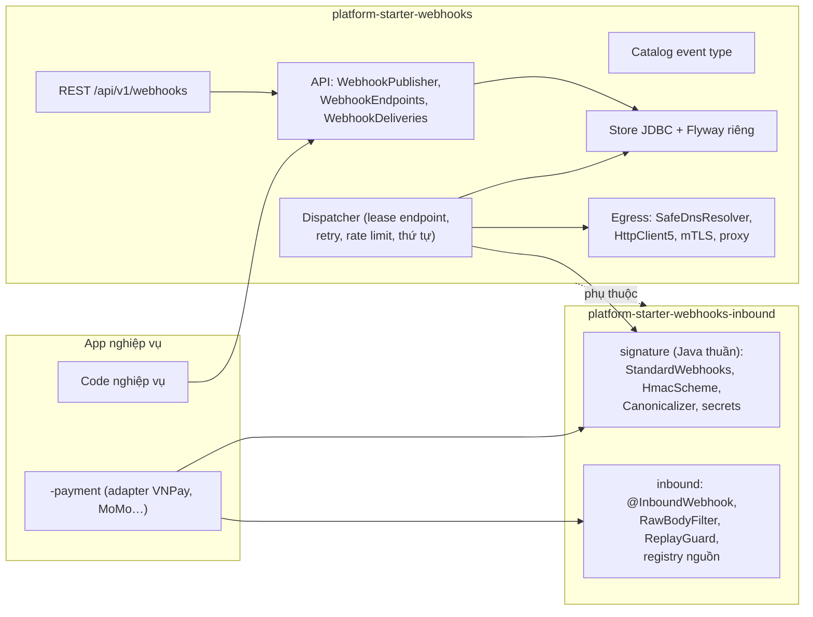
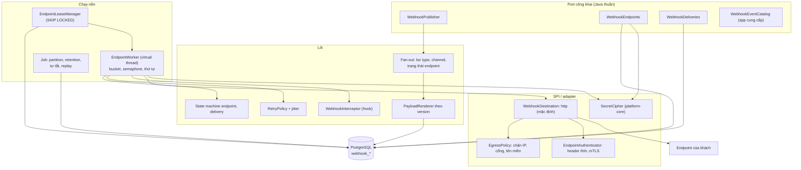
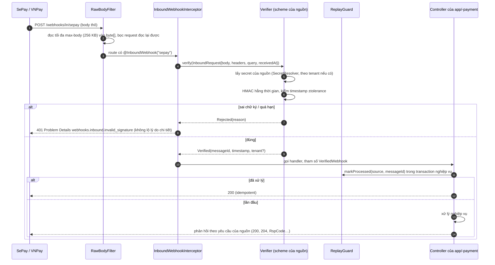
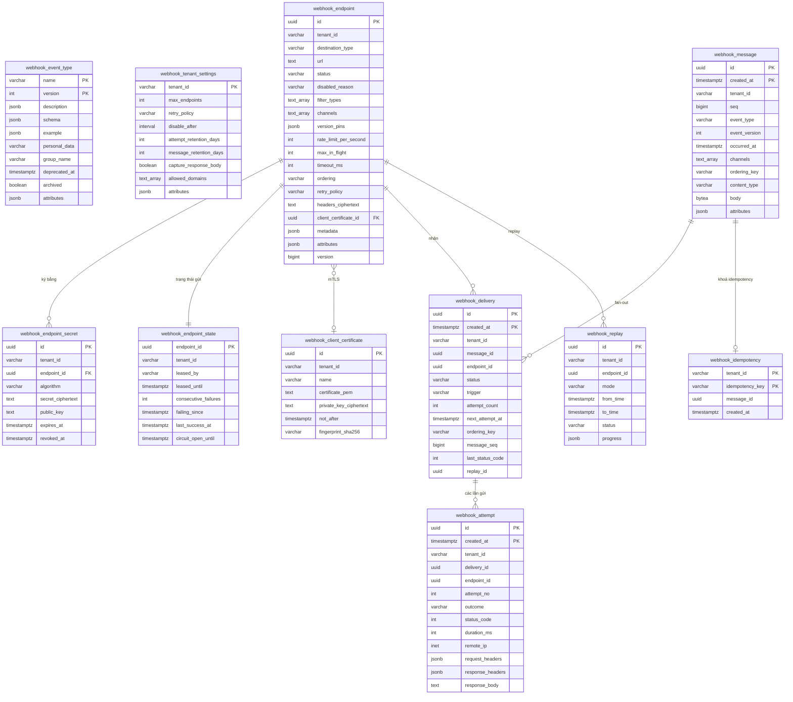
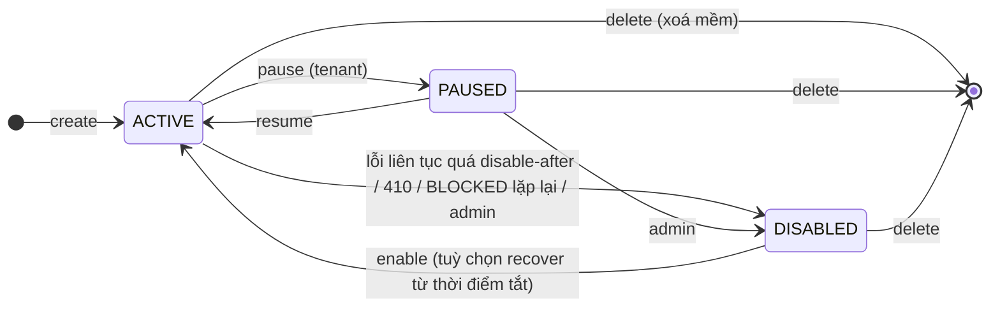
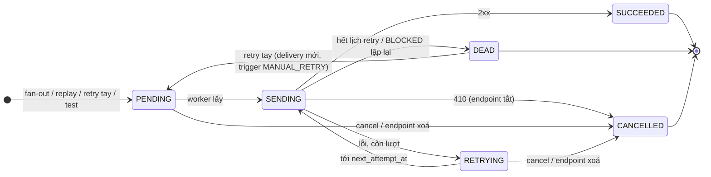

# Thiết kế module webhooks

> **Trạng thái:** bản thiết kế chờ duyệt (26/10/2026). Thuộc nhóm module P1 trong [MODULE_PLAN.md](../MODULE_PLAN.md).
> Tài liệu theo mục 3 của quy ước chung cho module P1. Nguồn tham khảo được kiểm ngày 26/10/2026 bằng GitHub Releases
> API, Maven Central và trang tài liệu chính thức. Link nằm ngay tại chỗ dùng và tổng hợp ở mục 2.7.
>
> **Đã duyệt (26/10/2026), bản 2.** Chỉnh theo mục 5 của quy ước (khối dùng chung platform-java 0.12.1):
> - Mã hoá secret dùng `SecretCipher` của `platform-core`. Bỏ L7 và bỏ `SecretCipher` riêng của bản 1.
> - Migration dùng `StarterSchemaMigrator` của `-jpa`, bảng lịch sử `flyway_schema_history_webhooks` (L1 nay đã thành
>   quy ước chung).
> - Việc gửi **giữ hàng đợi riêng** là `webhook_delivery` + lease theo endpoint (L5), không dùng `DurableTaskQueue` của
>   `-scheduling`. Lý do nằm ở mục 10.1 và ADR-0020 mục "webhooks".

Module gồm hai artifact Java và một package web:

| Artifact | Vai trò |
|---|---|
| `platform-starter-webhooks-inbound` | Kiểm chữ ký và chống replay cho webhook **nhận vào** (IPN thanh toán, callback của provider). Không có bảng, không gửi gì ra ngoài. `-payment` và `-notification` dùng artifact này |
| `platform-starter-webhooks` | Webhook **gửi ra** cho khách hàng và đối tác: catalog event type, endpoint theo tenant, ký theo Standard Webhooks, hàng đợi gửi bền vững trên PostgreSQL, retry, DLQ, replay, nhật ký, chống SSRF, mTLS, API quản trị. Phụ thuộc artifact inbound (dùng chung phần ký), `-jpa` (`StarterSchemaMigrator`), `-scheduling` (job bảo trì), `-authz`, `-audit`; mã hoá secret bằng `SecretCipher` của `platform-core` |
| `@vyforge/webhooks` | Portal quản lý endpoint, xem nhật ký gửi, gửi thử, replay, xoay secret |

Lý do tách hai artifact nằm ở mục 3.1.

---

## 1. Bài toán và phạm vi

### 1.1 Vì sao cần

App nghiệp vụ trên Vyforge là SaaS nhiều tenant. Khách hàng của tenant (ERP, phần mềm kế toán, website bán hàng, công
cụ no-code) cần biết ngay khi có việc xảy ra trong hệ thống: đơn hàng mới, thanh toán xong, hoá đơn đã phát hành. Nếu
không có webhook, họ phải gọi API liên tục để hỏi, vừa chậm vừa tốn tài nguyên của cả hai bên.

Gửi một HTTP POST thì đơn giản, nhưng gửi **tin cậy và an toàn** cho hàng trăm endpoint không do mình kiểm soát thì
khó:

- endpoint chậm, sập nhiều ngày, trả 500, chuyển hướng, hết hạn chứng chỉ;
- URL do người dùng nhập, nên bị lợi dụng để gọi vào mạng nội bộ (SSRF);
- bên nhận cần kiểm được webhook là thật, chưa bị sửa, không bị phát lại;
- đối tác lớn đòi mTLS, IP nguồn cố định, giới hạn tốc độ, đúng thứ tự;
- khi đối tác sửa xong lỗi, họ cần nhận lại những gì đã lỡ.

Chiều ngược lại cũng cần: hệ thống **nhận** IPN của VNPay, MoMo, ZaloPay, payOS, SePay, callback của nhà mạng SMS, Zalo
OA. Mỗi bên ký một kiểu. Nếu mỗi module tự viết phần kiểm chữ ký thì sớm muộn sẽ có chỗ so sánh chuỗi không hằng thời
gian, quên kiểm timestamp hoặc parse lại body trước khi kiểm.

### 1.2 Kịch bản nghiệp vụ phải đáp ứng

| # | Kịch bản | Yêu cầu rút ra |
|---|---|---|
| K1 | **SaaS bán hàng đa kênh** gửi `order.created`, `order.paid`, `order.cancelled` sang ERP của khách (MISA AMIS, Fast, Bravo, Odoo). Mỗi khách đăng ký endpoint riêng, chỉ chọn event cần | Endpoint theo tenant, lọc theo event type, fan-out nhiều endpoint |
| K2 | **Cổng trung gian thanh toán**: nhận IPN của VNPay/MoMo (HMAC-SHA512/SHA256, tham số sắp xếp), xác nhận đơn, rồi báo `payment.succeeded` cho website của merchant | Kiểm chữ ký inbound theo từng provider, chống trùng, rồi publish outbound trong cùng transaction |
| K3 | **Xác nhận chuyển khoản VietQR**: SePay/payOS gọi webhook khi có biến động số dư; app đối chiếu nội dung chuyển khoản và tự xác nhận đơn | Kiểm `X-SePay-Signature` (`sha256=` hex trên `timestamp.body`, lệch tối đa 5 phút), kiểm checksum payOS (key sắp xếp, HMAC-SHA256), chống trùng theo id giao dịch |
| K4 | **Hoá đơn điện tử**: khi hoá đơn có mã của cơ quan thuế, gửi `einvoice.issued` cho hệ thống kế toán của đối tác | Payload có version; đối tác cũ ghim version cũ khi schema đổi |
| K5 | **Vận chuyển**: `shipment.status_changed` gửi cho shop; trạng thái của một vận đơn phải đến **đúng thứ tự** (đã lấy → đang giao → đã giao) | Thứ tự theo key (mã vận đơn), không chặn các vận đơn khác |
| K6 | **Chấm công và tính lương on-prem**: khách hàng doanh nghiệp đặt phần mềm lương trong mạng nội bộ (`10.x`), nối với SaaS qua VPN | Mặc định chặn IP nội bộ; người vận hành platform mở được dải CIDR cụ thể cho tenant cụ thể; mTLS và CA riêng |
| K7 | **Ngân hàng, công ty tài chính** làm đối tác: bắt buộc mTLS, IP nguồn cố định để whitelist, giới hạn 10 request/giây | Chứng chỉ client theo endpoint, egress qua proxy có IP tĩnh, rate limit và số kết nối đồng thời theo endpoint |
| K8 | **Chatbot Zalo OA / CSKH**: chuyển tiếp tin nhắn của khách tới bot của đối tác, lưu lượng cao theo giờ cao điểm | Thông lượng cao, không để một endpoint chậm làm nghẽn endpoint khác |
| K9 | **Tích hợp no-code** (n8n tự host, Make, Zapier): người dùng không lập trình dán URL, bấm "Gửi thử" và xem payload mẫu | Gửi thử, catalog có ví dụ và JSON Schema, định dạng theo chuẩn để các công cụ này kiểm chữ ký được |
| K10 | **Đối tác sập hai ngày** trong đợt khuyến mãi. Hệ thống retry trong 3 ngày, báo cho tenant admin. Khi đối tác sửa xong, họ bấm "gửi lại các event lỗi từ thứ Sáu" | Retry nhiều ngày, tự tắt endpoint lỗi lâu, event công khai để `-notification` gửi email, recover/replay theo khoảng thời gian |
| K11 | **Bảo hiểm, phòng khám**: payload chứa dữ liệu cá nhân nhạy cảm (chẩn đoán, CCCD). Đối tác có máy chủ ở nước ngoài | Thin payload, đánh dấu event chứa dữ liệu cá nhân, giới hạn tên miền đích theo tenant, retention ngắn, xoá theo yêu cầu (Luật 91/2025) |
| K12 | **Chuỗi bán lẻ nhiều chi nhánh**: kho Hà Nội chỉ muốn nhận event của kho Hà Nội | Lọc theo channel (chi nhánh, kho, cửa hàng) ngoài event type |
| K13 | **Xoay khoá định kỳ** theo chính sách bảo mật của khách (90 ngày) mà không mất webhook nào | Hai secret cùng hiệu lực trong thời gian chồng, gửi hai chữ ký |
| K14 | **Một service khác** trong cùng hệ thống (không có starter) cần publish webhook cho tenant | API publish qua REST với token service, cùng engine |
| K15 | **Đối tác trả 410 Gone** vì đã ngừng tích hợp | Tắt endpoint ngay, không retry |

Kịch bản tương lai mà thiết kế phải chừa chỗ, chưa làm ở bản đầu:

- Đích không phải HTTP: Kafka, SQS, Google Pub/Sub, RabbitMQ của khách (Hookdeck Outpost đã có).
- Xác thực OAuth 2.0 client credentials tới endpoint (Convoy có), như SePay đang dùng khi gửi webhook.
- Chuyển đổi payload theo endpoint (Svix gọi là transformation).
- Tenant tự quản lý bộ webhook nhận vào (tenant dán secret của VNPay của họ vào màn hình, không cần deploy).
- Kết nối trục liên thông LGSP/NGSP của khối nhà nước (mạng riêng, chứng thư số).
- Đẩy sang Svix tự host khi lưu lượng vượt khả năng của PostgreSQL dùng chung (mục 6.6).

### 1.3 Ngoài phạm vi

- Không làm event bus nội bộ giữa các service: đã có Kafka qua `-messaging` (`@Externalized`).
- Không làm thông báo cho người dùng cuối (email, SMS, Zalo ZNS): thuộc `-notification`. Webhook là kênh **máy với máy**.
- Không viết riêng adapter VNPay/MoMo/ZaloPay: thuộc `-payment`, dùng các khối kiểm chữ ký của artifact inbound.
- Không làm SSE/WebSocket cho trình duyệt: thuộc `-realtime`.

---

## 2. Nghiên cứu

### 2.1 Chuẩn: Standard Webhooks

[Standard Webhooks](https://github.com/standard-webhooks/standard-webhooks/blob/main/spec/standard-webhooks.md)
(Apache-2.0, release spec v1.0.2 ngày 18/02/2026) do Svix khởi xướng, được Zapier, Twilio, Supabase, Kong… theo. Những
điểm có giá trị chuẩn:

| Chủ đề | Quy định |
|---|---|
| Header | `webhook-id` (giữ nguyên qua các lần retry), `webhook-timestamp` (giây Unix), `webhook-signature` (một hoặc nhiều chữ ký cách nhau bằng dấu cách) |
| Chữ ký | `v1,<base64>` là HMAC-SHA256; `v1a,<base64>` là ed25519 |
| Secret | Đối xứng: 24–64 byte ngẫu nhiên, base64, tiền tố `whsec_`. Bất đối xứng: `whsk_` (bí mật), `whpk_` (công khai) |
| Nội dung ký | `msg_id.timestamp.payload`. Id và timestamp không do người dùng điều khiển, không chứa dấu `.`. Bên nhận phải kiểm trên **body thô** |
| Payload | `type` (phân cấp bằng dấu chấm, ký tự `[a-zA-Z0-9_]`), `timestamp` (ISO 8601, lúc xảy ra), `data`. Nên dưới khoảng 20 KB. Cho phép thin payload |
| Retry | Retry tới khi thành công hoặc coi như không thể. Lịch mẫu: ngay, 5s, 5m, 30m, 2h, 5h, 10h, 14h, 20h, 24h (lần cuối ở khoảng 75h35m). Có jitter. Lỗi lâu thì báo qua kênh khác và cân nhắc tắt endpoint |
| Mã trả về | `2xx` thành công. `3xx` là lỗi (không theo redirect). `410` tắt endpoint. `429`, `502`, `504` thì giảm tốc. Tôn trọng `retry-after` |
| Timeout | 15–30 giây |
| Xoay khoá | Ký bằng cả khoá mới và khoá cũ trong thời gian chuyển, gửi cả hai chữ ký; bên nhận chấp nhận nếu một chữ ký đúng |
| Khoá theo endpoint | Khoá đối xứng phải riêng cho từng endpoint |
| SSRF | Gửi qua proxy lọc IP nội bộ (ví dụ smokescreen), đặt worker trong subnet không vào được dịch vụ nội bộ |
| Khác | Lọc event phía bên gửi; nhiều endpoint cho một khách; xem lỗi và replay từng message hoặc theo khoảng; công bố danh sách IP nguồn |

Thư viện Java chính thức `com.standardwebhooks:standardwebhooks`
[1.2.0](https://repo1.maven.org/maven2/com/standardwebhooks/standardwebhooks/maven-metadata.xml) (Apache-2.0, cập nhật
25/08/2026). Đọc mã nguồn ([WebhookBase.java](https://github.com/standard-webhooks/standard-webhooks/blob/main/libraries/java/src/main/java/com/standardwebhooks/WebhookBase.java))
thấy các giới hạn:

- chỉ có `v1` (HMAC), không có `v1a` (ed25519);
- payload nhận `String`, không nhận `byte[]`, nên phải giải mã body rồi mã hoá lại (dễ lệch byte với body không phải
  UTF-8 chuẩn);
- tolerance cố định 5 phút, đồng hồ là `System.currentTimeMillis()`, không thay được để test;
- chỉ nhận header Standard Webhooks, không dùng được cho SePay, GitHub, VNPay;
- baseline Java 8, test JUnit 4.

**Kết luận:** tự viết phần ký và kiểm (khoảng 150 dòng trên JCA; ed25519 có sẵn trong JDK từ Java 15,
[JEP 339](https://openjdk.org/jeps/339)). Dùng thư viện 1.2.0 ở **scope test** làm oracle: mọi chữ ký `v1` do Vyforge
tạo phải được thư viện chính thức chấp nhận, và ngược lại. Như vậy tương thích được chứng minh bằng test mà không mang
giới hạn của thư viện vào runtime.

### 2.2 Hệ thống tham khảo

| | **Svix** | **Convoy** | **Hookdeck Outpost** | **Stripe** (SaaS) | **GitHub** (SaaS) |
|---|---|---|---|---|---|
| Loại | Server tự host + SaaS | Server tự host + SaaS | Server tự host + SaaS | Bên gửi | Bên gửi |
| Phiên bản | [v2.9.0](https://github.com/svix/svix-webhooks/releases/tag/v2.9.0) (23/10/2026); SDK Java `com.svix:svix` 2.9.0 | [v26.9.2](https://github.com/frain-dev/convoy/releases/tag/v26.9.2) (20/10/2026) | [v1.7.0](https://github.com/hookdeck/outpost/releases/tag/v1.7.0) (23/10/2026) | — | — |
| License | MIT | **Elastic License 2.0** ([LICENSE](https://github.com/frain-dev/convoy/blob/main/LICENSE)); mTLS, basic auth ở bản trả phí | Apache-2.0 | — | — |
| Ngôn ngữ, phụ thuộc | Rust; PostgreSQL, Redis/Valkey (hàng đợi, tuỳ chọn) | Go; PostgreSQL, Redis | Go; PostgreSQL, Redis, một message queue | — | — |
| Mô hình | Application (= khách) → Endpoint; Message; MessageAttempt; EventType có JSON Schema; channel | Project → Endpoint → Subscription (filter); Event → EventDelivery | Tenant → Destination (webhook, SQS, Kafka, Pub/Sub…) → Topic | Event destination (≤16), `enabled_events`, payload thin hoặc snapshot theo API version | Hook theo repo/org/app, chọn event |
| Chữ ký | Standard Webhooks (v1, v1a) | HMAC, "advanced signatures" nhiều chữ ký | HMAC, có xoay khoá | `Stripe-Signature: t=…,v1=…` HMAC-SHA256 hex trên `t.body`; tolerance mặc định 5 phút | `X-Hub-Signature-256: sha256=<hex>` |
| Xoay secret | Có | Có, gửi chữ ký của cả hai secret tới khi secret cũ hết hạn | Có | Giữ secret cũ tối đa 24 giờ, mỗi secret một chữ ký | Không có chồng thời gian |
| Retry | Ngay, 5s, 5m, 30m, 2h, 5h, 10h, 10h ([docs](https://docs.svix.com/retries)) | Tuyến tính hoặc luỹ thừa, cấu hình | Luỹ thừa cơ số 2 từ 30s, tối đa 10 lần, hoặc lịch tuỳ chọn ([docs](https://hookdeck.com/docs/outpost/features/event-delivery)) | Tới 3 ngày, luỹ thừa ([docs](https://docs.stripe.com/webhooks)) | **Không** tự retry; gửi lại tay trong 3 ngày ([docs](https://docs.github.com/en/webhooks/testing-and-troubleshooting-webhooks/redelivering-webhooks)) |
| Tự tắt endpoint | Lỗi liên tục 5 ngày (đồng hồ chỉ bắt đầu khi có nhiều lần lỗi trải trên ít nhất 12 giờ) | Trạng thái `inactive` theo circuit breaker; event mới bị bỏ | Theo ngưỡng lỗi | Có, kèm email | Không |
| Gửi lại | Từng message; "Recover failed" từ một thời điểm; "Replay missing" | Batch retry | Retry API, portal | Resend 15 ngày (dashboard), 30 ngày (CLI) | 3 ngày |
| Thứ tự | Không đảm bảo | Không | Không | Không đảm bảo | Không |
| SSRF | Mặc định chặn IP nội bộ, `whitelist_subnets` | Allow/block list | Không nêu | IP nguồn công bố | IP nguồn công bố |
| Rate limit theo endpoint | Có | Có | Không nêu | — | — |
| Portal cho khách | App Portal nhúng | Portal link theo owner | Tenant portal | Dashboard | Settings |
| Webhook vận hành | `message.attempt.exhausted`, `endpoint.disabled` | Thông báo email/Slack/Teams khi đổi trạng thái | Operator event `attempt.failed`, … | Email | — |

### 2.3 Rút ra: học theo và không làm

**Học theo:**

1. **Định dạng Standard Webhooks** cho mọi webhook gửi ra (header, chữ ký, secret, payload `type/timestamp/data`).
   Công cụ no-code và SDK của Svix kiểm được ngay, khách không phải viết code riêng cho Vyforge.
2. **Mô hình Svix**: event type có JSON Schema và ví dụ; endpoint lọc theo event type và channel; message bất biến;
   mỗi lần gửi là một attempt có log.
3. **Lịch retry dài nhiều ngày có jitter** của Standard Webhooks (giống Stripe về độ dài 3 ngày).
4. **Quy tắc tự tắt của Svix** (lỗi liên tục nhiều ngày, không tắt vì một đợt lỗi ngắn) cộng **circuit breaker ngắn hạn**
   của Convoy để không dội request vào endpoint đang sập.
5. **Xoay secret có thời gian chồng** như Stripe và Convoy, gửi nhiều chữ ký.
6. **Recover/replay theo khoảng thời gian** như Svix; phân biệt gửi lại cái lỗi và gửi bù cái chưa từng gửi.
7. **Payload có version, endpoint ghim version** như Stripe (event dựng theo API version của destination).
8. **Thin payload là lựa chọn được khuyến khích** cho dữ liệu nhạy cảm (Stripe đã chuyển sang khuyến nghị thin).
9. **Mã trả về theo chuẩn**: `410` tắt endpoint, `429`/`503` + `Retry-After` thì giãn ra, `3xx` là lỗi.
10. **Event vận hành công khai** (endpoint bị tắt, message hết lượt retry) để module khác gửi email cho tenant admin.
11. **Destination là SPI** như Outpost, để sau này thêm Kafka/SQS mà không đổi lõi.

**Không làm:**

1. **Không chạy Svix/Convoy/Outpost làm service bắt buộc.** Mỗi cái thêm một service (Rust hoặc Go), một Redis và một
   hệ phân quyền riêng (JWT của Svix, project key của Convoy) không gắn với IAM và `TenantContext` của Vyforge. Trái
   nguyên tắc "thư viện, không phải service" và tăng việc trực vận hành cho đội một người. Port `WebhookPublisher` vẫn
   chừa chỗ cho adapter Svix khi lưu lượng vượt ngưỡng (mục 6.6).
2. **Không dùng Convoy** kể cả làm tham chiếu code: Elastic License 2.0 cấm cung cấp như dịch vụ quản lý cho bên thứ ba,
   và mTLS nằm ở bản trả phí.
3. **Không dùng thư viện Standard Webhooks ở runtime** (mục 2.1); chỉ dùng trong test.
4. **Không cho chạy JavaScript chuyển đổi payload** (transformation của Svix). Chạy code của tenant trong JVM là bề mặt
   tấn công lớn. Thay bằng SPI `PayloadRenderer` do lập trình viên của app viết (mục 6).
5. **Không theo redirect** và **không tin DNS hai lần** (kiểm một lần, kết nối một lần khác). Kiểm và kết nối dùng chung
   một kết quả phân giải (mục 3.5).
6. **Không đảm bảo thứ tự toàn cục.** Không hệ thống nào ở trên làm, vì một endpoint lỗi sẽ chặn mọi thứ. Chỉ có thứ tự
   **theo key** cho endpoint bật tuỳ chọn này (K5).
7. **Không dùng Kafka làm hàng đợi gửi.** Kafka không có hẹn giờ retry theo từng message, không giới hạn được đồng thời
   theo endpoint và không replay chọn lọc theo endpoint. PostgreSQL với `FOR UPDATE SKIP LOCKED` làm được cả ba ở quy mô
   của tier 0–2 (mục 7.5).

### 2.4 Webhook nhận vào: các kiểu ký đang gặp ở Việt Nam

| Nguồn | Cách ký | Chống replay | Phản hồi | Nguồn tài liệu |
|---|---|---|---|---|
| **Standard Webhooks** (Svix, Clerk, Supabase…) | HMAC-SHA256 base64 trên `id.ts.body`, header `webhook-*` | Timestamp + `webhook-id` | `2xx` | [spec](https://github.com/standard-webhooks/standard-webhooks/blob/main/spec/standard-webhooks.md) |
| **SePay** | `X-SePay-Signature: sha256=<hex>` trên `{timestamp}.{raw_body}`; `X-SePay-Timestamp`; hoặc `Authorization: Apikey …`; hoặc OAuth 2.0 | Lệch tối đa 5 phút; chống trùng theo `id` giao dịch; SePay retry tới 7 lần theo Fibonacci | `2xx` | [xác thực](https://developer.sepay.vn/en/sepay-webhooks/xac-thuc), [bảo mật](https://developer.sepay.vn/en/sepay-webhooks/bao-mat) |
| **payOS** | Trường `signature` trong body: HMAC-SHA256 hex trên `key1=value1&key2=value2…` của object `data`, key sắp theo alphabet, giá trị null thành chuỗi rỗng, mảng thành JSON có key sắp xếp; khoá là checksum key | Không có timestamp; chống trùng theo mã đơn/giao dịch | `2xx` | [kiểm signature](https://payos.vn/docs/tich-hop-webhook/kiem-tra-du-lieu-voi-signature/) |
| **VNPay** | `vnp_SecureHash`: HMAC-SHA512 trên các tham số `vnp_*` sắp xếp theo tên, bỏ `vnp_SecureHash`/`vnp_SecureHashType`, giá trị URL-encode | Không có timestamp; VNPay gọi IPN nhiều lần; chống trùng theo `vnp_TxnRef` + trạng thái đơn | JSON `{"RspCode":"00"\|"01"\|"02"\|"04"\|"97"\|"99","Message":…}` | Tài liệu tích hợp trong trang merchant của VNPay (chỉ có sau đăng ký); mô tả công khai: [viblo](https://viblo.asia/p/ezcode-bai-21-tich-hop-thanh-toan-vnpay-R5JRQ3DD4Gv) |
| **MoMo** | Trường `signature`: HMAC-SHA256 trên `key1=value1&…` theo danh sách field cố định, khoá là secret key | Theo `orderId`/`requestId` | HTTP `204` trong 15 giây | [chữ ký](https://developers.momo.vn/v3/docs/payment/api/other/signature/), [IPN](https://developers.momo.vn/v3/docs/payment/api/result-handling/notification/) |
| **ZaloPay** | Trường `mac`: HMAC-SHA256 trên chuỗi `data` với `key2` | Theo `app_trans_id`; ZaloPay gửi lại tối đa 3 lần | JSON `return_code` 1 / −1 / 0 | [callback](https://docs.zalopay.vn/docs/developer-tools/knowledge-base/callback) |
| **GitHub** | `X-Hub-Signature-256: sha256=<hex>` trên body | `X-GitHub-Delivery` | `2xx` trong 10 giây | [validating](https://docs.github.com/en/webhooks/using-webhooks/validating-webhook-deliveries) |
| **Stripe** | `Stripe-Signature: t=…,v1=…` hex trên `t.body` | Tolerance 5 phút; event id | `2xx` | [webhooks](https://docs.stripe.com/webhooks) |

Chúng chia thành bốn họ: (a) HMAC trên body thô kèm timestamp trong header (Standard Webhooks, SePay, Stripe,
GitHub); (b) HMAC trên chuỗi chuẩn hoá từ tham số đã sắp xếp (VNPay, payOS, MoMo); (c) HMAC trên một trường của body
(ZaloPay); (d) khoá API tĩnh (SePay Apikey). Artifact inbound cung cấp các khối cho cả bốn họ (mục 5.4). Chi tiết của
từng cổng thanh toán (danh sách field của MoMo, cách encode của VNPay) nằm trong adapter của `-payment`.

### 2.5 Chống SSRF

[OWASP SSRF Prevention Cheat Sheet](https://cheatsheetseries.owasp.org/cheatsheets/Server_Side_Request_Forgery_Prevention_Cheat_Sheet.html),
trường hợp "ứng dụng phải gọi URL bất kỳ do người dùng nhập", yêu cầu:

- chỉ `http`/`https`, kiểm host bằng parser chuẩn, từ chối URL mà các parser đọc khác nhau;
- phân giải DNS, kiểm **mọi** bản ghi A/AAAA, rồi **kết nối đúng IP vừa kiểm**; giữ hostname cho `Host`, SNI và kiểm
  chứng chỉ. Kiểm DNS riêng rồi để HTTP client tự phân giải lại không chống được DNS rebinding;
- tắt theo redirect;
- chặn metadata cloud (`169.254.169.254`), loopback, RFC 1918, `fc00::/7`, `fe80::/10`, multicast; xem đầy đủ trong
  registry địa chỉ đặc biệt của IANA;
- ở tầng mạng: egress firewall, tách subnet.

[smokescreen](https://github.com/stripe/smokescreen) (MIT, Go) là proxy CONNECT của Stripe làm đúng việc này cho
webhook của họ, đồng thời cho IP nguồn cố định. Standard Webhooks cũng khuyên dùng proxy loại này.

Trong Java, Apache HttpClient 5 (5.6.4, version Spring Boot 4.1.1 quản lý) có interface `DnsResolver` cho phép thay
bước phân giải. Client kết nối tới đúng `InetAddress` mà resolver trả về, nên kiểm và kết nối dùng chung một kết quả
(mục 3.5). `HttpClient` của JDK không có điểm móc này (chỉ có `InetAddressResolverProvider` toàn JVM, JEP 418), nên không
chọn.

### 2.6 Hàng đợi trên PostgreSQL

- `SELECT … FOR UPDATE SKIP LOCKED` cho nhiều worker lấy việc không đè nhau
  ([PostgreSQL 18, SELECT](https://www.postgresql.org/docs/18/sql-select.html#SQL-FOR-UPDATE-SHARE)). Đây là cách
  Svix (bản không Redis), Hookdeck và các thư viện job như JobRunr/pg-boss dùng.
- Partition khai báo theo khoảng thời gian, xoá dữ liệu cũ bằng `DROP`/`DETACH PARTITION` thay vì `DELETE` hàng loạt
  ([PostgreSQL 18, partitioning](https://www.postgresql.org/docs/18/ddl-partitioning.html)).

### 2.7 Danh sách nguồn

| Nguồn | Phiên bản | License | Link |
|---|---|---|---|
| Standard Webhooks spec | v1.0.2 (18/02/2026) | Apache-2.0 | <https://github.com/standard-webhooks/standard-webhooks> |
| `com.standardwebhooks:standardwebhooks` | 1.2.0 (25/08/2026) | Apache-2.0 | Maven Central |
| Svix server | v2.9.0 (23/10/2026) | MIT | <https://github.com/svix/svix-webhooks> |
| `com.svix:svix` (SDK Java) | 2.9.0 | MIT | Maven Central |
| Convoy | v26.9.2 (20/10/2026) | Elastic License 2.0 | <https://github.com/frain-dev/convoy> |
| Hookdeck Outpost | v1.7.0 (23/10/2026) | Apache-2.0 | <https://github.com/hookdeck/outpost> |
| smokescreen | (cập nhật 22/10/2026) | MIT | <https://github.com/stripe/smokescreen> |
| Apache HttpClient | 5.6.4 (Boot 4.1.1) | Apache-2.0 | <https://hc.apache.org/httpcomponents-client-5.6.x/> |
| Stripe, GitHub, SePay, payOS, MoMo, ZaloPay | tài liệu trực tuyến, đọc 26/10/2026 | — | link trong bảng 2.2 và 2.4 |
| Luật 91/2025/QH15, NĐ 356/2025/NĐ-CP | hiệu lực 01/01/2026 | — | [báo cáo module thông dụng §3.14](../research/2026-10-module-thong-dung.md), [EY legal alert 03/2026](https://www.ey.com/vi_vn/technical/tax/tax-and-law-updates/nghi-dinh-so-356-2025-nd-cp-quy-dinh-chi-tiet-mot-so-dieu-va-bien-phap-thi-hanh-luat-bao-ve-du-lieu-ca-nhan) |

---

## 3. Kiến trúc

### 3.1 Hai artifact



Lý do tách (nguyên tắc 1 của MODULE_PLAN: tách artifact khi **phụ thuộc và người dùng khác nhau**):

- `-payment`, `-notification` (callback của nhà mạng, Zalo) chỉ cần kiểm chữ ký inbound. Nếu kéo cả starter outbound,
  app bị thêm 9 bảng, một dispatcher chạy nền và Apache HttpClient.
- Artifact inbound chỉ phụ thuộc `platform-core`, `-web` và tuỳ chọn `-messaging` (cho `ProcessedMessages`). Gói
  `signature` bên trong là Java thuần, không import Spring (luật ArchUnit), nên SDK hay test của đối tác cũng dùng được.
- Hai artifact release cùng nhau trong `platform-java`, nên không thêm đơn vị phải release.

### 3.2 Thành phần của starter outbound



| Thành phần | Trách nhiệm |
|---|---|
| `WebhookPublisher` | Nhận event trong transaction của code nghiệp vụ, ghi `webhook_message` và một `webhook_delivery` cho mỗi endpoint khớp. Chính bảng này là outbox: commit thì chắc chắn sẽ gửi, rollback thì không có gì |
| `WebhookEventCatalog` | Danh sách event type do app khai báo bằng code (giống `ActionCatalog` của authz). Đồng bộ vào bảng `webhook_event_type` lúc khởi động để API và portal đọc |
| `EndpointLeaseManager` | Mỗi replica định kỳ nhận quyền xử lý (lease) một số endpoint đang có việc đến hạn, bằng `SKIP LOCKED`. Mỗi endpoint tại một thời điểm chỉ do một replica xử lý |
| `EndpointWorker` | Với endpoint đang giữ lease: lấy delivery đến hạn, áp rate limit (bucket) và số request đồng thời (semaphore), giữ thứ tự theo key, gửi trên virtual thread, ghi attempt, tính lần retry tiếp theo |
| `WebhookDestination` | SPI gửi một request. Bản đầu chỉ có `http`. Thêm `kafka`, `sqs` sau mà không đổi lõi |
| `SafeDnsResolver` + `EgressPolicy` | Phân giải tên miền, loại bỏ IP bị chặn, trả về đúng địa chỉ để HttpClient kết nối |
| `SecretCipher` (platform-core) | Mã hoá secret của endpoint, header nhạy cảm và khoá riêng của chứng chỉ client trước khi lưu. Context gắn vào AAD: `webhooks:endpoint-secret:<tenant>:<id>`, `webhooks:endpoint-headers:<tenant>:<id>`, `webhooks:client-key:<tenant>:<id>` |
| Job bảo trì (`@ClusterScheduled`) | Tạo/xoá partition, xoá dữ liệu quá retention theo tenant, tự tắt endpoint lỗi lâu, chạy replay theo lô, mã hoá lại bản mã có `needsRotation()`, đồng bộ catalog |

### 3.3 Vì sao lease theo endpoint

Phương án thường gặp là mỗi worker lấy từng delivery bằng `SKIP LOCKED`. Cách này không đáp ứng được ba yêu cầu theo
endpoint: rate limit, số request đồng thời và thứ tự theo key. Nếu nhiều replica cùng gửi tới một endpoint thì phải đếm
chung qua Redis hoặc khoá thêm dòng, và vẫn có race.

Thiết kế này lease **endpoint** thay vì delivery:

- Một endpoint tại một thời điểm chỉ có một replica gửi. Rate limit, semaphore và thứ tự chỉ cần nằm trong bộ nhớ của
  replica đó và luôn chính xác. Không cần Redis, đúng nguyên tắc 8 của MODULE_PLAN.
- Thông lượng của một endpoint bị giới hạn bởi một replica: với virtual thread và HttpClient async, một replica gửi
  được vài trăm request/giây tới một endpoint. Con số này đã vượt mức đa số đối tác chịu được, và endpoint nào cũng có
  rate limit.
- Lease có hạn (mặc định 30 giây, gia hạn mỗi 10 giây). Replica chết thì lease hết hạn, replica khác nhận và đưa các
  delivery đang `SENDING` về `RETRYING` (giao ít nhất một lần, bên nhận khử trùng theo `webhook-id`).
- Công bằng: lease cấp theo endpoint có delivery đến hạn **lâu nhất**. Mỗi replica giữ tối đa `max-leased-endpoints`
  (mặc định 64). Một endpoint chậm chỉ chiếm slot của chính nó.

### 3.4 Luồng chính: publish và gửi

```mermaid
sequenceDiagram
  autonumber
  participant B as Code nghiệp vụ
  participant P as WebhookPublisher
  participant DB as PostgreSQL
  participant L as LeaseManager (replica X)
  participant W as EndpointWorker
  participant R as SafeDnsResolver
  participant E as Endpoint đối tác
  B->>P: publish(order.paid, data, key=orderId) [trong @Transactional]
  P->>P: interceptor.beforePublish, kiểm type trong catalog, kích thước
  P->>DB: insert webhook_message
  P->>DB: chọn endpoint ACTIVE/PAUSED khớp type + channel
  P->>DB: insert webhook_delivery (PENDING, next_attempt_at = now) cho từng endpoint
  P-->>B: PublishResult(messageId, deliveries)
  Note over B,DB: commit cùng dữ liệu nghiệp vụ, rollback thì không gửi
  P--)L: NOTIFY webhooks (sau commit, chỉ để đánh thức sớm)
  L->>DB: claim endpoint có việc đến hạn (vyforge_webhooks_claim, SKIP LOCKED)
  L->>W: giao lease endpoint
  W->>DB: lấy delivery đến hạn (theo thứ tự key nếu bật), đặt SENDING
  W->>W: bucket.tryConsume, semaphore.acquire
  W->>W: render payload theo version của endpoint, ký v1 (+ v1a), interceptor.beforeSend
  W->>R: resolve(host)
  R-->>W: IP công khai đã kiểm (hoặc chặn)
  W->>E: POST (timeout 15s, không redirect, mTLS nếu có)
  E-->>W: 200
  W->>DB: insert webhook_attempt; delivery SUCCEEDED; state.last_success_at
  W->>W: interceptor.afterAttempt, metric
```

### 3.5 Luồng lỗi

```mermaid
sequenceDiagram
  autonumber
  participant W as EndpointWorker
  participant E as Endpoint
  participant DB as PostgreSQL
  participant EV as Domain events
  W->>E: POST
  alt 5xx, timeout, lỗi kết nối, 3xx, 4xx khác
    E-->>W: 503 Retry-After: 120
    W->>DB: attempt FAILED; delivery RETRYING, next = max(lịch retry + jitter, Retry-After)
    W->>DB: state.consecutive_failures++, failing_since nếu chưa có
    opt consecutive_failures >= ngưỡng circuit
      W->>DB: state.circuit_open_until = now + cooldown (luỹ thừa, tối đa 1h)
      Note over W: trả lease, không gửi tới endpoint này tới khi hết cooldown
    end
  else 429 hoặc 502/504
    E-->>W: 429
    W->>W: giảm rate của bucket một nửa trong 5 phút (AIMD), tôn trọng Retry-After
    W->>DB: delivery RETRYING (không tính vào ngưỡng tự tắt)
  else 410 Gone
    E-->>W: 410
    W->>DB: endpoint DISABLED (reason GONE), huỷ delivery đang chờ thành CANCELLED
    W--)EV: WebhookEndpointDisabled
  else IP bị chặn (SSRF), DNS lỗi
    W->>DB: attempt BLOCKED/DNS_ERROR; delivery RETRYING (DNS có thể đổi)
    Note over W: BLOCKED lặp lại 3 lần liên tiếp thì DEAD ngay, không retry 3 ngày
  end
  opt hết lịch retry
    W->>DB: delivery DEAD
    W--)EV: WebhookDeliveryDead
  end
  Note over DB,EV: Job tự tắt: failing_since quá 5 ngày và không có lần thành công nào sau đó<br/>thì endpoint DISABLED (reason FAILING), phát WebhookEndpointDisabled
```

### 3.6 Chống SSRF và kết nối

```mermaid
sequenceDiagram
  participant W as Worker
  participant H as HttpClient5
  participant R as SafeDnsResolver
  participant P as EgressPolicy
  participant DNS
  W->>H: execute(POST https://hook.partner.vn/x)
  H->>R: resolve("hook.partner.vn")
  R->>DNS: A + AAAA
  DNS-->>R: [203.0.113.7, 10.0.0.5]
  R->>P: kiểm từng IP (tenant, endpoint)
  P-->>R: 10.0.0.5 bị chặn (RFC 1918)
  R-->>H: UnknownHostException("blocked") (chế độ strict: một IP bị chặn thì chặn cả tên miền)
  Note over H: Nếu mọi IP hợp lệ, H kết nối đúng các IP đó;<br/>SNI và kiểm chứng chỉ vẫn dùng hostname
```

Các lớp phòng thủ:

1. **Lúc đăng ký và lúc gửi**: URL phải parse được bằng `java.net.URI`, scheme `https` (cho `http` chỉ khi
   `vyforge.webhooks.egress.allow-http=true`, dùng cho dev), không có userinfo, không có fragment, cổng thuộc
   `allowed-ports` (mặc định 443, 8443; thêm 80, 8080 khi cho `http`). Host là IP literal thì kiểm ngay; host dạng số
   thập phân, bát phân, hex (`0x7f000001`, `2130706433`) bị từ chối.
2. **Lúc kết nối**: `SafeDnsResolver` phân giải, chuẩn hoá (IPv4-mapped `::ffff:a.b.c.d` về IPv4; NAT64
   `64:ff9b::/96`, 6to4 `2002::/16`, Teredo `2001::/32` lấy IPv4 nhúng bên trong) rồi kiểm theo danh sách chặn. Danh sách
   lấy theo IANA special-purpose registry: `0.0.0.0/8`, `10/8`, `100.64/10`, `127/8`, `169.254/16`, `172.16/12`,
   `192.0.0/24`, `192.0.2/24`, `192.88.99/24`, `192.168/16`, `198.18/15`, `198.51.100/24`, `203.0.113/24`, `224/4`,
   `240/4`, `255.255.255.255/32`, `::/128`, `::1/128`, `fc00::/7`, `fe80::/10`, `ff00::/8`, `2001:db8::/32`, `100::/64`.
   Chế độ `strict` (mặc định) chặn cả tên miền khi có bất kỳ IP nào bị chặn, vì đó là dấu hiệu rebinding.
3. **Không redirect**, không retry ở tầng HttpClient (retry là việc của state machine).
4. **Ngoại lệ có kiểm soát**: `vyforge.webhooks.egress.allow-cidrs` (toàn platform) và `tenant-allow-cidrs.<tenant>`
   (theo tenant) do **người vận hành platform** cấu hình, không qua API của tenant. Dùng cho K6.
5. **Proxy egress tuỳ chọn** (`vyforge.webhooks.egress.proxy=http://smokescreen:4750`): mọi request đi qua proxy có IP
   tĩnh (K7). Khi có proxy, DNS do proxy phân giải; bước 1 và danh sách tên miền vẫn kiểm ở app. Tài liệu triển khai
   khuyên chạy smokescreen ở chế độ `enforce` cho môi trường production.
6. **Tầng mạng**: chart của app khai báo `NetworkPolicy` egress mẫu (chặn dải pod/service CIDR, chỉ cho 443 ra ngoài)
   cho deployment có bật dispatcher. Ghi trong README của starter.
7. **Giới hạn đọc phản hồi**: chỉ đọc tối đa 64 KB body phản hồi, lưu tối đa 4 KB; header phản hồi tối đa 8 KB.
   Không bao giờ trả body phản hồi trong lỗi API cho người gọi khác tenant.

### 3.7 Luồng nhận webhook vào



`ReplayGuard` mặc định dùng lại bảng `processed_messages` có sẵn của `-messaging`: consumer là `webhook-in:<nguồn>`,
`event_id` là UUID v5 (name-based) của `<nguồn>:<messageId>`. Không thêm bảng mới. App không có database thì dùng
`RedisMessageDeduplicator` có sẵn.

---

## 4. Mô hình dữ liệu

### 4.1 ERD



`webhook_event_type` là bảng dùng chung (danh mục hệ thống, không có `tenant_id`, theo ADR-0015 §3). Mọi bảng khác có
`tenant_id varchar(63) not null` và index bắt đầu bằng `tenant_id`, trừ index phục vụ dispatcher (mục 4.3).

### 4.2 DDL dự kiến

```sql
-- Danh mục event type: app khai báo bằng code, starter đồng bộ lúc khởi động. Bảng dùng chung, không có tenant_id.
create table webhook_event_type (
    name           varchar(128) not null,        -- order.paid; [a-zA-Z0-9_] phân cấp bằng dấu chấm
    version        int          not null,        -- 1, 2… (major của schema payload)
    description    jsonb        not null,        -- {"vi": "...", "en": "..."}
    schema         jsonb,                        -- JSON Schema 2020-12 của "data"
    example        jsonb,                        -- ví dụ "data", dùng cho portal và "gửi thử"
    personal_data  varchar(16)  not null default 'NONE', -- NONE | BASIC | SENSITIVE (khớp PersonalDataCategory)
    group_name     varchar(64),                  -- nhóm hiển thị: orders, payments…
    deprecated_at  timestamptz,
    archived       boolean      not null default false, -- không cho đăng ký mới, vẫn gửi cho endpoint cũ
    attributes     jsonb        not null default '{}',
    synced_at      timestamptz  not null,
    primary key (name, version)
);

-- Cấu hình theo tenant; thiếu dòng thì dùng mặc định trong vyforge.webhooks.defaults.*
create table webhook_tenant_settings (
    tenant_id               varchar(63) primary key,
    max_endpoints           int,
    retry_policy            varchar(32),          -- tên policy trong vyforge.webhooks.retry-policies
    disable_after           interval,
    attempt_retention_days  int,                  -- <= vyforge.webhooks.retention.max-attempt-days
    message_retention_days  int,
    capture_response_body   boolean,
    allowed_domains         text[],               -- null = mọi tên miền công khai; K11
    attributes              jsonb       not null default '{}',
    updated_at              timestamptz not null,
    updated_by              varchar(255) not null,
    version                 bigint      not null default 0
);

create table webhook_client_certificate (
    id                  uuid primary key,
    tenant_id           varchar(63)  not null,
    name                varchar(128) not null,
    certificate_pem     text         not null,    -- chuỗi chứng chỉ (công khai)
    private_key_ciphertext text      not null,    -- PKCS#8 PEM; SecretCipher, context webhooks:client-key:<tenant>:<id>
    trust_pem           text,                     -- CA riêng của đối tác để kiểm chứng chỉ server (K6)
    not_after           timestamptz  not null,
    fingerprint_sha256  varchar(64)  not null,
    created_at timestamptz not null, created_by varchar(255) not null,
    updated_at timestamptz not null, updated_by varchar(255) not null,
    version bigint not null default 0,
    unique (tenant_id, name)
);

create table webhook_endpoint (
    id                    uuid primary key,                 -- UUID v7 (BaseEntity)
    tenant_id             varchar(63)  not null,
    destination_type      varchar(32)  not null default 'http', -- SPI WebhookDestination
    url                   text         not null,
    description           varchar(512),
    status                varchar(16)  not null,            -- ACTIVE | PAUSED | DISABLED (kiểm ở code)
    disabled_reason       varchar(32),                      -- MANUAL | FAILING | GONE | BLOCKED
    disabled_at           timestamptz,
    filter_types          text[]       not null default '{}', -- rỗng = mọi type; hỗ trợ "order.*"
    channels              text[]       not null default '{}', -- rỗng = mọi channel
    version_pins          jsonb        not null default '{}', -- {"order.paid": 1}; thiếu = version mới nhất
    rate_limit_per_second int,                              -- null = mặc định tenant/platform
    max_in_flight         int,
    timeout_ms            int,
    ordering              varchar(16)  not null default 'NONE', -- NONE | KEY
    retry_policy          varchar(32),
    headers_ciphertext    text,                             -- header tuỳ chỉnh (JSON); SecretCipher, context webhooks:endpoint-headers:<tenant>:<id>
    client_certificate_id uuid references webhook_client_certificate (id),
    metadata              jsonb        not null default '{}', -- do khách tự đặt, trả lại qua API
    attributes            jsonb        not null default '{}', -- mở rộng của app, có kiểm soát (mục 6.5)
    created_at timestamptz not null, created_by varchar(255) not null,
    updated_at timestamptz not null, updated_by varchar(255) not null,
    deleted_at timestamptz,                                 -- xoá mềm; log còn tới hết retention
    version bigint not null default 0
);
create index webhook_endpoint_tenant_idx on webhook_endpoint (tenant_id, status) where deleted_at is null;

create table webhook_endpoint_secret (
    id          uuid primary key,
    tenant_id   varchar(63) not null,
    endpoint_id uuid        not null references webhook_endpoint (id),
    algorithm   varchar(16) not null,     -- HMAC_SHA256 (v1) | ED25519 (v1a)
    secret_ciphertext text  not null,     -- whsec_/whsk_; SecretCipher, context webhooks:endpoint-secret:<tenant>:<id>
    public_key  text,                     -- whpk_ cho ED25519
    created_at  timestamptz not null,
    created_by  varchar(255) not null,
    expires_at  timestamptz,              -- null = đang dùng; có giá trị = đang trong thời gian chồng
    revoked_at  timestamptz
);
create index webhook_endpoint_secret_idx on webhook_endpoint_secret (tenant_id, endpoint_id);

-- Trạng thái gửi tách khỏi cấu hình: dòng được cập nhật liên tục, không làm tăng version của endpoint
-- (admin sửa endpoint không bị xung đột optimistic lock với dispatcher).
create table webhook_endpoint_state (
    endpoint_id          uuid primary key references webhook_endpoint (id),
    tenant_id            varchar(63) not null,
    leased_by            varchar(128),
    leased_until         timestamptz,
    consecutive_failures int         not null default 0,
    failing_since        timestamptz,
    last_attempt_at      timestamptz,
    last_success_at      timestamptz,
    circuit_open_until   timestamptz,
    throttled_until      timestamptz
);

create table webhook_message (
    id             uuid        not null,
    created_at     timestamptz not null,
    tenant_id      varchar(63) not null,
    seq            bigint      not null generated always as identity, -- thứ tự cho ordering KEY
    event_type     varchar(128) not null,
    event_version  int          not null,
    occurred_at    timestamptz  not null,
    channels       text[]       not null default '{}',
    ordering_key   varchar(255),
    content_type   varchar(64)  not null default 'application/json',
    body           bytea        not null, -- envelope đã serialize ở version mới nhất, đúng byte sẽ ký
    body_size      int          not null,
    subject_refs   text[]       not null default '{}', -- chủ thể dữ liệu (vd. customer:123) để xoá theo yêu cầu
    attributes     jsonb        not null default '{}',
    primary key (id, created_at)
) partition by range (created_at);
create index webhook_message_tenant_idx on webhook_message (tenant_id, created_at desc);
create index webhook_message_type_idx on webhook_message (tenant_id, event_type, created_at desc);
create index webhook_message_subject_idx on webhook_message using gin (subject_refs);

-- Idempotency của publish: bảng thường vì unique trên bảng partition phải chứa khoá partition
create table webhook_idempotency (
    tenant_id       varchar(63)  not null,
    idempotency_key varchar(255) not null,
    message_id      uuid         not null,
    created_at      timestamptz  not null,
    primary key (tenant_id, idempotency_key)
);

create table webhook_delivery (
    id               uuid        not null,
    created_at       timestamptz not null,
    tenant_id        varchar(63) not null,
    message_id       uuid        not null,
    endpoint_id      uuid        not null,
    status           varchar(16) not null, -- PENDING | SENDING | RETRYING | SUCCEEDED | DEAD | CANCELLED
    trigger          varchar(16) not null, -- EVENT | MANUAL_RETRY | REPLAY | TEST
    attempt_count    int         not null default 0,
    next_attempt_at  timestamptz,
    last_attempt_at  timestamptz,
    completed_at     timestamptz,
    ordering_key     varchar(255),
    message_seq      bigint      not null,
    event_type       varchar(128) not null,  -- chép từ message để lọc log không cần join
    last_status_code int,
    last_outcome     varchar(24),
    replay_id        uuid,
    primary key (id, created_at)
) partition by range (created_at);
-- Dispatcher: chỉ dòng đang chờ, nên index nhỏ dù bảng lớn
create index webhook_delivery_due_idx on webhook_delivery (endpoint_id, next_attempt_at)
    where status in ('PENDING', 'RETRYING');
create index webhook_delivery_sending_idx on webhook_delivery (endpoint_id) where status = 'SENDING';
create index webhook_delivery_order_idx on webhook_delivery (endpoint_id, ordering_key, message_seq)
    where status in ('PENDING', 'RETRYING', 'SENDING') and ordering_key is not null;
-- Portal: log theo endpoint, theo message
create index webhook_delivery_endpoint_idx on webhook_delivery (tenant_id, endpoint_id, created_at desc);
create index webhook_delivery_message_idx on webhook_delivery (tenant_id, message_id);

create table webhook_attempt (
    id               uuid        not null,
    created_at       timestamptz not null,
    tenant_id        varchar(63) not null,
    delivery_id      uuid        not null,
    endpoint_id      uuid        not null,
    attempt_no       int         not null,
    url              text        not null,  -- query string bị che nếu khớp mẫu token
    remote_ip        inet,
    outcome          varchar(24) not null,  -- SUCCESS | HTTP_ERROR | TIMEOUT | CONNECT_ERROR | TLS_ERROR | DNS_ERROR | BLOCKED | CIRCUIT_OPEN | CANCELLED
    status_code      int,
    error            varchar(512),
    duration_ms      int         not null,
    request_headers  jsonb       not null,  -- không có webhook-signature và header bí mật
    response_headers jsonb,
    response_body    text,                  -- tối đa 4 KB, có thể tắt theo tenant
    response_size    int,
    primary key (id, created_at)
) partition by range (created_at);
create index webhook_attempt_delivery_idx on webhook_attempt (tenant_id, delivery_id, attempt_no);
create index webhook_attempt_endpoint_idx on webhook_attempt (tenant_id, endpoint_id, created_at desc);

create table webhook_replay (
    id          uuid primary key,
    tenant_id   varchar(63) not null,
    endpoint_id uuid        not null references webhook_endpoint (id),
    mode        varchar(16) not null,   -- FAILED (DEAD + CANCELLED) | ALL | MISSING
    from_time   timestamptz not null,
    to_time     timestamptz not null,
    event_types text[]      not null default '{}',
    status      varchar(16) not null,   -- QUEUED | RUNNING | DONE | CANCELLED | FAILED
    progress    jsonb       not null default '{}', -- con trỏ (created_at, id), số đã tạo
    created_at timestamptz not null, created_by varchar(255) not null,
    finished_at timestamptz
);
create index webhook_replay_tenant_idx on webhook_replay (tenant_id, created_at desc);
```

Không dùng `enum` của PostgreSQL. Mọi trạng thái là `varchar` được kiểm ở code (enum Java), theo mục 2 của quy ước.
Thêm trạng thái chỉ cần đổi code.

### 4.3 Hàm claim của dispatcher

Dispatcher phải tìm việc của **mọi tenant**. Truy vấn này là ngoại lệ có chủ đích của ADR-0015 (mục 10) và được gói
trong một hàm SQL `security definer`, để vẫn chạy được khi tenant bật Row-Level Security:

```sql
create or replace function vyforge_webhooks_claim(p_owner varchar, p_limit int, p_lease interval)
returns table (endpoint_id uuid, tenant_id varchar) language sql security definer as $$
    with due as (
        select d.endpoint_id, min(d.next_attempt_at) as oldest
        from webhook_delivery d
        where d.status in ('PENDING', 'RETRYING') and d.next_attempt_at <= now()
        group by d.endpoint_id
    ), picked as (
        select s.endpoint_id
        from webhook_endpoint_state s
        join due on due.endpoint_id = s.endpoint_id
        join webhook_endpoint e on e.id = s.endpoint_id
        where e.status = 'ACTIVE' and e.deleted_at is null
          and (s.leased_until is null or s.leased_until < now())
          and (s.circuit_open_until is null or s.circuit_open_until < now())
        order by due.oldest
        limit p_limit
        for update of s skip locked
    )
    update webhook_endpoint_state s
       set leased_by = p_owner, leased_until = now() + p_lease
      from picked where s.endpoint_id = picked.endpoint_id
    returning s.endpoint_id, s.tenant_id;
$$;
```

Hàm chỉ trả `(endpoint_id, tenant_id)`. Mọi truy vấn sau đó của worker chạy trong `TenantContext.run(tenant, …)` và có
tham số `tenant_id` tường minh. Bước `due` dùng index `webhook_delivery_due_idx` trên từng partition. Partition cũ chỉ
còn dòng đã kết thúc, nên index partial của chúng gần như rỗng.

### 4.4 Partition và retention

| Bảng | Partition | Retention mặc định | Cách xoá |
|---|---|---|---|
| `webhook_message` | theo tháng (`created_at`), tuỳ chọn theo ngày khi lưu lượng lớn | 30 ngày (giới hạn tenant ≤ `max-message-days`, mặc định 90) | `DROP PARTITION` khi cả partition quá retention lớn nhất; tenant có retention ngắn hơn thì job `perTenant` xoá theo lô 5.000 dòng |
| `webhook_delivery` | như trên | theo message | như trên; delivery `PENDING/RETRYING/SENDING` không bao giờ nằm ở partition bị xoá vì lịch retry tối đa khoảng 3 ngày, job kiểm trước khi drop |
| `webhook_attempt` | như trên | 30 ngày (giới hạn ≤ 90) | như trên |
| `webhook_idempotency` | không | bằng retention của message | xoá theo lô |
| `webhook_replay` | không | 90 ngày | xoá theo lô |

Job `webhooks-partitions` (`@ClusterScheduled`, mỗi ngày 01:30 giờ Việt Nam) tạo trước partition của 2 kỳ tới và
drop partition quá hạn. Có partition `default` để insert không lỗi nếu job trễ, kèm alert khi `default` có dữ liệu.

### 4.5 Tiến hoá schema

- **Migration** theo mục 5.3 của quy ước: `StarterSchemaMigrator` của `-jpa` chạy location
  `classpath:META-INF/vyforge/db/webhooks` với bảng lịch sử riêng `flyway_schema_history_webhooks`, trước
  `EntityManagerFactory`. Version của starter (`V1__…`, `V2__…`) không đụng version của app. Tắt bằng
  `vyforge.webhooks.schema.migrate=false`; DBA dùng file gộp `META-INF/vyforge/sql/webhooks.sql`. Artifact inbound
  không có bảng.
- **Payload**: envelope có trường `version` (version của event type). Thay đổi tương thích (thêm field) giữ version.
  Thay đổi không tương thích tăng version và khai báo `PayloadRenderer` (mục 6.2) để dựng payload version cũ cho endpoint
  đã ghim. Message lưu một bản body ở version mới nhất. Bản cho version cũ được dựng lúc gửi, nên không phải lưu nhiều bản.
- **Mở rộng không cần migration**: `attributes jsonb` trên endpoint, message, settings, event type. Key do app định
  nghĩa phải có tiền tố tên app (`crm.branchCode`) và được kiểm bằng `AttributeValidator` (mục 6.5). Starter không đọc
  key không có trong danh sách khai báo.
- **Envelope** có `schema_version` ngầm định là 1 trong code. Khi đổi cấu trúc envelope (rất hiếm), header
  `webhook-id` và chữ ký không đổi, chỉ thêm trường mới.

### 4.6 State machine



| Trạng thái endpoint | Fan-out event mới | Dispatcher gửi |
|---|---|---|
| `ACTIVE` | Có | Có |
| `PAUSED` | Có, delivery giữ ở `PENDING` | Không. Resume thì gửi bù, delivery quá retention thì bị xoá |
| `DISABLED` | **Không** (như Convoy). Bù được bằng replay `MISSING` trong thời hạn retention của message | Không |
| Đã xoá | Không | Không. Delivery đang chờ chuyển `CANCELLED` |



Retry tay và replay **tạo delivery mới** (cùng `message_id`, cùng `webhook-id`), không sửa delivery cũ. Nhờ vậy log
giữ đủ lịch sử, và bên nhận khử trùng được vì `webhook-id` giữ nguyên.

---

## 5. API

### 5.1 Java: publish

```java
package com.vyforge.platform.webhooks;

/** Port chính. Gọi trong transaction nghiệp vụ; tenant lấy từ TenantContext (bắt buộc). */
public interface WebhookPublisher {

    PublishResult publish(WebhookMessage message);
}

public record WebhookMessage(
        String eventType,          // phải có trong WebhookEventCatalog
        Object data,               // serialize bằng ObjectMapper của app (có che PII theo @PersonalData nếu bật)
        @Nullable Integer version, // null = version mới nhất của event type
        @Nullable String idempotencyKey,
        Set<String> channels,
        @Nullable String orderingKey,
        @Nullable Instant occurredAt,
        Set<String> subjectRefs,   // chủ thể dữ liệu cá nhân, để xoá theo yêu cầu (mục 8)
        Map<String, Object> attributes) {

    public static Builder of(String eventType, Object data) { ... }
}

public record PublishResult(String messageId, int deliveries, boolean duplicate) {}
```

```java
@Transactional
public Order markPaid(UUID orderId) {
    Order order = orders.markPaid(orderId);
    webhooks.publish(WebhookMessage.of("order.paid", OrderPaidPayload.from(order))
            .idempotencyKey("order.paid:" + orderId)
            .orderingKey(orderId.toString())
            .channel("branch:" + order.branchCode())
            .subject("customer:" + order.customerId())
            .build());
    return order;
}
```

Cách khai báo bằng event domain, không gọi trực tiếp:

```java
@WebhookEvent(type = "order.paid", version = 1, orderingKey = "#{orderId()}", channels = "#{'branch:' + branchCode()}")
public record OrderPaid(UUID orderId, String branchCode, long amount) {}

// Code nghiệp vụ chỉ publish ApplicationEvent như bình thường; listener của starter (BEFORE_COMMIT) gọi WebhookPublisher.
events.publishEvent(new OrderPaid(order.id(), order.branchCode(), order.amount()));
```

### 5.2 Java: catalog, endpoint, delivery

```java
/** App khai báo event type, giống ActionCatalog. Nhiều bean được gộp lại. */
public interface WebhookEventCatalog {
    Collection<EventTypeDefinition> eventTypes();
    static WebhookEventCatalog of(EventTypeDefinition... types) { ... }
}

public record EventTypeDefinition(
        String name, int version, LocalizedText description,
        @Nullable String jsonSchema,       // hoặc sinh từ record bằng EventTypeDefinition.fromRecord(...)
        @Nullable Object example,
        PersonalDataLevel personalData,    // NONE | BASIC | SENSITIVE
        @Nullable String group, boolean deprecated, boolean archived, Map<String, Object> attributes) {}

public interface WebhookEndpoints {
    EndpointView create(CreateEndpoint command);           // trả secret một lần trong CreatedEndpoint
    EndpointView update(UUID id, UpdateEndpoint command);  // optimistic lock theo version
    Optional<EndpointView> find(UUID id);
    Page<EndpointView> list(EndpointQuery query, Pageable page);
    void pause(UUID id); void resume(UUID id);
    void enable(UUID id, @Nullable Instant recoverSince);
    void delete(UUID id);
    RotatedSecret rotateSecret(UUID id, Duration overlap, SecretAlgorithm algorithm);
    RevealedSecret revealSecret(UUID id);                   // audit + quyền riêng
    TestResult sendTest(UUID id, String eventType, @Nullable Object data); // gửi ngay, trả kết quả attempt
    EndpointStats stats(UUID id, Duration window);
}

public interface WebhookDeliveries {
    Page<DeliveryView> list(DeliveryQuery query, Pageable page);
    Optional<DeliveryDetail> find(UUID id);                 // kèm các attempt
    DeliveryView retry(UUID id);
    void cancel(UUID id);
    ReplayView replay(UUID endpointId, ReplayRequest request); // chạy nền theo lô
    Page<MessageView> messages(MessageQuery query, Pageable page);
    int purgeSubject(String subjectRef);                    // xoá message của chủ thể dữ liệu (mục 8)
}
```

Mọi method của `WebhookEndpoints` và `WebhookDeliveries` kiểm quyền bằng `Authz` bên trong service (không chỉ ở
controller), nên app gọi trực tiếp từ code của mình cũng an toàn. `WebhookPublisher` không kiểm quyền: nó được gọi từ
code nghiệp vụ đã được phân quyền, giống như ghi một bảng của chính app.

### 5.3 Định dạng gửi ra

```http
POST /hooks/vyforge HTTP/1.1
Host: erp.khachhang.vn
Content-Type: application/json
User-Agent: Vyforge-Webhooks/0.13
webhook-id: msg_0192f6c4e1a87c3b9d2e4f60a1b2c3d4
webhook-timestamp: 1793001600
webhook-signature: v1,K5oZfzN95Z9UVu1EsfQmfVNQhnkZ2pj9o9NDN/H/pI4= v1,Q2xhc3NpYyBvbGQga2V5IHNpZ25hdHVyZQ==

{"id":"msg_0192f6c4e1a87c3b9d2e4f60a1b2c3d4","type":"order.paid","version":1,
 "timestamp":"2026-10-26T08:00:00Z","data":{"orderId":"…","amount":1250000,"currency":"VND"}}
```

- `webhook-id` = `msg_` + UUID v7 dạng hex, không có dấu chấm, giữ nguyên qua retry, retry tay, replay.
- Trong thời gian chồng của xoay secret có nhiều chữ ký `v1`; endpoint bật ed25519 có thêm `v1a,…`.
- Không gửi `X-Request-Id` hay tenant id nội bộ ra ngoài.
- Header tuỳ chỉnh của endpoint được thêm sau cùng. Không ghi đè được các header `webhook-*`, `content-type`, `host`,
  `content-length` và header hop-by-hop.

### 5.4 Java: nhận webhook vào

```java
package com.vyforge.platform.webhooks.signature;   // Java thuần, không Spring

public final class StandardWebhooks {
    public static StandardWebhooks signer(List<WebhookSecret> activeSecrets);  // ký: nhiều secret -> nhiều chữ ký
    public String sign(String msgId, Instant timestamp, byte[] body);          // giá trị header webhook-signature
    public static Verifier verifier(List<WebhookSecret> secrets, Duration tolerance, Clock clock);
}

public sealed interface WebhookSecret permits HmacSecret, Ed25519PrivateKey, Ed25519PublicKey {
    static WebhookSecret parse(String value);   // whsec_ / whsk_ / whpk_
    static HmacSecret generateHmac();           // 32 byte SecureRandom
}

/** Khối dựng cho họ (a) và (c): GitHub, SePay, Stripe, ZaloPay… */
public final class HmacScheme {
    public static Builder builder();  // algorithm(SHA256|SHA512), encoding(HEX|BASE64), signatureHeader("X-SePay-Signature"),
                                      // prefix("sha256="), timestampHeader("X-SePay-Timestamp"), signedContent("{ts}.{body}"),
                                      // tolerance(5m), idHeader(...) hoặc idExtractor(body -> ...)
}

/** Khối dựng cho họ (b): VNPay, payOS, MoMo. */
public final class Canonicalizer {
    public static String sortedParams(Map<String, String> params, Set<String> exclude, ParamEncoding encoding);
    public static String sortedJsonFields(JsonNode object, NullPolicy nullPolicy);  // kiểu payOS
    public static String orderedFields(Map<String, String> params, List<String> order); // kiểu MoMo
}

public final class Hmacs {   // so sánh hằng thời gian, ký hex/base64
    public static byte[] hmac(HmacAlgorithm alg, byte[] key, byte[] data);
    public static boolean constantTimeEquals(String expected, String actual);
}
```

```java
package com.vyforge.platform.webhooks.inbound;    // Spring

/** Một nguồn webhook vào. Bean; -payment khai báo VNPay, MoMo…; app khai báo nguồn riêng. */
public interface InboundWebhookSource {
    String name();                                         // "sepay", "vnpay", "github-ci"
    VerificationResult verify(InboundRequest request, SecretResolver secrets);
    default Duration replayWindow() { return Duration.ofDays(7); }
}

public record InboundRequest(byte[] body, HttpHeaders headers, MultiValueMap<String, String> query,
                             Instant receivedAt, @Nullable String remoteIp) {}

/** Secret theo nguồn và tenant: mặc định đọc vyforge.webhooks.inbound.sources.<name>.secrets; app thay bằng DB/OpenBao. */
public interface SecretResolver {
    List<String> secrets(String source, @Nullable String tenant);
}

// Dùng trong controller
@PostMapping("/webhooks/in/sepay")
@InboundWebhook("sepay")
ResponseEntity<Void> sepay(VerifiedWebhook webhook, @RequestBody SepayTransfer body) {
    payments.confirmTransfer(webhook.messageId(), body);   // markProcessed bên trong transaction
    return ResponseEntity.ok().build();
}
```

Nguồn có sẵn trong artifact inbound: `StandardWebhooksSource` (cấu hình bằng property, dùng cho đối tác cũng dùng
Standard Webhooks), `HmacHeaderSource` (khai báo bằng property cho các nguồn kiểu GitHub/SePay), `ApiKeySource`. VNPay,
MoMo, ZaloPay, payOS nằm ở `-payment`.

```yaml
vyforge.webhooks.inbound:
  sources:
    sepay:
      type: hmac-header
      algorithm: SHA256
      encoding: HEX
      signature-header: X-SePay-Signature
      prefix: "sha256="
      timestamp-header: X-SePay-Timestamp
      signed-content: "{timestamp}.{body}"
      tolerance: 5m
      id-json-pointer: /id
      secrets: ["${SEPAY_WEBHOOK_SECRET}"]
      allowed-ips: ["103.255.238.9/32"]   # tuỳ chọn, thêm một lớp
```

### 5.5 REST

Base `/api/v1/webhooks`, JSON, Problem Details, phân trang `PageResponse`. Tenant luôn lấy từ token. Mọi lệnh ghi nhận
`Idempotency-Key` (của `-web`).

| Method | Path | Action IAM | Ghi chú |
|---|---|---|---|
| GET | `/event-types` | `webhooks:event-type:List` | Lọc `group`, `includeArchived` |
| GET | `/event-types/{name}` | `webhooks:event-type:Get` | Mọi version, schema, ví dụ |
| GET | `/endpoints` | `webhooks:endpoint:List` | Lọc `status`, `eventType`, `q` |
| POST | `/endpoints` | `webhooks:endpoint:Create` + `webhooks:event-type:Subscribe` cho từng type | Trả `secret` một lần |
| GET | `/endpoints/{id}` | `webhooks:endpoint:Get` | Kèm `state` (lỗi liên tiếp, lần thành công cuối) |
| PATCH | `/endpoints/{id}` | `webhooks:endpoint:Update` | `If-Match` theo `version` |
| DELETE | `/endpoints/{id}` | `webhooks:endpoint:Delete` | Xoá mềm |
| POST | `/endpoints/{id}/pause`, `/resume` | `webhooks:endpoint:Pause` / `Resume` | |
| POST | `/endpoints/{id}/enable` | `webhooks:endpoint:Enable` | Body `{ "recoverSince": "…" }` tuỳ chọn |
| GET | `/endpoints/{id}/secret` | `webhooks:endpoint:RevealSecret` | Ghi audit; có thể tắt bằng `vyforge.webhooks.api.reveal-secret=false` |
| POST | `/endpoints/{id}/secret/rotate` | `webhooks:endpoint:RotateSecret` | `{ "overlap": "PT24H", "algorithm": "HMAC_SHA256" }`, overlap tối đa 7 ngày |
| POST | `/endpoints/{id}/test` | `webhooks:endpoint:Test` | `{ "eventType", "data"? }`, mặc định dùng `example` của catalog; rate limit 10/phút |
| POST | `/endpoints/{id}/replay` | `webhooks:endpoint:Replay` | `{ "mode": "FAILED\|ALL\|MISSING", "from", "to", "eventTypes"? }` → 202 + replay |
| GET | `/endpoints/{id}/replays/{replayId}` | `webhooks:endpoint:Get` | Tiến độ |
| GET | `/endpoints/{id}/stats?window=PT24H` | `webhooks:endpoint:Get` | Tỉ lệ thành công, p50/p95, số theo outcome |
| GET | `/messages` | `webhooks:message:List` | Lọc `eventType`, `channel`, `from`, `to` |
| GET | `/messages/{id}` | `webhooks:message:Get` | Body chỉ trả khi có `webhooks:message:GetPayload` |
| POST | `/messages` | `webhooks:message:Publish` | Cho service khác (K14); tắt mặc định (`vyforge.webhooks.api.publish-enabled`) |
| GET | `/deliveries` | `webhooks:delivery:List` | Lọc `endpointId`, `messageId`, `status`, `eventType`, `from`, `to` |
| GET | `/deliveries/{id}` | `webhooks:delivery:Get` | Kèm attempt |
| POST | `/deliveries/{id}/retry`, `/cancel` | `webhooks:delivery:Retry` / `Cancel` | |
| GET, PUT | `/settings` | `webhooks:settings:Get` / `Update` | Chỉ trong giới hạn platform cho phép |
| GET, POST, DELETE | `/client-certificates[/{id}]` | `webhooks:certificate:List/Create/Delete` | Không bao giờ trả khoá riêng |

Resource VRN: `vrn:webhooks:endpoint/<id>`, `vrn:webhooks:event-type/<name>`, `vrn:webhooks:message/<id>`,
`vrn:webhooks:settings`, `vrn:webhooks:certificate/<id>`. Policy mẫu:

```json
{"Statement": [
  {"Effect": "Allow", "Action": "webhooks:*", "Resource": "*"},
  {"Effect": "Deny", "Action": "webhooks:event-type:Subscribe", "Resource": "vrn:webhooks:event-type/payment.*"}
]}
```

Mã lỗi (`ErrorCode`, vi/en): `webhooks.endpoint.not_found`, `webhooks.endpoint.limit_reached`,
`webhooks.endpoint.url_invalid`, `webhooks.endpoint.url_blocked`, `webhooks.endpoint.domain_not_allowed`,
`webhooks.endpoint.not_active`, `webhooks.event_type.unknown`, `webhooks.event_type.archived`,
`webhooks.message.too_large`, `webhooks.delivery.not_retryable`, `webhooks.replay.range_too_large`,
`webhooks.secret.overlap_too_long`, `webhooks.certificate.invalid`, `webhooks.inbound.invalid_signature`,
`webhooks.inbound.expired`.

OpenAPI đầy đủ sinh bằng springdoc lúc build và được kiểm bằng snapshot test.

### 5.6 Event công khai

Phát qua `ApplicationEventPublisher` sau commit. App muốn đưa ra Kafka thì gắn `@Externalized` ở listener riêng. Mọi
event implement `TenantAwareEvent` và `IntegrationEvent`.

| Event | Khi nào | Ai thường nghe |
|---|---|---|
| `WebhookEndpointCreated` / `Updated` / `Deleted` | Thay đổi cấu hình | Audit (đã tự ghi), đồng bộ sang hệ khác |
| `WebhookEndpointDisabled(reason)` | Tự tắt hoặc 410 | `-notification`: email tenant admin (K10) |
| `WebhookEndpointRecovered` | Lần thành công đầu tiên sau chuỗi lỗi ≥ 1 giờ | `-notification` |
| `WebhookDeliveryDead` | Hết lượt retry | Dashboard, `-notification` (gom theo giờ) |
| `WebhookSecretRotated` | Xoay secret | Audit, nhắc khi secret cũ sắp hết hạn |
| `WebhookClientCertificateExpiring` | 30, 7, 1 ngày trước `not_after` (job hằng ngày) | `-notification` |

### 5.7 Package frontend `@vyforge/webhooks`

| Export | Nội dung |
|---|---|
| `createWebhooksClient({ baseUrl, getAccessToken })` | Client server-only (`@vyforge/api-client`), type sinh từ OpenAPI |
| `createEndpointFormAction()`, `createRotateSecretAction()`, `createTestSendAction()`, `createReplayAction()`, `createDeliveryRetryAction()` | Server Action theo mẫu `createFormAction` |
| `webhooksErrorMessages` | Message vi/en theo mã lỗi |
| `@vyforge/webhooks/ui`: `EndpointTable` | Danh sách endpoint, trạng thái (badge), tỉ lệ thành công 24 giờ, lỗi liên tiếp |
| `EndpointForm` | URL, mô tả, chọn event type theo nhóm (có wildcard), channel, version pin, rate limit, đồng thời, timeout, thứ tự, header tuỳ chỉnh, chứng chỉ client |
| `SecretPanel` | Hiện secret (che mặc định, `CopyButton`), xoay có thời gian chồng, danh sách secret đang hiệu lực và hạn |
| `DeliveryLog` | Bảng delivery có lọc trạng thái, event type, khoảng thời gian; link sang message |
| `DeliveryDetail` / `AttemptTimeline` | Từng attempt: thời gian, mã, outcome, header, body phản hồi rút gọn; nút retry/cancel |
| `TestSendDialog` | Chọn event type, sửa payload mẫu (từ `example`), gửi và xem kết quả ngay |
| `ReplayDialog` | Chọn chế độ, khoảng thời gian, event type; xem tiến độ |
| `EventTypeCatalog` | Danh sách type, mô tả, JSON Schema, ví dụ, mức dữ liệu cá nhân |
| `VerifySnippet` | Đoạn code kiểm chữ ký cho Node, Java, PHP, Python (theo Standard Webhooks) cho đối tác |
| `WebhookSettingsForm` | Cấu hình theo tenant trong giới hạn platform |

Mọi component nhận `can` (kết quả `createPermissionHelpers`) để ẩn nút khi thiếu quyền, không giả định người xem có
quyền xuyên tenant. Dùng được ở cả trang tenant admin của app lẫn `platform-admin`.

---

## 6. Mở rộng

### 6.1 Hook (interceptor)

```java
public interface WebhookInterceptor {
    /** Trước khi lưu message. Sửa data/attributes/channels, hoặc ném WebhookVetoException để không publish. */
    default WebhookMessage beforePublish(WebhookMessage message) { return message; }
    /** Trước mỗi lần gửi, theo endpoint. Thêm header, đổi body (đã render), nhưng không đổi webhook-id. */
    default OutboundRequest beforeSend(EndpointView endpoint, OutboundRequest request) { return request; }
    /** Sau mỗi attempt (thành công hoặc lỗi). Không được ném lỗi; lỗi bị log và bỏ qua. */
    default void afterAttempt(EndpointView endpoint, AttemptResult result) {}
}
```

Ví dụ: app bán lẻ thêm header `X-Branch` lấy từ `attributes` của endpoint; app y tế che số CCCD trong `data` trước khi
lưu nếu endpoint không thuộc danh sách tên miền được duyệt.

### 6.2 Version payload

```java
@Bean
PayloadRenderer orderPaidV1() {
    // Khách ghim order.paid@1; payload mới là @2 (amount thành object {value, currency})
    return PayloadRenderer.downgrade("order.paid", 2, 1, data -> {
        ObjectNode v1 = data.deepCopy();
        v1.put("amount", data.path("amount").path("value").asLong());
        return v1;
    });
}
```

Starter nối các renderer thành chuỗi (2→1, 3→2…). Thiếu renderer cho version đã ghim thì endpoint không được tạo với
pin đó (kiểm lúc tạo), nên không có trường hợp phát hiện thiếu lúc gửi.

### 6.3 Đích và xác thực mới

```java
/** Đích gửi. "http" có sẵn. Thêm "kafka", "sqs"… bằng bean hoặc ServiceLoader. */
public interface WebhookDestination {
    String type();
    void validate(EndpointConfig config);                    // lúc tạo/sửa endpoint
    CompletableFuture<AttemptResult> send(EndpointConfig config, SignedMessage message, Duration timeout);
}

/** Xác thực thêm tới endpoint. Có sẵn: static-headers, mtls. Sau: oauth2-client-credentials. */
public interface EndpointAuthenticator {
    String type();
    void apply(EndpointConfig config, OutboundRequest.Builder request);
}
```

Ví dụ thêm OAuth 2.0 client credentials (như SePay dùng khi gửi webhook): một bean `EndpointAuthenticator` lấy token từ
token endpoint của đối tác, cache theo `expires_in`, đặt `Authorization: Bearer`. Thông tin client lưu trong
`attributes` đã mã hoá. Không phải sửa lõi.

### 6.4 Cấu hình theo tenant

Thứ tự ưu tiên: thuộc tính của endpoint > `webhook_tenant_settings` > `vyforge.webhooks.defaults.*`. Mọi giá trị bị kẹp
trong giới hạn của platform (`vyforge.webhooks.limits.*`), ví dụ tenant không đặt được rate limit trên 200/giây hay
retention trên 90 ngày. Thay đổi qua `PUT /settings`, có audit.

Gói dịch vụ (khi có `-features`): app cài `WebhookTenantLimits` (SPI) đọc giới hạn từ feature flag, ví dụ gói Free tối
đa 2 endpoint, gói Business 20 endpoint và được mTLS. Starter không phụ thuộc `-features`.

### 6.5 `attributes`

App khai báo key được phép:

```java
@Bean
AttributeSchema webhookAttributes() {
    return AttributeSchema.builder("endpoint")
            .string("crm.branchCode", 32)
            .bool("crm.legacyFormat")
            .build();
}
```

Key lạ hoặc sai kiểu bị từ chối với `webhooks.attribute.invalid`. Không có schema thì `attributes` chỉ nhận object rỗng.

### 6.6 Thay engine: adapter Svix

Port `WebhookPublisher`, `WebhookEndpoints`, `WebhookDeliveries` không lộ chi tiết lưu trữ. Khi một app vượt khoảng
5 triệu delivery/ngày (mục 7.5), có thể viết adapter `platform-webhooks-svix`: publish sang Svix tự host qua SDK
`com.svix:svix` 2.9.0 (MIT), map tenant thành Svix Application và endpoint thành Svix Endpoint. Code nghiệp vụ không đổi.
Portal lúc đó dùng App Portal của Svix hoặc giữ `@vyforge/webhooks` qua API của adapter. Bản đầu không làm adapter này.

### 6.7 Kênh webhook của `-notification`

`-notification` có kênh "webhook". Điểm nối chốt như sau: `-notification` không phụ thuộc starter này. Nếu app có cả hai,
starter webhooks cung cấp bean `WebhookNotificationChannel` (bật khi có class SPI kênh của `-notification` trên
classpath), chuyển mỗi thông báo thành `publish("notification.<template>", …)`. Tên SPI kênh lấy theo thiết kế của
`-notification` khi hai bên merge. Chiều ngược lại, `-notification` nghe `WebhookEndpointDisabled` để gửi email.

---

## 7. Vận hành

### 7.1 Cấu hình

```yaml
vyforge:
  webhooks:
    enabled: true
    schema.migrate: true            # StarterSchemaMigrator, lịch sử flyway_schema_history_webhooks
    dispatcher:
      enabled: true                 # false trên replica chỉ phục vụ API
      poll-interval: 500ms          # cộng LISTEN/NOTIFY để đánh thức sớm
      max-leased-endpoints: 64
      lease-duration: 30s
      max-concurrency: 256          # request đang bay trên một replica
      batch-size: 100
    defaults:
      timeout: 15s
      connect-timeout: 5s
      rate-limit-per-second: 20
      max-in-flight: 4
      retry-policy: standard
      disable-after: 5d
      circuit: { failure-threshold: 10, min-cooldown: 30s, max-cooldown: 1h }
      max-endpoints-per-tenant: 20
    retry-policies:
      standard: [0s, 5s, 5m, 30m, 2h, 5h, 10h, 14h, 20h, 24h]   # Standard Webhooks, khoảng 3 ngày
      short:    [0s, 10s, 1m, 5m, 30m]                           # cho event chỉ có ý nghĩa trong giờ
    retry-jitter: 0.2               # ±20%
    limits:
      max-payload: 256KB
      max-rate-limit-per-second: 200
      max-attempt-days: 90
      max-message-days: 90
      max-replay-range: 30d
    retention:
      attempt-days: 30
      message-days: 30
      partition-interval: month     # day khi lưu lượng lớn
    egress:
      allow-http: false
      allowed-ports: [443, 8443]
      strict-dns: true
      allow-cidrs: []
      tenant-allow-cidrs: {}        # acme: ["10.20.0.0/16"]
      proxy: null                   # http://smokescreen.egress:4750
    # Khoá mã hoá secret: vyforge.crypto.keys.<kid> + vyforge.crypto.active-key (SecretCipher của platform-core)
    api:
      enabled: true
      publish-enabled: false
      reveal-secret: true
    inbound:
      max-body: 256KB
      sources: {}
```

### 7.2 Metric (Micrometer)

| Metric | Loại | Tag |
|---|---|---|
| `vyforge.webhooks.messages.published` | counter | `event_type`, `outcome` (`ok`, `duplicate`, `no_endpoint`) |
| `vyforge.webhooks.attempts` | counter | `outcome`, `status_class` (`2xx`…), `trigger` |
| `vyforge.webhooks.attempt.duration` | timer (histogram) | `outcome` |
| `vyforge.webhooks.deliveries.dead` | counter | `event_type` |
| `vyforge.webhooks.queue.due` | gauge | — (số delivery đến hạn chưa gửi) |
| `vyforge.webhooks.queue.lag` | gauge (giây) | — (tuổi của delivery đến hạn lâu nhất) |
| `vyforge.webhooks.endpoints` | gauge | `status` |
| `vyforge.webhooks.endpoints.leased` | gauge | — (trên replica này) |
| `vyforge.webhooks.egress.blocked` | counter | `reason` (`private_ip`, `port`, `domain`, `scheme`) |
| `vyforge.webhooks.circuit.opened` | counter | — |
| `vyforge.webhooks.inbound.verifications` | counter | `source`, `outcome` (`ok`, `invalid_signature`, `expired`, `replayed`, `ip_denied`) |

Không gắn tag theo `tenant` hay `endpoint_id` để tránh bùng số chuỗi metric. Thống kê theo endpoint lấy từ bảng
`webhook_attempt` qua API `stats`.

**Trace (OTel):** span `webhook.publish` (con của span nghiệp vụ), span `webhook.deliver` kiểu client với `http.request.method`,
`server.address`, `http.response.status_code`, `webhook.event_type`, `webhook.attempt`. Không ghi `url.full` có query.
Không truyền `traceparent` ra ngoài (đối tác không thuộc hệ thống), có thể bật theo endpoint.

**Log:** MDC có `tenant_id`, `webhook_endpoint_id`, `webhook_message_id`. Không log body và secret.

**Health:** `webhooksDispatcher` UP khi lượt poll gần nhất < 5 × `poll-interval` và claim không lỗi; DOWN không làm
readiness của app đỏ (cấu hình group), vì API nghiệp vụ vẫn chạy được khi dispatcher hỏng.

### 7.3 Alert gợi ý (chart `platform-observability`)

| Alert | Điều kiện | Mức |
|---|---|---|
| WebhookQueueLag | `queue.lag` > 300 giây trong 10 phút | warning; > 1800 giây là critical |
| WebhookDeadSpike | `deliveries.dead` tăng > 50 trong 1 giờ | warning |
| WebhookEgressBlockedSpike | `egress.blocked` > 20 trong 5 phút | warning (có thể là thử SSRF) |
| WebhookDispatcherDown | health DOWN 5 phút trên mọi replica | critical |
| WebhookDefaultPartitionUsed | partition `default` có dòng | warning (job partition không chạy) |
| WebhookInboundInvalidSignature | `inbound.verifications{outcome="invalid_signature"}` > 10 trong 5 phút | warning (sai secret sau xoay, hoặc giả mạo) |
| WebhookClientCertExpiring | chứng chỉ còn < 7 ngày | warning |

### 7.4 Chế độ lỗi

| Sự cố | Hành vi |
|---|---|
| PostgreSQL mất | `publish` lỗi cùng transaction nghiệp vụ (đúng ý: không mất event). Dispatcher dừng, tự thử lại |
| Replica chết khi đang gửi | Lease hết hạn sau 30 giây; delivery `SENDING` chuyển `RETRYING`, attempt có thể đã tới đối tác: **giao ít nhất một lần**, đối tác khử trùng theo `webhook-id` |
| Đối tác chậm (timeout 15 giây) | Chỉ chiếm `max-in-flight` slot của endpoint đó; virtual thread không giữ thread nền tảng |
| Đối tác sập nhiều ngày | Circuit mở, cooldown tăng dần tới 1 giờ; delivery giữ lịch retry; tới 5 ngày thì tắt endpoint và phát event |
| Đối tác trả 429 liên tục | Giảm rate một nửa, tăng dần lại (AIMD); không tính vào ngưỡng tự tắt |
| Bão event (import 1 triệu đơn) | Publish chỉ insert; dispatcher gửi theo rate limit của từng endpoint; `queue.lag` tăng và có alert. Nên dùng channel hoặc filter để giảm fan-out |
| Khoá của `SecretCipher` bị mất | Không giải mã được secret: endpoint không gửi được, attempt `outcome=SECRET_UNAVAILABLE`, không tắt endpoint. Khoá phải có trong backup của secret store |
| Đồng hồ lệch | Lease và lịch dùng `now()` của database, không dùng đồng hồ JVM |
| Catalog bị xoá type khi còn endpoint đăng ký | Lúc khởi động chỉ đánh dấu `archived`, không xoá; publish type đã xoá khỏi code thì lỗi lúc compile của app chứ không lỗi ngầm |

### 7.5 Tải và dung lượng

Mỗi delivery thành công ở lần đầu tạo khoảng 4 lần ghi (insert delivery, cập nhật `SENDING`, insert attempt, cập nhật
`SUCCEEDED`) và một phần của insert message.

| Quy mô | Delivery/ngày | Ghi/giây trung bình (giờ cao điểm ×5) | Dung lượng/ngày (payload 2 KB, attempt 1 KB, không lưu body phản hồi) | Đánh giá |
|---|---|---|---|---|
| Tier 0–1 | 100 nghìn | ~5 (~25) | ~0,3 GB | PostgreSQL dùng chung của app thừa sức |
| Tier 2 | 2 triệu | ~90 (~450) | ~6 GB, 30 ngày ~180 GB | Được, nên partition theo ngày và tách tablespace |
| Lớn | > 5 triệu | > 230 (> 1.150) | > 15 GB | Cân nhắc database riêng cho webhooks hoặc adapter Svix (mục 6.6) |

Giới hạn mặc định để bảo vệ hệ thống: payload 256 KB (khuyên < 20 KB, thin payload cho dữ liệu lớn), 20 endpoint mỗi
tenant, 200 request/giây mỗi endpoint, replay tối đa 30 ngày mỗi lần và 100 nghìn message mỗi lệnh, test send 10 lần/phút
mỗi endpoint (qua `-ratelimit`).

---

## 8. Bảo mật và tuân thủ

### 8.1 Bảo mật

| Rủi ro | Biện pháp |
|---|---|
| SSRF, DNS rebinding | Mục 3.6: kiểm khi đăng ký và khi kết nối, resolver trả đúng IP đã kiểm, không redirect, ngoại lệ chỉ do người vận hành cấu hình, NetworkPolicy, proxy tuỳ chọn. Test bắt buộc cho các dạng IP nội bộ |
| Giả mạo webhook của Vyforge | Ký Standard Webhooks, secret 32 byte riêng từng endpoint; ed25519 tuỳ chọn để đối tác chỉ giữ khoá công khai |
| Lộ secret | `SecretCipher` của `platform-core` (AES-256-GCM, bản mã `v1:<kid>:`), context gồm tenant và id gắn vào AAD nên bản mã không chép sang dòng hoặc tenant khác được. Khoá nạp từ secret store (ESO/OpenBao). Job `webhooks-reencrypt` mã hoá lại bản mã có `needsRotation()`. API chỉ trả secret khi tạo, khi xoay, hoặc qua `RevealSecret` có audit. Không log secret, không đưa vào attempt |
| Replay webhook gửi ra | `webhook-timestamp` nằm trong chữ ký, tính lại ở mỗi attempt; `webhook-id` cố định để khử trùng |
| Webhook vào giả mạo | Kiểm trên body thô trước khi parse, so sánh hằng thời gian, kiểm timestamp, `ReplayGuard`, IP allowlist tuỳ chọn; trả 401 chung chung, chi tiết chỉ nằm trong log |
| Tấn công qua phản hồi của đối tác | Đọc tối đa 64 KB, lưu 4 KB, coi là văn bản không tin cậy (portal escape khi hiển thị), không parse |
| Tenant đọc dữ liệu tenant khác | `@TenantId` trên entity, `tenant_id` tường minh ở mọi truy vấn JDBC, test "tenant A không thấy tenant B" cho từng store, ArchUnit `TENANT_ISOLATION` |
| Leo thang quyền | Quyền theo từng event type (`Subscribe`), quyền riêng cho đọc payload và lộ secret; ngoại lệ mạng nội bộ không có API |
| mTLS | Khoá riêng của chứng chỉ client mã hoá như secret; `SSLContext` riêng theo chứng chỉ, TLS 1.2+; tuỳ chọn CA riêng của đối tác thay cho trust store mặc định (không bao giờ tắt kiểm chứng chỉ) |
| Header tuỳ chỉnh chứa token của đối tác | Mã hoá cả khối header; API trả tên header và giá trị đã che |

### 8.2 Luật 91/2025/QH15 và Nghị định 356/2025/NĐ-CP

Webhook gửi ra là **chuyển dữ liệu cho bên thứ ba**. Tenant là bên kiểm soát dữ liệu, đối tác nhận webhook là bên thứ
ba hoặc bên xử lý; Vyforge (app) là bên xử lý thay tenant. Module không quyết định thay tenant về căn cứ pháp lý,
nhưng cung cấp công cụ để tenant tuân thủ:

| Yêu cầu | Cách module hỗ trợ |
|---|---|
| Biết dữ liệu cá nhân nào đi ra ngoài | Event type khai báo `personalData` (NONE/BASIC/SENSITIVE, khớp `@PersonalData`); portal hiện cảnh báo khi đăng ký type có dữ liệu cá nhân; endpoint ghi lại ai đăng ký, khi nào (audit) |
| Tối thiểu hoá dữ liệu | Khuyến nghị và hỗ trợ **thin payload** (chỉ id + trạng thái, đối tác gọi API có phân quyền để lấy chi tiết); `beforePublish` để che field |
| Dữ liệu nhạy cảm | Type `SENSITIVE` mặc định chỉ đăng ký được khi tenant bật `allow-sensitive-events` trong settings (có audit), và endpoint bắt buộc `https` + tên miền trong `allowed_domains` |
| Chuyển dữ liệu ra nước ngoài (NĐ 356: hồ sơ đánh giá tác động chuyển dữ liệu xuyên biên giới) | `allowed_domains` theo tenant giới hạn nơi nhận; mỗi attempt lưu `remote_ip` để tenant lập hồ sơ; module không tự xác định quốc gia của IP |
| Lưu trữ có thời hạn | Retention cấu hình theo tenant, mặc định 30 ngày cho payload và log, xoá bằng drop partition |
| Quyền xoá của chủ thể dữ liệu | `subject_refs` trên message; `purgeSubject("customer:123")` xoá payload và attempt liên quan trong mọi partition còn giữ; app gọi từ luồng xoá dữ liệu của `-privacy` |
| Log không chứa PII | Không lưu body request trong attempt (đã có trong message); body phản hồi có thể tắt theo tenant (`capture_response_body=false`) và được che bằng `PiiMasker` của `-privacy` trước khi lưu |
| Audit | Tạo/sửa/xoá endpoint, xoay và lộ secret, replay, thay settings, xoá theo chủ thể đều ghi `AuditLog` |

Quy định ngành: webhook thanh toán theo hướng dẫn của Ngân hàng Nhà nước về an toàn hệ thống thanh toán thuộc phạm vi
`-payment`; module này cung cấp mTLS, chữ ký và nhật ký để đáp ứng phần kỹ thuật.

---

## 9. Kế hoạch triển khai

### 9.1 Thứ tự

| Bước | Nội dung | Test |
|---|---|---|
| 1 | Module `platform-starter-webhooks-inbound`: gói `signature` (Standard Webhooks v1/v1a, `HmacScheme`, `Canonicalizer`, `Hmacs`, `WebhookSecret`) | Unit: vector của spec; **oracle** `com.standardwebhooks:standardwebhooks:1.2.0` (scope test) ký/kiểm hai chiều; ed25519 bằng JDK; xoay nhiều chữ ký; tolerance với `Clock` giả; vector SePay, GitHub, Stripe từ tài liệu; ArchUnit gói `signature` không import Spring |
| 2 | Inbound Spring: `RawBodyFilter`, `@InboundWebhook`, `InboundWebhookSource`, `HmacHeaderSource`, `StandardWebhooksSource`, `ApiKeySource`, `SecretResolver`, `ReplayGuard` (ProcessedMessages, Redis) | MockMvc: body thô giữ nguyên byte (JSON có khoảng trắng, UTF-8 có dấu), sai chữ ký → 401, quá hạn, trùng id; Testcontainers PostgreSQL cho `ReplayGuard` |
| 3 | Module `platform-starter-webhooks`: migration qua `StarterSchemaMigrator`, schema, entity `TenantEntity`, store JDBC, dùng `SecretCipher` của `platform-core`, catalog + đồng bộ | Testcontainers PostgreSQL: migration chạy trên DB trống và trên DB có app migration; `TenantIsolationTests` cho từng store; bản mã sai context bị từ chối, job mã hoá lại |
| 4 | Egress: `UrlPolicy`, `SafeDnsResolver`, `EgressPolicy`, HttpClient5 không redirect, mTLS, proxy | Unit: bảng IP (IPv4, IPv6, IPv4-mapped, NAT64, 6to4, dạng thập phân/hex, `localhost`, `0.0.0.0`); resolver giả trả IP công khai rồi IP nội bộ (rebinding); MockWebServer: redirect không theo; mTLS với chứng chỉ sinh trong test |
| 5 | Publish + fan-out + idempotency + `@WebhookEvent` bridge + interceptor + renderer version | Testcontainers: rollback không có message; lọc type wildcard, channel; idempotency trả `duplicate`; pin version dùng renderer |
| 6 | Dispatcher: claim lease, worker, bucket, semaphore, thứ tự theo key, retry + jitter, circuit, `Retry-After`, 410, tự tắt | Testcontainers + MockWebServer: 3 dispatcher song song không gửi trùng và không vượt `max-in-flight`; lease hết hạn sau khi "giết" worker; thứ tự theo key khi lỗi giữa chừng; 429 giảm tốc; 410 tắt endpoint; lịch retry với đồng hồ DB giả lập bằng `next_attempt_at` |
| 7 | Retry tay, cancel, replay theo lô, job partition và retention, purge theo chủ thể | Testcontainers: replay FAILED/ALL/MISSING; drop partition không đụng delivery đang chờ; retention theo tenant |
| 8 | REST + action catalog + mã lỗi vi/en + audit + metric + health | MockMvc với `TestAuthz`: thiếu quyền → 403, `Subscribe` theo type; `ErrorCatalogAssertions`; snapshot OpenAPI; test metric |
| 9 | `@vyforge/webhooks`: client, action, UI, i18n | Vitest + MSW cho client/action; test component (form, secret che, dialog); Storybook story; lint, typecheck, build |
| 10 | README hai module, ADR | — |

Ước lượng: Java 2,5–3 tuần, web 1 tuần (lớn hơn con số 2,5 tuần của báo cáo nghiên cứu vì có inbound, mTLS, replay,
thứ tự và portal).

### 9.2 Chất lượng

- `./mvnw -s $MVN_SETTINGS clean install` toàn repo xanh; JaCoCo ≥ 60% như parent, mục tiêu ≥ 80% cho gói `signature`
  và `egress`.
- Contract: snapshot OpenAPI; test tương thích Standard Webhooks bằng thư viện chính thức.
- Kiến trúc: `TENANT_ISOLATION`, `PERSONAL_DATA_ANNOTATED`, `NO_PLAIN_SCHEDULED`, gói `signature` thuần Java.

### 9.3 Để bản sau

- Đích Kafka/SQS/Pub/Sub (`WebhookDestination`), OAuth 2.0 client credentials (`EndpointAuthenticator`).
- Lọc theo nội dung payload (JSONPath/CEL), chỉ khi có yêu cầu thật.
- Tenant tự quản lý nguồn webhook vào trong DB (secret của VNPay của tenant) cùng `-payment`.
- Adapter Svix (mục 6.6).
- Trang thống kê dạng biểu đồ trong portal (bản đầu chỉ có số liệu).
- Công bố danh sách IP nguồn: phụ thuộc hạ tầng egress (`template-infra`), chỉ ghi hướng dẫn.

---

## 10. Lệch quy ước và quyết định

### 10.1 Lệch quy ước

| # | Quy ước | Thiết kế này | Lý do |
|---|---|---|---|
| L1 | (đã thành quy ước 5.3) | `StarterSchemaMigrator`, bảng lịch sử `flyway_schema_history_webhooks` | Không còn là lệch |
| L2 | Job không đọc chéo tenant ngầm định (ADR-0015 §4) | Hàm `vyforge_webhooks_claim` đọc mọi tenant để chia việc | Lặp theo từng tenant thì độ trễ tăng theo số tenant và không công bằng. Hàm chỉ trả `(endpoint_id, tenant_id)`, là `security definer` để chạy được khi bật RLS, được đánh dấu `@TenantExempt`. Mọi xử lý sau đó chạy trong `TenantContext.run` |
| L3 | Rate limit dùng `-ratelimit` | Bucket4j cục bộ trong `EndpointWorker` | `-ratelimit` giới hạn request **đi vào**. Ở đây là giới hạn request **đi ra** theo endpoint, và nhờ lease endpoint nên bucket cục bộ đã chính xác, không cần Valkey. `-ratelimit` vẫn dùng cho API test send |
| L4 | Gọi ra ngoài qua `RestClient` của `-web` (timeout, retry, circuit breaker, chuyển tiếp request id) | HttpClient5 riêng | Cần resolver chống SSRF, mTLS theo endpoint, không retry ở tầng HTTP, không gửi request id và token nội bộ ra ngoài |
| L5 | Việc bất đồng bộ qua outbox Modulith (`event_publication`); việc nền bền vững qua `DurableTaskQueue` (quy ước 5.2) | Bảng `webhook_delivery` là outbox và hàng đợi, lease theo endpoint | Cần hẹn giờ retry theo policy của từng endpoint (có `Retry-After`, cooldown), replay chọn lọc theo endpoint. Giới hạn đồng thời, tốc độ và thứ tự **theo endpoint** chỉ chính xác khi một endpoint tại một thời điểm do một replica gửi. `DurableTaskQueue` chỉ giới hạn theo queue và tenant: dùng nó thì phải thêm slot trong DB, rate limit qua Valkey (không có Valkey thì sai theo số replica), và mỗi delivery có hai bản ghi trạng thái (task và delivery) với khoảng 7 lần ghi thay vì 4. Modulith vẫn dùng cho event công khai (mục 5.6). Được duyệt 26/10/2026, ghi trong ADR-0020 |
| L6 | Một starter cho một module | Hai artifact | Mục 3.1 |

### 10.2 Quyết định đã tự chốt (có thể đổi khi duyệt)

| Quyết định | Chọn | Phương án khác |
|---|---|---|
| Engine | Nhúng trong app trên PostgreSQL | Svix tự host (thêm service), Outpost (thêm service + MQ) |
| Định dạng | Standard Webhooks, envelope `id/type/version/timestamp/data` | Định dạng riêng kiểu Stripe |
| Retry mặc định | Lịch Standard Webhooks, khoảng 3 ngày, jitter ±20% | Lịch của Svix (khoảng 27 giờ) |
| Tự tắt | Lỗi liên tục 5 ngày (như Svix) hoặc 410 | Theo số lần lỗi (Convoy) |
| Endpoint bị tắt | Không tạo delivery mới; bù bằng replay `MISSING` | Giữ hàng đợi như `PAUSED` (tốn dung lượng khi đối tác bỏ hẳn) |
| Thứ tự | Không mặc định; tuỳ chọn theo key | Thứ tự toàn endpoint (một lỗi chặn tất cả) |
| Ed25519 | Có, tắt mặc định, bật theo endpoint | Bắt buộc (nhiều công cụ no-code chưa hỗ trợ `v1a`) |
| Lộ lại secret | Có, quyền riêng + audit, tắt được | Chỉ hiện một lần như API key |
| DNS | Strict: một IP bị chặn thì chặn cả tên miền | Bỏ IP bị chặn, dùng IP còn lại (smokescreen) |
| Lưu body phản hồi | 4 KB, bật mặc định, tắt được theo tenant | Không lưu |

### 10.3 Kết quả duyệt (26/10/2026)

- L1–L6 được chấp nhận. L7 bỏ, dùng `SecretCipher` của `platform-core`.
- Các quyết định ở mục 10.2 giữ nguyên.
- Không cần tên pilot.
- ADR: một mục "webhooks" trong ADR-0020 chung cho các module P1.
