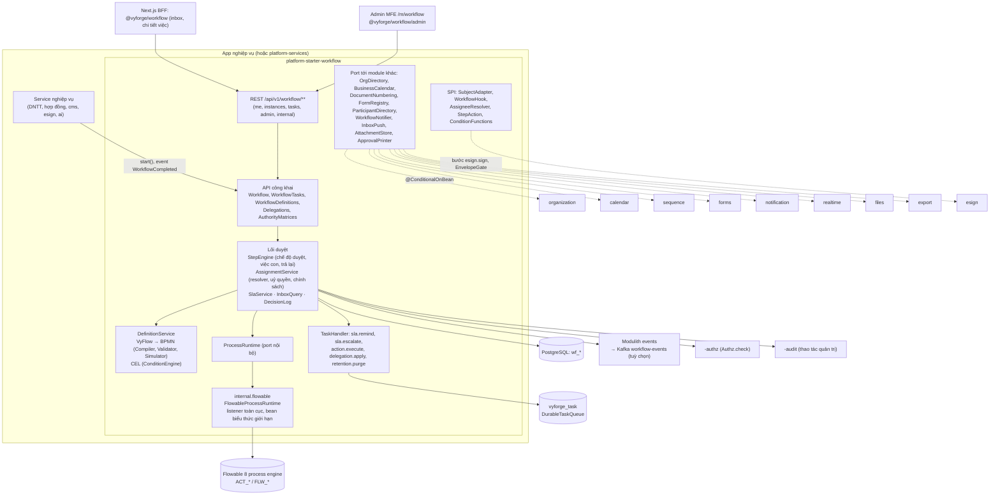
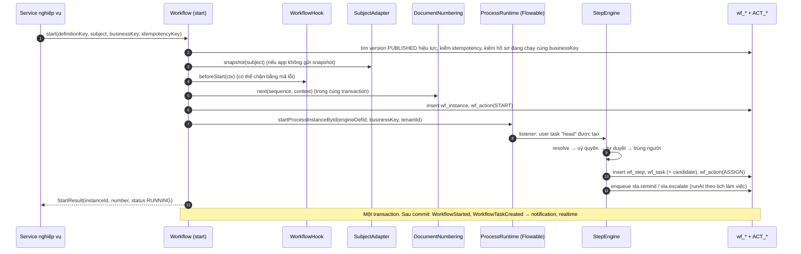
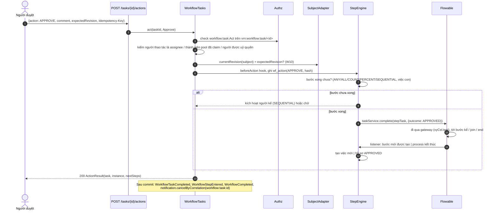
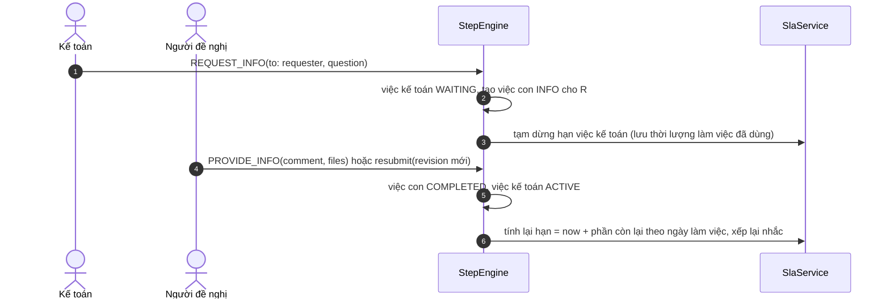
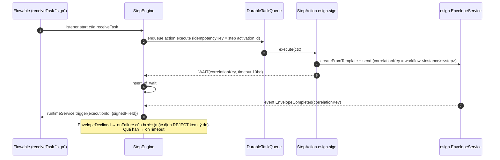
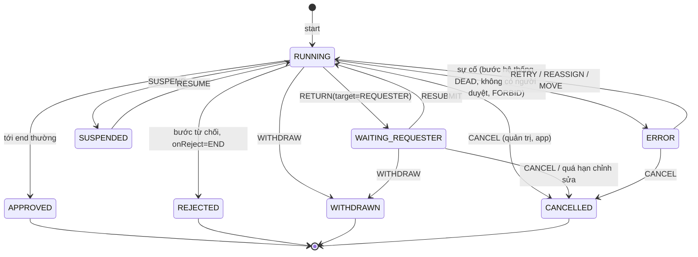
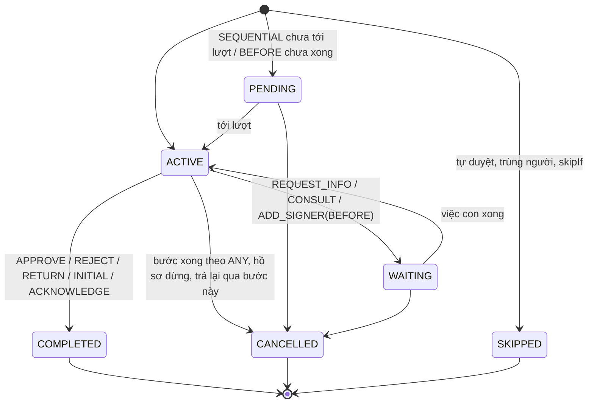
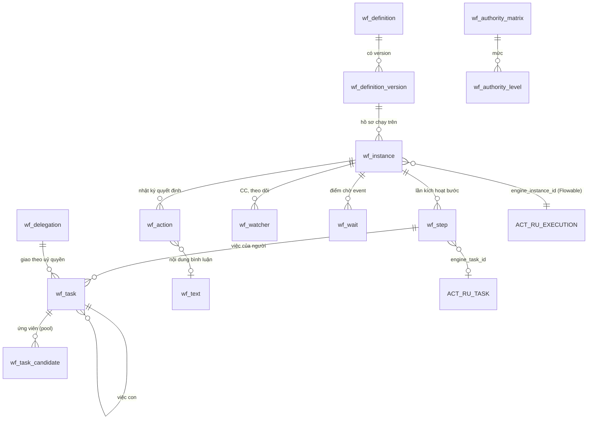

# Thiết kế module workflow: `platform-starter-workflow` + `@vyforge/workflow` + `@vyforge/workflow-admin`

> **Trạng thái:** bản thiết kế chờ duyệt (27/10/2026), phiên forge-39. Chưa có code.
>
> **Phạm vi:** quy trình phê duyệt nhiều cấp (BPM nhẹ) dùng chung cho mọi dự án Vyforge:
> - định nghĩa quy trình có version, soạn bằng DSL khối (JSON/YAML) cho tenant admin, BPMN 2.0 cho người vận hành và dev;
> - bước duyệt tuần tự, song song, theo điều kiện; người duyệt theo vai trò, theo cơ cấu tổ chức, theo ma trận hạn mức;
> - thao tác: duyệt, từ chối, trả lại, yêu cầu bổ sung, uỷ quyền, vắng mặt, chuyển xử lý, thêm người duyệt, ký nháy,
>   rút hồ sơ;
> - SLA tính theo giờ làm việc, nhắc việc, escalation;
> - gắn với bất kỳ bản ghi nghiệp vụ nào, hook trước/sau, event công khai;
> - hộp việc (inbox), lịch sử, nhật ký quyết định không sửa được.
>
> **Nền:** platform-java 0.12.1 (khối chung `SecretCipher`, `DurableTaskQueue`, `StarterSchemaMigrator`), platform-web
> 0.9.0, module-conventions mục 1–6, `platform-services.md` (forge-37: Next.js Multi-Zones, `/m/<module>`,
> `@vyforge/admin-shell`, manifest `contract: 1`, `GET /api/v1/<module>/admin/info`), gap analysis 10/2026 mục 2.5–2.8,
> 2.11 và 3. Bản phát hành đích: `platform-java` 0.13.0 (`platform-starter-workflow`), `platform-web`
> (`@vyforge/workflow` 0.1.0), app `platform-admin/apps/workflow-admin`.
>
> **Module liên quan (không làm ở đây, chỉ dùng qua interface):** `organization` (forge-53), `sequence` (forge-54),
> `calendar` (forge-55), `forms` (forge-56). Luật sự kiện–điều kiện–hành động không có bước chờ người thuộc `automation`
> (làm sau). Thiết kế của bốn module trên chưa có khi viết tài liệu này, nên workflow tự định nghĩa **port phía người
> dùng** (mục 6.3) và chốt chữ ký mong muốn để các phiên kia đối chiếu.
>
> **Ghi chú độ tin cậy.** Version thư viện lấy từ `maven-metadata.xml` của Maven Central, registry npm và GitHub, kiểm
> ngày 27/10/2026. Văn bản pháp lý lấy từ cổng thông tin cơ quan nhà nước và thư viện pháp luật; chỗ chưa đối chiếu
> được toàn văn ghi **(chưa kiểm chứng)**.

## Mục lục

0. [Tóm tắt quyết định](#0-tóm-tắt-quyết-định)
1. [Bài toán và phạm vi](#1-bài-toán-và-phạm-vi)
2. [Nghiên cứu](#2-nghiên-cứu)
3. [Kiến trúc](#3-kiến-trúc)
4. [Mô hình dữ liệu](#4-mô-hình-dữ-liệu)
5. [API](#5-api)
6. [Mở rộng](#6-mở-rộng)
7. [Vận hành](#7-vận-hành)
8. [Bảo mật và tuân thủ](#8-bảo-mật-và-tuân-thủ)
9. [Kế hoạch triển khai](#9-kế-hoạch-triển-khai)
10. [Đóng gói và triển khai độc lập](#10-đóng-gói-và-triển-khai-độc-lập)
11. [Lệch quy ước và quyết định](#11-lệch-quy-ước-và-quyết-định)

---

## 0. Tóm tắt quyết định

| # | Quyết định | Lý do ngắn |
|---|---|---|
| W1 | **Engine: nhúng Flowable 8.0 (chỉ process engine BPMN), không tự viết engine.** Flowable nằm sau port nội bộ `ProcessRuntime`, chỉ package `internal.flowable` được import `org.flowable..` (ArchUnit) | MODULE_PLAN mục 5 và nguyên tắc 4 ("lớp mỏng trên OSS, không tự viết engine"); nghiên cứu 10/2026 mục 3.9 đã chọn Flowable cho phê duyệt có người tham gia. Flowable 8.0.0 build trên Spring Boot 4.0.2, Apache-2.0. So sánh ở mục 2.3 |
| W2 | **Hai cách soạn quy trình.** (a) **VyFlow**: DSL dạng khối (tuần tự, rẽ nhánh điều kiện, song song, bước duyệt, bước hệ thống), JSON/YAML có JSON Schema, tenant admin soạn trên trình dựng dọc kiểu Lark; module biên dịch sang BPMN. (b) **BPMN 2.0 thô**: chỉ người vận hành/dev, tắt mặc định | Người dùng nghiệp vụ không vẽ được BPMN; dev cần trần cao (subprocess, message event, call activity) cho nghiệp vụ sau này. Một engine chạy cả hai |
| W3 | **Bảng của Vyforge là nguồn sự thật cho phần nghiệp vụ** (hồ sơ, bước, việc, quyết định, uỷ quyền); Flowable chỉ giữ token thực thi. Hộp việc truy vấn bảng `wf_task` của module, không truy vấn `ACT_RU_TASK` | Inbox cần lọc theo số tiền, loại hồ sơ, người đề nghị, hạn; biến của Flowable là EAV, lọc chậm. Thao tác duyệt có ngữ nghĩa BPMN không có (yêu cầu bổ sung, thêm người duyệt) |
| W4 | **Thao tác duyệt nằm ở lớp Vyforge.** Yêu cầu bổ sung, thêm người duyệt trước/sau/song song, nhờ tham vấn được làm bằng việc con (`wf_task.parent_task_id`); task Flowable của bước chỉ hoàn tất khi lớp Vyforge quyết định. Trả lại bước trước dùng `ChangeActivityStateBuilder` của Flowable | Không phải sửa BPMN hay sinh definition mới cho từng hồ sơ |
| W5 | **Người duyệt được xác định khi bước bắt đầu và chụp lại** (snapshot). Người chuyển phòng ban sau đó không làm đổi người duyệt của việc đang chờ. Riêng "nhóm xử lý chung" (pool theo nhóm IAM) giữ dạng ứng viên động và phải nhận việc (claim) | Đúng lịch sử duyệt (gap analysis 2.5: hiệu lực theo thời gian); khớp Flowable candidate user/group |
| W6 | **Điều kiện viết bằng CEL** (`dev.cel:cel` 0.14.0, Apache-2.0), có sandbox, biên dịch khi publish. BPMN do VyFlow sinh chỉ dùng một biểu thức cố định gọi bộ đánh giá CEL. Tenant không bao giờ viết JUEL | JUEL của Flowable gọi được bean Spring: rủi ro thực thi mã. Cùng ngôn ngữ biểu thức với `automation` (gap analysis 2.11) |
| W7 | **SLA, nhắc việc, escalation chạy ở lớp Vyforge** bằng `DurableTaskQueue` (`runAt`) và port lịch làm việc (`calendar`). BPMN do VyFlow sinh không có timer; async executor của Flowable chỉ bật khi cho phép BPMN thô | Hạn tính theo ngày làm việc VN và tạm dừng khi chờ bổ sung; một hệ việc nền thay vì hai |
| W8 | **Ma trận thẩm quyền (hạn mức) là dữ liệu**, tenant admin sửa mà không phải publish lại quy trình: "đến 20 triệu trưởng phòng, đến 200 triệu giám đốc chi nhánh, trên đó tổng giám đốc" | Phân cấp thẩm quyền đổi thường xuyên hơn quy trình; mô hình release strategy của SAP và tier definition của OCA |
| W9 | **Nhật ký quyết định chỉ ghi thêm, có chuỗi băm** (`wf_action.hash = sha256(prev_hash ‖ bản ghi chuẩn hoá)`), trigger chặn `UPDATE`/`DELETE`. Uỷ quyền ghi rõ người uỷ quyền, người được uỷ quyền, phạm vi, thời hạn | Luật Giao dịch điện tử 2023 (toàn vẹn thông điệp dữ liệu), chứng từ kế toán, kiểm toán nội bộ (mục 8) |
| W10 | **Bản ghi nghiệp vụ gắn qua `SubjectRef`** (`vrn:<service>:<type>/<id>` + revision) và SPI `SubjectAdapter` (tóm tắt, quyền xem, khoá sửa, kết quả). Duyệt bị chặn khi bản ghi đã đổi revision sau lúc trình (`workflow.subject_changed`) | "Duyệt đúng cái đã trình": không duyệt nhầm số tiền đã bị sửa. cms cần gắn revision cụ thể |
| W11 | **organization, calendar, sequence, forms dùng qua port của workflow**, adapter bật bằng `@ConditionalOnBean`; vắng module thì có bản thay thế tối thiểu hoặc tính năng tương ứng bị tắt rõ ràng trong `admin/info` | Mục 6 module-conventions: không phụ thuộc cứng. Gap analysis mục 3 |
| W12 | **Đóng gói ba phần.** Starter (nhúng hoặc chạy trong `platform-services`, `mode: embedded \| remote`); `@vyforge/workflow` (inbox, chi tiết việc, khung trạng thái duyệt trên trang bản ghi); admin MFE `/m/workflow` với component ở `@vyforge/workflow/admin`. Chạy ở `platform-services` khi nhiều app cần **một hộp việc chung** | platform-services D1–D10 |

---

## 1. Bài toán và phạm vi

### 1.1 Bài toán

Gần như mọi app doanh nghiệp VN đều có "trình duyệt": đề nghị thanh toán, tạm ứng, mua sắm, hợp đồng, nghỉ phép, công
tác, tuyển dụng, đăng bài, phát hành chứng từ. Mỗi dự án đang tự viết một bộ cột `status`, `approved_by`, `approved_at`
và một vài `if` trong service. Cách đó vỡ ngay khi khách hỏi:

- "trên 50 triệu thì thêm giám đốc duyệt", rồi tháng sau "trên 30 triệu";
- "trưởng phòng đi công tác thì phó phòng duyệt thay, và phải ghi là duyệt thay";
- "pháp chế và kế toán duyệt song song, xong cả hai mới tới giám đốc";
- "quá 2 ngày làm việc chưa duyệt thì nhắc, quá 3 ngày thì chuyển lên cấp trên";
- "giám đốc trả lại cho kế toán chứ không trả về người đề nghị";
- "cho tôi một chỗ xem mọi việc đang chờ tôi, ở cả CRM lẫn HRM".

Module workflow giải bài toán này một lần, dưới dạng starter nhúng được, chạy được trong `platform-services`, có giao
diện quản trị riêng.

### 1.2 Phạm vi

| Trong phạm vi | Ngoài phạm vi (ở đâu) |
|---|---|
| Định nghĩa quy trình có version; VyFlow (JSON/YAML) và BPMN 2.0 thô | Trình vẽ BPMN đầy đủ trên web (dùng công cụ desktop, mục 2.5) |
| Bước duyệt: một người, nhiều người (tất cả / một người / N người / tỷ lệ), tuần tự trong bước; rẽ nhánh điều kiện; song song; bước hệ thống; chờ event | Luật "khi X thì Y" không có bước chờ người (`automation`) |
| Người duyệt: người cụ thể, nhóm IAM, quản lý cấp N, trưởng đơn vị, chức danh trong đơn vị, người đề nghị tự chọn, người ở bước trước chọn, trường trên bản ghi, ma trận thẩm quyền | Cây đơn vị, chức danh, quản lý trực tiếp (`organization`) |
| Thao tác: duyệt, từ chối, trả lại (người đề nghị / bước trước / bước bất kỳ đã qua), yêu cầu bổ sung, chuyển xử lý, nhờ tham vấn, thêm người duyệt trước/sau/song song, ký nháy, rút hồ sơ, nhận việc, bình luận, đính kèm, CC | Ký số lên tài liệu (`esign`), vết ký nháy trên PDF (`esign` vai trò INITIALER) |
| Uỷ quyền theo thời hạn và phạm vi; vắng mặt tự chuyển | Uỷ quyền pháp lý ngoài hệ thống (giấy uỷ quyền) |
| SLA theo giờ làm việc, nhắc, escalation, tạm dừng khi chờ bổ sung | Lịch làm việc, ngày lễ (`calendar`) |
| Gắn bản ghi bất kỳ; hook; event; khoá bản ghi khi đang duyệt | Trạng thái nghiệp vụ của bản ghi (app tự đổi khi nhận kết quả) |
| Đề nghị chung không có bảng riêng (form động) | Form builder (`forms`) |
| Số hiệu hồ sơ | Bộ đánh số (`sequence`) |
| Hộp việc, việc đã xử lý, hồ sơ của tôi, CC, đếm số việc | Danh bạ người dùng (auth-server, ADR-0011) |
| Lịch sử, nhật ký quyết định có chuỗi băm, in phiếu trình duyệt | Bộ render PDF (`export`) |
| Gửi thông báo theo sự kiện của quy trình | Kênh gửi (`notification`) |
| Quản trị: định nghĩa, ma trận, hồ sơ, sự cố, uỷ quyền, cài đặt | Khung admin, đăng nhập (`@vyforge/admin-shell`) |

### 1.3 Kịch bản nghiệp vụ phải đáp ứng

| # | Kịch bản | Điều module phải có |
|---|---|---|
| K1 | **Đề nghị thanh toán** (DNTT) của một công ty phân phối: nhân viên lập, trưởng phòng duyệt; trên 50 triệu thêm giám đốc chi nhánh; trên 500 triệu thêm tổng giám đốc; kế toán trưởng kiểm cuối; thủ quỹ chi. Số phiếu `DNTT-HN-2026-000123` không nhảy số | Điều kiện theo số tiền hoặc ma trận thẩm quyền (W8); quản lý theo cây tổ chức tại thời điểm trình; số hiệu qua `sequence` chế độ GAPLESS; nhật ký quyết định giữ cùng chứng từ kế toán |
| K2 | **Tạm ứng, hoàn ứng** liên kết với nhau: hoàn ứng chỉ trình được khi tạm ứng đã duyệt | Hook `beforeStart` của app chặn có mã lỗi; tra cứu hồ sơ theo `SubjectRef` |
| K3 | **Mua sắm**: phòng đề xuất → pháp chế và kế toán duyệt song song → giám đốc. Pháp chế từ chối thì cả hồ sơ dừng; kế toán yêu cầu bổ sung báo giá thì hạn của kế toán tạm dừng | Khối song song có join; từ chối ở nhánh huỷ nhánh còn lại; yêu cầu bổ sung dừng SLA |
| K4 | **Hợp đồng**: chuyên viên soạn, trưởng phòng **ký nháy** từng trang, pháp chế duyệt, giám đốc **ký số** | Bước loại `initial` (ghi nhận ký nháy); bước hệ thống `esign.sign` gọi `EnvelopeService` rồi chờ `EnvelopeCompleted` (esign §3.8) |
| K5 | **Nghỉ phép** theo Bộ luật Lao động 2019: dưới 3 ngày trưởng nhóm duyệt; từ 3 ngày thêm trưởng phòng; nhân sự được CC. Không có bảng riêng trong app, form do tenant tự dựng | Đề nghị chung với form của `forms`; CC; điều kiện trên dữ liệu form |
| K6 | **Trưởng phòng nghỉ phép 01–10/11**: mọi việc duyệt của DNTT chuyển cho phó phòng, nhưng hợp đồng thì không | Uỷ quyền có phạm vi theo quy trình/loại, có thời hạn; ghi "duyệt thay"; áp dụng cho việc đang chờ (tuỳ chọn) |
| K7 | **Escalation**: quá 2 ngày làm việc chưa duyệt thì nhắc; quá 3 ngày chuyển lên quản lý của người duyệt; quá 5 ngày báo người vận hành quy trình | SLA nhiều mức theo ngày làm việc, hành động escalation cấu hình được |
| K8 | **Giám đốc trả lại cho kế toán** (không phải người đề nghị) vì sai mã ngân sách; kế toán sửa rồi trình tiếp thẳng lên giám đốc, không đi lại từ đầu | Trả lại về bước bất kỳ đã qua; tuỳ chọn "trình lại về bước đã trả" |
| K9 | **Người duyệt cũng là người đề nghị** (trưởng phòng tự lập DNTT) và **một người xuất hiện hai lần** (vừa là trưởng phòng vừa là giám đốc chi nhánh kiêm nhiệm) | Chính sách tự duyệt (bỏ qua, chuyển lên cấp trên, cấm) và gộp người duyệt trùng |
| K10 | **Đăng bài trên trang tin của ngân hàng** (cms K2): biên tập viên → pháp chế → trưởng phòng truyền thông; duyệt gắn với đúng revision | `PublicationGate` của cms gọi `start(definitionKey, businessKey, …)`; event hoàn tất có `businessKey`; chặn duyệt khi revision đổi |
| K11 | **AI trích xuất hoá đơn đầu vào** đánh dấu cần người kiểm tra; agent AI muốn thực hiện thao tác `DESTRUCTIVE` | Nghe `AiExtractionCompleted(needsReview)`; cài `ApprovalRouter` của ai (ai §6.1) |
| K12 | **Một cửa ở cơ quan nhà nước/đơn vị sự nghiệp**: hồ sơ tiếp nhận → chuyên viên thụ lý → lãnh đạo phòng → lãnh đạo đơn vị ký; hạn giải quyết tính theo ngày làm việc; trả hồ sơ phải nêu lý do | Hạn theo ngày làm việc; lý do bắt buộc khi trả lại/từ chối; nhật ký không sửa được; in phiếu trình |
| K13 | **Hộp việc chung** của nhân viên văn phòng dùng CRM, HRM và app mua sắm của cùng tenant | Chạy trong `platform-services` (`mode: remote` ở app); inbox gộp; link quay về app gốc |
| K14 | **Duyệt hàng loạt** cuối tháng: kế toán trưởng duyệt 80 phiếu tạm ứng dưới 5 triệu | Duyệt nhiều việc một lần khi bước cho phép (`bulk: true`), vẫn ghi từng quyết định |
| K15 | **Đổi quy trình giữa năm**: quy trình DNTT mới áp dụng từ 01/01; hồ sơ đang chạy đi tiếp theo version cũ; người vận hành chuyển một số hồ sơ sang version mới | Version bất biến sau publish; hồ sơ gắn version; di chuyển hồ sơ sang version mới có kiểm tra |
| K16 | **Không tìm được người duyệt** (phòng chưa có trưởng phòng) | Chính sách: chuyển người vận hành quy trình, tự duyệt, hoặc dừng hồ sơ ở trạng thái sự cố |
| K17 | **Khách cài workflow mà không có organization** (dự án nhỏ, phân quyền bằng nhóm IAM) | Bộ chọn người duyệt theo nhóm/người cụ thể vẫn dùng được; bộ chọn theo tổ chức báo "không khả dụng" khi publish |

### 1.4 Ngoài phạm vi bản đầu (để bản sau, mục 9.4)

- Case management không cấu trúc (CMMN), bảng quyết định DMN: Flowable có engine riêng, chỉ bật khi có nhu cầu.
- Mô phỏng tải và tối ưu quy trình (process mining).
- Trình vẽ BPMN trên web.
- Hộp việc trên mobile (dùng chung component khi `template-expo` có).

---

## 2. Nghiên cứu

### 2.1 Engine: nhúng hay tự viết

Kiểm ngày 27/10/2026 trên Maven Central, GitHub Releases và tài liệu chính thức.

| Ứng viên | Version mới nhất | License | Nền | Đánh giá cho module này |
|---|---|---|---|---|
| **Flowable** | 8.0.0, 27/02/2026; nhánh chính đang 8.1.0-SNAPSHOT ([release](https://github.com/flowable/flowable-engine/releases/tag/flowable-8.0.0), [maven-metadata](https://repo1.maven.org/maven2/org/flowable/flowable-engine/maven-metadata.xml)) | Apache-2.0 ([repo](https://github.com/flowable/flowable-engine)) | Build cho Java 17, trên Spring Boot 4.0.2, Spring Framework 7.0.3, MyBatis 3.5.19, Jackson 3 mặc định ([flowable-dependencies-8.0.0.pom](https://repo1.maven.org/maven2/org/flowable/flowable-dependencies/8.0.0/flowable-dependencies-8.0.0.pom)). 8.0 bỏ hỗ trợ Boot 3 | **Chọn.** Nhúng trong app, dùng PostgreSQL của app, đủ thao tác duyệt cần (mục 2.2) |
| **Operaton** (fork Camunda 7) | 2.2.0, 23/10/2026 ([release](https://github.com/operaton/operaton/releases/tag/v2.2.0)) | Apache-2.0, "no open-core model" ([README](https://github.com/operaton/operaton)) | Java 17, Spring Boot 4.1.2 ([parent pom](https://repo1.maven.org/maven2/org/operaton/bpm/operaton-parent/2.2.0/operaton-parent-2.2.0.pom)); giữ API, schema, mô hình của Camunda 7 | Phương án dự phòng: cùng loại engine nhúng, cộng đồng còn mới. Chưa kiểm chi tiết multi-tenancy và job executor |
| **Camunda 7 CE** | 7.24.0, 14/10/2025 | Apache-2.0 | README ghi CE "is End of Life", repo đã archive ([repo](https://github.com/camunda/camunda-bpm-platform), [thông báo](https://forum.camunda.io/t/important-update-camunda-7-community-edition-end-of-life-announced/50921)) | Loại: không còn bản vá bảo mật |
| **Camunda 8** | 8.10.6, 22/10/2026 ([releases](https://github.com/camunda/camunda/releases)) | Camunda License v1 (không phải OSI); production self-managed phải mua bản Enterprise ([licenses](https://docs.camunda.io/docs/reference/licenses/)) | Cụm Zeebe chạy riêng, không nhúng | Loại (MODULE_PLAN mục 5) |
| **Temporal** | Java SDK 1.40.0 (29/09/2026, Apache-2.0); server 1.32.1 (MIT) ([sdk](https://github.com/temporalio/sdk-java/releases), [server](https://github.com/temporalio/temporal)) | MIT / Apache-2.0 | Starter Spring hỗ trợ Boot 2/3/4 ([#2738](https://github.com/temporalio/sdk-java/issues/2738)); cần vận hành cụm Temporal + database riêng (Cassandra, PostgreSQL 13–16, MySQL) và nên có Elasticsearch cho visibility ([persistence](https://docs.temporal.io/temporal-service/persistence)) | Loại cho phê duyệt: workflow viết bằng code, không có task người, ứng viên, claim, inbox; định nghĩa do tenant cấu hình phải tự viết bộ thông dịch. Hợp cho saga kỹ thuật dài, không phải bài toán này |
| **Spring Statemachine** | 4.0.2, 11/06/2026 | Apache-2.0 | Repo chuyển vào `spring-attic`, README: "no longer maintained" ([README](https://github.com/spring-attic/spring-statemachine)) | Loại |
| **Kogito / jBPM** | Kogito runtimes 10.2.0 (28/04/2026), repo archive, code chuyển vào `apache/incubator-kie-drools` ([repo](https://github.com/apache/incubator-kie-kogito-runtimes)) | Apache-2.0 | Đang ở Apache incubator | Loại: hướng cloud-native/codegen, không hợp nhúng |
| **Elsa Workflows** (ABP dùng) | 3.9.0, 04/10/2026 ([releases](https://github.com/elsa-workflows/elsa-core/releases)) | MIT | .NET | Chỉ tham khảo mô hình |
| **Tự viết state machine** | — | — | — | Xem so sánh dưới |

**Flowable 8 so với tự viết state machine:**

| Tiêu chí | Flowable 8 nhúng | Tự viết (cây khối + bảng trạng thái) |
|---|---|---|
| Phù hợp MODULE_PLAN | Đúng nguyên tắc 4 và mục 5 ("Flowable hoặc Temporal") | Trái mục 5 ("Workflow engine tự viết" nằm trong danh sách không làm) |
| Trần nghiệp vụ sau này | BPMN 2.0 đầy đủ: subprocess, call activity, message/signal event, boundary event, compensation; có CMMN, DMN khi cần; di chuyển hồ sơ giữa version (`ProcessMigrationService`) | Chỉ những gì tự viết; mỗi khái niệm mới là một tính năng engine |
| Đúng đắn khi đồng thời (join song song, hai người cùng duyệt) | Engine đã kiểm qua nhiều năm, khoá lạc quan trên execution | Phải tự chứng minh |
| Thao tác duyệt đặc thù (thêm người, tham vấn, bổ sung) | Không có sẵn ở mức nghiệp vụ; làm ở lớp Vyforge (W4). Có sẵn: `delegateTask/resolveTask`, `addMultiInstanceExecution`, `ChangeActivityStateBuilder` | Làm ở lớp nghiệp vụ như nhau |
| Schema | ~32 bảng (`ACT_GE_*`, `ACT_RE_*`, `ACT_RU_*`, `ACT_HI_*`, `FLW_*`) cho BPMN-only; script SQL trong jar, không Liquibase từ 7.1 ([7.1.0](https://github.com/flowable/flowable-engine/releases/tag/flowable-7.1.0)) | ~10 bảng `wf_*` |
| Tenant | Cột `TENANT_ID_` không được engine kiểm ([advanced](https://www.flowable.com/open-source/docs/bpmn/ch18-Advanced)): phải bọc mọi truy vấn | `TenantEntity`, luật ArchUnit sẵn có |
| Biểu thức | JUEL gọi được bean: phải giới hạn `beans` và không cho tenant viết JUEL | Chọn được CEL từ đầu |
| Phụ thuộc | MyBatis, Jackson 3, khoảng 10 MB jar | Không thêm |
| Công sức | Biên dịch VyFlow → BPMN, adapter, bọc tenant, migration schema, test tích hợp engine | Bộ thông dịch cây khối, join, trả lại, di chuyển version, test đồng thời |

**Kết luận (W1):** nhúng **Flowable 8.0** làm engine đồ thị. Những điểm yếu của Flowable đều nằm ở chỗ lớp Vyforge vốn
phải làm (inbox, thao tác duyệt, tenant ở tầng service), còn phần khó nhất của engine (join, đồng thời, di chuyển
version, BPMN đầy đủ) thì có sẵn. Flowable bị nhốt sau port nội bộ `ProcessRuntime`; nếu sau này phải đổi sang Operaton
hoặc engine khác, chỉ thay gói `internal.flowable` và migration của nó, API công khai và bảng `wf_*` không đổi.

**Rủi ro đã biết và cách giảm:**

1. Flowable 8.0.0 build trên Boot 4.0.2, platform đang ở Boot 4.1.1, Java 25: chưa có xác nhận chính thức chạy Java 25.
   Bước đầu tiên của triển khai là **spike** khởi động engine trên `platform-parent` hiện tại với Testcontainers
   PostgreSQL, chạy bộ test mẫu của mục 9.2. Không qua thì dừng và báo phiên điều phối (phương án B: Operaton 2.2.0).
2. Chỉ có một bản 8.x đã phát hành. Ghim version trong `platform-bom`, Renovate nhóm riêng `flowable`, mỗi lần nâng có
   migration nâng schema kèm theo (mục 4.4).
3. DDL của Flowable không có chỉ mục trên `TENANT_ID_`, `ASSIGNEE_` ([kiểm 151 lệnh `create index`](https://github.com/flowable/flowable-engine/tree/flowable-8.0.0/distro/sql/create/all)).
   Module không truy vấn inbox trên bảng Flowable; truy vấn của adapter đi theo `PROC_INST_ID_` (đã có chỉ mục). Thêm
   chỉ mục `ACT_RU_EXECUTION(TENANT_ID_, BUSINESS_KEY_)` trong migration của module.

### 2.2 Flowable 8: những gì dùng và không dùng

| Tính năng | Dùng | Nguồn |
|---|---|---|
| `flowable-spring-boot-starter-process` (chỉ process engine, không IDM/CMMN/DMN) | Có | [pom](https://github.com/flowable/flowable-engine/blob/flowable-8.0.0/modules/flowable-spring-boot/flowable-spring-boot-starters/flowable-spring-boot-starter-process/pom.xml) |
| `databaseSchemaUpdate=false` (mặc định: kiểm version schema, lệch thì báo lỗi) + script `org/flowable/common/db/create/flowable.postgres.create.common.sql`, `org/flowable/db/create/flowable.postgres.create.engine.sql`, `…create.history.sql` | Có, chạy từ migration của starter | [config](https://www.flowable.com/open-source/docs/bpmn/ch03-Configuration), [source](https://github.com/flowable/flowable-engine/tree/flowable-8.0.0/distro/sql/create/all) |
| `tenantId` trên deployment, kế thừa xuống hồ sơ, task, job | Có, bọc ở adapter | [advanced](https://www.flowable.com/open-source/docs/bpmn/ch18-Advanced) |
| `ChangeActivityStateBuilder` (`moveActivityIdTo`, `moveActivityIdsToSingleActivityId`) | Có: trả lại, quản trị `MOVE` | [ChangeActivityStateBuilder](https://github.com/flowable/flowable-engine/blob/flowable-8.0.0/modules/flowable-engine/src/main/java/org/flowable/engine/runtime/ChangeActivityStateBuilder.java) |
| `ProcessMigrationService` | Có: `MIGRATE` hồ sơ sang version mới | Ghi chú 8.0.0 "more options for process and case migration" |
| User task, candidate, `claim`, `delegateTask/resolveTask` | Chỉ dùng user task làm "token của bước"; người duyệt nằm ở `wf_task` | [TaskService](https://github.com/flowable/flowable-engine/blob/flowable-8.0.0/modules/flowable-engine/src/main/java/org/flowable/engine/TaskService.java) |
| Multi-instance + `completionCondition` (N trên M) | Không cho VyFlow (chế độ bước ở lớp Vyforge); BPMN thô dùng được | [BPMN constructs](https://www.flowable.com/open-source/docs/bpmn/ch07b-BPMN-Constructs) |
| Timer, async executor | Chỉ khi bật BPMN thô | [advanced](https://www.flowable.com/open-source/docs/bpmn/ch18-Advanced) |
| Script task (Groovy, JavaScript) | **Không**: validator chặn `scriptTask` trong BPMN thô (script có toàn quyền JVM) | [advanced](https://www.flowable.com/open-source/docs/bpmn/ch18-Advanced) |
| REST của Flowable (`*-rest` starter), Flowable UI/Modeler | Không: API của module là REST Vyforge | [starters](https://github.com/flowable/flowable-engine/tree/flowable-8.0.0/modules/flowable-spring-boot/flowable-spring-boot-starters) |

### 2.3 Hệ thống phê duyệt tham khảo

| Hệ thống | Version, license | Mô hình dữ liệu và API | Mạnh | Yếu |
|---|---|---|---|---|
| **Lark/Feishu Approval v4** | Open API; SDK Go `larksuite/oapi-sdk-go` v2.0.11 (MIT) | Definition: `node_list` từ `START` tới `END`, mỗi node có `node_type` (`AND`, `OR`, `SEQUENTIAL`), `approver[].type` (`Supervisor`, `SupervisorTopDown`, `DepartmentManager`, `DepartmentManagerTopDown` kèm `level`; `Personal`; `Free` = người trình chọn), `ccer`, `privilege_field` (quyền trường theo node), `starter_assignee` (`STARTER`, `AUTO_PASS`, `SUPERVISOR`, `DEPARTMENT_MANAGER`) ([create](https://open.feishu.cn/document/server-docs/approval-v4/approval/create)). Instance có `uuid` chống trùng. Task: `approve`, `reject`, `transfer`, `resubmit`, `rollback`, `specified_rollback` (về node đã qua), `add_sign` với `add_sign_type` 1 trước / 2 sau / 3 song song ([add sign](https://open.feishu.cn/document/server-docs/approval-v4/task/approval-task-addsign)). Inbox `tasks/query` theo `topic` (chờ, đã xử lý, đã trình, CC chưa đọc/đã đọc). Event `approval_instance`, `approval_task` ([event](https://open.feishu.cn/document/server-docs/approval-v4/event/common-event/approval-instance-event)). **Phê duyệt bên thứ ba**: Lark chỉ hiện và gửi nút, hệ thống ngoài điều phối, gọi lại `action_callback_url` ([external](https://open.feishu.cn/document/server-docs/approval-v4/external_approval/create)) | Tách resolver người duyệt khỏi chế độ node; thêm người 3 vị trí; trả về node bất kỳ đã qua; nhật ký có loại sự kiện cho mọi thao tác (`AUTO_PASS`, `REMOVE_REPEAT`, `ADD_APPROVER_BEFORE`, `ROLLBACK_SELECTED`…) | Điều kiện rẽ nhánh chỉ cấu hình được trên giao diện, không qua API; definition tạo qua API không xoá được; form là JSON trong chuỗi |
| **Odoo 19 Approvals** (Enterprise) và **Studio approval rules** | OEEL-1 (trả phí) | `approval.category` (trường nào bắt buộc, quản lý có là người duyệt, "Approvers Sequence", "Minimum Approval"), `approval.request` (To Submit, Submitted, Approved, Refused, Cancelled) ([Cybrosys](https://www.cybrosys.com/odoo/odoo-books/v19/approvals/configuration/), nguồn thứ cấp). Studio approval rules: bước có người duyệt, nhóm, điều kiện domain, thứ tự, "Exclusive Approval" (đã duyệt bước này thì không duyệt bước khác), uỷ quyền tới ngày ([approval_rules.rst](https://github.com/odoo/documentation/blob/19.0/content/applications/studio/approval_rules.rst)) | "Exclusive approval" (bốn mắt); số người duyệt tối thiểu | License thương mại; không có escalation |
| **OCA `base_tier_validation`** (server-ux) | AGPL-3; bản 18.0.3.5.2; nhánh 19.0 **chưa có** module này (3 PR migrate đều đóng, PR cuối 13/08/2026) ([repo](https://github.com/OCA/server-ux)) | Mixin cho mọi model; `tier.definition` (`model_id`, `review_type` = `individual`/`group`/`field`, `definition_domain`, `sequence`, `approve_sequence`, `notify_*`, `notify_reminder_delay`); `tier.review` gắn đa hình `model` + `res_id`, trạng thái `waiting`/`pending`/`approved`/`rejected`/`cancel` | Mixin "gắn vào bất kỳ bản ghi"; tách `waiting` (chưa tới lượt) và `pending` (đang chờ người); người duyệt lấy từ trường của bản ghi | Điều kiện là chuỗi domain Python; không có uỷ quyền, escalation; `can_review` lệch khi nhiều user |
| **Frappe/ERPNext Workflow** | Frappe v16.53.0 (MIT); ERPNext v15.124.1 (GPL-3.0) | `Workflow` (`document_type`, `workflow_state_field`), `Workflow Document State` (`state`, `doc_status`, `update_field`/`update_value`, `allow_edit` theo role), `Workflow Transition` (`state` → `action` → `next_state`, `allowed` role, `condition` Python, `allow_self_approval` **mặc định 1**), `Workflow Action` (hàng việc theo người: `reference_doctype`, `reference_name`, `user`, `status`) ([workflow.json](https://github.com/frappe/frappe/blob/develop/frappe/workflow/doctype/workflow/workflow.json), [transition](https://github.com/frappe/frappe/blob/develop/frappe/workflow/doctype/workflow_transition/workflow_transition.json)) | Bảng trạng thái/chuyển rất dễ hiểu; ghi giá trị ngược lại bản ghi theo trạng thái | State machine thuần: không N trên M, không chuỗi quản lý, không uỷ quyền, không SLA; hạn mức phải nhân bản transition; tự duyệt bật mặc định |
| **SAP S/4HANA Flexible Workflow** | Thương mại | Workflow có điều kiện bắt đầu (số tiền…), xét từ trên xuống, **khớp đầu tiên thắng**; bước có điều kiện riêng, người nhận theo user/role/luật "quản lý của người duyệt trước" ([SAP Learning](https://learning.sap.com/courses/purchasing-in-sap-s-4hana/setting-up-flexible-workflows-in-purchasing), [all-for-one](https://www.all-for-one.pl/en/whitepapers/flexible-workflow-in-s-4)) | Chuỗi tuyến tính với điều kiện từng bước (đơn giản hơn rẽ nhánh); "quản lý của người duyệt trước" | Bẫy thứ tự khớp đầu tiên không hiện trên giao diện |
| **Jira Service Management approvals** | Thương mại | `approval.condition.type` = `number` / `percent` / `numberPerPrincipal` ([KB](https://support.atlassian.com/jira/kb/jira-service-management-cloud-approval-workflow-properties/)) | N người hoặc tỷ lệ | Một người từ chối là cả bước từ chối, không cấu hình được ([JSDCLOUD-4223](https://jira.atlassian.com/browse/JSDCLOUD-4223)) |
| **n8n** | n8n@2.44.7; Sustainable Use License v1.0: chỉ dùng nội bộ hoặc phi thương mại ([LICENSE.md](https://github.com/n8n-io/n8n/blob/master/LICENSE.md)) | "Send and Wait for Response" dừng execution chờ người trả lời | — | Không nhúng/phân phối được trong sản phẩm thương mại; không có mô hình task, người duyệt, uỷ quyền, inbox |
| **Base Request** (Base.vn) | SaaS VN | Nhóm đề xuất có form và đánh số tự động; người duyệt: quản lý trực tiếp, cố định, linh hoạt, theo điều kiện, "người duyệt tối cao"; **SLA theo từng người duyệt**; thay hàng loạt người duyệt trên mọi nhóm; uỷ quyền; người theo dõi; "Chuyển tiếp" (người ngoài chuỗi xem trước tôi) và "Duyệt và chuyển tiếp" ([help](https://help.base.vn/support/solutions/articles/63000284976-base-request-introduce-base-request-and-table-of-contents), [forward](https://help.base.vn/support/solutions/articles/63000286288-base-request-how-to-forward-a-request-to-another-approver)) | Đúng thói quen người dùng VN; SLA theo người | Không có API mô hình công khai |
| **MISA AMIS Quy trình** | SaaS VN | Quy trình mẫu: chi tạm ứng, quyết toán tạm ứng, chi thanh toán, trả tiền nhà cung cấp; sau duyệt đẩy dữ liệu sang AMIS Kế toán sinh chứng từ ([helpact](https://helpact.misa.vn/kb/thiet-lap-tu-dong-huong-dan-thiet-lap-quy-trinh-amis-quy-trinh/)); chuỗi điển hình trưởng bộ phận → kế toán trưởng → giám đốc | Bước "ghi sổ" sau duyệt | Chi tiết cấu hình bước chưa kiểm chứng |

**Ký nháy.** Chữ ký kiểm tra của người chịu trách nhiệm nội dung và thể thức, đặt trước khi người có thẩm quyền ký
([luatvietnam](https://luatvietnam.vn/hanh-chinh/ky-nhay-la-gi-570-34879-article.html)). NĐ 30/2020 Điều 12 quy định
người đứng đầu đơn vị soạn thảo kiểm tra nội dung, người được giao kiểm tra thể thức, cả hai chịu trách nhiệm; thuật
ngữ "ký nháy" không có định nghĩa trong các điều đã tra **(chưa kiểm chứng ở Phụ lục I)**. VNPT-iOffice làm ký nháy bằng
chữ ký số đặt ở vị trí chọn trước khi lãnh đạo ký
([hướng dẫn](https://binhphuoc.gov.vn/uploads/binhphuoc/cks/2019_04/huong-dan-ky-so-tren-vnpt-ioffice.pdf)). Vì vậy
workflow có bước `kind: INITIAL` (ghi nhận trách nhiệm), còn vết ký trên tài liệu là vai trò `INITIALER` của esign.

### 2.4 Học theo và không làm

| Học theo | Từ | Ở đâu trong thiết kế |
|---|---|---|
| Resolver người duyệt tách khỏi chế độ bước; `level` cho chuỗi quản lý | Lark | 3.5, 3.6.1 |
| Thêm người duyệt trước/sau/song song; trả về bước bất kỳ đã qua; `uuid` chống trùng khi tạo | Lark | 3.6.2, 3.6.4, `idempotencyKey` |
| Danh sách loại sự kiện trên dòng thời gian (`AUTO_PASS`, `REMOVE_REPEAT`, `ROLLBACK_SELECTED`) làm luôn nhật ký | Lark | `wf_action.type` |
| Inbox theo nhóm: chờ tôi, tôi đã xử lý, tôi trình, CC | Lark, Frappe `Workflow Action` | 5.2 `/me/tasks?view=` |
| "Phê duyệt bên thứ ba": bản ghi ở hệ thống khác, workflow chỉ điều phối người | Lark | `SubjectRef` + `SubjectAdapter`, chế độ remote |
| Gắn đa hình vào bất kỳ bản ghi (`model` + `res_id`); `waiting` khác `pending` | OCA tier validation | `SubjectRef`; `PENDING`/`ACTIVE` |
| Người duyệt lấy từ trường của bản ghi | OCA, Lark `Free` | resolver `field`, `chosenBy` |
| Bốn mắt (exclusive approval), số người tối thiểu | Odoo | `distinctApprovers`, `COUNT:n` |
| N người hoặc tỷ lệ | Jira SM, Flowable | `COUNT:n`, `PERCENT:p` + `rejectPolicy` cấu hình được |
| Điều kiện từng bước trên chuỗi tuyến tính; "quản lý của người duyệt trước" | SAP | `skipIf`, `manager.of: previousApprover` |
| Ma trận hạn mức là dữ liệu | SAP release strategy, Base "người duyệt theo điều kiện" | 3.5.2 |
| SLA theo người duyệt; thay hàng loạt người duyệt | Base Request | SLA trên `wf_task`; quản trị `reassign` hàng loạt |
| Đẩy kết quả sang hệ thống kế toán sau duyệt | AMIS | bước `task` (StepAction) |
| Ghi giá trị ngược bản ghi theo trạng thái | Frappe | Hook `afterComplete` + event; app tự đổi trạng thái |

| Không làm | Lý do |
|---|---|
| Điều kiện bằng script Python/JUEL/Groovy do tenant viết | Rủi ro thực thi mã; dùng CEL có sandbox (W6) |
| Điều kiện chỉ cấu hình được trên giao diện | VyFlow là văn bản (YAML/JSON), import/export, review được trong git |
| Tự duyệt bật mặc định | Mặc định `ESCALATE` |
| Một người từ chối luôn làm hỏng cả bước | `rejectPolicy` |
| Khớp đầu tiên ẩn | Nhánh điều kiện có thứ tự hiển thị rõ; mô phỏng chỉ ra nhánh được chọn |
| Definition không xoá được | Version `RETIRED`; định nghĩa chưa có hồ sơ thì xoá được |
| Nhúng n8n, Camunda 8, Temporal cho phê duyệt | License hoặc mô hình không hợp (2.1) |
| Trình vẽ BPMN trên web | `bpmn-js` 18.31.1 dùng license riêng của bpmn.io (MIT kèm điều kiện giữ watermark, `SEE LICENSE IN LICENSE` trên npm, [LICENSE](https://unpkg.com/bpmn-js@18.31.1/LICENSE)); trình dựng VyFlow đủ cho tenant; dev dùng công cụ desktop |

---

## 3. Kiến trúc

### 3.1 Sơ đồ thành phần



**Chia việc giữa Flowable và lớp Vyforge** (quyết định W3, W4):

| Việc | Flowable | Lớp Vyforge |
|---|---|---|
| Đồ thị quy trình: tuần tự, rẽ nhánh, song song và join, kết thúc huỷ mọi nhánh (terminate) | Có | Biên dịch VyFlow sang BPMN |
| Một **bước** đang hoạt động | Một user task "bước" (không giao cho người, không ai thấy trực tiếp) | Một dòng `wf_step` |
| Người duyệt cụ thể của bước | Không | `wf_task` cho từng người; chế độ ALL/ANY/N/tỷ lệ/tuần tự trong bước |
| Thêm người duyệt, nhờ tham vấn, yêu cầu bổ sung, chuyển xử lý | Không | Việc con, trạng thái `WAITING` |
| Trả lại bước trước | `ChangeActivityStateBuilder` dời token | Chọn đích hợp lệ (tính lúc biên dịch), ghi quyết định |
| Bước hệ thống, chờ event | `receiveTask` (token chờ) | Việc nền `action.execute`, bảng `wf_wait`, `trigger()` khi xong |
| Hạn, nhắc, escalation | Không dùng timer | `DurableTaskQueue` + lịch làm việc |
| Lịch sử pháp lý | `ACT_HI_*` mức `activity`, dọn sau N ngày | `wf_action` có chuỗi băm, giữ theo retention |
| Di chuyển hồ sơ sang version mới | `ProcessMigrationService` | Kiểm tra bước tương ứng, ghi quyết định `MIGRATE` |

Mọi lệnh gọi Flowable chạy **trong cùng transaction Spring** với bảng `wf_*` (Flowable dùng chung `DataSource` và
`PlatformTransactionManager` của app). Một thao tác duyệt hoặc commit cả hai phía, hoặc không phía nào.

### 3.2 Gói và lớp

```
com.vyforge.platform.workflow
├── Workflow, WorkflowTasks, WorkflowDefinitions, Delegations, AuthorityMatrices   (API công khai)
├── model/        SubjectRef, StartRequest, TaskAction (sealed), InstanceView, TaskView, Outcome, ...
├── event/        WorkflowStarted, WorkflowStepEntered, WorkflowTaskCreated, WorkflowCompleted, ...
├── spi/          SubjectAdapter, WorkflowHook, AssigneeResolver, StepAction, ConditionFunctions
├── port/         OrgDirectory, BusinessCalendar, DocumentNumbering, FormRegistry, ParticipantDirectory,
│                 WorkflowNotifier, InboxPush, AttachmentStore, ApprovalPrinter
├── definition/   VyFlowModel (record), VyFlowParser (JSON/YAML), Validator, Compiler (→ BPMN XML), Simulator
├── condition/    CelConditionEngine, hàm chuẩn (amount, inUnit, hasRole, businessDaysBetween...)
├── runtime/      StepEngine, AssignmentService, DelegationService, SlaService, DecisionLog, InboxQuery
├── internal/flowable/  FlowableProcessRuntime, VyStepListener, VyCel (bean biểu thức), FlowableSchemaMigration
├── integration/  organization, calendar, sequence, forms, notification, realtime, files, export, esign, ai, cms
│                 (mỗi gói một @AutoConfiguration, @ConditionalOnClass + @ConditionalOnBean)
├── web/          WorkflowController, TaskController, MeController, admin/*, internal/*
├── remote/       Client HTTP cài cùng interface (mode: remote)
└── autoconfigure/ PlatformWorkflowAutoConfiguration, PlatformWorkflowProperties
```

Luật ArchUnit của module (chạy trong test của starter):

- chỉ `..workflow.internal.flowable..` được phụ thuộc `org.flowable..`;
- `..workflow.integration.<x>..` là nơi duy nhất phụ thuộc package của module `<x>`;
- API công khai (`workflow`, `model`, `event`, `spi`, `port`) không phụ thuộc `runtime`, `internal`, `web`;
- luật `TENANT_ISOLATION` của platform cho mọi repository `wf_*`.

### 3.3 Khái niệm

| Khái niệm | Ý nghĩa | Bảng |
|---|---|---|
| **Định nghĩa quy trình** (definition) | Loại quy trình theo `key` trong tenant (vd. `payment-request`). Có tên vi/en, nhóm, loại bản ghi gắn được | `wf_definition` |
| **Version** | Bản cụ thể của định nghĩa: `DRAFT` sửa được; `PUBLISHED` bất biến, có `effectiveFrom`; `RETIRED` không nhận hồ sơ mới. Hồ sơ gắn với version lúc tạo | `wf_definition_version` |
| **Hồ sơ** (instance) | Một lần chạy quy trình cho một bản ghi nghiệp vụ; có số hiệu, người đề nghị, trạng thái, kết quả | `wf_instance` |
| **Bản ghi nghiệp vụ** (subject) | Đối tượng được duyệt: `SubjectRef` = `vrn:<service>:<type>/<id>` + `revision`. Đề nghị chung không có bảng riêng thì subject là chính hồ sơ (`vrn:workflow:request/<id>`) | cột của `wf_instance` |
| **Bước** (step) | Một lần bước của định nghĩa được kích hoạt. Trả lại rồi đi lại thì có lần kích hoạt mới (`activation_no`) | `wf_step` |
| **Việc** (task) | Việc của một người (hoặc một nhóm, phải nhận việc) trong một bước. Việc con (thêm người duyệt, tham vấn, bổ sung) trỏ về việc cha | `wf_task`, `wf_task_candidate` |
| **Quyết định** (action) | Mọi thao tác có ý nghĩa pháp lý hoặc nghiệp vụ, chỉ ghi thêm, có chuỗi băm | `wf_action` |
| **Uỷ quyền** | Người A cho người B duyệt thay trong phạm vi và thời hạn; vắng mặt là uỷ quyền tự động áp vào việc mới | `wf_delegation` |
| **Ma trận thẩm quyền** | Bảng hạn mức: mức → người duyệt → hạn mức tiền, có điều kiện phụ (nhóm chi phí, đơn vị) | `wf_authority_matrix`, `wf_authority_level` |
| **Người theo dõi** | CC, người theo dõi tự đăng ký, người đã tham gia | `wf_watcher` |
| **Điểm chờ** | Bước hệ thống đang chờ event có `correlationKey` | `wf_wait` |

### 3.4 VyFlow: DSL dạng khối

VyFlow mô tả quy trình bằng **cây khối**, không phải đồ thị tự do: mỗi khối là một bước, một khối điều kiện (nhiều nhánh,
nhánh đầu tiên khớp được chọn, luôn có nhánh `otherwise`), hoặc một khối song song (mọi nhánh chạy, join khi tất cả
xong). Cây khối luôn biên dịch ra BPMN đúng cấu trúc (mỗi gateway tách có gateway nối tương ứng), không có vòng lặp tự
do; "quay lại" chỉ qua thao tác trả lại. Đây là mô hình của Lark Approval và Base Request: người dùng nghiệp vụ đọc được,
trình dựng dọc làm được, không vẽ sai được.

Ví dụ đầy đủ cho K1 (đề nghị thanh toán):

```yaml
# META-INF/vyforge/workflow/definitions/payment-request.yml (app cung cấp mặc định; tenant sửa được bản sao)
schemaVersion: 1
key: payment-request
name: { vi: Đề nghị thanh toán, en: Payment request }
category: finance
subject:
  type: finance:payment-request          # khớp SubjectAdapter.subjectType(); bỏ trống = đề nghị chung (dùng form)
  revisionCheck: STRICT                  # STRICT | NONE: chặn duyệt khi bản ghi đổi revision sau lúc trình
variables:                               # dữ liệu điều kiện, lấy từ SubjectSnapshot.variables hoặc form
  amount:      { type: money, required: true }
  costCenter:  { type: string }
  urgent:      { type: boolean }
numbering: { sequence: DNTT, pattern: "DNTT-{branch}-{yyyy}-{seq:6}", mode: GAPLESS }   # port DocumentNumbering
settings:
  selfApproval: ESCALATE                 # requester là người duyệt: SKIP | ESCALATE (lên quản lý) | ALLOW | FORBID
  duplicateApprover: KEEP_LAST           # một người ở nhiều bước: KEEP_ALL | KEEP_FIRST | KEEP_LAST (tự duyệt các lần khác)
  distinctApprovers: false               # true: người đã duyệt bước này không duyệt bước khác (bốn mắt)
  noApprover: ASSIGN_PROCESS_ADMIN       # ASSIGN_PROCESS_ADMIN | AUTO_APPROVE | FAIL
  withdraw: UNTIL_FIRST_DECISION         # NEVER | UNTIL_FIRST_DECISION | ANYTIME
  onReturnToRequester: RESUBMIT_TO_RETURNER   # RESTART | RESUBMIT_TO_RETURNER
  retention: { period: P10Y, from: FISCAL_YEAR_END }   # mục 8.4
  calendar: default                      # lịch làm việc của tenant (port BusinessCalendar)
  processAdmins: [{ group: finance-ops }]
flow:
  - approval:
      id: head
      name: { vi: Trưởng phòng duyệt, en: Department head }
      assignees: [{ manager: { of: requester, level: 1 } }]
      sla: { duration: 2bd, remind: [-4bh, 0], escalate: [{ after: 1bd, action: ADD_APPROVER, to: { manager: { of: assignee, level: 1 } } }] }
      actions: [APPROVE, REJECT, RETURN, REQUEST_INFO, TRANSFER, CONSULT, ADD_SIGNER]
      requireComment: [REJECT, RETURN]
  - approval:
      id: limit-chain
      name: { vi: Duyệt theo hạn mức, en: Authority matrix }
      assignees: [{ matrix: { key: spending-limit, amount: "amount", mode: CHAIN_UNTIL_LIMIT, from: { unitOf: requester } } }]
      mode: SEQUENTIAL
      skipIfEmpty: true
  - parallel:
      branches:
        - - approval: { id: chief-accountant, name: { vi: Kế toán trưởng, en: Chief accountant },
                        assignees: [{ position: { code: KTT, scope: { company: requester } } }] }
        - - condition:
              branches:
                - when: "urgent && amount > money('100000000', 'VND')"
                  flow:
                    - approval: { id: cfo, name: { vi: Giám đốc tài chính, en: CFO }, assignees: [{ group: cfo }] }
              otherwise: []
  - task:
      id: post-to-erp
      name: { vi: Ghi sổ ERP, en: Post to ERP }
      action: http.call                  # StepAction do app hoặc module khác cài
      params: { endpoint: erp-posting }
      retry: { maxAttempts: 8 }
  - approval:
      id: cashier
      name: { vi: Thủ quỹ chi, en: Cashier }
      kind: ACKNOWLEDGE                  # xác nhận đã chi, chỉ có nút "Đã thực hiện"
      assignees: [{ group: cashier }]
      pool: true                         # một người trong nhóm nhận việc
cc: [{ group: finance-ops, on: [COMPLETED] }]
```

**Khối và thuộc tính:**

| Khối | Thuộc tính chính | Biên dịch sang BPMN |
|---|---|---|
| `approval` | `id`, `name`, `kind` (`APPROVE` mặc định, `INITIAL` ký nháy, `ACKNOWLEDGE` xác nhận, `REVIEW` góp ý không quyết định), `assignees[]`, `mode` (`ANY`, `ALL`, `SEQUENTIAL`, `COUNT:n`, `PERCENT:p`), `onReject` (`END` mặc định, `RETURN_TO_REQUESTER`, `RETURN_TO_PREVIOUS`), `sla`, `actions[]`, `requireComment[]`, `form` (form bổ sung của bước), `fieldAccess` (trường nào sửa được ở bước này), `skipIf` (CEL), `skipIfEmpty`, `bulk` | `userTask id=<id>` + listener của Vyforge; sau đó `exclusiveGateway` theo `outcome`: `REJECTED` → `endEvent` loại terminate (hoặc nhánh trả lại) |
| `condition` | `branches[].when` (CEL), `branches[].flow`, `otherwise` | `exclusiveGateway` tách và nối; điều kiện là `${vyCel.test(execution, '<condId>')}` |
| `parallel` | `branches[]` (mỗi nhánh là danh sách khối) | `parallelGateway` tách và nối |
| `task` | `action` (loại `StepAction`), `params`, `retry`, `timeout`, `onFailure` (`INCIDENT` mặc định, `CONTINUE`, `REJECT`) | `receiveTask` + listener `start` đưa việc `action.execute` vào hàng đợi |
| `wait` | `event` (loại event công khai), `correlation` (CEL ra `correlationKey`), `timeout`, `onTimeout` | `receiveTask` |
| `notify` | `to[]` (resolver), `type` (loại thông báo) | Không có nút BPMN: chạy khi token đi qua khối kề trước |

**Đơn vị thời gian của SLA.** `2bd` = 2 ngày làm việc, `4bh` = 4 giờ làm việc theo lịch của tenant; `P2D`/`PT4H`
(ISO-8601) = thời gian lịch. Số âm là trước hạn (`-4bh` = nhắc trước hạn 4 giờ làm việc). Không có `calendar` thì
`bd`/`bh` tính như ngày/giờ lịch và `admin/info` báo thiếu capability `sla.business-calendar`.

**Kiểm tra khi publish** (`Validator`, trả danh sách lỗi có `code` và đường dẫn JSON):

- JSON Schema của VyFlow (`META-INF/vyforge/workflow/schema/vyflow-1.json`, kiểm bằng `networknt` 3.0.8);
- `id` duy nhất; mọi resolver có bean (`workflow.resolver_unavailable` nếu dùng `manager` mà không có `organization`);
- mọi biểu thức CEL biên dịch được với khai báo `variables` (sai kiểu báo ngay, không đợi chạy);
- `StepAction` tồn tại và `params` khớp JSON Schema của action;
- form tham chiếu tồn tại (khi có `forms`), mã sequence tồn tại (khi có `sequence`);
- tính sẵn danh sách **đích trả lại hợp lệ** cho từng bước (mục 3.6.4), lưu cùng version;
- cảnh báo (không chặn): bước không có SLA, nhánh điều kiện không có nhánh nào chắc chắn khớp, quy trình quá 30 bước.

**Mô phỏng** (`Simulator`): nhận một `SubjectSnapshot` mẫu và người đề nghị, chạy cây khối mà không ghi gì, trả về
đường đi, người duyệt từng bước (kèm giải thích: "quản lý cấp 1 của Nguyễn Văn A tại 27/10/2026 là Trần Thị B"), hạn dự
kiến. Trình dựng dùng để xem trước; người vận hành dùng để trả lời "vì sao hồ sơ này tới tay anh X".

### 3.5 Xác định người duyệt

Resolver là SPI `AssigneeResolver`, khai báo theo `type`. Bộ có sẵn:

| Resolver | Ví dụ | Nguồn | Vắng nguồn thì |
|---|---|---|---|
| `user` | `{ user: "<sub>" }` | Trực tiếp | — |
| `group` | `{ group: "accounting" }` | Nhóm IAM qua `ParticipantDirectory` (`-authz` `IamStore.listMembers`) | — |
| `requester` | `{ requester: {} }` | Hồ sơ | — |
| `manager` | `{ manager: { of: requester \| assignee \| previousApprover \| "<field>", level: 1..9, skipVacant: true } }` | `OrgDirectory.managerOf(user, level, at)` | Không publish được |
| `unitHead` | `{ unitHead: { unit: "KT" \| { unitOf: requester }, levelUp: 0 } }` | `OrgDirectory.headOf(unit, at)` | Không publish được |
| `position` | `{ position: { code: KTT, scope: { company \| branch \| unit: requester } } }` | `OrgDirectory.holders(position, scopeUnit, at)` | Không publish được |
| `field` | `{ field: "projectManager" }` | Biến của hồ sơ (sub hoặc danh sách sub) | — |
| `chosenBy` | `{ chosenBy: { step: START \| "<stepId>", min: 1, max: 3, from: { group: legal } } }` | Người đề nghị (khi trình) hoặc người duyệt bước trước chọn, giới hạn trong tập cho phép | — |
| `matrix` | `{ matrix: { key, amount, mode, from } }` | `wf_authority_level` (mục 3.5.2) | — |
| `expression` | `{ expression: "amount > 1e9 ? ['u1'] : ['u2']" }` | CEL trả danh sách sub | — |

Mỗi bước có thể có nhiều resolver; kết quả gộp, bỏ trùng, giữ thứ tự (quan trọng với `SEQUENTIAL`).

**Thời điểm và snapshot.** Resolver chạy khi bước được kích hoạt, với `at = now` (organization có hiệu lực theo thời
gian). Kết quả và **lời giải thích** ghi vào `wf_step.resolution` (vd. `[{rule: manager(level=1), input: u-123, output:
[u-456], at: …}]`) và quyết định `ASSIGN`. Việc đang chờ không đổi người khi tổ chức thay đổi. Người vận hành giao lại
bằng thao tác quản trị `reassign` (có audit), hoặc bật `vyforge.workflow.assignment.follow-org-changes=true` để job đêm
kiểm và giao lại việc còn mở của người đã rời đơn vị.

#### 3.5.1 Chính sách sau khi có danh sách

Áp theo thứ tự, mỗi lần áp có quyết định tương ứng trong nhật ký (`AUTO_SKIP`, `AUTO_APPROVE`, `ESCALATE`):

1. **Uỷ quyền và vắng mặt:** người có uỷ quyền đang hiệu lực, đúng phạm vi → việc giao cho người được uỷ quyền, ghi
   `on_behalf_of` và `delegation_id`. Không cho chuỗi uỷ quyền (B uỷ tiếp cho C): việc dừng ở B và B thấy cảnh báo
   (NĐ 30/2020 Điều 13: người được uỷ quyền không uỷ quyền lại).
2. **Tự duyệt** (`selfApproval`): người đề nghị nằm trong danh sách → `SKIP` (bỏ người đó, bước còn người khác thì đi
   tiếp, hết người thì bước tự qua), `ESCALATE` (thay bằng quản lý cấp trên của người đề nghị), `ALLOW`, `FORBID` (hồ sơ
   vào sự cố). Mặc định `ESCALATE`.
3. **Trùng người duyệt** (`duplicateApprover`): một người duyệt ở nhiều bước liên tiếp hoặc trong cùng đường đi →
   `KEEP_LAST` mặc định: lần trước tự duyệt với lý do `DUPLICATE`, chỉ lần cuối phải bấm. Kiểm tra trước khi tạo việc.
4. **Không có ai** (`noApprover`): `ASSIGN_PROCESS_ADMIN` (giao `processAdmins` của định nghĩa, mặc định), `AUTO_APPROVE`
   (chỉ khi bước có `skipIfEmpty: true`), `FAIL` (hồ sơ `ERROR`, sự cố `NO_ASSIGNEE`).

#### 3.5.2 Ma trận thẩm quyền

```yaml
key: spending-limit
name: { vi: Hạn mức chi, en: Spending limit }
currency: VND
dimensions: [costCategory]               # trường lọc thêm (CEL trên biến hồ sơ)
levels:                                   # sắp theo order
  - { order: 1, approver: { unitHead: { unit: { unitOf: requester } } },             limit: 20000000 }
  - { order: 2, approver: { position: { code: GDCN, scope: { branch: requester } } }, limit: 200000000 }
  - { order: 3, approver: { position: { code: TGD,  scope: { company: requester } } }, limit: null }   # không giới hạn
  - { order: 2, approver: { group: it-director }, limit: 500000000, when: "costCategory == 'IT'" }        # thay mức 2 cho chi IT
```

- `CHAIN_UNTIL_LIMIT`: lấy các mức theo `order`, dừng ở mức đầu tiên có `limit ≥ amount` (hoặc `null`). 150 triệu →
  trưởng phòng, giám đốc chi nhánh.
- `SINGLE_MATCH`: chỉ mức đầu tiên có `limit ≥ amount` (giám đốc chi nhánh).
- Mức có `when` thay mức cùng `order` khi điều kiện đúng.
- Ma trận có version (`wf_authority_matrix.revision`); hồ sơ ghi revision đã dùng. Sửa ma trận không cần publish lại
  quy trình; hồ sơ đã kích hoạt bước không bị ảnh hưởng.

### 3.6 Ngữ nghĩa của bước duyệt

#### 3.6.1 Chế độ

| `mode` | Bước xong khi | Một người từ chối |
|---|---|---|
| `ANY` (mặc định khi một resolver ra nhiều người) | Một người duyệt | Theo `rejectPolicy`: `FIRST` (mặc định, cả bước từ chối) hoặc `ALL` (chỉ từ chối khi mọi người từ chối) |
| `ALL` | Mọi người duyệt | Cả bước từ chối ngay, việc còn lại `CANCELLED` |
| `COUNT:n` | Đủ n người duyệt | Từ chối khi số còn lại không thể đủ n |
| `PERCENT:p` | Tỷ lệ duyệt ≥ p | Từ chối khi không thể đạt p |
| `SEQUENTIAL` | Lần lượt từng người theo thứ tự, mọi người duyệt | Cả bước từ chối |

Với `SEQUENTIAL`, việc của người sau ở trạng thái `PENDING` (thấy được trong "sắp tới", không thao tác được), chuyển
`ACTIVE` khi người trước duyệt. Đây là tách `waiting`/`pending` của OCA `tier.review`.

#### 3.6.2 Thao tác trên việc

| Thao tác | Ai | Kết quả | Ghi chú |
|---|---|---|---|
| `APPROVE` | Người được giao | Việc `COMPLETED/APPROVED`; tính lại bước | `expectedRevision` phải khớp (W10) |
| `REJECT` | Người được giao | Việc `COMPLETED/REJECTED`; bước theo chế độ; `onReject` | Bắt buộc lý do (mặc định) |
| `RETURN` | Người được giao | Bước `RETURNED`; dời token tới đích (mục 3.6.4) | Bắt buộc lý do; `target`: `REQUESTER`, `PREVIOUS`, `<stepId>` |
| `REQUEST_INFO` | Người được giao | Việc `WAITING`; tạo việc con `INFO` cho người được hỏi (người đề nghị hoặc người đã tham gia); SLA tạm dừng | Trả lời bằng `PROVIDE_INFO` (bình luận, file, hoặc sửa bản ghi rồi `resubmit` revision mới) |
| `TRANSFER` (chuyển xử lý) | Người được giao; quản trị | Việc giao hẳn cho người khác; `owner_id` giữ người cũ | Có thể cấm theo bước |
| `CONSULT` (nhờ tham vấn) | Người được giao | Việc `WAITING`; việc con `CONSULT` cho người được nhờ; người đó góp ý (`RESPOND`), việc quay lại người giao | Giống `delegateTask`/`resolveTask` của Flowable; người tham vấn không quyết định |
| `ADD_SIGNER` | Người được giao | `position: BEFORE` (người mới duyệt trước rồi tới tôi), `AFTER` (tôi duyệt rồi người mới duyệt, bước chỉ xong khi người mới duyệt), `PARALLEL` (cùng duyệt với tôi); `approval: ANY \| ALL` cho nhiều người được thêm | Như `add_sign` của Lark (1/2/3). Chỉ khi bước cho phép; giới hạn số lần (mặc định 3) |
| `REMOVE_SIGNER` | Người đã thêm; quản trị | Huỷ việc con chưa xử lý | |
| `INITIAL` (ký nháy) | Người được giao ở bước `kind: INITIAL` | Như `APPROVE` nhưng ghi `INITIAL` và hiện là "đã ký nháy" | Vết ký nháy trên PDF là việc của esign |
| `ACKNOWLEDGE` | Bước `kind: ACKNOWLEDGE` | Xác nhận đã thực hiện | |
| `CLAIM` / `UNCLAIM` | Thành viên pool | Nhận việc (việc chuyển từ nhóm sang một người) / trả lại pool | |
| `COMMENT` | Người tham gia, người theo dõi | Bình luận (không đổi trạng thái) | Có thể đính kèm file |
| `WITHDRAW` (rút) | Người đề nghị | Hồ sơ `WITHDRAWN` | Theo `settings.withdraw` |
| `RESUBMIT` | Người đề nghị khi bị trả lại | Hồ sơ chạy tiếp, revision mới | `onReturnToRequester` |
| `CANCEL`, `SUSPEND`, `RESUME`, `REASSIGN`, `MOVE`, `MIGRATE`, `RETRY` | Quản trị | Mục 5.2 | Bắt buộc lý do, ghi `authority: ADMIN` |

**Việc con** (`parent_task_id`, `relation` = `BEFORE` | `AFTER` | `PARALLEL` | `CONSULT` | `INFO`): việc cha ở trạng
thái `WAITING` cho tới khi việc con xong (trừ `PARALLEL`). Task "bước" của Flowable chỉ hoàn tất khi lớp Vyforge kết
luận bước xong, nên Flowable không cần biết đến việc con.

#### 3.6.3 Bước bỏ qua, bước tự qua

`skipIf` (CEL) đúng khi kích hoạt → bước `SKIPPED`, quyết định `AUTO_SKIP` có lý do. Danh sách người trống và
`skipIfEmpty` → như trên. Chính sách tự duyệt/trùng người → `AUTO_APPROVE` trên từng việc. Mọi trường hợp đều hiện trên
dòng thời gian, để người xem không thắc mắc "sao không qua bước kế toán".

#### 3.6.4 Trả lại

- `REQUESTER`: token dời về bước đầu tiên (hoặc giữ ở bước hiện tại nếu `RESUBMIT_TO_RETURNER`), hồ sơ
  `WAITING_REQUESTER`, tạo việc `REVISE` cho người đề nghị. Khi người đề nghị `RESUBMIT`, việc duyệt của bước đích
  được tạo mới (lần kích hoạt mới).
- `PREVIOUS` hoặc `<stepId>`: chỉ được tới bước nằm trong **danh sách đích hợp lệ** tính lúc biên dịch:
  - các bước duyệt đã qua trên cùng đường từ gốc tới bước hiện tại;
  - không vào trong một nhánh song song khác;
  - nếu bước hiện tại ở trong khối song song và đích nằm trước khối: mọi nhánh của khối bị huỷ (Flowable
    `moveActivityIdsToSingleActivityId`), việc còn mở `CANCELLED`.
  - Bước đích phải đã từng hoàn tất trong hồ sơ này (không trả về bước đã bị bỏ qua).
- Sau khi bước đích duyệt lại, hồ sơ đi lại đường bình thường. Tuỳ chọn `returnMode: DIRECT_BACK` (K8): sau khi bước
  đích duyệt, token nhảy thẳng về bước đã trả lại, bỏ các bước giữa (ghi `AUTO_SKIP` với lý do `RETURN_SHORTCUT`).

### 3.7 Luồng chính

#### 3.7.1 Trình hồ sơ



#### 3.7.2 Duyệt việc và đi tiếp



#### 3.7.3 Yêu cầu bổ sung



#### 3.7.4 Bước hệ thống: ký số qua esign (K4)



#### 3.7.5 SLA, nhắc và escalation

- Khi việc `ACTIVE`: `due_at = calendar.addBusinessDuration(tenantCalendar, activatedAt, sla.duration)`. Mỗi mốc nhắc và
  escalation là một việc nền `sla.remind`/`sla.escalate` với `runAt` và `idempotencyKey =
  <taskId>:<kind>:<level>:<generation>`. `generation` tăng mỗi khi hạn được tính lại (tạm dừng, chuyển xử lý), handler
  bỏ qua việc nền của thế hệ cũ.
- Handler đọc lại trạng thái việc; việc đã xong thì bỏ qua (không cần huỷ việc nền).
- Hành động escalation: `NOTIFY` (người duyệt, quản lý của người duyệt, process admin), `ADD_APPROVER` (thêm người
  `PARALLEL` cùng quyết), `REASSIGN` (giao hẳn), `AUTO_APPROVE`, `AUTO_REJECT` (chỉ khi định nghĩa cho phép rõ ràng).
- Hồ sơ có `sla` tổng (vd. hạn giải quyết một cửa 10 ngày làm việc); `sla_state` của hồ sơ: `ON_TRACK`, `AT_RISK`
  (đã qua 80 %), `BREACHED`.
- Job `@ClusterScheduled` mỗi giờ quét việc `ACTIVE` có `due_at < now` mà chưa có mốc `BREACHED` (phòng việc nền mất),
  phát `WorkflowSlaBreached`.

### 3.8 State machine

**Hồ sơ** (`wf_instance.status`):



`outcome` chỉ có khi trạng thái cuối: `APPROVED`, `REJECTED`, `WITHDRAWN`, `CANCELLED`. Trạng thái cuối không đổi được;
duyệt lại là hồ sơ mới (có `previous_instance_id`).

**Việc** (`wf_task.status`):



Chuyển trạng thái chỉ đi qua `StepEngine`; bảng chuyển hợp lệ khai báo dạng `EnumMap` và có test bao hết các cặp.

### 3.9 Luồng lỗi

| Tình huống | Xử lý |
|---|---|
| Hai người cùng duyệt một việc / hai việc cùng bước `ANY` | Khoá lạc quan `wf_task.version` + `FlowableOptimisticLockingException` → người sau nhận `409 workflow.task_already_completed`, giao diện tải lại |
| Bấm duyệt hai lần (mạng chậm) | `Idempotency-Key` (`-web`) trả lại kết quả lần đầu |
| Bản ghi đổi sau khi trình | `409 workflow.subject_changed` kèm revision hiện tại; người duyệt yêu cầu bổ sung hoặc người đề nghị `resubmit` |
| Hook `beforeStart`/`beforeAction` chặn | `422` với `code` của hook (vd. `payment.budget_exceeded`), transaction rollback |
| Hook `after*` lỗi | Không ảnh hưởng thao tác; log, metric `vyforge.workflow.hook.errors`; hook after chạy sau commit qua event |
| Resolver lỗi (organization không trả lời ở `remote`) | Retry trong transaction 1 lần; vẫn lỗi → `503 workflow.dependency_unavailable`, thao tác rollback, không có trạng thái treo |
| Không có người duyệt | `noApprover` (mục 3.5.1) |
| Bước hệ thống lỗi | `DurableTaskQueue` retry backoff; hết lượt → `DEAD`, hồ sơ `ERROR`, sự cố `ACTION_FAILED` trong admin; `RETRY` từ admin enqueue lại |
| Event chờ không tới | `timeout` của `wait`/`task` → `onTimeout` (mặc định sự cố) |
| Version bị retire khi hồ sơ đang chạy | Hồ sơ chạy tiếp version cũ; không tạo hồ sơ mới trên version đó |
| Flowable báo definition không tìm thấy (DB khôi phục thiếu) | Hồ sơ `ERROR` `ENGINE_STATE_MISSING`; health indicator `workflow` `DOWN` khi số sự cố loại này > 0 |
| Người duyệt bị khoá tài khoản ở auth-server | Job `follow-org-changes` (tuỳ chọn) giao lại; nếu tắt thì escalation theo SLA xử lý |

### 3.10 Cấu hình Flowable trong starter

| Mục | Giá trị | Lý do |
|---|---|---|
| Artifact | `org.flowable:flowable-spring-boot-starter-process` 8.0.0 (chỉ process engine) | Không kéo CMMN, DMN, app engine |
| Schema | `flowable.database-schema-update=false`; bảng do migration của starter tạo (mục 4.4) | Theo quy ước 5.3: một nơi quản lý schema |
| Tenant | `tenantId` của deployment, hồ sơ, task = `TenantContext` hiện tại; mọi truy vấn qua `FlowableProcessRuntime` thêm điều kiện tenant | Flowable không có RLS; tenant chỉ là cột chuỗi |
| Bean dùng trong biểu thức | `processEngineConfiguration.setBeans(Map.of("vyCel", …, "vyStep", …))` | Biểu thức không gọi được bean Spring bất kỳ |
| Async executor | Tắt mặc định. Bật khi `vyforge.workflow.bpmn.enabled=true` (BPMN thô có thể dùng timer) | VyFlow không dùng timer |
| History | `activity`; dọn `ACT_HI_*` của hồ sơ đã kết thúc sau `vyforge.workflow.engine.history-ttl` (mặc định 90 ngày) | Lịch sử pháp lý ở `wf_action` |
| Id | `StrongUuidGenerator` | Không cần bảng id block, an toàn nhiều replica |
| Tự deploy `processes/*.bpmn20.xml` | Tắt (`flowable.check-process-definitions=false`) | Deploy qua `WorkflowDefinitions` có tenant |
| Listener toàn cục | `FlowableEventListener` cho `TASK_CREATED`, `PROCESS_COMPLETED`, `PROCESS_CANCELLED`, `ACTIVITY_STARTED` (receiveTask) | BPMN thô cũng đi qua lớp Vyforge mà không phải khai báo listener |

---

## 4. Mô hình dữ liệu

### 4.1 ERD



### 4.2 Nguyên tắc

- Mọi bảng `wf_*` có `tenant_id` (`TenantEntity` hoặc tham số tường minh ở truy vấn JDBC), khoá chính UUID v7.
- Trạng thái và loại là `varchar` + kiểm ở code (không enum DB), theo quy ước 2.
- Payload tiến hoá được: `model`, `variables`, `summary`, `form_data`, `payload` là JSONB có `schema_version` ở bản ghi
  hoặc trong JSON; `attributes` JSONB cho mở rộng có kiểm soát (khoá có tiền tố app, vd. `crm.*`).
- Văn bản hiển thị đa ngôn ngữ dùng `LocalizedText` (`{"vi": "...", "en": "..."}`).
- Truy cập dữ liệu: JPA cho bảng cấu hình (`wf_definition*`, `wf_delegation`, `wf_authority_*`, `wf_settings`); JDBC
  (`JdbcClient`) cho bảng runtime có truy vấn inbox và ghi nhiều (`wf_task`, `wf_action`), giống notification L1.

### 4.3 DDL dự kiến (`META-INF/vyforge/db/workflow/V2__workflow_core.sql`)

```sql
-- Định nghĩa
create table wf_definition (
  id               uuid primary key,
  tenant_id        varchar(64)  not null,
  key              varchar(100) not null,                 -- [a-z][a-z0-9-]{1,99}
  name             jsonb        not null,                 -- LocalizedText
  description      jsonb,
  category         varchar(64),
  subject_type     varchar(150),                          -- vd. finance:payment-request; null = đề nghị chung
  source           varchar(16)  not null,                 -- CODE | TENANT
  source_ref       varchar(300),                          -- classpath của bản CODE
  status           varchar(16)  not null default 'ACTIVE',-- ACTIVE | ARCHIVED
  process_admins   jsonb        not null default '[]',    -- resolver
  attributes       jsonb        not null default '{}',
  created_at       timestamptz  not null, created_by varchar(128) not null,
  updated_at       timestamptz  not null, updated_by varchar(128) not null,
  version          bigint       not null default 0,
  unique (tenant_id, key)
);

create table wf_definition_version (
  id                   uuid primary key,
  tenant_id            varchar(64)  not null,
  definition_id        uuid         not null references wf_definition(id),
  version              int          not null,
  status               varchar(16)  not null,             -- DRAFT | PUBLISHED | RETIRED
  format               varchar(16)  not null,             -- VYFLOW | BPMN
  schema_version       int          not null,             -- version của VyFlow
  model                jsonb,                             -- VyFlow (format = VYFLOW)
  source_text          text,                              -- YAML gốc hoặc BPMN XML gốc (giữ để hiển thị, diff)
  compiled_bpmn        text,                              -- BPMN đã sinh (VYFLOW) hoặc đã chuẩn hoá (BPMN)
  compiled             jsonb,                             -- bảng tra lúc chạy: bước, CEL đã kiểm, đích trả lại hợp lệ
  checksum             char(64)     not null,             -- sha256(compiled_bpmn ‖ compiled)
  engine_deployment_id varchar(64),
  engine_definition_id varchar(255),                      -- id process definition của Flowable
  effective_from       timestamptz,                       -- K15: áp dụng từ ngày
  change_note          text,
  published_at         timestamptz, published_by varchar(128),
  retired_at           timestamptz, retired_by   varchar(128),
  created_at           timestamptz  not null, created_by varchar(128) not null,
  updated_at           timestamptz  not null, updated_by varchar(128) not null,
  version_lock         bigint       not null default 0,
  unique (definition_id, version)
);
create index wf_defver_pick on wf_definition_version (tenant_id, definition_id, status, effective_from desc);

-- Hồ sơ
create table wf_instance (
  id                    uuid primary key,
  tenant_id             varchar(64)  not null,
  number                varchar(64)  not null,            -- số hiệu (port DocumentNumbering)
  definition_id         uuid         not null,
  definition_version_id uuid         not null,
  definition_key        varchar(100) not null,
  engine_instance_id    varchar(64),                      -- Flowable process instance id
  subject_type          varchar(150) not null,
  subject_id            varchar(200) not null,
  subject_ref           varchar(400) not null,            -- vrn:<service>:<type>/<id>
  subject_revision      varchar(100),                     -- revision lúc trình / lần trình lại gần nhất
  subject_digest        char(64),                         -- sha256 của snapshot đã trình
  business_key          varchar(200),
  source_app            varchar(64),                      -- app gốc (inbox chung, K13)
  link_url              varchar(1000),                    -- đường dẫn về bản ghi ở app gốc
  title                 varchar(500) not null,
  summary               jsonb        not null default '{}', -- trường hiển thị (số tiền, đơn vị…), có schema_version
  variables             jsonb        not null default '{}', -- dữ liệu cho điều kiện
  form_ref              varchar(200),                     -- forms: key@version
  form_data             jsonb,                            -- @PersonalData theo field đánh dấu của forms
  requester_id          varchar(128) not null,            -- sub
  requester_unit_id     varchar(64),                      -- đơn vị của người đề nghị lúc trình
  submitted_by          varchar(128) not null,            -- khác requester khi trình thay
  status                varchar(24)  not null,            -- mục 3.8
  outcome               varchar(16),
  priority              smallint     not null default 0,
  sla_state             varchar(16)  not null default 'ON_TRACK',
  due_at                timestamptz,
  current_steps         jsonb        not null default '[]', -- [{stepId, name}] để hiển thị danh sách
  previous_instance_id  uuid,                             -- duyệt lại sau khi kết thúc
  started_at            timestamptz  not null,
  completed_at          timestamptz,
  retention_until       date,
  legal_hold            boolean      not null default false,
  last_action_seq       int          not null default 0,
  last_action_hash      char(64),
  attributes            jsonb        not null default '{}',
  version               bigint       not null default 0,
  unique (tenant_id, number)
);
create index wf_inst_status    on wf_instance (tenant_id, status, started_at desc);
create index wf_inst_requester on wf_instance (tenant_id, requester_id, started_at desc);
create index wf_inst_subject   on wf_instance (tenant_id, subject_ref, started_at desc);
create index wf_inst_def       on wf_instance (tenant_id, definition_key, status);
create index wf_inst_retention on wf_instance (retention_until) where legal_hold = false and completed_at is not null;
create unique index wf_inst_active_business_key on wf_instance (tenant_id, definition_key, business_key)
  where business_key is not null and status in ('RUNNING','WAITING_REQUESTER','SUSPENDED','ERROR');
create unique index wf_inst_active_subject on wf_instance (tenant_id, definition_key, subject_ref)
  where status in ('RUNNING','WAITING_REQUESTER','SUSPENDED','ERROR');

create table wf_step (
  id                 uuid primary key,
  tenant_id          varchar(64)  not null,
  instance_id        uuid         not null references wf_instance(id),
  step_id            varchar(100) not null,               -- id trong định nghĩa
  activation_no      int          not null,               -- lần thứ mấy bước được kích hoạt
  name               jsonb        not null,
  kind               varchar(16)  not null,               -- APPROVE | INITIAL | ACKNOWLEDGE | REVIEW | SYSTEM | WAIT
  mode               varchar(16),                         -- ANY | ALL | COUNT | PERCENT | SEQUENTIAL
  threshold          int,
  status             varchar(16)  not null,               -- ACTIVE | COMPLETED | SKIPPED | CANCELLED | RETURNED
  outcome            varchar(16),
  engine_task_id     varchar(64),
  engine_execution_id varchar(64),
  resolution         jsonb        not null default '[]',  -- người duyệt đã xác định và lý do
  policy             jsonb        not null default '{}',  -- snapshot sla, actions, requireComment…
  started_at         timestamptz  not null,
  completed_at       timestamptz,
  due_at             timestamptz,
  unique (instance_id, step_id, activation_no)
);
create index wf_step_engine on wf_step (engine_task_id);

create table wf_task (
  id               uuid primary key,
  tenant_id        varchar(64)  not null,
  instance_id      uuid         not null references wf_instance(id),
  step_activation_id uuid       not null references wf_step(id),
  parent_task_id   uuid         references wf_task(id),
  relation         varchar(16),                           -- BEFORE | AFTER | PARALLEL | CONSULT | INFO
  kind             varchar(16)  not null,                 -- APPROVE | INITIAL | ACKNOWLEDGE | REVIEW | REVISE | INFO | CONSULT
  sequence_no      int          not null default 0,       -- thứ tự trong SEQUENTIAL
  assignee_id      varchar(128),                          -- null khi còn ở pool
  owner_id         varchar(128),                          -- người được giao ban đầu (trước chuyển/tham vấn)
  on_behalf_of     varchar(128),                          -- người uỷ quyền
  delegation_id    uuid,
  pooled           boolean      not null default false,
  status           varchar(16)  not null,                 -- PENDING | ACTIVE | WAITING | COMPLETED | CANCELLED | SKIPPED
  outcome          varchar(24),
  -- trường sao chép từ hồ sơ để inbox không cần join khi sắp xếp/lọc
  definition_key   varchar(100) not null,
  requester_id     varchar(128) not null,
  title            varchar(500) not null,
  priority         smallint     not null default 0,
  -- SLA
  activated_at     timestamptz,
  due_at           timestamptz,
  sla_generation   int          not null default 0,
  sla_paused_at    timestamptz,
  sla_used_seconds bigint       not null default 0,       -- thời lượng làm việc đã dùng khi tạm dừng
  escalation_level smallint     not null default 0,
  reminded_count   smallint     not null default 0,
  claimed_at       timestamptz,
  completed_at     timestamptz,
  completed_by     varchar(128),
  created_at       timestamptz  not null,
  version          bigint       not null default 0
);
create index wf_task_inbox   on wf_task (tenant_id, assignee_id, status, due_at) where status in ('ACTIVE','WAITING','PENDING');
create index wf_task_done    on wf_task (tenant_id, completed_by, completed_at desc) where status = 'COMPLETED';
create index wf_task_step    on wf_task (step_activation_id);
create index wf_task_due     on wf_task (due_at) where status = 'ACTIVE';

create table wf_task_candidate (
  task_id    uuid        not null references wf_task(id) on delete cascade,
  tenant_id  varchar(64) not null,
  kind       varchar(8)  not null,                        -- USER | GROUP
  ref        varchar(128) not null,
  open       boolean     not null default true,           -- false khi việc đã có người nhận hoặc kết thúc
  primary key (task_id, kind, ref)
);
create index wf_task_cand_inbox on wf_task_candidate (tenant_id, kind, ref) where open;

-- Nhật ký quyết định: chỉ ghi thêm, partition theo năm
create table wf_action (
  id                 uuid         not null,
  tenant_id          varchar(64)  not null,
  instance_id        uuid         not null,
  seq                int          not null,               -- tăng dần trong hồ sơ
  step_activation_id uuid,
  task_id            uuid,
  type               varchar(32)  not null,               -- START, APPROVE, REJECT, RETURN, ASSIGN, AUTO_SKIP…
  actor_type         varchar(16)  not null,               -- USER | SYSTEM | OPERATOR
  actor_id           varchar(128) not null,
  on_behalf_of       varchar(128),
  delegation_id      uuid,
  authority          varchar(16)  not null,               -- DIRECT | DELEGATED | ADMIN | POLICY
  comment_id         uuid,                                -- wf_text (xoá được theo yêu cầu, mục 8.3)
  comment_digest     char(64),                            -- sha256 nội dung bình luận, nằm trong hash
  attachments        jsonb        not null default '[]',  -- [{fileId, name, sha256}]
  payload            jsonb        not null default '{}',  -- target, người được thêm, lý do mã hoá…, schema_version
  subject_revision   varchar(100),
  subject_digest     char(64),
  request_id         varchar(64),
  client_ip          inet,
  occurred_at        timestamptz  not null,
  prev_hash          char(64),
  hash               char(64)     not null,
  primary key (id, occurred_at),
  unique (instance_id, seq, occurred_at)
) partition by range (occurred_at);
-- Partition năm tạo trước 2 năm bởi job; partition default bắt dữ liệu ngoài dải.
create index wf_action_instance on wf_action (instance_id, seq);
create index wf_action_actor    on wf_action (tenant_id, actor_id, occurred_at desc);

create table wf_text (
  id        uuid primary key,
  tenant_id varchar(64) not null,
  body      text,                                         -- null khi đã xoá theo yêu cầu
  erased_at timestamptz
);

create table wf_watcher (
  instance_id uuid         not null references wf_instance(id),
  tenant_id   varchar(64)  not null,
  user_id     varchar(128) not null,
  reason      varchar(16)  not null,                      -- CC | FOLLOW | PARTICIPANT
  added_at    timestamptz  not null,
  read_at     timestamptz,
  primary key (instance_id, user_id, reason)
);
create index wf_watcher_user on wf_watcher (tenant_id, user_id, read_at, added_at desc);

create table wf_wait (
  id                 uuid primary key,
  tenant_id          varchar(64)  not null,
  instance_id        uuid         not null,
  step_activation_id uuid         not null,
  engine_execution_id varchar(64) not null,
  correlation_key    varchar(300) not null,
  event_type         varchar(150),
  expires_at         timestamptz,
  status             varchar(16)  not null,               -- WAITING | DONE | EXPIRED | CANCELLED
  created_at         timestamptz  not null,
  unique (tenant_id, correlation_key)
);

-- Uỷ quyền và vắng mặt
create table wf_delegation (
  id                  uuid primary key,
  tenant_id           varchar(64)  not null,
  delegator_id        varchar(128) not null,
  delegate_id         varchar(128) not null,
  kind                varchar(16)  not null,              -- DELEGATION | OUT_OF_OFFICE
  scope               jsonb        not null default '{}', -- {definitions:[], categories:[], maxAmount:…}
  valid_from          timestamptz  not null,
  valid_to            timestamptz  not null,              -- bắt buộc; mặc định tối đa 1 năm (BLDS 2015 Điều 140)
  apply_to_open_tasks boolean      not null default false,
  basis               jsonb,                              -- {docNumber, issuedAt, fileId}: căn cứ uỷ quyền
  status              varchar(16)  not null,              -- ACTIVE | REVOKED | EXPIRED
  reason              text,
  created_at          timestamptz  not null, created_by varchar(128) not null,
  revoked_at          timestamptz, revoked_by varchar(128),
  version             bigint       not null default 0,
  check (delegator_id <> delegate_id),
  check (valid_to > valid_from)
);
create index wf_deleg_active on wf_delegation (tenant_id, delegator_id, valid_from, valid_to) where status = 'ACTIVE';

-- Ma trận thẩm quyền
create table wf_authority_matrix (
  id          uuid primary key,
  tenant_id   varchar(64)  not null,
  key         varchar(100) not null,
  name        jsonb        not null,
  currency    char(3)      not null,
  dimensions  jsonb        not null default '[]',
  revision    int          not null default 1,            -- tăng mỗi lần sửa mức
  created_at  timestamptz  not null, created_by varchar(128) not null,
  updated_at  timestamptz  not null, updated_by varchar(128) not null,
  version     bigint       not null default 0,
  unique (tenant_id, key)
);
create table wf_authority_level (
  id          uuid primary key,
  tenant_id   varchar(64)  not null,
  matrix_id   uuid         not null references wf_authority_matrix(id) on delete cascade,
  level_order int          not null,
  approver    jsonb        not null,                      -- resolver
  limit_amount numeric(20,2),                             -- null = không giới hạn
  condition   text,                                       -- CEL
  valid_from  date, valid_to date
);

-- Cài đặt theo tenant
create table wf_settings (
  tenant_id      varchar(64) primary key,
  schema_version int         not null,
  settings       jsonb       not null,                    -- mặc định của settings trong VyFlow, lịch, retention…
  updated_at     timestamptz not null, updated_by varchar(128) not null,
  version        bigint      not null default 0
);
```

**Chặn sửa nhật ký:**

```sql
create function wf_action_immutable() returns trigger language plpgsql as $$
begin
  if current_setting('vyforge.workflow.purge', true) = 'on' and tg_op = 'DELETE' then
    return old;                                          -- chỉ job retention đặt cờ này (mục 4.5)
  end if;
  raise exception 'wf_action is append-only' using errcode = 'P0001';
end $$;
create trigger wf_action_no_update before update or delete on wf_action
  for each row execute function wf_action_immutable();
```

**Chuỗi băm.** `hash = sha256(prev_hash ‖ canonical_json(tenant_id, instance_id, seq, type, actor_id, on_behalf_of,
delegation_id, authority, comment_digest, attachments, payload, subject_revision, subject_digest, occurred_at))`, JSON
chuẩn hoá theo RFC 8785 (JCS). `prev_hash` là hash của quyết định trước trong cùng hồ sơ (lấy từ
`wf_instance.last_action_hash` khi đang giữ khoá dòng hồ sơ, nên không có hai quyết định cùng `seq`). API
`GET /admin/instances/{id}/verify` tính lại toàn chuỗi; job hằng tháng kiểm ngẫu nhiên và phát metric
`vyforge.workflow.audit.chain.broken`.

### 4.4 Bảng của Flowable và migration

- Migration của starter ở `classpath:META-INF/vyforge/db/workflow`, bảng lịch sử `flyway_schema_history_workflow`, chạy
  bằng `StarterSchemaMigrator` (quy ước 5.3), tắt bằng `vyforge.workflow.schema.migrate=false`.
- `V1__flowable_8_0_0.java` (Flyway Java migration): đọc và chạy ba script PostgreSQL có sẵn trong jar Flowable
  (`common`, `engine`, `history`; khoảng 32 bảng). Không chép SQL vào repo, nên khi nâng Flowable thì script đi theo jar.
- `V2__workflow_core.sql`: bảng `wf_*` ở 4.3, trigger, chỉ mục bổ sung cho bảng Flowable (`ACT_RU_EXECUTION(TENANT_ID_,
  BUSINESS_KEY_)`).
- Nâng Flowable 8.0 → 8.x: thêm `V<n>__flowable_upgrade_8_x.java` chạy script `upgrade` tương ứng trong jar mới; Flowable
  ở `databaseSchemaUpdate=false` sẽ từ chối khởi động nếu schema lệch, nên không thể quên migration.
- File SQL gộp cho DBA `META-INF/vyforge/sql/workflow.sql` sinh lúc build (ghép script Flowable + V2), theo quy ước 5.3.

### 4.5 Retention, partition, dung lượng

| Dữ liệu | Giữ | Cách xoá |
|---|---|---|
| `wf_instance`, `wf_step`, `wf_task`, `wf_action`, `wf_watcher` của hồ sơ đã kết thúc | Theo `settings.retention` của định nghĩa: mặc định **10 năm kể từ cuối năm tài chính** cho nhóm `finance`, 5 năm cho nhóm khác (Luật Kế toán 2015 Điều 41, mục 8.4); tenant cấu hình được | Job `retention.purge` (DurableTaskQueue, theo lô 500 hồ sơ) xoá hồ sơ có `retention_until < today` và không `legal_hold`; ghi `AuditLog` số lượng xoá |
| `wf_action` | Như hồ sơ | Partition theo năm; khi mọi hồ sơ trong partition hết hạn thì `DETACH` + `DROP` |
| `ACT_HI_*` của Flowable | 90 ngày sau khi hồ sơ kết thúc | History cleaning của Flowable hoặc job của module |
| `wf_task_candidate` | Tới khi việc kết thúc | `open=false`, xoá cùng hồ sơ |
| `wf_delegation` hết hạn | 2 năm sau `valid_to` (cần để giải thích quyết định cũ: quyết định giữ `delegation_id` và `on_behalf_of` nên vẫn đọc được khi bản ghi uỷ quyền đã xoá) | Job đêm |

**Ước lượng.** Một hồ sơ điển hình (3 bước, 4 việc, 10 quyết định, snapshot 2 KB) chiếm khoảng 15 KB trên bảng `wf_*`
và 5 KB trên `ACT_RU_*` khi đang chạy. 100.000 hồ sơ/năm/tenant → khoảng 1,5 GB/năm; 10 năm → 15 GB, chủ yếu ở
`wf_action` (đã partition). Inbox đọc `wf_task` theo chỉ mục một phần (chỉ việc đang mở), kích thước tỷ lệ với số việc
đang mở chứ không với lịch sử.

### 4.6 Tiến hoá schema

- VyFlow có `schemaVersion`. Parser đọc mọi version cũ và nâng lên version hiện tại trong bộ nhớ (`VyFlowUpgrader`);
  bản đã publish giữ nguyên JSON gốc, bản biên dịch không đổi.
- `summary`, `variables`, `payload` của quyết định có `schemaVersion` bên trong; event công khai có `schemaVersion`.
- Thêm trạng thái/loại mới: `varchar` nên không cần migration; code đọc phải chịu được giá trị lạ (hiển thị "không rõ").
- `attributes` JSONB: khoá có tiền tố (`<app>.<field>`), schema đăng ký qua `WorkflowAttributesSchema` (bean tuỳ chọn)
  để API kiểm khi ghi.

---

## 5. API

### 5.1 Java

```java
package com.vyforge.platform.workflow;

/** Điểm vào cho service nghiệp vụ. Cùng interface ở mode embedded và remote. */
public interface Workflow {
    StartResult start(StartRequest request);
    Optional<InstanceView> find(UUID instanceId);
    List<InstanceView> findBySubject(SubjectRef subject);                 // mới nhất trước
    Optional<InstanceView> active(SubjectRef subject, String definitionKey);
    void resubmit(UUID instanceId, SubjectSnapshot snapshot, @Nullable String comment);
    void withdraw(UUID instanceId, String reason);                        // thay người đề nghị (app gọi)
    void cancel(UUID instanceId, String reason);                          // hệ thống huỷ (bản ghi bị xoá…)
    int signal(String correlationKey, Map<String, ?> payload);            // đánh thức bước chờ; trả số điểm chờ khớp
}

public record StartRequest(
        String definitionKey,
        SubjectRef subject,                       // SubjectRef.of("finance", "payment-request", id).revision("7")
        @Nullable SubjectSnapshot snapshot,       // app gửi sẵn; null thì gọi SubjectAdapter
        @Nullable String businessKey,
        @Nullable String requesterId,             // mặc định người đang đăng nhập
        @Nullable FormSubmission form,            // đề nghị chung (forms)
        Map<String, List<String>> preselected,    // stepId → người do người đề nghị chọn (resolver chosenBy)
        List<String> watchers,                    // CC thêm khi trình
        @Nullable String idempotencyKey,
        Map<String, ?> attributes) { }

public record SubjectRef(String service, String type, String id, @Nullable String revision) {
    public String vrn() { return "vrn:" + service + ":" + type + "/" + id; }
}

public record SubjectSnapshot(
        String title,                             // "DNTT 125.000.000 đ — Mua máy chủ"
        Map<String, ?> summary,                   // trường hiển thị trên inbox: amount, currency, unit…
        Map<String, ?> variables,                 // dữ liệu điều kiện (khớp khai báo variables của VyFlow)
        @Nullable String revision,
        @Nullable URI link,                       // trang bản ghi ở app gốc
        @Nullable String unitId) { }              // đơn vị của bản ghi (scope cho resolver)

public interface WorkflowTasks {
    ActionResult act(UUID taskId, TaskAction action);
    List<ActionResult> bulk(List<UUID> taskIds, TaskAction.Approve action);   // chỉ bước có bulk: true
    Set<String> availableActions(UUID taskId);
    Page<TaskView> inbox(InboxQuery query);                                   // view: TODO | UPCOMING | DONE | SUBMITTED | CC
    InboxCounts counts();
    Optional<TaskView> find(UUID taskId);
}

/** Thao tác trên việc. Sealed để REST và Java dùng cùng một mô hình. */
public sealed interface TaskAction {
    @Nullable String comment();
    List<AttachmentRef> attachments();
    @Nullable String expectedRevision();
    @Nullable String idempotencyKey();

    record Approve(...)                                         implements TaskAction { }
    record Reject(...)                                          implements TaskAction { }
    record Return(ReturnTarget target, ...)                     implements TaskAction { }   // REQUESTER | PREVIOUS | step(id)
    record RequestInfo(String fromUserId, String question, ...) implements TaskAction { }
    record ProvideInfo(...)                                     implements TaskAction { }
    record Transfer(String toUserId, ...)                       implements TaskAction { }
    record Consult(List<String> userIds, ...)                   implements TaskAction { }
    record Respond(...)                                         implements TaskAction { }   // trả lời tham vấn
    record AddSigner(List<String> userIds, Position position, StepMode mode, ...) implements TaskAction { }
    record RemoveSigner(UUID childTaskId, ...)                  implements TaskAction { }
    record Initial(...)                                         implements TaskAction { }
    record Acknowledge(...)                                     implements TaskAction { }
    record Claim(...)                                           implements TaskAction { }
    record Unclaim(...)                                         implements TaskAction { }
}

public interface WorkflowDefinitions {
    List<DefinitionView> list(DefinitionQuery query);
    DefinitionView get(String key);
    VersionView createDraft(String key, DraftSource source);              // từ version có sẵn, từ YAML/BPMN, rỗng
    VersionView updateDraft(String key, int version, String sourceText, long expectedLock);
    ValidationReport validate(String key, int version);
    SimulationResult simulate(String key, int version, SimulationInput input);
    VersionView publish(String key, int version, @Nullable Instant effectiveFrom, String note);
    void retire(String key, int version, String note);
    void syncFromClasspath();                                             // bản CODE của app, gọi lúc khởi động
}

public interface Delegations {
    DelegationView create(DelegationRequest request);                     // của chính mình hoặc (quản trị) thay người khác
    void revoke(UUID delegationId, String reason);
    List<DelegationView> mine();
    List<DelegationView> search(DelegationQuery query);
    Optional<DelegationView> effective(String userId, String definitionKey, Instant at);
}

public interface AuthorityMatrices {
    MatrixView get(String key);
    MatrixView save(MatrixRequest request, long expectedVersion);
    List<ResolvedLevel> evaluate(String key, BigDecimal amount, Map<String, ?> variables, String requesterId);
}

/** Quản trị hồ sơ (người vận hành, tenant admin). */
public interface WorkflowAdmin {
    void reassign(UUID taskId, String toUserId, String reason);
    int reassignAll(String fromUserId, String toUserId, @Nullable String definitionKey, String reason); // thay hàng loạt
    void cancel(UUID instanceId, String reason);
    void suspend(UUID instanceId, String reason);
    void resume(UUID instanceId, String reason);
    void move(UUID instanceId, String toStepId, String reason);          // dời token, chỉ trong đích hợp lệ
    MigrationReport migrate(UUID instanceId, int toVersion, Map<String, String> stepMapping, boolean dryRun);
    void retryIncident(UUID instanceId);
    ChainVerification verify(UUID instanceId);
}
```

Mã lỗi (`ErrorCode`, `platform-errors_vi.properties`/`_en`):

| Code | HTTP | Khi |
|---|---|---|
| `workflow.definition_not_found` | 404 | Không có định nghĩa/version hiệu lực |
| `workflow.definition_invalid` | 422 | Validator báo lỗi (kèm `errors[]` có `path`) |
| `workflow.instance_active_exists` | 409 | Đã có hồ sơ đang chạy cho cùng subject hoặc `businessKey` |
| `workflow.task_not_actionable` | 409 | Việc không ở `ACTIVE` hoặc thao tác không có trong `actions` của bước |
| `workflow.task_already_completed` | 409 | Người khác vừa xử lý |
| `workflow.not_assignee` | 403 | Người gọi không phải người được giao/ứng viên/người được uỷ quyền |
| `workflow.subject_changed` | 409 | Revision của bản ghi khác lúc trình |
| `workflow.comment_required` | 422 | Thao tác cần lý do |
| `workflow.return_target_invalid` | 422 | Đích trả lại không hợp lệ |
| `workflow.delegation_invalid` | 422 | Uỷ quyền chồng chéo, vượt thời hạn tối đa, uỷ quyền lại |
| `workflow.resolver_unavailable` | 422 | Định nghĩa dùng resolver mà module nguồn chưa cài |
| `workflow.dependency_unavailable` | 503 | organization/calendar/sequence lỗi ở chế độ remote |
| `workflow.withdraw_not_allowed` | 409 | Theo `settings.withdraw` |
| `workflow.bulk_not_allowed` | 422 | Bước không cho duyệt hàng loạt |

### 5.2 REST (OpenAPI phác thảo)

Prefix `/api/v1/workflow`, theo bốn loại đường dẫn của platform-services §5.1. Mọi lệnh ghi nhận `Idempotency-Key`.
Trang dạng `PageResponse` của `-web`.

```yaml
paths:
  # ---- Người dùng cuối (BFF gọi bằng token người dùng) ----
  /me/tasks:
    get:
      summary: Hộp việc
      parameters:
        - { name: view, in: query, schema: { enum: [TODO, UPCOMING, DONE, SUBMITTED, CC] }, required: true }
        - { name: definitionKey, in: query, schema: { type: array, items: { type: string } } }
        - { name: q, in: query, description: tìm theo số hiệu, tiêu đề (không dấu) }
        - { name: dueBefore, in: query, schema: { type: string, format: date-time } }
        - { name: sourceApp, in: query }
        - { name: sort, in: query, schema: { enum: [due, priority, newest, oldest] } }
      responses: { '200': { description: 'PageResponse<TaskCard>' } }
  /me/tasks/counts:
    get: { summary: 'Số việc theo view và theo định nghĩa (badge)', responses: { '200': {} } }
  /me/delegations:
    get: {}
    post: { summary: Tạo uỷ quyền/vắng mặt của chính mình }
  /me/delegations/{id}:
    delete: { summary: Thu hồi }

  /instances:
    post:
      summary: Trình hồ sơ (đề nghị chung bằng form, hoặc app gọi thay bằng Java API)
      requestBody: { content: { application/json: { schema: { $ref: '#/components/schemas/StartRequest' } } } }
      responses: { '201': { description: StartResult } }
    get:
      summary: Tra hồ sơ của một bản ghi (khung trạng thái duyệt trên trang bản ghi)
      parameters: [ { name: subjectRef, in: query, required: true } ]
  /instances/{id}:
    get: { summary: 'Chi tiết hồ sơ: tóm tắt, các bước, việc, quyền thao tác của người xem' }
  /instances/{id}/timeline:
    get: { summary: Dòng thời gian (wf_action đã che theo quyền) }
  /instances/{id}/path:
    get: { summary: 'Sơ đồ đường đi: bước đã qua, đang ở, dự kiến (từ mô phỏng)' }
  /instances/{id}/withdraw:   { post: { summary: Người đề nghị rút } }
  /instances/{id}/resubmit:   { post: { summary: Trình lại sau khi bị trả } }
  /instances/{id}/comments:   { post: { summary: Bình luận, đính kèm } }
  /instances/{id}/watchers:   { post: { summary: CC thêm người / theo dõi }, delete: { summary: Bỏ theo dõi } }
  /instances/{id}/print:      { get: { summary: 'Phiếu trình duyệt PDF (khi có export)', responses: { '200': { content: { application/pdf: {} } } } } }

  /tasks/{id}:
    get: { summary: 'Việc + hồ sơ + availableActions + đích trả lại hợp lệ + form của bước' }
  /tasks/{id}/actions:
    post:
      summary: Thao tác trên việc
      requestBody:
        content:
          application/json:
            schema:
              oneOf:   # discriminator: action
                - { $ref: '#/components/schemas/Approve' }        # {action: APPROVE, comment?, attachments?, expectedRevision?, formData?}
                - { $ref: '#/components/schemas/Reject' }
                - { $ref: '#/components/schemas/Return' }         # {target: REQUESTER | PREVIOUS | {stepId}}
                - { $ref: '#/components/schemas/RequestInfo' }
                - { $ref: '#/components/schemas/ProvideInfo' }
                - { $ref: '#/components/schemas/Transfer' }
                - { $ref: '#/components/schemas/Consult' }
                - { $ref: '#/components/schemas/Respond' }
                - { $ref: '#/components/schemas/AddSigner' }      # {users[], position: BEFORE|AFTER|PARALLEL, mode: ANY|ALL}
                - { $ref: '#/components/schemas/RemoveSigner' }
                - { $ref: '#/components/schemas/Initial' }
                - { $ref: '#/components/schemas/Acknowledge' }
                - { $ref: '#/components/schemas/Claim' }
                - { $ref: '#/components/schemas/Unclaim' }
      responses: { '200': { description: ActionResult }, '409': {}, '422': {} }
  /tasks/bulk-actions:
    post: { summary: 'Duyệt hàng loạt (tối đa 100); trả kết quả từng việc' }

  # ---- Quản trị (admin MFE, trang /admin của app) ----
  /admin/info:                         { get: { summary: 'Hợp đồng MFE (platform-services §5.1)' } }
  /admin/stats:                        { get: { summary: 'Hồ sơ theo trạng thái, việc quá hạn, thời gian xử lý trung bình theo bước' } }
  /admin/definitions:                  { get: {}, post: { summary: Tạo định nghĩa (TENANT) } }
  /admin/definitions/{key}:            { get: {}, put: { summary: 'Tên, nhóm, process admins' }, delete: { summary: 'Chỉ khi chưa có hồ sơ' } }
  /admin/definitions/{key}/versions:   { get: {}, post: { summary: Tạo bản nháp } }
  /admin/definitions/{key}/versions/{v}:          { get: {}, put: { summary: Sửa bản nháp } }
  /admin/definitions/{key}/versions/{v}/validate: { post: {} }
  /admin/definitions/{key}/versions/{v}/simulate: { post: {} }
  /admin/definitions/{key}/versions/{v}/publish:  { post: { summary: '{effectiveFrom?, note}' } }
  /admin/definitions/{key}/versions/{v}/retire:   { post: {} }
  /admin/definitions/{key}/versions/{v}/source:   { get: { summary: 'YAML/JSON hoặc BPMN gốc; ?compiled=true trả BPMN đã sinh' } }
  /admin/definitions/import:           { post: { summary: 'YAML VyFlow; BPMN chỉ khi bpmn.enabled và có quyền DeployBpmn' } }
  /admin/resolvers:                    { get: { summary: 'Resolver, StepAction, hàm CEL khả dụng (cho trình dựng)' } }
  /admin/matrices:                     { get: {}, post: {} }
  /admin/matrices/{key}:               { get: {}, put: {}, delete: {} }
  /admin/matrices/{key}/evaluate:      { post: {} }
  /admin/instances:                    { get: { summary: 'Lọc theo trạng thái, định nghĩa, người đề nghị, quá hạn, sự cố' } }
  /admin/instances/{id}:               { get: {} }
  /admin/instances/{id}/cancel|suspend|resume|move|migrate|retry: { post: {} }
  /admin/instances/{id}/verify:        { get: { summary: Kiểm chuỗi băm } }
  /admin/tasks/{id}/reassign:          { post: {} }
  /admin/tasks/reassign-all:           { post: { summary: 'Thay người duyệt hàng loạt (người nghỉ việc)' } }
  /admin/delegations:                  { get: {}, post: { summary: Tạo uỷ quyền thay người khác } }
  /admin/delegations/{id}:             { delete: {} }
  /admin/settings:                     { get: {}, put: {} }

  # ---- Nội bộ (mode remote; gateway chặn) ----
  /internal/instances:                 { post: { summary: start từ app (client credentials + X-Tenant-Id) } }
  /internal/instances/{id}/resubmit|withdraw|cancel: { post: {} }
  /internal/signals:                   { post: { summary: '{correlationKey, payload}' } }
  /internal/subject-types/{type}:      { put: { summary: 'App khai báo subject type: tên, link mẫu, callback kiểm revision (tuỳ chọn)' } }
  /internal/definitions/{service}:     { put: { summary: 'App đăng ký định nghĩa CODE của mình (như catalog của notification)' } }
```

**`GET /admin/info`** (platform-services §5.1):

```json
{ "module": "workflow", "version": "0.13.0", "apiVersion": 1, "mode": "embedded",
  "capabilities": ["vyflow", "bpmn", "org.resolvers", "sla.business-calendar", "numbering.sequence",
                   "forms", "notify", "realtime", "print", "esign.step", "matrix"] }
```

`bpmn` chỉ có khi `vyforge.workflow.bpmn.enabled=true`; `org.resolvers` khi có `OrgDirectory`; `forms` khi có
`FormRegistry`; `print` khi có `ApprovalPrinter` (export). MFE ẩn phần không dùng được.

### 5.3 Event công khai

Mọi event là `record` implement `TenantAwareEvent`, có `schemaVersion`, phát qua Modulith sau commit. Bật
`vyforge.workflow.events.externalize=true` thì ra Kafka topic `workflow-events` (key `instanceId`, header `tenant_id`),
để app ở `mode: remote` nhận kết quả.

| Event | Khi | Trường chính | Ai nghe |
|---|---|---|---|
| `WorkflowStarted` | Trình | `instanceId`, `number`, `definitionKey`, `subjectRef`, `businessKey`, `requesterId` | App (khoá bản ghi), automation |
| `WorkflowStepEntered` | Bước kích hoạt | `instanceId`, `stepId`, `activationNo`, `assignees[]` | App (hiện "đang ở bước…") |
| `WorkflowTaskCreated` / `WorkflowTaskCompleted` | Việc tạo / xong | `taskId`, `instanceId`, `assigneeId`, `onBehalfOf`, `kind`, `outcome`, `dueAt` | notification, realtime |
| `WorkflowReturned` | Trả lại | `instanceId`, `fromStepId`, `target`, `reason` (đã che) | App (mở khoá sửa) |
| `WorkflowInfoRequested` | Yêu cầu bổ sung | `instanceId`, `taskId`, `fromUserId`, `toUserId` | notification |
| `WorkflowSlaWarning` / `WorkflowSlaBreached` / `WorkflowEscalated` | SLA | `taskId`, `dueAt`, `level`, `action` | notification, báo cáo |
| `WorkflowCompleted` | Kết thúc | `instanceId`, `number`, `definitionKey`, `subjectRef`, `subjectRevision`, `businessKey`, `outcome` (`APPROVED`/`REJECTED`/`WITHDRAWN`/`CANCELLED`), `completedAt` | App (đổi trạng thái bản ghi), cms `PublicationGate`, esign gate, automation |
| `WorkflowIncident` | Hồ sơ vào `ERROR` | `instanceId`, `kind`, `stepId` | Người vận hành, alert |
| `WorkflowDelegationChanged` | Tạo/thu hồi/hết hạn uỷ quyền | `delegationId`, `delegatorId`, `delegateId`, `status` | notification |

Event không chứa `comment`, `form_data` hay dữ liệu bản ghi (chỉ id và mã). App cần chi tiết thì gọi API.

Workflow **nghe**: `EnvelopeCompleted`/`EnvelopeDeclined`/`EnvelopeVoided`/`EnvelopeExpired` (esign, đánh thức bước
`esign.sign` theo `correlationKey`), `AiExtractionCompleted` với `needsReview` (ai, khởi động định nghĩa cấu hình),
`FormSubmitted` (forms, khi form khai báo `startsWorkflow`), và mọi event có `correlationKey` cho bước `wait` (đăng ký
qua `vyforge.workflow.wait.events`).

### 5.4 Package frontend `@vyforge/workflow`

Cho app nghiệp vụ (người dùng cuối). Server-only client qua `@vyforge/api-client`, component dùng `@vyforge/ui`,
i18n vi/en.

| Export | Nội dung |
|---|---|
| `@vyforge/workflow/server` | `createWorkflowClient({ baseUrl, getAccessToken })`; Server Action dựng sẵn: `actOnTask`, `startInstance`, `withdraw`, `resubmit`, `comment`, `createDelegation` |
| `@vyforge/workflow` | `TaskInbox` (tab Chờ tôi / Sắp tới / Đã xử lý / Tôi trình / CC, lọc, tìm không dấu, duyệt hàng loạt), `TaskDetail` (tóm tắt bản ghi, thanh thao tác theo `availableActions`, form của bước, đính kèm), `ApprovalTimeline`, `ApprovalPath` (sơ đồ dọc các bước), `ApprovalPanel` (khung đặt trên trang bản ghi: trạng thái, nút trình/rút, việc của tôi), `StartRequestDialog` (chọn người duyệt khi có `chosenBy`), `DelegationForm`, `InboxBadge` |
| `@vyforge/workflow/hooks` | `useInboxUpdates({ subscribe })` (nhận hàm subscribe của `@vyforge/realtime`; không có thì poll `/me/tasks/counts`) |
| `@vyforge/workflow/admin` | Component quản trị (mục 10.3) |
| `@vyforge/workflow/messages` | `vi.json`, `en.json`; lỗi dịch theo `code` bằng `errorTranslator` của `@vyforge/i18n` |

Component nhận dữ liệu và Server Action qua props, nhận `can` để ẩn nút (platform-services §4.12), không tự đọc cookie
hay env.

---

## 6. Mở rộng

### 6.1 SPI

```java
package com.vyforge.platform.workflow.spi;

/** Cầu nối tới một loại bản ghi nghiệp vụ. Một bean cho mỗi subjectType. Không bắt buộc ở mode remote (app gửi snapshot). */
public interface SubjectAdapter {
    String subjectType();                                         // "finance:payment-request"
    SubjectSnapshot snapshot(SubjectRef ref);
    @Nullable String currentRevision(SubjectRef ref);             // W10; null = không kiểm
    boolean canView(String userId, SubjectRef ref);               // người không tham gia hồ sơ có được xem không
    default void lock(SubjectRef ref, UUID instanceId) {}         // khoá sửa khi đang duyệt (trong transaction start)
    default void unlock(SubjectRef ref, UUID instanceId) {}       // khi trả về người đề nghị / kết thúc
}

/** Hook nghiệp vụ. before* chạy trong transaction và chặn được bằng WorkflowHookException(code, params); after* chạy sau commit. */
public interface WorkflowHook extends Ordered {
    default boolean supports(String definitionKey, String subjectType) { return true; }
    default void beforeStart(StartContext ctx) {}
    default void afterStart(InstanceContext ctx) {}
    default void onStepEntered(StepContext ctx) {}                // trong transaction; dùng để bổ sung biến
    default void beforeAction(ActionContext ctx) {}               // vd. kiểm ngân sách trước khi APPROVE
    default void afterAction(ActionContext ctx) {}
    default void beforeComplete(InstanceContext ctx, Outcome outcome) {}
    default void afterComplete(InstanceContext ctx, Outcome outcome) {}
}

/** Xác định người duyệt. type() là khoá trong VyFlow (manager, unitHead, ...). */
public interface AssigneeResolver {
    String type();
    JsonNode configSchema();                                      // JSON Schema cho trình dựng và validator
    default Set<String> requiredCapabilities() { return Set.of(); }
    Resolution resolve(ResolverContext ctx, JsonNode config);     // users[], groups[], explanation
}

/** Bước hệ thống. Chạy trong việc nền, có retry. */
public interface StepAction {
    String type();                                                // "http.call", "esign.sign", "erp.post"
    JsonNode paramsSchema();
    StepActionResult execute(StepActionContext ctx) throws Exception;
    // StepActionResult: Completed(Map vars) | Wait(String correlationKey, Duration timeout) | Failed(code, retryable)
}

/** Hàm CEL thêm cho điều kiện (khai báo kiểu để kiểm lúc publish). */
public interface ConditionFunctions {
    List<CelFunctionDecl> declarations();
    Map<String, CelFunctionBinding> bindings();
}
```

Bộ có sẵn trong starter:

| SPI | Mặc định | Ví dụ thêm |
|---|---|---|
| `SubjectAdapter` | `WorkflowRequestSubjectAdapter` (đề nghị chung, subject là chính hồ sơ) | Adapter cho đơn hàng, hợp đồng của app |
| `WorkflowHook` | — | Kiểm ngân sách; đổi trạng thái DNTT khi `APPROVED`; chặn hoàn ứng khi tạm ứng chưa duyệt (K2) |
| `AssigneeResolver` | `user`, `group`, `requester`, `field`, `chosenBy`, `matrix`, `expression`; `manager`, `unitHead`, `position` (khi có `OrgDirectory`) | "Quản lý dự án của dự án trong bản ghi" |
| `StepAction` | `notify` (qua `WorkflowNotifier`), `http.call` (gọi endpoint khai báo trước qua `RestClient` của `-web`, không nhận URL tuỳ ý), `wait.event`; `esign.sign` (khi có esign) | Ghi sổ ERP, tạo phiếu chi |
| `ConditionFunctions` | `money(value, currency)`, `businessDaysBetween(a, b)` (khi có calendar), `inUnit(user, unitCode)`, `hasGroup(user, group)`, `daysUntil(date)` | `fiscalQuarter(date)` |

### 6.2 Port tới module khác (workflow sở hữu interface, module kia cài adapter)

Bốn module dưới đây đang thiết kế song song (forge-53…56). Workflow chốt **chữ ký mình cần**; adapter nằm ở
`..workflow.integration.<module>`, bật khi có class và bean của module đó. Khi module kia công bố API khác tên, chỉ
adapter đổi.

```java
package com.vyforge.platform.workflow.port;

/** organization (forge-53): managerOf, unitsOf, descendants theo gap analysis 2.5. Mọi lệnh có thời điểm hiệu lực. */
public interface OrgDirectory {
    Optional<String> managerOf(String userId, int level, Instant at);          // quản lý cấp N (bỏ qua chỗ trống)
    List<OrgUnitRef> unitsOf(String userId, Instant at);                       // gồm kiêm nhiệm, đơn vị chính đứng đầu
    Optional<String> headOf(String unitId, Instant at);
    List<String> holders(String positionCode, String scopeUnitId, Instant at); // người giữ chức danh trong phạm vi
    Optional<OrgUnitRef> ancestorOfType(String unitId, String unitType, Instant at); // branch, company…
    boolean isInUnit(String userId, String unitId, boolean includeDescendants, Instant at);
}

/** calendar (forge-55): BusinessCalendar theo tenant. */
public interface BusinessCalendar {
    Instant addBusinessDuration(String calendarKey, Instant start, BusinessDuration duration); // 2bd, 4bh
    Duration businessDurationBetween(String calendarKey, Instant from, Instant to);
    boolean isWorkingTime(String calendarKey, Instant at);
}

/** sequence (forge-54). Gọi trong transaction start; GAPLESS khoá dòng bộ đếm tới khi commit. */
public interface DocumentNumbering {
    String next(String sequenceKey, Map<String, String> context, NumberingMode mode); // context: branch, yyyy…
}

/** forms (forge-56). */
public interface FormRegistry {
    Optional<FormDescriptor> describe(String formKey, @Nullable Integer version);  // JSON Schema + UI schema + PII fields
    ValidationResult validate(String formKey, int version, JsonNode data);
}

/** Danh bạ người dùng và nhóm: auth-server (tên, email) + -authz (nhóm IAM). */
public interface ParticipantDirectory {
    List<String> membersOf(String groupId);
    Set<String> groupsOf(String userId);                                        // cho inbox pool
    Map<String, ParticipantInfo> describe(Collection<String> userIds);          // tên hiển thị, trạng thái tài khoản
}

public interface WorkflowNotifier { void send(WorkflowNotification n); void cancel(String correlationKey); }
public interface InboxPush        { void inboxChanged(String userId, InboxCounts counts); }
public interface AttachmentStore  { AttachmentRef verify(String fileId); void attach(String fileId, SubjectRef owner); }
public interface ApprovalPrinter  { byte[] render(UUID instanceId, Locale locale); }
```

| Port | Adapter (khi có) | Vắng module thì |
|---|---|---|
| `OrgDirectory` | `OrganizationOrgDirectory` gọi API Java của `organization` (nhúng hoặc remote) | Resolver `manager`, `unitHead`, `position` không đăng ký; định nghĩa dùng chúng báo `workflow.resolver_unavailable` khi publish (K17). Có `ConfigOrgDirectory` cho test và dự án rất nhỏ: quản lý khai báo trong YAML (`vyforge.workflow.static-org.managers`) |
| `BusinessCalendar` | `CalendarBusinessCalendar` (calendar) | `WallClockCalendar`: `bd` = 24 giờ, `bh` = 1 giờ; cảnh báo trong `admin/info` |
| `DocumentNumbering` | `SequenceDocumentNumbering` (sequence) | `LocalNumbering`: `<KEY>-<yyyy>-<seq>` bằng PostgreSQL sequence `wf_instance_seq` (FAST, có thể nhảy số); `GAPLESS` không publish được |
| `FormRegistry` | `FormsFormRegistry` (forms) | Đề nghị chung không có; bước có `form` không publish được |
| `ParticipantDirectory` | `IamParticipantDirectory` (`IamStore` khi `-authz` local; API nội bộ iam-server khi remote) + tên từ auth-server | Chỉ resolver `user`, không có pool theo nhóm |
| `WorkflowNotifier` | `NotificationsWorkflowNotifier`: type `workflow.task.assigned`, `workflow.task.reminder`, `workflow.task.escalated`, `workflow.info.requested`, `workflow.instance.returned`, `workflow.instance.completed`, `workflow.cc`, `workflow.delegation.started`; khai báo ở `META-INF/vyforge/notification/types/workflow.yml`; `correlationKey = workflow:task:<id>` | Log; app tự nghe event |
| `InboxPush` | `RealtimeInboxPush`: `RealtimePublisher.toUser(sub, "workflow.inbox", counts)` | Client poll |
| `AttachmentStore` | `FilesAttachmentStore` (`FileService`, attach vào `vrn:workflow:instance/<id>`) | Không cho đính kèm |
| `ApprovalPrinter` | `ExportApprovalPrinter`: template `workflow/approval-sheet` của export (Thymeleaf → PDF), có dòng "chuyển đổi từ thông điệp dữ liệu" (mục 8.4) | Không có nút in |

### 6.3 Nối với esign, cms, ai (hợp đồng đã đặt ở thiết kế của họ)

| Module | Hướng | Cách nối |
|---|---|---|
| esign (forge-47) | Workflow cài `EnvelopeGate` | `WorkflowEnvelopeGate.requestApproval(envelope)` khởi động định nghĩa `approval.processKey` của template, subject `vrn:esign:envelope/<id>`, trả `PENDING(instanceId)`; khi `WorkflowCompleted` gọi `EnvelopeService.resolveGate(envelopeId, approved, comment)` |
| esign | Workflow gọi esign | `StepAction` `esign.sign`: `createFromTemplate` + `send`, `correlationKey = workflow:<instanceId>:<stepId>:<activation>`, chờ `EnvelopeCompleted`/`Declined`/`Voided`/`Expired` |
| cms (forge-43) | cms gọi workflow | `WorkflowPublicationGate` (code ở cms) gọi `Workflow.start(definitionKey, SubjectRef(cms, entry, id, revision), businessKey "cms:entry:<id>:<locale>")`, nghe `WorkflowCompleted`. Inbox dùng `link` do cms gửi trong snapshot |
| ai (forge-48) | Workflow cài `ApprovalRouter`; nghe `AiExtractionCompleted` | `WorkflowApprovalRouter` khởi động định nghĩa `vyforge.workflow.integrations.ai.agent-approval-definition`; extraction cần kiểm tra → định nghĩa `…extraction-review-definition` |
| automation (làm sau) | automation gọi workflow | Hành động `workflow.start` của automation dùng `Workflow.start`; workflow không phụ thuộc automation |

### 6.4 Cấu hình theo tenant

| Mức | Ở đâu | Ví dụ |
|---|---|---|
| Platform (mặc định) | `vyforge.workflow.*` | `defaults.self-approval: ESCALATE`, `delegation.max-duration: P1Y` |
| Tenant | `wf_settings` (API `/admin/settings`) | Lịch làm việc mặc định, retention theo nhóm, cho phép uỷ quyền tự tạo, tắt thông báo CC, `follow-org-changes` |
| Định nghĩa | `settings` trong VyFlow | Ghi đè cho từng quy trình |
| Định nghĩa của app (CODE) | `META-INF/vyforge/workflow/definitions/*.yml` | App giao sẵn; tenant "tuỳ biến" tạo bản sao `TENANT` cùng `key` (copy-on-write như type của notification); "khôi phục mặc định" xoá bản sao |

### 6.5 Ví dụ: thêm resolver "quản lý dự án"

```java
@Component
class ProjectManagerResolver implements AssigneeResolver {
    private final ProjectRepository projects;
    public String type() { return "projectManager"; }
    public JsonNode configSchema() { return Json.schema("""{"type":"object","properties":{"field":{"type":"string"}}}"""); }
    public Resolution resolve(ResolverContext ctx, JsonNode config) {
        String projectId = ctx.variables().getString(config.path("field").asText("projectId"));
        return projects.findManager(ctx.tenantId(), projectId)
                .map(pm -> Resolution.users(List.of(pm), "PM của dự án " + projectId))
                .orElse(Resolution.empty("Dự án " + projectId + " chưa có PM"));
    }
}
```

VyFlow dùng ngay `assignees: [{ projectManager: { field: projectId } }]`; trình dựng hiện resolver mới vì
`/admin/resolvers` liệt kê bean và `configSchema`.

### 6.6 Ví dụ: hook kiểm ngân sách trước khi duyệt

```java
@Component
class BudgetCheckHook implements WorkflowHook {
    public boolean supports(String key, String subjectType) { return key.equals("payment-request"); }
    public void beforeAction(ActionContext ctx) {
        if (ctx.action() instanceof TaskAction.Approve && ctx.step().stepId().equals("chief-accountant")) {
            var amount = ctx.instance().variables().getMoney("amount");
            if (!budgets.hasRoom(ctx.instance().variables().getString("costCenter"), amount)) {
                throw new WorkflowHookException("finance.budget_exceeded", Map.of("costCenter", "..."));
            }
        }
    }
    public void afterComplete(InstanceContext ctx, Outcome outcome) {
        paymentRequests.markApproval(ctx.subject().id(), outcome, ctx.instance().number());
    }
}
```

### 6.7 Ví dụ: bước hệ thống ghi sổ ERP

```java
@Component
class ErpPostAction implements StepAction {
    public String type() { return "erp.post"; }
    public JsonNode paramsSchema() { return Json.schema("""{"type":"object","required":["journal"]}"""); }
    public StepActionResult execute(StepActionContext ctx) {
        var res = erp.post(ctx.idempotencyKey(), ctx.instance().variables());   // idempotencyKey = lần kích hoạt bước
        return res.accepted() ? StepActionResult.completed(Map.of("erpDocNo", res.docNo()))
                              : StepActionResult.failed("erp.rejected", false);
    }
}
```

### 6.8 Ví dụ: BPMN thô của dev (khi bật `bpmn.enabled`)

User task trong BPMN thô vẫn là "bước" của lớp Vyforge; cấu hình người duyệt đặt ở `extensionElements`:

```xml
<userTask id="legal" name="Pháp chế">
  <extensionElements>
    <vyforge:approval xmlns:vyforge="https://vyforge.dev/schema/workflow/1"
                      mode="ALL" sla="3bd" actions="APPROVE,REJECT,RETURN,REQUEST_INFO">
      <vyforge:assignees>[{"group":"legal"}]</vyforge:assignees>
    </vyforge:approval>
  </extensionElements>
</userTask>
```

Validator của BPMN thô: chặn `scriptTask`, chặn `serviceTask` có `flowable:class`/`expression`/`delegateExpression` ngoài
danh sách bean cho phép (`vyStep`, `vyCel`, `vyAction`), chặn biểu thức JUEL ngoài mẫu `${vyCel.test(execution, '…')}`
hoặc biến đơn; mọi user task phải có `vyforge:approval`.

---

## 7. Vận hành

### 7.1 Cấu hình chính

```yaml
vyforge:
  workflow:
    enabled: true
    mode: embedded                    # embedded | remote
    remote:
      url: http://platform-services   # mode remote
    schema:
      migrate: true
    bpmn:
      enabled: false                  # BPMN thô; bật thì async executor của Flowable chạy
    engine:
      history-level: activity
      history-ttl: P90D
      async-executor:
        core-pool-size: 2
        max-pool-size: 8
    defaults:
      self-approval: ESCALATE
      duplicate-approver: KEEP_LAST
      no-approver: ASSIGN_PROCESS_ADMIN
      withdraw: UNTIL_FIRST_DECISION
      require-comment: [REJECT, RETURN]
    delegation:
      max-duration: P1Y               # BLDS 2015 Điều 140: không ghi thời hạn thì 1 năm
      allow-self-service: true
      allow-chain: false              # NĐ 30/2020 Điều 13
    sla:
      breach-scan: PT1H
    limits:
      max-steps-per-definition: 60
      max-active-tasks-per-instance: 200
      max-add-signer-per-task: 3
      bulk-max: 100
      snapshot-max-bytes: 65536
    assignment:
      follow-org-changes: false
    retention:
      default: P5Y
      finance: P10Y
    events:
      externalize: false              # Kafka workflow-events
    integrations:
      ai:
        agent-approval-definition: ai-agent-action
        extraction-review-definition: ai-extraction-review
    static-org: {}                    # chỉ cho test/dự án không có organization
```

Hàng đợi `DurableTaskQueue`: queue `workflow`, kind `sla.remind`, `sla.escalate`, `action.execute`, `delegation.apply`,
`retention.purge`, `org.followup`. Giới hạn đồng thời theo queue mặc định 8, theo tenant 2.

### 7.2 Metric (Micrometer)

| Metric | Loại | Tag |
|---|---|---|
| `vyforge.workflow.instances.started` / `.completed` | counter | `definition`, `outcome` |
| `vyforge.workflow.instances.active` | gauge (đọc định kỳ) | `definition`, `status` |
| `vyforge.workflow.instance.duration` | timer (thời gian lịch) | `definition`, `outcome` |
| `vyforge.workflow.task.duration` | timer (thời gian làm việc) | `definition`, `step` |
| `vyforge.workflow.tasks.open` | gauge | `definition`, `step`, `sla` (`on_track`, `at_risk`, `breached`) |
| `vyforge.workflow.actions` | counter | `type`, `authority` |
| `vyforge.workflow.sla.breached` / `.escalated` | counter | `definition`, `step`, `action` |
| `vyforge.workflow.incidents` | gauge | `kind` |
| `vyforge.workflow.hook.errors` | counter | `hook`, `phase` |
| `vyforge.workflow.resolver.duration` | timer | `type` |
| `vyforge.workflow.engine.call.duration` | timer | `operation` |
| `vyforge.workflow.audit.chain.broken` | counter | — |

Span OTel cho `start`, `act`, `resolve`, `engine.*`, `action.execute`. MDC có `tenant_id`, `request_id`,
`workflow_instance`. Health indicator `workflow`: engine trả lời, schema Flowable đúng version, số sự cố
`ENGINE_STATE_MISSING` = 0.

### 7.3 Alert gợi ý (PrometheusRule trong `platform-observability`)

| Alert | Điều kiện |
|---|---|
| `WorkflowIncidentsOpen` | `vyforge_workflow_incidents > 0` trong 15 phút |
| `WorkflowSlaBreachSurge` | `increase(vyforge_workflow_sla_breached_total[1h]) > 20` theo tenant |
| `WorkflowTaskQueueBacklog` | backlog queue `workflow` > 1.000 trong 10 phút (metric `vyforge.task.*`) |
| `WorkflowAuditChainBroken` | `increase(vyforge_workflow_audit_chain_broken_total[1d]) > 0` (nghiêm trọng) |
| `WorkflowActionLatency` | p95 `vyforge_workflow_engine_call_duration` > 500 ms |

### 7.4 Chế độ lỗi

| Lỗi | Ảnh hưởng | Phục hồi |
|---|---|---|
| PostgreSQL không trả lời | Mọi thao tác lỗi 503 | Không có trạng thái treo (một transaction) |
| organization/calendar/sequence ở remote lỗi | Không trình, không kích hoạt bước mới; duyệt việc đang có vẫn được nếu bước kế không cần resolver theo tổ chức | Circuit breaker của `-web`; retry phía người dùng |
| notification lỗi | Không gửi thông báo | notification tự retry; workflow không chờ |
| Việc nền SLA chậm | Nhắc trễ | Job quét `due_at` mỗi giờ |
| Bước hệ thống DEAD | Hồ sơ `ERROR` | Admin `retry`; alert |
| Flowable và `wf_*` lệch (khôi phục một phần) | Hồ sơ `ERROR` `ENGINE_STATE_MISSING` | Admin `move` hoặc huỷ; backup chung một database nên trường hợp này chỉ xảy ra khi khôi phục sai |
| Nâng Flowable thiếu migration | App không khởi động (`databaseSchemaUpdate=false`) | Thêm migration nâng (mục 4.4) |

### 7.5 Giới hạn tải

- Mục tiêu bản đầu: 50 thao tác duyệt/giây/replica, p95 < 200 ms cho `POST /tasks/{id}/actions` (gồm một lần complete
  của Flowable), inbox p95 < 100 ms với 10.000 việc mở/tenant. Đo bằng `load-test` (k6) trước khi phát hành.
- Thao tác trên một hồ sơ được tuần tự hoá bằng `SELECT … FOR UPDATE` trên `wf_instance` (cần cho chuỗi băm); hai hồ sơ
  khác nhau không khoá nhau.
- Rate limit (`-ratelimit`): `POST /tasks/*/actions` 120/phút/người; `/tasks/bulk-actions` 10/phút/người;
  `POST /instances` 60/phút/người; `/admin/definitions/*/simulate` 30/phút/người.
- Snapshot bản ghi tối đa 64 KB; `variables` chỉ giữ trường khai báo trong VyFlow.

---

## 8. Bảo mật và tuân thủ

### 8.1 Phân quyền

Catalog action của dịch vụ `workflow` (đăng ký vào authz như các module khác):

| Action | Tài nguyên | Ai thường có |
|---|---|---|
| `workflow:instance:Start` | `vrn:workflow:definition/<key>` | Mọi nhân viên (policy mặc định), giới hạn theo định nghĩa |
| `workflow:instance:Get`, `:List` | `vrn:workflow:instance/<id>` | Người tham gia và người theo dõi được ngầm cho phép (không cần policy); ngoài ra cần quyền này **và** `SubjectAdapter.canView` |
| `workflow:task:Act` | `vrn:workflow:task/<id>` | Ngầm cho người được giao/ứng viên/người được uỷ quyền; policy dùng để **chặn** (vd. Deny ngoài giờ, Deny khi không có MFA với định nghĩa `finance`) |
| `workflow:definition:List`, `:Get`, `:Create`, `:Update`, `:Publish`, `:Retire`, `:Simulate`, `:Delete` | `vrn:workflow:definition/<key>` | Tenant admin, process owner |
| `workflow:definition:DeployBpmn` | `vrn:workflow:definition/*` | Chỉ người vận hành/dev |
| `workflow:matrix:List`, `:Get`, `:Update` | `vrn:workflow:matrix/<key>` | Tenant admin, kế toán trưởng |
| `workflow:instance:Admin` (cancel, suspend, resume, move, migrate, retry, reassign) | `vrn:workflow:instance/*` | Process admin, tenant admin |
| `workflow:delegation:Manage` | `vrn:workflow:delegation/*` | Nhân sự, tenant admin (tạo thay người khác) |
| `workflow:settings:Get`, `:Update` | `vrn:workflow:settings` | Tenant admin |
| `workflow:stats:Get`, `workflow:audit:Verify` | `vrn:workflow:*` | Tenant admin, kiểm toán nội bộ |

Thuộc tính resource cho Condition: `resource.definitionKey`, `resource.category`, `resource.amount` (từ `summary`),
`resource.requesterUnit`. Ví dụ policy "kiểm toán chi nhánh HN chỉ xem hồ sơ của chi nhánh HN" dùng
`${principal.branch}` do organization cung cấp qua `PrincipalAttributesProvider`.

Nguyên tắc: **danh tính quyết định quyền hành động trên việc** (là người được giao), policy IAM chỉ thu hẹp; còn xem hồ
sơ và quản trị thì cần quyền IAM. Backend luôn kiểm, giao diện chỉ ẩn nút.

### 8.2 Tính toàn vẹn và giá trị pháp lý của quyết định

Căn cứ (kiểm 27/10/2026, bản hợp nhất trên Công báo):

| Văn bản | Tình trạng | Điểm áp dụng |
|---|---|---|
| Luật Giao dịch điện tử 20/2023/QH15, hiệu lực 01/07/2024 | Còn hiệu lực; đã sửa bởi Luật Dữ liệu 60/2024, Luật An ninh mạng 116/2025, Luật Chuyển đổi số 148/2025; bản hợp nhất 154/2026/VBHN-LQ-VPQH ngày 28/09/2026. Luật sửa đổi 20/2026/QH16 hiệu lực 01/03/2027, phần đã tra chủ yếu đổi cơ quan quản lý ([bản hợp nhất](https://luatvietnam.vn/van-ban/xem-truoc-file-fa063b6b-163c-da00-14e1-56fa93926b9a), [TVPL](https://thuvienphapluat.vn/van-ban/Cong-nghe-thong-tin/Luat-Giao-dich-dien-tu-2023-20-2023-QH15-513347.aspx)) | Điều 10–11: giá trị như bản gốc khi toàn vẹn, giá trị chứng cứ dựa trên cách bảo đảm toàn vẹn và xác định người khởi tạo. Điều 13: lưu trữ phải truy cập được, đúng khuôn dạng, xác định nguồn gốc và thời điểm. Điều 22 khoản 4: "hình thức xác nhận khác bằng phương tiện điện tử" (bấm Duyệt) không phải chữ ký điện tử, giá trị theo luật chuyên ngành. Điều 23: cần tương đương chữ ký tay thì dùng chữ ký số |
| Luật Kế toán 88/2015/QH13 | Còn hiệu lực; sửa bởi Luật 56/2024/QH15 (từ 01/01/2025) và Luật Quản lý thuế 108/2025; bản hợp nhất 41/VBHN-VPQH ngày 16/03/2026 ([Công báo](https://cdn.thuvienphapluat.vn//uploads/Hoidapphapluat/2026/LNMT/Thang_4/260404/172_41_VBHN_VPQH.pdf)) | Điều 16: chứng từ có họ tên, chữ ký người lập, **người duyệt**. Điều 17–18: chứng từ điện tử chống sửa đổi, không tẩy xoá. Điều 19 (sửa 2024): chứng từ chi tiền phải được người duyệt chi và kế toán trưởng ký trước khi chi; khoản 4: chứng từ điện tử có chữ ký điện tử **hoặc hình thức xác nhận điện tử khác**. Điều 41: lưu 5 năm, 10 năm, vĩnh viễn |
| NĐ 30/2020/NĐ-CP về công tác văn thư | Còn áp dụng, chưa thấy văn bản thay thế ([TVPL](https://thuvienphapluat.vn/van-ban/Bo-may-hanh-chinh/Nghi-dinh-30-2020-ND-CP-cong-tac-van-thu-436532.aspx)). TT 01/2019/TT-BNV đã bị bãi bỏ bởi TT 01/2020/TT-BNV | Điều 12: trách nhiệm kiểm tra nội dung và thể thức trước khi trình ký (cơ sở của bước `INITIAL`). Điều 13: ký thay, ký thừa uỷ quyền (bằng văn bản, có thời hạn, phạm vi, **không uỷ quyền lại**), ký thừa lệnh |
| Bộ luật Dân sự 91/2015/QH13 | Còn hiệu lực | Điều 135, 140 (không ghi thời hạn uỷ quyền thì 1 năm), 141 (hành động trong phạm vi) — trích qua nguồn thứ cấp **(chưa kiểm chứng toàn văn)** |

Thiết kế đáp ứng:

1. **Toàn vẹn:** `wf_action` chỉ ghi thêm (trigger), chuỗi băm theo hồ sơ (mục 4.3), API và job kiểm chuỗi. Mỗi quyết
   định lưu `subject_revision` và `subject_digest` (sha256 snapshot đã trình), nên chứng minh được người duyệt đã duyệt
   đúng nội dung nào. Bản ghi đổi sau khi trình thì không duyệt được (W10).
2. **Xác định người và thời điểm:** `actor_id` (`sub` của token đã kiểm chữ ký), `on_behalf_of`, `delegation_id`,
   `authority`, `request_id`, `client_ip`, `occurred_at` (giờ máy chủ UTC, máy chủ đồng bộ NTP; hiển thị
   `Asia/Ho_Chi_Minh`).
3. **Mức xác thực theo định nghĩa:** `settings.assurance`: `BASIC` (đăng nhập), `MFA` (policy IAM Deny `workflow:task:Act`
   khi `amr` không có `mfa`), `SIGNATURE` (bước kết thúc bằng `esign.sign`, cho hợp đồng, văn bản ban hành theo Điều 23
   Luật GDĐT và Điều 13 khoản 7 NĐ 30/2020). Mặc định nhóm `finance` là `MFA`.
4. **Uỷ quyền:** bản ghi riêng có người uỷ quyền, người được uỷ quyền, phạm vi, thời hạn (bắt buộc, tối đa
   `delegation.max-duration`), căn cứ (số văn bản, file); không cho uỷ quyền lại; quyết định hiện "Duyệt thay [người uỷ
   quyền] theo uỷ quyền số …".
5. **Chứng từ chi tiền:** mẫu định nghĩa `payment-request` giao kèm có bước kế toán trưởng trước bước chi (Điều 19 Luật
   Kế toán); validator cảnh báo (không chặn) khi định nghĩa nhóm `finance` có bước `cashier`/`payment` mà không có bước
   nào trước nó gắn chức danh kế toán trưởng.
6. **Bản in:** phiếu trình duyệt (`ApprovalPrinter`) liệt kê mọi quyết định, hash cuối chuỗi, mã QR tra cứu và dòng "Bản
   chuyển đổi từ thông điệp dữ liệu" (Luật GDĐT Điều 12 khoản 2).

### 8.3 Dữ liệu cá nhân (Luật 91/2025/QH15, NĐ 356/2025/NĐ-CP, cùng hiệu lực 01/01/2026)

| Dữ liệu | Loại | Xử lý |
|---|---|---|
| `requester_id`, `actor_id`, `assignee_id` (sub) | Định danh gián tiếp | Cần cho mục đích phê duyệt và nghĩa vụ lưu chứng từ; không che trong API cho người có quyền xem hồ sơ |
| `wf_text.body` (bình luận), `form_data`, `summary`, `variables` | Có thể chứa PII, kể cả nhạy cảm (lý do nghỉ ốm) | `@PersonalData` trên field; `LogSafeJson` khi log/audit; event không chứa; field form đánh dấu nhạy cảm (theo forms) chỉ hiện cho người tham gia |
| `client_ip` | PII | Giữ cùng quyết định (giá trị chứng cứ) |

- **Yêu cầu xoá** của chủ thể: `WorkflowErasure` (cài SPI `PersonalDataEraser` khi `-privacy` có): xoá nội dung
  `wf_text.body` (giữ `comment_digest` nên chuỗi băm vẫn kiểm được), xoá `form_data` trường PII, thay tên hiển thị trong
  snapshot bằng nhãn ẩn danh. **Không xoá** quyết định và định danh người duyệt của hồ sơ đang trong thời hạn lưu theo
  Luật Kế toán: Luật 91/2025 cho phép lưu khi luật khác quy định; phản hồi yêu cầu ghi rõ lý do.
- **Xuất dữ liệu** của chủ thể: `WorkflowPersonalDataExporter` liệt kê hồ sơ đã trình và quyết định đã đưa ra.
- **Mục đích xử lý** khai báo theo nhóm định nghĩa (`category`) trong catalog của `-privacy`.
- Hồ sơ nhân sự (nghỉ phép) xoá theo retention của nhóm `hr` khi người lao động nghỉ việc, trừ khi luật/thoả thuận quy
  định khác.

### 8.4 Thời hạn lưu (mặc định, cấu hình được)

| Nhóm | Mặc định | Căn cứ |
|---|---|---|
| `finance` (DNTT, tạm ứng, hoàn ứng, chi) | 10 năm từ cuối năm tài chính | Luật Kế toán Điều 41: chứng từ dùng trực tiếp để ghi sổ; bản ghi phê duyệt là chữ ký "người duyệt" (Điều 16, 19) — suy luận, cần kế toán của khách xác nhận |
| `contract`, `procurement` | 10 năm từ khi kết thúc | Thực hành phổ biến; hợp đồng là căn cứ ghi sổ |
| `hr` (nghỉ phép, công tác) | 5 năm hoặc theo quy chế | Luật Kế toán (tài liệu quản lý không ghi sổ trực tiếp); Bộ luật Lao động 2019 Điều 113 |
| Khác | 5 năm | Mặc định an toàn |
| Cơ quan nhà nước | Theo danh mục hồ sơ của cơ quan | Luật Lưu trữ 33/2024/QH15 (hiệu lực 01/07/2025) và NĐ 113/2025/NĐ-CP **(chưa kiểm chứng toàn văn)** |

`legal_hold` chặn xoá; đặt bởi người có `workflow:instance:Admin` (có audit).

### 8.5 Các rủi ro bảo mật khác

| Rủi ro | Biện pháp |
|---|---|
| Thực thi mã qua biểu thức | Tenant chỉ viết CEL (không I/O, không reflection, có giới hạn chi phí đánh giá); JUEL chỉ có mẫu cố định; Flowable chỉ thấy bean trong `setBeans`; `scriptTask` bị chặn |
| SSRF qua bước hệ thống | `http.call` chỉ gọi endpoint khai báo trong cấu hình (`vyforge.workflow.http-endpoints.<name>`), không nhận URL từ định nghĩa |
| Tự nâng quyền: tự thêm mình làm người duyệt, uỷ quyền cho mình | `ADD_SIGNER`/`TRANSFER` không nhận chính người gọi hoặc người đề nghị (trừ `selfApproval: ALLOW`); tạo uỷ quyền thay người khác cần `workflow:delegation:Manage`; mọi thao tác ghi nhật ký |
| Xem hồ sơ qua id đoán được | UUID v7 + kiểm quyền mỗi lần đọc; số hiệu không dùng làm khoá truy cập |
| Người vận hành sửa hồ sơ của tenant khác | `OperatorTenantSelection` (platform-services §5.6), `authority: ADMIN`, `AuditLog` có `actorTenant`, `actingTenant` |
| Thông báo lộ nội dung | Thông báo chỉ có số hiệu, tiêu đề, link; nội dung xem trong app sau đăng nhập |
| Tách nhiệm (SoD) | `distinctApprovers`; validator cảnh báo người đề nghị có thể là người duyệt cuối |

---

## 9. Kế hoạch triển khai

### 9.1 Phần code và thứ tự

Bản 0.13.0 (`platform-java`), `@vyforge/workflow` 0.1.0 (`platform-web`):

| # | Phần | Kiểm |
|---|---|---|
| 0 | **Spike Flowable 8.0.0 trên `platform-parent` (Boot 4.1.1, Java 25)**: khởi động process engine với `databaseSchemaUpdate=false`, migration V1 chạy script trong jar, một hồ sơ hai bước, `ChangeActivityStateBuilder`, transaction chung với `JdbcClient` | Test Testcontainers PostgreSQL. Không qua → dừng, báo phiên điều phối (phương án Operaton, mục 11.3) |
| 1 | Module `platform-starter-workflow`, `pom.xml` gốc, `platform-bom` (Flowable ghim version), auto-config, properties, `enabled=false` tắt sạch | Test context có/không bật |
| 2 | Migration V1 (Flowable) + V2 (`wf_*`), `StarterSchemaMigrator`, trigger, partition `wf_action` | Testcontainers: migrate từ trống, chạy lại không lỗi, trigger chặn update |
| 3 | VyFlow: model, parser YAML/JSON, JSON Schema, validator, CEL (`dev.cel:cel` 0.14.0), compiler → BPMN, tính đích trả lại | Unit: bộ ví dụ hợp lệ/không hợp lệ; snapshot BPMN sinh ra; BPMN sinh ra deploy được trên Flowable |
| 4 | `ProcessRuntime` + `internal.flowable` (deploy theo tenant, start, complete, move, trigger, migrate, listener toàn cục, `setBeans`) | Test tích hợp; ArchUnit cấm `org.flowable` ngoài gói |
| 5 | Runtime: `StepEngine` (chế độ, việc con), `AssignmentService` (resolver cơ bản, chính sách), `DecisionLog` (chuỗi băm JCS), `Workflow`, `WorkflowTasks` | Unit cho mọi cặp chuyển trạng thái; test tích hợp K1, K3, K8, K9, K14 |
| 6 | Uỷ quyền và vắng mặt, ma trận thẩm quyền | Test K6, K1 (ma trận) |
| 7 | SLA: `BusinessCalendar` port + `WallClockCalendar`, `TaskHandler` nhắc/escalation, job quét | Test với `Clock` giả, tạm dừng/tiếp tục |
| 8 | Bước hệ thống: `StepAction`, `action.execute`, `wf_wait`, `signal` | Test retry, DEAD → sự cố, retry từ admin |
| 9 | REST công khai + admin + `admin/info` + internal; mã lỗi vi/en; catalog authz | MockMvc; test hợp đồng OpenAPI |
| 10 | Integration: organization, calendar, sequence, forms (adapter theo port; viết khi các module kia có API, trước đó test bằng bean giả), notification, realtime, files, export, esign (`EnvelopeGate`, `esign.sign`), ai (`ApprovalRouter`) | Mỗi adapter một test `@ConditionalOnBean` có/không |
| 11 | Chế độ `remote` (client HTTP cùng interface), consumer Kafka `workflow-events` mẫu | `WorkflowContractTests` chạy cùng kịch bản trên `embedded` và `remote` (platform-services §3.5) |
| 12 | Retention, erasure/export dữ liệu cá nhân, kiểm chuỗi | Test xoá giữ được hash |
| 13 | `@vyforge/workflow`: client, Server Action, `TaskInbox`, `TaskDetail`, `ApprovalTimeline`, `ApprovalPath`, `ApprovalPanel`, `DelegationForm` | Vitest + Testing Library; lint, typecheck, build |
| 14 | `@vyforge/workflow/admin`: component quản trị (mục 10.3), trình dựng VyFlow | Như trên |
| 15 | App `platform-admin/apps/workflow-admin` dựng bằng `pnpm create-admin-zone workflow` khi forge-37 xong; manifest | Playwright e2e cùng shell |
| 16 | README, ADR (mục trong ADR-0020 hoặc ADR riêng cho việc chọn Flowable) | — |

### 9.2 Test

- **Unit:** compiler (bảng ví dụ VyFlow → BPMN), validator, CEL, chính sách người duyệt, bảng chuyển trạng thái, SLA
  (lịch giả), chuỗi băm (vector cố định).
- **Testcontainers PostgreSQL:** kịch bản K1–K17 dạng test tích hợp đọc YAML trong `src/test/resources/scenarios`, mỗi
  kịch bản chạy hết đường đi và kiểm trạng thái, quyết định, event. Thêm test đồng thời: 2 luồng duyệt cùng việc, 2
  nhánh song song kết thúc cùng lúc (join).
- **Kafka (Testcontainers):** `workflow-events` ra ngoài, consumer idempotent.
- **Hợp đồng:** `WorkflowContractTests` cho `embedded` và `remote` (server chạy bằng Testcontainers image
  `platform-services` khi có).
- **ArchUnit:** luật ở mục 3.2 + `TENANT_ISOLATION`.
- **Hiệu năng (trước phát hành):** k6 theo mục 7.5.

### 9.3 Điểm nối chốt với module khác

| Module | Hợp đồng | Trạng thái |
|---|---|---|
| organization (forge-53) | `OrgDirectory` (mục 6.2); thời điểm hiệu lực; chức danh theo mã; `ancestorOfType` | Chờ API của forge-53; adapter đổi tên hàm nếu khác |
| calendar (forge-55) | `BusinessCalendar` + đơn vị `bd`/`bh` | Chờ forge-55 |
| sequence (forge-54) | `DocumentNumbering.next(key, context, mode)` trong transaction | Chờ forge-54 |
| forms (forge-56) | `FormRegistry` + event `FormSubmitted` có `formKey`, `submissionId` | Chờ forge-56 |
| esign (forge-47) | `EnvelopeGate`, `EnvelopeService.resolveGate`, event `Envelope*` có `correlationKey` | Đã có trong thiết kế esign |
| cms (forge-43) | `Workflow.start` + `WorkflowCompleted` có `businessKey` | Đã có trong thiết kế cms; cms bật ở 0.14.0 |
| ai (forge-48) | `ApprovalRouter`, `AiExtractionCompleted.needsReview` | Đã có trong thiết kế ai |
| notification, realtime, files, export | Port ở 6.2 | Thiết kế P1 đã duyệt |
| automation (sau) | Hành động `workflow.start` | — |
| Khối dùng chung (0.12.1) | `DurableTaskQueue`, `StarterSchemaMigrator`; `SecretCipher` chỉ dùng nếu `http.call` cần secret | Đã có ở `feat/shared-p1-foundation` |

### 9.4 Để bản sau

- Trình dựng hỗ trợ kéo thả nâng cao, so sánh hai version bằng hình.
- Hộp việc trên mobile (`template-expo`).
- Phản hồi duyệt qua email/ZNS có chữ ký liên kết một lần (cần đánh giá bảo mật riêng).
- CMMN cho hồ sơ không cấu trúc (helpdesk), DMN cho bảng quyết định.
- Process mining: thời gian chờ theo bước, điểm nghẽn, gợi ý tối ưu.
- Callback kiểm revision qua HTTP cho app ở `mode: remote` (bản đầu: app gửi revision khi trình và khi `resubmit`).

---

## 10. Đóng gói và triển khai độc lập

Theo module-conventions mục 6 và `platform-services.md` (D1–D10, mục 4.11–4.12, 5.1–5.2).

### 10.1 Backend

| Cách chạy | Cách làm | Khi nào |
|---|---|---|
| **Nhúng** (`mode: embedded`, mặc định) | App thêm `platform-starter-workflow`. Bảng `wf_*` và Flowable nằm trong database của app; hook và `SubjectAdapter` chạy cùng transaction với dữ liệu nghiệp vụ | Một app có quy trình duyệt (phổ biến nhất) |
| **Trong `platform-services`** | `platform-services` bật module `workflow` (`SERVICES_MODULES=…,workflow`). App đặt `vyforge.workflow.mode: remote`: `Workflow.start/resubmit/withdraw/signal` gọi `/internal/**` (client credentials + `X-Tenant-Id`), kết quả về qua Kafka `workflow-events` | Nhiều app cần **một hộp việc chung** cho nhân viên (K13); quy trình đề nghị chung (form) không thuộc app nào |
| **Chạy riêng** | Cùng image `platform-services`, deployment chỉ bật `workflow` | Tải lớn hoặc cần cách ly |

Ở `remote`, app gửi `SubjectSnapshot` (gồm `revision`, `link`) khi trình và khi trình lại; hook `before*` của app không
chạy ở server (bản đầu), nên app kiểm điều kiện nghiệp vụ trước khi gọi `start`. Hạn chế này ghi trong README.

Route gateway (bổ sung bảng ở platform-services §5.1): `/api/v1/workflow/**` → `platform-services` (hoặc app nhúng),
không có đường public không cần token; rate limit theo mục 7.5. Entitlement `module.workflow`, `admin.workflow`
(`ServicesFeatureCatalog`).

**Không phụ thuộc cứng module khác.** Phụ thuộc bắt buộc: `platform-core`, `-web`, `-security`, `-jpa`
(`StarterSchemaMigrator`), `-scheduling` (`DurableTaskQueue`), `-messaging` (kiểu event), `-privacy`, Flowable,
`dev.cel:cel`, `networknt` json-schema-validator. Mọi module ứng dụng khác là `<optional>true</optional>` và nối qua port
(mục 6.2–6.3). `-authz` và `-audit` cũng tuỳ chọn: thiếu `Authz` thì không có API admin, chỉ có API người dùng với kiểm
"là người được giao".

### 10.2 Package frontend `@vyforge/workflow`

Như mục 5.4: inbox, chi tiết việc, khung trạng thái duyệt trên trang bản ghi, uỷ quyền của tôi. Không chứa màn hình quản
trị (nằm ở subpath `/admin`).

### 10.3 Admin microfrontend `@vyforge/workflow-admin` (`/m/workflow`)

App `platform-admin/apps/workflow-admin`, dựng bằng `pnpm create-admin-zone workflow` khi forge-37 xong. Component ở
`@vyforge/workflow/admin`, nhận dữ liệu và Server Action qua props, nhận `can`. Khung, đăng nhập, CSP, registry thuộc
`@vyforge/admin-shell`. Nhóm: `O` = chỉ người vận hành, `T` = tenant admin (và người vận hành đang xem tenant đó),
`O+T` = cả hai.

| Màn hình | Nhóm | Action | API | Component |
|---|---|---|---|---|
| Tổng quan: hồ sơ theo trạng thái, việc quá hạn, thời gian xử lý trung bình theo bước, bước nghẽn | O+T | `workflow:stats:Get` | `GET /admin/stats` | `WorkflowOverview` |
| Định nghĩa quy trình: danh sách, version, nguồn (CODE/TENANT), khôi phục mặc định | O+T | `workflow:definition:List/Get/Create/Delete` | `/admin/definitions[/{key}]` | `DefinitionTable` |
| Trình dựng VyFlow: khối dọc (bước, điều kiện, song song, bước hệ thống), chọn resolver theo `configSchema`, SLA, thao tác cho phép, xem YAML, kiểm tra | O+T | `workflow:definition:Update` | `/versions/{v}`, `/validate`, `/admin/resolvers` | `FlowDesigner`, `StepEditor`, `ResolverPicker`, `ConditionEditor` (CEL có gợi ý biến) |
| Mô phỏng: nhập bản ghi mẫu và người đề nghị → đường đi, người duyệt, hạn | O+T | `workflow:definition:Simulate` | `/simulate` | `SimulationPanel` |
| Publish, lịch áp dụng, lịch sử version, so sánh YAML | O+T | `workflow:definition:Publish/Retire` | `/publish`, `/retire`, `/source` | `VersionHistory`, `VersionDiff` |
| Nhập BPMN thô, xem BPMN đã sinh | O | `workflow:definition:DeployBpmn` | `/admin/definitions/import`, `/source?compiled=true` | `BpmnImport` (chỉ hiện khi capability `bpmn`) |
| Ma trận thẩm quyền: mức, hạn mức, điều kiện, thử với số tiền | O+T | `workflow:matrix:*` | `/admin/matrices[/{key}[/evaluate]]` | `AuthorityMatrixEditor` |
| Tra cứu hồ sơ: lọc, chi tiết, dòng thời gian, đường đi, kiểm chuỗi | O+T | `workflow:instance:List/Get`, `workflow:audit:Verify` | `/admin/instances[/{id}[/verify]]` | `InstanceTable`, `InstanceDetail` (dùng lại `ApprovalTimeline`, `ApprovalPath`) |
| Thao tác quản trị: huỷ, tạm dừng, tiếp tục, giao lại, dời bước, chuyển version, thay người hàng loạt | O+T | `workflow:instance:Admin` | `/admin/instances/{id}/*`, `/admin/tasks/*` | `InstanceAdminActions`, `ReassignAllDialog`, `MigrateDialog` |
| Sự cố và việc nền | O+T | `workflow:instance:Admin` | `/admin/instances?status=ERROR`, `/admin/instances/{id}/retry`; queue `workflow` | `IncidentTable`; `TaskQueueTable` (admin-shell) |
| Uỷ quyền và vắng mặt của mọi người | O+T | `workflow:delegation:Manage` | `/admin/delegations` | `DelegationTable`, `DelegationForm` |
| Cài đặt tenant: lịch mặc định, chính sách mặc định, retention theo nhóm, thông báo | O+T | `workflow:settings:Get/Update` | `/admin/settings` | `WorkflowSettingsForm` |
| Nhật ký thay đổi định nghĩa, ma trận, cài đặt | O+T | `workflow:definition:Get` | `-audit` | `AuditTrail` (admin-shell) |

Manifest (`contract: 1`, platform-services §5.2):

```ts
// apps/workflow-admin/admin.manifest.ts
import { defineAdminManifest } from '@vyforge/admin-shell/manifest';
import pkg from './package.json' with { type: 'json' };

export default defineAdminManifest({
  contract: 1,
  name: 'workflow',
  version: pkg.version,
  title: { vi: 'Quy trình phê duyệt', en: 'Approval workflows' },
  icon: 'workflow',
  order: 300,
  audiences: ['operator', 'tenant'],
  minPermission: { anyOf: [
    { action: 'workflow:definition:List', resource: 'vrn:workflow:definition/*' },
    { action: 'workflow:instance:List',   resource: 'vrn:workflow:instance/*' } ] },
  entitlement: 'admin.workflow',
  api: { base: '/api/v1/workflow', requires: '>=0.13.0 <1.0.0' },
  menu: [
    { id: 'overview',    path: '/',            title: { vi: 'Tổng quan', en: 'Overview' },
      permission: { action: 'workflow:stats:Get', resource: 'vrn:workflow:*' } },
    { id: 'definitions', path: '/definitions', title: { vi: 'Quy trình', en: 'Definitions' },
      permission: { action: 'workflow:definition:List', resource: 'vrn:workflow:definition/*' } },
    { id: 'matrices',    path: '/matrices',    title: { vi: 'Ma trận thẩm quyền', en: 'Authority matrices' },
      permission: { action: 'workflow:matrix:List', resource: 'vrn:workflow:matrix/*' } },
    { id: 'instances',   path: '/instances',   title: { vi: 'Hồ sơ', en: 'Instances' },
      permission: { action: 'workflow:instance:List', resource: 'vrn:workflow:instance/*' } },
    { id: 'incidents',   path: '/incidents',   title: { vi: 'Sự cố', en: 'Incidents' },
      permission: { action: 'workflow:instance:Admin', resource: 'vrn:workflow:instance/*' } },
    { id: 'delegations', path: '/delegations', title: { vi: 'Uỷ quyền', en: 'Delegations' },
      permission: { action: 'workflow:delegation:Manage', resource: 'vrn:workflow:delegation/*' } },
    { id: 'settings',    path: '/settings',    title: { vi: 'Cài đặt', en: 'Settings' },
      permission: { action: 'workflow:settings:Get', resource: 'vrn:workflow:settings' } },
    { id: 'bpmn',        path: '/bpmn',        title: { vi: 'BPMN', en: 'BPMN' }, audience: 'operator',
      permission: { action: 'workflow:definition:DeployBpmn', resource: 'vrn:workflow:definition/*' } },
  ],
  health: '/api/health',
});
```

`icon: 'workflow'` phải nằm trong danh sách icon cho phép của shell (lucide có `workflow`); nếu không thì dùng
`git-branch`. Mục `bpmn` bị ẩn thêm khi `admin/info` không có capability `bpmn`.

**Hộp việc không nằm trong admin MFE.** Inbox là màn hình của người dùng cuối, nằm trong app nghiệp vụ qua
`@vyforge/workflow`. Khi chạy ở `platform-services` (K13), app nào cũng hiện được inbox chung bằng cùng component (lọc
`sourceApp` tuỳ chọn, link về app gốc qua `link_url`).

---

## 11. Lệch quy ước và quyết định

### 11.1 Lệch quy ước

| # | Quy ước | Thiết kế này | Lý do |
|---|---|---|---|
| L1 | Bảng của module có tiền tố riêng, schema do migration của module quản lý | Ngoài `wf_*` còn ~32 bảng `ACT_*`/`FLW_*` của Flowable, schema do script của Flowable định nghĩa (migration của module chạy script đó) | Engine nhúng (W1). Vẫn qua `StarterSchemaMigrator` và `flyway_schema_history_workflow`, tắt được bằng `schema.migrate=false` |
| L2 | Việc nền đi qua `DurableTaskQueue` | Khi bật BPMN thô, timer/async job của BPMN chạy bằng async executor của Flowable (bảng `ACT_RU_*JOB`) | Timer là ngữ nghĩa BPMN; VyFlow mặc định không dùng, nên mặc định chỉ có một hệ việc nền |
| L3 | Bảng runtime là `TenantEntity` | `wf_task`, `wf_action` dùng JDBC với `tenant_id` tường minh; bảng Flowable chỉ có `TENANT_ID_` và adapter tự lọc | Inbox và nhật ký ghi nhiều, partition (`wf_action`); giống notification L1. Flowable không hỗ trợ `@TenantId` |
| L4 | Không khoá cứng enum trong DB | Không lệch (varchar + kiểm ở code) | — |
| L5 | MODULE_PLAN P2 "Workflow (Flowable/Temporal) khi có dự án cần, phải có ADR" | Làm ở đợt P1 theo quyết định "build platform ahead" | Người dùng đã đổi nguyên tắc (commit `docs(module-plan): build P1 modules ahead of demand`). Vẫn cần ADR chọn Flowable (mục 9.1 bước 16) |

### 11.2 Quyết định đã tự chốt (đổi được khi duyệt)

1. **Flowable 8.0 thay vì tự viết** (W1, mục 2.1). Phương án B nếu spike thất bại: Operaton 2.2.0 (Apache-2.0, Boot 4.1.2)
   sau cùng port `ProcessRuntime`.
2. **Lớp Vyforge giữ người duyệt, Flowable giữ đồ thị** (W3, W4): một user task Flowable cho mỗi bước, người duyệt là
   `wf_task`. Không dùng multi-instance của Flowable cho VyFlow.
3. **CEL** là ngôn ngữ điều kiện (chung với `automation` sau này).
4. **Mặc định an toàn:** tự duyệt `ESCALATE`; trùng người `KEEP_LAST`; không có người duyệt → process admin; lý do bắt
   buộc khi từ chối/trả lại; uỷ quyền tối đa 1 năm, không uỷ quyền lại; nhóm `finance` cần MFA và giữ 10 năm.
5. **Người duyệt chụp lại khi bước bắt đầu**, không tự đi theo thay đổi tổ chức (bật được `follow-org-changes`).
6. **Duyệt gắn revision** (`revisionCheck: STRICT` mặc định khi subject có revision).
7. **Bước hệ thống không nhận URL tuỳ ý**; `http.call` chỉ gọi endpoint khai báo.
8. **Hộp việc ở app nghiệp vụ**, không ở admin MFE; hộp việc chung giữa nhiều app nhờ chạy ở `platform-services`.
9. **Port cho organization, calendar, sequence, forms do workflow định nghĩa** (mục 6.2); có bản thay thế tối thiểu, trừ
   resolver theo tổ chức (không có thì báo rõ khi publish).

### 11.3 Cần người dùng chọn

| # | Câu hỏi | Đề xuất | Phương án khác |
|---|---|---|---|
| Q1 | Đồng ý nhúng Flowable 8 (khoảng 32 bảng engine, MyBatis) thay vì tự viết? | Đồng ý (MODULE_PLAN mục 5) | Tự viết bộ thông dịch cây khối (~10 bảng, trái MODULE_PLAN); Operaton |
| Q2 | BPMN thô có nằm trong 0.13.0 không? | Có nhưng tắt mặc định, chỉ người vận hành/dev | Để 0.14.0 để giảm phạm vi test |
| Q3 | Mức xác thực mặc định nhóm `finance`: `MFA`? | `MFA` | `BASIC` (dự án chưa bật MFA) |
| Q4 | Thời hạn lưu mặc định 10 năm cho nhóm `finance` là suy luận từ Luật Kế toán Điều 16, 19, 41 | Giữ 10 năm, cần kế toán/pháp chế của khách xác nhận | 5 năm nếu khách coi phiếu duyệt là tài liệu quản lý |
| Q5 | Ở `mode: remote`, có cần callback HTTP để server gọi hook `before*` của app ngay bản đầu? | Không (app tự kiểm trước khi trình; revision gửi kèm) | Có: thêm `/internal/subject-types` callback có ký (tăng phạm vi) |
