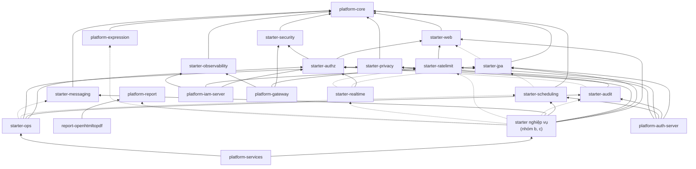
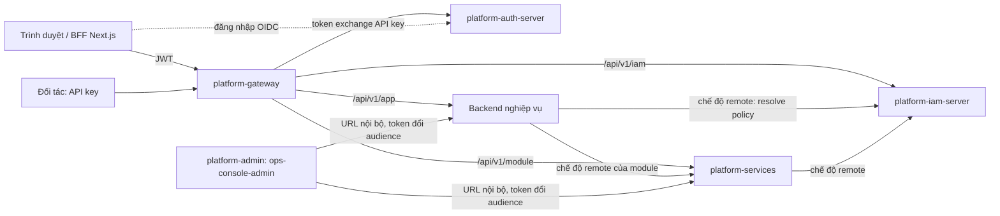

# Tài liệu tổng quan module

Mỗi module có một trang tiếng Việt cùng khuôn: mục đích, thành phần, tính năng chính, cách dùng nhanh, cấu hình, tích
hợp, chế độ triển khai, trạng thái. Nguồn sự thật là code trên `main` của từng repo và thiết kế ở
[`docs/design/`](../design/). Chỗ chưa chắc ghi "(cần xác nhận)".

## Phiên bản hiện tại

| Thành phần | Phiên bản | Ghi chú |
|---|---|---|
| platform-java (mọi thư viện `com.vyforge.platform:*`, image `platform-iam-server`, `platform-services`) | **0.16.1** | Java 25, Spring Boot 4.1.1, Spring Modulith 2.1, PostgreSQL 18. Release notes: [0.16.0](../releases/platform-java-0.16.0.md); 0.16.1 chỉ ghim snappy-java 1.1.10.9 |
| platform-gateway | **0.2.1** | parent 0.16.0 |
| platform-auth-server | **0.2.1** | parent 0.15.0 |
| platform-web (`@vyforge/*`) | theo từng package | vd. `admin-shell` 0.3.0, `admin-kit` 0.2.0, `ui` 0.5.0, `api-client` 0.6.0, `iam` 0.5.0 |

## Mục lục

### a. Nền tảng và hạ tầng

| Module | Mô tả |
|---|---|
| [platform-core](platform-core.md) | Ngữ cảnh tenant/request, cache theo tenant, `SecretCipher`, `Money`, `EntityRef`, `VietnameseText`, SPI license/settings/extensible |
| [platform-starter-web](platform-starter-web.md) | Problem Details + mã lỗi vi/en, `X-Request-Id`, `Idempotency-Key`, API danh sách quản trị, `RestClient` có timeout/retry/circuit breaker |
| [platform-starter-security](platform-starter-security.md) | Resource server OIDC bắt buộc `aud`, `CurrentUser`, tenant từ token, token exchange RFC 8693 |
| [platform-starter-jpa](platform-starter-jpa.md) | PostgreSQL + JPA + Flyway, cách ly tenant bằng Hibernate, jpa-extras: tìm không dấu, `LocalizedText`, xoá mềm + thùng rác, mã hoá cột |
| [platform-starter-authz](platform-starter-authz.md) | Phân quyền kiểu AWS IAM: policy JSON, group, `@RequiresPermission`, Policy Simulator, `PermissionBoundary`, chế độ local/remote |
| [platform-starter-audit](platform-starter-audit.md) | Audit log nghiệp vụ (`@Audited`, `AuditLog`), che PII, REST `/api/v1/audit-log` |
| [platform-starter-messaging](platform-starter-messaging.md) | Outbox Spring Modulith tự bảo trì, Kafka retry + DLT, consumer idempotent, ops outbox/dead-letter |
| [platform-starter-scheduling](platform-starter-scheduling.md) | `@ClusterScheduled` (ShedLock, theo tenant) và `DurableTaskQueue` (việc nền bền vững trong PostgreSQL) |
| [platform-starter-ratelimit](platform-starter-ratelimit.md) | Token bucket trên Valkey dùng chung giữa replica, `@RateLimited`, rule theo path, fail-open/closed |
| [platform-starter-observability](platform-starter-observability.md) | Health probe, OpenTelemetry gắn tenant/request id, graceful shutdown, virtual threads, log JSON ECS |
| [platform-starter-ops](platform-starter-ops.md) | ops-console trên mỗi backend: việc nền, queue, job, outbox, DLT, cache; zone `ops-console-admin` |
| [platform-starter-realtime](platform-starter-realtime.md) | Đẩy tin SSE/WebSocket theo topic thuộc tenant, kiểm quyền IAM, replay, fan-out Valkey/Kafka |
| [platform-expression](platform-expression.md) | Thư viện CEL có sandbox và hàm VN cho workflow, automation |
| [platform-report](platform-report.md) | Thư viện dựng PDF/DOCX theo template của tenant, in hàng loạt, ký PAdES; gồm `platform-report-openhtmltopdf` (LGPL) |
| [platform-test](platform-test.md) | `SharedPostgres`/`SharedRedis`/`SharedKafka`, `TestJwt`, `TestAuthz`, luật ArchUnit, kiểm schema/mã lỗi/tenant |
| [platform-bom, platform-parent](platform-bom-parent.md) | Ghim version + bản vá CVE; enforcer, Spotless, JaCoCo 60%, SBOM CycloneDX, Error Prone/NullAway; luật `NO_SYSTEM_TIME_ZONE` |
| [platform-iam-server](platform-iam-server.md) | App IAM tập trung cho chế độ remote, policy dựng sẵn cho tenant admin |
| [platform-auth-server](platform-auth-server.md) | Identity provider OIDC (repo riêng): MFA, passkey, SAML/LDAP/Zalo, tenant, danh bạ, đổi API key |
| [platform-gateway](platform-gateway.md) | API gateway (repo riêng): xác thực JWT, định tuyến theo service, rate limit, API key đối tác |

### b. Dữ liệu dùng chung và nghiệp vụ nền

| Module | Mô tả |
|---|---|
| [platform-starter-licensing](platform-starter-licensing.md) | File giấy phép ký số kiểm offline (on-prem, air-gapped): module được chạy, số tenant/người dùng, hạn, bản được nâng cấp |
| [platform-starter-features](platform-starter-features.md) | Feature flag (OpenFeature, flagd) và entitlement theo gói, quota, trial |
| [platform-starter-settings](platform-starter-settings.md) | Cài đặt có kiểu khai báo bằng code, ghi đè theo tầng platform → tenant → đơn vị → người dùng, duyệt 4 mắt, UI tự sinh |
| [platform-starter-sequence](platform-starter-sequence.md) | Đánh số chứng từ FAST/GAPLESS, reset theo kỳ, sổ cái và báo cáo liên tục |
| [platform-starter-master-data](platform-starter-master-data.md) | Danh mục dùng chung (ngân hàng có BIN NAPAS, tỷ giá…), gói dữ liệu, thuộc tính kiểm theo JSON Schema |
| [platform-starter-organization](platform-starter-organization.md) | Cơ cấu tổ chức: cây đơn vị có hiệu lực theo thời gian, chức danh, kiêm nhiệm, trưởng/phó, quản lý trực tiếp |
| [platform-starter-calendar](platform-starter-calendar.md) | Lịch làm việc VN, ngày nghỉ, âm lịch, cộng ngày làm việc, nhắc việc, iCalendar |
| [platform-starter-tenant-lifecycle](platform-starter-tenant-lifecycle.md) | Đăng ký, kích hoạt, tạm khoá, xuất và xoá tenant; nối billing/payment/privacy-dsr |
| [platform-starter-privacy](platform-starter-privacy.md) | `@PersonalData`, che PII trong log và audit (Luật 91/2025, NĐ 356/2025) |
| [platform-starter-privacy-dsr](platform-starter-privacy-dsr.md) | Yêu cầu của chủ thể dữ liệu (xuất, xoá, đồng ý) qua contributor của các service |
| [platform-starter-files](platform-starter-files.md) | Lưu trữ file: presigned upload, quét virus, biến thể ảnh, attachment, chia sẻ, quota, legal hold |
| [platform-starter-export](platform-starter-export.md) | Xuất CSV/XLSX/PDF, nhập Excel qua staging, báo cáo PDF theo template tenant |
| [platform-starter-search](platform-starter-search.md) | Tìm toàn văn tiếng Việt (không dấu, Telex dở), facet, lọc theo tenant và quyền; adapter `platform-search-opensearch`, `platform-search-meilisearch` |
| [platform-starter-notification](platform-starter-notification.md) | Thông báo đa kênh (email, SMS, Zalo ZNS, push, in-app, chat), template Liquid, tuỳ chọn người nhận |
| [platform-starter-webhooks](platform-starter-webhooks.md) | Webhook gửi ra (Standard Webhooks, retry, DLQ, replay) và nhận vào (`platform-starter-webhooks-inbound`) |
| [platform-starter-custom-fields](platform-starter-custom-fields.md) | Trường tuỳ biến theo tenant trên entity `Extensible`, không DDL |
| [api-access](platform-starter-api-access.md) | App đối tác, API key, scope, quota, cổng nhà phát triển (`platform-api-access-core`, `-gateway`, `platform-starter-api-access`, K9) |

### c. Nghiệp vụ và ứng dụng

| Module | Mô tả |
|---|---|
| [workflow](workflow.md) | Quy trình phê duyệt nhiều cấp: DSL VyFlow → BPMN trên Flowable nhúng, SLA, uỷ quyền |
| [automation](automation.md) | Luật "khi X thì Y" do tenant admin tự cấu hình (trigger từ event, lịch, webhook); gồm `platform-automation-api` |
| [forms](forms.md) | Form builder, form động, khảo sát; gồm `platform-forms-core` |
| [cms-content](cms-content.md) | Headless CMS: content type động, editor block, đa ngôn ngữ, draft → review → publish, API delivery có cache |
| [collaboration](collaboration.md) | Bình luận, dòng thời gian, việc cần làm, kiểm duyệt gắn vào bản ghi bất kỳ |
| [ai](ai.md) | AI gateway nhiều provider, che PII, ngân sách, prompt có version, RAG, agent |
| [ekyc](ekyc.md) | eKYC: giấy tờ (OCR, chip NFC), khuôn mặt (so khớp, liveness), adapter FPT.AI/VNPT/Viettel…, duyệt tay |
| [esign](esign.md) | Ký số tài liệu, phong bì nhiều người ký; gồm adapter `platform-starter-esign-dss` (LGPL) |
| [payment](payment.md) | Thanh toán VNPay, MoMo, ZaloPay, payOS, SePay, Stripe; hoàn tiền, thu định kỳ, sổ cái |
| [billing](billing.md) | Gói dịch vụ, thuê bao, tính phí và hoá đơn |
| [einvoice](einvoice.md) | Hoá đơn điện tử |
| [platform-services](platform-services.md) | App nhúng các starter, bật module bằng `SERVICES_MODULES` |
| [admin-shell](admin-shell.md) | `@vyforge/admin-shell`: khung khu quản trị, `requireOperator`, `requireStepUp` |
| [admin-kit](admin-kit.md) | `@vyforge/admin-kit`: bảng, bulk, `TaskMonitor`, `AuditTimeline` |
| [ui](ui.md) | `@vyforge/ui`: component giao diện dùng chung |
| [api-client](api-client.md) | `@vyforge/api-client`: client gọi API, đọc Problem Details |
| [i18n](i18n.md) | `@vyforge/i18n`: đa ngôn ngữ vi/en |
| [platform-admin](platform-admin.md) | Shell quản trị và cách tạo zone (`create-admin-zone`) |
| [template-spring-boot](template-spring-boot.md) | Template backend Spring Boot |
| [template-nextjs](template-nextjs.md) | Template frontend Next.js (sub-template resource) |

Module nhóm b và c do tài liệu riêng của nhóm đó mô tả. Module phụ (`platform-search-*`,
`platform-starter-webhooks-inbound`, `platform-api-access-*`, `platform-forms-core`, `platform-automation-api`,
`platform-starter-esign-dss`, `platform-report-openhtmltopdf`) nằm trong trang của module chính. Hai công cụ
`tools/license-cli` và `tools/masterdata-packs` của platform-java chưa có trang riêng.

## Sơ đồ phụ thuộc chính

Lấy từ dependency không phải `test` trong `pom.xml` của platform-java (`main`). Mũi tên `A --> B` nghĩa là A phụ thuộc
B. Nét đứt là phụ thuộc tuỳ chọn. Chỉ vẽ các cạnh chính.

Luồng lúc chạy:

Quy tắc chung:

- Mọi service tự kiểm JWT và quyền; gateway không đánh giá IAM.
- Tenant chỉ lấy từ claim `tenant_id`.
- API `/internal/**` và `/ops/**` không đi qua gateway.
