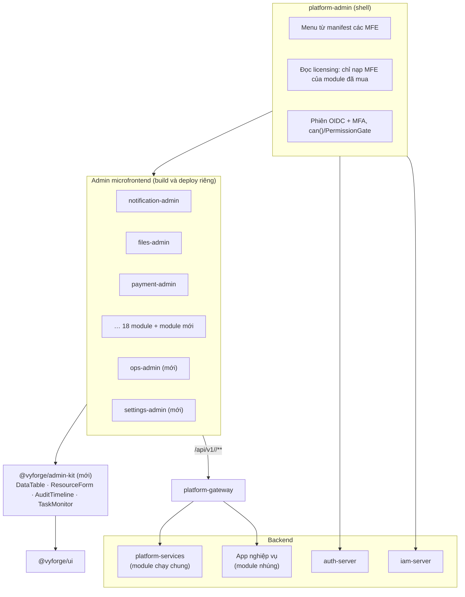
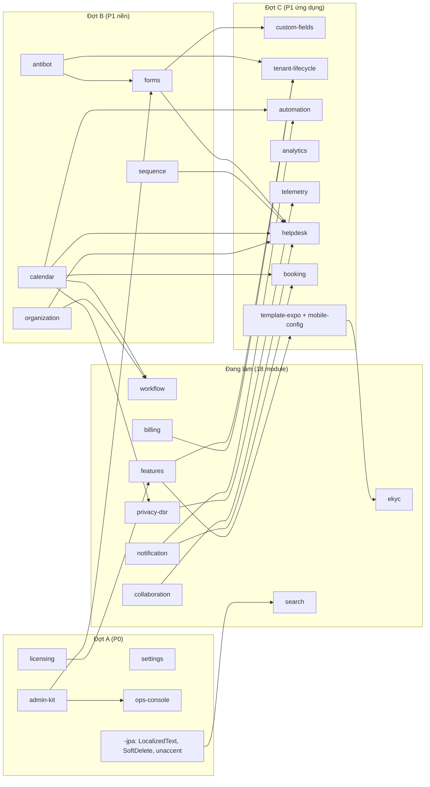

> Báo cáo nghiên cứu ngày 26/10/2026. Bổ sung cho [MODULE_PLAN.md](../MODULE_PLAN.md) và hai báo cáo
> [module thông dụng](2026-10-module-thong-dung.md), [quy hoạch](2026-10-quy-hoach-vyforge.md). Đây là đề xuất, chưa
> phải quyết định. Mỗi module mới được chốt bằng tài liệu thiết kế `docs/design/<module>.md` rồi mới code (nguyên tắc 5).

# Rà soát khoảng trống: vyforge còn thiếu service và module dùng chung nào

Người dùng yêu cầu: *"nghiên cứu thêm thiếu gì nữa không? các service common cần triển khai hết, cả CMS quản trị và phần
server phía sau"*. Nguyên tắc đã chốt: platform đi trước nhu cầu, xây sẵn mọi service dùng chung. Báo cáo này vì vậy không
có hạng mục "chờ dự án cần mới làm". P0, P1, P2 chỉ là **thứ tự**, không phải điều kiện để làm.

## Tóm tắt

**Đã có hoặc đang làm (18 module, không đề xuất lại):**

| Nhóm | Module | Trạng thái 26/10/2026 |
|---|---|---|
| P1 đang thiết kế xong, chờ triển khai | notification, files, export, webhooks, features, payment, realtime | `docs/design/*.md` (forge-28…34); khối chung `SecretCipher`, `DurableTaskQueue`, `StarterSchemaMigrator` (forge-35) |
| Server và quản trị | `platform-services`, admin microfrontend | forge-37 đang thiết kế |
| Mới mở session thiết kế | master-data, workflow, collaboration, search, api-access, cms-content, privacy-dsr, billing, ekyc, esign, ai | forge-38…48 |

**Còn thiếu ngoài 18 module trên: 22 module mới**, cộng một số mở rộng module có sẵn và chỉnh phạm vi, chia thành ba loại.

| Loại | Hạng mục | Ưu tiên |
|---|---|---|
| **Module mới** | `admin-kit` (khối CRUD, DataTable, form, sinh code quản trị), `settings` (cài đặt phân tầng), `licensing` (giấy phép module cho bản on-prem), `ops-console` (vận hành job, outbox, DLT) | P0 |
| | `organization` (cơ cấu tổ chức, phòng ban, chi nhánh, chức danh), `sequence` (đánh số chứng từ), `calendar` (lịch làm việc, ngày lễ VN, SLA theo ngày làm việc, nhắc việc), `forms` (form builder, form động, khảo sát), `custom-fields` (trường tuỳ biến theo tenant), `tenant-lifecycle` (đăng ký, khởi tạo, chọn gói, offboarding), `automation` (luật "khi X thì Y" do tenant cấu hình), `antibot` (captcha tự host, chống lạm dụng form công khai), `analytics` (BI nhúng, dashboard theo tenant), `telemetry` (product analytics, tracking event), `helpdesk` (ticket, SLA, CSKH), `booking` (đặt lịch hẹn, tài nguyên, slot), `template-expo` + `mobile-config` (đưa từ P2 lên) | P1 |
| | `engagement` (thông báo hệ thống, changelog, góp ý, bình chọn tính năng, NPS), `chat` (chat trong app, CSKH), `translations` (quản lý bản dịch lúc chạy), `records` (lưu trữ hồ sơ điện tử theo Luật Lưu trữ 2024), `contacts` (danh bạ khách hàng/đối tác dùng chung, tra MST) | P2 |
| **Mở rộng module có sẵn** | auth-server: hỗ trợ "đăng nhập thay" (support impersonation) có đồng ý và audit; IdP VNeID khi có kênh tích hợp chính thức. `-jpa`: `LocalizedText`, `@SoftDeletable`, `unaccent` + trigram **vẫn chưa làm** dù đã có trong kế hoạch. Chart `platform-status` (status page) | P0–P2 |
| **Chỉnh phạm vi 11 session mới** | 14 điểm chỉnh ở mục 3: tách `organization` khỏi workflow; collaboration thêm *activity/to-do* và kiểm duyệt nội dung (NĐ 147/2024); master-data thêm tỷ giá; esign dùng chung renderer của export; privacy-dsr dùng `calendar` cho SLA "ngày làm việc"… | ngay |

**"CMS quản trị"** có hai nghĩa và cần cả hai (mục 4):
- **(a) Back-office cho service dùng chung:** shell `platform-admin` + microfrontend từng module + server `platform-services`
  (forge-37). Phần còn thiếu để làm được là `admin-kit`, `ops-console`, `settings`, bản dành cho tenant admin, và
  `licensing` để bật đúng module khách hàng mua.
- **(b) Headless CMS nội dung:** `cms-content` (forge-43). Khuyến nghị: đánh giá Payload (MIT) trước, vì Directus dùng license
  không phải OSI (MSCL-1.0) và Strapi có thư mục `ee/` thương mại.

**Lộ trình (mục 5):** 4 đợt, mỗi đợt 4–6 luồng chạy song song. Đợt A (P0) là nền cho mọi admin microfrontend nên mở ngay
cùng lúc với triển khai 7 module P1.

> **Phạm vi và độ tin cậy.** Version và license kiểm ngày 26/10/2026: server OSS qua GitHub Releases API và file LICENSE
> (`gh api repos/<repo>/releases/latest`, `.../license`), thư viện Java qua `maven-metadata.xml` trên Maven Central. Danh
> sách module của ABP lấy trực tiếp từ [abp.io/modules](https://abp.io/modules). Văn bản pháp lý VN lấy từ báo chính
> thống, cổng thông tin cơ quan nhà nước và thư viện pháp luật; **chưa đối chiếu toàn văn**. Chỗ chưa chắc được đánh dấu
> **(chưa kiểm chứng)**. Cột của nền tảng khác trong bảng đối chiếu dựa trên tài liệu công khai; ◐ nghĩa là có một phần
> hoặc qua plugin/extension.

---

## 1. Bảng đối chiếu năng lực

### 1.1 Nền tảng tham chiếu

| Nền tảng | Version | License | Điều đáng học cho vyforge |
|---|---|---|---|
| **ABP Framework** | 10.7.0 (06/10/2026) | LGPL-3.0 (framework); 18/28 module là Pro | Danh mục module "cài là dùng". Bản Free: Account, Blogging, CMS Kit, Docs, Feature Management, Identity, Setting Management, Tenant Management, Virtual File Explorer. Bản Pro: AI Management, Audit Logging UI, Chat, CMS Kit Pro, Elsa Workflows, File Management, Forms, GDPR, Language Management, OpenIddict UI, Operation Rate Limiting, Payment, SaaS, Text Template Management, Twilio SMS ([abp.io/modules](https://abp.io/modules)) |
| **JHipster** | 9.4.0 (18/09/2026) | Apache-2.0 | Sinh entity và màn hình CRUD từ JDL; admin sẵn (metrics, health, logs, config, user management) |
| **Supabase** | v1.26.08 (self-host, 08/2026) | Apache-2.0 | Queues (pgmq), Cron (pg_cron), Vault, Log Drains, Branching, Storage, Realtime, Vector ([features](https://supabase.com/features)) |
| **Appwrite** | 2.6.2 (24/10/2026) | BSD-3 | Messaging, Storage, Functions, Sites, Databases, Teams |
| **Directus** | v12.5.1 | MSCL-1.0 (không phải OSI) | Data Studio trên DB có sẵn; Flows (tự động hoá), Insights (dashboard), quyền theo field, revisions, translations |
| **Strapi / Payload** | 5.59.0 / 3.92.0 | MIT + `ee/` / MIT | Content-type builder, i18n, draft/publish, review workflow (Strapi EE), Form Builder và Live Preview (Payload) |
| **Odoo** | 19 (09/2025) | LGPL-3.0 (Community) | Phần nền dùng lại khắp ERP: `mail.thread` (chatter), `mail.activity` (việc cần làm, nhắc, phê duyệt qua activity), `ir.sequence`, `ir.attachment`, `res.partner`, phòng ban, lịch ([release notes](https://www.odoo.com/odoo-19-release-notes), [mail_activity_approval](https://apps.odoo.com/apps/modules/19.0/mail_activity_approval)) |
| **Frappe Framework** | v16.53.0 (22/10/2026) | MIT | Custom Field/Customize Form, Naming Series, Print Format, Web Form, Workflow, Assignment Rule, Auto Repeat, Notification rules, Server Script, Report Builder, Dashboard/Number Card, Data Import, User Permission theo bản ghi ([v16](https://frappe.io/framework/version-16)) |
| **Backstage** | v1.56.2 (22/10/2026) | Apache-2.0 | Catalog, Scaffolder, TechDocs, plugin |
| **Spring Modulith** | 2.1.2 (23/10/2026) | Apache-2.0 | Event publication registry (outbox), externalization, **Moments** (sự kiện thời gian `DayHasPassed`, `MonthHasPassed`…, có `zone-id` và `TimeMachine` để test) ([docs](https://docs.spring.io/spring-modulith/reference/moments.html)) |
| **SaaS starter kit** (MakerKit, supastarter, Bullet Train) | — | thương mại / Bullet Train MIT | Team và lời mời, onboarding tạo team đầu tiên, super admin có **impersonation kèm audit**, billing, help center ([MakerKit super admin](https://makerkit.dev/blog/changelog/super-admin), [supastarter](https://supastarter.dev/products), [Bullet Train](https://bullettrain.co/)). Tài liệu của nhà bán, chỉ để tham khảo |

### 1.2 Ma trận năng lực

Ký hiệu nền tảng khác: ● có sẵn, ◐ một phần hoặc qua plugin, ○ không có. Cột vyforge: **✓** đã có, **⧗** đang thiết kế
hoặc triển khai (ghi session), **✗** chưa có (ghi đề xuất ở mục 2). Cột "Starter" gộp MakerKit, supastarter, Bullet Train.

| Năng lực | ABP | JHip | Supa | Appw | Directus | Strapi/Payload | Odoo | Frappe | Starter | **vyforge** |
|---|---|---|---|---|---|---|---|---|---|---|
| **Danh tính và tenant** | | | | | | | | | | |
| OIDC, MFA, social, passkey | ● | ● | ● | ● | ● | ◐ | ◐ | ● | ● | **✓** auth-server |
| Phân quyền chi tiết, policy | ● | ◐ | ● (RLS) | ● | ● (field) | ◐ | ● | ● | ◐ | **✓** authz, iam-server |
| Quản lý tenant | ● | ○ | ○ | ◐ (teams) | ○ | ○ | ◐ (company) | ◐ | ● | **✓** ADR-0011 |
| Tenant tự đăng ký, chọn gói, khởi tạo dữ liệu | ● (SaaS, Pro) | ○ | ○ | ○ | ○ | ○ | ○ | ○ | ● | **✗** → `tenant-lifecycle` |
| Cơ cấu tổ chức (phòng ban, chi nhánh, chức danh, cây quản lý) | ● (Organization Units) | ○ | ○ | ○ | ○ | ○ | ● | ● | ○ | **✗** → `organization` |
| Quyền theo phạm vi dữ liệu (chi nhánh, phòng ban) | ● | ○ | ● (RLS) | ◐ | ● | ○ | ● (record rules) | ● (User Permission) | ○ | **◐** IAM condition có, thiếu nguồn thuộc tính tổ chức → `organization` |
| Đăng nhập thay để hỗ trợ (impersonation) | ● | ◐ | ○ | ○ | ○ | ○ | ◐ | ● | ● | **◐** chỉ token exchange RFC 8693 → mở rộng auth-server |
| API key, client đối tác, developer portal | ◐ | ○ | ● | ● | ● (static token) | ● | ◐ | ● | ◐ | **⧗** api-access (forge-42) |
| Captcha, chống bot cho form công khai | ◐ | ○ | ● (captcha cho auth) | ◐ | ○ | ◐ | ● (Turnstile) | ◐ | ○ | **✗** → `antibot` |
| **Dữ liệu dùng chung** | | | | | | | | | | |
| Danh mục dùng chung, địa chỉ | ◐ | ○ | ○ | ○ | ○ | ○ | ● | ● | ○ | **⧗** master-data (forge-38) |
| Cài đặt phân tầng (platform → tenant → user), UI tự sinh | ● (Setting Mgmt) | ◐ | ○ | ○ | ● | ◐ | ● | ● (Single DocType) | ◐ | **✗** → `settings` |
| Trường tuỳ biến theo tenant | ● (extra properties) | ○ | ○ | ○ | ● | ● (schema builder) | ● (Studio, EE) | ● | ○ | **✗** → `custom-fields` |
| Đánh số chứng từ theo mẫu (năm, chi nhánh, không nhảy số) | ○ | ○ | ○ | ○ | ○ | ○ | ● | ● | ○ | **✗** → `sequence` |
| Dữ liệu đa ngôn ngữ | ● | ○ | ○ | ○ | ● | ● | ● | ● | ○ | **✗** `LocalizedText` đã có trong kế hoạch `-jpa`, chưa làm |
| Quản lý bản dịch lúc chạy | ● (Language Mgmt, Pro) | ○ | ○ | ○ | ● | ○ | ● | ● | ○ | **✗** → `translations` |
| Lịch làm việc, ngày lễ, giờ làm việc | ○ | ○ | ○ | ○ | ○ | ○ | ● (working schedule) | ● (Holiday List) | ○ | **✗** → `calendar` |
| Soft delete, thùng rác | ● | ○ | ○ | ○ | ◐ | ◐ | ● (archive) | ● (Deleted Document) | ○ | **✗** `@SoftDeletable` trong kế hoạch, chưa làm |
| **Nội dung và tài liệu** | | | | | | | | | | |
| File, presigned URL | ● (Pro) | ○ | ● | ● | ● | ● | ● | ● | ● | **⧗** files |
| Headless CMS | ● (CMS Kit) | ○ | ○ | ○ | ● | ● | ● (Website) | ● (Web pages) | ◐ (blog) | **⧗** cms-content (forge-43) |
| Quản lý template văn bản dùng chung | ● (Text Template, Pro) | ○ | ○ | ○ | ○ | ○ | ● (QWeb) | ● | ○ | **◐** mỗi module tự có (notification, export, esign) → chỉnh phạm vi |
| Sinh tài liệu, ký số | ○ | ○ | ○ | ○ | ○ | ○ | ● (Sign, EE) | ◐ | ○ | **⧗** esign (forge-47) |
| Lưu trữ hồ sơ theo thời hạn bảo quản | ○ | ○ | ○ | ○ | ○ | ○ | ◐ | ○ | ○ | **✗** → `records` |
| **Quy trình và cộng tác** | | | | | | | | | | |
| Workflow, phê duyệt nhiều cấp | ● (Elsa, Pro) | ○ | ○ | ○ | ◐ (Flows) | ● (Strapi review, EE) | ● | ● | ○ | **⧗** workflow (forge-39) |
| Tự động hoá "khi X thì Y" do người dùng cấu hình | ◐ | ○ | ◐ (DB webhook) | ◐ (Functions) | ● (Flows) | ◐ (hooks) | ● (Automated Actions) | ● (Notification, Server Script) | ○ | **✗** → `automation` |
| Comment, activity, tag, follow | ● (CMS Kit) | ○ | ○ | ○ | ◐ (comments) | ○ | ● (chatter) | ● | ○ | **⧗** collaboration (forge-40) |
| Việc cần làm gắn bản ghi, nhắc việc, giao việc tự động | ○ | ○ | ○ | ○ | ○ | ○ | ● (activities) | ● (ToDo, Assignment Rule) | ○ | **✗** → chỉnh phạm vi collaboration + `calendar` |
| Form builder, form động, khảo sát | ● (Forms, Pro) | ○ | ○ | ○ | ◐ | ● (Payload Form Builder) | ● (Survey) | ● (Web Form) | ○ | **✗** → `forms` |
| Ticket, CSKH, SLA | ○ | ○ | ○ | ○ | ○ | ○ | ● (Helpdesk, EE) | ● (Helpdesk app) | ◐ (help center) | **✗** → `helpdesk` |
| Đặt lịch hẹn, tài nguyên | ○ | ○ | ○ | ○ | ○ | ○ | ● (Appointments) | ◐ | ○ | **✗** → `booking` |
| Chat trong app | ● (Chat, Pro) | ○ | ◐ (Realtime) | ◐ | ○ | ○ | ● (Discuss) | ◐ | ○ | **✗** → `chat` |
| **Tìm kiếm, dữ liệu, báo cáo** | | | | | | | | | | |
| Tìm kiếm toàn văn, facet | ○ | ● (ES) | ● (FTS) | ◐ | ◐ | ◐ | ◐ | ● | ○ | **⧗** search (forge-41) |
| Xuất, nhập, báo cáo theo template | ○ | ○ | ○ | ○ | ● (export) | ○ | ● | ● (Print Format, Data Import) | ○ | **⧗** export |
| Dashboard, BI nhúng theo tenant | ○ | ◐ (metrics) | ○ | ○ | ● (Insights) | ○ | ● (Spreadsheet, EE) | ● (Dashboard, Report Builder) | ○ | **✗** → `analytics` |
| Product analytics, tracking event | ○ | ○ | ○ | ○ | ○ | ○ | ○ | ○ | ● (PostHog/Umami tích hợp) | **✗** → `telemetry` |
| **Thương mại** | | | | | | | | | | |
| Thanh toán | ● (Payment, Pro) | ○ | ○ | ○ | ○ | ○ | ● | ● | ● (Stripe) | **⧗** payment |
| Feature flag, entitlement, quota | ● | ○ | ○ | ○ | ○ | ○ | ○ | ○ | ● | **⧗** features |
| Subscription, hoá đơn, hoá đơn điện tử VN | ● (SaaS editions, Pro) | ○ | ○ | ○ | ○ | ○ | ● | ● | ● | **⧗** billing (forge-45) |
| Giấy phép phần mềm cho bản cài on-prem | ● (license key của ABP Commercial) | ○ | ○ | ○ | ● (license key EE) | ● (EE key) | ● (enterprise code) | ○ | ○ | **✗** → `licensing` |
| eKYC | ○ | ○ | ○ | ○ | ○ | ○ | ○ | ○ | ○ | **⧗** ekyc (forge-46) |
| **Tích hợp** | | | | | | | | | | |
| Webhook ra ngoài, nhận vào | ◐ | ○ | ● | ● | ● | ● | ● | ● | ◐ | **⧗** webhooks |
| Realtime | ● | ● | ● | ● | ● | ○ | ● | ● | ● | **⧗** realtime |
| AI, RAG, OCR | ● (AI Mgmt, Pro) | ○ | ● (vector) | ○ | ◐ | ◐ | ● (AI, EE) | ◐ | ◐ | **⧗** ai (forge-48) |
| **Tuân thủ và quan sát** | | | | | | | | | | |
| Audit log + UI | ● (Audit UI, Pro) | ◐ | ◐ | ○ | ● (activity) | ◐ (EE) | ● | ● | ● | **◐** có `-audit`, `AuditLogTable`; chưa có UI chung cho mọi module → `admin-kit` |
| Privacy, consent, DSR, retention | ● (GDPR, Pro) | ○ | ○ | ○ | ○ | ○ | ○ | ● (Personal Data Deletion) | ○ | **⧗** privacy-dsr (forge-44) |
| Observability stack | ◐ | ● | ● (Log Drains) | ◐ | ○ | ○ | ○ | ◐ | ○ | **✓** chart `platform-observability` |
| Console vận hành: job, hàng đợi, outbox, DLT | ● (Background Jobs) | ● (admin) | ● (Queues UI) | ◐ | ○ | ○ | ● (scheduled actions) | ● (RQ Job, Scheduled Job Log) | ○ | **✗** → `ops-console` |
| Status page, thông báo hệ thống, changelog | ○ | ○ | ○ | ○ | ○ | ○ | ○ | ◐ (announcement) | ◐ | **✗** → chart `platform-status` + `engagement` |
| **Kênh và quản trị** | | | | | | | | | | |
| Khung admin CRUD, sinh màn hình | ● | ● (JDL) | ● (Studio) | ● (Console) | ● | ● | ● | ● | ● | **✗** `DataTable`, `ResourceForm`, `PermissionGate` trong kế hoạch `@vyforge/ui`, chưa làm → `admin-kit` |
| Admin tách module, bật theo nhu cầu | ● (module) | ○ | ○ | ○ | ● (extension) | ● (plugin) | ● (app) | ● (app) | ○ | **⧗** microfrontend (forge-37) |
| Mobile SDK, template mobile | ◐ (MAUI, RN) | ◐ | ● | ● | ● | ● | ● | ● | ● (Expo) | **✗** `template-expo` đang là P2 → nâng P1 |

### 1.3 Kết luận từ bảng

1. **Sau 18 module, vyforge vẫn thiếu đúng "phần nền ứng dụng" mà Odoo và Frappe dùng lại khắp nơi:** cài đặt phân tầng,
   cơ cấu tổ chức, đánh số chứng từ, trường tuỳ biến, form động, lịch làm việc, tự động hoá. Không có các khối này thì
   workflow, helpdesk, billing, booking sẽ mỗi module tự làm một bản.
2. **Phần "SaaS hoá" còn hở hai đầu:** chưa có luồng tenant tự đăng ký và khởi tạo (`tenant-lifecycle`), và chưa có
   giấy phép để bản on-prem chỉ bật đúng module khách mua (`licensing`). Mục 6 của module-conventions yêu cầu triển khai
   độc lập theo nhu cầu khách hàng, nên `licensing` là điều kiện thương mại chứ không phải tiện ích.
3. **Quản trị chung chưa có "gạch":** 18 admin microfrontend sẽ cùng cần bảng dữ liệu phân trang server, form theo
   schema, cổng quyền, màn audit, màn việc nền. Những thứ này đã có trong kế hoạch `@vyforge/ui` từ trước nhưng chưa làm.
   Nếu không làm trước, 18 session sẽ viết 18 bản.
4. **Ba việc đã hứa trong MODULE_PLAN vẫn chưa có trong code:** `LocalizedText`, `@SoftDeletable`, tìm kiếm `unaccent` +
   trigram trong `-jpa` (grep `platform-java` ngày 26/10/2026 không thấy). Search (forge-41) và cms-content (forge-43)
   phụ thuộc vào chúng.

---

## 2. Module còn thiếu

Định dạng mỗi module: **vì sao cần** (kịch bản thật), **xây hay dùng OSS**, **đóng gói** theo mục 6 của module-conventions
(starter / chạy trong `platform-services` / server riêng; package `@vyforge/<module>`; admin microfrontend
`@vyforge/<module>-admin`), **ưu tiên**, **phụ thuộc**, **công sức** (tuần-người, gồm test và tài liệu).

Quy ước chung áp dụng cho mọi module dưới đây: `TenantContext`, Flyway riêng `flyway_schema_history_<module>`,
`DurableTaskQueue`, `SecretCipher`, action IAM `<module>:<resource>:<Verb>`, metric `vyforge.<module>.*`, i18n vi/en,
điểm nối với module khác là interface hoặc event kèm `@ConditionalOnBean`.

### 2.1 `admin-kit`: khối dựng màn hình quản trị (P0)

**Vì sao cần.** Mỗi module có hai bản admin (người vận hành, tenant admin). 18 module là khoảng 36 khu quản trị, phần lớn
là danh sách lọc/phân trang, form tạo/sửa, chi tiết, audit, thao tác hàng loạt. Kịch bản: admin notification cần bảng log
gửi 10 triệu dòng có lọc theo kênh, trạng thái, khoảng ngày, xuất Excel; admin payment cần cùng bảng đó cho giao dịch.

**Xây hay dùng OSS.**
- Không dùng framework admin trọn gói. react-admin 5.15.5 (MIT) và Refine 5.0.12 (MIT, bản gần nhất 02/04/2026, nhịp chậm)
  đều áp mô hình data provider riêng, khó khớp Server Component + Server Action (B13).
- Dựng trên thứ đã có: TanStack Table (MIT) cho `DataTable` headless, `nuqs` cho state lọc trên URL (K6), RHF + Zod (K7).
- Form theo schema dùng chung engine với `forms` (mục 2.8): `@rjsf/core` 6.11.0 (Apache-2.0) hoặc JSON Forms 3.8.0 (MIT).
- Sinh code: sub-template Copier `resource` (giống JDL của JHipster nhưng gọn): từ một file YAML mô tả resource, sinh
  entity + Flyway + controller + page danh sách/chi tiết/form + action IAM. JHipster 9.4.0 là tham chiếu.

**Đóng gói.** `@vyforge/admin-kit` (package web): `DataTable` (phân trang server khớp `PageResponse`, lọc, sắp xếp, chọn
cột, thao tác hàng loạt, xuất qua `-export`), `ResourceForm`, `DetailView`, `PermissionGate`, `AuditTimeline` (đọc
`-audit`), `TaskMonitor` (đọc `DurableTaskQueue`), `ConfirmDangerDialog` (gõ lại tên để xác nhận), khung trang admin
microfrontend theo manifest của forge-37. Sub-template `resource` trong `template-spring-boot` và `template-nextjs`.

**Ưu tiên:** P0, chạy song song với forge-37; các admin microfrontend chỉ bắt đầu sau khi `DataTable` và `ResourceForm`
có API ổn định. **Phụ thuộc:** `@vyforge/ui`, `@vyforge/api-client`, `@vyforge/auth` (`can`). **Công sức:** 4.

### 2.2 `settings`: cài đặt phân tầng (P0)

**Vì sao cần.** ABP Setting Management và Frappe Single DocType giải bài toán này: giá trị mặc định ở platform, ghi đè ở
tenant, rồi ở người dùng. Kịch bản: múi giờ và định dạng số của tenant; logo và màu thương hiệu dùng chung cho email,
PDF, trang đăng nhập; người dùng chọn ngôn ngữ và mật độ bảng; chính sách mật khẩu của tenant; giờ yên lặng mặc định.
Hiện mỗi module P1 tự có bảng "cấu hình theo tenant" riêng. Cấu hình phức tạp (provider, khoá) vẫn nên ở module, nhưng các
giá trị đơn giản mà UI cần hiện chung thì đang không có chỗ.

**Xây hay dùng OSS.** Tự xây, mỏng. Không dùng Spring Cloud Config (MODULE_PLAN mục 5 đã loại). Không dùng feature flag
cho việc này: `features` đánh giá theo ngữ cảnh và có rollout, còn settings là giá trị có kiểu, ghi đè theo tầng, đọc
nhiều.

**Thiết kế gợi ý.**
- Module khai báo định nghĩa bằng code: `SettingDefinition<T>` (key, kiểu, mặc định, phạm vi cho phép
  `PLATFORM|TENANT|USER`, nhạy cảm hay không, JSON Schema để UI tự sinh form, nhóm hiển thị).
- `Settings.get(key)` đọc theo thứ tự user → tenant → platform → mặc định; cache theo quy ước `platform-core`, xoá cache qua
  Valkey pub/sub như IAM.
- Giá trị nhạy cảm mã hoá bằng `SecretCipher`, API không trả bản rõ.
- Mọi thay đổi có audit. Event `SettingChanged` để module khác phản ứng.
- Thay đổi qua API, có version để khôi phục.

**Đóng gói.** Starter `platform-starter-settings`; chạy embedded hoặc trong `platform-services`. `@vyforge/settings`
(`getSetting()` phía server, form tự sinh). Admin microfrontend: trang cài đặt nhóm theo module, bản platform và bản
tenant admin; trang "Tuỳ chọn của tôi".

**Ưu tiên:** P0. **Phụ thuộc:** `-jpa`, `-authz`, `-audit`, `platform-core`. **Được dùng bởi:** gần như mọi module có admin.
**Công sức:** 2,5.

### 2.3 `licensing`: giấy phép module cho bản on-prem (P0)

**Vì sao cần.** Người dùng yêu cầu "tách code từng module ra, để có thể triển khai độc lập cho khách hàng theo nhu cầu".
Khi giao bản cài on-prem (cơ quan nhà nước, ngân hàng, không có Internet), cần một cách có thể kiểm chứng để:
khách chỉ chạy được module đã mua; giới hạn số tenant, số người dùng, thời hạn hỗ trợ; gia hạn không cần cài lại. ABP,
Directus EE, Strapi EE, Odoo Enterprise đều có cơ chế license key.

**Xây hay dùng OSS.**
- **Keygen CE** v1.7.0 có license file ký số cho môi trường air-gapped, nhưng dùng **Fair Core License (FCL-1.0-ALv2)**,
  là source-available, không phải OSI; CE là API-only ([self-hosting](https://keygen.sh/docs/self-hosting/),
  [Relay](https://keygen.sh/docs/relay/)). Không chọn làm phụ thuộc runtime.
- **license3j** 3.3.0 (Apache-2.0, Maven Central) đủ để ký và kiểm file license, nhưng định dạng riêng.
- **Đề xuất: tự xây lớp mỏng.** File license là JSON (`licensee`, `modules[]`, `limits`, `not_before`, `expires_at`,
  `support_until`, `deployment_id`) ký Ed25519 (JDK có sẵn), kiểm offline bằng public key nhúng trong `platform-core`.
  Công cụ phát hành license (CLI hoặc trang nội bộ) chỉ chạy ở phía vyforge.

**Thiết kế gợi ý.**
- `LicenseGuard` đọc file từ secret/ConfigMap. Mỗi starter có cờ `@ConditionalOnLicensedModule("payment")`. Không có
  license thì chạy chế độ dev (cảnh báo, giới hạn).
- Hết hạn: không tắt dịch vụ đang chạy (rủi ro cho khách), chỉ chặn nâng cấp version và hiện cảnh báo trong admin. Hành vi
  này cần chủ sở hữu chốt.
- Shell `platform-admin` đọc license để chỉ nạp microfrontend của module đã mua.
- Nối với `features`: license là trần mà entitlement của tenant không vượt được.

**Đóng gói.** Phần kiểm trong `platform-core` (nhỏ, không phụ thuộc); CLI `vyforge-license` trong `platform-ci` hoặc repo
riêng private. Admin: trang "Giấy phép" (xem module, hạn, giới hạn, tải file mới).

**Ưu tiên:** P0, vì quyết định cách đóng gói mọi module. **Phụ thuộc:** `platform-core`, `features` (tuỳ chọn). **Công
sức:** 2.

### 2.4 `ops-console`: vận hành việc nền, outbox, dead-letter (P0)

**Vì sao cần.** 7 module P1 dùng `DurableTaskQueue`, mọi module dùng outbox Modulith (`event_publication`) và Kafka DLT.
Kịch bản: cổng ZNS lỗi 2 giờ, 50.000 việc gửi vào `DEAD`; người vận hành cần lọc theo queue/tenant/lỗi, retry hàng loạt
sau khi provider phục hồi. Outbox có event không hoàn tất sau deploy lỗi, cần republish. JHipster, Frappe (RQ Job,
Scheduled Job Log), Supabase (Queues UI) đều có màn hình này.

**Xây hay dùng OSS.** Tự xây trên API quản trị đã có của `DurableTaskQueue`; Modulith có `IncompleteEventPublications`
để republish. Không thêm JobRunr dashboard (LGPL-3.0, và vyforge đã không chọn JobRunr).

**Đóng gói.** Không cần starter mới: thêm endpoint quản trị vào `-scheduling` (đã có một phần) và `-messaging` (outbox,
DLT). Admin microfrontend `@vyforge/ops-admin`: backlog theo queue, việc lỗi, retry/cancel hàng loạt, outbox chưa hoàn tất,
DLT Kafka, job `@ClusterScheduled` (lần chạy gần nhất, khoá), xoá cache theo tenant. Chỉ người vận hành platform, bắt buộc
MFA, mọi thao tác có audit.

**Ưu tiên:** P0, cần có trước khi các module P1 lên production. **Phụ thuộc:** `-scheduling`, `-messaging`, `admin-kit`.
**Công sức:** 2.

### 2.5 `organization`: cơ cấu tổ chức (P1, đầu đợt B)

**Vì sao cần.** Ứng dụng doanh nghiệp VN gần như luôn có phòng ban, chi nhánh, chức danh, cấp quản lý. Kịch bản:
- đề nghị thanh toán trên 50 triệu cần trưởng phòng rồi giám đốc chi nhánh duyệt (workflow);
- nhân viên chi nhánh Hà Nội chỉ thấy đơn hàng của chi nhánh mình (quyền theo phạm vi dữ liệu);
- gói Pro giới hạn 5 chi nhánh (features);
- ticket chuyển về hàng đợi của phòng CSKH (helpdesk).

ABP có Organization Units; Odoo và Frappe có phòng ban và User Permission. Brief workflow (forge-39) đã nêu "nếu cần thì
tách module organization riêng". Báo cáo này đề xuất **tách**, vì ít nhất 5 module cần nó (workflow, authz, features,
helpdesk, booking) và không module nào trong số đó nên sở hữu.

**Xây hay dùng OSS.** Tự xây. Cây đơn vị dùng closure table hoặc `ltree` của PostgreSQL. Có hiệu lực theo thời gian
(người chuyển phòng ban giữa kỳ vẫn đúng lịch sử duyệt).

**Thiết kế gợi ý.**
- `org_unit` (cây, loại: công ty / chi nhánh / phòng ban / nhóm, mã, `LocalizedText`), `org_position` (chức danh),
  `org_membership` (user, đơn vị, chức danh, quản lý trực tiếp, hiệu lực từ–đến, kiêm nhiệm).
- API: `managerOf(user, level)`, `unitsOf(user)`, `descendants(unit)`.
- Cung cấp thuộc tính cho IAM qua `PrincipalAttributesProvider` (`principal.orgUnits`, `principal.branch`), để policy viết
  được điều kiện "chỉ bản ghi thuộc chi nhánh của tôi".
- Danh bạ người dùng vẫn ở auth-server (ADR-0011). Module này chỉ tham chiếu `sub`.

**Đóng gói.** Starter `platform-starter-organization`; `@vyforge/organization` (cây chọn đơn vị, sơ đồ tổ chức); admin
microfrontend cho tenant admin (quản lý cây, gán người, nhập từ Excel qua `-export`).

**Ưu tiên:** P1, làm trước workflow triển khai. **Phụ thuộc:** `-jpa`, `-authz`, `-audit`. **Công sức:** 3.

### 2.6 `sequence`: đánh số chứng từ (P1)

**Vì sao cần.** Odoo có `ir.sequence`, Frappe có Naming Series. Kịch bản VN: số phiếu thu `PT-HN-2026-000123` theo chi
nhánh và năm; số hợp đồng reset đầu năm; số đề nghị thanh toán không được nhảy số vì kế toán đối chiếu; số hồ sơ một cửa
theo mẫu của cơ quan. Hiện payment, billing, workflow, esign, helpdesk sẽ mỗi module tự đánh số.

**Xây hay dùng OSS.** Tự xây. PostgreSQL `SEQUENCE` không đảm bảo liên tục (nhảy số khi rollback), nên cần hai chế độ:
`FAST` (dùng sequence của DB, cho phép nhảy) và `GAPLESS` (bảng đếm + `SELECT … FOR UPDATE` trong cùng transaction nghiệp
vụ, có chi phí khoá).

**Thiết kế gợi ý.** Mẫu dạng `{prefix}-{branch}-{yyyy}-{seq:6}`, phạm vi reset (không, năm, tháng, ngày theo
`Asia/Ho_Chi_Minh`), theo tenant và theo khoá phụ (chi nhánh). Không tự cấp số hoá đơn điện tử: số đó do nhà cung cấp hoá
đơn và cơ quan thuế quản lý (billing).

**Đóng gói.** Nhỏ, đặt trong `-jpa` dưới package `sequence` hoặc starter riêng `platform-starter-sequence`. Đề xuất
**starter riêng** để cài độc lập theo mục 6. Admin: danh sách mẫu, giá trị hiện tại, đặt lại (có audit, cần quyền cao).

**Ưu tiên:** P1. **Phụ thuộc:** `-jpa`. **Công sức:** 1.

### 2.7 `calendar`: lịch làm việc, ngày lễ VN, SLA và nhắc việc (P1)

**Vì sao cần.**
- **SLA theo ngày làm việc là yêu cầu luật.** NĐ 356/2025 cho bên kiểm soát dữ liệu **2 ngày làm việc** để phản hồi yêu cầu
  của chủ thể dữ liệu ([báo cáo trước](2026-10-module-thong-dung.md), mục 3.14). Workflow, helpdesk, booking cũng tính SLA
  theo giờ làm việc.
- **Ngày lễ VN thay đổi theo văn bản, không cố định trong code.** Ví dụ mới nhất: Nghị quyết 28/2026/QH16 (thông qua
  24/04/2026) bổ sung **ngày 24/11 (Ngày Văn hoá Việt Nam) là ngày nghỉ hưởng nguyên lương từ 01/07/2026**, nâng tổng số
  ngày nghỉ lễ, Tết lên 12 ([FPT Shop dẫn NQ 28/2026/QH16](https://fptshop.com.vn/tin-tuc/for-gamers/nghi-le-24-11-huong-nguyen-luong-209135),
  [Báo Văn hoá](https://baovanhoa.vn/doi-song/tin-vui-tu-17-nguoi-lao-dong-chinh-thuc-co-them-1-ngay-nghi-huong-nguyen-luong-241964.html)).
  Lịch nghỉ cụ thể năm 2026 còn đang là đề xuất của Bộ Nội vụ (có hoặc không hoán đổi ngày làm việc)
  ([Báo Lào Cai](https://baolaocai.vn/bo-noi-vu-de-xuat-nghi-le-dip-ngay-van-hoa-viet-nam-nam-2026-keo-dai-4-ngay-post905418.html))
  **(chưa kiểm chứng văn bản gốc)**. Tết và Giỗ Tổ tính theo âm lịch. Ngày làm bù do Thủ tướng/Bộ Nội vụ công bố hằng
  năm. Vì vậy lịch phải là **dữ liệu có version**, có ngày làm bù, cập nhật được mà không deploy.

**Xây hay dùng OSS.**
- Tự xây phần nghiệp vụ. Thư viện: `cn.6tail:lunar` 1.7.7 (MIT) đổi âm–dương lịch; `ical4j` 4.4.0 (BSD-3) xuất/nhập
  iCalendar và luật lặp RRULE.
- Sự kiện thời gian dùng **Spring Modulith Moments** (`DayHasPassed`, `MonthHasPassed`, `zone-id`, `TimeMachine` để test)
  thay vì tự viết cron cho từng module.

**Thiết kế gợi ý.**
- `BusinessCalendar` theo tenant: tuần làm việc, giờ làm việc theo ca, ngày nghỉ (kế thừa lịch quốc gia VN do platform
  phát hành + ngày riêng của tenant), ngày làm bù.
- API `addBusinessDays(t, n)`, `businessDurationBetween(a, b)`, `isWorkingTime(t)`.
- Nhắc việc: `Reminder` (đối tượng, thời điểm hoặc offset theo ngày làm việc, kênh qua `-notification`).
- Lịch quốc gia phát hành như dữ liệu danh mục (nối master-data), có nguồn văn bản cho từng năm.

**Đóng gói.** Starter `platform-starter-calendar`; `@vyforge/calendar` (component lịch dùng FullCalendar 7.1.3, MIT;
chọn ngày làm việc); admin cho tenant admin (lịch nghỉ, giờ làm việc) và người vận hành (lịch quốc gia).

**Ưu tiên:** P1, trước privacy-dsr, workflow, helpdesk, booking triển khai. **Phụ thuộc:** `-scheduling`,
`-notification` (tuỳ chọn), master-data (tuỳ chọn). **Công sức:** 2,5.

### 2.8 `forms`: form builder, form động, khảo sát (P1)

**Vì sao cần.** ABP có module Forms (Pro), Frappe có Web Form, Payload có Form Builder, Odoo có Survey. Kịch bản:
- tenant admin tự tạo form đăng ký sự kiện, phiếu khảo sát hài lòng (CSAT) sau khi đóng ticket;
- workflow cần form nhập liệu khác nhau cho từng loại đề nghị mà không phải sửa code;
- form công khai trên trang CMS (liên hệ, ứng tuyển) có captcha;
- trường tuỳ biến (`custom-fields`) cần cùng một bộ render.

**Xây hay dùng OSS.**
- Chuẩn mô tả: **JSON Schema** + UI schema. Kiểm phía server bằng `com.networknt:json-schema-validator` 3.0.8
  (Apache-2.0).
- Render phía web: `react-jsonschema-form` 6.11.0 (Apache-2.0) hoặc JSON Forms 3.8.0 (MIT). Chọn một trong thiết kế.
- **SurveyJS:** thư viện render `survey-library` v3.2.2 là MIT, nhưng **Survey Creator (trình thiết kế) là thương mại**.
  Không dùng Creator. Form.io (OSL-3.0, copyleft) không chọn.
- Trình thiết kế form kéo thả: tự xây ở mức vừa phải trên `admin-kit` (danh sách field, thuộc tính, xem trước). Không
  làm thành low-code platform.

**Thiết kế gợi ý.** `form_definition` (version, schema, ui schema, logic hiện/ẩn, i18n), `form_submission` (dữ liệu
JSONB, `schema_version`, file qua `-files`, `@PersonalData` theo field được đánh dấu). Hook `onSubmitted` và event
`FormSubmitted` (để `automation`, `workflow` nhận). Chống spam qua `antibot` + `-ratelimit`.

**Đóng gói.** Starter `platform-starter-forms`; `@vyforge/forms` (renderer, dùng chung với `admin-kit` và
`custom-fields`); admin microfrontend (builder, danh sách bài nộp, xuất Excel).

**Ưu tiên:** P1. **Phụ thuộc:** `-files`, `-privacy`, `antibot`, `admin-kit`. **Công sức:** 4.

### 2.9 `custom-fields`: trường tuỳ biến theo tenant (P1)

**Vì sao cần.** ABP gọi là Module Entity Extensions / extra properties; Frappe có Custom Field và Customize Form; Odoo có
Studio (EE). Kịch bản: cùng một sản phẩm CRM bán cho 20 khách hàng, khách A cần thêm "Mã khách hàng cũ", khách B cần
"Nguồn giới thiệu" dạng danh sách chọn. Không thể fork code hay thêm cột cho từng khách.

**Xây hay dùng OSS.** Tự xây. Quy ước module-conventions đã có cột `attributes` JSONB. Module này thêm phần **định nghĩa
có quản trị** cho cột đó.

**Thiết kế gợi ý.**
- `custom_field_definition` (entity type, key, kiểu, bắt buộc, danh sách chọn từ master-data, quyền xem/sửa theo action
  IAM, có `@PersonalData` hay không, hiển thị trong danh sách/tìm kiếm).
- Kiểm dữ liệu khi lưu bằng JSON Schema sinh từ định nghĩa.
- Chỉ mục: GIN trên `attributes`, hoặc expression index cho field được đánh dấu "lọc được".
- Đẩy sang search (forge-41) qua event.
- Entity muốn mở rộng chỉ cần implement `Extensible`.

**Đóng gói.** Starter `platform-starter-custom-fields`; render bằng `@vyforge/forms`; admin cho tenant admin.

**Ưu tiên:** P1. **Phụ thuộc:** `forms`, `-jpa`, search (tuỳ chọn). **Công sức:** 2,5.

### 2.10 `tenant-lifecycle`: tự đăng ký, khởi tạo, chọn gói, offboarding (P1)

**Vì sao cần.** ABP SaaS (Pro) và mọi SaaS starter đều có luồng này. Kịch bản: hộ kinh doanh vào trang đăng ký, nhập tên
cửa hàng và số điện thoại, xác thực OTP, chọn gói Free, có ngay tenant kèm dữ liệu mẫu, rồi được mời nâng cấp lên Pro
và thanh toán VietQR. Ở chiều ngược lại: khách ngừng dùng thì xuất toàn bộ dữ liệu, giữ trong thời hạn hợp đồng, rồi xoá
có biên bản (khớp Luật 91/2025 và nghĩa vụ xoá).

Hiện auth-server có tạo tenant (người vận hành làm) và tự đăng ký **tài khoản**, nhưng không có luồng **tạo tenant tự phục
vụ**, không có cơ chế để từng module khởi tạo dữ liệu khi tenant mới ra đời.

**Xây hay dùng OSS.** Tự xây. Saga ngắn bằng event Modulith và `DurableTaskQueue`.

**Thiết kế gợi ý.**
- SPI `TenantProvisioner` mỗi module cài: `provision(tenant, plan)`, `deprovision`, `exportData`. Module nào có mặt
  (`@ConditionalOnBean`) thì tham gia.
- Trạng thái `REQUESTED → PROVISIONING → ACTIVE → SUSPENDED → OFFBOARDING → DELETED`.
- Gọi billing/features để gắn gói; gọi auth-server để tạo tenant và gán owner.
- Mẫu dữ liệu khởi tạo (template tenant).
- Offboarding: dùng SPI xuất dữ liệu của privacy-dsr ở cấp tenant, lưu file qua `-files`, có retention.

**Đóng gói.** Phần điều phối chạy trong `platform-services` (cần quyền gọi auth-server); `@vyforge/onboarding` (trang
đăng ký nhiều bước, wizard chọn gói); admin cho người vận hành (hàng đợi tenant mới, tenant lỗi khởi tạo, offboarding).

**Ưu tiên:** P1, đi cùng billing. **Phụ thuộc:** auth-server, features, billing, `antibot`, `-notification`,
privacy-dsr. **Công sức:** 3.

### 2.11 `automation`: luật tự động do tenant cấu hình (P1)

**Vì sao cần.** Directus Flows, Odoo Automated Actions, Frappe Notification rule và Server Script đều giải bài toán "khi X
thì Y" mà không cần dev. Kịch bản: "khi đơn hàng chuyển sang Đã giao và tổng tiền trên 10 triệu thì gửi ZNS cảm ơn và
tạo việc gọi lại sau 3 ngày làm việc"; "khi form ứng tuyển được nộp thì gửi email cho phòng nhân sự".

**Ranh giới với workflow (forge-39).** Workflow là quy trình nhiều bước có người tham gia, có trạng thái chờ. Automation là
luật sự kiện–điều kiện–hành động (ECA), chạy xong ngay, không có bước chờ người. Gộp vào workflow thì automation phải kéo
theo engine BPM dù khách không mua workflow. Mục 6 yêu cầu cài độc lập, nên **tách**. Hành động "khởi động workflow" chỉ
có khi workflow được cài.

**Xây hay dùng OSS.** Tự xây lớp mỏng. Điều kiện viết bằng biểu thức có sandbox: **CEL** (`dev.cel:cel` 0.14.0 của Google,
Apache-2.0) hoặc JSONLogic. Không cho chạy script tuỳ ý như Server Script của Frappe (rủi ro bảo mật). Không dùng n8n
(Sustainable Use License, không phải OSI).

**Thiết kế gợi ý.** Trigger lấy từ catalog event công khai của các module (`TenantAwareEvent`), từ lịch (`calendar`),
hoặc từ thay đổi bản ghi. Hành động qua SPI `AutomationAction` mà module cài: gửi thông báo, gọi webhook, tạo việc
(collaboration), đặt giá trị field, khởi động workflow. Có giới hạn chống vòng lặp (độ sâu, số lần/phút theo tenant), có
log từng lần chạy.

**Đóng gói.** Starter `platform-starter-automation`; admin microfrontend cho tenant admin (trình dựng luật, lịch sử chạy).

**Ưu tiên:** P1, đợt C. **Phụ thuộc:** `-messaging`, `calendar`, các module cung cấp action (tuỳ chọn). **Công sức:** 3.

### 2.12 `antibot`: captcha tự host, chống lạm dụng form công khai (P1)

**Vì sao cần.** Đăng ký tenant, quên mật khẩu, form liên hệ, comment công khai, đặt lịch đều là đích của bot. Rate limit
theo IP không đủ (botnet). Captcha của Google/Cloudflare không dùng được on-prem không Internet và gửi dữ liệu người dùng ra
nước ngoài (chuyển dữ liệu xuyên biên giới theo Luật 91/2025).

**Xây hay dùng OSS.** **ALTCHA** v3.5.0 (MIT): captcha proof-of-work tự host, không cookie, không gọi bên thứ ba
([altcha.org](https://altcha.org/)); thư viện Java `org.altcha:altcha` 2.1.1 trên Maven Central. TP. München dùng ALTCHA
trong một service Spring Boot ([CaptchaService](https://opensource.muenchen.de/software/captchaservice.html)). Thiết kế có
SPI để đổi sang Turnstile hoặc hCaptcha khi khách chấp nhận.

**Đóng gói.** Không cần starter riêng: thêm `@RequiresCaptcha` và verifier vào `-ratelimit` (cùng bài toán chống lạm
dụng), widget vào `@vyforge/ui`. Auth-server dùng cho đăng ký và quên mật khẩu.

**Ưu tiên:** P1, trước `tenant-lifecycle` và form công khai. **Phụ thuộc:** `-ratelimit`. **Công sức:** 1.

### 2.13 `analytics`: dashboard và BI nhúng theo tenant (P1)

**Vì sao cần.** Export (forge-30) đã loại BI, pivot, biểu đồ tương tác khỏi phạm vi. Kịch bản: chủ chuỗi cửa hàng xem
doanh thu theo chi nhánh/ngày; người vận hành platform xem số tenant hoạt động, tin nhắn gửi theo kênh, doanh thu theo gói.
Directus Insights, Frappe Dashboard, Odoo Spreadsheet đều có phần này.

**Xây hay dùng OSS.**

| Lựa chọn | Version | License | Nhận xét |
|---|---|---|---|
| **Apache Superset** | 6.1.0 (13/05/2026) | Apache-2.0 | Embedded SDK `@superset-ui/embedded-sdk`; backend xin **guest token** qua `/api/v1/security/guest_token/` kèm mệnh đề RLS (ví dụ `tenant_id = '…'`), không gọi từ trình duyệt ([docs](https://superset.apache.org/user-docs/using-superset/embedding)). **Chọn** |
| Cube Core | v1.8.13 (25/10/2026) | Apache-2.0 (một phần MIT) | Semantic layer, security context qua JWT, phù hợp khi nhiều nguồn dữ liệu. Tuỳ chọn ở bản sau |
| Metabase | v0.64.1 | AGPL-3.0; nhúng đầy đủ nằm ở bản Enterprise (thương mại) | Không chọn làm mặc định |

**Thiết kế gợi ý.**
- Superset chạy như service hạ tầng (chart trong `platform-helm-charts`), đọc từ **bản sao chỉ đọc hoặc schema báo cáo**,
  không đọc thẳng DB giao dịch.
- Starter `platform-starter-analytics` cấp guest token theo `TenantContext` và quyền IAM (`analytics:dashboard:View`),
  luôn gắn RLS theo tenant.
- Dataset theo tenant có quy ước view `rpt_*` có `tenant_id`.
- Dashboard dựng sẵn cho các module (notification, payment, billing, features usage).
- `@vyforge/analytics` nhúng dashboard.

**Đóng gói.** Chart `platform-analytics` (Superset), starter cấp token, package web, admin microfrontend (danh mục
dashboard, gán quyền theo tenant).

**Ưu tiên:** P1, đợt C. **Phụ thuộc:** `-authz`, observability (dashboard vận hành vẫn ở Grafana). **Công sức:** 3.

### 2.14 `telemetry`: product analytics và tracking event (P1)

**Vì sao cần.** Khác observability (sức khoẻ hệ thống), đây là hành vi người dùng: phễu đăng ký, tỷ lệ dùng tính năng
mới, giữ chân theo tuần. Module `features` đã phát exposure qua hook `track` của OpenFeature nhưng chưa có nơi nhận.
Kịch bản: đo tỷ lệ chuyển đổi của màn thanh toán mới đang rollout 25%.

**Xây hay dùng OSS.**

| Lựa chọn | Version | License | Nhận xét |
|---|---|---|---|
| PostHog | phát hành liên tục | MIT, trừ thư mục `ee/` (thương mại) | Bản self-host miễn phí là Docker Compose "hobby", khuyến nghị 4 GB RAM, chỉ nên tới khoảng **100.000 event/tháng**, không có hỗ trợ ([docs](https://posthog.com/docs/self-host/deploy)). Hợp khi khách dùng PostHog Cloud |
| Umami | v3.4.1 (23/10/2026) | MIT | Web analytics gọn, không cookie; không có phễu sâu |
| OpenPanel | v3.16.1 | AGPL-3.0 | Thay thế Mixpanel tự host |
| RudderStack | v1.91.1 | Elastic License 2.0 | Không phải OSI; không chọn |

**Đề xuất.** Không gắn chặt vào một hệ. Làm **lớp thu thập trung lập**:
- `@vyforge/analytics` (client) và `Telemetry.track()` (server) theo một schema event có version;
- **tôn trọng consent** của privacy-dsr: không có đồng ý thì không gửi, hoặc chỉ gửi ẩn danh;
- che PII bằng `-privacy`;
- sink qua SPI: Umami (mặc định cho web analytics on-prem), PostHog (Cloud hoặc self-host), Kafka → kho dữ liệu.

**Đóng gói.** Starter nhỏ + package web; chart tuỳ chọn cho Umami. **Ưu tiên:** P1, đợt C. **Phụ thuộc:** privacy-dsr
(consent), `-privacy`. **Công sức:** 2.

### 2.15 `helpdesk`: ticket và chăm sóc khách hàng (P1)

**Vì sao cần.** Mọi SaaS và dịch vụ công trực tuyến đều cần tiếp nhận yêu cầu hỗ trợ, phản ánh, kiến nghị; có SLA, chuyển
cấp, khảo sát hài lòng. Kịch bản: khách gửi phản ánh qua form trên web, email, Zalo OA; ticket vào hàng đợi phòng CSKH
theo chi nhánh; SLA 8 giờ làm việc; quá hạn thì chuyển trưởng nhóm.

**Xây hay dùng OSS.**

| Lựa chọn | Version | License | Nhận xét |
|---|---|---|---|
| Zammad | 7.2.2 | AGPL-3.0 | Đầy đủ nhất (SLA, escalation), cần khoảng 4 GB RAM, PostgreSQL và Elasticsearch ([so sánh](https://use-apify.com/blog/zendesk-alternatives-2026)) |
| FreeScout | 1.8.248 (17/10/2026) | AGPL-3.0 | Shared inbox nhẹ, **không có SLA engine** ([WZ-IT](https://wz-it.com/en/blog/zammad-freescout-osticket-chatwoot-helpdesk-comparison/)) |
| Chatwoot | v4.19.1 (24/10/2026) | MIT, trừ `enterprise/` | Omnichannel live chat, không phải ticketing cổ điển |
| Frappe Helpdesk | v1.31.0 | AGPL-3.0 | Gắn với Frappe |

Các hệ trên đều là ứng dụng riêng, có user và tenant riêng. Nhúng vào vyforge (tenant, IAM, tổ chức) tốn hơn tự làm.
**Đề xuất: tự xây module gọn** trên những khối vyforge sẽ có: `collaboration` (trao đổi), `calendar` (SLA), `organization`
(hàng đợi theo phòng ban), `notification` (email, ZNS), `forms` (form tiếp nhận, CSAT), `automation` (luật chuyển cấp),
`sequence` (số ticket), `cms-content` (bài trợ giúp). Kênh vào qua SPI (form, email IMAP, webhook Zalo OA). Chatwoot là
adapter tuỳ chọn khi khách cần live chat omnichannel.

**Đóng gói.** Starter `platform-starter-helpdesk`; `@vyforge/helpdesk` (widget gửi yêu cầu, trang "Yêu cầu của tôi");
admin microfrontend cho nhân viên hỗ trợ (hộp ticket, SLA, macro) và tenant admin (cấu hình hàng đợi, SLA).

**Ưu tiên:** P1, đợt C (sau các khối nền). **Phụ thuộc:** như trên. **Công sức:** 4.

### 2.16 `booking`: đặt lịch hẹn và tài nguyên (P1)

**Vì sao cần.** Phòng khám đặt lịch khám, ngân hàng hẹn giờ quầy, cơ quan một cửa hẹn nộp hồ sơ, đặt phòng họp, đặt xe.
Odoo có Appointments.

**Xây hay dùng OSS.** **Cal.com** v6.2.0: file LICENSE hiện là **MIT** (kiểm qua GitHub API ngày 26/10/2026). Có nguồn
nói trước 04/2026 bản lõi là AGPL-3.0, phần `ee/` thương mại ([pinggy](https://pinggy.io/blog/self_hosted_calendly_alternatives/))
**(chưa kiểm chứng lịch sử đổi license)**. Cal.com là ứng dụng Next.js hoàn chỉnh với DB và đăng nhập riêng, thiên về
lịch cá nhân kiểu Calendly. Bài toán của dự án VN thường là **tài nguyên và sức chứa** (bác sĩ, quầy, phòng, slot 15 phút,
giới hạn số người). **Đề xuất: tự xây** trên `calendar`, dùng Cal.com làm tham chiếu mô hình dữ liệu.

**Thiết kế gợi ý.** Tài nguyên, dịch vụ (thời lượng, buffer), lịch sẵn sàng (giờ làm việc từ `calendar` trừ ngày nghỉ),
slot, sức chứa, giữ chỗ tạm có hạn (chống đặt trùng bằng ràng buộc exclusion `tstzrange` của PostgreSQL), xác nhận, huỷ,
đổi lịch, nhắc qua `-notification`, đặt cọc qua `-payment`, xuất `.ics`.

**Đóng gói.** Starter `platform-starter-booking`; `@vyforge/booking` (chọn slot, lịch tài nguyên); admin cho tenant admin.

**Ưu tiên:** P1, đợt C. **Phụ thuộc:** `calendar`, `-notification`, `-payment` (tuỳ chọn), `antibot`. **Công sức:** 3.

### 2.17 `template-expo` và `mobile-config` (P1, nâng từ P2)

**Vì sao cần.** MODULE_PLAN để `template-expo` ở P2 "khi có dự án mobile". Nguyên tắc mới là xây trước, và ekyc
(forge-46) cần đọc chip NFC của CCCD **trên điện thoại**, nên mobile đã thành phụ thuộc của một module đang thiết kế.
Kịch bản thêm: bắt buộc cập nhật app khi API đổi; tắt tính năng trên mobile theo version; đăng ký push token.

**Xây hay dùng OSS.** Expo SDK 58 (`expo-template-tabs@58.0.28`, 23/10/2026, MIT); Better Auth có plugin Expo (báo cáo
trước, mục 3.21).

**Đóng gói.**
- `template-expo` (Copier): OIDC PKCE với auth-server, `@vyforge/auth/core`, `@vyforge/api-client`, i18n, push.
- `mobile-config` là phần nhỏ trong `features`: version tối thiểu theo nền tảng, thông báo bắt cập nhật, cấu hình từ xa
  (dùng flag kiểu `object`). Cộng thêm sổ đăng ký thiết bị trong `-notification` (nếu thiết kế notification chưa có).

**Ưu tiên:** P1, đợt C. Cần ADR-0022 (mobile là public client, không có BFF). **Công sức:** 4 (template + tách
`@vyforge/auth/core`) + 1.

### 2.18 Các module P2

| Module | Vì sao cần (kịch bản) | Xây hay dùng OSS | Đóng gói | Phụ thuộc | Công sức |
|---|---|---|---|---|---|
| `engagement` | Banner "bảo trì 22h–23h tối nay"; trang "Có gì mới" sau mỗi release; khách góp ý và bình chọn tính năng; NPS định kỳ | Tự xây. Fider v0.38.2 (AGPL-3.0) làm tham chiếu cho bình chọn tính năng | Starter + `@vyforge/engagement` (banner, changelog, widget góp ý) + admin | `forms` (khảo sát), `collaboration`, `-notification` | 2,5 |
| `chat` | Chat nội bộ theo bản ghi, chat CSKH với khách trên web/app | Tự xây kênh 1–1 và nhóm trên `realtime` (WebSocket chỉ khi cần, K15). Chatwoot (MIT, trừ `enterprise/`) làm adapter omnichannel. Không chọn Rocket.Chat (license hỗn hợp, nặng), Tinode (GPL-3.0), Matrix Synapse (AGPL-3.0) | Starter + package + admin | `realtime`, `-files`, `collaboration` | 4 |
| `translations` | Tenant tự sửa câu chữ giao diện ("Khách hàng" thành "Bệnh nhân"); dịch nội dung CMS và danh mục; quy trình dịch | Tolgee v3.240.3: lõi Apache-2.0 (Spring Boot + React), `ee/` thương mại; có chỉnh sửa trong ngữ cảnh ([pricing self-hosted](https://tolgee.io/pricing/self-hosted)). Weblate GPL-2.0. Đề xuất: lớp ghi đè message theo tenant trong `@vyforge/i18n` + `MessageSource`, Tolgee là tuỳ chọn cho quy trình dịch | Mở rộng `-web`, `@vyforge/i18n` + admin | `settings`, `LocalizedText` | 2 |
| `records` | Hồ sơ phải lưu theo thời hạn bảo quản, nộp lưu, huỷ có biên bản. Luật Lưu trữ 33/2024/QH15 có hiệu lực **01/07/2025** và coi tài liệu lưu trữ số có giá trị như thông điệp dữ liệu ([luatvietnam](https://luatvietnam.vn/hanh-chinh/luat-luu-tru-2024-360813-d1.html)) | Tự xây trên `-files` (legal hold, retention đã có) + privacy-dsr (retention trung tâm). Nghị định, thông tư hướng dẫn về hệ thống lưu trữ điện tử **chưa tra được** | Starter + admin | `-files`, privacy-dsr, esign | 3 |
| `contacts` | Danh bạ khách hàng, nhà cung cấp, đối tác (cá nhân và tổ chức) dùng chung giữa CRM, bán hàng, kế toán, helpdesk; tra mã số thuế | Tự xây kiểu `res.partner` của Odoo, `Contact`/`Address` của Frappe. Địa chỉ dùng master-data | Starter + package + admin | master-data, `custom-fields`, `-privacy` | 3 |
| Chart `platform-status` | Trang trạng thái cho khách, kiểm tra từ ngoài | Gatus v5.37.0 (Apache-2.0, cấu hình bằng file, hợp GitOps) hoặc Uptime Kuma 2.5.7 (MIT, cấu hình qua UI). Đề xuất Gatus | Chart trong `platform-helm-charts` | observability | 1 |

### 2.19 Mở rộng module có sẵn (không tạo module mới)

| Module có sẵn | Thêm | Lý do | Ưu tiên |
|---|---|---|---|
| `-jpa` | `LocalizedText`, `@SoftDeletable` + purge, `immutable_unaccent()` + trigram | Đã có trong MODULE_PLAN, chưa làm. search, cms-content, master-data, custom-fields cần | **P0** |
| `platform-auth-server` | **Đăng nhập thay để hỗ trợ:** người vận hành hoặc tenant admin xin phiên thay mặt người dùng, có lý do, có thời hạn (ví dụ 30 phút), có thể yêu cầu người dùng đồng ý, banner "đang đăng nhập thay", claim `act`, audit đầy đủ. Hiện chỉ có token exchange RFC 8693 cho service | MakerKit, supastarter, Frappe đều có; thiếu thì đội hỗ trợ xin mật khẩu khách | P1 |
| `platform-auth-server` | IdP **VNeID**. Mạng đấu thầu quốc gia và Cổng đăng ký doanh nghiệp đã cho đăng nhập bằng VNeID ([Báo Đấu thầu](https://baodauthau.vn/he-thong-mang-dau-thau-quoc-gia-trien-khai-tich-hop-xac-thuc-dien-tu-qua-vneid-post195706.html)), nhưng **không tìm thấy tài liệu kỹ thuật công khai cho bên thứ ba** | Dự án dịch vụ công sẽ hỏi | P2, khi có kênh chính thức với Bộ Công an |
| `platform-auth-server` | Xác thực tài khoản bằng số điện thoại VN hoặc số định danh cá nhân trước khi cho đăng bài, bình luận (NĐ 147/2024/NĐ-CP, hiệu lực 25/12/2024, áp dụng cho **mạng xã hội**) ([SGGP](https://www.sggp.org.vn/tu-hom-nay-25-12-xac-thuc-tai-khoan-mang-xa-hoi-bang-so-dien-thoai-di-dong-post774719.html)) | Dự án có cộng đồng hoặc nội dung do người dùng tạo | P1, nối với collaboration |
| `@vyforge/i18n`, `-web` | Ghi đè message theo tenant (bước đầu của `translations`) | Rẻ, khách hay xin đổi thuật ngữ | P1 |
| `privacy-dsr` (đang thiết kế) | Cấu hình nơi lưu dữ liệu (data residency). Luật An ninh mạng 116/2025/QH15 hiệu lực **01/07/2026**, theo EY yêu cầu lưu dữ liệu người dùng tại VN ([EY](https://www.ey.com/vi_vn/technical/tax/tax-and-law-updates/luat-an-ninh-mang-2025-cua-viet-nam-cac-diem-chinh-va-yeu-cau-tuan-thu)) **(chưa kiểm chứng điều kiện cụ thể)**. Luật Dữ liệu 60/2024/QH15 đặt nghĩa vụ riêng cho dữ liệu quan trọng và dữ liệu cốt lõi theo danh mục của Thủ tướng ([TVPL](https://thuvienphapluat.vn/van-ban/Bo-may-hanh-chinh/Luat-Du-lieu-621343.aspx)) | ai (gửi prompt ra nước ngoài), files (bucket theo vùng), telemetry | P1 |

### 2.20 Không làm (và lý do)

| Không làm | Lý do |
|---|---|
| Nền tảng low-code tổng quát (kiểu Appsmith, ToolJet, Budibase, NocoDB, Baserow) | Trùng vai với `admin-kit` + `forms` + `custom-fields` + `automation` nhưng không theo IAM, tenant của vyforge. License: Appsmith Apache-2.0; ToolJet AGPL-3.0; Budibase GPL-3.0; NocoDB, Baserow có phần không mở (kiểm file LICENSE 26/10/2026) |
| iPaaS, connector tổng quát (n8n) | n8n dùng Sustainable Use License, không phải OSI. Tích hợp đi qua `webhooks` + `automation` + `api-access` |
| Báo cáo kéo thả kiểu JasperReports Studio | Báo cáo theo mẫu đã có ở `-export` (template HTML/Excel); phân tích ad-hoc dùng Superset (`analytics`) |
| Keygen, Metabase, RudderStack làm phụ thuộc runtime | License không phải OSI (FCL, phần nhúng thương mại, ELv2) |
| Phần mềm ERP nghiệp vụ (kế toán, kho, nhân sự) | Là sản phẩm, không phải platform. `contacts`, `organization`, `sequence` là phần nền mà các sản phẩm đó cần |
| Quản lý văn bản đến/đi (e-office theo NĐ 30/2020) | Là gói nghiệp vụ cho dự án nhà nước. Dựng được từ `workflow` + `esign` + `sequence` + `records` |

---

## 3. Đánh giá nhanh phạm vi 11 session mới (forge-38…48) và 7 module P1

| Module | Đề xuất chỉnh | Lý do |
|---|---|---|
| master-data (38) | (1) Thêm **tỷ giá** (nguồn công bố của ngân hàng, lưu theo ngày, có SPI nguồn). (2) **Lịch nghỉ quốc gia** phát hành như một danh mục có version để `calendar` dùng. (3) Danh mục ngân hàng phải có BIN NAPAS mà payment (VietQR) đang cần, để payment không giữ bảng riêng | billing đa tiền tệ; tránh hai nơi giữ cùng danh mục |
| workflow (39) | (1) **Tách `organization` thành module riêng** (mục 2.5); workflow chỉ dùng API `managerOf`, `unitsOf`. (2) SLA dùng `calendar`. (3) Số hiệu hồ sơ dùng `sequence`. (4) Form của bước dùng `forms`. (5) Luật ECA không bước chờ thuộc `automation`, không đưa vào workflow | 5 module cần cơ cấu tổ chức; giữ workflow cài độc lập được |
| collaboration (40) | (1) Thêm **activity/to-do gắn bản ghi** (giao việc, hạn, nhắc, đánh dấu xong), kiểu `mail.activity` của Odoo. Phần nhắc dùng `calendar`. (2) **Kiểm duyệt nội dung:** hàng đợi duyệt, báo cáo vi phạm, ẩn bình luận, lọc từ khoá; với nội dung công khai, cấu hình bắt buộc tài khoản đã xác thực số điện thoại (NĐ 147/2024) | Odoo 19 cho cả phê duyệt đơn giản đi qua activity; dự án có bình luận công khai phải có kiểm duyệt |
| search (41) | Phụ thuộc `unaccent` + trigram trong `-jpa` (chưa làm): làm luôn trong session này hoặc giao `-jpa` làm trước. Chỉ mục `custom-fields` được đánh dấu "lọc được" | Tránh hai cách tìm không dấu |
| api-access (42) | Client OAuth đối tác phải **dùng chung bảng client của auth-server**, không tạo kho client thứ hai. Đo mức dùng đẩy vào `features` (metering đã có ở thiết kế features), không đếm riêng | features đã có `METERED` |
| cms-content (43) | Phải chạy được **độc lập với app nghiệp vụ** (site marketing). Form công khai dùng `forms` + `antibot`. Đa ngôn ngữ dùng `LocalizedText`. Nếu chọn Payload: Payload có user và quyền riêng, cần cầu nối OIDC với auth-server và ánh xạ tenant | Mục 6 và ADR-0008 |
| privacy-dsr (44) | SLA "ngày làm việc" lấy từ `calendar`. Thêm data residency (mục 2.19). Consent là đầu vào bắt buộc của `telemetry`. Offboarding tenant của `tenant-lifecycle` dùng lại SPI xuất/xoá | Luật 91/2025, Luật An ninh mạng 2025 |
| billing (45) | Ranh giới với `tenant-lifecycle`: billing lo gói, giá, hoá đơn, dunning; tenant-lifecycle lo đăng ký và khởi tạo. Coupon và khuyến mãi nằm ở billing. License on-prem (`licensing`) nằm ngoài billing nhưng đọc cùng danh mục module | Tránh trùng luồng "chọn gói" |
| ekyc (46) | Phần đọc chip NFC cần `template-expo` (nâng P1). OCR CCCD dùng chung với ai (forge-48): chốt một nơi sở hữu OCR (đề xuất ai), ekyc gọi qua port | Tránh hai pipeline OCR |
| esign (47) | **Sinh tài liệu từ template dùng renderer của `-export`** (Thymeleaf → OpenHTMLtoPDF, JXLS), không viết engine thứ hai. esign chỉ thêm DOCX (Gotenberg tuỳ chọn) và lớp ký. Export (forge-30) đã có SPI ký số PAdES; chốt ai sở hữu SPI này (đề xuất esign) | Export mục 6.5–6.6 đã có template và ký số |
| ai (48) | Prompt template dùng chung quy ước version template với notification và export. Chặn gửi dữ liệu ra nước ngoài theo cấu hình residency của privacy-dsr | Như trên |
| notification, export, esign, cms, ai | **Quy ước template dùng chung** (không thành module mới): cùng mô hình version, i18n, preview, quyền `*:template:*`, cùng component editor trong `admin-kit`. ABP gom thành Text Template Management | 5 module cùng có template |
| features (P1) | Thêm `mobile-config` (mục 2.17). Trần entitlement theo `licensing` | |
| notification (P1) | Kiểm thiết kế đã có sổ đăng ký thiết bị cho push chưa; nếu chưa, thêm | template-expo cần |

---

## 4. "CMS quản trị": hai nghĩa, hai đề xuất

### 4.1 Nghĩa (a): back-office quản trị cho các service dùng chung

**Hiện trạng.** `platform-admin` (Next.js) có users, roles, clients, tenants, IdP, IAM, audit đăng nhập, cài đặt thương
hiệu. forge-37 đang thiết kế server `platform-services` và cách ghép admin microfrontend của từng module vào shell (mục 6
của module-conventions).

**Kiến trúc đích.**



**Còn thiếu để làm được (so với thiết kế hiện có):**

| Thiếu | Ở đâu trong báo cáo |
|---|---|
| Khối dựng màn hình chung, nếu không 18 module tự viết | `admin-kit` (2.1) |
| Màn hình vận hành xuyên module: việc nền, outbox, DLT | `ops-console` (2.4) |
| Nơi chỉnh cài đặt chung theo tầng | `settings` (2.2) |
| Bật module theo hợp đồng khách | `licensing` (2.3) |
| **Hai bản cho hai nhóm người**: người vận hành (xuyên tenant, MFA) và tenant admin (một tenant). Mỗi MFE phải khai báo trong manifest màn hình nào cho nhóm nào. Bản tenant admin chạy **trong app nghiệp vụ** (như `/admin/iam` hiện nay), không phải trong `platform-admin` | Mục "Hai nhóm người quản trị" của MODULE_PLAN; manifest do forge-37 chốt |
| Đăng nhập thay để hỗ trợ, có audit | Mở rộng auth-server (2.19) |
| Màn audit chung cho mọi module (lọc theo module, actor, tài nguyên) | `admin-kit` (`AuditTimeline`), đọc `-audit` |
| Dashboard tổng quan xuyên module | `analytics` (2.13) |

**Phần server phía sau.** Do forge-37 chốt. Báo cáo này chỉ thêm: các module mới đề xuất ở mục 2 đều theo cùng mô hình
(starter nhúng hoặc chạy trong `platform-services`). Riêng `tenant-lifecycle` và phần cấp guest token của `analytics` nên
chạy trong `platform-services`, vì cần quyền gọi auth-server và Superset mà app nghiệp vụ không nên giữ.

### 4.2 Nghĩa (b): headless CMS nội dung

Do forge-43 thiết kế. Đánh giá nhanh để session đó cân nhắc:

| Lựa chọn | Version | License | Hợp với vyforge |
|---|---|---|---|
| **Payload** | 3.92.0 (22/10/2026) | MIT | Chạy trong Next.js, cùng stack TypeScript với `platform-web`; có Form Builder, Live Preview, đa ngôn ngữ, version/draft. Cần cầu nối OIDC với auth-server và cách ánh xạ tenant |
| Strapi | 5.59.0 | MIT + `ee/` (review workflow, SSO nằm ở EE) | Tính năng quy trình xuất bản quan trọng lại nằm ở bản thương mại |
| Directus | v12.5.1 | MSCL-1.0 (không phải OSI; điều kiện theo doanh thu) | Không chọn làm mặc định |
| Tự xây trên starter vyforge | — | — | Hợp nhất tenant, IAM, workflow, files, search; tốn công nhất cho trình soạn block và preview |

Khuyến nghị cho forge-43: **so Payload với tự xây theo tiêu chí tenant, IAM và mục 6** (cài độc lập, admin là MFE). Dù
chọn hướng nào: xuất bản có duyệt qua `workflow`, media qua `-files`, tìm kiếm qua `search`, form qua `forms`, cache phân
phối qua CDN. Site marketing của khách phải đọc được qua delivery API mà không cần app nghiệp vụ.

---

## 5. Lộ trình triển khai các module thiếu

Giả định giống đợt P1 hiện tại: nhiều luồng song song, mỗi module đi hai giai đoạn (thiết kế được duyệt, rồi triển khai).
Đợt sau chỉ cần **interface** của đợt trước đã chốt trong thiết kế, không cần code đã merge (giống cách 7 module P1 đang làm).

| Đợt | Module (luồng song song) | Bắt đầu | Điều kiện | Công sức |
|---|---|---|---|---|
| **A (P0)** | `admin-kit` · `settings` · `licensing` · `ops-console` · `-jpa` (`LocalizedText`, `@SoftDeletable`, `unaccent`) | Ngay, song song với triển khai 7 module P1 và forge-37 | forge-37 chốt manifest MFE trước khi `admin-kit` chốt khung trang | 4 + 2,5 + 2 + 2 + 2 = 12,5 |
| **B (P1, nền nghiệp vụ)** | `organization` · `sequence` · `calendar` · `forms` · `antibot` | Khi thiết kế đợt A được duyệt | `organization` và `calendar` phải xong thiết kế trước khi workflow (39), privacy-dsr (44) triển khai | 3 + 1 + 2,5 + 4 + 1 = 11,5 |
| **C (P1, ứng dụng)** | `custom-fields` · `tenant-lifecycle` · `automation` · `analytics` · `telemetry` · `helpdesk` · `booking` · `template-expo` + `mobile-config` · auth-server: đăng nhập thay | Khi đợt B có interface | `custom-fields` cần `forms`; `tenant-lifecycle` cần billing (45); `helpdesk` cần collaboration (40) | 2,5 + 3 + 3 + 3 + 2 + 4 + 3 + 5 + 1,5 = 27 |
| **D (P2)** | `engagement` · `chat` · `translations` · `records` · `contacts` · chart `platform-status` · VNeID | Sau đợt C | VNeID cần kênh tích hợp chính thức | 2,5 + 4 + 2 + 3 + 3 + 1 = 15,5 (chưa tính VNeID) |

Tổng khoảng **66,5 tuần-người** cho 22 module mới và các mở rộng, chưa tính 18 module đang làm.



**Thứ tự trong mỗi đợt không quan trọng,** trừ hai cạnh gấp: `calendar` và `organization` phải chốt interface trước khi
workflow và privacy-dsr triển khai; `admin-kit` phải chốt API trước khi bất kỳ admin MFE nào bắt đầu.

**ADR cần thêm:** mục cho từng module mới trong ADR-0020; ADR riêng cho `licensing` (định dạng license, hành vi khi hết
hạn) và cho `analytics` (Superset là service hạ tầng, đọc bản sao chỉ đọc).

---

## 6. Brief cho từng module P0/P1

Theo mẫu của s38…s48. Phiên điều phối điền số session và tab. Mỗi brief dùng phần "Việc cần làm" chung:

> **Việc cần làm (chung):** Đọc 00-rules.md (số tab của bạn), module-conventions.md (mục 1–6, BẮT BUỘC), MODULE_PLAN.md,
> `docs/research/2026-10-gap-analysis.md` (mục của module). Worktree `~/forge/wt/gh--d-<module>` (.github, branch
> `docs/design-<module>`). Viết `docs/design/<module>.md` theo mục 3 và mục 6 của module-conventions. Nghiên cứu thật
> bằng WebSearch/WebFetch, có nguồn, phiên bản và license; văn bản pháp lý VN kiểm bản hiện hành. Commit, append
> `THIẾT KẾ XONG` vào progress log, rồi DỪNG chờ "TRIỂN KHAI". Không push, không ghi công AI.

### 6.1 `admin-kit` (P0)
```
# Session forge-NN: admin-kit — khối dựng màn hình quản trị dùng chung
Đọc thêm: docs/design/platform-services.md (forge-37, manifest MFE); README platform-web (@vyforge/ui, api-client, auth);
platform-admin/src/features (users, iam, tenants) để thấy các mẫu đang lặp lại.
## Phạm vi
- DataTable headless (TanStack Table): phân trang server khớp PageResponse, lọc/sắp xếp lưu trên URL (nuqs), chọn cột,
  thao tác hàng loạt, xuất qua -export, trạng thái rỗng/lỗi/đang tải, i18n vi/en.
- ResourceForm theo JSON Schema (chung engine với `forms`) + RHF/Zod; map Problem Details về lỗi field.
- DetailView, PermissionGate (can()), ConfirmDangerDialog, AuditTimeline (-audit), TaskMonitor (DurableTaskQueue).
- Khung trang admin MFE theo manifest forge-37; bản người vận hành và bản tenant admin.
- Sub-template Copier `resource`: YAML mô tả resource → entity + Flyway + controller + action IAM + trang list/detail/form.
- Tham khảo: react-admin, Refine, JHipster JDL, Frappe Customize Form, ABP CRUD page. Không làm DSL low-code.
- Phụ thuộc: @vyforge/ui, api-client, auth. Được dùng bởi: mọi admin MFE.
```

### 6.2 `settings` (P0)
```
# Session forge-NN: settings — cài đặt phân tầng platform → tenant → user
Đọc thêm: thiết kế 7 module P1 (mục "cấu hình theo tenant") để tách phần nào chuyển sang settings, phần nào giữ ở module.
## Phạm vi
- SettingDefinition<T> khai báo trong code: key, kiểu, mặc định, phạm vi PLATFORM|TENANT|USER, nhạy cảm, JSON Schema, nhóm.
- Đọc theo tầng user → tenant → platform → mặc định; cache theo platform-core; xoá cache qua Valkey pub/sub.
- Giá trị nhạy cảm mã hoá SecretCipher; API không trả bản rõ. Audit, version, khôi phục; event SettingChanged.
- Tuỳ chọn người dùng (ngôn ngữ, múi giờ, mật độ bảng, view đã lưu của DataTable).
- UI tự sinh form từ schema (admin-kit); bản platform, bản tenant admin, trang "Tuỳ chọn của tôi".
- Ranh giới: không thay features (flag có targeting), không thay secret (ESO/OpenBao), không thay application.yml.
- Tham khảo: ABP Setting Management, Frappe Single DocType, Directus settings, Spring Boot config metadata.
```

### 6.3 `licensing` (P0)
```
# Session forge-NN: licensing — giấy phép module cho bản cài on-prem
Đọc thêm: module-conventions mục 6 (triển khai độc lập theo nhu cầu); thiết kế features (entitlement, plan).
## Phạm vi
- File license JSON ký Ed25519: licensee, deployment_id, modules[], limits (tenant, user), not_before, expires_at,
  support_until. Kiểm offline bằng public key nhúng trong platform-core; xoay khoá ký.
- @ConditionalOnLicensedModule cho starter; chế độ dev khi không có license; hành vi khi hết hạn (đề xuất: không tắt
  dịch vụ, chặn nâng cấp, cảnh báo) — ghi rõ phương án để chủ sở hữu chọn.
- Shell platform-admin chỉ nạp MFE của module có trong license. features không cấp entitlement vượt license.
- Công cụ phát hành license (CLI) chỉ ở phía vyforge; sổ license đã phát hành.
- Tham khảo: Keygen (FCL-1.0, offline license file, Relay), license3j (Apache-2.0), cơ chế license của ABP, Directus EE,
  GitLab EE. Phân tích chống sửa đổi ở mức hợp lý, không làm DRM.
```

### 6.4 `ops-console` (P0)
```
# Session forge-NN: ops-console — vận hành việc nền, outbox, dead-letter
Đọc thêm: README platform-java (DurableTaskQueue, -scheduling, -messaging, Kafka DLT); Spring Modulith event publication
registry (IncompleteEventPublications); thiết kế 7 module P1 (queue nào, kind nào).
## Phạm vi
- API quản trị (bổ sung vào -scheduling, -messaging): backlog theo queue/tenant, việc FAILED/DEAD, retry/cancel hàng loạt
  theo bộ lọc, outbox chưa hoàn tất và republish, DLT Kafka và replay, job @ClusterScheduled (lần chạy, khoá).
- Admin MFE @vyforge/ops-admin, chỉ người vận hành, MFA, mọi thao tác có audit, thao tác hàng loạt cần xác nhận.
- Metric và alert liên quan đưa vào chart platform-observability.
- Tham khảo: JobRunr dashboard, Sidekiq Web, Frappe RQ Job, Supabase Queues UI, JHipster admin.
```

### 6.5 `organization` (P1)
```
# Session forge-NN: organization — cơ cấu tổ chức dùng chung
Đọc thêm: ADR-0011 (danh bạ ở auth-server), README -authz (PrincipalAttributesProvider, condition); brief workflow (39).
## Phạm vi
- Cây đơn vị (công ty, chi nhánh, phòng ban, nhóm) có hiệu lực theo thời gian; chức danh; thành viên, kiêm nhiệm, quản lý
  trực tiếp; lịch sử thay đổi.
- API managerOf(user, level), unitsOf(user), descendants(unit); dùng bởi workflow, helpdesk, booking.
- Thuộc tính cho IAM (principal.orgUnits, principal.branch) để viết policy "chỉ dữ liệu chi nhánh của tôi".
- Nhập/xuất Excel qua -export; sơ đồ tổ chức ở web; admin cho tenant admin.
- Lưu trữ: closure table hoặc ltree (so sánh); hiệu năng truy vấn tổ tiên/hậu duệ.
- Tham khảo: ABP Organization Units, Odoo hr.department, Frappe User Permission, Microsoft Entra administrative units.
```

### 6.6 `sequence` (P1)
```
# Session forge-NN: sequence — đánh số chứng từ
## Phạm vi
- Mẫu số {prefix}-{branch}-{yyyy}-{seq:6}; reset theo năm/tháng/ngày (Asia/Ho_Chi_Minh); theo tenant và khoá phụ.
- Hai chế độ: FAST (sequence DB, cho phép nhảy) và GAPLESS (bảng đếm + khoá trong transaction nghiệp vụ); đo chi phí khoá.
- Đặt trước số, huỷ số có lý do (chứng từ huỷ vẫn giữ số), audit.
- Ranh giới: không cấp số hoá đơn điện tử (thuộc billing và nhà cung cấp).
- Admin: mẫu, giá trị hiện tại, đặt lại có quyền cao.
- Tham khảo: Odoo ir.sequence (date_range), Frappe Naming Series, ABP (không có), các mẫu số chứng từ kế toán VN.
```

### 6.7 `calendar` (P1)
```
# Session forge-NN: calendar — lịch làm việc, ngày lễ VN, SLA theo ngày làm việc, nhắc việc
## Phạm vi
- BusinessCalendar theo tenant: tuần làm việc, ca và giờ làm việc, ngày nghỉ (kế thừa lịch quốc gia + riêng tenant),
  ngày làm bù. addBusinessDays, businessDurationBetween, isWorkingTime.
- Lịch quốc gia VN là dữ liệu có version và nguồn văn bản (Bộ luật Lao động 2019 Điều 112, NQ 28/2026/QH16 bổ sung 24/11,
  thông báo nghỉ lễ hằng năm); âm lịch cho Tết, Giỗ Tổ (cn.6tail:lunar, MIT). Kiểm văn bản hiện hành.
- Reminder và sự kiện thời gian (Spring Modulith Moments), lịch lặp RRULE, xuất/nhập iCalendar (ical4j).
- Dùng bởi: privacy-dsr (2 ngày làm việc), workflow, helpdesk, booking, automation.
- Web: component lịch (FullCalendar, MIT), chọn ngày làm việc. Admin: lịch quốc gia (người vận hành), lịch tenant.
- Tham khảo: Frappe Holiday List, Odoo resource.calendar, Google Calendar API, Jira SLA calendars.
```

### 6.8 `forms` (P1)
```
# Session forge-NN: forms — form builder, form động, khảo sát
## Phạm vi
- Định nghĩa form bằng JSON Schema + UI schema, có version, logic hiện/ẩn, i18n vi/en; kiểm server (networknt
  json-schema-validator).
- Renderer web dùng chung với admin-kit và custom-fields (so sánh rjsf 6.x và JSON Forms 3.x, chọn một).
- Builder kéo thả mức vừa phải; form công khai (captcha qua antibot, rate limit), form nội bộ, khảo sát/CSAT/NPS.
- Bài nộp: JSONB + schema_version, file qua -files, field PII đánh dấu @PersonalData, retention, xuất Excel.
- Event FormSubmitted cho automation/workflow; hook kiểm tra nghiệp vụ.
- Tham khảo: ABP Forms, Payload Form Builder, Frappe Web Form, SurveyJS (library MIT, Creator thương mại — không dùng),
  Form.io (OSL-3.0 — không dùng), Tally, Google Forms (mô hình).
```

### 6.9 `antibot` (P1)
```
# Session forge-NN: antibot — captcha tự host và chống lạm dụng (mở rộng -ratelimit)
## Phạm vi
- ALTCHA (MIT, proof-of-work, không cookie, không gọi bên thứ ba): @RequiresCaptcha, verifier Java (org.altcha:altcha),
  widget trong @vyforge/ui; độ khó thích ứng theo tín hiệu (-ratelimit).
- SPI đổi provider (Turnstile, hCaptcha) khi khách chấp nhận gửi dữ liệu ra ngoài (ghi rõ hệ quả theo Luật 91/2025).
- Dùng cho: đăng ký, quên mật khẩu (auth-server), tenant-lifecycle, forms công khai, comment công khai, booking.
- Chống lạm dụng khác: honeypot, kiểm thời gian điền form, danh sách chặn email dùng một lần.
- Tham khảo: ALTCHA, CaptchaService của TP. München, Cloudflare Turnstile, Friendly Captcha.
```

### 6.10 `custom-fields` (P1)
```
# Session forge-NN: custom-fields — trường tuỳ biến theo tenant
Đọc thêm: thiết kế forms, search (41), master-data (38).
## Phạm vi
- Định nghĩa field cho entity type (Extensible): kiểu, bắt buộc, danh sách chọn từ master-data, mặc định, quyền xem/sửa
  theo action IAM, @PersonalData, hiển thị trong danh sách/lọc/tìm kiếm.
- Lưu trong cột attributes JSONB đã có trong quy ước; kiểm bằng JSON Schema sinh từ định nghĩa; GIN hoặc expression index.
- Render bằng @vyforge/forms trong ResourceForm và DataTable; đẩy sang search qua event.
- Tiến hoá: đổi kiểu, xoá field, migrate dữ liệu cũ; giới hạn số field theo gói (features).
- Tham khảo: ABP extra properties, Frappe Custom Field, Odoo Studio, Salesforce custom fields, HubSpot properties.
```

### 6.11 `tenant-lifecycle` (P1)
```
# Session forge-NN: tenant-lifecycle — đăng ký, khởi tạo, chọn gói, offboarding
Đọc thêm: ADR-0011, thiết kế features, billing (45), privacy-dsr (44), README auth-server (tự đăng ký tài khoản).
## Phạm vi
- Đăng ký tự phục vụ: thông tin tổ chức, xác thực email/OTP, captcha, chọn gói, thanh toán (billing/payment).
- SPI TenantProvisioner cho mọi module (provision, deprovision, exportData); saga qua event + DurableTaskQueue; retry.
- Trạng thái REQUESTED → PROVISIONING → ACTIVE → SUSPENDED → OFFBOARDING → DELETED; dữ liệu mẫu theo template tenant.
- Offboarding: xuất dữ liệu cấp tenant, giữ theo hợp đồng, xoá có biên bản (Luật 91/2025).
- Chạy trong platform-services; @vyforge/onboarding (wizard); admin người vận hành (tenant mới, lỗi khởi tạo).
- Tham khảo: ABP SaaS, MakerKit/supastarter onboarding, Clerk Organizations, WorkOS.
```

### 6.12 `automation` (P1)
```
# Session forge-NN: automation — luật "khi X thì Y" do tenant cấu hình
Đọc thêm: thiết kế workflow (39) để chốt ranh giới; catalog event công khai của các module.
## Phạm vi
- Trigger: event công khai (TenantAwareEvent), lịch (calendar), thay đổi bản ghi; điều kiện bằng CEL hoặc JSONLogic
  (sandbox, không script tuỳ ý).
- Hành động qua SPI AutomationAction do module cài: gửi thông báo, gọi webhook, tạo việc, đặt giá trị field, khởi động
  workflow (khi có).
- Chống vòng lặp (độ sâu, tần suất theo tenant), log từng lần chạy, chạy thử, bật/tắt, version luật.
- Admin cho tenant admin: trình dựng luật trên admin-kit.
- Tham khảo: Directus Flows, Odoo Automated Actions, Frappe Notification/Assignment Rule, Zapier, n8n (SUL — chỉ tham
  khảo mô hình), Google CEL.
```

### 6.13 `analytics` (P1)
```
# Session forge-NN: analytics — dashboard và BI nhúng theo tenant
## Phạm vi
- Apache Superset (Apache-2.0) là service hạ tầng: chart trong platform-helm-charts, đọc bản sao chỉ đọc hoặc schema báo
  cáo, không đọc DB giao dịch trực tiếp.
- Starter cấp guest token theo TenantContext và quyền IAM, luôn gắn RLS tenant; không gọi guest_token từ trình duyệt.
- Quy ước dataset rpt_* có tenant_id; dashboard dựng sẵn cho notification, payment, billing, features usage.
- @vyforge/analytics nhúng dashboard; admin: danh mục dashboard, gán theo tenant/quyền.
- So sánh với Cube Core (semantic layer), Metabase (AGPL, nhúng ở bản thương mại), Grafana (giữ cho vận hành).
```

### 6.14 `telemetry` (P1)
```
# Session forge-NN: telemetry — product analytics và tracking event
## Phạm vi
- Telemetry.track() ở server và @vyforge/analytics ở client theo schema event có version; nhận exposure từ features.
- Tôn trọng consent (privacy-dsr); che PII; ẩn danh khi không có đồng ý; data residency.
- Sink qua SPI: Umami (MIT) mặc định cho web analytics on-prem, PostHog (MIT trừ ee/; self-host hobby ~100k event/tháng),
  Kafka → kho dữ liệu. So sánh OpenPanel (AGPL), Matomo (GPL), RudderStack (ELv2 — không chọn).
- Chart tuỳ chọn cho Umami; admin: danh mục event, sink theo tenant.
```

### 6.15 `helpdesk` (P1)
```
# Session forge-NN: helpdesk — ticket và chăm sóc khách hàng
Đọc thêm: thiết kế collaboration (40), workflow (39), calendar, organization, forms, notification.
## Phạm vi
- Ticket: kênh vào qua SPI (form web, email IMAP, webhook Zalo OA, API), số ticket qua sequence, phân loại, ưu tiên.
- Hàng đợi theo phòng ban (organization), giao việc tự động (round-robin, theo tải), SLA theo calendar, chuyển cấp.
- Trao đổi qua collaboration; macro trả lời; bài trợ giúp từ cms-content; CSAT qua forms.
- Phản ánh, kiến nghị cho dự án dịch vụ công (kiểm quy định hiện hành về tiếp nhận phản ánh).
- Web: widget gửi yêu cầu, "Yêu cầu của tôi"; admin MFE cho nhân viên hỗ trợ và tenant admin.
- Tham khảo: Zammad (AGPL), FreeScout (AGPL), Frappe Helpdesk (AGPL), Chatwoot (MIT trừ enterprise/), Zendesk (mô hình).
```

### 6.16 `booking` (P1)
```
# Session forge-NN: booking — đặt lịch hẹn và tài nguyên
## Phạm vi
- Tài nguyên (người, phòng, quầy, thiết bị), dịch vụ (thời lượng, buffer), lịch sẵn sàng từ calendar, sức chứa.
- Slot, giữ chỗ tạm có hạn, chống đặt trùng (exclusion constraint tstzrange), xác nhận, huỷ, đổi lịch, danh sách chờ.
- Nhắc qua notification, đặt cọc qua payment, xuất .ics; form thông tin qua forms; captcha.
- Kịch bản VN: phòng khám, ngân hàng, một cửa hành chính, đặt phòng họp.
- Web: chọn slot, lịch tài nguyên; admin cho tenant admin.
- Tham khảo: Cal.com (LICENSE hiện MIT, kiểm lại lịch sử), Odoo Appointments, Easy!Appointments, Google Calendar
  appointment schedules.
```

### 6.17 `template-expo` + `mobile-config` (P1)
```
# Session forge-NN: template-expo và mobile-config
Đọc thêm: báo cáo module thông dụng mục 3.21; ADR-0006, ADR-0008; thiết kế notification (push), features, ekyc (46).
## Phạm vi
- Template Copier Expo SDK 58: OIDC PKCE với auth-server (public client), lưu token an toàn, gọi API qua gateway.
- Tách @vyforge/auth/core (thuần TS); dùng lại api-client, i18n, query.
- Push (FCM/APNs) đăng ký thiết bị qua notification; deep link; OTA update (expo-updates) có tự host được không.
- mobile-config trong features: version tối thiểu theo nền tảng, bắt cập nhật, cấu hình từ xa.
- Module NFC cho ekyc (đọc chip CCCD) là phần tuỳ chọn.
- Viết ADR-0022 (golden path mobile, mô hình bảo mật public client).
```

### 6.18 Đăng nhập thay để hỗ trợ (mở rộng auth-server, P1)
```
# Session forge-NN: support impersonation trong platform-auth-server
## Phạm vi
- Người vận hành hoặc tenant admin xin phiên thay mặt người dùng: lý do bắt buộc, thời hạn ngắn, tuỳ chọn cần người dùng
  đồng ý, không cho thay mặt người có quyền cao hơn mình (chống leo thang).
- Token mang claim act (RFC 8693), app hiện banner "đang đăng nhập thay"; thao tác nhạy cảm (đổi mật khẩu, thanh toán)
  bị chặn trong phiên thay.
- Audit đầy đủ ở cả auth-server và app; thông báo cho người dùng sau phiên.
- UI trong platform-admin và trong @vyforge/iam/members.
- Tham khảo: MakerKit/supastarter impersonation, Keycloak impersonation, Auth0, Frappe "Login as".
```

---

## 7. Nguồn và phiên bản đã kiểm (26/10/2026)

| Thành phần | Version | License | Nguồn |
|---|---|---|---|
| ABP Framework | 10.7.0 | LGPL-3.0; 18 module Pro | GitHub API; [abp.io/modules](https://abp.io/modules) |
| JHipster | 9.4.0 | Apache-2.0 | GitHub API |
| Frappe Framework / Frappe Helpdesk | v16.53.0 / v1.31.0 | MIT / AGPL-3.0 | GitHub API; [v16](https://frappe.io/framework/version-16) |
| Odoo | 19 | LGPL-3.0 (Community) | [release notes](https://www.odoo.com/odoo-19-release-notes) |
| Spring Modulith | 2.1.2 | Apache-2.0 | GitHub API; [Moments](https://docs.spring.io/spring-modulith/reference/moments.html) |
| Supabase / Appwrite / Backstage | v1.26.08 / 2.6.2 / v1.56.2 | Apache-2.0 / BSD-3 / Apache-2.0 | GitHub API; [Supabase features](https://supabase.com/features) |
| Directus / Strapi / Payload | v12.5.1 / 5.59.0 / 3.92.0 | MSCL-1.0 / MIT + EE / MIT | GitHub API, file LICENSE |
| Keygen CE / license3j | v1.7.0 / 3.3.0 | FCL-1.0-ALv2 / Apache-2.0 | GitHub API (LICENSE); Maven Central |
| Apache Superset / Cube / Metabase | 6.1.0 / v1.8.13 / v0.64.1 | Apache-2.0 / Apache-2.0 + MIT / AGPL-3.0 + thương mại | GitHub API, file LICENSE; [Superset embedding](https://superset.apache.org/user-docs/using-superset/embedding) |
| PostHog / Umami / OpenPanel / Matomo / RudderStack | — / v3.4.1 / v3.16.1 / 5.14.2 / v1.91.1 | MIT trừ `ee/` / MIT / AGPL-3.0 / GPL-3.0 / ELv2 | GitHub API, file LICENSE; [PostHog self-host](https://posthog.com/docs/self-host/deploy) |
| Zammad / FreeScout / Chatwoot | 7.2.2 / 1.8.248 / v4.19.1 | AGPL-3.0 / AGPL-3.0 / MIT trừ `enterprise/` | GitHub API, file LICENSE |
| Cal.com | v6.2.0 | MIT (LICENSE hiện tại) | GitHub API, file LICENSE |
| SurveyJS library / Form.io / JSON Forms / rjsf | v3.2.2 / v4.11.0 / v3.8.0 / v6.11.0 | MIT (Creator thương mại) / OSL-3.0 / MIT / Apache-2.0 | GitHub API |
| networknt json-schema-validator | 3.0.8 | Apache-2.0 | Maven Central |
| CEL Java (`dev.cel:cel`) | 0.14.0 | Apache-2.0 | Maven Central |
| ALTCHA (JS / Java) | v3.5.0 / 2.1.1 | MIT | GitHub API; Maven Central; [altcha.org](https://altcha.org/) |
| lunar-java / ical4j / FullCalendar | 1.7.7 / 4.4.0 / v7.1.3 | MIT / BSD-3 / MIT | Maven Central; GitHub API |
| Gatus / Uptime Kuma | v5.37.0 / 2.5.7 | Apache-2.0 / MIT | GitHub API |
| Fider / Tolgee / Weblate | v0.38.2 / v3.240.3 / — | AGPL-3.0 / Apache-2.0 trừ `ee/` / GPL-2.0 | GitHub API, file LICENSE |
| Rocket.Chat / Tinode / Synapse | 8.9.0 / v0.25.3 / v1.163.2 | hỗn hợp / GPL-3.0 / AGPL-3.0 | GitHub API |
| Appsmith / ToolJet / Budibase / NocoDB / Baserow | v2.5.1 / v3.20 LTS / v3.50.0 / 2026.10.0 / 2.4.1 | Apache-2.0 / AGPL-3.0 / GPL-3.0 / không OSI hoàn toàn / MIT + premium | GitHub API, file LICENSE |
| Flowable / Elsa | 8.0.0 / 3.9.0 | Apache-2.0 / MIT | GitHub API |
| Expo | SDK 58 (`expo-template-tabs@58.0.28`) | MIT | GitHub API |

**Văn bản pháp lý VN được dẫn** (chưa đối chiếu toàn văn):

| Văn bản | Hiệu lực | Liên quan | Nguồn |
|---|---|---|---|
| Nghị quyết 28/2026/QH16 (24/11 là Ngày Văn hoá Việt Nam, nghỉ hưởng lương) | 01/07/2026 | `calendar` | [FPT Shop](https://fptshop.com.vn/tin-tuc/for-gamers/nghi-le-24-11-huong-nguyen-luong-209135), [Báo Văn hoá](https://baovanhoa.vn/doi-song/tin-vui-tu-17-nguoi-lao-dong-chinh-thuc-co-them-1-ngay-nghi-huong-nguyen-luong-241964.html) |
| Bộ luật Lao động 2019, Điều 112 (ngày nghỉ lễ, Tết) | 01/01/2021 | `calendar` | như trên |
| NĐ 147/2024/NĐ-CP (xác thực tài khoản mạng xã hội) | 25/12/2024 | collaboration, auth-server | [SGGP](https://www.sggp.org.vn/tu-hom-nay-25-12-xac-thuc-tai-khoan-mang-xa-hoi-bang-so-dien-thoai-di-dong-post774719.html), [LSVN](https://lsvn.vn/chinh-thuc-bat-buoc-xac-thuc-tai-khoan-mang-xa-hoi-bang-so-dien-thoai-a149711.html) |
| Luật Dữ liệu 60/2024/QH15 | (thông qua 30/11/2024; ngày hiệu lực chưa kiểm) | privacy-dsr, telemetry | [TVPL](https://thuvienphapluat.vn/van-ban/Bo-may-hanh-chinh/Luat-Du-lieu-621343.aspx) |
| Luật An ninh mạng 116/2025/QH15 | 01/07/2026 | privacy-dsr (residency), ai, telemetry | [EY](https://www.ey.com/vi_vn/technical/tax/tax-and-law-updates/luat-an-ninh-mang-2025-cua-viet-nam-cac-diem-chinh-va-yeu-cau-tuan-thu) |
| Luật Lưu trữ 33/2024/QH15 | 01/07/2025 | `records` | [Luật Việt Nam](https://luatvietnam.vn/hanh-chinh/luat-luu-tru-2024-360813-d1.html) |
| Luật Giao dịch điện tử 20/2023/QH15 + NĐ 137/2024/NĐ-CP | 01/07/2024 / 23/10/2024 | esign, records | [TVPL](https://thuvienphapluat.vn/van-ban/Thuong-mai/Law-20-2023-QH15-Electronic-Transactions-577937.aspx). Có luật sửa đổi 20/2026/QH16 hiệu lực 01/03/2027 **(chưa kiểm nội dung)** |
| NĐ 69/2024/NĐ-CP (định danh, xác thực điện tử) | 01/07/2024 | VNeID, ekyc | [Báo Đấu thầu](https://baodauthau.vn/he-thong-mang-dau-thau-quoc-gia-trien-khai-tich-hop-xac-thuc-dien-tu-qua-vneid-post195706.html) |
